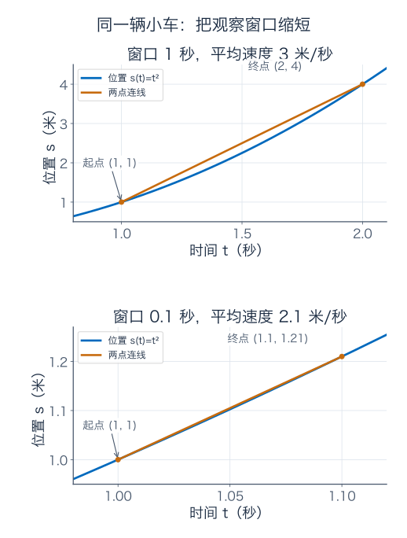
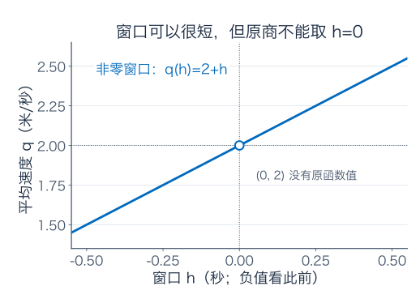
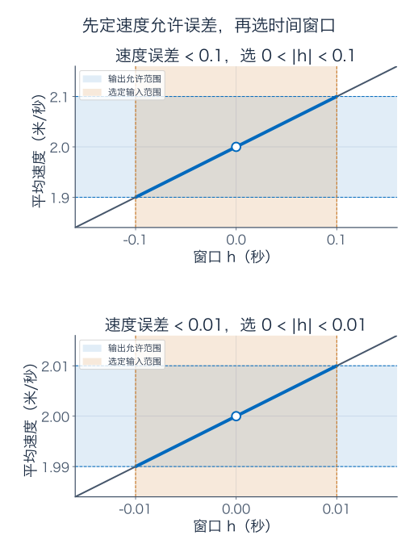
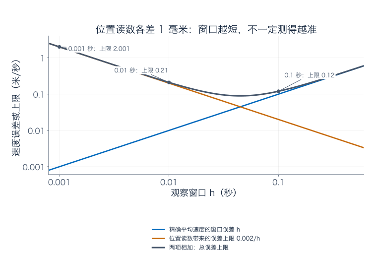
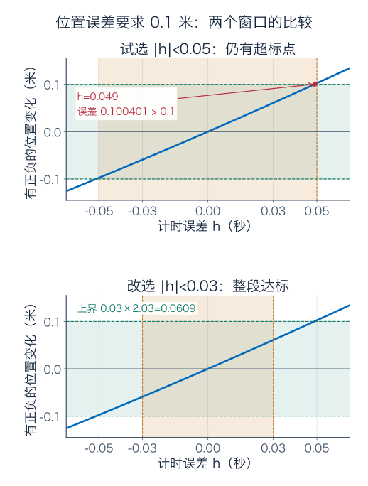
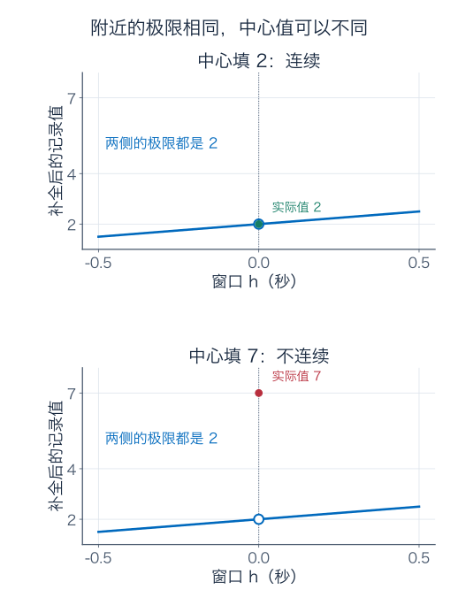
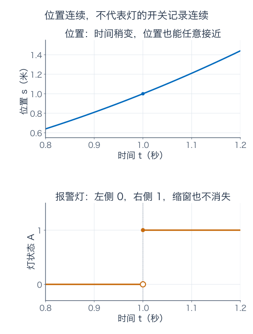
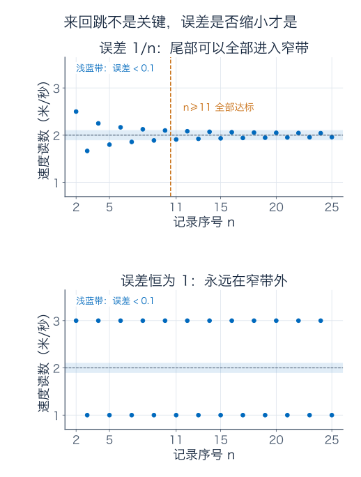
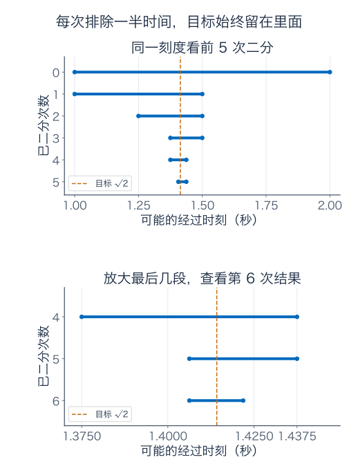
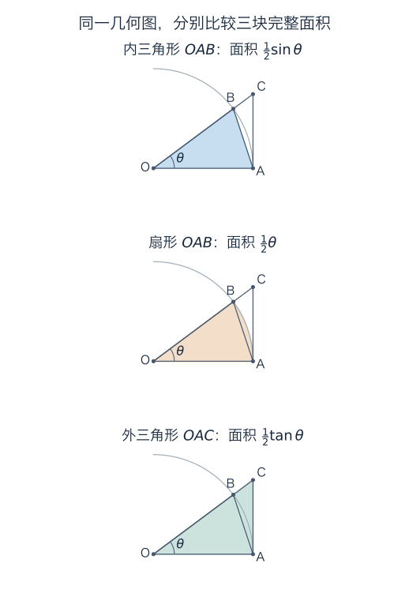

[数学总导航](../00-%E6%95%B0%E5%AD%A6%E5%AD%A6%E4%B9%A0%E5%AF%BC%E8%88%AA.md) · [本课程目录](00-%E5%AD%A6%E4%B9%A0%E8%B7%AF%E7%BA%BF%E4%B8%8E%E7%AC%A6%E5%8F%B7.md) · [← 上一章](00-%E5%AD%A6%E4%B9%A0%E8%B7%AF%E7%BA%BF%E4%B8%8E%E7%AC%A6%E5%8F%B7.md) · [下一章 →](02-%E5%AF%BC%E6%95%B0%E4%B8%8E%E5%B1%80%E9%83%A8%E7%BA%BF%E6%80%A7%E8%BF%91%E4%BC%BC.md)

## 先看一辆小车，不急着背定义

你拿手机拍一辆沿直轨前进的小车。视频告诉你：第 1 秒，它离起点 1 米；第 2 秒，它离起点 4 米。

这段时间走了 $4-1=3$ 米，用时 $2-1=1$ 秒，所以这一秒的**平均速度**是 3 米/秒。这个计算没有困难。

但如果有人问：“**就在第 1 秒那个瞬间，它有多快？**”3 米/秒还能直接拿来回答吗？

不能。小车可能在这一秒内越来越快。把整段路程平均分给整段时间，掩盖了这段时间内部的变化。就像你一趟通勤平均时速 30 公里，不能据此说过每一个路口时都开了 30 公里/小时。

我们先给这辆小车设定一条简单、精确的位置规则：

$$
s(t)=t^2,\qquad t\ge0.
$$

这里 $t$ 是以秒为单位的时间数值，$s(t)$ 是以米为单位的位置数值。例如 $s(1.5)=1.5^2=2.25$，意思是 1.5 秒时它在 2.25 米处。这个式子是本章给定的理想运动模型，不是从刚才两条读数推出来的；两条读数不足以确定整段运动。

这篇文章先解决三个问题：怎样把一段时间的平均速度，变成对某一刻速度的精确描述；怎样给近似结果一份可检查的误差保证；怎样保证反复逼近的过程有一个真正的终点。

只需要用到分数、平方和坐标图。后面出现的新符号，会在用到它们时解释。你可以先读到“连续”那部分，亲手完成前五题，再接着读找时刻和实数的部分。

不用一口气读完。第一回读第 1—3 节，自己算出“截得更短，平均速度怎样变”；第二回读第 4—7 节，学会为“差不多”标出误差，并看清补洞与跳变的区别；第三回再读数列和二分法，弄懂为什么不断逼近能找到一个确定的时刻。后面的补充材料可以留到下一章需要时再看。

## 1．把录像截短一点，会发生什么

既然一整秒太长，我们就少看一点：从第 1 秒看到第 1.5 秒。

起点位置还是 1 米，终点位置变成 $1.5^2=2.25$ 米。因此

$$
\text{平均速度}=\frac{2.25-1}{1.5-1}
=\frac{1.25}{0.5}=2.5\ \text{米/秒}.
$$

这个数比刚才的 3 小一些。再缩短呢？

| 观察的时间段（秒） | 走过的距离（米） | 用时（秒） | 平均速度（米/秒） |
| --- | --- | --- | --- |
| 1 到 2 | $4-1=3$ | 1 | 3 |
| 1 到 1.5 | $2.25-1=1.25$ | 0.5 | 2.5 |
| 1 到 1.1 | $1.21-1=0.21$ | 0.1 | 2.1 |
| 1 到 1.01 | $1.0201-1=0.0201$ | 0.01 | 2.01 |
| 1 到 1.001 | $1.002001-1=0.002001$ | 0.001 | 2.001 |

这些数似乎在靠近 2。先不要宣布答案。我们需要弄清楚，为什么会出现这个规律，而不是只相信表格的最后一行。

把观察时长记成 $h$。字母只是替我们省掉反复写 0.5、0.1、0.01 的麻烦。对应的平均速度是

$$
q(h)=\frac{s(1+h)-s(1)}{h}
=\frac{(1+h)^2-1}{h}.
$$

分子是这段时间的位置变化，分母是所用时间。展开平方：

$$
(1+h)^2-1=1+2h+h^2-1=2h+h^2=h(2+h).
$$

只要 $h\ne0$，分子分母就能约去一个 $h$，得到

$$
\boxed{q(h)=2+h\quad(h\ne0).}
$$

于是前面的数值都有了解释：观察 0.1 秒，平均速度是 $2+0.1=2.1$；观察 0.003 秒，就是 $2.003$。我们不必再一格一格算位置。

图的横轴是时间，纵轴是位置。连接两个时刻的位置点，直线的“上升量除以横向距离”正好就是平均速度。上图取 1 秒的窗口，下图取 0.1 秒的窗口；下图放大了坐标范围，方便看清两个点。两幅图坐标比例不同，**速度要读斜率的数值，不能比较线条在屏幕上的倾角**。

### 只看第 1 秒之后，会不会偏心

我们也可以看第 1 秒之前的一小段。例如从 0.9 秒到 1 秒：

$$
\frac{s(1)-s(0.9)}{1-0.9}
=\frac{1-0.81}{0.1}=1.9.
$$

刚才的公式也能包下这种情况。取 $h=-0.1$，有

$$
q(-0.1)=\frac{s(0.9)-s(1)}{-0.1}
=\frac{-0.19}{-0.1}=1.9.
$$

分子和分母都反过来，商没有变。这不是让小车倒着走，而是用同一个式子描述第 1 秒之前的区间。以后只看 $-1<h$，就不会用到模型之外的负时间。

从前面截 0.01 秒，平均速度为 1.99；截 0.001 秒，为 1.999。右边的估计从 2 的上方靠近，左边的估计从 2 的下方靠近。它们指向同一个数。

## 2．为什么不能干脆让这段时间等于零

很自然的想法是：“既然窗口越短越好，那就取 $h=0$。”

可原式会变成

$$
\frac{s(1)-s(1)}0=\frac00.
$$

零秒内走零米，这件事本身没有错；但它没有给出速度。匀速 2 米/秒、匀速 20 米/秒的车，在零秒内也都走零米。$0/0$ 无法替我们区分这些运动。

你也许会问，刚才不是已经约成 $2+h$ 了吗？往这里代零不就是 2？

这里要分清两个式子的适用范围。约去 $h$ 的前提是 $h\ne0$。因此，原来的 $q$ 与直线 $2+h$ 在所有**非零**的允许输入上相同，但原来的 $q(0)$ 没有定义。

图中的空心圆表示“这一点没有函数值”，圆的大小只是为了让人看见，并不表示附近挖掉了一整段。

我们真正要问的于是变成：**不代入零，只让非零的窗口足够短，能不能把所有对应的平均速度都压在 2 附近，而且想压多紧就能压多紧？**

这就是极限要解决的问题。它不负责给 $0/0$ 安一个值，而是给“附近的值究竟怎样”一个精确答案。

## 3．“足够接近”到底要多接近

假如你拿 2 米/秒当作第 1 秒的速度估计，别人要求：“用一小段时间测出的平均速度，和它相差必须小于 0.1 米/秒。”

先把误差算出来：

$$
|q(h)-2|=|(2+h)-2|=|h|.
$$

竖线表示绝对值。在这里它把“高估多少”和“低估多少”都变成非负的误差大小。例如 $h=-0.03$ 时，速度是 1.97，误差是 $|-0.03|=0.03$。

因此，速度误差小于 0.1 的要求，恰好等价于

$$
0<|h|<0.1.
$$

前面的 $0<$ 负责排除没有定义的零窗口；后面的不等式表示前后都可以，只要时间差的绝对值小于 0.1 秒。

如果对方改口，要误差小于 0.001 呢？把窗口限制为 $0<|h|<0.001$ 就行。要小于百万分之一呢？同样有对应的非零窗口。

关键不在于我们测过多少次，而在于有一条对**所有允许窗口**都有效的规则：

> 你先给出任意一个正的速度误差要求。我总能给出一个正的时间范围；只要窗口落在其中且不为零，误差就一定达标。

图里的横向浅蓝带是允许的速度范围，竖向浅橙带是我们选的时间窗口。每一小段被选中的图像都落在横带内。第二幅用了更严格的误差要求，所以两根坐标轴也跟着放大；请读刻度，不要只看色带的宽度。

这时才值得给结论起一个名字：

$$
\boxed{\lim_{h\to0}\frac{(1+h)^2-1}{h}=2.}
$$

读作：“当 $h$ 趋于零时，这个平均速度的极限是 2。”下一章会把位置变化率的这种极限叫作**导数**，并推广到其他时刻、其他运动。现在先把“趋于”弄懂就够了。

### 只查一张很漂亮的表，为什么仍然不够

表格里只用了 0.1、0.01、0.001。它没有替你检查 0.037、$\sqrt2/1000$ 或任何负窗口。

假设有人做了一份有毛病的计算程序：只要输入 $h=1/10^n$（$n=1,2,\ldots$），就输出 $2+h$；其余非零输入全部输出 3。你沿 0.1、0.01、0.001 测试，会得到和前面完全相同的表格；沿 $h=2/10^n$ 测试，得到的却永远是 3。

所以表格帮助我们**猜**极限，误差公式才帮助我们**证明**极限。我们的小车例子可靠，是因为 $|q(h)-2|=|h|$ 对所有允许的非零 $h$ 成立。

### 如果真拿手机测，录像是不是截得越短越好

先回答一个很实际的疑问，再继续往下。你可能已经想拿手机拍一段运动，照着表格测速度。但刚才的位置数值来自精确的数学规则；真实录像里，车头到底落在哪个像素、尺子能读到哪一格，都可能有误差。

我们只加一个小小的现实条件：**时间暂且视为准确，每次位置读数最多偏差 1 毫米。** 例如真实位置是 1 米，你可能读成 0.999 米，也可能读成 1.001 米。这是一份假设的误差保证，不是说某款手机实际就能达到这个精度。

测速要把两次位置相减。最不利时，终点多读 1 毫米，起点少读 1 毫米，算出的路程就会多 2 毫米。换成米是 0.002。若窗口长为 $h>0$ 秒，仅这两次读数偏差就可能让平均速度差到

$$
\frac{0.002}{h}\ \text{米/秒}.
$$

看看它和原来那个误差怎样一起变化：

| 窗口 $h$（秒） | 精确平均速度离 2 的误差（米/秒） | 位置读数带来的误差上限（米/秒） | 测速结果离 2 的误差上限（米/秒） |
| --- | --- | --- | --- |
| 0.1 | 0.1 | 0.02 | 0.12 |
| 0.01 | 0.01 | 0.2 | 0.21 |
| 0.001 | 0.001 | 2 | 2.001 |

第一列往下，窗口确实越来越短；但相同的 2 毫米，被越来越短的时间去除，影响反而越来越大。两种误差各自朝相反方向变化。

最后一列为什么能相加？先从“测出的速度”走到“精确平均速度”，再走到“瞬时速度 2”，总偏差不会超过两段偏差的大小之和。因此，按这里秒、米对应的数值，有

$$
\boxed{\text{测速结果离 2 的误差}\ \le\ h+\frac{0.002}{h},\qquad h>0.}
$$

这是上限，不代表每次测量都会错这么多。有时两次读数偏差还会互相抵消。

图中横、纵轴都按十倍的间距标刻度，方便把 0.001 秒和 0.1 秒放在一起看。橙线表示读数误差的影响，蓝线表示精确模型中的窗口误差，深色曲线是二者相加的保证。读数误差随窗口缩小而放大，所以深色曲线会先降后升；这里先不求最好的窗口，学会比较三行数值就够了。

这没有推翻 $q(h)\to2$。极限研究的是**精确函数值**算出的商；真实测量还要额外处理读数误差。学微积分时把这两层分开，才能既相信已经证明的结论，又不把现实中的不准硬说成“趋近得还不够”。题九会让你亲手造出一次这样的测速偏差；不影响后面主线，可以第二遍再做。

## 4．换一个任务：计时不准，位置会差多少

继续用同一辆小车。现在不估速度了，而是用时间读数计算位置。

你希望知道第 1 秒的位置，可时间读数有误差，实际用了 $1+h$。计算出来的位置是 $(1+h)^2$，真正想要的位置是 1。因此位置误差为

$$
|(1+h)^2-1|=|2h+h^2|=|h|\,|2+h|.
$$

和刚才相比，误差多了一个因子 $|2+h|$。所以不能照搬“输入差多少，输出就差多少”。

假设位置误差必须小于 0.1 米。我们试几个办法。

**第一次：让计时误差小于 0.1 秒。** 够不够？取一个确实在这个范围内的数 $h=0.09$，位置误差是

$$
2\times0.09+0.09^2=0.1881\ \text{米}.
$$

超标了。只说“输入已经很小”没有用，要看函数把它放大了多少。

**第二次：既然主要是乘 2，那把时间误差压到 0.05 秒以内。** 试 $h=0.049$：

$$
2\times0.049+0.049^2=0.100401\ \text{米}.
$$

还是稍微超标。问题就在被忽略的 $h^2$。它很小，却不是零，而误差保证要负责到底。

**第三次：干脆先把窗口压到 0.03 秒以内。** 当 $|h|<0.03$ 时，

$$
|h|\,|2+h|\le |h|(2+|h|)
<0.03\times2.03=0.0609<0.1.
$$

这回保证了。中间的不等式说的是：不管 $h$ 正负，$2+h$ 的绝对值都不会超过 $2+|h|$。

两幅图使用同样的坐标刻度。蓝曲线是**有正负的位置变化** $2h+h^2$，横向绿色带是允许范围 $(-0.1,0.1)$。上图标出的 $h=0.049$ 在竖带内，输出却跑出了横带；下图的整段曲线都留在横带里。

### 不想每次重试，能不能给一个通用办法

刚才我们是为 0.1 米量身挑了 0.03 秒。要把误差改成 0.0001 米，总不能一直猜。

难点是 $|h|\,|2+h|$ 里的两项都在变。一个省事的办法是：**先给第二项定一个宽松上限，再专心控制第一项。**

只要先要求 $|h|<1$，就有

$$
|2+h|\le2+|h|<3,
$$

于是位置误差小于 $3|h|$。假如允许的位置误差叫 $\varepsilon$，让 $|h|<\varepsilon/3$ 就够了。

但别忘了，刚才的上限 3 还依赖 $|h|<1$。两个条件必须同时满足。所以选

$$
\boxed{\delta=\min\left(1,\frac{\varepsilon}{3}\right).}
$$

$\min$ 表示取两者中较小的数。$\delta$ 读作 delta，是允许的输入误差半径；$\varepsilon$ 读作 epsilon，是要求的输出误差半径。它们只是两个有不同职责的字母。

现在完整检查一遍：给定任意 $\varepsilon>0$，上面的 $\delta$ 一定也大于零。只要 $|h|<\delta$，一方面 $|h|<1$，另一方面 $|h|<\varepsilon/3$，所以

$$
|(1+h)^2-1|=|h|\,|2+h|<3|h|<\varepsilon.
$$

这就是一份能对付任意精度要求的证明。

这里所有公式都在使用“秒、米”对应的数值；时间容差和位置容差的单位不同。取 $\varepsilon=0.1$，得到的是位置允许差 0.1 米、时间只许差 $1/30$ 秒。

你可能嫌 $1/30$ 秒太保守。没关系，我们要找的是**能保证达标的窗口**，没有要求找最大的那个。写极限证明时，常常宁可用一个容易核实的安全范围，也不必先解决另一个更难的“最优范围”问题。

> 停一下，自己检查：如果位置误差要求是 0.006 米，我们的方法给多大的时间范围？答案是 $\delta=0.002$ 秒。验证理由是 $3|h|<3\times0.002=0.006$，而不是“看起来已经很小”。

## 5．现在再看定义，里面没有突然冒出来的东西

把刚才的过程从小车推广到任意函数：输入 $x$ 靠近某个位置 $a$ 时，输出 $f(x)$ 靠近某个数 $L$。我们写

$$
\lim_{x\to a}f(x)=L.
$$

它的精确定义是：对每个 $\varepsilon>0$，都能找到一个 $\delta>0$，使函数定义域里所有满足 $0<|x-a|<\delta$ 的 $x$，都有 $|f(x)-L|<\varepsilon$。

把“对每个”缩写成 $\forall$，“能找到”缩写成 $\exists$，就是

$$
\forall\varepsilon>0,\quad\exists\delta>0,\quad
0<|x-a|<\delta\ \Longrightarrow\ |f(x)-L|<\varepsilon.
$$

这里 $x$ 只在定义域中取；还要求 $a$ 附近有任意近的其他定义域点，否则根本没有“靠近”的过程可讨论。本章通常看 $a$ 两边都有输入的情况。若模型只允许从一边靠近，要明确写单侧极限。

请沿着刚才做事的顺序读它：

1. 对方先指定输出要多准，也就是 $\varepsilon$。
2. 我据此选一个输入范围，也就是 $\delta$。
3. 选定以后，范围里每一个允许的非中心输入都要达标。

$\delta$ 可以依赖 $\varepsilon$，也可以依赖正在讨论的函数和位置 $a$；但不能对范围里某个不听话的 $x$ 临时换一个 $\delta$。承诺的是一整段范围。

两个例子的区别也清楚了：平均速度 $q(h)$ 的误差是 $|h|$，可以取 $\delta=\varepsilon$；位置函数在第 1 秒的误差是 $|h|\,|2+h|$，我们取 $\delta=\min(1,\varepsilon/3)$。**定义一样，找范围的计算随函数而变。**

如果你暂时记不住符号，先记住那份承诺就够了。看到极限题时，先找“输出误差能被什么控制”，比盯着 $\forall\exists$ 发愁更有用。

## 6．附近都指向 2，正中间就一定填 2 吗

回到平均速度图像的那个洞。我们做两份人为补全的记录：

$$
Q_2(h)=\begin{cases}2+h,&h\ne0,\\2,&h=0,\end{cases}
\qquad
Q_7(h)=\begin{cases}2+h,&h\ne0,\\7,&h=0.\end{cases}
$$

它们在每一个非零窗口上都相同，所以当 $h\to0$ 时，它们的极限也都等于 2。极限定义特意排除了中心点，因此把中心点填成 7，不能改变附近输入的表现。

不过，填成 7 的图显然多了一个孤零零的点。它说：“附近的输出都接近 2，偏偏正中间输出 7。”如果这是一份仪器校准表，你会怀疑这一条记录有问题。

我们需要一个更强的要求：**中心点确实有值，而且附近输入的输出要靠近这个实际值。** 这就是在该点**连续**。

用公式写，$f$ 在 $a$ 连续意味着

$$
\boxed{\lim_{x\to a}f(x)=f(a).}
$$

因此 $Q_2$ 在零连续，$Q_7$ 在零不连续。原来的 $q$ 则连 $q(0)$ 都没有定义，不能说它在零连续；我们可以给它补上 2，使补全后的函数连续。

### 连续和日常的“读数稳定”有什么关系

对小车位置 $s(t)=t^2$，我们前面证明了：在第 1 秒附近，时间读数误差足够小，位置计算误差就可以小到任意指定的程度。这正是 $s$ 在 1 连续的含义，因为它在 1 的实际值就是 1。

把极限定义里的 $L$ 换成 $f(a)$，连续的误差说法就是：对每个 $\varepsilon>0$，有 $\delta>0$，使

$$
|x-a|<\delta\quad\Longrightarrow\quad|f(x)-f(a)|<\varepsilon.
$$

这里不用排除 $x=a$，因为此时输出误差等于零，自动达标。

连续并不要求“变化很慢”。例如数值关系 $F(t)=1000t$ 在零附近，输入变 0.001，输出就变 1；但若只许输出误差小于 0.01，把输入压到 $0.00001$ 以内仍能保证。因此它连续，只是需要更精细的输入。连续关心的是**能否通过缩小输入误差来满足任意输出精度**，没有给所有函数统一规定“多小算小”。

## 7．同一辆车，位置连续，报警灯却可以跳变

在轨道的 1 米处装一个理想传感器。小车没到 1 米，灯记作 0；到达或超过 1 米，灯记作 1。对我们的运动模型，灯的记录是

$$
A(t)=\begin{cases}0,&0\le t<1,\\1,&t\ge1.\end{cases}
$$

位置没有瞬移，但灯只有开、关两个状态：0.999 秒时是 0，1.001 秒时是 1。把窗口换成 0.999999 秒到 1.000001 秒，两边仍差 1。

这次不能像洞那样靠填一个值修好。无论把 $A(1)$ 改成 0、1 还是 0.5，都无法改变左边恒为 0、右边恒为 1 的事实。

从左侧靠近，输出极限是 0；从右侧靠近，输出极限是 1。两个方向没有共同答案，因此 $t\to1$ 的双侧极限不存在。

也可以直接用误差带判断：若有共同极限 $L$，取允许误差 $\varepsilon=0.4$。无论时间窗口多窄，里面都同时有输出 0 和 1。如果二者都离 $L$ 小于 0.4，它们之间的距离就会小于 $0.4+0.4=0.8$；可实际距离是 1，矛盾。

这里用到一个很朴素的事实：从 0 绕道走到 $L$ 再走到 1，总距离不会比直接从 0 到 1 更短。这叫**三角不等式**，公式是 $|u-v|\le|u-w|+|w-v|$。

这也解释了为什么一个极限不可能同时等于两个不同的数：两数有正距离，足够窄的误差带不可能同时容纳同一批输出。若距离为 $d$，把两边允许误差都取 $d/3$，就会得到 $d<2d/3$ 的矛盾。

所以看到图上的断开，要先问是哪一种：是附近本来就有统一的目标，只在中心点漏填、错填了；还是两侧本来就冲着不同的目标？前者可以补洞，后者改一个点没有用。

现实灯具还有采样频率、延迟等问题，这里把它简化成瞬间切换的二值记录。这个例子要说明的是：**同一个物理过程，选择不同的输出方式，得到的函数可以有不同的连续性。**

## 8．如果只能一帧一帧地取样

刚才讨论的是一整个时间范围。实际整理数据时，我们通常按顺序记录一串结果。比如依次选窗口 $h_n=1/n$ 秒，第 $n$ 个平均速度就是

$$
a_n=q(1/n)=2+\frac1n,\qquad n=1,2,3,\ldots
$$

下标 $n$ 只标明第几个结果。这种按正整数排队的数叫**数列**。头几项是 3、2.5、$2.333\ldots$、2.25……注意这次窗口是 1、$1/2$、$1/3$，不是每次缩小十倍。

如果仍要求速度误差小于 0.01，哪一项起能保证后面全部合格？

$$
|a_n-2|=\frac1n<0.01
\quad\Longleftrightarrow\quad n>100.
$$

答案是从第 **101** 项起。第 100 项误差恰好等于 0.01，没有满足“严格小于”。而 $n$ 越大，$1/n$ 越小，所以 101 项之后不会再次超标。

把 0.01 换成任意正误差 $\varepsilon$，需要 $n>1/\varepsilon$。取

$$
N=\left\lfloor\frac1\varepsilon\right\rfloor+1
$$

就可以。$\lfloor r\rfloor$ 表示不超过 $r$ 的最大整数，例如 $\lfloor3.7\rfloor=3$。先向下取整再加一，保证选出的整数**严格大于** $1/\varepsilon$，即使后者本来就是整数也成立。

这给出数列收敛的定义：

$$
\boxed{a_n\to L\quad\text{表示}\quad
\forall\varepsilon>0,\ \exists N\in\mathbb N,
\ \forall n\ge N,\quad |a_n-L|<\varepsilon.}
$$

这里 $\mathbb N=\{1,2,3,\ldots\}$。和函数极限相比，“输入落在足够近的范围里”，换成了“序号排到足够后面”。同样要负责整个尾部，而不只是挑出偶尔很准的几项。

### 靠近目标，可以左右摇摆

如果窗口改成 $h_n=(-1)^n/n$（从 $n=2$ 起取样即可），速度记录就变成

$$
b_n=2+\frac{(-1)^n}{n}.
$$

偶数项高于 2，奇数项低于 2；误差却始终是 $1/n$，因此同一份 $N$ 规则仍然适用。收敛不要求每一步都从同一侧靠近。

反过来，一串读数 1、3、1、3、……并不因为“上下都有”就趋于中间的 2。它的误差一直是 1。偶尔接近、在目标两边、变化看起来有规律，都不能代替整段尾部达标。

函数极限成立时，沿任何趋向中心点、且不取中心点的输入数列取样，输出都会趋向同一个极限：给定误差后，先由函数极限得到一个输入范围，再由输入数列的收敛保证后面全进这个范围。两份保证接起来，输出尾部就全部达标了。

但只检查一条输入数列还不够，这正是前面那个有毛病的程序能蒙混过关的原因。

## 9．小车什么时候经过 2 米：不用先知道答案也能逼近

我们已经知道每个时刻的位置，现在反过来问：**它什么时候经过 2 米处？**

也就是找一个 $c$，使 $c^2=2$。你可能会立即说“$\sqrt2$ 秒”。这个写法当然正确，但只给答案起了名字；如果要设置一个定时器，仍然需要知道具体该设多少。

先别用计算器的开方键。第 1 秒在 1 米处，第 2 秒在 4 米处，目标时刻应该夹在 1 和 2 之间。检查正中间的 1.5 秒：

$$
1.5^2=2.25>2.
$$

这时已经过了 2 米，因此把晚于 1.5 秒的那半段排除。再检查剩下时间段的中点 1.25：

$$
1.25^2=1.5625<2.
$$

这时还没到，所以保留 $[1.25,1.5]$。每次都只检查一个中点，留下仍夹着“没到”和“已过”的半段。

| 已完成的二分次数 | 当前保留的时间区间（秒） | 当前区间长度（秒） | 当前中点估计（秒） |
| --- | --- | --- | --- |
| 0 | $[1,2]$ | 1 | 1.5 |
| 1 | $[1,1.5]$ | 0.5 | 1.25 |
| 2 | $[1.25,1.5]$ | 0.25 | 1.375 |
| 3 | $[1.375,1.5]$ | 0.125 | 1.4375 |
| 4 | $[1.375,1.4375]$ | 0.0625 | 1.40625 |
| 5 | $[1.40625,1.4375]$ | 0.03125 | 1.421875 |

注意：表格的“当前中点”是**下一次要检查的点**。例如最后一行的 1.421875 还没有用于更新这一行的区间。把两种时刻混在一列，是二分法计算中很容易犯的小错。

这个方法叫**二分法**。它特别实用的一点是：不必先知道精确答案，就能给近似值标明可信范围。

起始区间长度是 1，完成 $n$ 次二分后，长度是 $1/2^n$。如果用当前区间中点作估计，离区间内任何一点都不超过半个区间，所以对真正的目标时刻，误差不超过

$$
\frac1{2^{n+1}}\ \text{秒}.
$$

例如二分 9 次，误差不超过 $1/1024\approx0.0009766$ 秒，小于 0.001 秒。这里保证的是**时间误差**，不是位置误差；若要位置也精确，还要把时间误差代回位置模型。

不过，我们刚才偷偷用了一个重要判断：“一直缩小的夹缝里，确实有那个经过 2 米的时刻。”把程序无限运行下去，为什么不会夹到一个没有数字可填的洞？这就轮到本章标题里的“实数”出场了。

## 10．为什么要有小数写不完的数

整数能数完整的个数，分数能精确表达等分后的数量。有理数就是能写成 $p/q$ 的数，其中 $p,q$ 是整数且 $q\ne0$。例如 1.414 是有理数，因为它等于 $1414/1000$。

可是 $c^2=2$ 没有正的有理数解。这个结论可以很短地证明，但每一步都有必要。

假设 $c=p/q$，而且已经约成最简分数。由 $p^2=2q^2$ 可知 $p^2$ 是偶数。如果 $p$ 是奇数，写成 $2k+1$，平方就是 $4k^2+4k+1$，仍是奇数；因此 $p$ 只能是偶数。写 $p=2k$，代回去得到

$$
4k^2=2q^2\quad\Longrightarrow\quad q^2=2k^2.
$$

同理 $q$ 也为偶数。这说明 $p,q$ 至少有公因数 2，与“已经最简”矛盾。所以这样的分数不存在。

但我们的时间夹缝可以继续变小。下面换用十进制网格观察同一个目标：

$$
\begin{aligned}
1.4^2&=1.96<2<2.25=1.5^2,\\
1.41^2&=1.9881<2<2.0164=1.42^2,\\
1.414^2&=1.999396<2<2.002225=1.415^2.
\end{aligned}
$$

每个端点都是有理数，而目标不等于任何一个分数。我们需要一种数系，能让这种不断精细、相互兼容的定位真正落到一个点上。**实数**就是我们通常用来填满整条数轴的数，其中既有有理数，也有 $\sqrt2$ 这样的无理数。

“填满”不是说测量仪器能显示无穷多位；它说的是数学模型允许这个精确位置存在。实际可以用 1.414 近似它，同时给误差范围。近似值有限、目标精确，两者不冲突。

### “数轴没有洞”怎样成为可用的保证

我们采用实数的一条基础性质：**一串闭区间逐层套住，每个都非空，长度又趋于零，那么恰有一个实数同时在所有区间里。** 这叫闭区间套性质，是实数**完备性**的一种等价说法。

闭区间 $[u,v]$ 包含两个端点；开区间 $(u,v)$ 不包含端点。“逐层套住”指下一段完全包含在上一段里。每个条件都在做事：例如开区间 $(0,1/n)$ 长度趋零，却没有一个数同时属于所有这些区间，因为唯一可能的 0 被排除了。

为什么只能有一个公共点？若有两个不同点，距离为 $d>0$；当某个区间长度已经小于 $d$ 时，它就不可能同时装下二者。**唯一性**可以这样直接看懂；**存在性**则是实数系统的基础保证，不能仅凭“图上看起来还有一个点”代替它。

在二分法中，保留的区间闭合、非空、逐层套住，长度趋零，所以有公共点 $c$。每段的左端 $l_n$ 与右端 $r_n$ 都离 $c$ 不超过区间长度，于是都趋于 $c$。

还差最后一步：怎么确定 $c^2$ 真等于 2？我们一直有

$$
l_n^2<2<r_n^2.
$$

所有点都在 $[1,2]$，所以

$$
|l_n^2-c^2|=|l_n-c|\,|l_n+c|\le4|l_n-c|\to0,
$$

右端同理。两边的平方都能靠近 $c^2$，而 2 始终夹在中间，因此 $c^2$ 只能等于 2。如果 $c^2$ 大于 2，靠近到误差小于差距的一半时，左端平方也会大于 2，矛盾；小于 2 的情况同理。

到这里，“$\sqrt2$ 是什么”才真正接上了我们的计算：它是那个被所有时间区间锁住、平方为 2 的正实数。二分得到的是它的有理近似，不是每次创造一个新目标。

### 为什么这也保证不会漏过其他位置

对于一个在闭区间 $[a,b]$ 上连续的函数 $f$，若某个目标值 $y$ 夹在 $f(a)$ 与 $f(b)$ 之间，它就会在区间中某一点取到 $y$。这叫**介值定理**。

理由仍是刚才的程序。若端点已经等于目标，立即找到；否则取中点，若也不等于目标，就保留两端输出分居目标两侧的半段。区间套给出公共点 $c$，连续性保证两列端点的输出都趋于 $f(c)$，于是夹在中间的 $y$ 就等于 $f(c)$。函数不必单调，才能使用这份存在保证；不过也就不保证只经过一次。

这解释了我们为什么能放心寻找小车经过 2 米的时刻。这里它还恰好只经过一次，因为非负时间上，$t_2>t_1$ 时有

$$
t_2^2-t_1^2=(t_2-t_1)(t_2+t_1)>0,
$$

位置严格递增。存在性来自连续与实数完备性，唯一性另有理由。

报警灯则把这份保证的边界照得很清楚：灯从 0 跳到 1，并没有经过 0.5。它不连续，不能拿介值定理保证中间的输出都出现。

## 11．读到这里，可以先停下来

回看最初的问题：一段时间的平均速度不是一个瞬间的速度；把非零窗口缩小，得到的平均速度是 $2+h$；它离 2 的误差正好等于 $|h|$，所以不管要求多准，总能给出保证。这让“第 1 秒速度为 2 米/秒”有了精确含义。

同样的误差思路也让我们能检查时间读数、分清连续位置和跳变灯光、为二分算出的近似时刻标上误差。几个术语都在回答这些具体问题。

先做下面练习会比继续记新名词更有帮助。后面两段补充材料分别供第 3 章的最值定理、第 2 章的正弦求导使用；第一次阅读可以等相关章节需要它们时再回来。Cauchy 数列、紧性和一致连续留到[泛函分析的距离与紧性](../泛函分析/02-距离、开闭集与紧性.md)、[Banach 空间](../泛函分析/04-Banach%20空间与压缩映射.md)结合相应问题学习，这里先不把它们全压进第一课。

## 练习：用刚才实际做过的办法

所有题目列在前面，完整答案统一放在后面。先把算式写出来，再对答案；答案中的推理也属于课程正文。

**题一：从第 2 秒看小车。** 仍取 $s(t)=t^2$。计算从 2 秒到 2.1 秒的平均速度，再算从 1.9 秒到 2 秒的平均速度。用一个含 $h$ 的式子同时解释两次计算，并找出 $h\to0$ 时的极限。不要先用求导公式。

**题二：已经进了误差范围吗？** 对本章第 1 秒的平均速度 $q(h)=2+h$，要求误差严格小于 0.02 米/秒。判断 $h=0.02,-0.019,0$ 是否允许，说明每一个理由。如果改用每次窗口减半的方案 $h_n=2^{-n}$、$n=1,2,\ldots$，从第几项开始全部达标？

**题三：多一个平方项，保证怎么写？** 对位置函数 $s(t)=t^2$ 在 $t=2$ 附近，要求位置误差小于 $\varepsilon$。先写出误差公式，再仿照正文“先控制一个因子”的办法，找一条适用于所有 $\varepsilon>0$ 的输入范围规则。最后代入 $\varepsilon=0.01$，给出一个足够的计时精度。

**题四：改一个点能修好吗？** 定义 $R(h)=2+h$（$h\ne0$），$R(0)=9$。求它在零的极限，并判断它在零是否连续。怎样只改一个值让它连续？为什么同样的办法修不好正文在 $t=1$ 跳变的报警灯？

**题五：上下跳，就一定不收敛吗？** 对 $u_n=2+(-1)^n/n$，找出速度误差严格小于 0.05 的第一个永久达标序号，并说明它是否收敛。对 $v_n=2+(-1)^n/10$，说明它是否收敛；不能仅凭“有振荡”作判断。

**题六：亲手再二分一次。** 正文已经完成 5 次二分，区间为 $[1.40625,1.4375]$。检查它的中点，写出第 6 次之后保留的区间、中点近似及时间误差上限。如果一开始从 $[1,2]$ 出发，希望中点近似的误差严格小于 0.0001 秒，我们给出的区间长度保证至少需要二分几次？

**题七：显示“已经到达”，和真正到达是一回事吗？** 某位置显示器按最接近的百分之一米显示，恰逢半格时向上取整。在 $t=1.001$ 秒，屏幕显示什么？能否根据屏幕显示断言位置恰好等于 1 米？这种显示是否在所有时刻都连续？给出你判断的具体依据。

**题八：只准用分数当时刻，会缺少什么？** 解释为什么二分法每一步的端点和中点都是有理数，但最终目标时刻不一定是有理数。如果把数轴的允许点只保留为有理数，正文逐层套住 $\sqrt2$ 的闭区间是否还保证有公共的允许点？又为什么“实数区间套性质”必须保留“闭”这个条件？

**题九：更短的一段录像，为什么可能测出更离谱的速度？** 仍取 $s(t)=t^2$，每次位置读数最多偏差 0.001 米，时间准确。从第 1 秒观察到第 1.001 秒：假设起点少读 0.001 米，终点多读 0.001 米，分别写出两个读数，计算测出的平均速度。它离瞬时速度 2 米/秒差多少？再比较窗口 0.1 秒和 0.01 秒各自的总误差上限。这里的计算是否说明“窗口越短，实际误差每一次都必定越大”？

### 参考答案与解题过程

#### 题一解答

从 2 到 2.1 秒，位置由 4 变为 4.41 米，平均速度为 $(4.41-4)/0.1=4.1$ 米/秒。从 1.9 到 2 秒，位置由 3.61 变为 4 米，平均速度为 $(4-3.61)/0.1=3.9$ 米/秒。

统一写为

$$
\frac{s(2+h)-s(2)}h
=\frac{(2+h)^2-4}h
=\frac{4h+h^2}h=4+h\quad(h\ne0).
$$

$h=0.1$ 给出 4.1，$h=-0.1$ 给出 3.9。其与 4 的误差是 $|h|$，所以任给 $\varepsilon>0$，取 $\delta=\varepsilon$，所有允许的 $0<|h|<\delta$ 都有输出误差小于 $\varepsilon$。因此极限为 4。这是误差证明，没有预先使用平方函数的导数。

#### 题二解答

$h=0.02$ 不达标，因为误差恰好是 0.02，题目要求严格小于。$h=-0.019$ 达标，因为误差为 0.019，且对应时间 0.981 秒仍在模型内。$h=0$ 不允许，因为原来的平均速度商没有定义；不能因为补全直线在零有值，就把零当成原商的合法输入。

减半方案要满足 $2^{-n}<0.02=1/50$，也就是 $2^n>50$。$2^5=32<50$，$2^6=64>50$，所以从第 6 项开始，后面误差全部达标。

#### 题三解答

位置误差为

$$
|(2+h)^2-4|=|4h+h^2|=|h|\,|4+h|.
$$

先要求 $|h|<1$，这样 $|4+h|\le4+|h|<5$；再要求 $|h|<\varepsilon/5$。因此可取

$$
\delta=\min(1,\varepsilon/5).
$$

当 $|h|<\delta$ 时，位置误差小于 $5|h|<\varepsilon$。代入 $\varepsilon=0.01$，得到 $\delta=0.002$ 秒。也就是说，把计时误差绝对值严格限制在 0.002 秒内，就足以保证位置误差小于 0.01 米。这个选择足够可靠，并没有声称是最大允许范围。

#### 题四解答

非零处 $|R(h)-2|=|h|$，故 $\lim_{h\to0}R(h)=2$。但 $R(0)=9$，不等于极限，所以在零不连续。把 $R(0)$ 改成 2，中心值和附近极限接上，就连续了。

报警灯的左极限是 0，右极限是 1。改 $A(1)$ 不能改变任何 $t<1$ 或 $t>1$ 的值，故无法消除两边的差异。它缺少的不是一个恰当的中心值，而是共同的附近极限。

#### 题五解答

$|u_n-2|=1/n$，小于 $0.05=1/20$ 需要 $n>20$。所以从第 21 项起全部达标，第 20 项不符合严格不等号。对任意正误差，仍可取 $N=\lfloor1/\varepsilon\rfloor+1$，所以 $u_n\to2$。

$v_n$ 的偶数项恒为 2.1，奇数项恒为 1.9，二者相距 0.2。若它收敛到某个 $L$，取 $\varepsilon=0.09$，足够靠后的奇、偶两项都应离 $L$ 小于 0.09，因而彼此距离小于 0.18，与实际的 0.2 矛盾。所以它不收敛到任何数，不只是“不收敛到 2”。决定结论的是振幅有没有缩小到任意精度，不是有没有来回跳。

#### 题六解答

当前中点为 $(1.40625+1.4375)/2=1.421875$，平方为

$$
1.421875^2=2.021728515625>2.
$$

所以保留左半段 $[1.40625,1.421875]$，这才是完成 6 次二分后的区间。它的中点近似为 1.4140625 秒，区间长 0.015625 秒，误差不超过半个长度，即 0.0078125 秒。

严格小于 0.0001 的保证要求 $2^{-(n+1)}<0.0001$，等价于 $2^{n+1}>10000$。$2^{13}=8192$ 不够，$2^{14}=16384$ 足够，因此至少二分 13 次。这是这条通用误差上限给出的次数；某个较早的中点可能碰巧更准，但不能靠碰巧给保证。

#### 题七解答

真实位置为 $1.001^2=1.002001$ 米，按题设显示为 1.00 米。显示值与 1 米相同，不表示真实位置恰等于 1 米；这里只能说它落在对应的舍入区间 $[0.995,1.005)$ 米内。

显示函数并非处处连续。在 $t_0=\sqrt{1.005}$ 秒，真实位置刚好达到 1.005 米，显示由此前的 1.00 变为 1.01。由于位置在非负时间上严格递增，任何足够靠近 $t_0$ 的较早时刻，显示都还是 1.00，而 $t_0$ 时显示为 1.01。选输出误差要求 0.004 米，无论输入时间窗口多小，左侧都达不了标。因此在这一时刻不连续。连续的真实位置，经过舍入后可以变成跳变的数字记录。

#### 题八解答

起始端点 1、2 是有理数；两个有理数相加再除以 2，仍是有理数。因此每次新中点和保留的端点都为有理数。但“每一个近似都为有理数”不代表它们的极限也必须是有理数。

正文的区间在实数里唯一夹住的点是 $\sqrt2$。若只允许有理数，每个区间仍有有理端点、仍可继续二分，所有区间却没有共同的有理点，因为有理数里不存在平方等于 2 的数。这就是有理数缺少完备性的具体表现。

“闭”也不能删掉：实数里的 $(0,1/n)$ 都非空、逐层套住、长度趋零，却没有公共点。任何正数都会在足够靠后的某个区间之外，零又被排除。改成 $[0,1/n]$，才会共同留下 0。

#### 题九解答

真实起点位置为 $s(1)=1$ 米，少读 0.001 米，记录为 0.999 米。真实终点位置为

$$
s(1.001)=1.001^2=1.002001\ \text{米},
$$

多读 0.001 米，记录为 1.003001 米。因此测速结果是

$$
\frac{1.003001-0.999}{0.001}
=\frac{0.004001}{0.001}
=4.001\ \text{米/秒}.
$$

它离瞬时速度 2 的误差为 2.001 米/秒。拆开核对：精确平均速度其实是 $2+0.001=2.001$，离目标只差 0.001；两次读数使路程多了 0.002 米，除以 0.001 秒，又增加了 2 米/秒。因此这一次恰好达到 $0.001+0.002/0.001=2.001$ 的误差上限。

窗口为 0.1 秒时，上限为 $0.1+0.002/0.1=0.12$ 米/秒；窗口为 0.01 秒时，上限为 $0.01+0.002/0.01=0.21$ 米/秒。在这两个候选窗口之间，前者给出的最坏情况保证更小。

这没有说实际误差每次都会更大。若两次位置都恰好读准，测速误差仍然分别为 0.1、0.01、0.001，随窗口缩短而减小；若两次位置同向偏差相同，相减时也会抵消。我们说明的是：只凭“每次位置最多偏差 1 毫米”这份信息，不能承诺把时间窗口无限缩小就一定测得更准。

## 补充 A：为什么能谈“最高的一点”

这一段为第 3 章寻找最大、最小值作准备，第一次可以跳过。

小车在 $[0,2]$ 秒的位置最大值显然是 4 米，因为位置一直增加。但若换成一个忽高忽低的温度记录，虽然整段连续，最高点还一定真的出现吗？会不会只能越来越接近某个高度，却始终没有哪一刻达到？

先看一个会失败的情况：只观察小车的 $0<t<2$ 秒。位置能无限靠近 4 米，但始终小于 4；任取一个时刻，还能选一个更晚、位置更高的时刻。因此这段**不包含端点**的时间范围没有最大位置。把第 2 秒也允许进来，才实际达到 4 米。

一般结论是：**实值连续函数在闭的、有限长的时间区间 $[a,b]$ 上，有界，而且一定在某些时刻实际取得最大值和最小值。** 这叫闭区间上的最值定理。“闭”把可能的端点留下，“有界区间”不让候选时刻跑到无穷远，“连续”则把靠近的时刻与靠近的读数接起来。

下面分开解释为什么这三件事足够。

**先解决时刻乱跑的问题。** 假设你已经在 $[a,b]$ 中挑了无限多个候选时刻，它们的顺序可以乱。把区间对半分，至少一半含有无限多项；留下这一半，再对半分，仍留含有无限多项的一半。每一步选一个序号比上次更靠后的候选时刻。选出的时刻被越来越短的闭区间套住，因此趋于一个仍在 $[a,b]$ 内的点 $c$。这叫选出一个**收敛子列**：不用原来的每一项，只按原序挑其中一些项。

**再解决读数是否会无限大的问题。** 若读数绝对值没有上限，就能依次挑时刻 $t_n$，使 $|f(t_n)|>n$。按刚才的办法挑出趋于 $c$ 的一部分时刻。连续性又要求这部分读数趋于有限的 $f(c)$，不可能同时越来越大到超过任意上限。矛盾，说明读数有界。

**最后解决最大值是否真的取到。** 既然读数有界，就能谈所有读数的最小上界 $M$：它是“足以罩住所有读数”的上界中最低的一个。这也叫**上确界**；有上界的非空实数集合存在上确界，是完备性的另一种等价表述。

对每个 $n$，总能找到时刻 $t_n$ 使

$$
M-\frac1n<f(t_n)\le M.
$$

否则 $M-1/n$ 本身就能当上界，说明 $M$ 还不够低。再挑出趋于某个 $c$ 的一部分时刻。这些读数一方面被上式压向 $M$，另一方面由连续性趋向 $f(c)$，于是 $f(c)=M$。这个上界真的被某个时刻达到，才成为最大值。把读数全部取负，同样得到最小值。

这份论证只保证最高点存在，不负责告诉你它在哪。第 3 章的导数工具才会进一步帮助寻找候选点。

## 补充 B：小角度时，为什么能把正弦近似成角度

这一段是第 2 章三角函数求导要用的地基。它还展示一种新的误差控制办法：自己难算的量，可以夹在两个容易控制的量之间。

想象一根长 1 米、绕一端转动的杆。它从水平位置转过一个小角度 $\theta$，杆尖上升多少？按直角三角形，答案是 $\sin\theta$ 米。若想用更简单的 $\theta$ 米估计，什么时候合理？这里必须用**弧度**：角度的弧度数等于圆弧长度除以半径。半径为 1 时，弧长的数值就是 $\theta$；整圈为 $2\pi$。

取 $0<\theta<\pi/2$，在单位圆上标出圆心 $O$、起点 $A=(1,0)$ 和转动后的杆尖 $B=(\cos\theta,\sin\theta)$。再让射线 $OB$ 碰到过 $A$ 的竖直切线，交点记作 $C=(1,\tan\theta)$。

图把三块面积分开放，避免颜色重叠后看不清。它们实际上有包含关系：三角形 $OAB$ 在扇形里，扇形又在三角形 $OAC$ 里。

内三角形以长为 1 的 $OA$ 作底，高为 $\sin\theta$，面积为 $\sin\theta/2$；扇形占整圆的 $\theta/(2\pi)$，面积为 $\pi\cdot\theta/(2\pi)=\theta/2$；外三角形同底、高为 $\tan\theta$，面积为 $\tan\theta/2$。因此

$$
\sin\theta<\theta<\tan\theta
=\frac{\sin\theta}{\cos\theta}.
$$

这一区间的三角函数值为正，可以安全地乘除，整理得到

$$
\cos\theta<\frac{\sin\theta}{\theta}<1.
$$

我们想证明中间的比值接近 1，恰好可以把它的误差改写为

$$
0\le1-\frac{\sin\theta}{\theta}
\le1-\cos\theta
=2\sin^2(\theta/2)\le\frac{\theta^2}{2}.
$$

最后一步对半角使用刚才的 $\sin u\le u$。这样就不必预先借用正弦的导数，也不必凭图宣布余弦连续：中间比值的误差已经被明确压在 $\theta^2/2$ 以下。

例如转过 0.1 弧度（约 $5.73^\circ$），比值与 1 的误差不超过 0.005；也就是用角度数值代替正弦数值时，相对角度大小的误差不超过 $0.5\%$。要这个误差小于任给的 $\varepsilon>0$，只需再把 $|\theta|$ 压到 $\sqrt{2\varepsilon}$ 以内，并保持在上述小角度范围。

负角度也没问题，因为 $\sin(-\theta)/(-\theta)=\sin\theta/\theta$。于是两侧都得到

$$
\boxed{\lim_{\theta\to0}\frac{\sin\theta}{\theta}=1.}
$$

这种让误差被另一个趋零的量压住的办法叫**夹逼**。这里不是“把小量直接扔掉”，而是计算出你扔掉的东西最多有多大。

如果角度用“度数” $u$ 表示，对应弧度为 $\pi u/180$，所以 $\sin(u^\circ)/u$ 的极限是 $\pi/180$，并非 1。符号里省掉角度单位，会把一个正确结论变成错误结论。

## 伴读与接下来要做的事

下一章会沿着小车的问题继续：把目标时刻从 1 换成任意 $t$，把平方位置换成一般函数，怎样研究每一点附近的变化？那时再把今天已经理解的极限装进导数定义，会轻松得多。

- [3Blue1Brown：用输入窗口与输出范围理解极限](https://www.3blue1brown.com/lessons/epsilon-delta/)：可以对照动画理解误差带。这篇采用自己的小车数值、推导和图示组织讲解。
- [Jiří Lebl：介值定理与最值定理](https://www.jirka.org/ra/html/sec_minmaxint.html)：需要核对正式条件时查阅。第一次不必把书中所有证明一次读完。

---

[数学总导航](../00-%E6%95%B0%E5%AD%A6%E5%AD%A6%E4%B9%A0%E5%AF%BC%E8%88%AA.md) · [本课程目录](00-%E5%AD%A6%E4%B9%A0%E8%B7%AF%E7%BA%BF%E4%B8%8E%E7%AC%A6%E5%8F%B7.md) · [← 上一章](00-%E5%AD%A6%E4%B9%A0%E8%B7%AF%E7%BA%BF%E4%B8%8E%E7%AC%A6%E5%8F%B7.md) · [下一章 →](02-%E5%AF%BC%E6%95%B0%E4%B8%8E%E5%B1%80%E9%83%A8%E7%BA%BF%E6%80%A7%E8%BF%91%E4%BC%BC.md)
