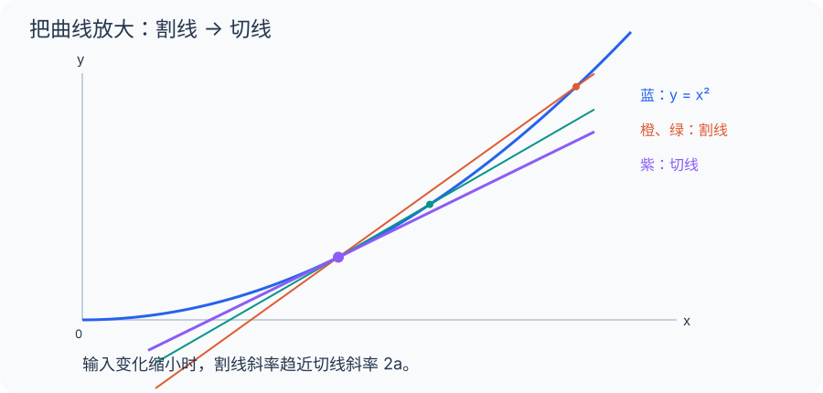

[数学总导航](../00-%E6%95%B0%E5%AD%A6%E5%AD%A6%E4%B9%A0%E5%AF%BC%E8%88%AA.md) · [本课程目录](00-%E5%AD%A6%E4%B9%A0%E8%B7%AF%E7%BA%BF%E4%B8%8E%E7%AC%A6%E5%8F%B7.md) · [← 上一章](01-%E5%AE%9E%E6%95%B0%E3%80%81%E6%9E%81%E9%99%90%E4%B8%8E%E8%BF%9E%E7%BB%AD.md) · [下一章 →](03-%E4%B8%AD%E5%80%BC%E5%AE%9A%E7%90%86%E3%80%81Taylor%20%E5%B1%95%E5%BC%80%E4%B8%8E%E4%BC%98%E5%8C%96.md)

## 区间测速和仪表盘，为什么不是一个读数？

你开车经过一段 2 公里的路，用时 2 分钟。区间平均速度是 60 km/h。但这不能说明你每一刻都开 60：你可能前半段快，后半段慢。

把模型缩小一点：一辆小车行驶 $t$ 秒后的位置为 $s(t)=t^2$ 米。第 2 秒到第 3 秒的平均速度是 $(9-4)/1=5$ 米/秒。第 2 秒到第 2.1 秒则是 $(4.41-4)/0.1=4.1$ 米/秒。

把观察窗口继续缩短，$[s(2+h)-s(2)]/h=4+h$ 会接近 4。于是“第 2 秒这一刻的速度”定义为 4 米/秒。导数就是这个读数；切线是在位置图上记录它的办法。

## 先算一秒，再算十分之一秒，最后才谈一瞬间

对位置 $s(t)=t^2$，从时刻 $t$ 到 $t+h$，小车走了

$$
\Delta s=(t+h)^2-t^2=2th+h^2.
$$

除以真正经过的时间 $h\ne0$，平均速度为 $2t+h$。这里没有把时间“直接变成零”，因为除以零本来就没有定义。我们做的是：对越来越小但非零的 $h$，观察平均速度越来越接近哪个数。

在 $t=2$ 时，可列出一张自己能核算的表：

| 时间窗口 $h$（秒） | 平均速度（米/秒） |
| --- | --- |
| 1 | 5 |
| 0.1 | 4.1 |
| 0.01 | 4.01 |
| $-0.01$ | 3.99 |

负的 $h$ 表示往过去看一小段。两侧都靠近 4，因此导数取 4。它不是“某个无限小时间里的商”，而是一串合法平均值的极限。

## 同一个计算，为什么还能解释切线

在位置—时间图上，连接 $(t,s(t))$ 与 $(t+h,s(t+h))$，直线斜率正是刚才的平均速度。第二点靠近第一点时，直线趋向局部的切线。于是“速度”和“斜率”不是两个碰巧共用公式的定义，而是同一个差商的物理与几何解释。

但切线不意味着曲线在一段范围内真的变直。对 $t=2$，

$$
s(2+h)=4+4h+h^2.
$$

线性预测是 $4+4h$，真实误差是 $h^2$。当 $h=0.1$，位置误差为 0.01 米；当 $h=0.01$，误差为 0.0001 米。缩短十倍窗口，线性近似的误差缩小一百倍。这正是它有用的原因。

## 乘积法则可以从一块桌面长出来

长方形边长是 $u,v$，分别增加 $\Delta u,\Delta v$。面积新增三部分：一条 $v\Delta u$ 的长条、一条 $u\Delta v$ 的长条，以及角落的 $\Delta u\Delta v$ 小块。

若两边都随时间变化，且 $\Delta u=u'h+o(h)$、$\Delta v=v'h+o(h)$，除以时间 $h$ 后，角落小块的贡献趋零，另外两条留下 $vu'+uv'$。所以 $(uv)'=u'v+uv'$。

这里可以看出一个普遍规则：一阶近似保留“一个小量”，丢掉“两个小量相乘”所产生的更高阶余项。不是因为它们等于零，而是因为除以 $h$ 后它们的贡献趋零。

## 链式法则是一串比例尺

烤箱功率旋钮 $x$ 先影响温度 $T=g(x)$，温度再影响某个反应速度 $r=f(T)$。旋钮变一点 $\Delta x$，温度约变 $g'(x)\Delta x$；反应速度再约变 $f'(T)g'(x)\Delta x$。

两段放大率相乘，便得到链式法则。数值例：在工作点，旋钮每单位让温度升 5°C，温度每升 1°C 让反应速度增 2 个单位，那么旋钮每单位的局部影响就是 10 个单位。只有当两段近似都在同一工作点附近成立，这个估计才可靠。

## 为什么尖角没有导数

对 $f(x)=|x|$，零点右边的差商为 1，左边为 $-1$。它们各自稳定，却没有共同读数。因此问题不在函数值是否连续，而在有没有一条能够同时解释两边变化的局部直线。下面的正式定义会把“同时解释所有足够小的变化”写为一个极限。

## 带你做：气球半径增长，体积会怎样增长

一个理想球形气球的半径 $r$ 以每秒 0.2 厘米增长。半径恰为 5 厘米时，体积每秒增加多少？先分清三个量：时间 $t$、半径 $r(t)$、体积 $V(r)=4\pi r^3/3$。

对半径求导得 $dV/dr=4\pi r^2$，对时间则要再乘 $dr/dt$：

$$
\frac{dV}{dt}=4\pi r^2\frac{dr}{dt}
=4\pi\times25\times0.2=20\pi\text{ 立方厘米/秒}.
$$

你也可以从薄壳理解：半径增加一小段，相当于表面外面长出一层很薄的体积，约为表面积乘厚度。单位核对是平方厘米乘厘米/秒，正好得到立方厘米/秒。

不要把结果写成半径的增长速度 0.2，也不要只算 $4\pi r^2$ 就停：前者漏掉形状，后者还没把半径变化换成时间变化。链式法则让每一步的输入输出接口都对齐。

## 回头整理：定义、工具与练习

### 导数衡量什么

位置为 $s(t)$ 时，平均速度是 $[s(t+h)-s(t)]/h$。若 $h\to0$ 时极限存在，就定义为瞬时速度 $s'(t)$。

更有用的等价形式是

$$
f(a+h)=f(a)+f'(a)h+o(h),
\qquad \frac{o(h)}{h}\to0.
$$

导数把弯曲的函数在一点附近替换为线性函数。$o(h)$ 不是固定函数名，而是“比 $h$ 更小一阶”的余项记号。

例：$\sqrt{1+h}=1+\tfrac12h+o(h)$，因此 $\sqrt{1.02}\approx1.01$。这是一阶近似；若要保证小数位，需要进一步估计余项。

### 从定义推导一个法则

乘积差可以拆成

$$
f(a+h)g(a+h)-f(a)g(a)
=[f(a+h)-f(a)]g(a+h)+f(a)[g(a+h)-g(a)].
$$

除以 $h$ 后取极限，利用可导蕴含连续，得到 $(fg)'=f'g+fg'$。求导法则不是凭记忆拼装，而是误差的组织方式。

### 常用导数

| 函数 | 导数 | 约束 |
| --- | --- | --- |
| $x^r$ | $rx^{r-1}$ | 任意实数 $r$ 时先取 $x>0$ |
| $e^x$ | $e^x$ | 全实轴 |
| $\log x$ | $1/x$ | $x>0$，此处为自然对数 |
| $\sin x$ | $\cos x$ | 弧度制 |
| $\cos x$ | $-\sin x$ | 弧度制 |
| $1/f$ | $-f'/f^2$ | $f\ne0$ |

### 链式法则

若 $g$ 在 $a$ 可导、$f$ 在 $g(a)$ 可导，则

$$
(f\circ g)'(a)=f'(g(a))g'(a).
$$

先把输入改变量线性化，再把输出改变量线性化，斜率相乘。例如 $(e^{x^2})'=2xe^{x^2}$。这个法则在多变量中会变成 Jacobian 矩阵相乘。

隐函数例：由 $x^2+y(x)^2=1$ 得 $2x+2yy'=0$，在 $y\ne0$ 的分支上有 $y'=-x/y$。不能把这个式子直接用于圆的左右端点，那里不能局部写成可导的 $y(x)$。

### 可导比连续强

可导蕴含连续，因为 $f(a+h)-f(a)=[f'(a)+o(1)]h\to0$。反向不成立，$|x|$ 在零点左右斜率不同。

有导数也不保证导函数连续。令 $f(x)=x^2\sin(1/x)$（$x\ne0$）、$f(0)=0$。差商趋零，故 $f'(0)=0$；但 $f'(x)=2x\sin(1/x)-\cos(1/x)$ 在零点振荡。

### 练习与解答

1. 求 $\log(1+x^2)$ 的导数。
2. 用导数估计 $1/1.01$。
3. $f(x)=|x|^{3/2}$ 在零点可导吗？

解答：1. $2x/(1+x^2)$。2. $1/(1+h)=1-h+o(h)$，得约 $0.99$。3. 差商为 $\operatorname{sgn}(h)|h|^{1/2}\to0$，所以可导且导数为零。函数外观“有尖的趋势”不能替代差商检验。

### 几何伴读

[3Blue1Brown：导数的悖论](https://www.3blue1brown.com/lessons/derivatives/)。关注割线怎样趋向切线，再区分平均变化与瞬时变化。

---

[数学总导航](../00-%E6%95%B0%E5%AD%A6%E5%AD%A6%E4%B9%A0%E5%AF%BC%E8%88%AA.md) · [本课程目录](00-%E5%AD%A6%E4%B9%A0%E8%B7%AF%E7%BA%BF%E4%B8%8E%E7%AC%A6%E5%8F%B7.md) · [← 上一章](01-%E5%AE%9E%E6%95%B0%E3%80%81%E6%9E%81%E9%99%90%E4%B8%8E%E8%BF%9E%E7%BB%AD.md) · [下一章 →](03-%E4%B8%AD%E5%80%BC%E5%AE%9A%E7%90%86%E3%80%81Taylor%20%E5%B1%95%E5%BC%80%E4%B8%8E%E4%BC%98%E5%8C%96.md)
