[数学总导航](../00-%E6%95%B0%E5%AD%A6%E5%AD%A6%E4%B9%A0%E5%AF%BC%E8%88%AA.md) · [本课程目录](00-%E5%AD%A6%E4%B9%A0%E8%B7%AF%E7%BA%BF%E4%B8%8E%E7%AC%A6%E5%8F%B7.md) · [← 上一章](01-%E5%AE%9E%E6%95%B0%E3%80%81%E6%9E%81%E9%99%90%E4%B8%8E%E8%BF%9E%E7%BB%AD.md) · [下一章 →](03-%E4%B8%AD%E5%80%BC%E5%AE%9A%E7%90%86%E3%80%81Taylor%20%E5%B1%95%E5%BC%80%E4%B8%8E%E4%BC%98%E5%8C%96.md)

## 接着上一辆小车：知道此刻在哪，能预测下一刻吗

上一章的小车沿直轨前进。用秒记录时间、米记录位置，给定的位置模型是

$$
s(t)=t^2,\qquad t\ge0.
$$

我们已经算出：第 1 秒，它在 1 米处；围绕这一刻截取越来越短的非零时间段，平均速度趋于 2 米/秒。

这次把录像拖到第 2 秒。屏幕上能看见小车在 4 米处。假如你想预测它在 2.1 秒、2.01 秒的位置，该怎么算？

直接算平方当然可以。但想象这是一段更复杂的运动，只知道它当前的位置和速度，能否用一句“按当前速度往前走”给出可靠的短期预测？我们先在这个能算出精确答案的模型里检查这种办法。

**这一篇先把“导数能做什么”算明白，再学习组合函数的规则。** 前半篇继续看小车；后半篇用桌面尺寸和面积，算清楚乘积、复合这两种不同的变化。每遇到一个新公式，都先说明它要解决哪个计算问题。

## 1．第 1 秒的速度，不能拿来预测第 2 秒

先重新测第 2 秒附近的速度。从 2 秒看到 $2+h$ 秒，位置变化是

$$
s(2+h)-s(2)=(2+h)^2-4=4h+h^2.
$$

只要 $h\ne0$，平均速度就是

$$
\frac{s(2+h)-s(2)}h=4+h.
$$

例如 $h=0.1$，平均为 4.1 米/秒；$h=0.01$，平均为 4.01 米/秒。看此前的一小段，$h=-0.1$ 时是 3.9，$h=-0.01$ 时是 3.99。这里负的 $h$ 只是把另一个时刻放在第 2 秒之前，不是让车倒着开。

两边的平均速度都趋于 4。误差仍然很好算：$|(4+h)-4|=|h|$。所以上一章的极限保证可以原样用上。

于是第 2 秒的瞬时速度是 **4 米/秒**，已经不是第 1 秒的 2 米/秒。

如果想给整段视频每一刻都配上速度，不必分别从头计算。把基点 2 换成任意内部时刻 $t>0$：

$$
\frac{s(t+h)-s(t)}h
=\frac{t^2+2th+h^2-t^2}h
=2t+h.
$$

先固定 $t$，再让非零的 $h$ 趋于零，平均速度趋于 $2t$。因此整条速度规则为

$$
v(t)=2t.
$$

在 0.5 秒，速度为 1 米/秒；在 1 秒，为 2；在 2 秒，为 4。“给定一个时刻，返回那个时刻的变化率”，本身也构成一个函数。

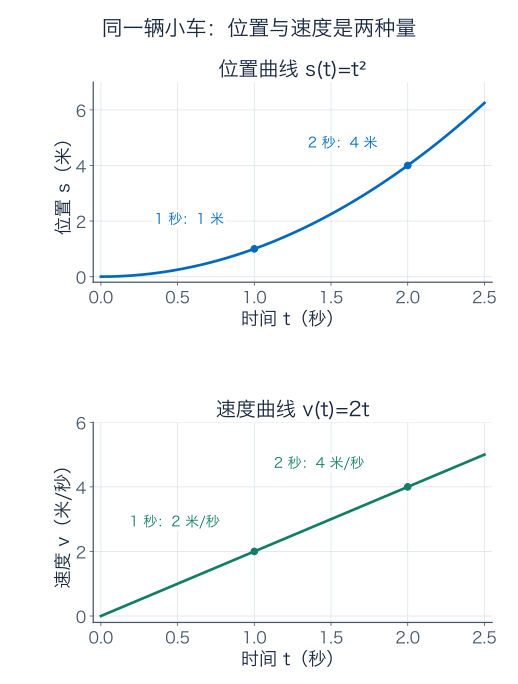

上图的高度是**位置**，下图的高度是**速度**。在第 2 秒，上图读到 4 米，下图恰巧也读到数值 4，但单位不同，含义不同；在第 1 秒就分别是 1 米和 2 米/秒。这能提醒我们，不要把两张图上的同一个数字当成同一种量。

### 这时才给变化率起名字

对一般函数 $f$，若在区间内部的点 $a$ 附近有定义，且下面的极限存在、是有限实数，就称 $f$ 在 $a$ **可导**，把极限叫作它在 $a$ 的**导数**：

$$
\boxed{f'(a)=\lim_{h\to0}\frac{f(a+h)-f(a)}h.}
$$

分子是输出变化，分母是非零输入变化，它们的商叫差商。导数就是这些平均变化率的共同极限。

这里没有把零代进分母，也没有挑某个“神秘的无限小数”来代入。上一章如何理解极限，这里就如何理解。两侧都要给出同一个有限答案；只看一侧的情况要明确称左导数或右导数。在模型起点 $t=0$，只允许从右边看，小车的右导数为 0。

现在可以把刚才的结果写成

$$
s'(2)=4,\qquad s'(t)=2t.
$$

$s'(2)$ 是一个具体时刻的数值，$s'$ 是把每个时刻映射到变化率的**导函数**。导数的单位是“输出单位除以输入单位”，这里就是米/秒。

另外，导数表示带方向的速度：位置导数为负，意味着位置正在减小；速度表上不带方向的速率是它的绝对值。“速度为负”不等于“正在减速”。本例非负时间内始终向前，两者数值才相同。

## 2．只用当前速度预测，小车会不会走偏

第 2 秒在 4 米处，当前速度为 4 米/秒。最自然的预测是：接下来很短的 $h$ 秒，先当作速度不变，预计走 $4h$ 米。

所以预测位置为

$$
\text{预测}=4+4h.
$$

取 $h=0.1$，预测是 4.4 米；真实位置为 $2.1^2=4.41$ 米，少算了 0.01 米，也就是 1 厘米。

为什么少算？小车在这段时间继续加速。用起点速度跑完整段，会漏掉后面变快的影响。把真实值展开，漏掉的部分一目了然：

$$
\underbrace{s(2+h)}_{\text{真实位置}}
=\underbrace{4+4h}_{\text{当前速度给出的预测}}
+\underbrace{h^2}_{\text{本例精确的剩余误差}}.
$$

时间改成 0.01 秒，预测为 4.04 米，真实值为 4.0401 米，差 0.0001 米，也就是 0.1 毫米。窗口缩小十倍，这个模型中的位置预测误差缩小一百倍。

你可能会想：“误差越变越小，不就说明预测合适了吗？”这里还有一个陷阱。

### 一个根本没用上速度的预测，误差竟然也趋于零

我们故意试三个办法：

- 不让车动，永远预测在 4 米处。
- 随便拿 3 米/秒，预测 $4+3h$。
- 用刚才算出的 4 米/秒，预测 $4+4h$。

在 $h=0.1$ 时，真实位置为 4.41：

| 预测办法 | 预测位置（米） | 位置误差大小（米） | 误差除以窗口大小（米/秒） |
| --- | --- | --- | --- |
| 停在原地 | 4 | 0.41 | 4.1 |
| 按 3 米/秒前进 | 4.3 | 0.11 | 1.1 |
| 按 4 米/秒前进 | 4.4 | 0.01 | 0.1 |

如果把 $h$ 缩到 0.01，三个位置误差分别变成 0.0401、0.0101、0.0001 米，**全都变小了**。原因很简单：时间够短，小车本来就来不及离开起点太远，哪怕预测它不动，也会在绝对位置上“看起来越来越准”。

所以只检查位置误差趋零，还不足以判断是否抓住了变化率。

再把误差除以窗口大小看看：三个结果依次是 4.01、1.01、0.01 米/秒。前两个仍保留着明显的速度差，最后一个才继续缩向零。

这给了我们更有用的标准：**预测误差相对于所用的输入步长，也必须能变得任意小。**

为了同时照顾正负 $h$，用误差绝对值除以 $|h|$。三个办法分别得到

$$
\begin{aligned}
\frac{|s(2+h)-4|}{|h|}&=|4+h|\longrightarrow4,\\
\frac{|s(2+h)-(4+3h)|}{|h|}&=|1+h|\longrightarrow1,\\
\frac{|s(2+h)-(4+4h)|}{|h|}&=|h|\longrightarrow0.
\end{aligned}
$$

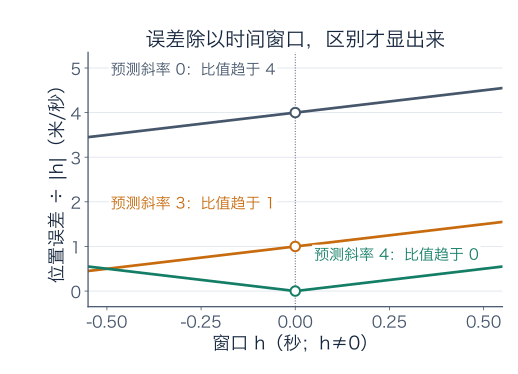

图中的纵轴是“每秒窗口对应的预测误差”，不是位置本身。三种办法最终分别留下 4、1、0 的高度，区别就不会因为窗口变小而被藏起来。

这里的“相对”是相对于**输入步长**，不是常见的“误差除以真实值”的百分比误差。把这两种比值混为一谈，会漏掉我们刚才发现的区别。

## 3．切线为什么偏偏取这个斜率

在时间与位置的坐标图上，预测式

$$
L(t)=4+4(t-2)
$$

是一条直线。它经过当前点 $(2,4)$，斜率为 4。上一节已经给出选它的理由：用它预测附近位置，误差与时间窗口的比值趋零。

我们把这样的直线叫作曲线在这个点的**切线**。这里的“切”不是说只碰一下曲线；例如 $f(x)=x^3$ 在零点的差商是 $h^2\to0$，切线是横轴，曲线却会从横轴下面穿到上面。

如果想换一个斜率 $m$，会怎样？仍在第 2 秒预测，残余误差为

$$
s(2+h)-(4+mh)=(4-m)h+h^2.
$$

除以 $h$ 后，结果趋于 $4-m$。想让这个比值趋零，就只能取 $m=4$。因此切线斜率是被这条误差要求确定的，不是凭画图时的眼缘挑的。

### “放大之后像直线”，要怎样放大才公平

在图上只把坐标窗口缩小，两条曲线都可能看起来贴在一起。为了比较不同尺度，先把第 2 秒、第 4 米移到画面中央，再把横纵两个方向按**同一个倍数**放大。

具体说，选一个观察尺度 $r>0$，把横坐标写成 $u=(t-2)/r$，纵坐标写成 $w=(s(t)-4)/r$。例如 $r=0.1$，表示原来 0.1 秒的横向距离和 0.1 米的纵向距离，现在各画成 1 个坐标单位。

原曲线 $s(2+h)-4=4h+h^2$ 中代入 $h=ru$，再除以 $r$，得到

$$
w=4u+ru^2.
$$

预测直线则变成 $w=4u$。在同一幅画面 $-1\le u\le1$ 内，两者的竖直差最多为 $r$。把观察尺度缩小，差也跟着缩小。

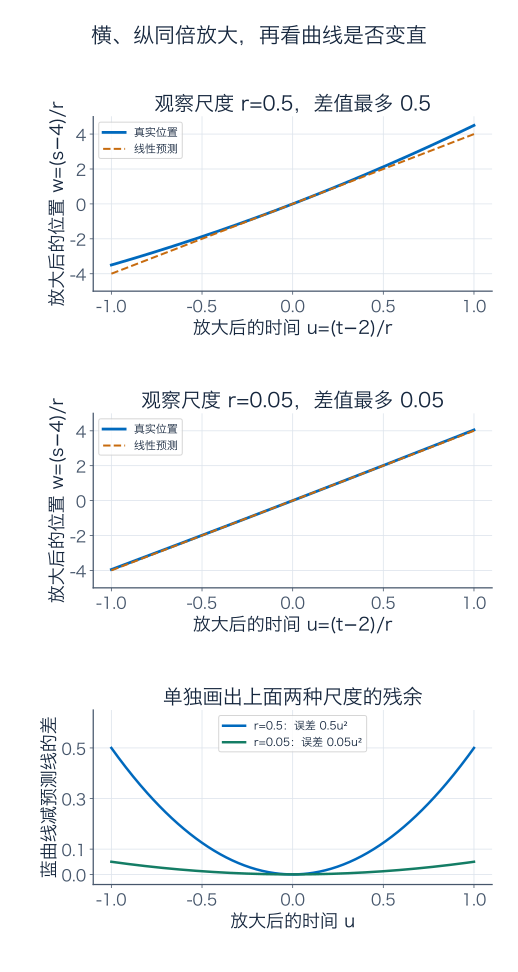

前两幅图使用相同的放大后坐标刻度：第一幅 $r=0.5$，第二幅 $r=0.05$。橙线始终是斜率 4 的预测；蓝曲线在第二幅更贴近它。底部单独画出了“蓝线减橙线”的差，避免两条线太近时看不清。

### 把刚才的发现推广到一般函数

假设想用 $f(a)+Ah$ 预测 $f(a+h)$，把没预测到的部分记作 $E(h)$：

$$
f(a+h)=f(a)+Ah+E(h).
$$

我们的标准是 $|E(h)|/|h|\to0$。移项、除以非零的 $h$，就得到

$$
\frac{f(a+h)-f(a)}h=A+\frac{E(h)}h\longrightarrow A.
$$

这恰好说明 $A=f'(a)$。反过来，如果差商趋于 $f'(a)$，把两者的差乘回 $h$，也得到这样的余项。

因此，**有导数**和**能用一条直线给出这种局部预测**是同一件事的两种说法。一般的切线公式就是

$$
\boxed{L_a(x)=f(a)+f'(a)(x-a).}
$$

它分成两份信息：$f(a)$ 告诉我们从哪里开始，$f'(a)$ 告诉我们附近每单位输入对应多少输出变化。

有些书把“比 $h$ 更小的余项”简记成 $o(h)$，于是写

$$
f(a+h)=f(a)+f'(a)h+o(h).
$$

这个 $o$ 不是数字零，也不是一个需要你另背公式的函数名，只是刚才那个比例极限的缩写。暂时不熟悉它，就继续写出误差再除以 $|h|$，照样能判断。

## 4．给一张正方形桌子配桌布：根号能怎样心算

现在换一个实际用途。假设正方形桌面的面积为 1.02 平方米，桌布先只考虑刚好盖住桌面，不留垂边。它的边长是多少？

如果面积是 1 平方米，边长是 1 米；面积只多了 0.02，边长应该比 1 米大一点。精确数值为 $\sqrt{1.02}$ 米。我们想知道，能否用面积在 1 附近的变化率快速估算。

以平方米、米为单位写数值关系 $\ell(A)=\sqrt A$。先从定义算它在 $A=1$ 的导数。面积增加 $h$ 后，边长的平均变化率为

$$
\frac{\sqrt{1+h}-1}{h}.
$$

根号的减法不好直接处理，但 $(p-q)(p+q)=p^2-q^2$ 可以把它变成已知的 $h$。分子分母同乘 $\sqrt{1+h}+1$：

$$
\frac{\sqrt{1+h}-1}{h}
=\frac{(1+h)-1}{h(\sqrt{1+h}+1)}
=\frac1{\sqrt{1+h}+1},\qquad h\ne0.
$$

当 $h\to0$，根号趋于 1。也能直接检查：$|\sqrt{1+h}-1|=|h|/(\sqrt{1+h}+1)\le|h|$，所以它确实靠近 1，而不是靠猜。差商的极限于是为 $1/2$。

这意味着在面积 1 平方米附近，边长的局部变化率为 **0.5 米/平方米**。面积多 0.02 平方米，边长预计多 $0.5\times0.02=0.01$ 米。因此

$$
\sqrt{1.02}\approx1.01.
$$

### 做桌布时，误差有多大也得说清楚

导数告诉我们怎样预测，但**只写近似符号，不等于给出了有限步长下的误差保证**。这里模型简单，可以把真实值减去预测值，继续算下去：

$$
\begin{aligned}
\sqrt{1+h}-1-\frac h2
&=\frac h{\sqrt{1+h}+1}-\frac h2\\
&=\frac{h(1-\sqrt{1+h})}{2(\sqrt{1+h}+1)}\\
&=-\frac{h^2}{2(\sqrt{1+h}+1)^2}.
\end{aligned}
$$

这里最后又用了一次 $1-\sqrt{1+h}=-h/(\sqrt{1+h}+1)$。

对我们的 $h=0.02>0$，根号大于 1，所以分母大于 8。误差为负，绝对值小于

$$
\frac{0.02^2}{8}=0.00005\ \text{米}=0.05\ \text{毫米}.
$$

因此真边长处在

$$
1.00995\le\sqrt{1.02}\le1.01
$$

米之间。我们的预测略偏大，差不到 0.05 毫米。对这个理想面积值，已经能给出非常细的尺寸保证；若面积本身只量到百分之一平方米，还要另外考虑输入测量误差。

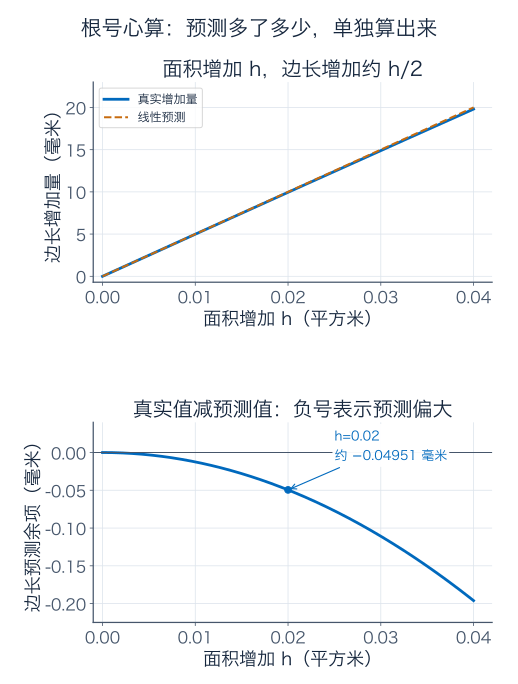

上图以“相对原边长增加了多少毫米”比较真实值与预测，下图单独画“真实值减预测值”。不单独放大这点误差，两条线贴在一起，并不能让你看出预测到底偏哪一边。

### 书上说的“微分”，在这里是哪一部分

把一次实际的输入变化记作 $dA=h$，它可以是 0.02 这样的普通数。由导数计算的线性预测变化叫作微分：$d\ell=\ell'(1)dA=h/2$。真实变化记作 $\Delta\ell=\sqrt{1+h}-1$，还包括刚才算出的余项。

所以 $d\ell$ 和 $\Delta\ell$ 不要混用。记号 $d\ell/dA$ 在这里表示导数；用导数乘一个小的面积变化，得到的是边长变化的线性预测，有限步长下通常不是精确变化。

## 5．两条边一起变长，面积的变化怎么分账

正方形只需要一个边长。现在考虑一块可伸缩的长方形桌面：长 $u$ 厘米、宽 $v$ 厘米，面积为 $uv$。拉动装置时，两条边可能一起改变。

先不求导，也不说“很小”。假设长度增加 $\Delta u$，宽度增加 $\Delta v$，新面积就是 $(u+\Delta u)(v+\Delta v)$。减去原面积，得到**精确的**面积增量：

$$
\Delta A=v\Delta u+u\Delta v+\Delta u\Delta v.
$$

三块分别是：随着长度增加的侧边长条、随着宽度增加的上边长条、右上角那一小块。缺哪一块，有限增量的面积账都对不上。

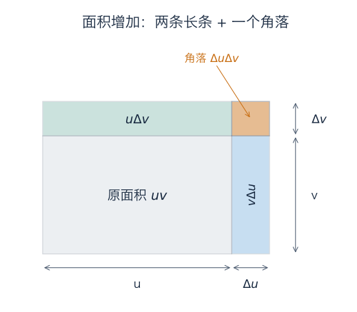

图中增量刻意画大，才能看清角落。接下来用实际数字看看，每一块对变化率贡献多少。

用一个迷你桌面模型算数：当前时刻为 $t=0$，长为 3 厘米、宽为 2 厘米。在这一段理想运动中，两边分别匀速增加：

$$
u(t)=3+0.3t,\qquad v(t)=2+0.2t.
$$

经过 $h$ 秒，长多 $0.3h$，宽多 $0.2h$。代入刚才的面积分账：

$$
\Delta A
=\underbrace{2(0.3h)}_{\text{长的变化带来的长条}}
+\underbrace{3(0.2h)}_{\text{宽的变化带来的长条}}
+\underbrace{(0.3h)(0.2h)}_{\text{角落}}
=1.2h+0.06h^2.
$$

例如过了 0.1 秒，三块面积分别为 0.06、0.06、0.0006 平方厘米，总共增加 0.1206。除以 0.1 秒，平均增长率为 1.206 平方厘米/秒。

换成任意非零 $h$，平均增长率为

$$
\frac{\Delta A}{h}=1.2+0.06h\longrightarrow1.2.
$$

所以此刻的面积增长率是 1.2 平方厘米/秒。

角落为什么没出现在最终答案里？它并没有在实际面积中消失；只是面积除以时间后，角落的贡献是 $0.06h$，趋于零。**先把它保留在精确等式里，再看它对极限有没有贡献**，比一句“高阶小量忽略”更不容易出错。

### 把同一笔账写成乘积法则

若两边都是时间的可导函数 $u(t),v(t)$，在当前时刻，把它们的值简记为 $u,v$，增量记作 $\Delta u,\Delta v$。面积差商拆成

$$
\frac{\Delta A}h
=v\frac{\Delta u}h+u\frac{\Delta v}h
+\frac{\Delta u}h\Delta v.
$$

前两项趋于 $vu'$、$uv'$。最后一项里，$\Delta u/h$ 趋于有限的 $u'$；而 $\Delta v=h(\Delta v/h)\to0$，因此乘积趋零。于是

$$
\boxed{(uv)'=u'v+uv'.}
$$

这条式子说的是：**每一部分的变化率，要乘另一部分当前的大小，再把两份贡献相加。** 桌面长、宽都在变，只拿两个增长率相乘，会只看见角落、漏掉两条主要的长条。

单位也能提醒你：$u'v$ 的单位是“厘米/秒乘厘米”，也就是平方厘米/秒；$u'v'$ 的单位却是平方厘米/秒平方，连题目所问的量都不是。

面积图画的是正的长宽增量，代数证明则也允许函数值或增量为负。只要两个函数在所讨论点可导，法则就成立。

加法的变化更直接：两个输出相加，总增量就是各自增量之和。除以 $h$ 再取极限，就有 $(f+g)'=f'+g'$；乘常数只会把每个差商乘同一个数，所以 $(cf)'=cf'$。例如 $(3x^2+2x+1)'=6x+2$。常数项在相减时完全抵消，导数为零。

## 6．先改变半径，再改变面积，为什么变化率要相乘

有时不是“两条量相乘”，而是“一个量的输出，成为下一步的输入”。我们还用桌面面积，看看差别。

假设一个圆形伸缩模型由旋钮控制。旋钮读数为 $x$ 格，按选定的厘米单位，半径数值为

$$
r(x)=1+x^2.
$$

桌面面积则由半径决定：$A(r)=\pi r^2$。这是一个为计算设定的理想标定规则，不是所有伸缩装置的通用参数。

现在旋钮在 $x=1$。先沿着这条过程走一遍：

$$
\text{旋钮 }1\text{ 格}
\quad\longrightarrow\quad
\text{半径 }2\text{ 厘米}
\quad\longrightarrow\quad
\text{面积 }4\pi\text{ 平方厘米}.
$$

把旋钮再转 0.01 格，面积大约增加多少？别急着写整条复合式，我们分两步预测。

**第一步，旋钮怎样改变半径。** $r(x)=1+x^2$ 在 $x=1$ 的导数是 2 厘米/格，所以半径大约增加 $2\times0.01=0.02$ 厘米。

**第二步，半径怎样改变面积。** 由平方函数的导数，$A'(r)=2\pi r$。当前半径为 2，不是 1，因此面积对半径的变化率是 $4\pi$ 平方厘米/厘米。半径增加约 0.02，面积预计增加

$$
4\pi\times0.02=0.08\pi\ \text{平方厘米}.
$$

两段的局部变化率乘起来，就是对旋钮的局部变化率：

$$
\left(4\pi\frac{\text{平方厘米}}{\text{厘米}}\right)
\left(2\frac{\text{厘米}}{\text{格}}\right)
=8\pi\frac{\text{平方厘米}}{\text{格}}.
$$

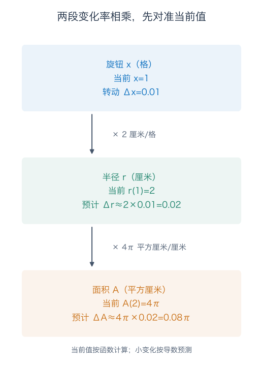

图把“当前值”和“变化量”分开写：当前半径是 2，预计增加量才是 0.02。外层变化率要在当前半径计算，不能把预计增加量拿来当当前位置。

### 用精确计算检查这两步近似

旋钮转到 1.01 格，真实半径是

$$
1+1.01^2=2.0201\ \text{厘米}.
$$

真实面积为 $2.0201^2\pi=4.08080401\pi$ 平方厘米，增加了 $0.08080401\pi$。我们预测 $0.08\pi$，少了 $0.00080401\pi$。这个误差同时包含半径预测和面积预测的影响。

如果旋钮只转 $h$ 格，先有

$$
r(1+h)=2+2h+h^2.
$$

再把这个**完整结果**送进面积函数，展开后得到

$$
\begin{aligned}
A(r(1+h))-A(r(1))
&=\pi\bigl[(2+2h+h^2)^2-4\bigr]\\
&=8\pi h+8\pi h^2+4\pi h^3+\pi h^4.
\end{aligned}
$$

除以 $h$，除第一项以外都趋于零。所以整个过程的导数确实是 $8\pi$，两段变化率相乘的预测得到了核实。

### 链式法则，特别容易接错哪个点

把内层函数记为 $g$，外层记为 $f$，整个过程为 $F(x)=f(g(x))$。若 $g$ 在 $a$ 可导，$f$ 在 $g(a)$ 可导，那么

$$
\boxed{F'(a)=f'(g(a))\,g'(a).}
$$

这叫**链式法则**。它的顺序是：先由 $a$ 找到内层输出 $g(a)$，在那里求外层变化率，再乘内层在 $a$ 的变化率。

在桌面的例子中，$a=1$，内层输出为 2，因此用的是 $A'(2)r'(1)=4\pi\times2$。若外层也机械地代入 1，会得到错误的 $2\pi\times2$。

写成一般位置的公式就是

$$
\frac{d}{dx}\bigl[\pi(1+x^2)^2\bigr]
=\underbrace{2\pi(1+x^2)}_{\text{对当前半径的变化率}}
\underbrace{2x}_{\text{半径对旋钮的变化率}}
=4\pi x(1+x^2).
$$

它不是乘积法则：我们没有把两个输出相乘，而是把第一步的结果送给第二步。判断用哪条规则，先看计算过程怎样组合，比只看表面上有几个乘号更可靠。

一般链式法则的余项证明放在文末补充 A；它也会处理“内层的变化恰好为零，不能拿它当分母”的情况。

## 7．连续，为什么还不一定有导数

想象路边两段斜坡接成一个 V 形低点，横向位置为 $x$ 米、高度为 $f(x)=|x|$ 米。靠近最低点，高度会靠近零，没有断裂，所以它在零连续。

但是在低点附近，两侧坡度完全不同。用定义算：

$$
\frac{f(h)-f(0)}h=\frac{|h|}h
=\begin{cases}1,&h>0,\\-1,&h<0.\end{cases}
$$

从右边估，坡度恒为 1；从左边估，坡度恒为 $-1$。没有共同的有限极限，所以零点没有导数。

这也可以用预测解释：如果挑斜率 1，能贴合右边，左边却留下与步长一样大的误差；挑 $-1$ 则反过来。无论选什么斜率，都不能让两边的误差除以步长后一起趋零。

我们可以尝试把这个低点变得更平：原来的差商幅度始终是 1，若把高度再乘一个趋零的因子 $\sqrt{|x|}$，差商的幅度也会跟着缩小。于是选择 $g(x)=|x|\sqrt{|x|}=|x|^{3/2}$。它在零点的差商为

$$
\frac{|h|^{3/2}}h
=\begin{cases}\sqrt h,&h>0,\\-\sqrt{-h},&h<0,\end{cases}
$$

两边都趋于零，所以它有导数，斜率为 0。图像看起来都向一个低点聚拢，却有不同答案。判断依据是刚才的比值，不是“这个底部好像挺尖”。

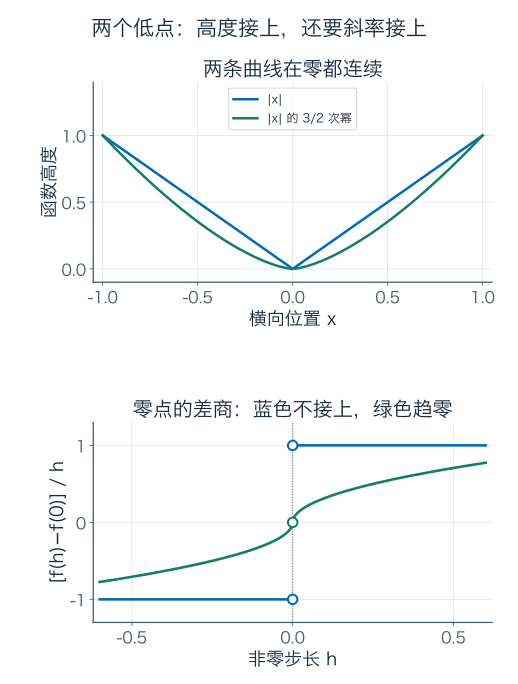

### 为什么导数反过来一定保证连续

若 $f$ 在 $a$ 可导，差商在靠近时趋于一个有限数，因此不会无限大。再看真实输出变化：

$$
f(a+h)-f(a)
=h\cdot\frac{f(a+h)-f(a)}h\longrightarrow0.
$$

一项趋零，另一项趋于有限数，乘积趋零。这正是连续性要求的输出接近。所以可导一定连续，连续却可能像 V 形低点那样不可导。

### 有导数，能保证预测误差总是平方级吗

小车的误差是 $h^2$，根号例子的误差也被常数乘 $h^2$ 控住。这很容易让人误以为“可导就保证误差按平方缩小”。

刚才的 $g(x)=|x|^{3/2}$ 提供了一个可算的检查。它在零的线性预测是 0，误差就是 $|h|^{3/2}$。误差除以 $|h|$ 为 $\sqrt{|h|}$，确实趋零；但误差除以 $h^2$ 为 $1/\sqrt{|h|}$，反而越来越大。

例如 $|h|=0.01$，误差为 0.001，是 $h^2$ 的 10 倍；$|h|=0.0001$，误差为 0.000001，是 $h^2$ 的 100 倍。没有一个固定倍数能在所有足够小的窗口中压住它。

因此可导保证的是“误差除以步长趋零”，不是自动保证“误差不超过固定倍数的步长平方”。后者常简写为 $O(h^2)$：存在固定的 $C$ 和足够小的范围，使误差不超过 $C|h|^2$。下一章会说明增加哪些条件后，才能得到这份更强的保证。

## 8．拿真正的录像测速度，为什么窗口太短反而麻烦

回到小车。对精确模型，围绕第 2 秒用前向窗口 $h>0$，算出的平均速度是 $4+h$。它与瞬时速度 4 相差 $h$，缩短窗口确实减少这种模型近似偏差。

但视频读数不是无限精确。假设计时准确，而两个位置读数各自可能有最多 1 毫米，也就是 0.001 米的误差。测得的平均速度为

$$
\frac{\widetilde s(2+h)-\widetilde s(2)}h.
$$

波浪号表示测量值。把两次读数误差记作 $e_1,e_0$，各自满足 $|e_i|\le0.001$ 米。于是测量速度可以展开为

$$
\frac{s(2+h)+e_1-s(2)-e_0}{h}
=4+h+\frac{e_1-e_0}{h}.
$$

例如后一次位置被多读 1 毫米、前一次被少读 1 毫米，两次相减就多出了 2 毫米。若窗口只有 0.001 秒，这 2 毫米除以 0.001 秒，相当于速度多了 **2 米/秒**。

按最坏情形保证，有

$$
\left|\frac{\widetilde s(2+h)-\widetilde s(2)}h-4\right|
\le\underbrace{h}_{\text{模型平均值的偏差}}
+\underbrace{\frac{0.002}{h}}_{\text{位置读数误差的贡献上限}}.
$$

这里是在选定的秒、米单位下写数值公式；两项合起来的单位是米/秒。看看不同窗口：

| 时间窗口（秒） | 模型偏差（米/秒） | 读数误差贡献上限（米/秒） | 总误差上限（米/秒） |
| --- | --- | --- | --- |
| 0.1 | 0.1 | 0.02 | 0.12 |
| 0.01 | 0.01 | 0.2 | 0.21 |
| 0.001 | 0.001 | 2 | 2.001 |

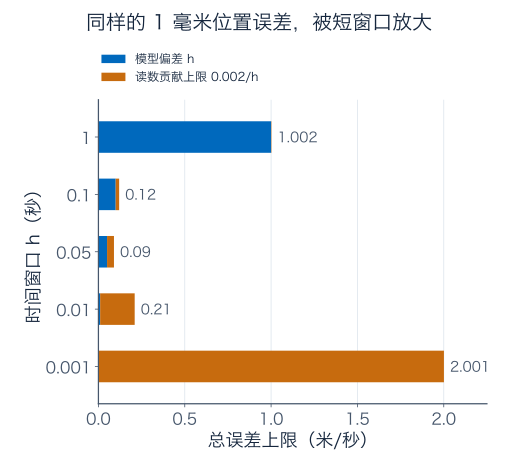

图上画的是误差**上限**，不是每次测量实际发生的误差。两次位置误差也可能相互抵消。但当我们要给一个对所有允许误差都有效的保证时，不能假设它们刚好抵消。

数学极限研究精确函数的性质；实际测量要同时考虑数据精度。先把这两件事分清，才不会把“差商趋近导数”误读成“拿真实设备时，时间窗越短一定越好”。

### 换一个取窗口的办法，有时可以消掉模型偏差

我们也可以以第 2 秒为中心，看前后各 $h$ 秒：

$$
\frac{s(2+h)-s(2-h)}{2h}
=\frac{(4+4h+h^2)-(4-4h+h^2)}{2h}=4.
$$

这叫中心差商。对**这条二次位置模型**，平方项恰好抵消，所以精确数据下它直接等于真实速度。读数仍各有最多 0.001 米误差时，额外误差上限为 $0.002/(2h)=0.001/h$，仍会在窗口过小时放大。

这不是说中心差商对所有运动都精确；只是说明，算法怎样利用左右两边的信息，会改变模型偏差。一个近似方法好不好，要同时看函数、步长和数据误差。

## 读完正文，先把这几笔计算自己做一遍

你现在可以从位置差商得到速度，能用速度预测附近位置，也能检查预测误差。遇到一个组合公式，还能先拆清楚：输出是在相加、相乘，还是依次传递，再选择对应的求导办法。

下列练习都可以用正文已经走过的方法完成。文末另外放了常用公式的来由、滑动梯子的完整应用，以及以后研究函数空间时会用到的例子。第一次不必把这些补充一次吃完。

## 练习：先写计算，再看解答

**题一：换一条运动规则。** 时间单位为秒、位置单位为米，$p(t)=3t^2+2t+1$。从差商出发求 $p'(t)$，再求第 2 秒的位置和速度。用当前速度预测 2.05 秒的位置，算出真实值与预测值的差，并解释这个差的单位。

**题二：绝对误差小，为什么还不够？** 仍在第 2 秒预测 $s(t)=t^2$，考虑 $4+3h$、$4+4h$ 两种规则。分别在 $h=0.01$ 时计算位置误差，再求一般非零 $h$ 下“误差绝对值除以 $|h|$”的极限。为什么前一种预测的误差趋零，仍没有抓住导数？

**题三：更大的正方形桌子。** 桌面面积为 4.04 平方米。先仿照正文的有理化方法，求 $\ell(A)=\sqrt A$ 在 $A=4$ 的导数，再用直线预测边长。继续算“真实值减预测值”，给出一个具体的误差区间和偏大、偏小方向。不要只报计算器的根号读数。

**题四：另一块伸缩桌面。** $u(t)=3+0.2t$、$v(t)=2+0.5t$，单位分别为厘米和秒。求 $t=0$ 的面积增长率，用它预测过 0.1 秒的面积。再展开精确面积，说明少算或多算的那一块来自哪里。

**题五：把旋钮换到另一个位置。** 正文圆桌模型 $r(x)=1+x^2$、$A(r)=\pi r^2$。在 $x=2$ 格，分别写出当前半径、半径对旋钮的变化率、面积对半径的变化率，最后求面积对旋钮的变化率。若转到 2.01 格，预测面积增加多少？用精确值核对，求出预测误差。

**题六：两个低点。** 不用任何幂函数求导表，直接用差商判断 $f(x)=|x|$、$g(x)=|x|^{3/2}$ 在零是否可导。若可导，写出线性预测，说明它的误差除以 $|h|$、除以 $h^2$ 分别怎样变化。

**题七：换一台更精细的摄像机。** 仍用 $s(t)=t^2$，但每次位置误差不超过 0.0005 米。计时精确，计算 $h=0.1,0.01,0.001$ 时前向差商估计第 2 秒速度的总误差上限。再求中心差商的模型值及读数误差贡献上限，解释为什么这个上限不一定等于某次实际误差。

**题八：怎样把两段曲线接好？** 定义

$$
F(x)=\begin{cases}x^2,&x\ge0,\\cx+d,&x<0.\end{cases}
$$

先找出让它在零连续的 $c,d$ 条件，再找出让它在零可导的条件。请分别检查函数值和两侧差商；“线条在零碰上了”够不够？

### 参考答案与解题过程

#### 题一解答

先展开位置增量：

$$
\begin{aligned}
p(t+h)-p(t)
&=3\bigl[(t+h)^2-t^2\bigr]+2h\\
&=(6t+2)h+3h^2.
\end{aligned}
$$

除以非零的 $h$，差商为 $6t+2+3h$；让 $h\to0$，得到 $p'(t)=6t+2$，单位为米/秒。

第 2 秒，位置 $p(2)=12+4+1=17$ 米，速度 $p'(2)=14$ 米/秒。取 $h=0.05$ 秒，直线预测为

$$
17+14\times0.05=17.7\ \text{米}.
$$

真实位置为 $17+14(0.05)+3(0.05)^2=17.7075$ 米，真实值减预测为 0.0075 米，即 7.5 毫米。它是位置差，单位为米；不是速度误差。系数 3 按所选单位对应米/秒平方，乘以时间平方后才成为位置。

#### 题二解答

$h=0.01$ 时，真实位置为 4.0401 米。按 3 米/秒预测为 4.03，误差为 0.0101 米；按 4 米/秒预测为 4.04，误差为 0.0001 米。

一般地，两种残余分别为 $h+h^2$ 和 $h^2$，所以归一到单位窗口的误差为

$$
\frac{|h+h^2|}{|h|}=|1+h|\to1,
\qquad
\frac{|h^2|}{|h|}=|h|\to0.
$$

第一种的绝对误差也趋零，是因为任何有界速度在越来越短时间里造成的位置差都会变小；但它始终漏掉约 1 米/秒的局部速度，残余相对于时间仍是一阶大小。第二种才把这个一阶差异消掉，剩下比窗口更小的误差。

#### 题三解答

先在面积 4 处计算差商：

$$
\frac{\sqrt{4+h}-2}{h}
=\frac1{\sqrt{4+h}+2}\longrightarrow\frac14.
$$

这里根号定义在 $h>-4$ 的附近，且 $h\ne0$ 时约分合法。因此局部边长变化率为 $1/4$ 米/平方米。面积增加 $h=0.04$ 平方米，预测边长为 $2+h/4=2.01$ 米。

继续算精确余项：

$$
\begin{aligned}
\sqrt{4+h}-2-\frac h4
&=\frac h{\sqrt{4+h}+2}-\frac h4\\
&=\frac{h(2-\sqrt{4+h})}{4(\sqrt{4+h}+2)}\\
&=-\frac{h^2}{4(\sqrt{4+h}+2)^2}.
\end{aligned}
$$

当 $h=0.04>0$，分母大于 $4\times4^2=64$，所以余项为负、绝对值小于 $0.04^2/64=0.000025$ 米。真实值因此在 $[2.009975,2.01]$ 米内，预测偏大，误差不到 0.025 毫米。知道导数后，具体误差保证仍来自这次额外的余项计算。

#### 题四解答

乘积法则给出

$$
A'(0)=u'(0)v(0)+u(0)v'(0)
=0.2\times2+3\times0.5=1.9
$$

平方厘米/秒。初始面积为 6，过 0.1 秒的线性预测为 $6+1.9(0.1)=6.19$ 平方厘米。

精确展开为

$$
A(t)=(3+0.2t)(2+0.5t)=6+1.9t+0.1t^2.
$$

在 0.1 秒，真实面积为 6.191，预测少算 0.001 平方厘米。长增加 0.02、宽增加 0.05，二者相乘正好是这个角落小块。它不进入瞬时增长率，是因为除以时间后贡献为 $0.1t\to0$，不是因为它在实际桌面上不存在。

#### 题五解答

旋钮 $x=2$ 时，半径为 $r(2)=1+4=5$ 厘米；半径对旋钮的导数为 $r'(2)=2\times2=4$ 厘米/格；面积对当前半径的导数为 $A'(5)=2\pi\times5=10\pi$ 平方厘米/厘米。

两段相乘，得到面积对旋钮的导数 $40\pi$ 平方厘米/格。转动 0.01 格，预测面积增加 $0.4\pi$ 平方厘米。

精确半径为 $r(2.01)=1+2.01^2=5.0401$ 厘米，精确面积为 $25.40260801\pi$；初始为 $25\pi$，因此真实增加量为 $0.40260801\pi$。预测少了 $0.00260801\pi$ 平方厘米。

也可展开检查：$r(2+h)=5+4h+h^2$，面积增量为

$$
\pi\bigl[(5+4h+h^2)^2-25\bigr]
=40\pi h+26\pi h^2+8\pi h^3+\pi h^4.
$$

一次项给出链式法则的结果，余下三项给出有限转动的误差。

#### 题六解答

$f(0)=g(0)=0$。$f$ 的差商为 $|h|/h$，正侧为 1、负侧为 $-1$，所以没有共同导数。

$g$ 的差商绝对值为 $\sqrt{|h|}\to0$，正负两侧都趋零，所以 $g'(0)=0$，线性预测为 $g(0)+0h=0$。真实误差为 $|h|^{3/2}$，除以 $|h|$ 得到 $\sqrt{|h|}\to0$，符合可导要求；除以 $h^2$ 得到 $1/\sqrt{|h|}\to\infty$，所以不能被一个固定常数乘 $h^2$ 控制。

这也说明“预测为常数”不一定错。对第 2 秒的小车，变化的主要部分是 $4h$，把它漏掉不合格；对这个平底函数，主要的一阶变化本来就是零，常数预测恰好合格。

#### 题七解答

设两次位置误差为 $e_1,e_0$，有 $|e_i|\le\eta=0.0005$ 米。前向差商与瞬时速度 4 的差为 $h+(e_1-e_0)/h$，故总误差上限为

$$
B(h)=h+\frac{2\eta}h=h+\frac{0.001}h.
$$

三个窗口依次给出 $0.11$、$0.11$、$1.001$ 米/秒。前两个保证一样，第三个反而差很多。

中心差商的精确模型值仍为 4。两端读数误差之差不超过 $2\eta$，除以总窗口 $2h$，贡献上限为 $\eta/h=0.0005/h$。在这三个窗口下，分别为 $0.005$、$0.05$、$0.5$ 米/秒。

这些是对所有允许读数误差的保证，并非某次必然发生的误差。比如两端读数恰好都多了同样的 0.0004 米，它们相减后就抵消了；也可能一端多读、一端少读，造成较大的差。

#### 题八解答

中心值 $F(0)=0$。从右侧靠近，$x^2\to0$；从左侧靠近，$cx+d\to d$。要连续必须且只需 $d=0$，此时任何有限实数 $c$ 都可以。

在 $d=0$ 下再看差商：右边为 $h^2/h=h\to0$，左边为 $ch/h=c$。共同导数存在必须且只需 $c=0$。因此可导的完整条件为 $c=d=0$，导数为 0。

如果 $d\ne0$，左侧差商还有 $d/h$，不能趋于有限导数，也已经违反可导必连续。把线条接到同一个点只解决连续问题；想有导数，还要两边一阶变化率接上。

## 补充 A：需要查求导公式时，再读这里

### 链式法则的一般证明，为什么不能直接约去中间变化

正文的圆桌模型能直接展开；若函数更复杂，就不方便每次把整个式子展开。我们需要证明“两段局部变化率相乘”在一般可导情形下也可靠。

设内层为 $g$、外层为 $f$，当前输入为 $a$，内层当前输出为 $b=g(a)$。为避免一上来堆符号，把两段斜率分别记为 $A=g'(a)$、$B=f'(b)$。

内层可导，意味着它的差商是“斜率 $A$ 加一个趋零的误差”。记这个误差为 $\rho(h)$，则

$$
g(a+h)-g(a)=h\bigl(A+\rho(h)\bigr),\qquad\rho(h)\to0.
$$

把这次内层实际变化记为 $k$。外层同样可导，因此

$$
f(b+k)-f(b)=k\bigl(B+\eta(k)\bigr),\qquad\eta(k)\to0.
$$

对非零 $k$，$\eta(k)$ 就是外层差商减去 $B$；在 $k=0$ 时另设 $\eta(0)=0$，上式仍然成立。这样，无论这次内层是否恰好没变，我们都有一个合法的等式。

由于 $k=h(A+\rho(h))\to0$，将它代入外层等式，再除以原始的非零窗口 $h$，得到

$$
\frac{f(g(a+h))-f(g(a))}{h}
=\bigl(A+\rho(h)\bigr)\bigl(B+\eta(k)\bigr)\longrightarrow AB.
$$

这证明了链式法则。整个过程只除以 $h$，没有除以可能为零的 $k$。常见的 $\Delta f/\Delta g$ 乘 $\Delta g/\Delta x$ 是很好的直觉，但真正写证明时，要照顾 $\Delta g=0$ 的情况，不能把两个本来无意义的分数写出来再说它们会约掉。

### 幂、倒数与商，怎样从已有规则接出来

平方函数已经由差商求出。立方的差商也能直接展开：

$$
\frac{(a+h)^3-a^3}{h}=3a^2+3ah+h^2\longrightarrow3a^2.
$$

对正整数 $n$，展开 $(a+h)^n$ 时，恰含一个 $h$ 的项来自 $n$ 个因子中任挑一个贡献 $h$、其余贡献 $a$，所以是 $na^{n-1}h$。其余非恒定项至少有两个 $h$；除以 $h$ 后都趋零。因此 $(x^n)'=nx^{n-1}$。这是幂函数公式中系数 $n$ 的来由。

导函数还可以继续求导。小车速度为 $v(t)=s'(t)=2t$，速度差商 $[2(t+h)-2t]/h=2$，所以 $v'(t)=2$。它表示速度每秒增加多少，叫加速度，单位为米/秒平方。对位置而言，这也是求了两次导数，写成 $s''(t)=2$。下一章出现 $f''$ 时，指的就是同样的第二次求导。

倒数在 $a\ne0$ 时的差商为

$$
\frac{1/(a+h)-1/a}{h}
=-\frac1{a(a+h)}\longrightarrow-\frac1{a^2}.
$$

取足够小的 $h$，保证 $a+h$ 也不为零。把 $u/v$ 看成 $u$ 乘 $v$ 的倒数，先用乘积法则，再用链式法则，就得到

$$
\left(\frac uv\right)'=\frac{u'}v-u\frac{v'}{v^2}
=\frac{u'v-uv'}{v^2},\qquad v\ne0.
$$

例如 $H(x)=x/(1+x^2)$ 的导数为

$$
H'(x)=\frac{1(1+x^2)-x(2x)}{(1+x^2)^2}
=\frac{1-x^2}{(1+x^2)^2}.
$$

分母始终为正，适用于所有实数 $x$。第一项跟着分子变，第二项修正分母变化造成的影响。若分母为常数，第二项自然消失；这也是检查公式是否抄错的一种办法。

### 正弦、指数与对数：哪些地基已经有了，哪些留待后面

上一章补充 B 用单位圆面积证明了弧度制极限 $\sin h/h\to1$，并得到 $0\le1-\cos h\le h^2/2$（在零附近）。因此

$$
\begin{aligned}
\frac{\sin(a+h)-\sin a}{h}
&=\sin a\frac{\cos h-1}{h}
+\cos a\frac{\sin h}{h}\\
&\longrightarrow\cos a.
\end{aligned}
$$

第一项的绝对值不超过 $|\sin a||h|/2$，趋零；第二项趋于 $\cos a$。这就得到了正弦导数，而不是把它当成解释自己的前提。用余弦加法公式同样得到 $(\cos x)'=-\sin x$。角度一定用弧度。

指数与自然对数的完整构造要用到后面的积分或级数。这里先采用自然指数的基本极限 $(e^h-1)/h\to1$；这项地基会在[积分](04-定积分与微积分基本定理.md)和[幂级数](06-级数、幂级数与函数列.md)中继续建立，不要求你在此凭空证明。由指数相加的性质，有

$$
\frac{e^{a+h}-e^a}{h}
=e^a\frac{e^h-1}{h}\longrightarrow e^a.
$$

自然对数 $\log$ 是自然指数的连续反函数。对 $a>0$，令 $u=\log(a+h)-\log a$，则 $h=a(e^u-1)$；$h\to0$ 时 $u\to0$，并且非零 $h$ 对应非零 $u$。所以

$$
\frac{\log(a+h)-\log a}{h}
=\frac1{a(e^u-1)/u}\longrightarrow\frac1a.
$$

这给出 $(\log x)'=1/x$，使用范围 $x>0$。任意实指数的 $x^r$ 在 $x>0$ 可写为 $e^{r\log x}$，再用链式法则得到 $rx^{r-1}$。负的底数是否允许，要另看指数的含义，不能直接照搬 $x>0$ 的表达式。

| 函数 | 导数 | 使用时检查 |
| --- | --- | --- |
| 常数 $c$ | $0$ | 相减后没有变化 |
| $x^n$，正整数 $n$ | $nx^{n-1}$ | 全实轴 |
| $x^r$，任意实数 $r$ | $rx^{r-1}$ | 这里先取 $x>0$ |
| $1/x$ | $-1/x^2$ | $x\ne0$ |
| $e^x$ | $e^x$ | 自然指数 |
| $\log x$ | $1/x$ | $x>0$，自然对数 |
| $\sin x$ | $\cos x$ | 弧度制 |
| $\cos x$ | $-\sin x$ | 弧度制 |

这张表用来查，不是让你在理解正文之前先背一遍。比如要算 $\log(1+x^2)$，先把内层 $u=1+x^2$ 记清，再算 $(1/u)\cdot2x=2x/(1+x^2)$。要算 $e^{x^2}$，先取内层当前输出 $x^2$，再乘内层变化率 $2x$，得到 $2xe^{x^2}$。

## 补充 B：梯子下滑，为什么不能拿梯子的斜率当速度

一把 5 米长的梯子靠在竖直墙上，脚离墙 $x$ 米、顶端离地 $y$ 米。假设运动平稳且顶端仍高于地面，脚向外移动时，顶端会下降。当前 $x=3$、$y=4$，脚以 0.2 米/秒外移，顶端此刻每秒下降多少？

有人会看图说：“梯子斜率是 $-4/3$，所以乘 0.2 就行。”但这根斜线画的是**一把梯子本身**，不是“顶端高度如何随脚距变化”的函数。一个固定姿态，不能直接告诉你姿态变化有多快。

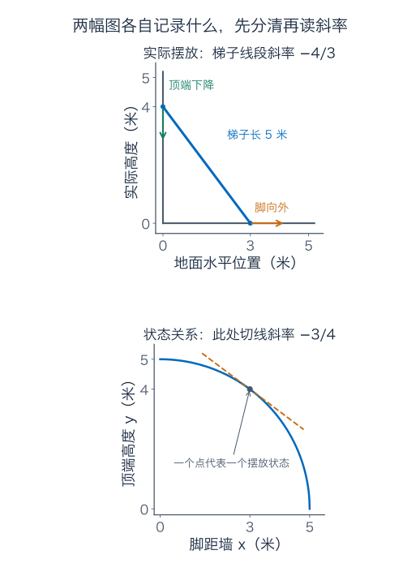

正确的约束是勾股关系

$$
x^2+y^2=25.
$$

在顶端高于地面的分支，$y=\sqrt{25-x^2}$，可以直接用根号与链式法则求导；也可以不解出根号，先把 $y$ 视为 $x$ 的函数。两边对 $x$ 求导，得到

$$
2x+2y\frac{dy}{dx}=0.
$$

为什么 $y^2$ 不是直接变成 $2y$？因为正在变化的输入是 $x$，中间还有一段 $x\to y$。先对 $y$ 求导得到 $2y$，再乘 $y$ 对 $x$ 的变化率，这就是链式法则。

只要 $y\ne0$，就有

$$
\frac{dy}{dx}=-\frac xy.
$$

当前为 $-3/4$，意思是脚每向外移动很小的一段，顶端高度约减少这段距离的 $3/4$。它的单位是米/米，还不是米/秒。再接上脚的外移速度：

$$
\frac{dy}{dt}=\frac{dy}{dx}\frac{dx}{dt}
=-\frac34\times0.2=-0.15\ \text{米/秒}.
$$

负号表示高度减小；下降速率的大小为 0.15 米/秒。

如果直接对时间求导，同一约束给出 $2xx'+2yy'=0$，代入脚的速度，答案一样。这种不先解出函数、沿约束求导的办法叫**隐式求导**。

当 $y=0$ 时，刚才除以 $y$ 的步骤不合法，不能从公式硬读出一个有限导数。实际梯子也会受接触、碰撞等条件限制；这里的模型只描述顶端尚高于地面的理想阶段。

## 补充 C：以后遇到“函数很接近”，要多问哪一句

这一段可以等学习函数列或泛函分析时再回来。它接着正文的测量问题：**高度误差很小，究竟能不能保证斜率误差也小？**

先看一个在零点有导数的函数：

$$
p(x)=\begin{cases}x^2\sin(1/x),&x\ne0,\\0,&x=0.\end{cases}
$$

正弦的绝对值最多为 1，所以函数高度被 $x^2$ 控住。零点的差商为 $h\sin(1/h)$，绝对值不超过 $|h|$，因此 $p'(0)=0$。在零点确实有一条水平的局部预测线。

但在非零处，用乘积和链式法则计算：

$$
p'(x)=2x\sin(1/x)-\cos(1/x).
$$

第一项大小不超过 $2|x|$，趋零；第二项没有越变越小的振幅。要确定它是否会趋于零，我们专挑正弦为零、余弦达到两种极值的位置，让结果最容易核对：

$$
x_n=\frac1{2\pi n},\qquad y_n=\frac1{(2n+1)\pi},\qquad n=1,2,\ldots
$$

在第一列上，$1/x_n=2\pi n$，所以正弦为 0、余弦为 1，导数恰为 $-1$。在第二列上，正弦同样为 0，余弦为 $-1$，导数恰为 1。两列输入都趋零，导数却没有共同地趋于 $p'(0)=0$。

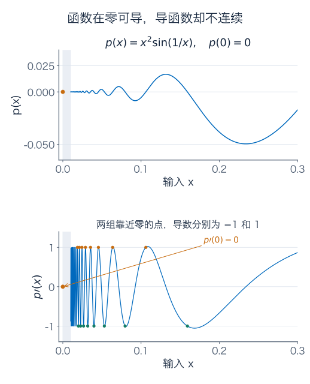

因此，在一个点有导数，不保证导函数在这个点连续。若一个区间上导数存在且导函数也连续，才称函数在该区间为 $C^1$。图只显示零点右侧，靠零过密的一小段振荡省略了；函数本身也在左侧有定义。结论来自刚才的差商与两列输入，不依赖像素能否画全。

再看一串更直接与误差有关的例子。在 $[-1/2,1/2]$ 上，令

$$
f_n(x)=\frac{\sin(nx)}n.
$$

每一条曲线在任何位置的高度都不超过 $1/n$。给定一个正误差，只要 $n$ 足够大，整条曲线同时都落在误差带内；这叫一致趋于零。

但它的导数为 $f_n'(x)=\cos(nx)$：缩小高度的 $1/n$，被越来越快的振荡带来的变化率 $n$ 抵消了。尤其在零点，每条导数都是 1；而零函数的导数是 0。

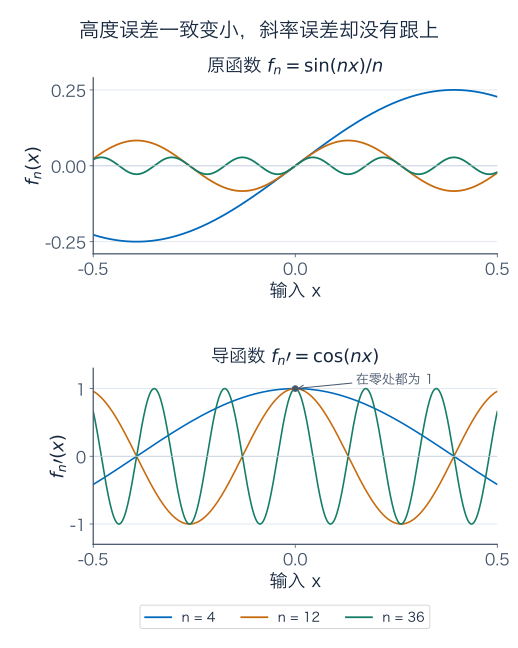

这说明只凭函数值一致接近，不能交换“先取极限”和“先求导”的顺序。求导对加法、常数倍仍然是线性的，这条性质并没有失效；失去的是仅凭高度误差就控制导数误差的保证。

以后在[函数列](06-级数、幂级数与函数列.md)、[范数与收敛方式](../泛函分析/03-范数与不同的收敛方式.md)中，我们会专门说明怎样衡量“两个函数接近”。那时要先问的就是：你关心的是整条曲线的高度，还是连斜率也要一起准？

## 视频伴读与下一步

- [3Blue1Brown：导数的悖论](https://www.3blue1brown.com/lessons/derivatives/)：对照观察位置、平均速度与切线的联系。
- [3Blue1Brown：链式法则与乘积法则](https://www.3blue1brown.com/lessons/chain-rule-and-product-rule/)：对照观察面积分块和逐层传递的变化。本文用自己的数值问题、推导、图示和练习展开。

下一章会把“一个点附近”的判断扩展到“一整段范围”：已知变化率，能对总变化作什么保证？为什么有些函数的线性预测能给平方误差上限？怎样用导数寻找最大、最小值，同时避免把任何零导数点都误当成最优答案？

---

[数学总导航](../00-%E6%95%B0%E5%AD%A6%E5%AD%A6%E4%B9%A0%E5%AF%BC%E8%88%AA.md) · [本课程目录](00-%E5%AD%A6%E4%B9%A0%E8%B7%AF%E7%BA%BF%E4%B8%8E%E7%AC%A6%E5%8F%B7.md) · [← 上一章](01-%E5%AE%9E%E6%95%B0%E3%80%81%E6%9E%81%E9%99%90%E4%B8%8E%E8%BF%9E%E7%BB%AD.md) · [下一章 →](03-%E4%B8%AD%E5%80%BC%E5%AE%9A%E7%90%86%E3%80%81Taylor%20%E5%B1%95%E5%BC%80%E4%B8%8E%E4%BC%98%E5%8C%96.md)
