[数学总导航](../00-%E6%95%B0%E5%AD%A6%E5%AD%A6%E4%B9%A0%E5%AF%BC%E8%88%AA.md) · [本课程目录](00-%E5%AD%A6%E4%B9%A0%E8%B7%AF%E7%BA%BF%E4%B8%8E%E7%AC%A6%E5%8F%B7.md) · [← 上一章](02-%E5%AF%BC%E6%95%B0%E4%B8%8E%E5%B1%80%E9%83%A8%E7%BA%BF%E6%80%A7%E8%BF%91%E4%BC%BC.md) · [下一章 →](04-%E5%AE%9A%E7%A7%AF%E5%88%86%E4%B8%8E%E5%BE%AE%E7%A7%AF%E5%88%86%E5%9F%BA%E6%9C%AC%E5%AE%9A%E7%90%86.md)

## 区间平均开了 60，途中一定有一刻也是 60 吗

一辆车在一小时内沿直路向前行驶 60 公里。平均速度是 60 公里/小时，但它可能先慢后快。能不能肯定，途中至少有一刻，瞬时速度恰好也是 60？

在位置连续、途中每一刻都可导的模型下，答案是能。先用一个具体模型核算：时间 $t$ 以小时计、位置 $s$ 以公里计，数值关系为

$$
s(t)=40t+20t^2,\qquad 0\le t\le1.
$$

起点位置为 0，一小时后为 60，平均速度为 60；瞬时速度 $s'(t)=40+40t$，在 $t=1/2$ 小时时恰为 60。这里的半小时是这个模型算出来的，一般问题不保证发生在时间中点。

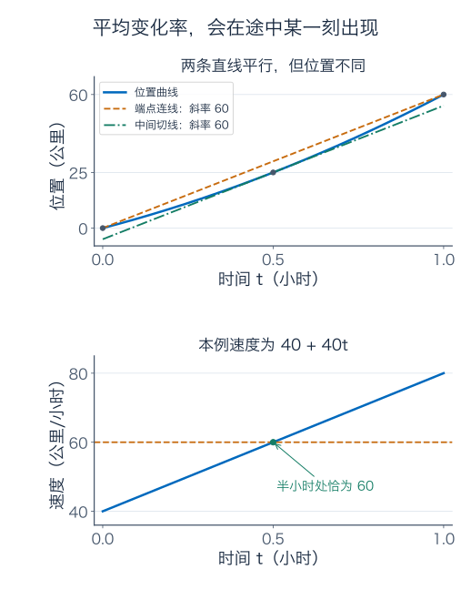

上图中，端点连线记录平均速度，平行切线记录某一刻相同的瞬时速度；下图把速度单独画出来。上一章给了“一个点附近怎么变”的导数，本章要把它接到“整段总共变多少”，再用它控制近似误差和寻找最优方案。

## 为什么会有那条平行切线

先把问题简化：如果一段路的起点和终点高度一样，而且中途没有断裂、尖角，那么沿途应该至少有一处坡度为零。这就是 **Rolle 定理**：$g$ 在 $[a,b]$ 连续、在 $(a,b)$ 可导，且 $g(a)=g(b)$，则某个 $c\in(a,b)$ 满足 $g'(c)=0$。

它依赖上一章之前建立的最值保证：连续函数在闭区间取得最大最小值。如果函数不是常数，至少有一个比端点更高的峰或更低的谷，必在内部取到；如果是常数，所有内部点导数都为零。

为什么内部的可导峰顶斜率为零？峰顶两侧的函数值不超过峰顶值，右侧差商非正，左侧差商非负；若两侧有同一个极限，它只能是零。谷底同理。这里同时用到了“内部”和“可导”，后面找最值时还会回来检查这两项条件。

现在把一般曲线 $f$ 的端点连线记为

$$
\ell(t)=f(a)+m(t-a),\qquad m=\frac{f(b)-f(a)}{b-a}.
$$

从曲线高度中减去这条直线，得到 $g(t)=f(t)-\ell(t)$，其两端都为零。Rolle 定理给出 $g'(c)=f'(c)-m=0$，所以

$$
\boxed{f(b)-f(a)=f'(c)(b-a),\qquad c\in(a,b).}
$$

这就是 **Lagrange 中值定理**。它只要求闭区间上连续、开区间内可导，不额外要求导函数连续。

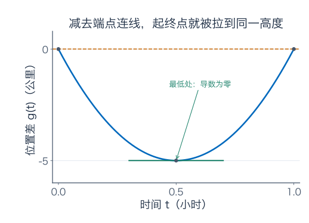

对开头的模型，减去 $60t$ 得到 $g(t)=20t(t-1)$，中间最低处在 $t=1/2$，恰好是原曲线切线斜率等于 60 的地方。“减去整体趋势”，把一般端点问题变回了等高端点问题。

### 条件缺一项，会怎样

$f(x)=|x|$ 在 $[-1,1]$ 的端点同高，但它在零有尖角；其余点的导数只有 $-1$ 或 1，找不到零导数。

另一个例子在 $0\le t<1$ 时取 $f(t)=t$，却单独把 $f(1)$ 填成 2。它在区间内部的导数恒为 1，端点平均变化率却为 2。这里失去的是右端点连续性。

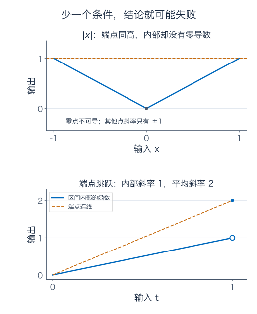

这两个例子说明，图像上“差不多是一条线”不能代替条件检查。中值定理也不负责找出 $c$ 的具体位置，只保证它存在。

## 比找出那个时刻更常用的，是控制总变化

如果某段行驶中有方向的瞬时速度绝对值不超过 80 公里/小时，那么 0.1 小时内的位置变化绝对值不超过 8 公里。在数学上，在满足中值定理条件的一整个区间中，若 $|f'|\le M$，对其中任意 $x,y$，中值定理给出

$$
\boxed{|f(x)-f(y)|\le M|x-y|.}
$$

它是“输入误差最多放大多少”的统一保证，也叫 Lipschitz 估计。注意界必须在连接 $x,y$ 的整段区间有效；只知道起点斜率小，并不能保证后面不会突然变陡。

同样，在这些条件下，若区间内部 $f'\ge0$，任意 $x<y$ 都有 $f(y)-f(x)=f'(c)(y-x)\ge0$，所以函数单调不减；若内部处处 $f'>0$，则严格递增。若内部处处 $f'=0$，函数在这个区间上只能是常数。后面的练习会说明，不能随意把“区间”换成互不相连的几段。

## 从少买的一小块桌布，走进二阶近似

一张圆桌半径 1 米，现在半径增加 1 厘米，也就是 $h=0.01$ 米，桌面面积增加多少？

精确计算是

$$
\pi(1+h)^2-\pi=2\pi h+\pi h^2.
$$

导数 $A'(1)=2\pi$ 给出的线性预测是 $2\pi h=0.02\pi$ 平方米；真实增量为 $0.0201\pi$。漏掉的 $0.0001\pi$ 平方米，乘 $10000$ 换成平方厘米，是约 3.14 平方厘米。

这不是神秘的“高阶项”：它就是本次线性估计少算的一小块面积。二阶近似把 $\pi h^2$ 补上，恰好得到精确答案，因为面积本来就是二次函数。但对于一般曲线，补到二阶后还会有余项，需要另外估计。

### 自己造出指数函数的近似式

想在零附近用 $P_2(x)=a+bx+cx^2$ 近似 $e^x$，先让它们在零有相同高度，再有相同斜率，最后让二阶导数相同：

$$
P_2(0)=a=1,\qquad P_2'(0)=b=1,\qquad P_2''(0)=2c=1.
$$

因此 $P_2(x)=1+x+x^2/2$。继续添 $dx^3$，三阶导数在零为 $6d$，匹配 $e^0=1$ 后有 $d=1/6$。系数里的阶乘来自反复求导产生的乘数。

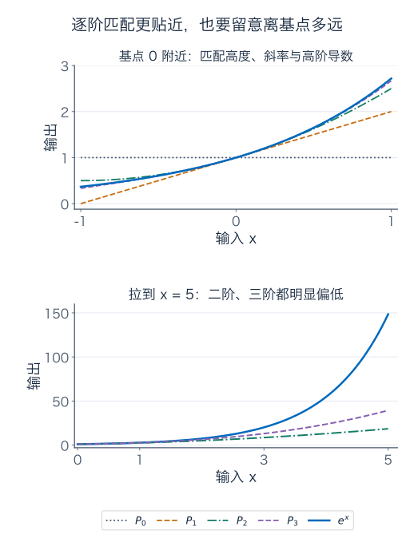

在一般基点 $a$，把幂写成 $(x-a)^k$，求 $k$ 阶导数后在 $a$ 处只留下 $k!$，就得到 **Taylor 多项式**：

$$
P_n(x)=\sum_{k=0}^n\frac{f^{(k)}(a)}{k!}(x-a)^k.
$$

$f^{(k)}$ 表示第 $k$ 阶导数，约定 $f^{(0)}=f$、$0!=1$。它匹配到第 $n$ 阶导数，尚未说明在某个具体输入处误差够不够小。

## Taylor 定理真正多给了什么：余项的保证

使用一个容易检查的条件版本：假设 $f$ 在包含 $a$ 与 $x$ 之间线段的开区间上，有直到第 $n+1$ 阶的连续导数。则存在夹在 $a,x$ 之间的 $\xi$，使

$$
\boxed{f(x)=P_n(x)+R_n(x),\qquad
R_n(x)=\frac{f^{(n+1)}(\xi)}{(n+1)!}(x-a)^{n+1}.}
$$

这叫 Lagrange 余项。$\xi$ 通常不知道，而且会随输入和阶数改变；有用的是，只要在**整段区间**上找到 $|f^{(n+1)}|\le M_{n+1}$，就有

$$
\boxed{|R_n(x)|\le\frac{M_{n+1}}{(n+1)!}|x-a|^{n+1}.}
$$

先选工作区间，再界定导数，再代入输入距离。跳过前两步，单写“忽略高阶项”，还没有给出精度保证。

### 它为什么也是中值定理的一家人

先设 $x>a$。把实际误差暂时写成 $K(x-a)^{n+1}$，这里 $K$ 是由该输入的误差决定的数。构造

$$
H(t)=f(t)-P_n(t)-K(t-a)^{n+1}.
$$

我们刻意令 $H(a)=H(x)=0$；多项式的导数匹配又保证 $H'(a)=\cdots=H^{(n)}(a)=0$。由 Rolle 定理，$H'$ 在两点之间有个零点；把这个零点和 $a$ 处的 $H'(a)=0$ 配对，再用一次 Rolle，得到 $H''$ 的零点。

如此重复 $n+1$ 次，得到某个 $\xi\in(a,x)$ 满足

$$
H^{(n+1)}(\xi)=f^{(n+1)}(\xi)-(n+1)!K=0.
$$

解出 $K$ 就得到余项公式。$x<a$ 时沿反方向使用同样的零点链。所谓高阶误差公式，原来是把“端点相等，中间有水平处”的想法重复使用。

特别取 $n=1$，若二阶导数在附近被 $M_2$ 控制，就得到线性近似误差不超过 $M_2h^2/2$。上一章可导只保证 $o(h)$；现在能保证平方误差，是因为加入了对二阶导数的控制。

## 近似到几位小数，要看舍入边界

取 $e^{0.1}$，二阶多项式给出

$$
P_2(0.1)=1+0.1+0.005=1.105.
$$

要估计第三阶导数，不能拿未知真值的精细小数来证明自己。可以先得到一个独立粗界：对 $0\le t<1$，令 $q(t)=-\log(1-t)-t$，则 $q(0)=0$、$q'(t)=t/(1-t)\ge0$，所以

$$
t\le-\log(1-t),\qquad e^t\le\frac1{1-t}.
$$

因此在 $[0,0.1]$ 上，指数的各阶导数都不超过 $10/9$。第三阶导数为正，且 $0.1^3>0$，于是二阶余项满足

$$
0<R_2(0.1)\le\frac{10/9}{6}(0.1)^3
=\frac1{5400}\approx0.0001851852.
$$

真实值便被夹在 $1.105$ 与约 $1.1051851852$ 之间。保留三位小数时，舍入到 $1.105$ 的范围是 $[1.1045,1.1055)$；整个保证区间都在里面，所以**三位小数可以放心写成 1.105**。只知道误差小于 0.001，反而不一定足以保证同一个三位小数结果，关键是有没有跨过舍入边界。

若希望四位小数，再补三次项：

$$
P_3(0.1)=1.105166666\ldots,
\qquad 0<R_3(0.1)\le\frac1{216000}.
$$

由此得到的区间约为 $[1.1051666667,1.1051712963]$，完全位于舍入为 $1.1052$ 的范围 $[1.10515,1.10525)$ 内，故四位小数也有保证。

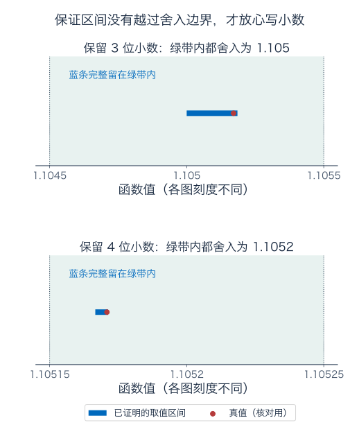

图中的真值标记只作事后核对，证明依赖的是蓝色保证区间。上面的循环小数和舍入后的端点用于阅读，严格计算使用 $P_2+1/5400$、$P_3+1/216000$ 这些精确表达式。真值约为 $1.1051709181$，与两个保证都相符。

同一个二阶多项式拿到 $x=5$，却只给出 $18.5$，而 $e^5$ 约为 $148.41$。局部近似必须连同距离和余项一起使用。

## 再做一次：把平方根的二次修正补回来

令 $f(h)=\sqrt{1+h}$，在零点有

$$
f(0)=1,\qquad f'(0)=\frac12,\qquad f''(0)=-\frac14.
$$

因此估计 $\sqrt{1.04}$ 时，取 $h=0.04$：

$$
P_2(h)=1+\frac h2-\frac{h^2}{8},\qquad P_2(0.04)=1.0198.
$$

这次三阶导数为 $f^{(3)}(h)=3/[8(1+h)^{5/2}]$。在 $[0,0.04]$ 上为正且不超过 $3/8$，所以

$$
0<R_2(0.04)\le\frac{3/8}{6}(0.04)^3
=\frac{(0.04)^3}{16}=0.000004.
$$

得到 $1.0198\le\sqrt{1.04}\le1.019804$，真值约为 $1.0198039027$。线性预测为 1.02，二次项把主要偏差补回来了；余项又说明二阶预测略偏小。

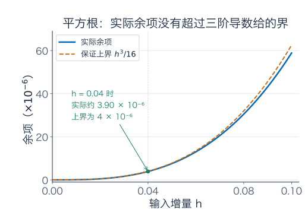

这个 $h^3/16$ 界用于图中的 $h\ge0$。不能照搬到 $h=-0.99$ 附近：靠近 $-1$ 时，三阶导数的分母会很小，原先的 $3/8$ 上界已经失效。

## 围栏怎么摆，才能圈出最大的地

有一面足够长的直墙，拿 40 米围栏围出一个长方形，靠墙的一边不用围。把两条垂直墙的边长记为 $x$，平行墙的另一边记为 $y$，约束是

$$
2x+y=40,\qquad y=40-2x.
$$

所以面积只剩一个变量：

$$
A(x)=x(40-2x),\qquad 0<x<20.
$$

为比较边界，也把 $x=0,20$ 的退化情形记入闭区间，面积均为零。内部求导得到 $A'(x)=40-4x$，在 $x=10$ 时为零；对应 $y=20$，面积为 200 平方米。

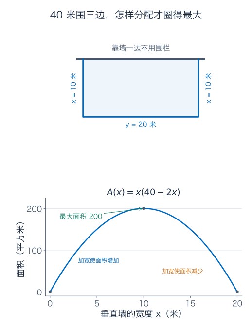

现在才是确认最优的步骤：$x<10$ 时导数为正，继续加宽会增加面积；$x>10$ 时导数为负，继续加宽反而减少面积。结合边界值，200 确实是全局最大值。

还可配方得到更直接的证明：

$$
A(x)=200-2(x-10)^2\le200.
$$

它顺便告诉你偏离方案的代价：$x$ 比 10 多或少 1 米，另一边按约束调整后，面积都会少 2 平方米。极值点附近一阶变化消失，主要损失就由二次项决定。

### 导数为零，只是候选资格

内部可导极值点一定满足 $f'=0$，但反过来不成立。$x^2$、$-x^2$、$x^3$、$x^4$ 在零的导数全为零，分别是谷底、峰顶、水平穿过、较平的谷底。

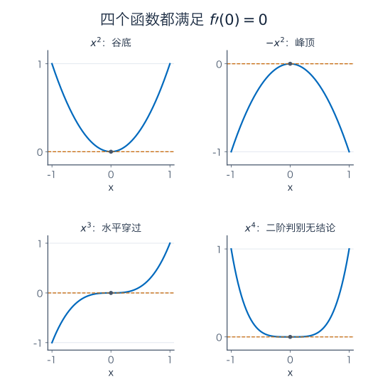

若 $f$ 在 $c$ 附近二阶连续可导，且 $f'(c)=0$、$f''(c)>0$，连续性保证足够近的二阶导数仍为正。Taylor 公式给出

$$
f(c+h)-f(c)=\frac12f''(\xi)h^2>0\quad(h\ne0\text{ 且足够小}),
$$

所以是严格局部最小值。$f''(c)<0$ 时为严格局部最大值；$f''(c)=0$ 时，这个判别不给结论，$x^3$ 与 $x^4$ 已经展示两种不同结果。

闭区间上找全局最值，要把内部驻点、内部不可导点和端点都纳入比较。比如 $f(x)=x$ 在 $[0,1]$ 的最大值在右端点，那里不需要导数为零；$|x|$ 的最小值则落在不可导点。可行范围本身也是题目的一部分。

## 凸性：什么时候局部的最低点就是全局最低点

设想沿曲线上两点拉一根绳，如果整段曲线不高于这条绳，函数就是**凸的**。正式地，对区间中的 $x,y$ 和 $0\le\theta\le1$，要求

$$
f((1-\theta)x+\theta y)
\le(1-\theta)f(x)+\theta f(y).
$$

左边是两输入之间某点的真实高度，右边是端点高度按同样比例连起来的高度。不要只凭“开口朝上”的说法判断，要看这个不等式。

对区间上二阶可导的函数，$f''\ge0$ 会让 $f'$ 单调不减。用中值定理比较从 $x$ 到 $y$ 的变化，就得到切线下界

$$
\boxed{f(y)\ge f(x)+f'(x)(y-x).}
$$

当 $y>x$，中间斜率不小于起点斜率；$y<x$ 时，斜率与位移符号一起改变，仍得到同一方向的不等式。把以中间点为基点的这条下界分别用于两个端点，再加权相加，便得到上面的凸性条件。

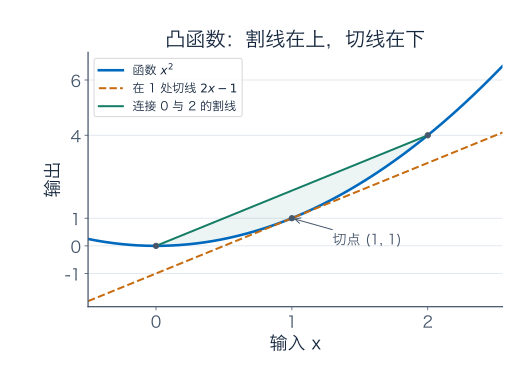

这时若某内部点 $x_*$ 满足 $f'(x_*)=0$，切线下界立刻给出所有 $y$ 上 $f(y)\ge f(x_*)$，所以它是全局最小点。

若对不同端点和内部比例，上面的凸性不等式始终严格，就叫严格凸。严格凸的最小点至多一个：若有两个不同的最小点，中间的值还得更小，矛盾。但**至多一个不等于一定存在**；$e^x$ 严格凸，在整个实轴上却只是趋近下确界 0，从不取到它。存在性仍需定义域和边界等额外信息。

## 把有限阶公式一直写下去，能自动得到原函数吗

有限阶 Taylor 公式是带余项的等式。要写成无穷级数

$$
f(x)=\sum_{k=0}^{\infty}\frac{f^{(k)}(a)}{k!}(x-a)^k,
$$

还要证明固定 $x$ 时 $R_n(x)\to0$；无穷求和指的是多项式部分和的极限。只知道每阶导数都存在，不够。

看一个在零附近“平得过分”的函数：

$$
F(x)=\begin{cases}e^{-1/x^2},&x\ne0,\\0,&x=0.\end{cases}
$$

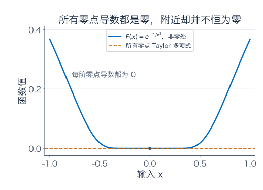

它每一阶零点导数都是零，所以在零的 Taylor 多项式无论写多长都是零；但任意 $x\ne0$，$F(x)>0$。它的 Taylor 级数确实收敛，却收敛到了另一个函数。

为什么所有导数都能为零？非零处每求一次导，结果仍形如 $P(1/x)e^{-1/x^2}$，其中 $P$ 是多项式。指数衰减可以压过任意这样的幂次：令 $u=1/x^2\to\infty$，对任意 $m>0$ 选整数 $K>m/2$。由指数的**有限阶** Taylor 公式和正余项，$e^u\ge u^K/K!$，所以

$$
|x|^{-m}e^{-1/x^2}=u^{m/2}e^{-u}
\le K!u^{m/2-K}\longrightarrow0.
$$

先有 $F(h)/h\to0$，得到 $F'(0)=0$；此后每次在零再求一阶，都只是让上述多项式多带一个 $1/h$，仍被同一类估计压到零。因此可以逐阶证明导数存在且为零，也连续接上非零处的导函数。这个论证没有先假设指数等于无穷级数。

对 $e^x$ 本身，在固定有界区间中，各阶导数都有同一个指数上界，余项中的 $|x|^{n+1}/(n+1)!$ 又趋零，才可以进一步得到熟悉的无穷展开。幂级数章节会继续分析这种收敛范围。

## L'Hôpital 法则：它为什么能用，又为什么不能乱用

常见的做法是把商的分子、分母分别求导后再算极限。但这不是一般商的求导法则，能保留极限需要条件。

先给出一个明确的右侧 $0/0$ 版本：$f,g$ 在 $[a,a+\delta]$ 连续，在 $(a,a+\delta)$ 可导，$f(a)=g(a)=0$，区间内部 $g'\ne0$；若

$$
\lim_{x\downarrow a}\frac{f'(x)}{g'(x)}=L\in\mathbb R,
$$

则 $\lim_{x\downarrow a}f(x)/g(x)=L$。左侧版本同理，两侧结论一致才得到双侧极限。这个表述只讨论有限的 $L$。

证明借助 Cauchy 中值定理：在同一条件下，两函数的端点变化满足

$$
\frac{f(x)-f(a)}{g(x)-g(a)}=\frac{f'(\xi)}{g'(\xi)},\qquad a<\xi<x.
$$

它可以用 Rolle 定理证明：对 $[g(x)-g(a)]f(t)-[f(x)-f(a)]g(t)$ 使用等高端点结论。分母 $g(x)-g(a)$ 不能为零，否则 Rolle 会迫使某处 $g'=0$。当 $x\downarrow a$ 时 $\xi\downarrow a$，于是导数商的极限传给原商。

对一个常用的 $\infty/\infty$ 版本，设 $x\to+\infty$ 时 $f,g\to+\infty$，二者在某个尾区间上可导、$g'\ne0$，且 $f'/g'\to L\in\mathbb R$，也有 $f/g\to L$。理由是：选足够大的固定 $A$ 后，对 $[A,x]$ 使用 Cauchy 中值定理，变化量之比就落在 $L$ 附近；再由 $g(x)\to\infty$，固定起点的 $f(A),g(A)$ 对最终比值的影响趋零。例如 $\log x/x\to0$，导数商为 $1/x\to0$。

使用时先确认属于适用版本，再检查导数商确有极限。$\lim_{x\to0}(1+x)/(1+2x)=1$，不属于 $0/0$ 型；若机械换成导数商，就会错得 $1/2$。反过来，导数商无极限，也不能据此断言原商无极限，练习中会给出一个例子。

## 练习：先尝试，再看后面的完整解答

**题一：导数怎样控制整段。** 用中值定理证明 $|\sin x-\sin y|\le|x-y|$。再说明：为什么 $f'=0$ 推出常数时，要强调定义域是一整个区间？可在 $(-2,-1)\cup(1,2)$ 上构造反例。

**题二：把余项一起带进极限。** 求 $\lim_{x\to0}(e^x-1-x)/x^2$ 与 $\lim_{x\to0}(\sin x-x)/x^3$。写出所用 Taylor 多项式和余项界，不能只在结果旁写“高阶项忽略”。

**题三：三位和四位小数的保证。** 对 $e^{0.1}$，分别写出二阶、三阶近似，并利用 $[0,0.1]$ 上导数界 $10/9$ 给出真值区间。判断它们是否分别足以保证三位小数为 1.105、四位小数为 1.1052，并写出舍入边界。

**题四：换一个平方根。** 用零点的二阶展开估计 $\sqrt{1.08}$。在 $[0,0.08]$ 上给出三阶导数界，说明余项方向与大小，并判断能否保证四位小数。

**题五：围栏更多，但地形也有限制。** 靠直墙，用 60 米围栏围另外三边，设垂直墙的宽度为 $x$。先求没有额外限制时的最大面积和两边尺寸；若场地又要求 $x\le12$ 米，重新求最大值，解释为什么最优点处导数可以不为零。

**题六：把端点也算进去。** 求 $f(x)=x^4-2x^2$ 在 $[-2,2]$ 上的全局最大、最小值及所有取到的位置。列出所有内部驻点和端点，并比较函数值。

**题七：严格凸，为什么还可能找不到最小点。** 用切线下界证明 $e^x\ge1+x$。说明 $e^x$ 在整个实轴上严格凸，却没有全局最小点，区分最小值与下确界。

**题八：别把法则当成按钮。** 分析以下三例能否直接用本章给出的 L'Hôpital 版本，并求原极限：（1）$x\to0$ 时 $(1+x)/(1+2x)$；（2）$x\to0$ 时 $x^2\sin(1/x)/x$；（3）$x\to+\infty$ 时 $\log x/x$。第二例同时检查导数商是否有极限。

### 参考答案与解题过程

#### 题一解答

若 $x=y$，两边都是零。若 $x\ne y$，正弦在连接两点的闭区间连续、内部可导，中值定理给出某个 $c$，使

$$
\sin x-\sin y=\cos c\,(x-y).
$$

由 $|\cos c|\le1$，立即得到所需不等式。输入和输出这里用弧度制，正弦导数的系数才是这样。

若 $f'$ 在整个区间为零，任意两点之间都能用中值定理，得到函数值相同。但在 $D=(-2,-1)\cup(1,2)$ 上，可以令左段恒为 0、右段恒为 1；它在定义域每一点导数都为零，却不是同一个常数。跨两段的连线会经过没有定义的输入，不能把中值定理用在那段缺口上。

#### 题二解答

在 $|x|\le0.1$ 上，指数三阶导数有界，设界为 $M$，如取 $M=e^{0.1}$。Taylor 公式给出

$$
e^x=1+x+\frac{x^2}{2}+R_2(x),\qquad
|R_2(x)|\le\frac{M|x|^3}{6}.
$$

减去首两项、除以 $x^2$，余项绝对值不超过 $M|x|/6\to0$，因此第一个极限为 $1/2$。

对正弦用四阶 Taylor 公式；四次项系数为零，所以多项式仍是 $x-x^3/6$，但第五阶导数绝对值不超过 1，得到

$$
\sin x=x-\frac{x^3}{6}+R_4(x),\qquad
|R_4(x)|\le\frac{|x|^5}{120}.
$$

除以 $x^3$ 后，余项绝对值不超过 $x^2/120\to0$，故第二个极限为 $-1/6$。这里对正负 $x$ 都作了绝对值估计。

#### 题三解答

二阶值为 $P_2=1.105$，三阶值为 $P_3=6631/6000=1.105166666\ldots$。在正输入 0.1 处，指数各阶导数都为正，因此两个余项都为正。

利用 $M=10/9$，

$$
0<R_2\le\frac{10/9}{3!}(0.1)^3=\frac1{5400},
\qquad
0<R_3\le\frac{10/9}{4!}(0.1)^4=\frac1{216000}.
$$

第一段严格保证区间为 $[P_2,P_2+1/5400]$，它包含在 $[1.1045,1.1055)$ 内，因此保留三位小数为 1.105。第二段为 $[P_3,P_3+1/216000]$，它包含在 $[1.10515,1.10525)$ 内，因此保留四位小数为 1.1052。

这两个保证都成立。二阶区间却不能单独保证四位小数，因为其中不同位置可能舍入到 1.1050、1.1051 或 1.1052；并非余项小，就能不看舍入边界。

#### 题四解答

令 $h=0.08$，二阶多项式给出

$$
P_2=1+0.04-\frac{0.08^2}{8}=1.0392.
$$

区间上 $f^{(3)}(t)=3/[8(1+t)^{5/2}]$ 为正且不超过 $3/8$，所以

$$
0<R_2\le\frac{3/8}{6}(0.08)^3
=\frac{0.08^3}{16}=0.000032.
$$

因此 $\sqrt{1.08}\in[1.0392,1.039232]$，二阶预测偏小。整个区间都落在舍入为 1.0392 的范围 $[1.03915,1.03925)$ 内，足以保证四位小数。真值约为 $1.0392304845$，用于核对，确实满足这个范围。

#### 题五解答

约束为 $2x+y=60$，所以 $A(x)=x(60-2x)$，非退化范围为 $0<x<30$。求导有 $A'=60-4x$，驻点 $x=15$，对应 $y=30$，面积为 450 平方米。

配方 $A=450-2(x-15)^2$，证明此值是整个可行范围的唯一最大值。也可用导数在 15 左正右负来检查，再与退化边界面积零比较。

加入 $x\le12$ 后，原驻点不再可行。在 $0<x\le12$ 内，$A'=60-4x\ge12>0$，面积一直递增，所以最大值在允许的右端点 $x=12$ 取到。此时 $y=36$，面积为 $12\times36=432$ 平方米。

这里 $A'(12)=12\ne0$，不违反内部可导极值的必要条件，因为 12 已经是新的可行范围边界。再加宽虽会继续增加面积，却不符合题目限制。

#### 题六解答

函数是多项式，在闭区间连续，必能取得最大最小值。导数

$$
f'(x)=4x^3-4x=4x(x-1)(x+1)
$$

给出内部驻点 $-1,0,1$，再加端点 $-2,2$。没有其他内部不可导点。

| 候选点 | 函数值 | 位置来源 |
| --- | --- | --- |
| $-2$ | 8 | 左端点 |
| $-1$ | $-1$ | 内部驻点 |
| 0 | 0 | 内部驻点 |
| 1 | $-1$ | 内部驻点 |
| 2 | 8 | 右端点 |

所以全局最小值为 $-1$，在 $x=\pm1$ 取到；全局最大值为 8，在 $x=\pm2$ 取到。原点只是内部的局部峰顶，并非全局最大点。

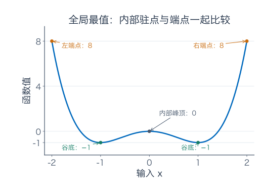

#### 题七解答

指数满足 $(e^x)''=e^x>0$，因此严格凸。在基点 0，函数值和导数都是 1，切线下界为

$$
e^x\ge e^0+(e^x)'\big|_{x=0}(x-0)=1+x.
$$

但最小值的存在不能从严格凸单独推出：对任意实数 $x$，$e^x>0$，而 $x\to-\infty$ 时可以任意接近零，所以所有函数值的下确界为 0，却没有输入使函数值为零。它没有全局最小点。严格凸只排除了两个不同的最小点，并没有补上定义域无穷远处那个没有取到的值。

#### 题八解答

（1）分子和分母都趋于 1，直接由连续性得到极限 1，不属于 $0/0$ 或本章的 $\infty/\infty$ 版本。若错用导数商，会得到 $1/2$，正说明条件不能省略。

（2）原商在 $x\ne0$ 时化简为 $x\sin(1/x)$，绝对值不超过 $|x|$，所以极限为 0。分子、分母确实都趋零，但导数商为

$$
2x\sin(1/x)-\cos(1/x).
$$

沿 $x_n=1/(2\pi n)$ 它恒为 $-1$，沿 $y_n=1/((2n+1)\pi)$ 恒为 1，因此没有极限。缺少导数商极限条件，不能靠这条法则作结论；原极限仍然可以存在，夹逼已经证明它存在。

（3）在 $x\to+\infty$ 时，$\log x$ 与 $x$ 都趋于正无穷；在 $x>1$ 二者可导，分母导数为 1，导数商为 $1/x\to0$。符合本章的无穷远版本，因此原极限为 0。

## 继续阅读时，把哪几件事放在一起

中值定理把一个区间内的导数控制变成整体变化控制；Taylor 定理进一步告诉你多项式近似会漏掉多少；优化则把导数给出的候选点放回可行范围里，比较并证明最优。局部斜率、全段保证、边界条件，缺了哪一项，结论都可能变。

下一章转向积分：已知每一小段贡献多少，怎样累积成总量。导数与积分之间的联系，也会再次依靠今天的连续性与误差控制。

### 几何伴读与正式表述

- [3Blue1Brown：Taylor 级数](https://www.3blue1brown.com/lessons/taylor-series/)：配合观察逐阶匹配局部形状。本文的具体问题、数值保证、图和练习为独立编写。
- [Jiří Lebl：中值定理](https://www.jirka.org/ra/html/sec_mvt.html)：查阅内部极值、Rolle、中值定理与 Cauchy 中值定理的条件。
- [Jiří Lebl：Taylor 定理](https://www.jirka.org/ra/html/sec_taylor.html)：查阅有限阶余项及无穷级数与原函数之间的区别。

---

[数学总导航](../00-%E6%95%B0%E5%AD%A6%E5%AD%A6%E4%B9%A0%E5%AF%BC%E8%88%AA.md) · [本课程目录](00-%E5%AD%A6%E4%B9%A0%E8%B7%AF%E7%BA%BF%E4%B8%8E%E7%AC%A6%E5%8F%B7.md) · [← 上一章](02-%E5%AF%BC%E6%95%B0%E4%B8%8E%E5%B1%80%E9%83%A8%E7%BA%BF%E6%80%A7%E8%BF%91%E4%BC%BC.md) · [下一章 →](04-%E5%AE%9A%E7%A7%AF%E5%88%86%E4%B8%8E%E5%BE%AE%E7%A7%AF%E5%88%86%E5%9F%BA%E6%9C%AC%E5%AE%9A%E7%90%86.md)
