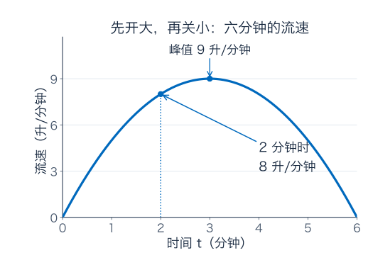
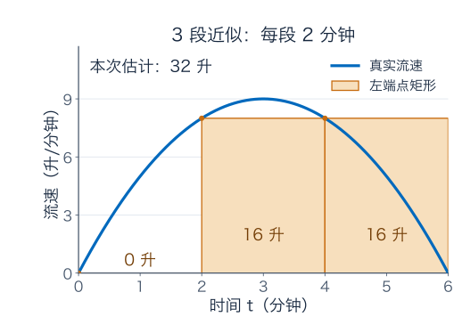
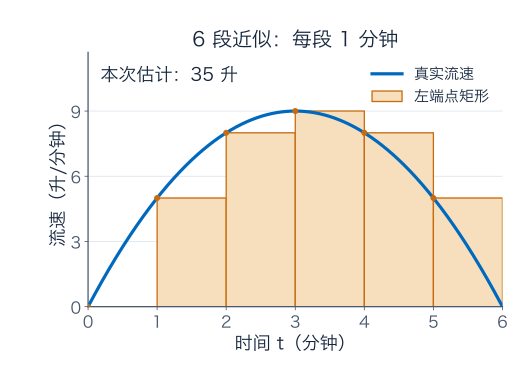
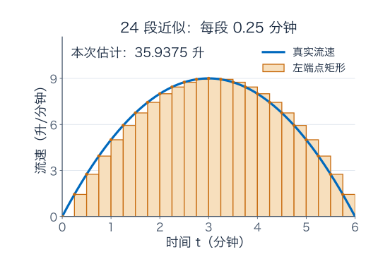
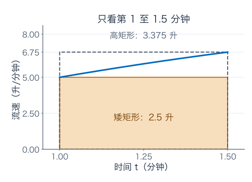
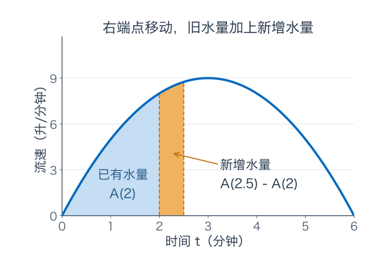
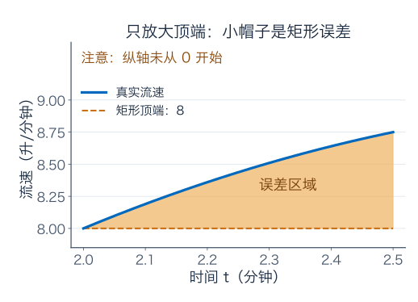
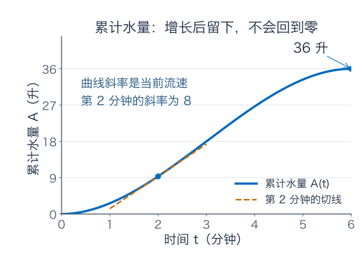
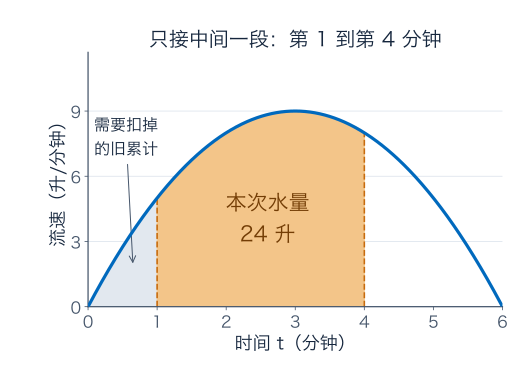
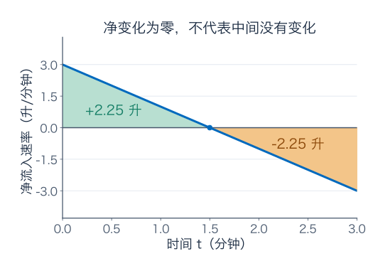

[数学总导航](../00-%E6%95%B0%E5%AD%A6%E5%AD%A6%E4%B9%A0%E5%AF%BC%E8%88%AA.md) · [本课程目录](00-%E5%AD%A6%E4%B9%A0%E8%B7%AF%E7%BA%BF%E4%B8%8E%E7%AC%A6%E5%8F%B7.md) · [← 上一章](03-%E4%B8%AD%E5%80%BC%E5%AE%9A%E7%90%86%E3%80%81Taylor%20%E5%B1%95%E5%BC%80%E4%B8%8E%E4%BC%98%E5%8C%96.md) · [下一章 →](05-%E7%A7%AF%E5%88%86%E6%8A%80%E5%B7%A7%E3%80%81%E5%8F%8D%E5%B8%B8%E7%A7%AF%E5%88%86%E4%B8%8E%E6%A6%82%E7%8E%87.md)

这章只解决一件事：**知道水每一刻流得多快，怎样算一段时间里总共接了多少水？**

我们会先用乘法算，再用小矩形估计，接着弄清估计为什么能变准确。到那时，积分符号和“求原函数”才会出现。你不需要提前相信微积分基本定理；我们要把它从这个问题里一步步做出来。

建议准备纸笔，图里每个轴都有单位。蓝色曲线表示流速，橙色矩形表示某一次近似；“升/分钟”和“升”会一直分开写。看图时先认单位，再看形状。

## 1．水表坏了，但流速计还在工作

你拿一个空桶接水，水龙头旁的仪器只显示“现在每分钟流出多少升”，不显示累计水量。你接了六分钟，想知道桶里有多少水。

先想最容易的情况：仪器从头到尾都显示每分钟 2 升，那么六分钟就是

$$
2\ \text{升/分钟}\times6\ \text{分钟}=12\ \text{升}.
$$

这不需要微积分。它成立的关键，是这六分钟里流速不变。

如果前两分钟是每分钟 2 升，后四分钟是每分钟 5 升，也不困难。分开计算：前段 4 升，后段 20 升，总共 24 升。你实际上已经使用了积分最重要的一种思路：**整段不好一次处理，就分段算，再加起来。**

注意，不能把两个流速取普通平均得到 3.5，再乘 6，算成 21 升。两个流速持续的时间不同，需要按时长加权。这个小错误会提醒我们：只知道若干流速读数，还必须知道每个读数代表多长一段时间。

现在把难度增加一点。水龙头逐渐开大，再逐渐关小，每一刻都在变。我们用下面这个平滑模型描述六分钟的过程：

$$
q(t)=t(6-t)=6t-t^2,\qquad0\le t\le6.
$$

这里 $t$ 用分钟计，$q(t)$ 的数值用升/分钟计；模型系数已包含对应单位。这是为了方便计算而选的理想模型，不是说所有水龙头都按抛物线工作。

| 开始后多久 $t$（分钟） | 此刻流速 $q(t)$（升/分钟） |
| --- | --- |
| 0 | 0 |
| 1 | 5 |
| 2 | 8 |
| 3 | 9 |
| 4 | 8 |
| 5 | 5 |
| 6 | 0 |

**图 1 怎么读：** 横轴上走到 2 分钟，再向上找到曲线，读到的是“第 2 分钟这一刻，流速为每分钟 8 升”。它没有说前两分钟已经接了 8 升。一个是速率，一个是累积量，单位就不同。

我们马上会发现，总水量是 36 升。但先别把 36 当成答案背下来。接下来要弄懂的是：没有原函数公式时，我们凭什么接近它，又凭什么知道越来越细的估计真的有用？

## 2．不知道怎样处理不断变化，就暂时把它当成不变

先把六分钟分成三段，每段两分钟：$[0,2]$、$[2,4]$、$[4,6]$。

在每段里，都偷一个小懒：用该段开始时的流速，代替这两分钟内的全部流速。这叫左端点近似，因为我们取每段左端的读数。

第一段取 $q(0)=0$，估计水量为 $0\times2=0$ 升；第二段取 $q(2)=8$，估计为 16 升；第三段取 $q(4)=8$，也估计为 16 升。加起来得到

$$
Q_3=0\times2+8\times2+8\times2=32\ \text{升}.
$$

**图 2 怎么读：** 每个橙色矩形的宽是两分钟，高是这段开始时的流速。宽乘高才是水量。第一个矩形高度为零，所以看不见填色；这不表示真实前两分钟没有水，只表示这次粗糙近似把它漏掉了。

你可能已经看出两种错误：水龙头开大的前半段，开始时的流速偏小，矩形会漏掉水量；关小的后半段，开始时的流速偏大，矩形又会多算。

因此不要立刻记成“左端点一定低估，右端点一定高估”。**只有在整个小区间上流速单调增加时，这个判断才成立；如果单调减少，方向会反过来。** 这条曲线先增后减，整段的误差需要把两边合起来看。

这一点也说明，我们不是在假装水龙头真的会每两分钟突然变一次。阶梯是计算方法，平滑曲线才是模型中的实际流速。近似的目的，是把一个不会算的问题暂时替换成会算的乘法。

## 3．把时间切细，算出来的数怎样变化？

改成每分钟取一次左端流速，六个读数是 $0,5,8,9,8,5$，每个都代表一分钟，于是

$$
Q_6=(0+5+8+9+8+5)\times1=35\ \text{升}.
$$

再把每段缩成半分钟，十二个矩形给出 35.75 升。用 24 个矩形，得到 35.9375 升。图上不是把同一张图换个颜色，而是每次都真正按新的宽度重新取样、重新计算面积。

| 分成几段 $N$ | 每段多长 $\Delta t$（分钟） | 左端点估计（升） |
| --- | --- | --- |
| 3 | 2 | 32 |
| 6 | 1 | 35 |
| 12 | 0.5 | 35.75 |
| 24 | 0.25 | 35.9375 |
| 60 | 0.1 | 35.99 |

先解释这个过程，再看它的一般式。把六分钟均匀分成 $N$ 段，每段宽度是 $\Delta t=6/N$。第 $i$ 段的左端时刻为 $t_i=i\Delta t$，左端点估计就是

$$
Q_N=\sum_{i=0}^{N-1}q(t_i)\,\Delta t.
$$

不要一眼跳过求和号。它只是在压缩刚才那句重复了很多遍的话：**到一个时刻读流速，乘上它代表的时长，然后把所有小段加起来。**

对这个特定的抛物线，还能把和算到最后：

$$
\begin{aligned}
Q_N
&=\sum_{i=0}^{N-1}
\left(6\frac{6i}{N}-\frac{36i^2}{N^2}\right)\frac6N\\
&=\frac{216}{N^2}\sum_{i=0}^{N-1}i
-\frac{216}{N^3}\sum_{i=0}^{N-1}i^2\\
&=\frac{216}{N^2}\frac{N(N-1)}2
-\frac{216}{N^3}\frac{N(N-1)(2N-1)}6\\
&=36-\frac{36}{N^2}.
\end{aligned}
$$

这里用到两个有限求和公式。没记住它们也不会妨碍理解积分；这一段只是把表里的规律核算出来。它说明我们这套特定估计会靠近 36，且 $N$ 翻倍时，与 36 的差缩小到原来的四分之一。

不过，只证明一种取样法靠近某个数，还不够解释“真实水量为什么也是那个数”。下一步，我们要给真实水量也套上上下界。

## 4．先别相信近似：能不能保证真实答案落在哪里？

先看一小段，从第 1 分钟到第 1.5 分钟。在这半分钟里，流速持续增加，从 $q(1)=5$ 增到 $q(1.5)=6.75$。

就算我们还不会算精确水量，也知道：如果全程都按较小的每分钟 5 升来算，会得到 2.5 升；如果全程都按较大的每分钟 6.75 升来算，会得到 3.375 升。真实流速一直夹在这两个值之间，因此这一段真实水量必在两者之间。

**图 5 怎么读：** 蓝色曲线不是矩形边界。实线框出的矮矩形全部位于曲线下方，虚线框出的高矩形把曲线下方的区域完整包住。两块矩形差出的部分，就是我们尚未确定的水量范围。图只展示这一段，不与整段六分钟共用横轴比例。

把这个做法用到每个小区间：每段取最小流速乘时长，得到下估计；取最大流速乘时长，得到上估计。总下估计一定不超过真实总量，总上估计一定不小于真实总量。

对每分钟一段的六段划分，下估计为

$$
0+5+8+8+5+0=26\ \text{升},
$$

上估计为

$$
5+8+9+9+8+5=44\ \text{升}.
$$

这份区间很宽，但它有一个与“35 看起来不错”不同的作用：**它是一份保证，真实值逃不出 $[26,44]$。**

把划分继续细化，就能缩小这个保证区间。对本例，使用偶数个等宽小段，使峰值时刻 $t=3$ 也是分点，可得到：

| 小段数 | 下估计（升） | 上估计（升） | 尚未确定的范围有多宽（升） |
| --- | --- | --- | --- |
| 6 | 26 | 44 | 18 |
| 12 | 31.25 | 40.25 | 9 |
| 24 | 33.6875 | 38.1875 | 4.5 |
| 60 | 35.09 | 36.89 | 1.8 |
| 600 | 35.9099 | 36.0899 | 0.18 |

当小段细到这种上下估计可以任意接近时，它们之间夹住的就是一个确定数。这个被夹出来的数，才是我们要定义的积分。

这里顺便分清两件事：某一种算法可能算得很准，而一个通用的上下界可能仍比较保守。比如 60 段的左端点估计其实只差 0.01 升，但我们没有利用误差精细抵消时，上下界给出的范围会更宽。这不是矛盾，而是“实际误差”与“保证上界”的区别。

## 5．小矩形越来越小，为什么总和没有变成零？

这是一个很值得停下来的疑问。每个小矩形的宽都趋于零，单块水量也趋于零，为什么加起来还会是 36？

因为小块变小的同时，小块数量也在增加。恒定流速每分钟 2 升、持续六分钟时，分成 $N$ 块，每块水量是 $2\times6/N=12/N$ 升；总共有 $N$ 块，相加始终是 12 升。

不能只让单块趋零，却忘了项数同时趋于无穷。积分极限处理的是**整个和**的变化，不是先把每一项变成零，再去相加。

同样也不需要想象一个“宽度等于零但仍有面积”的矩形。每次实际近似都使用正宽度 $\Delta t$，每次求和都是有限次。最后取的是这些有限结果的极限。

此时再写积分符号，就有了明确的内容：

$$
\int_0^6q(t)\,dt
=\lim_{N\to\infty}\sum_{i=0}^{N-1}q(t_i)\,\Delta t
=36\ \text{升}.
$$

左边读作“从零到六对流速累积”。下限 0、上限 6 指定观察时段；$q(t)$ 是被累积的速率；$dt$ 指明沿时间方向累积，也保留着“速率乘时间”的单位关系。

还需要补一条严格要求：Riemann 积分不只看等宽、左端点这一种方法。允许小段不等宽，也允许每段在任意位置取样；只要**最长小段的长度趋于零**，所有这样的和都应趋向同一个数。

为什么强调最长一段？如果总段数越来越多，却始终把前两分钟留成一个粗块，后四分钟切得再碎，也没有把整个区间都处理精细。我们需要所有局部近似都进入足够小的尺度。

对闭区间上的连续函数，这种与划分、取样无关的极限确实存在；连续函数在紧区间上一致连续，保证每个足够短的小段内振幅都能被统一控制。这是前面上下界最终能合拢的数学依据。对于不连续函数，是否可积则需要另外检查。

## 6．现在换个问法：不只问六分钟，而是问“到现在为止”

刚才我们求的是一个数：六分钟总共多少升。现在想让电脑随时显示累计水量，就需要一条随结束时刻变化的曲线。

把“从开始到第 $T$ 分钟接到的水量”记为 $A(T)$：

$$
A(T)=\int_0^Tq(t)\,dt.
$$

这里特意把上限写成大写 $T$，把被积分的时间写成小写 $t$，是为了区分工作：$T$ 是你可以拖动的结束时刻；$t$ 是累加过程中沿途经过的时间。它们不是两个不同的物理时间，只是两个不同角色的记号。

也可以写 $A(T)=\int_0^Tq(u)\,du$，意思完全相同。积分内部的变量像一条计算流水线的临时编号；真正改变问题的是上下限。

**图 6 怎么读：** 蓝色区域表示 $A(2)$，也就是前两分钟的水量。橙色带表示从 2 分钟到 2.5 分钟新接的水量。右端点移动时，旧水量还在，只是右边又加了一小段。

这条累计曲线有一些无需计算就能判断的性质：$A(0)=0$；六分钟内 $q\ge0$，所以 $A$ 不会往下走；流速大的时候，累计水量应该增长得更快；关水时，累计水量仍在，但增长会停下来。

这里最值得避免的误读是：“第六分钟流速为零，所以水量回到零。”已经接进桶里的水不会因为关掉水龙头而消失。**流速图会回到横轴，累计水量图则会到达一个平台。**

我们还不知道 $A$ 的表达式，但已经知道它与流速图不可能长成同一形状。这是判断答案的第一道检查。

## 7．基本定理的关键，只藏在新增的这一小条里

想知道 $A(T)$ 的导数，需要比较结束时刻稍微向后移动后的变化：

$$
\frac{A(T+h)-A(T)}h.
$$

分子不是重新计算整个桶的水量，而是只看新增部分：

$$
A(T+h)-A(T)=\int_T^{T+h}q(t)\,dt.
$$

先取 $T=2$，当前流速为 $q(2)=8$。如果只再接很短的 $h$ 分钟，最自然的第一估计就是：新增水量约为“当前流速 8 乘上新增时长 $h$”。

$$
A(2+h)-A(2)\approx8h.
$$

为什么只是近似？因为这段时间里流速还在慢慢增加，真实新增区域不是严格的矩形。为看清那一点差别，把图 6 的橙色带上沿单独放大：

**图 7 怎么读：** 这张图只放大流速接近 8 的顶端，纵轴不从零开始。水平虚线是当前流速 8，曲线在它上方的浅橙色“小帽子”是额外水量。整块矩形的水量仍是 $8h$，没有画出的下半部分不能当作不存在。

现在问一个更精细的问题：$h$ 变小时，这顶小帽子与整块矩形相比，究竟小得有多快？

把 $t=2+s$ 代入流速公式，有

$$
q(2+s)=8+2s-s^2.
$$

对 $0\le s\le h\le1$，流速比 8 多出的部分不超过 $2h$。帽子的宽是 $h$，高度最多 $2h$，所以它的水量最多为 $2h^2$。

于是新增水量满足

$$
0\le A(2+h)-A(2)-8h\le2h^2.
$$

两边除以正的 $h$，得到

$$
0\le\frac{A(2+h)-A(2)}h-8\le2h.
$$

右边随 $h\downarrow0$ 趋于零，因此这段新增时间里的平均流速会趋于 8。**帽子不会在有限宽度时凭空消失；只是它除以时长后的贡献，能被压到任意小。**

你可以把“误差更小”具体算给自己看：

| 多接多久 $h$（分钟） | 用当前流速估计的新增量 $8h$（升） | 新增量除以 $h$ 后，与 8 的差至多为多少（升/分钟） |
| --- | --- | --- |
| 0.5 | 4 | 1 |
| 0.1 | 0.8 | 0.2 |
| 0.01 | 0.08 | 0.02 |

最后一列是易得的上界，通常比实际误差宽松。它的任务是保证误差趋零，不是追求每一次都最精确。

刚才只用了从右侧增加时间。若从左侧看，$h<0$，可以把同一段小区间反向写出；流速与 $q(2)$ 的差仍由它在这段内的最大变化控制，也趋于零。左右两边得到同一个极限，所以

$$
A'(2)=q(2)=8\ \text{升/分钟}.
$$

## 8．把这一步推广，得到“累计的导数等于当前速率”

第 2 分钟没有什么特殊魔法。换成任意内部时刻 $T$，逻辑仍然一样。

只要 $q$ 在 $T$ 连续，那么给定再小的正数 $\varepsilon$，都能选一个足够短的时间窗口，让窗口里每个流速与 $q(T)$ 相差不到 $\varepsilon$。

这段新增水量与矩形 $q(T)h$ 的差，绝对值就不超过 $\varepsilon|h|$。再除以 $|h|$，便得到

$$
\left|
\frac{A(T+h)-A(T)}h-q(T)
\right|
\le\varepsilon.
$$

如果你愿意把这句话写成一个式子，它就是

$$
\left|
\frac1h\int_T^{T+h}\bigl(q(t)-q(T)\bigr)\,dt
\right|
\le
\sup_{t\text{ 位于 }T\text{ 与 }T+h\text{ 之间}}
|q(t)-q(T)|\longrightarrow0.
$$

右边说的是“这个小窗口里，流速最多偏离当前读数多少”。连续性使它趋于零。这里不需要先知道 $A$ 的公式，也不需要提前计算原函数。

因此，若 $q$ 在整个区间连续，就有

$$
\boxed{\quad
A(T)=\int_0^Tq(t)\,dt
\quad\Longrightarrow\quad
A'(T)=q(T).
\quad}
$$

在端点处，相应理解为单侧导数。这就是微积分基本定理中“由积分得到的累积函数，求导后恢复原函数”的一部分。

为什么这值得被称为基本定理？因为积分原本是一个**处理整段时间、不断细分再取极限**的操作，而导数原本是一个**只看某个时刻附近变化率**的操作。刚才的小帽子论证说明：这两件事能够准确接上。

还要看见连续性在证明里做了什么。若流速在某时刻突然从每分钟 2 升跳到 5 升，累计水量仍连续，但它左边的增长斜率为 2，右边为 5，在跳点处没有共同导数。你不能只背 $A'=q$，却删去这里需要的局部连续条件。

## 9．现在才来找公式：哪条曲线的斜率会等于流速？

我们已经知道 $A'(T)=6T-T^2$。求累计水量可以转成一个逆向问题：找一条函数，使它的导数为 $6T-T^2$。

先处理 $6T$。因为 $(T^2)'=2T$，所以 $(3T^2)'=6T$。

再处理 $-T^2$。因为 $(T^3)'=3T^2$，所以 $(-T^3/3)'=-T^2$。

两部分相加，得到一条候选曲线

$$
G(T)=3T^2-\frac{T^3}{3},\qquad G'(T)=6T-T^2=q(T).
$$

不过 $G(T)+7$、$G(T)-100$ 的导数也一样。导数只知道曲线怎样增长，不知道你把整条曲线向上或向下平移了多少。这就是原函数里要加常数 $C$ 的原因：

$$
G(T)+C=3T^2-\frac{T^3}{3}+C.
$$

我们的问题还给了一条信息：空桶从零分钟开始接水，所以 $A(0)=0$。代入得到 $C=0$，因而

$$
\boxed{A(T)=3T^2-\frac{T^3}{3}.}
$$

现在终于可以完成最开始的计算：

$$
A(6)=3\times36-\frac{216}{3}=108-72=36\ \text{升}.
$$

**图 8 怎么读：** 纵轴现在换成升，不再是升/分钟。第 3 分钟时流速达到最大，累计曲线也在这里最陡；第 6 分钟流速降为零，累计曲线的斜率降为零，但高度仍是 36。

把几个值并排看，区别会更牢：

| 时刻 | 当前流速 $q(T)$（升/分钟） | 已接水量 $A(T)$（升） |
| --- | --- | --- |
| 0 分钟 | 0 | 0 |
| 2 分钟 | 8 | $28/3\approx9.33$ |
| 3 分钟 | 9 | 18 |
| 6 分钟 | 0 | 36 |

用一个时刻的流速乘以全部经过时间，通常不等于累计量。例如第 2 分钟的流速乘两分钟是 16 升，而此前流速从 0 慢慢升到 8，真实累计只有约 9.33 升。错在把“此刻”冒充成“全程”。

## 10．为什么从第 1 分钟算到第 4 分钟，要做“末值减初值”？

现在桶在第 1 分钟才放到水龙头下，第 4 分钟拿走。前一分钟的水不属于你的桶，不能把从零开始的累计量直接算进来。

从零到第 4 分钟接的量，减去从零到第 1 分钟接的量，才是中间三分钟的量。因此

$$
\int_1^4q(t)\,dt=A(4)-A(1).
$$

代入公式：

$$
A(4)=48-\frac{64}{3}=\frac{80}{3},\qquad
A(1)=3-\frac13=\frac83.
$$

相减得 $72/3=24$ 升。

**图 9 怎么读：** 橙色区域是本次要算的水量，左边淡色区域属于已经过去、需要扣掉的前一段。“上限代入减下限代入”不是一条孤立口诀，而是把不属于本次时间窗口的旧累计扣除。

换一个原函数 $G(t)+100$ 会怎样？答案不变，因为

$$
[G(4)+100]-[G(1)+100]=G(4)-G(1).
$$

这解释了定积分计算中为什么不需要单独确定原函数的常数。需要确定绝对累计水量时，初始值决定常数；只需要两时刻之间的变化时，常数自动消掉。

至此可以把计算法写成一般形式：在 $f$ 连续、$G'=f$ 的条件下，

$$
\boxed{\int_a^bf(t)\,dt=G(b)-G(a).}
$$

这就是微积分基本定理的另一个常用表述。它与刚才的 $A'=f$ 相互衔接，却要分清角色：前者说明怎样由累积恢复速率，后者告诉你怎样用一条原函数计算累积量。

## 11．只看两个端点，怎么就把中间所有水量算进去了？

这件事初看像在偷懒。积分明明累积了整个区间，最后却只代两个数，中间的信息去了哪里？

它没有被忽略。**原函数 $G$ 本身已经被要求在每个时刻都满足 $G'=q$。** 你不是随便找一条首尾合适的曲线，而是在整个区间里都匹配了增长速率。

再把六分钟切回每分钟一段。每段的水量分别是

$$
\begin{aligned}
&[G(1)-G(0)],\
&[G(2)-G(1)],\
&[G(3)-G(2)],\
&[G(4)-G(3)],\
&[G(5)-G(4)],\
&[G(6)-G(5)].
\end{aligned}
$$

把它们相加，$+G(1)$ 与 $-G(1)$ 抵消，$+G(2)$ 与 $-G(2)$ 抵消，中间所有值都成对抵消，留下 $G(6)-G(0)$。

这叫望远镜式消去。你在算银行余额变化时也做过同样的事：每天的净变化相加等于最后余额减最初余额。中间发生了很多笔交易，并不妨碍总变化只通过两个余额表达。

不过，这个解释依赖我们已经证明每段水量确实能写成原函数之差。不能把望远镜消去单独拿来当基本定理的全部证明：真正连接“水量极限”与“原函数变化”的桥，仍是第 7—8 节的小帽子论证。

如果你想把整套逻辑核对得更严密：先由积分定义造出 $A$，再证明 $A'=q$；若另外找到 $G'=q$，就有 $(G-A)'=0$。由中值定理，$G-A$ 在区间上是常数。因此 $A(b)-A(a)=G(b)-G(a)$。每一步都有已经建立的依据，不会循环使用想证明的结论。

## 12．为什么积分有时是负的？水难道能有负体积？

换一个生活场景：同一个水箱一边进水，一边排水。定义**净流入速率** $r(t)$：进得比排得多时为正，排得更多时为负。

假设三分钟内净流入速率为

$$
r(t)=3-2t,\qquad0\le t\le3,
$$

仍以升/分钟计。前 1.5 分钟净流入，后 1.5 分钟净流出。

前半段水箱增加的量是一块三角形：$\tfrac12\times1.5\times3=2.25$ 升。后半段减少的量也是 2.25 升。所以

$$
\int_0^3r(t)\,dt=2.25-2.25=0.
$$

这表示水箱最后的水量与开始相同，并不是中间没有水流动。如果开始有 10 升，最后仍有 10 升；从零开始计的积分只记录**变化量**。

若你关心正负变化的总幅度，应算

$$
\int_0^3|r(t)|\,dt=2.25+2.25=4.5\ \text{升}.
$$

这里还要小心措辞：$r$ 是“进水减排水”的净速率，$\int|r|$ 算的是净变化的绝对累计。如果进水管和排水管同时大量通水，只知道净速率，仍不能推断两根管道实际经过的总水量；那需要分别知道两个速率。

用汽车来对照：有符号速度的积分给位移，速度绝对值的积分给路程。在一维运动里，这两个量通常不同。数学上所谓“有符号面积”，就是在提醒我们，横轴上下的贡献要按正负记账。

也由此容易理解方向反转：从 $a$ 积到 $b$ 记录正向累计，从 $b$ 积回 $a$ 就取相反数，约定为

$$
\int_b^af(t)\,dt=-\int_a^bf(t)\,dt.
$$

不是重新发明一份负的几何土地，而是改变累计的方向。

## 13．总量、平均值和概率，怎么在同一张图上分清？

回到六分钟接到 36 升的水龙头。平均流速是

$$
\overline q=\frac{36\ \text{升}}{6\ \text{分钟}}=6\ \text{升/分钟}.
$$

几何上，可以把原来弯曲的图形换成一块宽六分钟、高每分钟 6 升的矩形，保持总面积为 36 升。平均值不是最高流速，也不一定是某个端点读数。

这对电费也适用：功率的积分是能量，用能量除以时长才是平均功率。把“瓦”和“瓦时”混用，与把“升/分钟”和“升”混用，是同一种错误。

你学过概率论，还可以给刚才的图一个新的解释。把整个接水过程中所有水充分混合，再随机挑出一个等体积的小份，问这份水最初是在什么时刻流出来的。流速大的时段贡献更多水，被抽中的可能性也更高。

这个流出时刻的概率密度是

$$
p(t)=\frac{q(t)}{36},\qquad0\le t\le6.
$$

因为 $q\ge0$，而 $\int_0^6p(t)dt=36/36=1$。分母在做归一化：把总共 36 升的权重换成总概率 1。

第 2 到第 4 分钟贡献的水量为

$$
A(4)-A(2)=\frac{80}{3}-\frac{28}{3}=\frac{52}{3}\ \text{升},
$$

所以抽到这个时段流出之水的概率为

$$
\frac{52/3}{36}=\frac{13}{27}\approx48.15\%.
$$

两分钟只占六分钟的三分之一，为什么概率接近一半？因为这段正处于高流速区域，贡献的水量比平均更多。

如果改成“在六分钟里均匀随机选择一个时刻”，落在 $[2,4]$ 的概率才是 $2/6=1/3$。**随机挑一份水，与随机挑一个时刻，是两个不同的抽样方法。** 积分的权重必须跟着问题一起选，不能看到同一横轴就默认均匀分布。

## 14．如果找不到原函数，积分是不是就不存在？

不。要把“这个累计量有没有确定含义”与“能不能用熟悉函数写出公式”分开。

比如一台仪器的速率与 $e^{-t^2}$ 成比例，在 $[0,1]$ 上连续、非负。它的累计量可以用越来越细的矩形确定，Riemann 积分存在，即使原函数不能用有限次常见初等函数组合表达。

更准确地说，$F(x)=\int_0^xe^{-t^2}dt$ 本身就是一个原函数，因为第一部分基本定理保证 $F'=e^{-x^2}$。不存在的是**初等表达式**，不是原函数，也不是累计量。

实际计算可以用数值方法，并附上误差控制。最基础的思想仍是本章的上下界；更高效的方法包括梯形与 Simpson 方法。选哪一种、需要多少段，要看函数的光滑程度和目标精度。具体公式留到需要时再展开，不必把本章读成积分技巧清单。

还有一个容易误判的现象：左端点与右端点的估计相同，也不说明答案已精确。对本章的六段划分，左端点和右端点都算出 35，因为首尾流速相同、内部读数只是移了一格；但真实值是 36。**两种近似碰巧一致，不等于它们已经把真实值夹住。** 下界与上界必须由区间内的最小、最大读数等可靠方式构造。

## 15．练习：把刚才的每一环串起来

先做下面四题，再核对后面的答案与解题过程。

**题一：用小矩形估计，再用原函数核对**

另一台设备的流速是 $f(t)=1+t^2$ 升/分钟，观察 $0\le t\le2$。先分成两段，每段一分钟。请分别计算左端点、右端点与中点估计，再求精确积分，核对各自误差。

**题二：累计量不等于当前流速**

某设备累计量为 $B(t)=t+t^3/3$ 升，问第 2 分钟时流速多少，以及再过 0.01 分钟大约增加多少水。

**题三：积分上限本身也在变化**

设 $H(x)=\int_1^{x^2}\cos t\,dt$，求 $H'(x)$。

**题四：回到原位，也走过了路**

一辆小车的有符号速度为 $v(t)=2-t$ 米/秒，$0\le t\le4$。前两秒向前，后两秒向后。请分别求净位移与总路程，并解释两者为什么不同。

### 参考答案与解题过程

#### 题一解答

左端点读数为 $f(0)=1$、$f(1)=2$，所以左估计为 $1+2=3$ 升。右端点读数为 2、5，右估计为 7 升。由于函数全程递增，这次两者确实分别提供下界和上界。

用中点呢？两个中点为 0.5、1.5，读数为 1.25、3.25，得到 4.5 升。它看上去位于中间，但仅仅“位于两个界之间”还不能保证最接近真值。

精确计算时，找 $G(t)=t+t^3/3$，于是

$$
\int_0^2(1+t^2)dt=2+\frac83=\frac{14}{3}\approx4.6667\ \text{升}.
$$

现在核对误差：左估计少 $5/3$ 升，右估计多 $7/3$ 升，中点少 $1/6$ 升。这道题区分了三件事：定义累计、构造近似、验证近似误差。

#### 题二解答

先求导：$B'(t)=1+t^2$，因此当前流速为每分钟 5 升。新增量的一阶估计为 $5\times0.01=0.05$ 升。

精确增量可直接相减：

$$
B(2+h)-B(2)=5h+2h^2+\frac{h^3}{3}.
$$

当 $h=0.01$，真实增加约 0.0502003 升，比一阶估计多约 0.0002003 升。读到 $2h^2+h^3/3$ 时，请把它想成前面图里的小帽子，而不是又出现了两项莫名其妙的多项式。

#### 题三解答

先把上限临时看成一个独立变量 $u$，定义 $F(u)=\int_1^u\cos t\,dt$。基本定理给 $F'(u)=\cos u$。

再看 $H(x)=F(x^2)$，它不是直接把上限从 $x$ 换个写法，而是做了一次复合。链式法则给出

$$
H'(x)=F'(x^2)\cdot2x=2x\cos(x^2).
$$

若漏掉 $2x$，相当于只算了“每增加一单位上限，累计量变多少”，没有再算“$x$ 改变时，上限本身移动多快”。这个两层变化的区别，与温度旋钮先影响温度、温度再影响结果的链式法则例子相同。

#### 题四解答

原函数为 $2t-t^2/2$，所以净位移为

$$
\int_0^4(2-t)dt=8-8=0\ \text{米}.
$$

但路程要把符号变化处 $t=2$ 分开处理：

$$
\int_0^4|2-t|dt
=\int_0^2(2-t)dt+\int_2^4(t-2)dt
=2+2=4\ \text{米}.
$$

如果你最后只说“积分等于零”，还需要补一句自己算的是哪种积分、回答的是位移还是路程。正确的数值配上错误的问题，仍是错误答案。

## 16．合上这一章，试着自己重建这条思路

先不用写长定义，解释最初的接水问题：流速恒定时用乘法；流速变化时，切成短时段，每段暂时看作恒定；小段水量相加形成有限近似；把最长时段缩小，用上下界或连续性控制误差，从而得到一个确定的累计量。

接着把结束时刻变成变量。新增加的那一条区域，约等于当前流速乘以新增时长；连续性保证矩形误差除以时长后趋零，所以累计函数的导数就是当前流速。

最后，找一条导数与流速相同的原函数。它与累计函数只差常数，于是两时刻间的累计量等于原函数末值减初值。中间的每个时刻，都已经通过 $G'=q$ 这条全程要求进入了答案。

如果这里仍有一环说不顺，回到对应图和数字再算一次。最值得自己重做的，是图 5 的上下界与图 7 的小帽子估计：前者负责“累积量为何能确定”，后者负责“为何求导与积分能接上”。把它们讲清楚，比多记十个原函数公式更有助于后续学习。

### 对应伴读

[3Blue1Brown：Integration and the fundamental theorem of calculus](https://www.3blue1brown.com/lessons/integration/) 用速度与位移建立积分图像，并解释变上限面积与求导的联系。可配合这一页的动画观察“细分”和“移动右端点”；本章的接水模型、数值计算、图示和练习独立编写。

---

[数学总导航](../00-%E6%95%B0%E5%AD%A6%E5%AD%A6%E4%B9%A0%E5%AF%BC%E8%88%AA.md) · [本课程目录](00-%E5%AD%A6%E4%B9%A0%E8%B7%AF%E7%BA%BF%E4%B8%8E%E7%AC%A6%E5%8F%B7.md) · [← 上一章](03-%E4%B8%AD%E5%80%BC%E5%AE%9A%E7%90%86%E3%80%81Taylor%20%E5%B1%95%E5%BC%80%E4%B8%8E%E4%BC%98%E5%8C%96.md) · [下一章 →](05-%E7%A7%AF%E5%88%86%E6%8A%80%E5%B7%A7%E3%80%81%E5%8F%8D%E5%B8%B8%E7%A7%AF%E5%88%86%E4%B8%8E%E6%A6%82%E7%8E%87.md)
