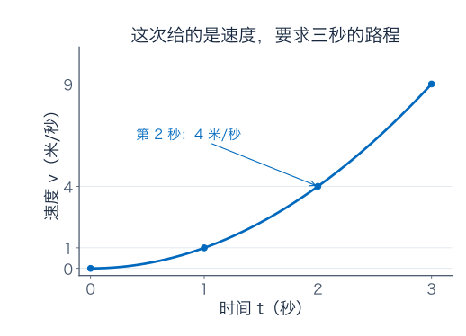
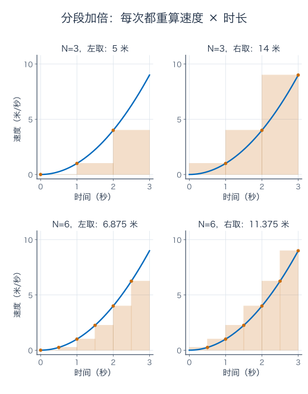
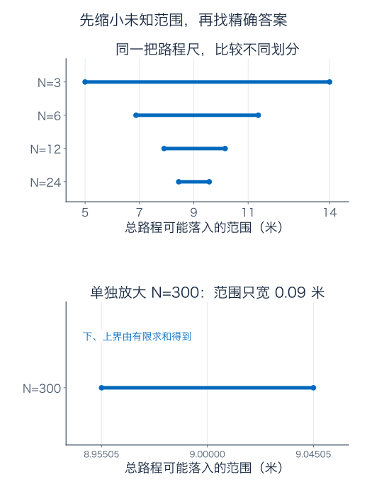
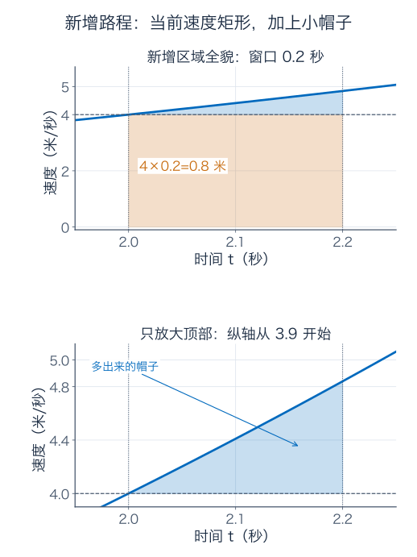
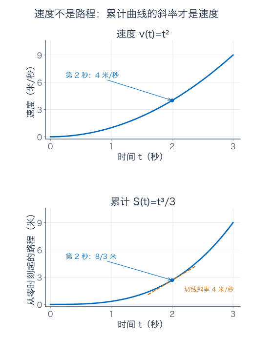
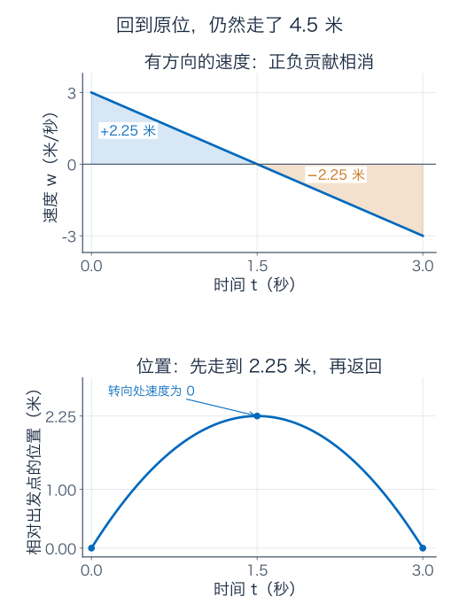
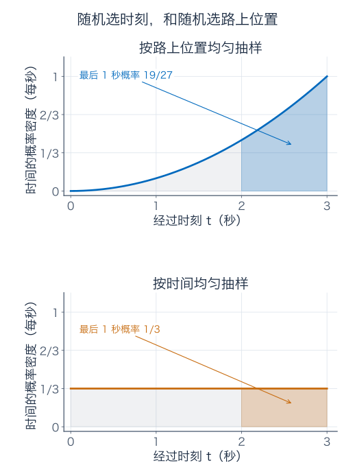

[数学总导航](../00-%E6%95%B0%E5%AD%A6%E5%AD%A6%E4%B9%A0%E5%AF%BC%E8%88%AA.md) · [本课程目录](00-%E5%AD%A6%E4%B9%A0%E8%B7%AF%E7%BA%BF%E4%B8%8E%E7%AC%A6%E5%8F%B7.md) · [← 上一章](03-%E4%B8%AD%E5%80%BC%E5%AE%9A%E7%90%86%E3%80%81Taylor%20%E5%B1%95%E5%BC%80%E4%B8%8E%E4%BC%98%E5%8C%96.md) · [下一章 →](05-%E7%A7%AF%E5%88%86%E6%8A%80%E5%B7%A7%E3%80%81%E5%8F%8D%E5%B8%B8%E7%A7%AF%E5%88%86%E4%B8%8E%E6%A6%82%E7%8E%87.md)

## 只看得到速度表，能知道走了多远吗

前两篇从位置求速度。这一次换一段实验：一辆小车沿直轨前进，仪器给出的是速度，我们要找走过的距离。

最容易的情况，是它连续 3 秒始终以 4 米/秒前进。这时距离为

$$
4\ \text{米/秒}\times3\ \text{秒}=12\ \text{米}.
$$

如果前 1 秒为 2 米/秒，后 2 秒为 5 米/秒，也会算：$2\times1+5\times2=12$ 米。两个速度持续的时间不同，不能把它们简单平均成 3.5，再乘 3 得到 10.5。速度数值要和它代表的时长配对。

现在让速度不断变化。在接下来的理想模型中，时间 $t$ 以秒计、速度 $v(t)$ 以米/秒计，数值关系为

$$
v(t)=t^2,\qquad0\le t\le3.
$$

这次平方的是速度数值；第 2 篇的 $t^2$ 写的是位置，是另一条运动规则。我们给定的是整段时间上的这个速度模型；几条孤立的仪器读数，本身还不能确定中间怎样运动。

| 时刻（秒） | 此刻速度（米/秒） |
| --- | --- |
| 0 | 0 |
| 1 | 1 |
| 2 | 4 |
| 3 | 9 |

第 2 秒显示 4，意思是“这一刻速度为 4 米/秒”，并不表示此前走了 4 米。速度一直在变，整段路程不能靠一次乘法算出来。

下面只用已经会做的乘法，看能不能把答案逼进一个越来越小的范围。

## 1．先拿三块矩形，做一份肯定偏小的估计

把 3 秒分成三段：$[0,1]$、$[1,2]$、$[2,3]$，每段都是 1 秒。

第一段从速度 0 增到 1。如果暂时把整段速度都按起点的 0 来算，距离估计为 $0\times1=0$ 米。它肯定算少了，因为这一秒里小车后来已经开始移动。

第二段从 1 增到 4，用起点速度估计，为 $1\times1=1$ 米；第三段从 4 增到 9，同样估计，为 $4\times1=4$ 米。加起来得到

$$
L_3=0+1+4=5\ \text{米}.
$$

下标 3 表示分了三段，$L$ 提醒我们这是一份下估计。在这个模型里，速度一直增加，每段起点速度都不超过段内任何速度，因此每段都算少或恰好相等，合起来也不会高估。

反过来，每段都用结束时的速度计算：

$$
U_3=1\times1+4\times1+9\times1=14\ \text{米}.
$$

每段都按最快的读数算，得到上估计。这样不用精确计算，也能断言实际路程在 5 到 14 米之间。

上一章的中值定理也支持这笔账：对连续、内部可导的位置函数，每小段实际位移等于段内某一时刻的速度乘时长，因此一定夹在最慢、最快速度对应的两份估计之间。

图第一行里，橙色矩形的宽是时间，单位为秒；高是速度，单位为米/秒。宽乘高的单位是米，所以速度图里的一块面积可以代表路程。这块面积不是一块真实地面的面积。

左图第一块高度为零，因此没有填色。这表示近似方法漏算了那一秒，不表示小车真的一动不动。右图矩形高于曲线，也不是说小车真的会按阶梯忽然改变速度。

这里的“左取偏小、右取偏大”依赖速度递增。若速度递减，方向会反过来；若一段里先增再减，端点也未必是最大、最小。可靠的上下界要看整个小区间的速度范围。

## 2．每段缩短一半，重新把账算一遍

现在分成六段，每段 0.5 秒。用左端点取样，读数是

$$
0^2,\ 0.5^2,\ 1^2,\ 1.5^2,\ 2^2,\ 2.5^2
=0,\ 0.25,\ 1,\ 2.25,\ 4,\ 6.25.
$$

每个读数只代表半秒，不能忘记乘 0.5：

$$
L_6=(0+0.25+1+2.25+4+6.25)\times0.5
=13.75\times0.5=6.875\ \text{米}.
$$

右端点取样则是

$$
U_6=(0.25+1+2.25+4+6.25+9)\times0.5
=22.75\times0.5=11.375\ \text{米}.
$$

这就是图的第二行。坐标刻度没变，只是矩形的宽减半、数量加倍。新的保证范围从 $[5,14]$ 缩到了 $[6.875,11.375]$。

这里的变化比 6.875 本身更要紧：每一段里的速度变化小了，用一个固定速度替代整段时，留下的不确定性也跟着小了。

继续对半切分，算出的上下估计如下：

| 小段数 $N$ | 每段时长（秒） | 下估计（米） | 上估计（米） |
| --- | --- | --- | --- |
| 3 | 1 | 5 | 14 |
| 6 | 0.5 | 6.875 | 11.375 |
| 12 | 0.25 | 7.90625 | 10.15625 |
| 24 | 0.125 | 8.4453125 | 9.5703125 |

表中的数都按“速度乘时长，再加起来”算，补充 A 会用一条有限求和公式核对它们。接下来的问题是这些范围会不会一直缩小，还是缩到某个宽度就停住。

## 3．不必先知道准确答案，也能算出还差多宽

把 3 秒均匀分成 $N$ 段，每段宽度为 $\Delta t=3/N$。分点为

$$
t_i=i\Delta t,\qquad i=0,1,\ldots,N.
$$

左估计为每段取左边的速度，右估计为每段取右边的速度。先不展开各自的平方和，直接把两份估计相减：

$$
\begin{aligned}
U_N-L_N
&=\Delta t\bigl([v(t_1)-v(t_0)]
+[v(t_2)-v(t_1)]+\cdots+[v(t_N)-v(t_{N-1})]\bigr)\\
&=\Delta t\,[v(3)-v(0)]\\
&=\frac3N\times9=\frac{27}{N}\ \text{米}.
\end{aligned}
$$

中间那些 $+v(t_i)$ 与 $-v(t_i)$ 恰好成对抵消，整串速度差只剩最后读数减最初读数，这就是上一章见过的“望远镜式消去”。这里还没有使用积分公式。

当 $N=3$，范围宽 9 米；$N=6$，宽 4.5 米；每次翻倍，宽度就减半。若想把未知范围压到 0.1 米以内，需要 $27/N<0.1$，也就是 $N>270$。

例如分成 300 段，每段 0.01 秒，下估计为 8.95505 米、上估计为 9.04505 米，范围宽 0.09 米。这些端点也是有限乘法和加法算出来的，不需要先知道目标值。

上图用同一把路程尺比较前几次估计，下图单独放大更细的划分。看横轴刻度：下图的线画得长，是因为尺子放大了，不是保证范围又变宽了。

### 一直逼近，怎样得到一个确定的数

沿着 $N=3,6,12,24,\ldots$ 不断对半分，每次的下估计不会变小，上估计不会变大：把一段细分，只会抬高可能的最低估计、压低可能的最高估计。

因此 $[L_N,U_N]$ 是一串逐层套住的闭区间，长度 $27/N$ 趋零。第 1 篇的实数区间套性质保证：恰有一个实数同时留在这些范围里。

我们把这个被不断细分锁定的数，定义为这段速度的**定积分**，它表达这个连续运动模型的累计路程。撑住这个定义的是每一次近似的上下界、细分后的嵌套、能趋零的范围宽度，而不是某个先摆出来的答案，也不是一张好看的采样表。

## 4．积分符号，只是把刚才的过程记下来

用符号写，刚才得到的数叫

$$
\int_0^3v(t)\,dt.
$$

$0,3$ 指明开始、结束时刻；$v(t)$ 指明累积的是哪个速率，叫被积函数；$dt$ 指明沿时间 $t$ 累积。$\int$ 是把许多小段贡献加起来的记号。

每一次有限近似仍然是普通的求和。例如左端点近似写成

$$
L_N=\sum_{i=1}^N v(t_{i-1})\,\Delta t.
$$

$\sum$ 就是“把 $i=1,\ldots,N$ 的这些项相加”。每项的含义一直没有变：某个时刻的速度，乘它代表的一小段时间。

每一小段的宽度都大于零，极限处理的是整个有限和，不是某个零宽度的小块。恒定速度 4 米/秒的 3 秒过程，分成 $N$ 块，每块为 $12/N$ 米，总和仍为 12 米。单块变小的同时，块数在增加。

### 为什么不必坚持左端点，也不必每段等长

同一段里挑中点、右端点或其他点，都可以形成近似。一般地，把 $[a,b]$ 划成 $a=t_0<t_1<\cdots<t_N=b$，每段长度 $\Delta t_i=t_i-t_{i-1}$，挑一个段内点 $\xi_i$，得到

$$
\sum_{i=1}^N f(\xi_i)\,\Delta t_i.
$$

这叫 Riemann 和。若存在一个数 $I$，使最长小段的长度趋零时，不管怎样划分、怎样取段内点，整个和都趋于 $I$，就说 $f$ 在这段 Riemann 可积，并记 $I=\int_a^bf(t)\,dt$。

对闭区间上的连续函数，这个极限存在。我们的递增平方速度已经用明确上下界演示了它的理由；一般连续函数如何做到，放在补充 A 解释。

要盯的是“最长小段”，而不是段数。假如始终把 $[0,1]$ 留成一大段，只把后两秒切得越来越碎，段数可以无穷增加。第一秒按速度零估计的漏算却一直留着。那一秒后半段速度至少 0.25 米/秒，仅它就至少贡献 $0.25\times0.5=0.125$ 米，不能因其他段数很多而自动补上。

## 5．把结束时刻拖动，累计量本身也成了函数

把从零到 $T$ 秒走过的距离记为

$$
S(T)=\int_0^T v(t)\,dt,\qquad0\le T\le3.
$$

大写 $T$ 是可变的结束时刻，小写 $t$ 是求和时沿途经过的时刻。也可以写成 $\int_0^T v(u)\,du$，意思不变；积分内部的字母是临时变量，上下限才决定积到哪里。

我们还没有算出 $S$ 的公式，但已经能判断：$S(0)=0$；速度非负时，走过的距离不会减少；速度越大的地方，累计曲线增长越快。

现在让结束时刻从 2 秒移到 $2+h$ 秒。旧的路程不会重新走一遍，只会增加右边这段：

$$
S(2+h)-S(2)=\int_2^{2+h}v(t)\,dt.
$$

这是分段相加的性质：先走前两秒，再走后面 $h$ 秒，和从零一次走到 $2+h$ 秒得到同样的总距离。

因为当前速度 $v(2)=4$ 米/秒，我们最容易算的新增路程预测是 $4h$。下一步就检查，它和真正新增量差多少。

## 6．积分和导数接起来的关键，在新增加的这一条里

先取 $0<h\le1$，保证仍在三秒实验内。令 $t=2+s$，则

$$
v(2+s)=(2+s)^2=4+4s+s^2.
$$

在 $0\le s\le h$ 上，速度比 4 多出来的部分不小于零，也不超过 $4h+h^2$。因此，新增路程与矩形 $4h$ 之间的差，夹在零和“一段宽 $h$、高 $4h+h^2$ 的矩形”之间：

$$
0\le S(2+h)-S(2)-4h\le(4h+h^2)h.
$$

上图从速度零开始画，浅橙矩形代表 $4h$ 米；蓝色曲线与矩形之间多出来的小帽子，才是估计漏掉的路程。下图单独放大顶部，纵轴不从零开始，不能把它当成完整的速度图。

两边除以正的 $h$，就有

$$
0\le\frac{S(2+h)-S(2)}h-4\le4h+h^2.
$$

例如 $h=0.1$，预测新增 0.4 米，新增量除以时间后与 4 的差不超过 0.41 米/秒；$h=0.01$，预测新增 0.04 米，平均速度的差不超过 0.0401 米/秒。上界可以继续缩小到任意精度，所以右侧差商趋于 4。

从左侧看也要检查。若 $h<0$，则 $S(2+h)-S(2)$ 是负的，它是把此前的一小段路程扣掉；再除以负的 $h$，仍是在算那一段的平均速度。附近速度与 4 的差会随着时间窗口一起缩小，因此左侧差商也趋于 4。

于是我们得到

$$
S'(2)=v(2)=4\ \text{米/秒}.
$$

这一步没有先猜 $S$ 的公式，只用了积分的上下估计和速度在此处的连续性。

### 换成一般时刻，证明还剩哪一步

若 $f$ 在闭区间 $[a,b]$ 上连续，定义 $A(T)=\int_a^T f(t)\,dt$。在内部时刻 $T$，只要窗口足够小，连续性使窗口里所有 $f(t)$ 都离 $f(T)$ 小于你指定的误差 $\varepsilon$。

当 $h>0$ 时，新增累计量夹在 $(f(T)-\varepsilon)h$ 与 $(f(T)+\varepsilon)h$ 之间；除以 $h$，差商就夹在 $f(T)\pm\varepsilon$ 之间。$h<0$ 时，把那段反向扣除，再除以负数，得到同样的夹逼。

所以

$$
\boxed{A(T)=\int_a^T f(t)\,dt
\quad\Longrightarrow\quad A'(T)=f(T).}
$$

这是微积分基本定理的一种表述：由连续速率累积出来的函数，它的当前变化率就是当前速率。在区间端点，相应只讨论允许的一侧导数。

你也可以把刚才的误差压缩写成

$$
\left|\frac{A(T+h)-A(T)}h-f(T)\right|
\le\sup_{t\text{ 位于 }T\text{ 与 }T+h\text{ 之间}}|f(t)-f(T)|\longrightarrow0.
$$

右边是整个小窗口内输出偏离当前值的最大可能距离。连续性让它趋零，关键就在这里。

## 7．现在才找公式：哪一个函数求导后是速度

已知 $S'(T)=T^2$，可以把求路程转成一个逆向问题。我们知道 $(T^3)'=3T^2$，所以除以 3 就得到

$$
G(T)=\frac{T^3}{3},\qquad G'(T)=T^2.
$$

像这样，导数等于被积函数的 $G$，叫它的**原函数**。被积函数是输入给积分的那个速度，原函数是求导能得到它的另一条曲线。

为什么找到 $G$ 就能算 $S$？我们刚才已经从累积定义证明 $S'=v$；现在 $G'=v$，所以 $(S-G)'=0$。小段累计的绝对值不超过最大速度 9 乘时长，保证 $S$ 在端点也连续。由上一章的中值定理，$S-G$ 在整个区间只能是常数。

再用初始条件 $S(0)=0$，得到这个常数为零。因此

$$
S(T)=\frac{T^3}{3}.
$$

这时才算出最初三秒的路程：

$$
\boxed{\int_0^3 t^2\,dt=S(3)=\frac{27}{3}=9\ \text{米}.}
$$

它落在前面的每一个保证区间里。300 段时左估计 8.95505 比它少 0.04495，右估计 9.04505 比它多 0.04505；两边并不恰好对称，不能随手把任何两种估计的平均都当成真值。

上图的纵轴是米/秒，下图是米。第 2 秒，速度为 4 米/秒，已经走的距离为 $8/3$ 米；第 3 秒，两者数值恰好都是 9，仍然不是同一种量。

平均速度应为总路程除以时间，也就是 $9/3=3$ 米/秒。只平均最初和最后的速度，会得到 $(0+9)/2=4.5$，再乘 3 算成 13.5 米。错在把中间非线性的速度变化，当成了端点之间的匀速率增长。

## 8．为什么上限代入减下限代入，能算中间那一段

如果只想知道第 1 秒到第 3 秒走了多远，就应该从累计三秒的距离中，扣掉前一秒：

$$
\int_1^3t^2\,dt=S(3)-S(1)
=9-\frac13=\frac{26}{3}\ \text{米}.
$$

无论拿哪个原函数来算，答案都一样。$G(T)=T^3/3$、$G(T)+5$ 的导数相同，但常数在两端相减时自动消掉。

若小车最初位于轨道的 5 米刻度，它的位置是 $X(T)=5+T^3/3$，三秒后在 14 米处；积分记录的 9 米是这段时间的变化量，不是绝对位置。

对 $[a,b]$ 上连续的 $f$，若找到在闭区间连续、内部满足 $G'=f$ 的 $G$，刚才的常数差论证就给出

$$
\boxed{\int_a^bf(t)\,dt=G(b)-G(a).}
$$

这就是基本定理的计算用法。不是只看两端读数就能知道中间发生的一切；我们要求原函数在**整段**都满足 $G'=f$，中间的变化率已经放进 $G$ 里。

### 中间那些时刻，为什么最后全抵消了

把三秒分回每秒一段，三份路程分别为

$$
[G(1)-G(0)],\quad[G(2)-G(1)],\quad[G(3)-G(2)].
$$

相加后中间值成对抵消，只剩 $G(3)-G(0)$。具体数值为 $1/3+7/3+19/3=9$ 米。这个消去只解释了式子为什么简洁，理由在前面：新增小条与常数差论证已经说明每段积分等于原函数之差。

从有限求和还可以看出一些方便的性质：分段可以合并，两个速率相加的总累计等于各自累计相加，常数倍可以提出积分。它们分别对应普通有限和的同样运算，再取极限。

## 9．回到出发点，也可能已经走了不少路

换一段会倒车的实验，重新从 $t=0$ 计时。给有方向的速度

$$
w(t)=3-2t,\qquad0\le t\le3,
$$

单位仍是米/秒。前 1.5 秒速度为正，沿正方向走；1.5 秒处速度为零，随后速度为负，车开始倒着回来。

速度图上方的三角形面积是 $\tfrac12\times1.5\times3=2.25$ 米，下方的三角形同样大，却记负号。因此

$$
\int_0^3 w(t)\,dt=2.25-2.25=0.
$$

它给出的是**净位移**，说明最后回到了出发位置。几何图形在横轴下方，不是产生了一段负长度的路，而是对位置变化记了反方向的账。

若要实际走过的总路程，前后两段都要按正长度相加，即积分速率的绝对值：

$$
\int_0^3|w(t)|\,dt=2.25+2.25=4.5\ \text{米}.
$$

下图的位置为 $3t-t^2$：前半段增加、后半段减少，终点回到零。不能因为净积分为零就说小车从来没动。

积分方向也要记清楚。约定从 $b$ 积回 $a$ 时

$$
\int_b^af(t)\,dt=-\int_a^bf(t)\,dt,\qquad
\int_a^af(t)\,dt=0.
$$

改变累计方向，会改变符号。这个约定让 $A(y)-A(x)=\int_x^y f$ 对前后两种输入顺序都成立，也正是前面讨论负的 $h$ 时所用的含义。

## 10．结束位置自己也在变化时，还要接上一段链式法则

基本定理里的 $A'(T)=f(T)$，说的是上限 $T$ 每变一点，累计量怎样变。如果上限本身由另一个变量控制，还不能忘记它移动的速度。

看一个单纯的数学例子：

$$
H(x)=\int_1^{x^2}\cos t\,dt.
$$

先把上限临时独立出来，写 $B(u)=\int_1^u\cos t\,dt$。由基本定理，$B'(u)=\cos u$。然后 $H(x)=B(x^2)$，是两段过程：先从 $x$ 算出上限 $x^2$，再累计到那里。

于是链式法则给出

$$
H'(x)=B'(x^2)\cdot2x=2x\cos(x^2).
$$

在 $x=0$，上限对 $x$ 的变化率为零，所以 $H'(0)=0$；只写 $\cos(x^2)$ 就会错得 1。若还想核对，直接找原函数可写 $H(x)=\sin(x^2)-\sin1$，求导得到相同答案。角度使用弧度。

当 $x^2<1$，上下限反向，按照上一节的约定计算即可，不妨碍这条公式。

### 连续性条件不能顺手删掉

累计量常常连续，当前速率却可能跳变。比如一项服务在第一分钟按 2 元/分钟收费，之后改成 5 元/分钟。累计费用在第 1 分钟仍接得上：之前是 $2T$，之后是 $2+5(T-1)$；但左侧增长率为 2，右侧为 5，没有共同导数。

这不否认累计量存在，只说明不能在跳变点无条件写“累计的导数等于当前速率”。正文证明依靠的正是局部连续性；更多边界例子放在补充 C。

定积分的定义来自可靠的累积极限；求原函数是基本定理给出的计算办法。先有这座桥，再用两端相减，逻辑才完整。

## 练习：每一步都说清算的是什么量

八题如下，完整解答统一放在后面。

**题一：少看一秒，重新估计。** 对速度 $v(t)=t^2$，只看 $0\le t\le2$ 秒。先均分两段，求左端点、右端点与中点估计；再均分四段，求左、右估计。最后求精确路程，比较两段中点估计的误差。哪两份估计在这个模型里必定提供上下界？

**题二：端点平均到底什么时候碰巧有效？** 分别计算 $v_1(t)=1+2t$ 和 $v_2(t)=t^2$ 在 $[0,3]$ 秒的路程。再用“最初速度与最后速度的平均，乘上总时长”各算一次。两种情形是否都正确？给出实际数字，不能只说“速度在变”。

**题三：把小帽子也算出来。** 用正文已经得到的 $S(T)=T^3/3$，展开 $S(2+h)-S(2)$。对 $h=0.1$ 和 $h=0.01$，分别写出当前速度矩形 $4h$、真实新增路程与二者差。核对差是否在正文的 $4h^2+h^3$ 上界内，并区分“路程误差”和“除以时间后的平均速度误差”。

**题四：车原来在 5 米刻度。** 初始位置为 $X(0)=5$ 米，速度仍为 $t^2$ 米/秒。求 $X(3)$，再求第 1 秒到第 3 秒的位移。为什么 $\int_0^3v(t)dt$ 不是 $X(3)$？若换成原函数 $G(t)=t^3/3+100$，定积分结果是否改变？

**题五：另一次来回运动。** 小车有方向的速度为 $w(t)=2-t$，$0\le t\le4$ 秒。求净位移与总路程，写出改变方向的时刻，并解释为什么同一个速度公式会给出两种不同的累计问题。

**题六：移动的积分上限。** 对 $H(x)=\int_1^{x^2}\cos t\,dt$，先把上限写成独立变量，再求 $H'(x)$。核对 $x=0$ 的导数，并写一个原函数之差的表达式作独立检查。下限 1 大于上限 0 时，为什么表达式仍有意义？

**题七：段数很多，但一段始终没变短。** 在正文三秒实验中，始终把 $[0,1]$ 当一大段，取左端速度零；只把 $[1,3]$ 越分越细，并继续取左端点。这样的估计最终趋向多少米？与真实路程差多少？为什么“总段数趋于无穷”没有保证正确极限？

**题八：收费速率跳了，账单会不会跳？** 某服务从零开始计费，前 1 分钟为 1 元/分钟，从第 1 分钟起改为 3 元/分钟，观察到第 2 分钟。写出累计费用 $C(T)$，求 $C(1)$、$C(2)$，判断 $C$ 在第 1 分钟是否连续、是否可导。请分别算左右变化率。

### 参考答案与解题过程

#### 题一解答

均分两段，每段 1 秒。左端读数为 0、1，得到 $L_2=1$ 米；右端为 1、4，得到 $U_2=5$ 米。中点为 0.5、1.5，读数为 0.25、2.25，得到中点估计 2.5 米。

均分四段，每段 0.5 秒。左估计为

$$
L_4=(0+0.25+1+2.25)\times0.5=1.75\ \text{米},
$$

右估计为

$$
U_4=(0.25+1+2.25+4)\times0.5=3.75\ \text{米}.
$$

精确路程为 $[t^3/3]_0^2=8/3$ 米。两段中点估计少了 $8/3-2.5=1/6$ 米。速度递增，所以左、右估计分别给可靠的下、上界；中点也是允许的取样方法，但不能只凭“取了中间”就把它当作精确答案。

#### 题二解答

第一条速度的原函数为 $G_1(t)=t+t^2$，三秒路程为 $G_1(3)-G_1(0)=3+9=12$ 米。端点速度为 1、7，端点平均给 $(1+7)/2\times3=12$，这次正确，因为速度随时间线性变化，图下区域是一个梯形。

第二条的真实路程为 $[t^3/3]_0^3=9$ 米。端点速度为 0、9，端点平均给 $4.5\times3=13.5$，多了 4.5 米。速度曲线向上弯，端点连线高于它，中间的速度被算大了。

因此不能把“起末速度平均”当成普遍的平均速度公式。一般仍要由整个过程的累计量除以总时长。

#### 题三解答

直接展开：

$$
S(2+h)-S(2)
=\frac{(2+h)^3-8}{3}
=4h+2h^2+\frac{h^3}{3}.
$$

所以矩形漏算的路程是 $2h^2+h^3/3$ 米。

当 $h=0.1$，矩形为 0.4 米，真实新增为 $0.42+1/3000=0.420333\ldots$ 米，漏算 $0.020333\ldots$ 米，小于上界 $4(0.1)^2+0.1^3=0.041$ 米。

当 $h=0.01$，矩形为 0.04 米，真实新增为 $0.0402+1/3000000=0.040200333\ldots$ 米，漏算 $0.000200333\ldots$ 米，小于上界 $4(0.01)^2+0.01^3=0.000401$ 米。

再除以各自时长，平均速度与 4 的差分别为 $0.203333\ldots$、$0.0200333\ldots$ 米/秒；对应的保证上限为 0.41、0.0401 米/秒。路程误差和平均速度误差的数值、单位不同，但两者都能由刚才的精确式核对。

#### 题四解答

位置为 $X(T)=5+T^3/3$，所以三秒后 $X(3)=14$ 米。第 1 秒位置为 $X(1)=5+1/3=16/3$ 米，第 1 秒到第 3 秒的位移为

$$
X(3)-X(1)=14-\frac{16}{3}=\frac{26}{3}\ \text{米}.
$$

$\int_0^3v=9$ 米记录起末位置的差，初始坐标 5 米不在这段位移里。换原函数 $G(t)=t^3/3+100$ 后，仍有 $G(3)-G(0)=109-100=9$，常数相消。原函数的任意平移不能改变区间累计量。

#### 题五解答

速度在 $t=2$ 秒变号。原函数为 $2t-t^2/2$，所以净位移为

$$
\int_0^4(2-t)\,dt=8-8=0\ \text{米}.
$$

总路程要将向前和向后的距离都取正：

$$
\int_0^4|2-t|\,dt
=\int_0^2(2-t)\,dt+\int_2^4(t-2)\,dt
=2+2=4\ \text{米}.
$$

前半段走出去 2 米，后半段返回 2 米，所以回到原位但总共走了 4 米。有方向的速度累积回答位置改变多少，速率的累积回答一共走多少路。

#### 题六解答

设 $B(u)=\int_1^u\cos t\,dt$，由基本定理 $B'(u)=\cos u$。又有 $H(x)=B(x^2)$，链式法则给

$$
H'(x)=2x\cos(x^2),\qquad H'(0)=0.
$$

独立检查：余弦的原函数为正弦，所以 $H(x)=\sin(x^2)-\sin1$，求导得到相同答案。$x=0$ 时，$H(0)=-\sin1$，它是 $-\int_0^1\cos t\,dt$，并没有因为上下限反向而失去定义。

零处的导数为零，与函数值是否为零无关；导数看的是附近变化，不是当前高度。

#### 题七解答

第一大段一直被估成零。其余划分越来越细，左端和趋于

$$
\int_1^3t^2\,dt=\frac{26}{3}\ \text{米}.
$$

完整实验真实为 9 米，因此永远漏掉的极限差为 $9-26/3=1/3$ 米，恰好是第一秒的真实路程。

最长小段始终至少 1 秒，根本没有趋零。把其他地方分得再细，也没有改进这一段。积分定义要求控制每一段的最大长度，而不是只数总共有多少段。

#### 题八解答

累计费用为

$$
C(T)=\begin{cases}T,&0\le T\le1,\\1+3(T-1)=3T-2,&1\le T\le2.\end{cases}
$$

所以 $C(1)=1$ 元、$C(2)=4$ 元。左右公式在 1 处都接到 1，因此累计账单连续，调价时不会凭空多出一笔整块费用。

但左侧变化率为 1 元/分钟，右侧为 3 元/分钟，故 $C$ 在 1 处不可导。原速率在这里跳变，正文中用连续性控制小窗口误差的步骤失效；累计仍然可以存在并且连续。

## 补充 A：把上下界的保证说完整

正文只对一条递增速度曲线作了明确计算。这里分两步解释，为什么一般连续曲线也能让所有足够细的取样和趋向同一个结果。

### 不用基本定理，也能核对正文的有限和

对 $v(t)=t^2$、$\Delta t=3/N$，左端点和为

$$
L_N=\sum_{i=0}^{N-1}\left(\frac{3i}{N}\right)^2\frac3N
=\frac{27}{N^3}\sum_{i=0}^{N-1}i^2.
$$

利用有限平方和 $\sum_{i=0}^{N-1}i^2=N(N-1)(2N-1)/6$，得到

$$
L_N=9-\frac{27}{2N}+\frac9{2N^2},\qquad
U_N=L_N+\frac{27}{N}=9+\frac{27}{2N}+\frac9{2N^2}.
$$

因此两者确实都趋于 9，和基本定理算出的值相同。这里是有限代数的独立检查，不需要用积分结果去倒推求和公式。

如果没见过平方和公式，可以把 $(i+1)^3-i^3=3i^2+3i+1$ 从 $i=0$ 加到 $N-1$，左边抵消为 $N^3$，再用 $\sum i=N(N-1)/2$，解出 $\sum i^2$。而 $\sum i$ 的公式，把正向、反向两串相加，每对都为 $N-1$，共有 $N$ 对，再除以 2 即得。

### 任意划分，都可以做上下估计

在 $[a,b]$ 上给定有界函数 $f$。对一个划分 $P$，在第 $i$ 段取函数值的下确界 $m_i$、上确界 $M_i$，定义

$$
L(P)=\sum_i m_i\Delta t_i,\qquad
U(P)=\sum_i M_i\Delta t_i.
$$

对连续函数，闭小区间里最大、最小值会实际取到。对一般有界函数，下、上确界是即使没有取到也能用的边界。

任何段内取样点都满足 $m_i\le f(\xi_i)\le M_i$，所以任何 Riemann 和都在 $L(P),U(P)$ 之间。

加进更多分点时，下估计只会升高或不变，上估计只会降低或不变。两种不同划分的下、上估计也不会交叉：把两种分点合在一起成为共同细分，就有“旧下估计不超过新下估计，不超过新上估计，不超过另一旧上估计”。

所以可以把所有下估计取上确界、所有上估计取下确界。前者不超过后者；如果存在划分把差压到任意小，两者就只能相等，这个共同实数就是积分。于是对每个划分，积分也落在其上下界之间。

### 小段最多多长，怎样控制所有取样法

设最长小段长为 $\delta$。对正文的平方速度，在 $[0,3]$ 有

$$
|u^2-w^2|=|u-w|\,|u+w|\le6|u-w|.
$$

所以每一段内速度的最大摆幅不超过 $6\Delta t_i$。上下估计之差满足

$$
U(P)-L(P)
\le6\sum_i(\Delta t_i)^2
\le6\delta\sum_i\Delta t_i
=18\delta.
$$

不要求等分，也不要求取端点，只要最长一段趋零，这个差就趋零。任意取样和与积分的误差都被它罩住。前面等分情况下的 $27/N$ 更紧；这个通用界比较保守，却照顾到了任意划分。

一般连续函数未必有有界导数，仍可用类似思想。闭区间上的连续函数有一个统一性质：给定输出差要求 $\eta>0$，能找一个输入长度 $\delta>0$，使区间内任意两输入相差小于 $\delta$ 时，输出差都小于 $\eta$。这里长度标准要在整个区间通用，叫一致连续。

为什么有这份统一保证？如果失败，就有某个固定的输出差 $\eta_0>0$，让我们对每个 $n$ 都找到相距小于 $1/n$、输出却至少差 $\eta_0$ 的一对点 $x_n,y_n$。闭有界区间中，$x_n$ 能抽出一个趋于区间内某点 $c$ 的子列；这是第 1 篇最值证明中用区间对半选择过的性质。对应的 $y_n$ 与它距离趋零，也趋于 $c$。连续性使两列输出都趋于 $f(c)$，不可能还隔着固定差距，矛盾。

因此每段足够短时，$M_i-m_i\le\eta$，从而 $U(P)-L(P)\le\eta(b-a)$。想让累计误差小于 $\varepsilon$，先选 $\eta=\varepsilon/[2(b-a)]$，再按一致连续性选最长段长度即可。

这补全了“闭区间连续函数一定 Riemann 可积”的保证，也说明积分定义里的“不管怎样取样”是实质要求。

## 补充 B：同一段行程，两种随机选法有不同的权重

三秒实验也可以看成一个抽样问题。

如果在 0 到 3 秒之间均匀随机选一个时刻，选中最后一秒 $[2,3]$ 的概率是 $1/3$。

换一种选法：在小车经过的 9 米路线上，均匀随机挑一个位置，问它经过这个位置的时刻。车后面跑得更快，最后一秒经过的路段更长，因此这次权重应该按路程，而不是按时间平均。

第 2 到第 3 秒走过的路程为 $9-8/3=19/3$ 米，所以抽中这段路的概率为

$$
\frac{19/3}{9}=\frac{19}{27}\approx70.37\%.
$$

它明显大于 $1/3$。随机选择一个时刻，和随机选择一个路上位置，是两个不同的问题。

左图的密度随速度增加，右图每秒的权重相同。两张图的总面积都是 1；最后一秒的阴影面积分别为 $19/27$ 和 $1/3$。看的是阴影面积，不是某一个时刻的曲线高度。

更一般地，一个很短的时间段贡献的路程约为 $v(t)\Delta t$，除以总路程 9，就得到其概率权重。经过时刻的概率密度为

$$
p(t)=\frac{t^2}{9},\qquad0\le t\le3,
\qquad\int_0^3p(t)\,dt=1.
$$

单位也正确：米/秒除以米，得到每秒，乘一个时间长度后才成为无单位的概率。累计分布函数就是 $S(T)/9=T^3/27$。

这份抽样的平均时刻为

$$
\mathbb E[T]=\int_0^3t\,p(t)\,dt
=\frac19\left[\frac{t^4}{4}\right]_0^3
=\frac94=2.25\ \text{秒}.
$$

它比均匀选时刻的平均 1.5 秒靠后，原因正是后段贡献了更多路程。积分把“小贡献乘权重再相加”的思路写成了连续形式。

## 补充 C：积分的用途，比“查一个原函数公式”更广

### 用积分补上自然对数与指数的地基

第 2 篇暂用了自然指数的基本极限。现在可以从一个已经会理解的累积过程出发，把这项地基补上，而不靠先背指数求导公式。

对 $x>0$，定义

$$
L(x)=\int_1^x\frac1t\,dt.
$$

$1/t$ 在任何正的闭区间上连续，所以这个函数有定义；基本定理给 $L'(x)=1/x$，且 $L(1)=0$。这就是自然对数 $\log x$ 的一种构造。它的名字不是让积分消失了，而是给这个具体的累积函数一个常用称呼。

它为什么有熟悉的乘法变加法性质？固定 $y>0$，看 $D(x)=L(xy)-L(x)$。用链式法则，

$$
D'(x)=\frac{y}{xy}-\frac1x=0.
$$

所以 $D$ 是常数，代入 $x=1$ 得这个常数为 $L(y)$。因此 $L(xy)=L(x)+L(y)$。

又因为 $L'>0$，它严格递增。$L(2)\ge1/2>0$，而 $L(2^n)=nL(2)\to+\infty$，$L(2^{-n})=-nL(2)\to-\infty$。连续性与介值定理让它的值域覆盖整个实轴，于是有唯一的反函数 $E$。

这个反函数也连续：在某个正输入 $x_0$ 两边各选一个足够近的点，严格递增的 $L$ 会把它们送到 $L(x_0)$ 的两边；输出落在这两值之间时，反函数的值也只能留在原来的小区间里。

现在求 $E$ 的导数。固定 $u$，令 $x=E(u)$；输入变为 $u+h$ 时，设反函数输出变化为 $k=E(u+h)-x$。由连续性，$h\to0$ 时 $k\to0$；由严格递增性，非零 $h$ 对应非零 $k$。而

$$
h=L(x+k)-L(x),\qquad
\frac{E(u+h)-E(u)}h
=\frac1{[L(x+k)-L(x)]/k}\longrightarrow x.
$$

因此 $E'(u)=E(u)$，且 $E(0)=1$。由 $L$ 的乘法性质又有 $E(u+v)=E(u)E(v)$。把 $E(1)$ 记作 $e$、把 $E(u)$ 记作 $e^u$，就接上了自然指数的记号与性质。特别地，

$$
\lim_{h\to0}\frac{e^h-1}{h}=E'(0)=1.
$$

先从 $1/t$ 的积分构造对数，再由反函数构造指数，这条路线没有预先依赖指数的导数来证明自己。

### 没有找到熟悉的表达式，也不妨碍累计量存在

例如定义 $F(x)=\int_0^x e^{-t^2}\,dt$。因为被积函数连续，$F$ 是一个确定的函数，并且 $F'(x)=e^{-x^2}$。即使暂时没有把它写成别的表达式，也已经有了原函数。

若要具体数值，可以用带误差控制的数值积分。存在性、能否写成熟悉的公式、实际要算到几位精度，是不同的问题。下一章会学一些把积分化简的技巧，但它们不是积分存在的前提。

### 左右两次估计相同，也要检查有没有夹住中间

取一条先升后降的曲线 $f(t)=t(1-t)$，$0\le t\le1$。如果整段只用一个矩形，左端和右端读数都是零，两次估计完全相同。但真实积分为

$$
\int_0^1(t-t^2)\,dt=\frac12-\frac13=\frac16.
$$

两次都漏掉了中间鼓起来的部分。整段的最小值为 0，最大值在 $t=1/2$ 为 $1/4$，因此真正的一段上下界是 $[0,1/4]$，并不是 $[0,0]$。两种算法碰巧一致，不能代替可靠的夹逼。

### 改一个时刻的记录，不会凭空累积一整块量

把 $f(t)$ 在 $[0,2]$ 上定义为：除 $t=1$ 外都等于 1，只在那一点填为 7。相比恒为 1 的函数，Riemann 和可能多算的，只是把那个特殊点选为样本的小段。

如果最长小段为 $\delta$，至多有相邻的两段把同一个端点 1 当作样本，每段最多多算 $6\delta$，总差不超过 $12\delta\to0$。所以这个函数的积分仍为 2，累计函数仍为 $A(T)=T$。

在 $T=1$，$A'(1)=1$，却不等于人工填的 $f(1)=7$。这再次说明：被积函数连续，是正文那份逐点恢复保证的充分条件；不连续时要具体检查，不能无条件套等式，也不能反过来说累计量一定不存在或一定不可导。

## 对应伴读与下一章

- [3Blue1Brown：积分与微积分基本定理](https://www.3blue1brown.com/lessons/integration/)：对照动画观察矩形细分与右端点移动。本篇的速度模型、计算、图与练习独立编写。
- [Jiří Lebl：微积分基本定理](https://www.jirka.org/ra/html/sec_ftc.html)：核对累计函数求导、原函数之差和连续性条件。

下一章会研究怎样选择变量代换、分部积分等办法，让具体积分变得好算；也会说明区间无穷长或函数无界时，为什么还要另外检查收敛。读那些技巧时，仍然可以回到今天的图上，问清楚自己正在累积什么、用什么单位、有哪些误差与范围条件。

---

[数学总导航](../00-%E6%95%B0%E5%AD%A6%E5%AD%A6%E4%B9%A0%E5%AF%BC%E8%88%AA.md) · [本课程目录](00-%E5%AD%A6%E4%B9%A0%E8%B7%AF%E7%BA%BF%E4%B8%8E%E7%AC%A6%E5%8F%B7.md) · [← 上一章](03-%E4%B8%AD%E5%80%BC%E5%AE%9A%E7%90%86%E3%80%81Taylor%20%E5%B1%95%E5%BC%80%E4%B8%8E%E4%BC%98%E5%8C%96.md) · [下一章 →](05-%E7%A7%AF%E5%88%86%E6%8A%80%E5%B7%A7%E3%80%81%E5%8F%8D%E5%B8%B8%E7%A7%AF%E5%88%86%E4%B8%8E%E6%A6%82%E7%8E%87.md)
