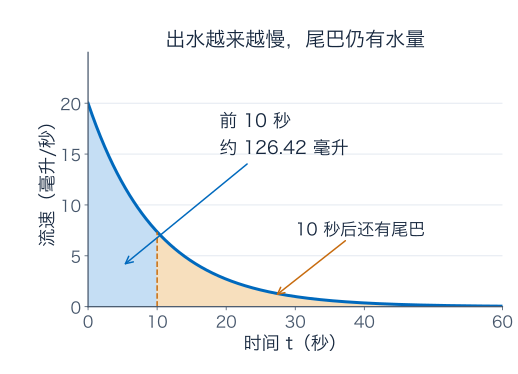
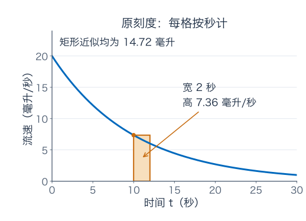
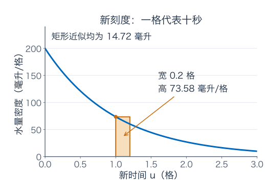
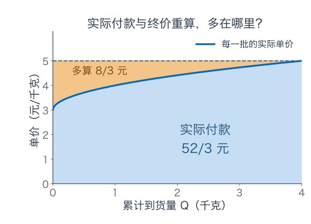
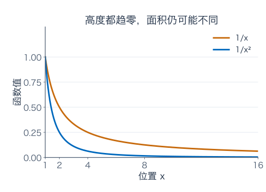
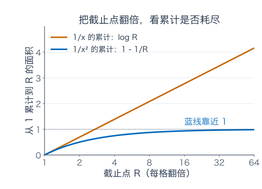
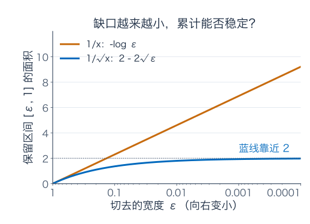
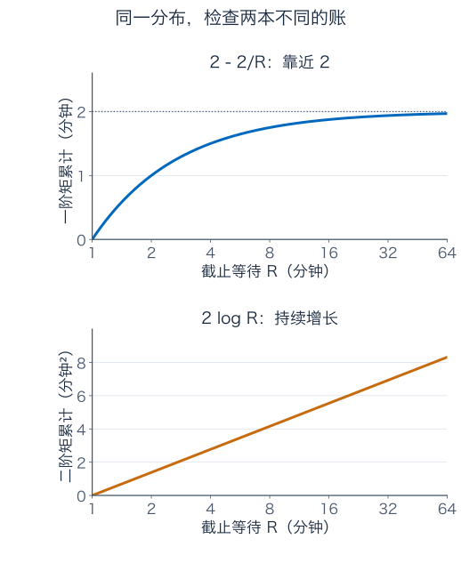

[数学总导航](../00-%E6%95%B0%E5%AD%A6%E5%AD%A6%E4%B9%A0%E5%AF%BC%E8%88%AA.md) · [本课程目录](00-%E5%AD%A6%E4%B9%A0%E8%B7%AF%E7%BA%BF%E4%B8%8E%E7%AC%A6%E5%8F%B7.md) · [← 上一章](04-%E5%AE%9A%E7%A7%AF%E5%88%86%E4%B8%8E%E5%BE%AE%E7%A7%AF%E5%88%86%E5%9F%BA%E6%9C%AC%E5%AE%9A%E7%90%86.md) · [下一章 →](06-%E7%BA%A7%E6%95%B0%E3%80%81%E5%B9%82%E7%BA%A7%E6%95%B0%E4%B8%8E%E5%87%BD%E6%95%B0%E5%88%97.md)

上一章，我们解决了“知道每一刻的流速，怎样得到总水量”。这一章继续往前走：**累计量已经写成积分，怎样把它算出来？如果时间没有终点，或者曲线在某处冲向无穷，还能不能谈总量？**

先抓住三个画面：换元是在换一把刻度不同的尺子；分部积分是在拆开“两个量一起变化”产生的总变化；反常积分则是在认真检查那些还没算完的尾巴。我们会用咖啡机、分批买货和等待时间把这三件事算清楚。

## 1．咖啡机越滴越慢，十秒钟接到多少？

一台理想化咖啡机刚启动时出水较快，后来越来越慢。用秒记录时间，设流速为

$$
q(t)=20e^{-t/10}\quad\text{毫升/秒},\qquad t\ge0.
$$

这条公式中，$t/10$ 表示“已经经过了多少个十秒”。如果严格保留量纲，分母是十秒，指数没有单位；我们在数值公式中把秒作为时间单位。

开始时流速为每秒 20 毫升；第 10 秒约为 7.36，第 20 秒约为 2.71，第 30 秒约为 1.00。这里的指数衰减是教学模型，不是对某一台真实设备的测量结论。

**图 1 怎么读：** 横轴是秒，纵轴是毫升/秒，面积的单位才是毫升。蓝色区域是前十秒的水量。十秒以后曲线虽低，仍有一条尾巴，不能只看高度就宣布后面没有水。

前十秒的水量为

$$
V(10)=\int_0^{10}20e^{-t/10}\,dt.
$$

我们知道 $e^u$ 的导数还是 $e^u$，但这里指数里多了一层 $-t/10$。直接猜 $20e^{-t/10}$ 是原函数会出错：对它求导还要乘 $-1/10$。这时，可以把时间刻度换得更适合这个模型。

## 2．把十秒当成一格，为什么必须补回一个 10？

令 $u=t/10$。原来的第 10 秒变成 $u=1$，第 20 秒变成 $u=2$。新坐标的一格代表十秒，因而

$$
t=10u,\qquad dt=10\,du.
$$

最后一个式子可以先按“时间长度怎样换算”理解：在新刻度上前进 0.2 格，真实时间就是两秒。它不意味着我们把一个普通数零拿来约分。

把积分中的每一部分逐项换掉：原来的指数 $-t/10$ 变成 $-u$；原来的小时间段 $dt$ 变成 $10du$；起点 $t=0$ 变成 $u=0$；终点 $t=10$ 变成 $u=1$。所以

$$
\begin{aligned}
\int_0^{10}20e^{-t/10}\,dt
&=\int_0^1 20e^{-u}\cdot10\,du\\
&=200\int_0^1e^{-u}\,du\\
&=200[-e^{-u}]_0^1\\
&=200(1-e^{-1})\\
&\approx126.42\ \text{毫升}.
\end{aligned}
$$

为什么新图里要把高度乘十？因为横向已经缩短十倍。你要表示同一份水量，不能只把横轴挤短，却保持每格代表的累计权重不变。

**图 2、图 3 怎么对照：** 这两张图表示同一计算，但横纵轴单位都换了。第 10 到第 12 秒，对应新刻度的第 1 到第 1.2 格。取左端点作矩形近似，原图算 $7.3576\times2\approx14.72$ 毫升；新图算 $73.576\times0.2\approx14.72$ 毫升。矩形的外观变了，代表的水量没变。

这只是该小段的矩形近似，不是精确水量；精确值为 $200(e^{-1}-e^{-1.2})\approx13.34$ 毫升。我们比较的是“同一套近似换坐标后仍然一致”，不是把近似偷偷变成精确。

如果漏掉 $dt=10du$ 中的 10，会得到 12.642 毫升，整整少算十倍。单位核对能很快发现问题：$20e^{-u}$ 仍是按秒计的速率，却被你拿去乘“十秒一格”的长度，没有完成单位转换。

## 3．不只是换单位：换元其实是在倒着使用链式法则

时间的十倍缩放容易想象。更一般的换元，例如 $u=1+x^2$，为什么也成立？这时新刻度不是等比例拉伸，不同位置的缩放率不同。

先回到已经学过的链式法则。假设 $F'(u)=f(u)$，那么

$$
\frac{d}{dx}F(\phi(x))=f(\phi(x))\phi'(x).
$$

这说明：**如果被积函数长成“外层函数乘以内层导数”的样子，原函数就可以由复合函数恢复。** 把两端积分，便得到换元公式

$$
\int_a^bf(\phi(x))\phi'(x)\,dx
=\int_{\phi(a)}^{\phi(b)}f(u)\,du,
$$

这里先采用容易使用的充分条件：$\phi$ 在闭区间上连续可导，$f$ 在包含 $\phi([a,b])$ 的区间上连续。这个证明依赖基本定理和链式法则，不依赖对“无限小”的神秘操作。

一起算一道题：

$$
I=\int_0^12x\sqrt{1+x^2}\,dx.
$$

你会发现，根号里面的 $1+x^2$ 求导后恰好是外面的 $2x$。因此选择 $u=1+x^2$，$du=2x\,dx$。上下限也一起变化：$x=0$ 时 $u=1$，$x=1$ 时 $u=2$。于是

$$
I=\int_1^2u^{1/2}\,du
=\left[\frac23u^{3/2}\right]_1^2
=\frac23(2\sqrt2-1).
$$

做完后，反向核对原函数：

$$
\frac{d}{dx}\left[\frac23(1+x^2)^{3/2}\right]
=\frac23\cdot\frac32(1+x^2)^{1/2}\cdot2x
=2x\sqrt{1+x^2}.
$$

这一步能同时检查系数、幂次和内层导数。有些积分技巧刚学时看起来像猜谜，求导核对则把猜想变成一项可检查的计算。

## 4．换元最容易在哪几处算岔？

第一种是换了函数，没有换长度。咖啡机少掉十倍就是这个问题；换元公式里的导数因子，负责校正局部刻度。

第二种是新旧上下限混在一起。若已经把变量全换成 $u$，还写从 $x=0$ 到 $x=1$ 对应的旧数字 0、1，就会把 $\int_1^2\sqrt u\,du$ 错算成 $\int_0^1\sqrt u\,du$。你可以换到新变量后直接使用新上下限；也可以先求不定积分，完整换回 $x$ 后再代旧上下限。两条路线都可以，别走到一半串线。

第三种是把 $u$ 的名字变了，却没让问题变简单。对 $\int\sqrt{1+x^2}\,dx$，直接令 $u=1+x^2$ 后，会留下由 $dx$ 带来的额外因子，不能把它当作上一题，直接写成 $\int\sqrt u\,du$。上一题好算，是因为原来真的有 $2x$ 配合内层导数。

还有一个细节：基本的“链式法则倒过来”公式，并不要求所有换元都单调。比如

$$
\int_{-1}^12x\,dx=[x^2]_{-1}^1=0.
$$

用 $u=x^2$ 时，路径先从 1 走到 0，再走回 1，正向与反向贡献抵消。它不是在把两段长度都当正数相加。以后用换元处理概率密度或面积权重，还要注意绝对值与多分支；那是不同的问题，本章先把有方向的定积分读清楚。

## 5．分批买货：为什么“最后单价乘总数量”会算错？

换一个问题。一家店在两小时内陆续送来原料。设到第 $t$ 小时累计送货量为 $Q(t)=t^2$ 千克；单价随着时间上涨，为 $p(t)=3+t$ 元/千克，$0\le t\le2$。每批按到货时刻的价格结算。

开始时价格每千克 3 元，结束时每千克 5 元；最终共到货 4 千克。若你把最后单价乘总量，得到 $5\times4=20$ 元，却把早先到货的原料也按后来高价计算了。

真实付款要对每一小批分别结算。第 $t$ 小时的到货速率为 $Q'(t)=2t$ 千克/小时，单位时间付款速率为 $p(t)Q'(t)$，所以

$$
\text{付款}=\int_0^2p(t)Q'(t)\,dt
=\int_0^2(3+t)2t\,dt.
$$

直接展开当然能算：原函数为 $3t^2+2t^3/3$，得到 $12+16/3=52/3\approx17.33$ 元。但我们更想理解，那笔多算的 $20-52/3=8/3$ 元是怎么来的。

**图 4 怎么读：** 横轴这次是千克，纵轴是元/千克，面积是元。蓝色曲线给每批货实际支付的价格；高度为 5 的整块矩形表示全部按最终单价算。橙色小帽子正是多算的部分。

随着单价上涨，已经到手的那些货若被“重新按新单价估值”，账面价值会增加 $Q(t)p'(t)$ 元/小时。这不属于真实新增采购款，却被最终价格乘总量一起算进去了。因此，需要从最终总估值中扣掉这份重新涨价的累计。

这段话会得到一个精确公式。下一节把中间步骤写全。

## 6．两个量一起变化，总变化可以拆成哪两份？

设账面估值为 $p(t)Q(t)$。对它求导，乘积法则给出

$$
\frac{d}{dt}[p(t)Q(t)]=p'(t)Q(t)+p(t)Q'(t).
$$

右边两项正好对应两件事：已有数量因价格变动而重新估值，以及新到货物按当前价格计入。把两项在整个时段累积，得到

$$
[pQ]_0^2=\int_0^2p'Q\,dt+\int_0^2pQ'\,dt.
$$

因此真实付款为

$$
\int_0^2pQ'\,dt=[pQ]_0^2-\int_0^2p'Q\,dt.
$$

代入 $p'=1$、$Q=t^2$，右边就是 $20-\int_0^2t^2dt=20-8/3=52/3$。它与直接展开得到的答案完全一致。

把 $p,Q$ 换成一般符号 $u,v$，就得到分部积分：

$$
\boxed{
\int_a^bu(t)v'(t)\,dt
=[u(t)v(t)]_a^b-\int_a^bu'(t)v(t)\,dt.
}
$$

这里 $[uv]_a^b$ 表示 $u(b)v(b)-u(a)v(a)$。本章先在 $u,v$ 连续可导的条件下使用它，这样乘积求导、积分和端点代入都合法。

它没有保证所有积分都会变简单。它只是把“$u$ 乘 $v'$”改写成一个已知的边界项减“$u'$ 乘 $v$”。你要选择一种拆法，让新的积分更容易算。

回到生活例子，扣掉边界项就会把最终货款整个漏掉；同样，在正式计算里，$[uv]_a^b$ 不是可有可无的装饰。有些偏微分方程里边界项会因为条件而为零，但那需要具体说明，不能默认删去。

## 7．带着目的拆：为什么常把多项式拿去求导？

一起算

$$
I=\int_0^1xe^x\,dx.
$$

看见乘积，并不代表立刻乱套分部积分。先问：哪一部分求导后会简化，哪一部分积分后不会更麻烦？$x$ 求导变成 1，$e^x$ 积分仍是 $e^x$，因此取 $u=x$、$v'=e^x$，从而 $u'=1$、$v=e^x$。

一步步写出来：

$$
\begin{aligned}
I&=[xe^x]_0^1-\int_0^1e^x\,dx\\
&=(e-0)-[e^x]_0^1\\
&=e-(e-1)\\
&=1.
\end{aligned}
$$

如果反过来，让 $u=e^x$、$v'=x$，会得到 $v=x^2/2$，新的积分包含 $x^2e^x$，反而比原来更复杂。公式仍正确，只是没有达到简化目的。

再看 $\int_0^1\log(1+x)\,dx$。它看起来只有一个函数，也能写成 $\log(1+x)\cdot1$。取 $u=\log(1+x)$、$v'=1$，得到

$$
\begin{aligned}
\int_0^1\log(1+x)\,dx
&=[x\log(1+x)]_0^1-\int_0^1\frac{x}{1+x}\,dx\\
&=\log2-\int_0^1\left(1-\frac1{1+x}\right)dx\\
&=\log2-(1-\log2)\\
&=2\log2-1.
\end{aligned}
$$

关键一步是把 $x/(1+x)$ 拆成 $1-1/(1+x)$。每做一次变换，都应能指出新问题比旧问题容易在哪里。最后也可以求导核对不定积分 $x\log(1+x)-x+\log(1+x)$，它的导数确实是 $\log(1+x)$。

如果只记“遇到对数就用分部积分”，新题稍改就容易卡住。更可迁移的判断是：导数能否简化其中一项，而另一项能否顺利积分？这就是拆法的依据。

## 8．时间没有终点时，先算一个有终点的问题

回到咖啡机。十秒接到约 126.42 毫升，三十秒约 190.04 毫升。它一直滴下去，总量会不会无穷大？

先别把 $\infty$ 直接代进原函数。取一个具体、有限的截止时间 $R$ 秒，先算

$$
V(R)=\int_0^R20e^{-t/10}\,dt
=200(1-e^{-R/10}).
$$

每个有限 $R$ 都对应一次普通定积分。然后才问这些有限答案，在 $R\to\infty$ 时是否靠近某个有限数。因为 $e^{-R/10}\to0$，有

$$
\int_0^\infty20e^{-t/10}\,dt
:=\lim_{R\to\infty}V(R)=200\ \text{毫升}.
$$

这就是一种反常积分。符号上的无穷上限，代表一项明确的极限过程，不是一个可以像普通端点那样任意运算的数。

| 截止时间（秒） | 已流出的水量（毫升） | 模型中剩余的尾部水量（毫升） |
| --- | --- | --- |
| 10 | 126.42 | 73.58 |
| 30 | 190.04 | 9.96 |
| 60 | 199.50 | 0.50 |
| 100 | 199.99 | 0.0091 |

“无限久”与“无限总量”不是同一件事。虽然一直还有水，但每段尾巴贡献得越来越少，累积的总预算可以有限。真实机器会停机，指数模型也未必无限期成立；我们是在研究这个数学模型若持续成立会有什么结果。

这个例子还直接给出截断误差：

$$
200-V(R)=200e^{-R/10}.
$$

若只需要漏掉的总水量小于 1 毫升，解 $200e^{-R/10}<1$，得到 $R>10\log200\approx52.98$ 秒。你不需要真的等到无穷久，只需知道剩余尾巴已经小于目标精度。

## 9．两条尾巴都贴近横轴，为什么一个面积有限，一个无限？

现在看两个没有单位的数学函数：$f(x)=1/x$、$g(x)=1/x^2$，都从 $x=1$ 开始观察。它们都为正，都趋于零，后面的曲线看起来也都很薄。

对 $g$，截止到 $R$ 的面积是

$$
\int_1^R\frac{dx}{x^2}
=\left[-\frac1x\right]_1^R
=1-\frac1R\longrightarrow1.
$$

对 $f$，同样计算得到

$$
\int_1^R\frac{dx}{x}=[\log x]_1^R=\log R\longrightarrow+\infty.
$$

所以第一种反常积分收敛，第二种发散。不要说“$1/x$ 的积分大概已经到 1 了”；$\log R$ 的增长可以很慢，却没有有限上界。

**图 6 怎么读：** 横轴标出 $1,2,4,8,\ldots$，每走一格是把截止点翻倍，不是加上固定长度。纵轴才是已经累积的面积。橙色线不断上升，蓝色线靠近 1。换成累计图，才把“尾部贡献是否耗尽”直接画出来。

还可以完全不用“无穷代入”，通过分组看出原因。把横轴分成 $[1,2]$、$[2,4]$、$[4,8]$……。对 $1/x$，每一块面积都恰好为

$$
\int_{2^k}^{2^{k+1}}\frac{dx}{x}=\log2.
$$

高度变矮了，宽度也在翻倍，两者平衡后，每组仍不断贡献同样的一笔。无穷多笔相同的正数，当然没有有限总额。

而 $1/x^2$ 在这些分组上的面积依次是 $1/2,1/4,1/8,\ldots$，是一笔不断减半的账。它的总额有限。下一章学级数时，这两种分组会再次出现；这里已经有了直接的几何与积分依据。

## 10．把尾巴统一成幂函数，收敛分界是哪里？

对一般 $x^{-p}$，先固定 $R$。若 $p\ne1$，则

$$
\int_1^Rx^{-p}\,dx
=\frac{R^{1-p}-1}{1-p}.
$$

如果 $p>1$，指数 $1-p<0$，$R^{1-p}\to0$，最终得到 $1/(p-1)$。如果 $p<1$，指数为正，累计量会增长到无穷。边界 $p=1$ 刚才单独算过，得到发散的 $\log R$。

因此

$$
\boxed{\int_1^\infty x^{-p}\,dx\text{ 收敛，当且仅当 }p>1.}
$$

严格大于号不能改成大于等于。$p=1$ 正是那个每次翻倍都要再收一笔 $\log2$ 的边界。

而且，靠近边界时“虽然收敛”也可能收得很慢。取 $p=1.1$，总面积为 10，截止到 $R$ 后仍遗漏 $10R^{-0.1}$。要遗漏小于 0.1，需 $R>100^{10}=10^{20}$。这不是实用的数值算法，但非常清楚地说明：**收敛只保证尾巴最终变小，不保证在你能承受的计算范围内已经足够小。**

判断“有极限”、估计“距离极限多远”，是两份工作。今后做数值积分与函数逼近，都要把它们分开核验。

## 11．不是路太长，而是起点附近太高，也会出问题

反常积分还有另一种来源：区间有限，但函数在某个点附近冲向无穷。例如 $\int_0^1x^{-1/2}dx$，曲线在零点附近越来越高。

仍然先把危险处切开。取 $\varepsilon>0$，先算从 $\varepsilon$ 到 1：

$$
\int_\varepsilon^1x^{-1/2}dx
=[2\sqrt x]_\varepsilon^1
=2-2\sqrt\varepsilon.
$$

当 $\varepsilon\downarrow0$，它趋于 2。函数高度虽然没有上界，累计面积仍有限。你不能把“图像冲上去了”直接等同于“积分发散”。

相反，$\int_\varepsilon^1dx/x=-\log\varepsilon\to+\infty$。这一次奇点附近的面积确实没有有限总额。

**图 7 怎么读：** 横轴是切去的宽度 $\varepsilon$，从左到右越来越小，并采用对数刻度。纵轴画的是保留下来的累计量，而不是函数在奇点附近的高度。这样可以直接比较：把缺口补得越来越小，答案能不能稳定下来。

一般地，$p\ne1$ 时

$$
\int_\varepsilon^1x^{-p}dx
=\frac{1-\varepsilon^{1-p}}{1-p}.
$$

这次要求 $\varepsilon^{1-p}\to0$，所以需要 $p<1$；$p=1$ 则是发散的对数。得到

$$
\boxed{\int_0^1x^{-p}dx\text{ 收敛，当且仅当 }p<1.}
$$

为什么与上一节的 $p>1$ 反过来？因为检查的位置不同。在无穷远，$p$ 越大让尾巴衰减越快，有利于收敛；在零点附近，$p$ 越大让尖峰升得越高，反而不利。别只背两个相反不等号，先指明自己在检查哪一端。

如果奇点出现在区间内部，例如 $\int_{-1}^1|x|^{-1/2}dx$，应从零点把左右分开。每侧都是刚才的可积尖峰，总积分为 4。只有两侧分别有有限极限，才能按普通反常积分把它们相加。

## 12．左右一抵消就得零，为什么还可能不合法？

看 $\int_{-1}^1dx/x$。图像左右反号，容易让人想到“奇函数在对称区间积分为零”。但零点处不连续且无界，不能跳过反常积分的检查。

先分别截断：

$$
\int_{-1}^{-\varepsilon}\frac{dx}{x}=\log\varepsilon\to-\infty,
\qquad
\int_\delta^1\frac{dx}{x}=-\log\delta\to+\infty.
$$

两侧都没有有限极限，所以通常意义下的反常积分不存在。$-\infty+\infty$ 不是一个已经定义好的零。

如果你强制左右缺口一样大，即 $\delta=\varepsilon$，相加确实始终为零。这个特定的对称截断极限有自己的名字，叫 **Cauchy 主值**。它是一种额外规定的计算方式，不等于两侧各自收敛。

为什么不能把对称结果当成普遍答案？看左右缺口分别为 $\varepsilon,\delta$ 时，总和为

$$
\log\varepsilon-\log\delta=\log(\varepsilon/\delta).
$$

令 $\varepsilon=\delta$，得到 0；令 $\varepsilon=2\delta$，当两者一起趋零时，结果恒为 $\log2$；令 $\varepsilon=\delta^2$，结果 $\log\delta$ 又趋于负无穷。你怎样接近奇点，答案就怎样变，因而没有与截断方式无关的普通积分。

这个例子值得保留到概率论：对称性可能给出好看的相消图像，却不能单独保证均值存在。

## 13．概率密度的面积为 1，还需要继续查什么？

设一个理想等待时间 $X$ 至少一分钟。用 $x$ 表示以一分钟为单位的数值，假设密度为

$$
p(x)=\frac{2}{x^3},\qquad x\ge1,
$$

小于 1 时密度为零。先验证它真能当密度：$p\ge0$，而

$$
\int_1^Rp(x)dx=1-\frac1{R^2}\longrightarrow1.
$$

这意味着全部可能情况的总概率为 1。但它没有告诉我们平均等多久，因为平均值还要把每种等待长度作为权重乘进去。

计算一阶矩：

$$
\int_1^Rxp(x)dx
=\int_1^R\frac{2}{x^2}dx
=2-\frac2R\longrightarrow2.
$$

因此平均等待为两分钟。计算二阶矩时，又多乘一次 $x$：

$$
\int_1^Rx^2p(x)dx
=\int_1^R\frac2x\,dx
=2\log R\longrightarrow+\infty.
$$

所以这个模型均值有限，却没有有限的二阶矩，也没有有限方差。虽然长等待很少发生，把等待时间平方以后，尾巴仍能支配总账。

**图 8 怎么读：** 两幅图使用同一个截止时间 $R$，但纵轴不是同一种量：上图是一阶矩的已计入部分，下图是二阶矩的已计入部分。各自要看是否趋向有限值，不能拿上下图的数值直接当同一单位比较。积分到 $R$ 的值没有再除以 $P(X\le R)$，因此这里也不是条件均值。

再换成 $p(x)=1/x^2$，$x\ge1$。它同样非负、积分为 1，但均值变成 $\int_1^\infty dx/x$，发散到正无穷。一个概率分布可以完全合法，却没有有限平均等待时间。

对非负随机变量，期望可以取扩展值 $+\infty$；这与“有正有负、两侧都无穷，期望无法定义”还要区分。下一节会看到，为什么概率里必须特别留意绝对可积性。

## 14．对称的概率分布，为什么也不保证有均值零？

对实随机变量，要得到一个有限实数的期望，要求 $\mathbb E|X|<\infty$。可以把 $X$ 拆成正部 $X^+=\max(X,0)$ 与负部 $X^-=\max(-X,0)$，然后写 $X=X^+-X^-$。

若两部分期望都有限，相减合法。若只有正部无穷、负部有限，期望可记为 $+\infty$；反之可记为 $-\infty$。若两部分都无穷，则不是得到零，而是这个差没有定义。

典型例子是标准 Cauchy 密度

$$
p(x)=\frac1{\pi(1+x^2)},\qquad x\in\mathbb R.
$$

对称截断 $\int_{-R}^Rxp(x)dx=0$，但正半轴上的贡献为

$$
\int_0^R\frac{x}{\pi(1+x^2)}dx
=\frac1{2\pi}\log(1+R^2)\longrightarrow+\infty.
$$

负半轴的负部也有相同的无限贡献。所以它没有通常意义下的期望，尽管密度对称，中位数和对称中心都在零。不同的“中心”概念，成立条件不同，不能互相代替。

如果你在数学分析里继续研究有符号反常积分，还会遇到“积分存在，但绝对值的积分发散”的条件收敛。普通概率论中的有限期望不接受这种通过远处正负抵消得到的条件结果；我们将在后面的函数空间中用 $L^1$ 明确表达绝对积分有限这一要求。

### 补充演算：分部积分怎样控制振荡尾巴

第一次读可先跳到下一节。对 $\int_1^\infty\sin x/x\,dx$，先在有限 $[1,R]$ 上使用分部积分，取 $u=1/x$、$v' =\sin x$，得到

$$
\int_1^R\frac{\sin x}{x}dx
=\left[-\frac{\cos x}{x}\right]_1^R
-\int_1^R\frac{\cos x}{x^2}dx.
$$

边界项在 $R\to\infty$ 时有有限极限；后面的积分由 $|\cos x|/x^2\le1/x^2$ 控制，绝对收敛。所以原反常积分存在。

但绝对值积分不收敛：在每一段 $[k\pi+\pi/6,k\pi+5\pi/6]$（$k\ge1$），都有 $|\sin x|\ge1/2$，该段绝对面积至少为 $1/[3(k+1)]$。这些下界组成发散的调和型级数。

这份演算不是为了多加一个难题，而是把前面的两项工具接起来：分部积分将不易直接判断的振荡尾巴，改成一个边界项和一条容易控制的绝对可积尾巴；同时也说明“相消后存在”与“绝对总量有限”确实是不同要求。

## 15．再把两种积分工具放回一个完整概率计算

设等待时间服从指数分布，密度为 $p(t)=\lambda e^{-\lambda t}$，$t\ge0$，其中 $\lambda>0$ 是速率参数。若 $t$ 以分钟计，$\lambda$ 的单位是每分钟。

先核验总概率。只算到 $R$ 分钟，得到

$$
\int_0^R\lambda e^{-\lambda t}dt
=1-e^{-\lambda R}\longrightarrow1.
$$

这里用换元 $u=\lambda t$，会出现 $dt=du/\lambda$，恰好与密度里的 $\lambda$ 抵消。总面积不随参数改变，但曲线在时间轴上的伸缩会变，因此等待长度会变。

平均等待需要计算 $\int_0^\infty t\lambda e^{-\lambda t}dt$。仍然先把上限留在有限的 $R$，再做分部积分。取 $u=t$、$v'=\lambda e^{-\lambda t}$，得到 $v=-e^{-\lambda t}$：

$$
\begin{aligned}
\int_0^Rt\lambda e^{-\lambda t}dt
&=[-te^{-\lambda t}]_0^R+\int_0^Re^{-\lambda t}dt\\
&=-Re^{-\lambda R}+\frac{1-e^{-\lambda R}}\lambda\\
&=\frac1\lambda-\left(R+\frac1\lambda\right)e^{-\lambda R}.
\end{aligned}
$$

最后才让 $R\to\infty$。指数衰减使 $Re^{-\lambda R}\to0$，于是

$$
\mathbb EX=\frac1\lambda.
$$

若你想核验“指数压过线性”而不是凭印象记住：对 $z>0$，Taylor 下界给 $e^z\ge z^2/2$，所以 $Re^{-\lambda R}\le2/(\lambda^2R)\to0$。边界项消失有具体理由，并不是看见无穷上限就可以自动删去。

取 $\lambda=0.5$ 每分钟，平均等待为两分钟。等待超过三分钟的概率不是把密度在 3 处的值当作概率，而是积分尾部：

$$
P(X>3)=\int_3^\infty0.5e^{-0.5t}dt=e^{-1.5}\approx22.31\%.
$$

这与咖啡机剩余水量的算法完全相同，只是整体权重归一化为 1。换元、分部积分、尾部极限没有各自孤立：它们在同一份概率计算里分别完成了不同工作。

## 16．练习：先辨认问题，再动手算

先做下面四题，再核对后面的答案与解题过程。

**题一：换了时间尺度，漏掉一个因子会怎样？**

某装置流速为 $12e^{-t/3}$ 毫升/秒，问前六秒流出多少、若模型持续成立还剩多少。

**题二：看起来只有一个函数，也能分部积分吗？**

求 $\int_1^e\log x\,dx$，说明分部积分的拆法，并检查结果。

**题三：同一幂函数，在两端可能有相反的表现**

比较

$$
\int_0^1x^{-2/3}dx
\quad\text{与}\quad
\int_1^\infty x^{-2/3}dx.
$$

说明每个积分是否收敛；收敛时求其值。

**题四：把等待分布的一阶、二阶条件一起算出来**

考虑一族密度

$$
p_\alpha(x)=\frac{\alpha}{x^{\alpha+1}},\qquad x\ge1,\quad\alpha>0,
$$

其他位置为零。仍把 $x$ 理解为以一分钟为单位的等待数值。

核验归一化，求 $k$ 阶矩（$k>0$）存在的条件与表达式，并在 $\alpha=3$ 时求均值与方差。

### 参考答案与解题过程

#### 题一解答

选择 $u=t/3$，则 $dt=3du$，上下限从 $0,6$ 变成 $0,2$。因此

$$
\int_0^612e^{-t/3}dt
=36\int_0^2e^{-u}du
=36(1-e^{-2})\approx31.13\ \text{毫升}.
$$

总量是 36 毫升，所以六秒后仍有 $36e^{-2}\approx4.87$ 毫升。两数相加回到 36，是一项额外核对。

如果忘记 $dt$ 带来的 3，会得到只有约 10.38 毫升的错误答案。请把换元前后的“每秒速率”与“每新刻度速率”分别写清楚，不能只因为指数变简单就认为换完了。

#### 题二解答

把它写成 $\log x\cdot1$，取 $u=\log x$、$v'=1$，因此 $u'=1/x$、$v=x$。

$$
\int_1^e\log x\,dx
=[x\log x]_1^e-\int_1^e1\,dx
=e-(e-1)=1.
$$

想检查答案，先看它为正是合理的，因为 $\log x\ge0$；再求导检查原函数 $x\log x-x$，导数为 $\log x+1-1=\log x$。

这个题的决定性选择不是“有没有两个明显乘在一起的函数”，而是对数求导会简化，常数 1 积分也容易。用这个理由去选择拆法，才能迁移到新题。

#### 题三解答

第一项先截到 $\varepsilon$，得 $[3x^{1/3}]_\varepsilon^1=3-3\varepsilon^{1/3}\to3$。第二项先截到 $R$，得 $[3x^{1/3}]_1^R=3R^{1/3}-3\to+\infty$。

因此它在零点附近的奇性可积，在无穷远却衰减得不够快。不是“$x^{-2/3}$ 这个函数天生可积或不可积”，而是必须带上积分区域，指出正在检查哪一段。

你还可以反问：它在整个 $(0,\infty)$ 上可积吗？需要两端都通过检查才行，这里无穷远已经失败，所以整个区域上的积分发散。

#### 题四解答

第一步核验归一化：

$$
\int_1^Rp_\alpha(x)dx
=1-R^{-\alpha}\longrightarrow1.
$$

第二步计算 $k$ 阶矩（$k>0$），相当于再乘 $x^k$：

$$
\int_1^\infty x^kp_\alpha(x)dx
=\alpha\int_1^\infty x^{k-\alpha-1}dx.
$$

由无穷远幂积分的分界，需要 $\alpha+1-k>1$，即 $\alpha>k$，这时结果为 $\alpha/(\alpha-k)$。边界 $\alpha=k$ 恰好落在对数发散上，不能算进去。

例如 $\alpha=3$ 时，一阶矩为 $3/2$，二阶矩为 3，所以方差为 $3-(3/2)^2=3/4$，带回单位分别为分钟、分钟平方。$\alpha=2$ 时均值为 2，二阶矩发散；$\alpha=1$ 时均值也不有限。

同一族合法密度，参数只改一点，可拥有的矩条件就不同。以后判断随机变量是否属于 $L^1,L^2$，做的正是这类积分检查。

## 17．这一章真正要练熟的判断顺序

拿到积分，先看它在哪里算、有没有奇点、区间是否无穷。若它本身是反常积分，先把端点截成有限值，别一开始就套一个原函数再含糊地写“代入无穷”。

在有限区间内寻找简化方式时，看被积函数是否含有复合结构及内层导数；若有，换元常能把刻度整理好。若乘积中的一部分求导后变简单、另一部分容易积分，就考虑分部积分。每次变化都保留正确上下限与边界项。

最后才是极限检查与答案核验：原函数求导能否回到原式？量纲是否一致？尾部能否控制？有正有负时是否在偷偷做不合法的抵消？概率总量、均值、二阶矩是否分别通过检查？

如果要从这章挑三个最值得自己重算的片段：一是咖啡机改时间刻度后面积为什么不变；二是分批采购中“最终估值减去已有货物的重新涨价”为何等于实际付款；三是把 $1/x$ 尾巴按翻倍区间分组，为何每组仍交同样一笔面积。把这三件事算顺，公式就有了来处，收敛条件也不会只剩一串不等号。

### 伴读与核对

- [MIT 18.01SC：Integration by Substitution](https://www.ocw.mit.edu/courses/18-01sc-single-variable-calculus-fall-2010/pages/unit-2-applications-of-differentiation/part-c-mean-value-theorem-antiderivatives-and-differential-equations/session-38-integration-by-substitution/)：换元的官方课程与例题，可用来核对链式法则的逆向使用。
- [MIT Open Learning Library：Integration by Parts](https://openlearninglibrary.mit.edu/courses/course-v1%3AMITx%2B18.01.2x%2B3T2019/courseware/unit8/technique4-sequential/?child=first)：分部积分的公式及边界项。
- [3Blue1Brown：积分与微积分基本定理](https://www.3blue1brown.com/lessons/integration/)：回看面积、局部速率与原函数的图像联系。具体计算须与本章对端点和收敛的检查一起使用。

本章的咖啡机、采购模型、图示与练习独立编写；外部链接用作伴读和核对。

---

[数学总导航](../00-%E6%95%B0%E5%AD%A6%E5%AD%A6%E4%B9%A0%E5%AF%BC%E8%88%AA.md) · [本课程目录](00-%E5%AD%A6%E4%B9%A0%E8%B7%AF%E7%BA%BF%E4%B8%8E%E7%AC%A6%E5%8F%B7.md) · [← 上一章](04-%E5%AE%9A%E7%A7%AF%E5%88%86%E4%B8%8E%E5%BE%AE%E7%A7%AF%E5%88%86%E5%9F%BA%E6%9C%AC%E5%AE%9A%E7%90%86.md) · [下一章 →](06-%E7%BA%A7%E6%95%B0%E3%80%81%E5%B9%82%E7%BA%A7%E6%95%B0%E4%B8%8E%E5%87%BD%E6%95%B0%E5%88%97.md)
