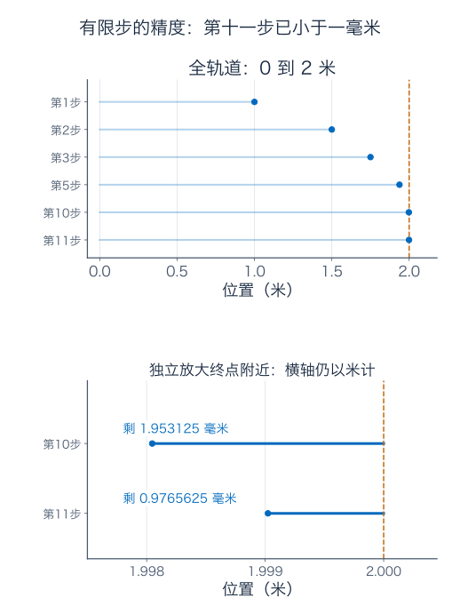
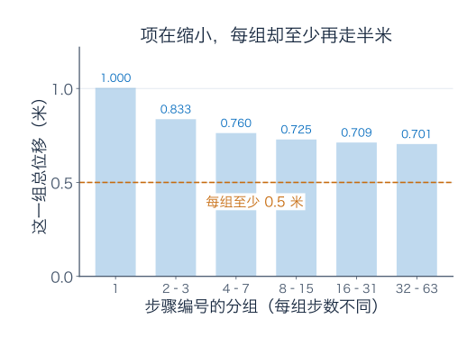
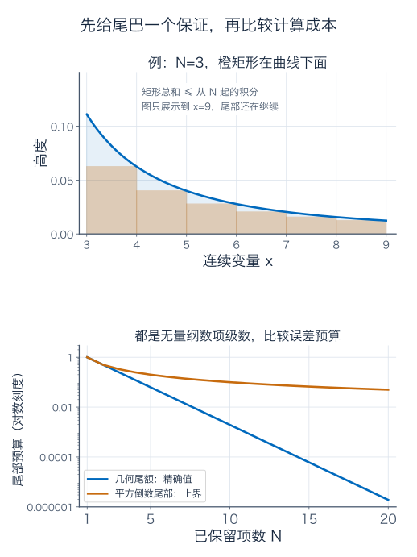
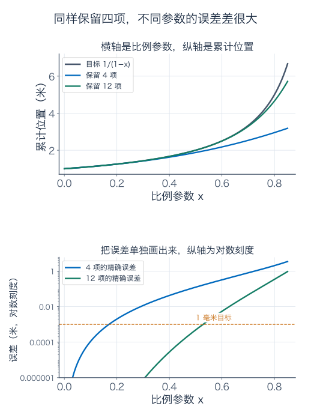
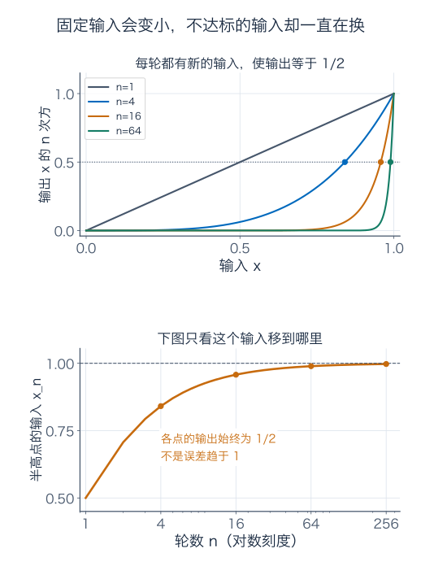
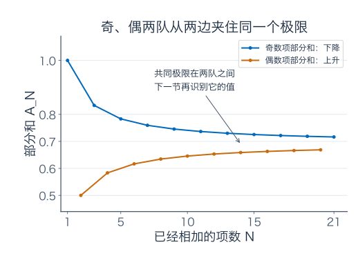
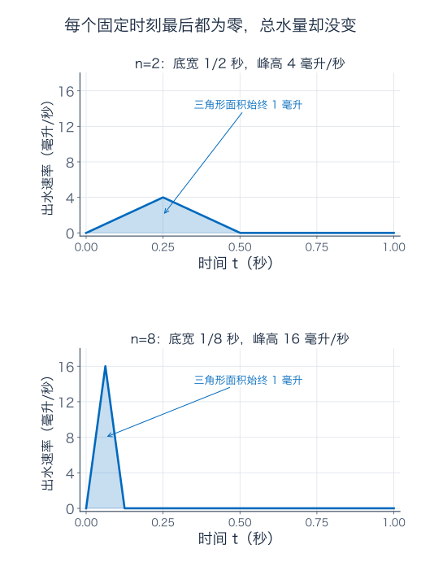
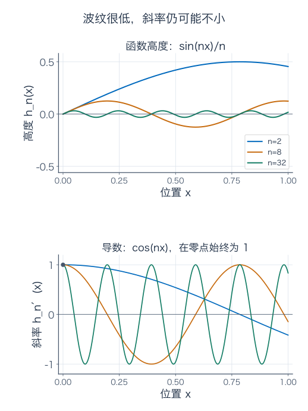

[数学总导航](../00-%E6%95%B0%E5%AD%A6%E5%AD%A6%E4%B9%A0%E5%AF%BC%E8%88%AA.md) · [本课程目录](00-%E5%AD%A6%E4%B9%A0%E8%B7%AF%E7%BA%BF%E4%B8%8E%E7%AC%A6%E5%8F%B7.md) · [← 上一章](05-%E7%A7%AF%E5%88%86%E6%8A%80%E5%B7%A7%E3%80%81%E5%8F%8D%E5%B8%B8%E7%A7%AF%E5%88%86%E4%B8%8E%E6%A6%82%E7%8E%87.md) · [下一章 →](07-%E5%A4%9A%E5%8F%98%E9%87%8F%E5%BE%AE%E5%88%86%E4%B8%8E%E6%A2%AF%E5%BA%A6.md)

## 每次走剩余距离的一半，机器人算到第几步才够准

桌上有一条 2 米长的直轨。机器人从左端出发，第一步走 1 米，第二步走 0.5 米，第三步走 0.25 米，以后每步都走剩余距离的一半。

先把问题问具体：不是要求机器真的执行无穷次动作，而是问，**执行有限的多少步以后，离右端的距离能保证小于 1 毫米？**

我们还会把“一半”换成可调参数，给一批不同设置的机器人准备同一个步数。前一个问题只要算一个数，后一个问题要照顾整段参数范围。这正是本章从数项级数走向函数列的路线。

本章需要第 1 篇的数列极限、第 3 篇的 Taylor 余项，以及第 4、5 篇的积分与尾部估计。不必提前认识“一致收敛”；我们会先看到它要解决什么事，再给它名字。

## 1．先算有限步，别急着给无穷做加减法

把执行完第 $N$ 步的位置记为 $S_N$，单位是米。它是有限和：

$$
S_N=1+\frac12+\frac1{2^2}+\cdots+\frac1{2^{N-1}}.
$$

先乘 $1/2$，再相减。中间的大部分项会抵消：

$$
\begin{aligned}
S_N&=1+\frac12+\cdots+\frac1{2^{N-1}},\\
\frac12 S_N&=\frac12+\frac1{2^2}+\cdots+\frac1{2^N},\\
\frac12 S_N&=1-\frac1{2^N}.
\end{aligned}
$$

所以

$$
S_N=2(1-2^{-N}),\qquad 2-S_N=2^{1-N}.
$$

最后一个式子就是我们需要的剩余距离。它不是猜出来的，也没有先假定无穷和等于 2；每个有限 $N$ 都满足这项精确等式。

| 已走步数 $N$ | 位置（米） | 剩余距离（毫米） |
| --- | --- | --- |
| 1 | 1 | 1000 |
| 2 | 1.5 | 500 |
| 3 | 1.75 | 250 |
| 5 | 1.9375 | 62.5 |
| 10 | 1.998046875 | 1.953125 |
| 11 | 1.9990234375 | 0.9765625 |

每个有限步都还差一点，位置却可以任意靠近 2。我们把部分和的极限叫这串数的级数之和：

$$
\sum_{n=0}^{\infty}2^{-n}
:=\lim_{N\to\infty}\sum_{n=0}^{N-1}2^{-n}=2.
$$

符号 $\sum$ 表示相加，下方的 $n=0$ 指第一项是 $2^0=1$。请区分 $n$ 与 $N$：小写是求和时依次走过的编号，大写是这次保留了多少项。前 $N$ 项到 $n=N-1$ 结束。

图的放大部分换了一把更细的尺子，不能把上下两幅的水平距离直接相比。第十步还差约 1.95 毫米，第十一步只差约 0.98 毫米。

要求小于 1 毫米，也就是小于 $0.001$ 米，需

$$
2^{1-N}<0.001
\quad\Longleftrightarrow\quad 2^N>2000.
$$

$2^{10}=1024$ 不够，$2^{11}=2048$ 足够；而且剩余距离随步数递减，所以最少 11 步。

“极限位置为 2 米”不等于“某个有限步骤恰好到 2 米”。它也没有单独证明是否能在有限时间到达；那还需要规定每一步耗时。这个实验要交付的是有限步的精度保证，11 步已经能回答。

## 2．下一步很小，为什么不代表全部尾巴很小

执行完 $N$ 步，下一步为 $2^{-N}$ 米，全部剩余距离却为 $2^{1-N}$ 米，是下一步的两倍。漏掉下一步，与漏掉此后所有步骤，是两笔不同的账。

把每步缩短的比例换成 $r$，第一步仍走 1 米。对 $r\ne1$，同样用“乘 $r$ 再相减”，得到

$$
P_N(r)=1+r+\cdots+r^{N-1}=\frac{1-r^N}{1-r}.
$$

若 $0\le r<1$，最终位置为 $1/(1-r)$ 米，剩余距离是 $r^N/(1-r)$ 米。比例越接近 1，单笔之后还藏着越长的尾巴。例如 $r=0.99$，下一步只有 1 毫米时，全部尾巴仍有 $1/(1-0.99)=100$ 倍，也就是 100 毫米。

再试一种指令：第 $n$ 步固定向右走 $1/n$ 米。单步同样趋零，总位置会不会也稳定在某个有限点？

把步骤按编号分组：第 1 步单独算；第 2、3 步一组；第 4 到 7 步一组；第 8 到 15 步一组。一般地，编号从 $2^k$ 到 $2^{k+1}-1$ 的一组有 $2^k$ 步，每步都至少有 $1/2^{k+1}$ 米，所以每组至少再走

$$
2^k\cdot\frac1{2^{k+1}}=\frac12\ \text{米}.
$$

无论前面走了多少，总能继续安排任意多组，每组又至少半米，位置没有有限上界。这串数叫调和级数，它发散。

柱子画的是一整组的总量，不是其中某一步的大小。每组步骤越来越多，不能只看最后一步已经很小。

如果级数确实收敛，单项必然趋零：设 $S_N\to S$，则 $a_N=S_N-S_{N-1}\to0$。但调和级数说明反过来不成立。通过“单项趋零”这项初筛，还没有完成整条尾巴的检查。

### 怎样在不知道答案时检查尾巴

对于实数或复数级数，收敛等价于下面的要求：给定任何误差 $\varepsilon>0$，都能找到一个位置 $N$，使得只要 $m>n\ge N$，

$$
\left|a_{n+1}+a_{n+2}+\cdots+a_m\right|<\varepsilon.
$$

这叫 Cauchy 条件。它检查任意有限尾段，完全不要求先知道最终和。实数、复数的完备性保证，后面的账若这样越来越稳定，就确实有一个极限。调和级数失败得很具体：不论从多晚开始，都能找到长尾段，贡献至少半个单位。

## 3．两种都收敛的算法，计算成本也可能差很多

看 $\sum_{n=1}^{\infty}1/n^2$。项比 $1/n$ 小一些，怎样给出真正的保证？

在每个整数点画高为 $1/n^2$、宽为 1 的矩形。因为 $x^{-2}$ 递减，编号 $n$ 的矩形面积夹在相邻两段曲线下面积之间：

$$
\int_n^{n+1}\frac{dx}{x^2}\le\frac1{n^2}
\le\int_{n-1}^{n}\frac{dx}{x^2}\qquad(n\ge2).
$$

先把 $n=N+1$ 到 $M$ 的有限项加起来，再让 $M$ 增大。积分上界有限，因此这些非负部分和单调且有界，尾部和存在，并满足

$$
\frac1{N+1}
=\int_{N+1}^{\infty}\frac{dx}{x^2}
\le\sum_{n=N+1}^{\infty}\frac1{n^2}
\le\int_N^{\infty}\frac{dx}{x^2}
=\frac1N.
$$

这一步既证明收敛，又准备了误差范围。我们暂时不知道精确总和，也不妨碍做有保证的近似。

若要求尾部严格小于 $0.001$，用上界 $1/N$，取 $N=1001$ 就足够。这里说的是“这份上界保证足够”，不是已经求出了真实误差所需的最少项数。一个保守的保证，不能拿来宣布所有更小的 $N$ 都失败。

而前面的几何级数只需 11 项就达到同样的绝对误差。它们都收敛，但一条尾巴按指数缩小，另一条大致按倒数缩小，计算量差很多。

同样的矩形比较，对 $x^{-p}$ 给出：$p>0$ 时，$\sum n^{-p}$ 与 $\int_1^\infty x^{-p}dx$ 同敛散；第 5 篇已经算过该积分。$p\le0$ 时，单项连趋零都做不到。因此

$$
\sum_{n=1}^{\infty}\frac1{n^p}\text{ 收敛，当且仅当 }p>1.
$$

以后遇到非负项，先找一份已知的预算。例如 $0\le n/(n^3+1)\le1/n^2$，右侧部分和有共同上界，左侧也有，因而收敛。不是式子“看起来像平方倒数”就够了，而是把不等式写出来，让它真正承担保证。

## 4．一个参数变成一整条曲线，同样的项数还够吗

回到几何指令，把比例记为 $x$，现在允许 $-1<x<1$。负比例代表步长正负交替，即沿直轨来回调整；累计的是有方向的位置变化。

前 $N$ 步的位置函数为

$$
P_N(x)=1+x+\cdots+x^{N-1}.
$$

对每个固定 $|x|<1$，它趋于

$$
F(x)=\frac1{1-x},
$$

而误差有精确公式

$$
F(x)-P_N(x)=\frac{x^N}{1-x}.
$$

同一个四项算法，在 $x=0.2$ 时，误差为 $0.2^4/0.8=0.002$ 米；在 $x=0.8$ 时，误差为 $0.8^4/0.2=2.048$ 米。两边只改了一个参数，误差却相差 1024 倍。

上图横轴是参数 $x$，不是步数；每条线都是一整个位置函数。下图单独画误差，才能看清“曲线好像挺贴近”究竟够不够用。

若设备的比例一律限制在 $|x|\le r<1$，就能为整批设备准备共同保证：

$$
|F(x)-P_N(x)|
=\frac{|x|^N}{|1-x|}
\le\frac{r^N}{1-r}.
$$

右边不再含各台设备的 $x$。例如全批都满足 $|x|\le1/2$，误差不超过 $2^{1-N}$ 米，保留 11 项便一起达到小于 1 毫米的要求。若允许 $0\le x\le0.8$，用同一公式需要 39 项；38 项的最坏误差约 0.001038 米，39 项约 0.000831 米。最坏值在 $x=0.8$ 取得，所以这回确实能据此判断最少项数。

若允许整个 $[0,1)$，就没有这样的共同项数。每个固定 $x$ 的误差都趋零，但对任何有限 $N$，当 $x\uparrow1$，$x^N/(1-x)$ 仍没有上界。每台设备迟早能达标，不等于能给所有设备同一个达标日期。

## 5．先让每个输入分别够准，还是让全部输入一起够准

给刚才的区别取名字。函数列 $f_n$ 逐点收敛于 $f$，意思是：先固定输入 $x$，再等 $n$ 增大；每个固定输入处都有 $f_n(x)\to f(x)$，但等待的轮数可以依赖这个输入。

一致收敛则要求：给定误差 $\varepsilon>0$，有一个不依赖输入的 $N$，让所有 $n\ge N$、所有允许的 $x$ 同时满足

$$
|f_n(x)-f(x)|<\varepsilon.
$$

“所有输入”的范围必须写清。几何多项式在 $[-1/2,1/2]$ 上一致收敛于 $1/(1-x)$，在 $[0,1)$ 上只逐点收敛。

还可以直接看那块积木 $f_n(x)=x^n$，$0\le x\le1$。固定 $x<1$，它趋零；在 $x=1$，它一直等于 1。因此逐点极限为

$$
f(x)=\begin{cases}0,&0\le x<1,\\1,&x=1.\end{cases}
$$

每条 $x^n$ 曲线都连续，极限却在右端跳了。可见“连续函数的极限还是连续函数”，缺少收敛方式就会出错。

若去掉右端，只看 $[0,1)$，极限处处为零，仍不一致。因为不管第 $n$ 轮做到多晚，都可找到新的输入

$$
x_n=2^{-1/n}<1,\qquad x_n^n=\frac12.
$$

你等一轮，不达标的位置就往右挪一点。每个固定位置最终过关，整条区间却始终有人不过关。

上图的点都落在高度 $1/2$ 的线上，横坐标却随轮数向 1 移动。下图画的是这些横坐标如何移动，不是在说误差趋于 1。

可以把整批输入的误差压成一个数：

$$
\|f_n-f\|_\infty=\sup_{x\in E}|f_n(x)-f(x)|.
$$

$E$ 是允许输入的集合；$\sup$ 是上确界，可以先读成“容得下全部误差的最低天花板”。在 $E=[0,1)$ 上，$x^n$ 永远小于 1，却能任意接近 1，所以天花板为 1，即使没有哪个点真的取到它。它不趋零，因此不一致收敛。

若把范围缩成 $[0,r]$，其中固定 $r<1$，天花板就是 $r^n\to0$，于是又一致了。一致收敛不是只看公式，还得看在哪个输入集合上检查。

## 6．正负交替能省事，但要保留它的次序

负比例的几何指令让机器人在终点两侧来回调整。另一种规律相消出现在

$$
1-\frac12+\frac13-\frac14+\cdots.
$$

设 $A_N$ 是前 $N$ 项和。偶数项部分和每次增加一对 $1/(2k-1)-1/(2k)>0$，因此从下方上升；奇数项部分和每次增加 $-1/(2k)+1/(2k+1)<0$，因此从上方下降。奇、偶两队互相夹住，间距为下一项的大小，趋于零，所以有共同极限。

对一般交错级数，若项的正大小单调趋零，同样的夹逼证明收敛，且前 $N$ 项的误差绝对值不超过下一项。这份“看下一项就够”的保证，来自特定的正负相消；前面的非负几何尾巴不能照抄它。

交错调和级数的绝对值总和是发散的调和级数。它靠次序中的相消收敛，称为条件收敛。若 $\sum|a_n|$ 有限，则称绝对收敛。绝对收敛容许任意重排而不改和，条件收敛不能这样保证。补充 B 会实际重排一遍，算出不同结果，而不只留一句警告。

目前我们只证明交错调和级数有一个极限，尚未识别它是多少。下一节将通过有限积分恒等式认出它，避免“先背下答案，再拿答案证明收敛”。

## 7．从有限积木做出对数，并给计算配一张误差单

从几何恒等式出发，对任意 $0\le t<1$ 都有

$$
\frac1{1-t}=\sum_{k=0}^{N-1}t^k+\frac{t^N}{1-t}.
$$

先只积分有限项。在 $0$ 到 $x$（$0\le x<1$）之间，

$$
-\log(1-x)
=\sum_{k=1}^{N}\frac{x^k}{k}
+\underbrace{\int_0^x\frac{t^N}{1-t}dt}_{E_N(x)}.
$$

剩下这块就是误差。由于 $1/(1-t)\le1/(1-x)$，

$$
0\le E_N(x)\le\frac{x^{N+1}}{(N+1)(1-x)}\longrightarrow0.
$$

因此，在 $0\le x<1$，$-\log(1-x)=\sum_{k=1}^{\infty}x^k/k$。若 $-1<x<0$，调转积分方向，用 $|t|\le|x|$、$|1-t|\ge1-|x|$，同样得到误差绝对值不超过 $|x|^{N+1}/((N+1)(1-|x|))$。所以公式在整个 $|x|<1$ 成立。

取 $x=1/2$，就能计算 $\log2$。前十项为

$$
L_{10}=\sum_{k=1}^{10}\frac{2^{-k}}k
\approx0.6930648562,
$$

误差被保证在

$$
0\le\log2-L_{10}\le\frac1{11264}<0.0001.
$$

这是一张不依赖预先知道 $\log2$ 小数值的误差单。小数看起来接近，不能替代这份保证；保证绝对误差小于 $0.0001$，也不自动意味着四位小数的舍入必然正确，第 3 篇已经解释过舍入边界。

### 端点不能直接代，但可以另外算

上一公式只在 $|x|<1$ 得到证明，不能直接把 $x=-1$ 塞进去，宣布交错调和级数的值。

另用一个有限恒等式：

$$
\frac1{1+t}=\sum_{k=0}^{N-1}(-t)^k+\frac{(-t)^N}{1+t}.
$$

这次在 $[0,1]$ 上没有奇点，积分得

$$
\log2=A_N+\int_0^1\frac{(-t)^N}{1+t}dt.
$$

最后一项绝对值不超过 $\int_0^1t^Ndt=1/(N+1)$，因此 $A_N\to\log2$。端点的身份，由这项独立估计补上了。

这个算法虽然会收敛，效率却低：只用下一项上界保证误差严格小于 $0.0001$，可取 $N=10000$。相比之下，正的 $2^{-k}/k$ 配方只需十项。

### 再换一种配方，四项就给出更小的保证

还可以从同一批积木出发，把几何变量改成 $t^2$，得到

$$
\frac2{1-t^2}=2\sum_{k=0}^{N-1}t^{2k}+\frac{2t^{2N}}{1-t^2}.
$$

左边一个原函数是 $\log((1+t)/(1-t))$，求导可核对。积到 $r\in(0,1)$ 后，

$$
\log\frac{1+r}{1-r}
=2\sum_{k=0}^{N-1}\frac{r^{2k+1}}{2k+1}+Q_N(r),
\qquad
0\le Q_N(r)\le\frac{2r^{2N+1}}{(2N+1)(1-r^2)}.
$$

为什么选 $r=1/3$？因为 $(1+r)/(1-r)=2$，仍在计算同一个 $\log2$；而幂次每次多二，后面的贡献缩得更快。

取四项，

$$
2\left(\frac13+\frac1{3\cdot3^3}
+\frac1{5\cdot3^5}+\frac1{7\cdot3^7}\right)
\approx0.6931347573,
$$

误差不超过 $1/78732\approx0.00001270$。同一个数换一种表达，计算成本可能大幅改变。选择展开位置与配方，不只是书写习惯，也是在选择误差如何消失。

## 8．幂级数的配方，必须附上有效范围

像 $1+x+x^2+\cdots$、$x+x^2/2+x^3/3+\cdots$ 这样，把参数的不同次幂乘上系数再相加，就叫幂级数。一般写成

$$
\sum_{n=0}^{\infty}c_n(x-a)^n.
$$

$a$ 是展开中心，$c_n$ 是各次幂的系数。它是一列多项式部分和的极限，不是一个无条件可用的“无限多项式”。

我们已经算过几何配方的范围：$|x|<1$ 时收敛；$x=1$ 时部分和为 $N$；$x=-1$ 时部分和在 1 与 0 之间跳；$|x|>1$ 时单项都不趋零。边界与外面都不能沿用 $1/(1-x)$ 的级数等号。

对 $\sum_{n=1}^{\infty}x^n/n$，内部同样收敛，但边界不一样：$x=1$ 得到发散的调和级数，$x=-1$ 得到交错调和级数的负数，收敛到 $-\log2$。所以这份配方的收敛区间是 $[-1,1)$，而非整个闭区间，也非两个端点都去掉。

### 相邻两项的比值，怎样帮忙估计整条尾巴

若 $a_n$ 最终非零，且 $|a_{n+1}/a_n|\to L<1$，就可选 $L<q<1$。从某项以后，每项绝对值不超过前一项的 $q$ 倍，后续贡献便被几何级数控制，因此绝对收敛。这叫比值判别法，它的理由仍是我们最早算出的几何尾巴。

对 $a_n=x^n/n$、固定 $x\ne0$，

$$
\left|\frac{a_{n+1}}{a_n}\right|
=|x|\frac n{n+1}\longrightarrow|x|.
$$

所以内部 $|x|<1$ 绝对收敛。$|x|>1$ 时，项的比值最终大于某个大于 1 的数，项不趋零，级数发散。比值极限恰好为 1 时，该判别法没结论；$1/n$ 与 $1/n^2$ 的相邻比值都趋于 1，却一个发散、一个收敛。端点须换用前面真正有效的理由。

幂级数都有一个收敛半径 $R\in[0,\infty]$：距中心小于 $R$ 时绝对收敛，大于 $R$ 时发散，边界另查。为什么会是一整段？若在距离 $\rho>0$ 的某点收敛，则该处各项有界，$|c_n|\rho^n\le M$。在更近的 $r<\rho$ 处，

$$
|c_n|r^n\le M(r/\rho)^n,
$$

又被几何预算罩住。能在远处收敛，就必能在所有更近的位置绝对收敛；有效范围不会是散乱的一串点。

阶乘 $n!=1\cdot2\cdots n$（约定 $0!=1$）给出两个极端：$\sum x^n/n!$ 的相邻比值为 $|x|/(n+1)\to0$，所以半径为无穷；$\sum n!x^n$ 在 $x\ne0$ 时比值 $(n+1)|x|\to\infty$，只在中心 0 收敛，半径为 0。

这还没有证明第一串恰好等于 $e^x$。级数有一个和，与那个和是不是指定的目标函数，是两份证明。

### 用 Taylor 余项认出指数，而不是只认出它的系数

第 3 篇的有限阶公式给出

$$
T_m(x)=\sum_{n=0}^m\frac{x^n}{n!},\qquad
|e^x-T_m(x)|\le\frac{e^A A^{m+1}}{(m+1)!}
\quad(|x|\le A).
$$

这里 $T_m$ 的下标是最高次数，包含 $m+1$ 项，与前面“$P_N$ 含 $N$ 项”的编号方式不同。右边的 $e^A$ 控制零与输入之间全部指数导数。固定 $A$ 后，预算相邻比值为 $A/(m+2)\to0$，所以预算趋零。这才证明

$$
e^x=\sum_{n=0}^{\infty}\frac{x^n}{n!},
$$

并且在每个固定有界输入区间上一致收敛。

要给 $|x|\le1$ 准备一个不用精细真值的粗界，可以用第 3 篇已有的不等式 $e^u\le1/(1-u)$（$0\le u<1$）：代 $u=1/2$ 得 $e^{1/2}\le2$，所以 $e\le4$。保留到 $m=6$，即七项，统一误差不超过 $4/7!=1/1260<0.001$。

匹配所有阶导数还不够：第 3 篇那个在零点取 0、其他位置取 $e^{-1/x^2}$ 的光滑函数，每阶零点导数都为 0，Taylor 配方却只给零函数，无法在任何含非零点的邻域还原原函数。关键仍是余项是否趋零，不能把“系数找齐了”当成“函数身份已经证明”。

## 9．曲线每一点都变小，积分为什么还可能没变

我们已经看见逐点收敛可能丢失连续性。接着检查第 4、5 篇一直在用的面积累计。

想象一个流量计在一秒内记录到很短的脉冲。第 $n$ 次测试中，出水只发生在 $[0,1/n]$ 秒，峰顶在 $1/(2n)$ 秒，高度为 $2n$ 毫升/秒，图像为三角形，其他时间为零。一个写法是

$$
g_n(t)=2n\max\{1-|2nt-1|,0\},\qquad0\le t\le1.
$$

$\max\{z,0\}$ 表示负的部分改成零。图里的脉冲越来越短，也越来越高。

固定任意 $t>0$，只要 $n>1/t$，整个脉冲已缩到这个时刻左边，所以 $g_n(t)$ 从此为零；$t=0$ 一直为零。因此每个固定时刻的读数都趋零。

但每次累计水量都是

$$
\int_0^1g_n(t)dt
=\frac12\times\frac1n\times2n=1\ \text{毫升}.
$$

极限函数为零，积分为零；各次积分的极限却为 1 毫升。不能只凭逐点收敛，就把极限与积分交换。真实仪器也可能漏掉采样间的短脉冲，不过本例证明的是这些精确函数的极限，不是在替某种采样设备给性能结论。

怎样给累计量一个足够条件？在固定有限区间 $[a,b]$，若连续函数 $f_n$ 一致收敛于 $f$，则 $f$ 连续，且

$$
\left|\int_a^b f_n-\int_a^b f\right|
\le(b-a)\|f_n-f\|_\infty\longrightarrow0.
$$

例如一整分钟内，每时每刻的流量预测误差都不超过 0.1 毫升/秒，累计水量误差就不超过 $60\times0.1=6$ 毫升。统一控制高度，再乘已固定的时长，就控制了面积。

这里的有限时长不能丢。若区间长度也在增大，“很低”的误差仍可能铺成不小的面积，补充 C 会给一个精确例子。

一致收敛是这个交换定理的充分条件，不是必要条件。$x^n$ 在 $[0,1]$ 上不一致收敛，但 $\int_0^1x^n dx=1/(n+1)\to0$，仍等于逐点极限的积分——那个极限只在点 1 取 1，单点不影响积分，第 4 篇已经解释过。

## 10．曲线很贴近，为什么斜率还可能完全不贴近

把平直的绳子压出越来越密、越来越低的波纹。用

$$
h_n(x)=\frac{\sin(nx)}n,\qquad0\le x\le1
$$

模拟它的高度。$|h_n(x)|\le1/n$，所以整条曲线一致趋于零；导数却为 $h_n'(x)=\cos(nx)$，在 $x=0$ 一直为 1。零函数的导数为 0，因此即使函数一致收敛，也不能自动交换极限与求导。

上图画高度，下图画斜率，两幅图各自使用固定刻度。小高度配上很密的变化，仍能有不小的坡度。

一个好用的充分条件需要反过来控制导数：在固定有限区间上，每个 $h_n$ 连续可导，$h_n'$ 一致收敛于 $g$，并且某一个位置 $x_0$ 的值 $h_n(x_0)\to c$。那么 $h_n$ 一致收敛到一个可导函数 $h$，且 $h'=g$。

为什么还需那个位置？导数看不见整体高度。$h_n(x)=n$ 的导数全为零，曲线本身却越来越高。一个锚点锁住常数，统一斜率控制剩余形状；补充 C 会用基本定理把这句话写成误差不等式。

还有一份检查函数级数的通用预算：若对所有允许的 $x$，都有 $|u_n(x)|\le M_n$，而 $\sum M_n$ 有限，那么任意尾段都满足

$$
\left|\sum_{k=N+1}^{m}u_k(x)\right|\le\sum_{k=N+1}^{m}M_k.
$$

右边不依赖 $x$ 且尾部可任意小，因此函数级数一致收敛。这叫 Weierstrass 的 M 判别法。例如 $\sum2^{-n}\cos(nx)$ 在整个实数轴上都被 $\sum2^{-n}$ 控制；是否能统一控制，关键在振幅预算，未必要求输入区间短。求导问题中，应把这份检查用在导数级数上，再核对一个锚点。

对幂级数，半径内部的几何衰减能同时控制函数与导数，所以内部可以逐项积分、求导。例如

$$
\frac1{(1-x)^2}=\sum_{n=1}^{\infty}n x^{n-1},\qquad |x|<1.
$$

这里多出来的 $n$ 仍压不过内部的几何衰减。具体预算与证明放在补充 D。不能把范围扩到端点：对数级数 $\sum x^n/n$ 在 $x=-1$ 收敛，求导后的 $\sum x^{n-1}$ 在这里却不停跳动。

## 11．练习：先指出误差，再决定怎样控制

先做下面八题，再查看全部解答。第一次读可以在这里完成练习，后面的补充留待需要时回看。

**题一：前几项与下一项，别数错。**

用前 $N$ 项近似 $\sum_{n=0}^{\infty}4^{-n}$，要让误差严格小于 $0.001$，最少几项？若几何比例为 $0.99$，下一项为 0.01 元，后面全部尾款是多少？

**题二：中心、半径、两个端点。**

求 $\sum_{n=1}^{\infty}(x-2)^n/(n3^n)$ 的收敛区间，并分别说明内部、左端点、右端点的收敛类型。

**题三：四项对数配方有多可靠。**

用正文的 $2\sum_{k=0}^{N-1}(1/3)^{2k+1}/(2k+1)$ 近似 $\log2$。计算三项与四项的误差上界；若只凭这份上界保证误差小于 $0.0001$，最少应选几项？写出四项近似值与一份包含真值的区间。

**题四：给每个输入分别等，与给所有输入一起等。**

考察 $f_n(x)=x^n$。在 $[0,1)$ 上的逐点极限是什么？是否一致？在 $[0,1/2]$ 上是否一致，且要让全部输出小于 $0.1$，最少需多大的 $n$？另外固定 $x=0.99$，至少需要几轮？

**题五：尖峰高度、固定点、总面积。**

比较两列连续三角脉冲：第一列底宽 $1/n$、峰高 $2n$；第二列底宽 $1/n^2$、峰高 $n$。两者左端都在零，峰在底边中点，其他位置为零。分别求逐点极限、最大高度与面积的极限，判断是否一致收敛。

**题六：把波纹再压低一些，求导能否恢复正常。**

比较 $h_n(x)=\sin(nx)/n$ 与 $k_n(x)=\sin(nx)/n^2$，区间为 $[0,1]$。它们是否一致趋零？导数是否一致趋零？在哪个例子里能用“导数统一控制加一个锚点”来交换求导与极限？

**题七：函数级数的求导，需要哪份预算。**

对 $F(x)=\sum_{n=1}^{\infty}\sin(nx)/n^3$，判断是否能逐项求导，写出导数并说明依据。若分母改成 $n^2$，原函数级数是否仍一致收敛？导数候选在 $x=0$ 通过什么检查？

**题八：有余项保证的指数计算。**

用 $T_6(x)=\sum_{n=0}^{6}x^n/n!$ 在 $[-1,1]$ 上近似 $e^x$。解释为什么是七项，利用 $e\le4$ 给出统一误差界，并算出 $T_6(1)$。这份界能否保证绝对误差小于 $0.001$？仅凭这份界，是否已经保证四位小数舍入正确？

### 参考答案与解题过程

#### 题一解答

前 $N$ 项从编号 0 到 $N-1$，第一项漏掉的是 $4^{-N}$。全部尾巴是

$$
\frac{4^{-N}}{1-1/4}=\frac4{3\cdot4^N}.
$$

$N=5$ 时为 $1/768\approx0.00130208$，不够；$N=6$ 时为 $1/3072\approx0.000325521$，达标。因为尾巴随 $N$ 递减，所以最少六项。这是精确尾额，不只是保守上界，才可以这样判断“最少”。

比例为 0.99、下一项为 0.01 元时，全部尾款为 $0.01/(1-0.99)=1$ 元。下一项与全部尾巴相差一百倍，不能把前者直接当作误差。

#### 题二解答

令 $y=(x-2)/3$，原式变为 $\sum y^n/n$。对 $y\ne0$，相邻项比值趋于 $|y|$，内部 $|y|<1$ 绝对收敛，外部 $|y|>1$ 发散；$y=0$ 时每项都为零，自然收敛。

所以中心为 2，半径为 3，内部为 $-1<x<5$。左端 $x=-1$，即 $y=-1$，级数为 $\sum(-1)^n/n$，条件收敛到 $-\log2$；右端 $x=5$，即 $y=1$，为发散的调和级数。收敛区间是 $[-1,5)$。半径只划出内部与外部，不替我们决定端点。

#### 题三解答

代 $r=1/3$，误差上界可简化为

$$
U_N=\frac{2(1/3)^{2N+1}}{(2N+1)(1-1/9)}
=\frac{9}{4(2N+1)3^{2N+1}}.
$$

三项时，$U_3=1/6804\approx0.00014697$；四项时，$U_4=1/78732\approx0.00001270$。$U_N$ 随 $N$ 递减，所以只用这份界保证小于 $0.0001$，最少选四项。三项上界过大，说明这份保证还不够，并不单凭这一点断言真实误差也一定过大。

四项值记为 $B_4$：

$$
B_4=2\left(\frac13+\frac1{81}+\frac1{1215}+\frac1{15309}\right)
\approx0.6931347573.
$$

余项非负，因此精确的真值保证区间是 $[B_4,B_4+1/78732]$。若想用只含十位小数的外包区间，可以写

$$
\log2\in[0.6931347573,\ 0.6931474587].
$$

两端分别向外取舍，避免把显示小数的舍入误差漏出保证。区间宽度小于 $0.0001$，即使不先查 $\log2$ 的真值，也有可靠近似。

#### 题四解答

在 $[0,1)$，每个固定 $x$ 都满足 $x^n\to0$。但取 $x_n=2^{-1/n}$，每轮仍有输出 $1/2$；也可以写 $\sup_{[0,1)}x^n=1$。所以不一致。

在 $[0,1/2]$，最大输出为 $2^{-n}\to0$，因此一致。$n=3$ 时最大值 $1/8=0.125$ 还大于 0.1；$n=4$ 时为 $1/16=0.0625$，所以最少四轮。

固定 $x=0.99$ 时，要 $0.99^n<0.1$，取对数得 $n\log0.99<\log0.1$。由于分母为负，除后不等号反向：

$$
n>\frac{\log0.1}{\log0.99}\approx229.1053.
$$

最少 230 轮。前两处谈的是输入集合上的统一要求，最后谈的是一个固定输入，各自所需轮数不同。

#### 题五解答

两列在 $t=0$ 都为零。任取固定 $t>0$，当底宽小于 $t$，该点就从此离开脉冲支撑区间，所以两列逐点极限均为零。

第一列最高为 $2n\to\infty$，面积为 $\frac12(1/n)(2n)=1$，不一致收敛，积分也不趋于零函数的积分。

第二列最高为 $n\to\infty$，同样不一致收敛；但面积为 $\frac12(1/n^2)n=1/(2n)\to0$。这一列积分恰好能交换，尽管统一高度误差完全失控。因此“不满足一致收敛”不等于“所有极限与积分交换都必失败”。

逐点误差、最坏误差、累计面积，是不同的检查。后面泛函分析会用不同的范数分别表达这些需求。

#### 题六解答

第一列 $\|h_n\|_\infty\le1/n$，所以一致趋零。其导数为 $\cos(nx)$，在 0 为 1，因此不能一致趋零，甚至在该点也不趋零。极限零函数的导数与这组导数的极限不能照搬交换。

第二列满足 $\|k_n\|_\infty\le1/n^2\to0$，导数为 $k_n'(x)=\cos(nx)/n$，统一绝对值不超过 $1/n\to0$。又有 $k_n(0)=0$，锚点固定，因此满足求导交换定理，极限函数的导数就是零。

两列波纹频率都在变高，第二列把高度再压低一个 $1/n$，使斜率也一起变小。控制函数高度与控制斜率，用的不是同一份误差预算。

#### 题七解答

先看导数候选：每项 $\sin(nx)/n^3$ 的导数为 $\cos(nx)/n^2$。对任意实数 $x$，都有

$$
\left|\frac{\cos(nx)}{n^2}\right|\le\frac1{n^2}.
$$

这是一份可求和且不依赖 $x$ 的预算，所以导数部分和一致收敛，具体理由见补充 D 的 M 判别法。原级数部分和在 $x=0$ 全为零，锚点条件成立。在任意有限区间 $[-A,A]$ 应用求导定理，得到

$$
F'(x)=\sum_{n=1}^{\infty}\frac{\cos(nx)}{n^2}.
$$

每个实数都能放进这样的有限区间，所以等式处处成立。原函数级数本身也被 $\sum1/n^3$ 控制而一致收敛。

分母若改为 $n^2$，原函数级数仍被 $\sum1/n^2$ 控制，一致收敛。但导数候选变为 $\sum\cos(nx)/n$，在 $x=0$ 就是发散的调和级数，连逐点收敛检查都通不过。因此不能把这个发散的候选当成逐项相加得到的导数。这里指出的是这条求导路线失效，不靠“某个充分条件不成立”就省略其他证明。

#### 题八解答

次数从 0 到 6，共七项。对 $|x|\le1$，Taylor 余项满足

$$
|e^x-T_6(x)|\le\frac{e}{7!}\le\frac4{5040}=\frac1{1260}
\approx0.00079365<0.001.
$$

这是一个同时覆盖整个输入区间的保证，不只覆盖 $x=1$。代入 1，

$$
T_6(1)=1+1+\frac12+\frac16+\frac1{24}+\frac1{120}+\frac1{720}
=\frac{1957}{720}\approx2.7180555556.
$$

这份误差界能保证绝对误差小于 $0.001$，却不足以保证四位小数舍入。它允许的区间比四位小数的一个舍入格宽得多。若要报告四位小数都可靠，应继续加项或找更细误差界，并检查整个真值保证区间落在哪个舍入格中。

## 补充 A：把数项级数的判断再往里推一步

### 为什么控制绝对值是一份更稳的预算

若 $\sum|a_n|$ 收敛，任意有限尾段都有

$$
\left|\sum_{k=n+1}^m a_k\right|\le\sum_{k=n+1}^m|a_k|,
$$

右边可任意小，Cauchy 条件便保证原级数收敛。

重排后为什么还不改和？先把原来前 $N$ 项以外的绝对总额压到 $\varepsilon$ 以下。任何真正的重排中，这前 $N$ 项总会在某个有限位置全部出现。之后两份有限重排账的差，只含原来编号大于 $N$ 的若干项，绝对值不超过那份尾部预算，因此重排部分和也满足 Cauchy 条件。再与原来的部分和比较、取极限，差不超过 $\varepsilon$。由于精度任意，两者之和相同。

这里“真正的重排”要求每个原项恰好出现一次，不允许漏项或复制。控制的是总绝对额，所以不在乎正负抵消发生在什么时候。

### 比值等于1就换工具，不是直接宣布发散

若比值极限 $L<1$，选 $L<q<1$ 后，存在 $N$ 使 $|a_{N+j}|\le |a_N|q^j$。全部绝对尾巴从而不超过 $|a_N|q/(1-q)$，这还给出可用的截断误差。

若极限 $L>1$，选 $1<q<L$，项的绝对值最终至少按 $q$ 倍增长，不趋零。若 $L=1$，两边都不能获得关键的几何缩放，因此没有结论。

有些式子更适合看第 $n$ 次根。如果 $\limsup_{n\to\infty}|a_n|^{1/n}<1$，同样可选一个 $q<1$，让足够后面的 $|a_n|\le q^n$，从而绝对收敛。$\limsup$ 表示后续各尾段上确界的极限；这里它只负责表达“最终所有这些根都低于某个小于1的上限”。若普通极限存在，用普通极限即可。

若上述上极限大于 1，就有无穷多个项的绝对值大于某个 $q^n$（$q>1$），不趋零。等于 1 时仍没结论。根值判别与比值判别背后都是几何预算，差别只在怎样从原式读出这份预算。

## 补充 B：真的把条件收敛级数重排一次，会得到什么

把交错调和级数改成“两个正项、一个负项”的顺序：

$$
1+\frac13-\frac12
+\frac15+\frac17-\frac14
+\frac19+\frac1{11}-\frac16+\cdots.
$$

每个正的奇数倒数、负的偶数倒数都恰好用一次，所以确实是重排。记 $H_N=\sum_{k=1}^N1/k$，原交错和仍记为 $A_N$。

原式前 $2N$ 项满足

$$
A_{2N}=H_{2N}-H_N.
$$

因为 $H_{2N}$ 中偶数倒数之和为 $H_N/2$，再减掉一次同样的偶数部分，就把它们从正号改为负号。

新式前 $3N$ 项包含前 $2N$ 个正的奇数倒数，以及前 $N$ 个负的偶数倒数，所以

$$
\begin{aligned}
T_{3N}
&=H_{4N}-\frac12H_{2N}-\frac12H_N\\
&=(H_{4N}-H_{2N})+\frac12(H_{2N}-H_N)\\
&=A_{4N}+\frac12A_{2N}\longrightarrow\frac32\log2.
\end{aligned}
$$

每组内多出来的一、两项也趋零，因此并非只有这条子序列有极限，整个重排的部分和都趋于 $\frac32\log2$。原来之和为 $\log2$，重排后约为它的一点五倍。

有限加法的交换律没有出错。我们始终做正确的有限加法，改变的是哪一些有限和排在“第 $N$ 次结账”的位置，然后再取极限。绝对值总账发散时，这种顺序变化可以改变相消的进度与最终极限。

## 补充 C：连续性、积分与求导的交换，证明分别靠什么

### 连续性：先选一条固定的近似曲线，再沿它绕过去

设连续的 $f_n$ 在同一集合上一致收敛于 $f$。给定 $x_0$ 与 $\varepsilon>0$，先选一条 $f_N$，让它在所有位置与 $f$ 的差都小于 $\varepsilon/3$。再用这条固定函数的连续性，让 $x$ 靠近 $x_0$ 时 $|f_N(x)-f_N(x_0)|<\varepsilon/3$。于是

$$
\begin{aligned}
|f(x)-f(x_0)|
\le{}&|f(x)-f_N(x)|\\
&+|f_N(x)-f_N(x_0)|\\
&+|f_N(x_0)-f(x_0)|<\varepsilon.
\end{aligned}
$$

这三段绕路依次是：目标曲线跳到近似曲线、沿近似曲线走到 $x_0$、再跳回目标曲线。需要一致收敛，是因为选定同一个 $N$ 之后，还要控制所有附近 $x$ 的第一段；逐点收敛可能每换一个位置又要换一条曲线。

### 积分：有限区间长度是一项实际条件

在 $[a,b]$ 上，连续性保证积分存在，再用积分三角不等式：

$$
\left|\int_a^b(f_n-f)\right|
\le\int_a^b|f_n-f|
\le(b-a)\|f_n-f\|_\infty.
$$

右边趋零，就是正文的交换结论。

若改成无限区间，就不能把 $(b-a)$ 换成无穷然后继续说误差趋零。看 $t\ge0$ 上的连续三角形

$$
v_n(t)=\frac1n\max\{1-|t/n-1|,0\}.
$$

底边为 $[0,2n]$，高度为 $1/n$。它在整个半轴上一致趋零，但积分始终为 $\frac12(2n)(1/n)=1$。高度虽然统一变小，宽度却一直增大。若要在无穷区间交换极限与积分，还需另找共同的可积控制或尾部保证，有限区间的定理不能直接扩张。

### 求导：斜率预算加一个固定高度

设 $h_n\in C^1([a,b])$，$h_n'$ 一致趋于 $g$，且某个 $x_0$ 满足 $h_n(x_0)\to c$。连续函数的一致极限 $g$ 连续。用基本定理写

$$
h_n(x)=h_n(x_0)+\int_{x_0}^x h_n'(t)dt.
$$

定义 $h(x)=c+\int_{x_0}^xg(t)dt$，则

$$
\|h_n-h\|_\infty
\le|h_n(x_0)-c|+(b-a)\|h_n'-g\|_\infty\longrightarrow0.
$$

因此函数也一致收敛，且基本定理给 $h'=g$。两个条件各自承担一部分误差，没有把“足够光滑”当作一句万能许可。

## 补充 D：为什么幂级数内部可以放心地逐项求导

设 $\sum c_n(x-a)^n$ 的收敛半径为 $R>0$。选 $0<r<\rho<R$，只要求在 $|x-a|\le r$ 的闭小区间工作。更外一圈 $\rho$ 上绝对收敛，所以存在 $M$，使每项 $|c_n|\rho^n\le M$。

原项与导数项分别有统一上界

$$
|c_n(x-a)^n|\le M(r/\rho)^n,
$$

$$
|n c_n(x-a)^{n-1}|
\le\frac M\rho\,n(r/\rho)^{n-1}.
$$

第一份是几何预算；第二份相邻比值趋于 $r/\rho<1$，也可和。M 判别法说明两组级数在闭小区间上一致收敛。更具体地说，M 判别法先给出所有部分和的统一 Cauchy 条件，固定每个输入用实数完备性得到极限，再把尾部上界取极限，就得一致逼近。

对多项式部分和，在中心 $a$ 的值始终为 $c_0$，锚点固定。应用补充 C 的求导定理，得到

$$
\left(\sum_{n=0}^{\infty}c_n(x-a)^n\right)'
=\sum_{n=1}^{\infty}n c_n(x-a)^{n-1}
\qquad(|x-a|<R).
$$

每个内部点都能放进某个这样的闭小区间，所以等式覆盖整个内部；这不等于说在整个开区间上都有同一份一致误差界。逐项积分则由闭小区间上的一致收敛与积分定理保证。

逐项求导与积分不改变收敛半径，但可能改变端点。半径为何不变，可以继续用刚才的几何预算看：内部已经保证新级数收敛；若新级数在更远的 $\rho$ 收敛，其项有界，那么在任何更近的 $r<\rho$，原系数项会被常数倍的 $(r/\rho)^n$、或 $n(r/\rho)^n$ 控制，原级数也应收敛。这排除了新半径严格更大的可能。边界处没有 $r/\rho<1$ 的余量，便必须另查。

最后把几何级数逐项求导：$1/(1-x)$ 的导数是 $1/(1-x)^2$，得到正文公式。代 $x=1/2$ 可算出

$$
\sum_{n=1}^{\infty}\frac{n}{2^{n-1}}=4,
\qquad
\sum_{n=1}^{\infty}\frac{n}{2^n}=2.
$$

多乘一个编号 $n$，几何衰减仍足够快。以后计算离散等待时间的期望时，你会再次遇到这种“每一项再乘等待步数”的账。

### 伴读与核对

- [3Blue1Brown：Taylor series](https://www.3blue1brown.com/lessons/taylor-series/)：可配合第 3 篇回看多项式怎样匹配函数。本章另从有限和与误差预算出发，独立编写机器人、脉冲、波纹、计算配方和图示。
- [Jiří Lebl：Pointwise and uniform convergence](https://www.jirka.org/ra/html/sec_puconv.html)：核对逐点与一致收敛的量词顺序、上确界误差与函数级数。
- [Jiří Lebl：Interchange of limits](https://www.jirka.org/ra/html/sec_liminter.html)：进一步核对哪些条件允许保持连续性、交换积分或求导；不要把一个操作的条件直接挪给另一个操作。

---

[数学总导航](../00-%E6%95%B0%E5%AD%A6%E5%AD%A6%E4%B9%A0%E5%AF%BC%E8%88%AA.md) · [本课程目录](00-%E5%AD%A6%E4%B9%A0%E8%B7%AF%E7%BA%BF%E4%B8%8E%E7%AC%A6%E5%8F%B7.md) · [← 上一章](05-%E7%A7%AF%E5%88%86%E6%8A%80%E5%B7%A7%E3%80%81%E5%8F%8D%E5%B8%B8%E7%A7%AF%E5%88%86%E4%B8%8E%E6%A6%82%E7%8E%87.md) · [下一章 →](07-%E5%A4%9A%E5%8F%98%E9%87%8F%E5%BE%AE%E5%88%86%E4%B8%8E%E6%A2%AF%E5%BA%A6.md)
