[数学总导航](../00-%E6%95%B0%E5%AD%A6%E5%AD%A6%E4%B9%A0%E5%AF%BC%E8%88%AA.md) · [本课程目录](00-%E5%AD%A6%E4%B9%A0%E8%B7%AF%E7%BA%BF%E4%B8%8E%E7%AC%A6%E5%8F%B7.md) · [← 上一章](06-%E7%BA%A7%E6%95%B0%E3%80%81%E5%B9%82%E7%BA%A7%E6%95%B0%E4%B8%8E%E5%87%BD%E6%95%B0%E5%88%97.md) · [下一章 →](08-%E5%A4%9A%E9%87%8D%E7%A7%AF%E5%88%86%E3%80%81%E6%8D%A2%E5%85%83%E4%B8%8E%E7%A7%AF%E5%88%86%E6%AC%A1%E5%BA%8F.md)

把一只桌面加热片的电压调高，它会更热；把电阻换大，结果又会变化。现实里的“只改一个变量”常常只是一种实验安排，设备、天气和成本通常都有几个输入一起变。

这一章要解决的实际问题是：**当几个输入同时微调时，怎样快速估计结果，怎样知道估计靠不靠谱，又怎样找到最有效的调整方向？** 我们先算一只加热片，再去看一块坡地，最后把同一方法放进多输出设备和函数空间里。

所需的向量知识很少：$(a,b)$ 表示两个变化量；长度为 $\sqrt{a^2+b^2}$；点积 $(p,q)\cdot(a,b)=pa+qb$。矩阵出现时，我们会先把它展开成两条普通方程。

## 1．一只加热片，两个旋钮

把加热片暂时当成理想电阻。直流电压为 $V$ 伏特、电阻为 $R$ 欧姆时，功率为

$$
P(V,R)=\frac{V^2}{R}\quad\text{瓦特},\qquad R>0.
$$

这里 $V,R$ 都指按上述单位计的数值，公式系数也按这些单位使用。初始状态为 $V=12,R=6$，所以功率为 $144/6=24$ 瓦特。

现在分别做三次实验：

| 调整 | 新功率（瓦特） | 相比 24 瓦特的变化 |
| --- | ---: | ---: |
| 只把电压调到 12.1 | $12.1^2/6\approx24.401667$ | 约 $+0.401667$ |
| 只把电阻调到 6.02 | $12^2/6.02\approx23.920266$ | 约 $-0.079734$ |
| 两项同时调整 | $12.1^2/6.02\approx24.320598$ | 约 $+0.320598$ |

同时调整的结果接近前两项变化之和，但并不完全相等。电压变化发生在一个已改变的电阻条件下，输入之间有交互影响。

每次都重新代入当然可以。更有用的问题是：在初始状态附近，能否做一张“输入变化换算成输出变化”的小表，让我们迅速预测许多不同的微调？

## 2．偏导数：先锁住一个旋钮，再测另一个

先保持 $R=6$。电压多出 $a$ 伏特，功率增量为

$$
P(12+a,6)-P(12,6)=\frac{(12+a)^2-144}{6}=4a+\frac{a^2}{6}.
$$

除以 $a\ne0$，再让 $a\to0$，得到变化率 $4$。这就是电压方向的偏导数：

$$
\frac{\partial P}{\partial V}(12,6)=4\quad\text{瓦特/伏特}.
$$

它说的是：**在这个工作点，并且保持电阻不变时**，很小的电压增量乘以 4，可以预测功率增量。它没有说把电压增加 10 伏特时仍能精确按这个比例计算。

再保持 $V=12$，把电阻改成 $6+b$：

$$
\frac{P(12,6+b)-P(12,6)}b
=\frac{144/(6+b)-24}{b}=-\frac{24}{6+b}\longrightarrow-4.
$$

所以 $P_R(12,6)=-4$ 瓦特/欧姆。负号表示增加电阻会降低功率。一般位置的公式为

$$
P_V(V,R)=\frac{2V}{R},\qquad P_R(V,R)=-\frac{V^2}{R^2}.
$$

$\partial$ 可以先读成“其余输入保持不动时的导数”。$P_V$ 与 $P_R$ 是同一偏导的简写。两个读数都碰巧是绝对值 4，却带不同单位，不能据此说“一伏特和一欧姆是一样大的调整”。后面我们会专门讨论调整尺度。

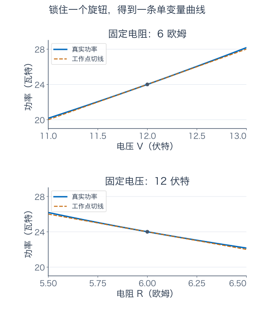

图里每条蓝色曲线只允许一个旋钮变化；橙色直线是工作点处的切线。请先读清两幅图不同的横轴，不能把两条切线的视觉倾斜程度直接当成同一种物理变化率。

## 3．两个旋钮一起动：先得到预测，再把误差算出来

若电压变化 $a$、电阻变化 $b$，最自然的一阶预测是把两项独立贡献相加：

$$
\Delta P\approx4a-4b.
$$

这个预测对不对，不能只靠“看起来挺合理”。直接代数整理，得到一个精确等式：

$$
\begin{aligned}
P(12+a,6+b)-24
&=\frac{24a+a^2-24b}{6+b}\\
&=4a-4b+\frac{(a-2b)^2}{6+b}.
\end{aligned}
$$

最后一项就是漏掉的误差。把线性部分记为 $L(a,b)=4a-4b$，把余项记为 $E(a,b)$。它们分别负责“主变化”和“预测没说全的部分”。

在第一节的同步调整中，$a=0.1,b=0.02$，线性预测为 $0.32$ 瓦特；余项为 $0.06^2/6.02\approx0.000598$ 瓦特。两项相加，正好得到真实变化 $0.320598$ 瓦特。

为什么小变化时余项可以忽略？暂时使用伏特、欧姆对应的数值坐标，记 $r=\sqrt{a^2+b^2}$。若 $|b|\le1$，分母至少为 5；又因为 $(a-2b)^2\le5(a^2+b^2)$，所以

$$
0\le E(a,b)\le r^2,\qquad \frac{|E(a,b)|}{r}\le r\longrightarrow0.
$$

这份上界对所有方向的 $(a,b)$ 同时成立。它比“沿电压轴试过，沿电阻轴也试过”更强：不论两个旋钮怎样配合微调，余项相对于总步长都会消失。

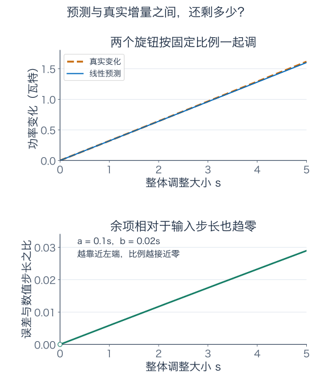

图中把 $a=0.1s,b=0.02s$，只调节整体大小 $s$。上图比较真实功率变化和预测；下图检查余项除以输入步长。图只展示一条路线，而前面的不等式负责保证所有小路线。

## 4．全微分：一张适用于所有小位移的预测表

对一般函数 $f(x,y)$，在点 $p=(x_0,y_0)$ 可微，意思是存在一个线性规则 $L$，使得

$$
f(p+h)-f(p)=L(h)+E(h),\qquad
\frac{|E(h)|}{\|h\|_2}\longrightarrow0\quad(h\to0).
$$

$h=(a,b)$，$\|h\|_2=\sqrt{a^2+b^2}$。所谓线性规则，就是 $L(a,b)=Aa+Bb$ 这种形式：放大输入变化，预测同比放大；叠加两个变化，预测也相加。没有 $a^2$、$ab$ 这样的高阶项。

把 $h$ 限制在两根轴上，就会发现 $A=f_x(p)$、$B=f_y(p)$。所以如果可微，唯一可能的预测就是

$$
df=L(h)=f_x(p)a+f_y(p)b.
$$

这叫全微分。$df$ 是线性预测，不总等于有限的真实增量 $\Delta f$；二者之间还隔着余项。记号 $o(\|h\|_2)$ 就是“除以输入步长后趋零”的简写，不是一个神秘的小数。

可微还会保证连续：线性部分随小位移趋零，余项也趋零，真实变化当然趋零。但反过来，连续并不保证有这样一张线性预测表。

实际怎样确认可微？一个常用充分条件是：附近偏导数存在，而且在该点连续。理由可以亲手看出来。把一步斜走拆成先竖走、再横走，一元中值定理给出

$$
\begin{aligned}
f(x_0+a,y_0+b)-f(x_0,y_0)
={}&f_x(x_0+\theta a,y_0+b)a\\
&+f_y(x_0,y_0+\eta b)b,
\end{aligned}
$$

其中 $\theta,\eta\in(0,1)$；若某个增量为零，对应那项直接为零。只要偏导连续，前面两个系数就分别靠近 $f_x(p),f_y(p)$。减去线性预测后，余项的绝对值不超过“系数误差最大值”乘以 $|a|+|b|\le\sqrt2\|h\|_2$。再除以步长，便趋零。

这解释了条件怎样起作用：我们需要附近的变化率稳定，不只是孤零零一个点上能算出两个偏导。偏导连续是够用的检查办法，但并非可微的必要条件。

## 5．把山坡摊成地图：怎样读一张等高线图？

换一个几何模型。令 $x,y$ 为向东、向北的坐标数值，均以米为单位；海拔数值也以米为单位，用

$$
H(x,y)=100+0.1x^2+0.3y^2
$$

描述一小块光滑坡地。系数按这些单位选定。起点为 $(1,1)$，海拔为 $100.4$ 米。这个点的东西、南北变化率分别为

$$
H_x(1,1)=0.2,\qquad H_y(1,1)=0.6.
$$

地图上的等高线由 $0.1x^2+0.3y^2=c$ 给出，每条线上的海拔相同。椭圆在南北方向更窄，表示南北方向移动较短距离，就会跨越相同高度差。

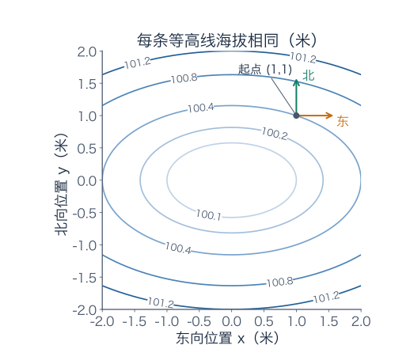

图的两个坐标轴使用相同长度比例。线挤得密，表示垂直跨越它们时坡度较大；不能只数自己走过几条线，还要比较实际走了多长。

从起点位移 $(a,b)$，直接展开可得

$$
H(1+a,1+b)-H(1,1)=0.2a+0.6b+0.1a^2+0.3b^2.
$$

令步长为 $r=\sqrt{a^2+b^2}$，余项不超过 $0.3r^2$，所以在足够小的范围内，主要变化是 $0.2a+0.6b$。现在才有理由拿这张线性地图比较各个行走方向。

## 6．为什么最快方向不是正北？

用单位向量 $v=(v_x,v_y)$ 表示方向，其中 $v_x^2+v_y^2=1$。沿它走距离 $s$，位移为 $sv$。把增量除以 $s$ 后令 $s\to0$，得到方向导数

$$
D_vH(1,1)=0.2v_x+0.6v_y.
$$

单位向量把行走速度归一化了。如果直接用 $(1,3)$ 与 $(0,1)$ 比，会把方向和步速混在一起；前者的长度为 $\sqrt{10}$，并不是同样长的一步。

先试三个方向。正东 $v=(1,0)$ 的变化率为 $0.2$；正北 $v=(0,1)$ 为 $0.6$；正东北 $v=(1,1)/\sqrt2$ 为 $0.8/\sqrt2\approx0.5657$。东北两个方向都向上，仍不如正北，说明“朝两个好方向各走一点”并不自动最有效。

把偏导数组成向量

$$
\nabla H(1,1)=(0.2,0.6),
$$

叫梯度。点积形式为 $D_vH=\nabla H\cdot v$。Cauchy–Schwarz 不等式给出

$$
D_vH\le\|\nabla H\|_2\|v\|_2=\sqrt{0.2^2+0.6^2}=\sqrt{0.4}.
$$

这个不等式在二维也可以由 $(p_xv_y-p_yv_x)^2\ge0$ 展开得到，里面没有额外假设。取与梯度同向的单位向量，恰好取到上限：

$$
v_* =\frac{(1,3)}{\sqrt{10}},\qquad
D_{v_*}H=\sqrt{0.4}\approx0.63246.
$$

它比正北的 $0.6$ 稍快：方向为从正东转向正北约 $71.6$ 度。最陡上坡由两个偏导共同决定。反方向给出最快下降；垂直方向的一阶变化为零。

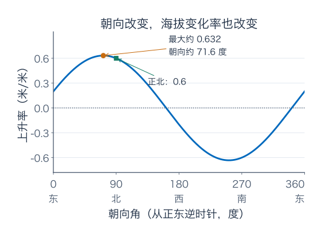

梯度本身通常不是单位向量。它的方向表示最陡上升方向，长度表示最大方向变化率；若只想得到一条行走方向，须除以它的长度。梯度为零时，所有方向的一阶变化率都为零，还需要更高阶信息判断地形。

## 7．为什么梯度垂直等高线？

站在 $(1,1)$，若沿等高线的切向移动，一阶海拔变化应为零，所以切向 $v$ 满足

$$
(0.2,0.6)\cdot v=0.
$$

例如 $(3,-1)/\sqrt{10}$ 就满足要求。点积为零意味着两向量垂直，因此梯度垂直于等高线，并朝海拔增加的一侧。

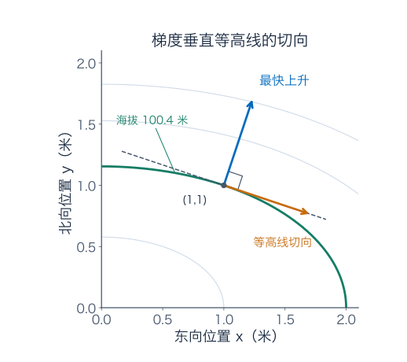

这里要分清“沿切线迈出一步”和“真的沿弯曲的等高线走”。沿切线移动 $sv$，一阶变化为零，但二阶变化还在。对上面的单位切向，

$$
\Delta H=0.1s^2\frac9{10}+0.3s^2\frac1{10}=0.12s^2.
$$

直线切向的一小步仍会略微爬高，只是变化比步长小一个数量级。要保持真实海拔不变，需要让路线随等高线弯曲。

如果梯度为零，也不能据此画出唯一的垂线。比如山谷底点可能没有一条普通光滑等高线经过。我们说“梯度给出法向”，默认讨论梯度非零的正常等高线位置。

## 8．两个偏导都有，为什么整张预测表仍可能失效？

先看一个容易核对的反例：

$$
f(x,y)=\begin{cases}\dfrac{xy}{x^2+y^2},&(x,y)\ne(0,0),\\0,&(x,y)=(0,0).\end{cases}
$$

沿 $x$ 轴或 $y$ 轴，函数始终为零，所以原点两个偏导都为零。但沿斜线 $(t,t)$，只要 $t\ne0$，读数就为 $1/2$，无论离原点多近。

它在原点甚至不连续，当然不可微。两条轴上的数据没有覆盖斜方向，不能用两次单变量检查冒充对所有位移的控制。

那么，把所有直线方向都查一遍，总够了吧？仍要小心。另取一个函数

$$
g(x,y)=\begin{cases}\dfrac{x^3}{x^2+y^2},&(x,y)\ne(0,0),\\0,&(x,y)=(0,0).\end{cases}
$$

它满足 $|g(x,y)|\le\sqrt{x^2+y^2}$，所以在原点连续。沿任意单位方向 $v=(\cos\theta,\sin\theta)$，有

$$
g(sv)=s\cos^3\theta,\qquad D_vg(0,0)=\cos^3\theta.
$$

因此每个方向导数都存在。但两个偏导分别为 $1$、$0$，如果存在全微分，只能预测 $L(a,b)=a$，对应方向导数应为 $\cos\theta$。$\cos^3\theta$ 并不是它；例如 $\theta=45$ 度，两者分别为 $1/(2\sqrt2)$ 与 $1/\sqrt2$。

也可以直接查余项。在 $(a,b)=(t,t)$ 上，$g(t,t)=t/2$，线性候选预测为 $t$，所以

$$
\frac{|g(t,t)-t|}{\sqrt{t^2+t^2}}=\frac1{2\sqrt2},
$$

没有趋零。它连续、各方向都有变化率，却不能拼成一个线性预测规则，因此仍不可微。

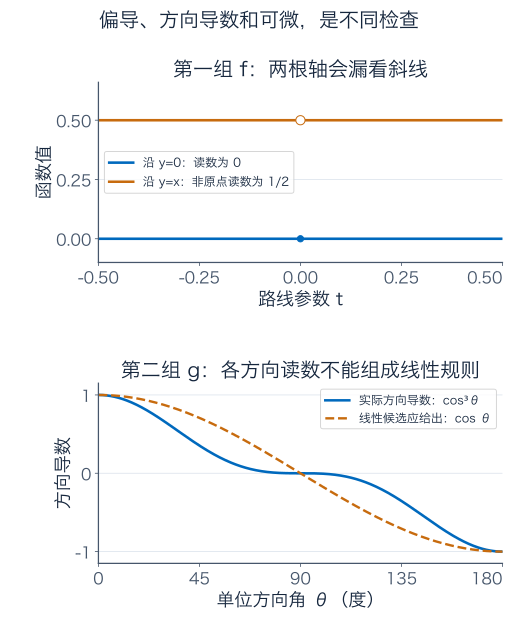

方向导数逐条考察直线路线；可微要求这些变化率来自同一线性规则，并且余项对所有趋近方式都足够小。这两项要求都不能省掉。前一章区分逐点与一致控制，这一章又遇到了“每条路线分别行”与“统一规则适用于全部小变化”的差别。

## 9．电压和电阻都随一个旋钮变：链式法则怎么组织？

回到加热片。现在你不直接控制 $V,R$，而是调一个标度为 $s$ 的旋钮，设备内部按照

$$
V(s)=12+0.1s,\qquad R(s)=6+0.02s
$$

同时调整二者。问初始位置 $s=0$ 时，每转动一单位旋钮，功率瞬时变化多快？

有两条影响路径：旋钮影响电压，电压再影响功率；旋钮影响电阻，电阻再影响功率。因此

$$
\begin{aligned}
\frac{d}{ds}P(V(s),R(s))\bigg|_{s=0}
&=P_V(12,6)V'(0)+P_R(12,6)R'(0)\\
&=4\times0.1+(-4)\times0.02=0.32.
\end{aligned}
$$

结果单位是瓦特/旋钮单位。前两条路径分别贡献 $+0.4$ 与 $-0.08$，必须相加，不能只挑其中一条。

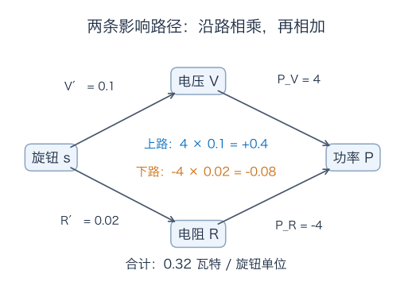

这条法则可以从全微分直接推出。旋钮增加 $\delta s$，输入变化为 $\delta V=V'(s)\delta s+o(|\delta s|)$、$\delta R=R'(s)\delta s+o(|\delta s|)$。把它们放进功率的线性预测式，再除以 $\delta s$，余项消失，就剩两条路径贡献之和。

一般写成

$$
\frac{d}{ds}f(x(s),y(s))=f_x\,x'(s)+f_y\,y'(s),
$$

其中 $f_x,f_y$ 必须在当前点 $(x(s),y(s))$ 计算。可微的 $f$ 加上可微的输入轨道，提供了这一步的保证；仅有两个偏导存在，并不足以让我们放心套公式。

沿等高线的轨道 $f(x(s),y(s))$ 为常数，导数为零，便严格得到上一节使用的 $\nabla f\cdot(x',y')=0$。

## 10．设备有两个读数：导数为什么变成一张矩阵？

假设一个校准装置有两个无量纲调节量 $u,v$，输出两个无量纲读数：

$$
F(u,v)=\begin{pmatrix}u^2+v\\u-2v^2\end{pmatrix}.
$$

在工作点 $(1,1)$，读数为 $(2,-1)$。微调 $(a,b)$ 后，把两条公式分别展开：

$$
\Delta F_1=2a+b+a^2,\qquad
\Delta F_2=a-4b-2b^2.
$$

线性部分是一张两行表：第一行把输入变化换算成第一路读数变化，第二行换算成第二路。压缩成矩阵写法就是

$$
J_F(1,1)=\begin{pmatrix}2&1\\1&-4\end{pmatrix},\qquad
\Delta F\approx J_F\begin{pmatrix}a\\b\end{pmatrix}
=\begin{pmatrix}2a+b\\a-4b\end{pmatrix}.
$$

这张偏导数组成的矩阵叫 **Jacobian（雅可比矩阵）**。行数对应输出个数，列数对应输入个数。第 $j$ 列描述“只微调第 $j$ 个输入时，各路输出如何一起变化”。

例如 $a=0.01,b=-0.02$，线性预测为 $(0,0.09)$；真实变化为 $(0.0001,0.0892)$。两者之差为 $(a^2,-2b^2)$，长度至多为 $2(a^2+b^2)$，所以同样满足余项除以输入长度趋零。

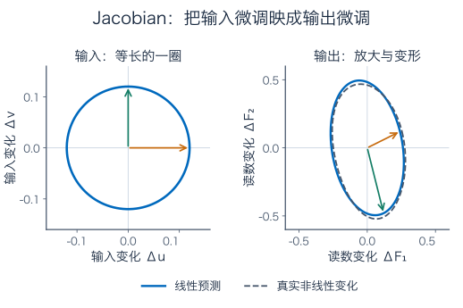

左图把许多等长输入微调围成半径为 0.12 的小圆；右图显示它们经过线性预测后的结果。输出方向不同，放大倍数也不同，小圆便变成椭圆。虚线给出真实非线性输出作为对照。两图各自使用等比例坐标，但缩放范围不同，请按刻度比较数值。

对一般 $F:\mathbb R^d\to\mathbb R^m$，可微的意思仍是

$$
F(p+h)-F(p)=J_F(p)h+o(\|h\|_2),
$$

只是余项现在也是一个向量，需用它的长度判断小不小。所谓多变量导数，就是“局部用一个线性映射替代原来的设备”。

## 11．两台设备串联：为什么链式法则是矩阵相乘？

第一台输出 $z=F(x)$，第二台把它变成 $G(z)$。小变化先经过 $J_F$，再经过 $J_G$，所以总预测为 $J_GJ_Fh$。因此

$$
J_{G\circ F}(x)=J_G(F(x))J_F(x).
$$

乘法顺序记录了实际处理顺序：右边的矩阵先作用，左边的后作用。若第一台有 $d$ 个输入、$m$ 个输出，第二台有 $k$ 个输出，维度为 $(k\times m)(m\times d)=k\times d$。

继续使用上一节的装置。第二台输出一个分数 $G(p,q)=p^2+q$，在第一台当前读数 $(2,-1)$ 处，$J_G=(4,1)$。所以

$$
J_{G\circ F}(1,1)
=\begin{pmatrix}4&1\end{pmatrix}
\begin{pmatrix}2&1\\1&-4\end{pmatrix}
=\begin{pmatrix}9&0\end{pmatrix}.
$$

也就是说，微调 $(a,b)$ 后，最终分数的一阶变化为 $9a$；$b$ 的两条路径贡献 $4b$ 与 $-4b$ 恰好抵消。不是第二个旋钮完全没作用，而是在这个工作点没有一阶作用。

可以不用矩阵核对一次。总函数是 $(u^2+v)^2+u-2v^2$，偏导为 $4u(u^2+v)+1$ 与 $2(u^2+v)-4v$，代入 $(1,1)$ 就得到 $9,0$。

标量输出的 Jacobian 是一行，而通常把梯度写成一列。二者是转置关系。于是同一个链式法则也常写成 $\nabla(G\circ F)=J_F^T\nabla G$。所谓反向传播，就反复把后续分数对读数的敏感度，沿着这样的转置矩阵传回输入端；这一章的小装置已经展示了它的计算骨架。

## 12．走一点以后，坡度也会变：Hessian 在记录什么？

梯度给出当前的一阶变化。若还想预测走开以后坡度怎样变化，就需要再次求导。二阶偏导排成矩阵

$$
H_f=\begin{pmatrix}f_{xx}&f_{xy}\\f_{yx}&f_{yy}\end{pmatrix},
$$

叫 **Hessian（海森矩阵）**。在二阶偏导连续的邻域内，混合偏导相等，矩阵对称；没有适当条件，不能只凭记号相似就交换求导顺序。

对坡地 $H=100+0.1x^2+0.3y^2$，Hessian 为 $\operatorname{diag}(0.2,0.6)$，即对角线上为 $0.2,0.6$，其余为零。它告诉我们南北方向的坡度改变更快。

一般 $f$ 在点附近二阶连续可微时，二阶近似是

$$
f(p+h)=f(p)+\nabla f(p)\cdot h+\frac12h^TH_f(p)h+o(\|h\|_2^2).
$$

为什么二次项长这样？临时沿直线路径定义 $\phi(t)=f(p+th)$。一元链式法则给 $\phi'(0)=\nabla f(p)\cdot h$，再求一次导数得到 $\phi''(0)=h^TH_f(p)h$。一元 Taylor 展开的二次项便是 $\phi''(0)/2$；二阶偏导的连续性保证余项对各个小位移统一成立。

若想核对“对所有方向统一成立”这一点，可以沿上述线段把二阶导数积分两次，余项写成

$$
E_2(h)=\int_0^1(1-t)h^T\big[H_f(p+th)-H_f(p)\big]h\,dt.
$$

若附近四个矩阵条目的差都不超过 $\delta$，则积分内二次型的绝对值不超过 $\delta(|a|+|b|)^2\le2\delta\|h\|_2^2$。又有 $\int_0^1(1-t)dt=1/2$，所以 $|E_2(h)|\le\delta\|h\|_2^2$。二阶偏导连续使这个 $\delta$ 随邻域缩小而趋零，统一的余项控制就有了。

二维展开为 $\tfrac12f_{xx}a^2+f_{xy}ab+\tfrac12f_{yy}b^2$。中间的交互项来自矩阵里两个相等的混合偏导，总共出现两次，再被 $1/2$ 除掉。

在加热片工作点 $(12,6)$，

$$
H_P=\begin{pmatrix}1/3&-2/3\\-2/3&4/3\end{pmatrix},\qquad
\frac12(a,b)H_P\begin{pmatrix}a\\b\end{pmatrix}=\frac{(a-2b)^2}{6}.
$$

第三节算出的精确余项为 $(a-2b)^2/(6+b)$。把分母用工作点数值 6 近似，正是 Hessian 给出的二阶修正。减去二阶项后还剩 $-b(a-2b)^2/[6(6+b)]$，在附近不超过常数乘以 $r^3$，比 $r^2$ 更小。

## 13．梯度为零，是山谷、山顶还是马鞍？

若在区域内部有局部极值，并且函数可微，那么所有方向的一阶变化必须为零，所以梯度为零。这些点叫驻点。但一阶预测说“暂时看不出变化”，并不等于判断了极值。

在驻点，二阶近似只剩 $\frac12h^TH_fh$。考察它在各个非零方向的符号：

| 二次型表现 | 名称 | 结论 |
| --- | --- | --- |
| 所有非零方向都为正 | 正定 | 严格局部最小 |
| 所有非零方向都为负 | 负定 | 严格局部最大 |
| 有正方向也有负方向 | 不定 | 鞍点 |
| 有非零方向取零，且不同时出现正负 | 半正定或半负定 | 单靠二阶信息不能决定 |

这些判断以前述二阶连续可微为条件。正定为什么足够？把方向限制在单位圆上，连续的正二次型会取得一个正的最小值。因此有限维里能找到统一的 $c>0$，使二次项至少为 $c\|h\|_2^2$；余项相对于 $\|h\|_2^2$ 趋零，最终无法抵消这份正增长。负定同理。

坡地模型在原点的二次增量为 $0.1a^2+0.3b^2>0$，所以是严格最小。$f(x,y)=xy$ 在原点梯度也为零，但沿 $y=x$ 为正，沿 $y=-x$ 为负，因此是鞍点。

半正定为什么不能直接判最小？比较 $f_+(x,y)=x^2+y^4$ 与 $f_-(x,y)=x^2-y^4$。它们在原点的 Hessian 都是 $\operatorname{diag}(2,0)$，但前者有严格最小，后者沿 $x$ 轴上升、沿 $y$ 轴下降，是鞍点。

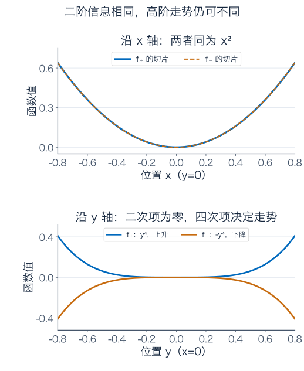

图的上半部比较 $y=0$ 的切片，两函数完全相同；下半部比较 $x=0$ 的切片，一条上升、一条下降。Hessian 看不到的方向，可能由更高阶项决定，不能把“二阶读数为零”读成“永远没有变化”。

## 14．方向找对了，一步迈太长仍会爬上去

若目标是降低一个标量函数，沿负梯度微调是自然选择。写成迭代就是

$$
p_{\text{new}}=p-\alpha\nabla f(p),\qquad \alpha>0.
$$

在梯度非零处，足够小的 $\alpha$ 会让函数降低，因为线性变化为 $-\alpha\|\nabla f(p)\|_2^2$，余项比 $\alpha$ 更小。但“足够小”不能随便省略。

仍从坡地的 $(1,1)$ 出发，负梯度为 $(-0.2,-0.6)$。取 $\alpha=1$，新位置为 $(0.8,0.4)$，海拔从 $100.4$ 降到 $100.112$。取 $\alpha=4$，新位置为 $(0.2,-1.4)$，海拔却升到 $100.592$：沿正确方向走过了头，又爬上另一侧。

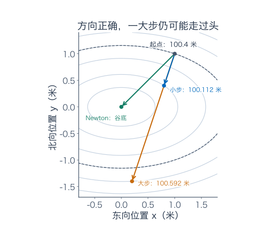

Newton 法进一步利用曲率，尝试解线性方程 $H_f(p)\Delta p=-\nabla f(p)$。在这块恰好为二次函数的坡地上，Hessian 为 $\operatorname{diag}(0.2,0.6)$，解得 $\Delta p=(-1,-1)$，一步到原点。

这次一步成功，来自二次模型在整个区域都精确。对一般函数，二次近似只有局部意义，Hessian 还可能不可逆或不正定，因此不能把这张图当成 Newton 法总能一步或总能下降的保证。步长和曲率信息需要配合使用，后续优化章节会继续展开。

## 15．测量有误差，怎样给输出准备预算？

回到 24 瓦特的加热片。假设电压测量误差满足 $|a|\le0.05$ 伏特，电阻测量误差满足 $|b|\le0.03$ 欧姆。一阶功率误差为 $4a-4b$，所以

$$
|\Delta P|\approx|4a-4b|\le4\times0.05+4\times0.03=0.32\quad\text{瓦特}.
$$

这里的 $0.32$ 只是线性部分的上界，不是完整误差已经被严格罩住。利用第三节的精确余项，补上

$$
0\le E(a,b)\le\frac{(0.05+2\times0.03)^2}{6-0.03}
=\frac{0.0121}{5.97}<0.002027.
$$

因此真实功率误差满足 $|\Delta P|<0.322027$ 瓦特。这才是一份把非线性影响也算进去的保证。它是保守预算，不声称每种误差组合都能达到上界。

如果你关心概率意义下的误差，就还需要输入误差的分布、相关性等信息；这里使用的是“每个输入都不超过给定界”的确定性模型，不把它冒充标准差。

还有一个常被忽略的问题：什么叫“同样大的输入调整”？若把电阻的单位改成毫欧姆，写成 $R'=1000R$，同一个微分变成

$$
dP=4\,dV-4\,dR=4\,dV-0.004\,dR'.
$$

实际预测不变，偏导数的数值却变了。若不说明坐标尺度，直接把不同单位的偏导摆在一起画“最快方向”，很可能是在比较任意的单位选择。

一种实际做法是用允许变化的典型尺度归一化：令 $a=0.05z_1,b=0.03z_2$，则一阶变化为

$$
dP=0.2z_1-0.12z_2.
$$

如果要求 $|z_1|,|z_2|\le1$，允许区域是正方形，最大线性增量在 $(1,-1)$ 处为 $0.32$。如果调节预算改成 $z_1^2+z_2^2\le1$，允许区域是圆，最大增量则为

$$
\sqrt{0.2^2+0.12^2}=\sqrt{0.0544}\approx0.23324.
$$

两个数都正确，因为“允许怎样一起调整”的要求不同。圆形预算下，最佳方向是 $(0.2,-0.12)/\sqrt{0.0544}$，它在归一化坐标里表示相同比例的成本，而不是把一伏特直接等同于一欧姆。

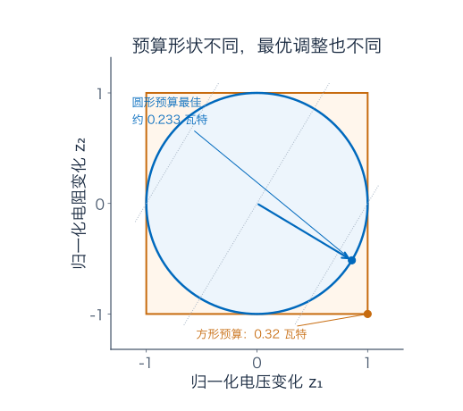

图里橙色角点对应分别把两个输入推到各自边界；蓝色圆点对应总平方预算的最佳分配。灰色点线表示一阶功率增量相同的输入组合，数值沿蓝箭头方向增加。先说清调整成本或误差尺度，再说“最陡”，这个习惯以后会直接关系到怎样选内积和范数。

## 16．练习：先写预测规则，再核对完整答案

先独立做这四题。答案集中放在后面，每题都给出中间步骤。

**题一：小加热片换了工作点。** 仍用 $P(V,R)=V^2/R$，工作点改为 $(9,3)$。电压增加 $0.02$ 伏特，电阻减少 $0.01$ 欧姆。求功率的一阶变化估计，再计算真实变化，解释差额来自哪里。

**题二：另一块坡地。** 海拔模型为 $K(x,y)=50+0.2x^2+0.1xy+0.3y^2$，两个平面坐标采用相同的米单位。在 $(1,2)$ 求：梯度、最陡上升的单位方向、最大上升率，以及沿 $(-1,1)/\sqrt2$ 的方向导数。再找一个等高线的单位切向。

**题三：每个方向都有导数，仍能失败吗？** 定义 $q(0,0)=0$，非原点时 $q(x,y)=xy^2/(x^2+y^2)$。证明它在原点连续，求两个偏导和任意单位方向的方向导数，并判断原点是否可微。

**题四：从两只传感器到最小二乘。** 两路预测读数为 $x_1+x_2$、$x_1-x_2$，观测分别为 4、2。代价函数是两个读数残差的平方和的一半：

$$
C(x_1,x_2)=\frac12\big[(x_1+x_2-4)^2+(x_1-x_2-2)^2\big].
$$

求 $(1,1)$ 处的梯度、Hessian 和唯一最小点。进一步，若写成 $C(x)=\frac12\|Ax-b\|_2^2$，推导一般的梯度与 Hessian 公式；这里 $A$ 是固定实矩阵，$b$ 是固定实向量。

### 参考答案与解题过程

#### 题一解答

初始功率为 $9^2/3=27$ 瓦特。偏导为 $P_V=2V/R=6$、$P_R=-V^2/R^2=-9$，所以输入变化 $a=0.02,b=-0.01$ 给出

$$
dP=6\times0.02+(-9)\times(-0.01)=0.21\quad\text{瓦特}.
$$

真实变化为 $9.02^2/2.99-27\approx0.21083612$ 瓦特，比预测多 $0.00083612$。

仿照第三节整理，可得到此工作点的精确增量公式

$$
P(9+a,3+b)-27=6a-9b+\frac{(a-3b)^2}{3+b}.
$$

代入得到余项 $0.05^2/2.99\approx0.00083612$，与差额吻合。两个输入都在变化，不能只拿电压方向的一元余项解释全部误差。

#### 题二解答

偏导为 $K_x=0.4x+0.1y$、$K_y=0.1x+0.6y$，代入 $(1,2)$ 得梯度 $(0.6,1.3)$。长度为 $\sqrt{2.05}=\sqrt{205}/10$，所以最陡单位方向是 $(6,13)/\sqrt{205}$，最大上升率约为 $1.43178$。

指定方向的变化率是点积：

$$
D_vK=(0.6,1.3)\cdot\frac{(-1,1)}{\sqrt2}=\frac{0.7}{\sqrt2}\approx0.494975.
$$

结果为正，表示它也在上坡，但并非最快。取切向 $(13,-6)/\sqrt{205}$，与梯度点积为零；其反方向也是切向。梯度非零，所以此处确有正常的光滑等高线。

#### 题三解答

对非原点，$|q(x,y)|\le|x|\le\sqrt{x^2+y^2}$，所以由夹逼可知在原点连续。两根轴上函数都为零，因此两个偏导都为零。

任取单位方向 $v=(v_x,v_y)$，由于 $v_x^2+v_y^2=1$，有 $q(sv)=s v_xv_y^2$，故 $D_vq(0,0)=v_xv_y^2$，每个方向的导数都存在。

但若可微，两个零偏导迫使线性预测为零。沿 $(t,t)$，真实函数为 $t/2$，于是余项与步长之比的绝对值恒为 $1/(2\sqrt2)$，没有趋零。所以它不可微。

这题同时检查了三件事：连续性、逐方向导数的存在性、全微分是否存在。它们不能合并成一个含糊的“函数挺平滑”。

#### 题四解答

先直接对两个残差求导：

$$
\begin{aligned}
C_{x_1}&=(x_1+x_2-4)+(x_1-x_2-2)=2x_1-6,\\
C_{x_2}&=(x_1+x_2-4)-(x_1-x_2-2)=2x_2-2.
\end{aligned}
$$

所以在 $(1,1)$，梯度为 $(-4,0)$；Hessian 为 $2I$，即对角线上为 2，其余为零。驻点为 $(3,1)$，两路残差都为零。代价是平方和，不可能低于零，而两条读数方程只有这一个共同解，所以它是唯一的全局最小点。

一般公式也可以从增量而不是背矩阵求导规则开始。记当前残差 $r=Ax-b$，输入变化为 $h$，则

$$
\begin{aligned}
C(x+h)-C(x)
&=\frac12\|r+Ah\|_2^2-\frac12\|r\|_2^2\\
&=r^TAh+\frac12\|Ah\|_2^2\\
&=\big(A^T(Ax-b)\big)\cdot h+\frac12h^TA^TAh.
\end{aligned}
$$

读出线性部分，得到 $\nabla C=A^T(Ax-b)$；读出二次部分，得到 $H_C=A^TA$。余项为二次量，在固定有限维矩阵下确实比输入长度更小。

对任意 $h$，$h^TA^TAh=\|Ah\|_2^2\ge0$，所以 Hessian 总是半正定。若 $A$ 的列线性无关，非零 $h$ 不会被映成零，才进一步得到正定。在本题，$A=\begin{pmatrix}1&1\\1&-1\end{pmatrix}$，所以 $A^TA=2I$，与直接计算相符。

## 17．把输入换成整段信号，导数的想法仍然适用

这章的导数已经不再只是一个斜率数字，而是一个作用于“输入变化”的线性规则。输入是一对旋钮时，它由一行系数描述；输入有多个分量、输出也有多路时，它由矩阵描述。

现在把输入换成连续信号 $u(t)$，$0\le t\le1$。用

$$
\mathcal E(u)=\frac12\int_0^1u(t)^2\,dt
$$

表示一种平方能量。给整段信号叠加小扰动 $h(t)$，仍然可以直接展开：

$$
\mathcal E(u+h)-\mathcal E(u)
=\underbrace{\int_0^1u(t)h(t)\,dt}_{\text{关于扰动的线性部分}}
+\frac12\int_0^1h(t)^2\,dt.
$$

这与加热片的“线性预测 + 余项”、最小二乘的增量公式，是同一种结构。若用 $\|h\|_2=(\int_0^1h^2)^{1/2}$ 衡量输入变化，余项除以输入大小就是 $\frac12\|h\|_2\to0$。

因此导数是规则 $D\mathcal E(u)[h]=\int_0^1uh$。它接收一整段扰动，输出一个预测的能量变化。积分的 Cauchy–Schwarz 不等式还保证 $|D\mathcal E(u)[h]|\le\|u\|_2\|h\|_2$，所以这份预测不会把任意小扰动放大成无界变化。

将来在泛函分析里，这会被称为有界线性泛函；在合适的内积结构下，也能把它写成与梯度做内积的形式。此处先想连续信号就够了，积分仍是熟悉的普通积分，完整函数空间的构造留到后面的章节。

值得记住的工作顺序始终没有改变：先写真实增量，找出关于扰动的线性部分，再检查余项相对于输入大小是否消失。至于怎样量输入大小、怎样规定调整成本，需要连同范数或内积一起说明。

## 伴读与进一步核对

- [3Blue1Brown：The other way to visualize derivatives](https://www.3blue1brown.com/lessons/derivatives-and-transforms/)：从输入、输出之间的局部伸缩看导数，可配合本章的小圆与椭圆理解 Jacobian。
- [3Blue1Brown：Gradient descent, how neural networks learn](https://www.3blue1brown.com/lessons/gradient-descent/)：看多个参数怎样一起影响代价，再回到本章关于方向、步长和尺度的讨论。本章的加热片、坡地、设备校准模型及图示均独立编写。
- [MIT 18.02SC：Chain Rule, Gradient and Directional Derivatives](https://ocw.mit.edu/courses/18-02sc-multivariable-calculus-fall-2010/pages/2.-partial-derivatives/part-b-chain-rule-gradient-and-directional-derivatives/)：可继续学习全微分、链式法则、梯度与等高线之间的联系，并核对正式表述。

---

[数学总导航](../00-%E6%95%B0%E5%AD%A6%E5%AD%A6%E4%B9%A0%E5%AF%BC%E8%88%AA.md) · [本课程目录](00-%E5%AD%A6%E4%B9%A0%E8%B7%AF%E7%BA%BF%E4%B8%8E%E7%AC%A6%E5%8F%B7.md) · [← 上一章](06-%E7%BA%A7%E6%95%B0%E3%80%81%E5%B9%82%E7%BA%A7%E6%95%B0%E4%B8%8E%E5%87%BD%E6%95%B0%E5%88%97.md) · [下一章 →](08-%E5%A4%9A%E9%87%8D%E7%A7%AF%E5%88%86%E3%80%81%E6%8D%A2%E5%85%83%E4%B8%8E%E7%A7%AF%E5%88%86%E6%AC%A1%E5%BA%8F.md)
