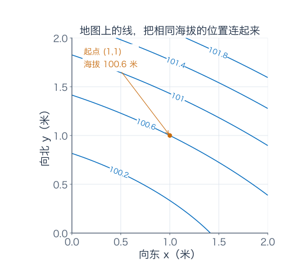
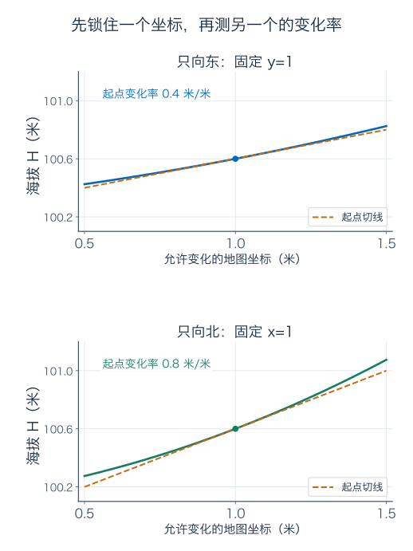
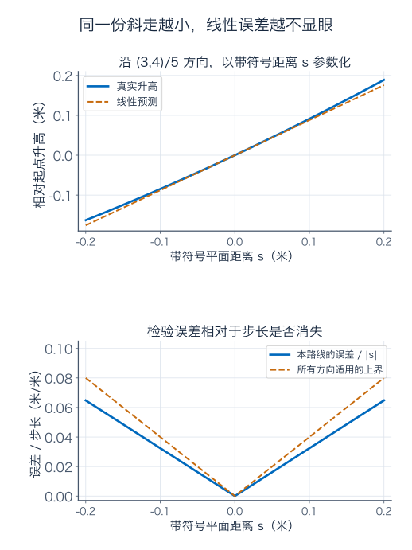
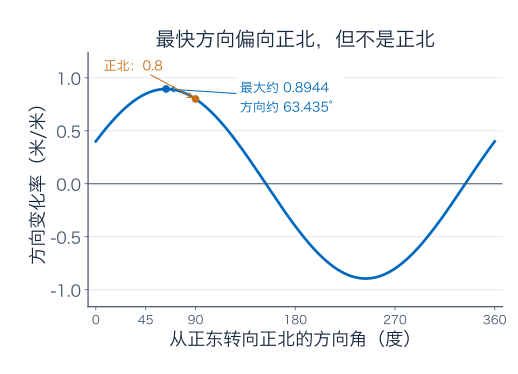
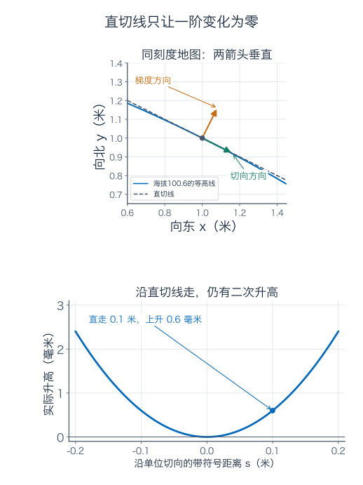
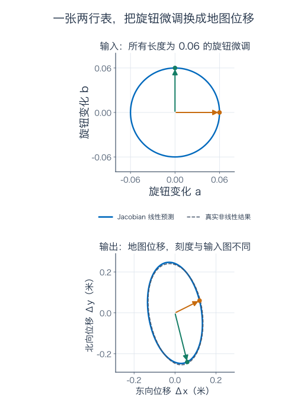
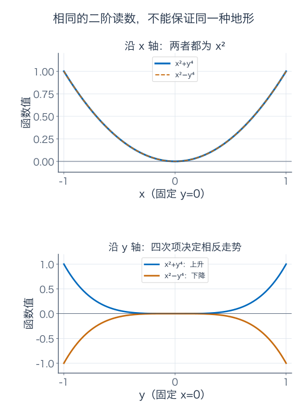
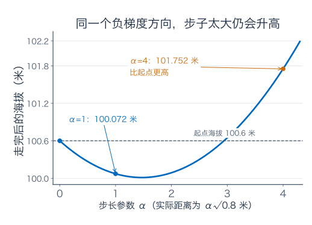

[数学总导航](../00-%E6%95%B0%E5%AD%A6%E5%AD%A6%E4%B9%A0%E5%AF%BC%E8%88%AA.md) · [本课程目录](00-%E5%AD%A6%E4%B9%A0%E8%B7%AF%E7%BA%BF%E4%B8%8E%E7%AC%A6%E5%8F%B7.md) · [← 上一章](06-%E7%BA%A7%E6%95%B0%E3%80%81%E5%B9%82%E7%BA%A7%E6%95%B0%E4%B8%8E%E5%87%BD%E6%95%B0%E5%88%97.md) · [下一章 →](08-%E5%A4%9A%E9%87%8D%E7%A7%AF%E5%88%86%E3%80%81%E6%8D%A2%E5%85%83%E4%B8%8E%E7%A7%AF%E5%88%86%E6%AC%A1%E5%BA%8F.md)

## 同样在地图上走十厘米，哪边升得最多

站在一块光滑坡地上，脚下的位置是地图坐标 $(1,1)$。向东也上坡，向北也上坡，你会选正北、东北，还是另一个方向？

先规定怎样公平比较：地图的东向坐标 $x$、北向坐标 $y$ 都以米计，海拔 $H$ 也以米计。我们比较的是**每米地图平面位移带来的海拔变化**，不是每米沿坡面的实际路程。相同的平面步长，才算同样大的输入调整。

给这块理想坡地一条明确的模型：

$$
H(x,y)=100+0.1x^2+0.2xy+0.3y^2.
$$

系数按上述单位选定。它是一块谷地附近的光滑坡面，不是对某座真实山的测绘结论。在起点 $p=(1,1)$，海拔为 $100.6$ 米。

先试三个都长 0.1 米的平面位移，把新坐标代回原式：

| 方向 | 位移 $(a,b)$（米） | 实际升高（米） |
| --- | --- | --- |
| 正东 | $(0.1,0)$ | $0.041$ |
| 正北 | $(0,0.1)$ | $0.083$ |
| 东北 | $(0.1/\sqrt2,0.1/\sqrt2)$ | 约 $0.0878528$ |

东北看起来比正北更好，但这才试了三个方向。把所有方向都代入一遍不现实，更省事的做法是先做一张起点附近的预测表：既找出最陡方向，又知道小步预测会错多少。

等高线是海拔相同的位置连成的线。线上的数字是海拔，不是到起点的距离。横纵轴采用同样的长度尺度，才能从地图上认真比较方向。

只需要一点向量记法：$(a,b)$ 是一份位移，长度为 $\sqrt{a^2+b^2}$；点积 $(c,d)\cdot(a,b)=ca+db$。矩阵出现时，会先展开成两条普通预测式。

## 1．先只向东走，再只向北走

保持 $y=1$，把东向坐标改成 $1+a$。直接展开：

$$
H(1+a,1)-H(1,1)=0.4a+0.1a^2.
$$

除以 $a\ne0$，得到每米位移对应的平均升高 $0.4+0.1a$。再让 $a\to0$，变化率趋于 $0.4$。这就是起点的东向偏导数：

$$
H_x(1,1)=\frac{\partial H}{\partial x}(1,1)=0.4.
$$

偏导数并没有换掉一元导数的意思，只是在测量时先把其他输入锁住了。“偏”提醒你：这里不许北向位置跟着改变。

同样保持 $x=1$，向北变化 $b$：

$$
H(1,1+b)-H(1,1)=0.8b+0.3b^2,
$$

所以北向偏导 $H_y(1,1)=0.8$。单位都是海拔米/平面米，正号表示相应方向在上升。

一般位置的两条公式是

$$
H_x(x,y)=0.2x+0.2y,\qquad H_y(x,y)=0.2x+0.6y.
$$

比如求 $H_x$ 时，把 $y$ 当固定数：$0.1x^2$ 给 $0.2x$，$0.2xy$ 给 $0.2y$，$0.3y^2$ 给零。求 $H_y$ 则换过来。没有要求 $y$ 永远不变，只是本次测量变化率时不让它动。

两幅图分别允许一个坐标变化，并使用相同的横纵数值范围。橙线是工作点切线，能够描述很小的一段变化；它没有保证向北走整整 10 米还按 $0.8$ 的常数坡度上升。

## 2．两个坐标一起变，直接把两份变化相加够不够

试一次斜走：向东 0.03 米、向北 0.04 米，平面步长为 $\sqrt{0.03^2+0.04^2}=0.05$ 米。

按两个偏导估计，升高应约为

$$
0.4\times0.03+0.8\times0.04=0.044\ \text{米}.
$$

这不是精确值。将两个输入同时代入原式，完整展开得

$$
\boxed{
H(1+a,1+b)-H(1,1)
=\underbrace{0.4a+0.8b}_{L(a,b)}
+\underbrace{0.1a^2+0.2ab+0.3b^2}_{E(a,b)}.
}
$$

$L$ 是关于输入变化的一次式，$E$ 是剩下的误差。对本次位移，

$$
E(0.03,0.04)=0.00009+0.00024+0.00048=0.00081\ \text{米}.
$$

所以实际升高为 $0.04481$ 米，线性预测少了 0.81 毫米。中间的 $0.2ab$ 是两个输入同时变化的交互项；若只把两次单轴实验的完整变化相加，就会漏掉它。

现在把整次位移按比例缩小：$(a,b)=(0.03s,0.04s)$。预测量变成 $0.044s$，误差变成 $0.00081s^2$。缩小十倍时，主要变化缩小十倍，误差缩小一百倍。这是局部线性近似会越来越好的具体原因。

### 图只画了一条路，怎样保证其他小方向也一样

令 $r=\sqrt{a^2+b^2}$。利用 $2|ab|\le a^2+b^2$，有

$$
0\le E(a,b)=0.1(a+b)^2+0.2b^2
\le0.2a^2+0.4b^2\le0.4r^2.
$$

因此，对所有方向，$|E|/r\le0.4r\to0$。不是只有刚才那条三比四的路线表现良好，所有趋近方式都由同一份界控制。

上图的两条线越来越贴近，下图把不易看见的差额单独检查。图展示一条路线，前面的不等式才是覆盖所有方向的理由。

若步长不超过 0.05 米，误差不超过 $0.4\times0.05^2=0.001$ 米，也就是 1 毫米。若要求严格小于 1 毫米，这份界可通过 $r<0.05$ 保证；等号处不能只凭上界就说严格小于。这是保守预算，不声称每个方向都会把它用满。

## 3．全微分，是一张接收整份位移的线性预测表

刚才最重要的对象是规则

$$
DH(p)[(a,b)]=0.4a+0.8b.
$$

它接收一份二维位移，输出一个海拔增量预测。这里的 $D$ 是导数，方括号表示把哪份扰动交给它。也常写作全微分 $dH=H_x\,dx+H_y\,dy$，其中 $dx,dy$ 记录输入变化。

“线性”可以直接检查：把位移放大两倍，预测也放大两倍；把两份位移相加，预测等于两份预测相加。余项里的 $a^2,ab,b^2$ 不具备这项性质。

一般函数 $f$ 在内点 $p$ 可微，要求存在一个线性规则 $L$，使

$$
f(p+h)-f(p)=L(h)+E(h),\qquad
\frac{|E(h)|}{\|h\|_2}\longrightarrow0\quad(h\to0).
$$

$h=(a,b)$，$\|h\|_2$ 是输入位移长度。$o(\|h\|_2)$ 是这种余项的简写，意思是误差相对于步长，对所有小位移统一消失。只说误差绝对值小，或只说沿两条轴各自小，都不够。

若这样的规则存在，把 $h$ 分别限制在两条坐标轴上，就知道它只能是

$$
Df(p)[h]=f_x(p)a+f_y(p)b.
$$

因此，偏导数给出唯一可能的线性预测系数；是否真的可微，还要检查这份预测的余项。可微也会保证连续：当位移趋零，线性部分与余项都趋零，真实输出变化便趋零。

一个常用充分条件是：附近偏导存在，并在 $p$ 连续。粗略地说，先北移再东移，用一元中值定理把两段实际变化写成“附近的偏导乘相应位移”；偏导连续让附近系数靠近起点系数，误差就比总步长小。补充 A 会把这段说明写成精确不等式。

这个充分条件适用于我们的多项式坡地，但不能把“某个点能算出两个偏导”当成同一个条件。例如

$$
f(x,y)=\begin{cases}\dfrac{xy}{x^2+y^2},&(x,y)\ne(0,0),\\0,&(x,y)=(0,0).
\end{cases}
$$

两根轴上读数都是零，原点两个偏导也为零；沿 $(t,t)$，读数却一直为 $1/2$，连连续性都没有。两条轴没查到的问题，斜走一下就暴露了。

## 4．把步长固定，才知道哪个方向真正最快

用 $v=(v_x,v_y)$ 表示单位方向，$v_x^2+v_y^2=1$。沿它走平面距离 $s$，位移是 $sv$。将真实增量除以 $s$，再让 $s\to0$，余项消失，得到方向导数

$$
D_vH(p)=0.4v_x+0.8v_y.
$$

这次只剩一个数，单位是每米平面位移升高多少米。它是瞬时变化率，与有限步的真实升高要区分。

正东给 $0.4$，正北给 $0.8$，东北给 $1.2/\sqrt2\approx0.848528$。有更好的方向吗？把两个偏导排成向量

$$
\nabla H(p)=(0.4,0.8),
$$

叫梯度。于是方向变化率是点积 $\nabla H\cdot v$。对任意向量 $g=(g_x,g_y)$ 与单位 $v$，

$$
\|g\|_2^2-(g\cdot v)^2=(g_xv_y-g_yv_x)^2\ge0.
$$

这项由平方非负得到的式子，就是二维 Cauchy–Schwarz 不等式在此处的用法。它给出

$$
D_vH\le\|\nabla H\|_2=\sqrt{0.4^2+0.8^2}
=\sqrt{0.8}\approx0.894427.
$$

取与梯度同向的单位向量就达到上限：

$$
v_* =\frac{(1,2)}{\sqrt5}.
$$

方向为从正东向正北转约 $63.435$ 度，略偏向正北，但不等于正北。反方向给最快下降；梯度本身的长度给最大变化率。

直接拿 $(1,2)$ 与 $(0,1)$ 比，会把步速也混进来：前者长 $\sqrt5$，后者长 1。未经归一化的点积 $0.4+1.6=2$，不能叫“每米上升2米”。

沿 $v_*$ 在地图上走 0.1 米，一阶预测为 $0.1\sqrt{0.8}\approx0.0894427$ 米；二次误差为 $0.34\times0.1^2=0.0034$ 米，所以实际升高约 $0.0928427$ 米。梯度保证的是起点瞬时最佳方向；对一个已经给定的有限步，沿途坡度还会改变，有限步的精确最佳方向未必完全相同。

## 5．沿等高线的切向走，为什么仍可能略微爬高

起点处，取与梯度垂直的单位方向

$$
v_{\mathrm{tan}}=\frac{(2,-1)}{\sqrt5}.
$$

点积 $\nabla H\cdot v_{\mathrm{tan}}=0$，所以沿它的一阶海拔变化为零。这就是梯度垂直等高线的原因：沿等高线真正走，海拔保持不变，切向变化率必须为零。

但沿一条直的切线走，与沿弯曲的等高线走，是两条路线。把 $h=sv_{\mathrm{tan}}$ 代入精确增量，得到

$$
\Delta H=0.1\frac{4s^2}{5}
+0.2\frac{-2s^2}{5}
+0.3\frac{s^2}{5}=0.06s^2.
$$

沿切线直走 0.1 米，仍会上升 $0.0006$ 米，即 0.6 毫米。它相对于步长是二阶小量，不与方向导数为零矛盾。

若要真实海拔一直不变，就要沿

$$
x^2+2xy+3y^2=6
$$

这条等高线弯着走。在 $(1,1)$ 附近，它可直接解成

$$
y(x)=\frac{-x+\sqrt{18-2x^2}}3.
$$

代 $x=1$ 得 $y=1$，求导得 $y'(1)=-1/2$，与切向 $(2,-1)$ 的南北变化比一致。直线给出当前位置的方向，曲线才给出保持海拔的完整路线。

对一般可微轨道 $(x(s),y(s))$，链式法则是

$$
\frac{d}{ds}f(x(s),y(s))=f_x(x(s),y(s))x'(s)
+f_y(x(s),y(s))y'(s).
$$

每条路径“输入变化率乘输出敏感度”，最后相加。等高线上的左边为零，便得到梯度与切向垂直。梯度非零时才把它当作一个确定的法向；梯度为零处，不能凭零向量画出唯一方向。

## 6．沿路走，当前的两个偏导也在变

让步行者按 $x(t)=1+0.03t$、$y(t)=1+0.04t$ 移动，$t$ 以秒计。东西速度与南北速度分别为 0.03、0.04 米/秒，平面速率为 0.05 米/秒。

起步瞬间，链式法则给海拔上升速度

$$
\frac{dH}{dt}(0)=0.4\times0.03+0.8\times0.04=0.044\ \text{米/秒}.
$$

东向路径贡献 $0.012$，北向路径贡献 $0.032$，两条影响都要算。将整条路径代入原式，还得到

$$
H(x(t),y(t))=100.6+0.044t+0.00081t^2,
$$

所以任意时刻的真实上升速度为 $0.044+0.00162t$。第一秒末变为 $0.04562$ 米/秒，前一秒平均为 $0.04481$ 米/秒。起点速度、某个时刻速度与整段平均，不是同一个数。

若用链式法则算第一秒末，也必须在新位置 $(1.03,1.04)$ 求偏导：此处 $H_x=0.414$、$H_y=0.83$，相乘相加仍得 $0.04562$。不能把起点的 $0.4,0.8$ 固定用到整条路上。

一般链式法则的保证来自两层可微性：轨道的小变化可用速度向量近似，外层函数的小变化可用它的线性导数近似。把这两张预测表接起来，余项除以时间变化后仍消失。只有几个偏导存在，未必够用。

## 7．遥控器的两个旋钮，为什么需要一张矩阵

仍控制同一个地图位置，但遥控器的两个读数 $u,v$ 不直接等于 $x,y$。假设内部校准规则为

$$
F(u,v)=\begin{pmatrix}u^2+v-1\\u-2v^2+2\end{pmatrix}
=\begin{pmatrix}x\\y\end{pmatrix}.
$$

旋钮是按选定尺度计的无量纲数，输出坐标按米计，系数按这些单位使用。$u=v=1$ 对应我们一直站着的 $(x,y)=(1,1)$。

把旋钮微调为 $(1+a,1+b)$，两路地图变化分别为

$$
\Delta x=2a+b+a^2,\qquad
\Delta y=a-4b-2b^2.
$$

每路都有一条线性预测。将系数排成两行表：

$$
J_F(1,1)=\begin{pmatrix}2&1\\1&-4\end{pmatrix},\qquad
\Delta F\approx J_F\begin{pmatrix}a\\b\end{pmatrix}
=\begin{pmatrix}2a+b\\a-4b\end{pmatrix}.
$$

这张表叫 Jacobian（雅可比矩阵）。第一行预测第一路输出，第二行预测第二路；第一列是只调 $u$ 时两路怎样变，第二列是只调 $v$ 时两路怎样变。矩阵相乘在这里，就是按每行做一次“系数乘变化再相加”。

例如 $a=0.01,b=-0.02$，预测地图位移 $(0,0.09)$ 米；真实位移为 $(0.0001,0.0892)$ 米。差额是 $(a^2,-2b^2)$。若 $r=\sqrt{a^2+b^2}$，这份向量余项的长度不超过 $2r^2$，除以输入长度后趋零，所以确实给出一个局部线性映射。

左图圈住一批同样大小的旋钮调整，右图画它们预测出的地图位移。两幅图各自等比例，但输入、输出单位与显示范围不同，要看刻度读放大倍数。右图虚线是真实结果，与椭圆稍有偏离。

### 海拔变化怎样沿这张表传回旋钮

地图位移先经过 $J_F$，再送给海拔的一行系数 $(0.4,0.8)$，因此

$$
J_{H\circ F}(1,1)
=\begin{pmatrix}0.4&0.8\end{pmatrix}
\begin{pmatrix}2&1\\1&-4\end{pmatrix}
=\begin{pmatrix}1.6&-2.8\end{pmatrix}.
$$

这可以不靠矩阵逐项核对：$u$ 的两条路径贡献为 $0.4\times2+0.8\times1=1.6$；$v$ 的两条路径贡献为 $0.4\times1+0.8\times(-4)=-2.8$。原来“向北更容易爬高”，并不表示“把第二个旋钮调大更容易爬高”，因为旋钮控制的路线不同。

对一般可微的两层设备，

$$
J_{G\circ F}(p)=J_G(F(p))J_F(p).
$$

右边先作用，左边后作用，顺序与实际处理相同。$d$ 个输入、$m$ 个中间读数、$k$ 个最终读数，尺寸是 $(k\times m)(m\times d)=k\times d$。

若把梯度写为列向量，上面的同一计算就是 $\nabla(H\circ F)=J_F^T\nabla H$；$T$ 表示把矩阵的行列对换。这也是反向传播的一个小例子：把后面海拔对读数的敏感度，沿校准表传回前面的旋钮。它仍然在做普通的路径相乘再相加。

## 8．坡度也会改变，二阶导数在记什么

海拔的梯度本身是位置的函数：

$$
\nabla H(x,y)=\begin{pmatrix}0.2x+0.2y\\0.2x+0.6y\end{pmatrix}.
$$

再对它求导，就得到记录坡度怎样变的矩阵

$$
\mathsf H_H=\begin{pmatrix}0.2&0.2\\0.2&0.6\end{pmatrix}.
$$

它叫 Hessian（海森矩阵）。为避免与海拔函数 $H$ 混淆，下面用 $\mathsf H_f$ 表示函数 $f$ 的 Hessian。

任意位移 $h=(a,b)$ 的二阶修正为

$$
\frac12h^T\mathsf H_Hh
=\frac12(0.2a^2+0.2ab+0.2ba+0.6b^2)
=0.1a^2+0.2ab+0.3b^2.
$$

它正好是早先亲手展开的误差。中间两个交互项各出现一次，再由前面的 $1/2$ 合并；不能看见 $H_{xy}=0.2$，就又额外乘错两倍。

对一般在附近二阶连续可微的 $f$，

$$
f(p+h)=f(p)+\nabla f(p)\cdot h
+\frac12h^T\mathsf H_f(p)h+o(\|h\|_2^2).
$$

把路线暂时写成 $\phi(t)=f(p+th)$，一元链式法则给 $\phi'(0)=\nabla f(p)\cdot h$、$\phi''(0)=h^T\mathsf H_f(p)h$。第 3 篇的二次 Taylor 项便产生这张公式；补充 B 会核验余项对所有小位移的统一性。

Hessian 中的混合偏导在二阶偏导连续时相等。没有适当条件，不能只因下标长得像就随便交换求导顺序。

### 梯度为零，不等于已经找到最低点

本模型在原点梯度为零，海拔增量为

$$
H(a,b)-100=0.1(a+b)^2+0.2b^2.
$$

对每个非零 $(a,b)$ 都严格为正，所以原点是唯一全局最低点。在区域内部，可微函数若有局部极值，梯度必须为零；反过来却不够，例如 $xy$ 在原点梯度为零，沿 $y=x$ 升高、沿 $y=-x$ 降低，是鞍点。

在驻点，若 Hessian 的二次型对所有非零方向都正，叫正定，保证严格局部最小；都负，叫负定，保证严格局部最大；既有正方向又有负方向，叫不定，给出鞍点。条件仍是前述附近二阶连续可微。

如果二次型始终非负，却在某些非零方向为零，叫半正定，只靠二阶信息就未必能判断极小；始终非正的情形同理。例如 $f_+(x,y)=x^2+y^4$、$f_-(x,y)=x^2-y^4$ 在原点都有 Hessian $\operatorname{diag}(2,0)$，前者却是严格最低点，后者是鞍点。

上图沿 $x$ 轴，两函数相同；下图沿 $y$ 轴，一条向上、一条向下。零的二阶读数只表示二阶近似没有信息，不表示那个方向永远不变。

## 9．负梯度方向没错，步子太大仍可能爬高

从 $(1,1)$ 降低海拔，一种做法是

$$
p_{\mathrm{new}}=p-\alpha\nabla H(p)
=(1-0.4\alpha,\ 1-0.8\alpha),\qquad\alpha>0.
$$

这里 $\alpha$ 控制一次沿负梯度走多远；它本身不等于平面步长，实际步长是 $\alpha\sqrt{0.8}$ 米。

取 $\alpha=1$，新点 $(0.6,0.2)$，海拔从 $100.6$ 降到 $100.072$ 米。取 $\alpha=4$，新点 $(-0.6,-2.2)$，海拔反而升到 $101.752$ 米。初始方向都一样，但后一次走过了头。

图的横轴是参数 $\alpha$，纵轴是走完那一步的海拔。负梯度给的是局部下降保证，不能代替有限步的检查。题六会从原式算出哪些 $\alpha$ 真正让海拔降低。

Newton 法还尝试利用曲率，解

$$
\mathsf H_H\Delta p=-\nabla H(p).
$$

此处两条方程为 $0.2\Delta x+0.2\Delta y=-0.4$、$0.2\Delta x+0.6\Delta y=-0.8$，解得 $\Delta p=(-1,-1)$，正好到谷底。

一步成功是因为这块地形在整个区域都恰好为二次函数。一般函数的二次近似只有局部意义，Hessian 也可能不可逆或不正定，不能照此宣布 Newton 法总会下降或总能一步到达。

## 10．说“同样大的调整”之前，要把尺度交代清楚

把东向坐标改用厘米，写 $X=100x$。同一份海拔微分变成

$$
dH=0.4\,dx+0.8\,dy=0.004\,dX+0.8\,dy.
$$

实际预测没变，偏导数数值却变了。若把 $(0.004,0.8)$ 直接当作米制地图上的箭头，就把厘米与米混在了一起。

原来的相同平面步长，在新坐标里应满足 $(\Delta X/100)^2+(\Delta y)^2=r^2$，不能改成 $(\Delta X)^2+(\Delta y)^2=r^2$。梯度的“最陡”依赖输入大小怎样量；默认公式使用的是同尺度坐标下的欧氏长度。

测量误差也一样。若东向误差 $|a|\le0.02$ 米、北向误差 $|b|\le0.01$ 米，一阶海拔误差绝对值不超过

$$
0.4\times0.02+0.8\times0.01=0.016\ \text{米}.
$$

但这还没有计入非线性余项。根据精确二次项，

$$
|E|\le0.1(0.02)^2+0.2(0.02)(0.01)+0.3(0.01)^2=0.00011\ \text{米}.
$$

因此真实误差被保证不超过 $0.01611$ 米。一阶预算与完整误差保证不能混称；这也不是标准差，若想谈概率误差，还需要分布和相关性。

再把允许尺度归一化：$a=0.02z_1,b=0.01z_2$，则线性变化为 $0.008z_1+0.008z_2$。若约束是 $|z_1|,|z_2|\le1$，最大线性升高为 0.016 米；若约束改为 $z_1^2+z_2^2\le1$，最大值是 $0.008\sqrt2\approx0.0113137$ 米。两者都正确，因为允许怎样一起动，已经变成两个不同的问题。

这也解释了为什么遥控器旋钮空间与地图空间的最快方向可以不同：相同大小的旋钮调整经过校准，未必对应相同长度的地图位移。先说清成本与尺度，再比较方向。

## 11．练习：先画清输入变化，再写预测

下面八题，答案统一放在后面。

**题一：五厘米的斜走，预测错了多少。**

仍用正文的坡地与起点 $(1,1)$。向东 0.03 米、向北 0.04 米，求平面步长、一阶升高预测、真实升高与差额。把这份位移缩小十倍后，各项怎样变化？用 $0.4r^2$ 核对误差保证。

**题二：最快方向须先统一步长。**

求起点处正东、正北、东北与梯度方向的方向导数。写出最快上升的单位方向和最大变化率，并解释为什么把 $(1,2)$ 直接代入得到 2，不能说成“每米上升2米”。

**题三：切向为零，有限步却不为零。**

沿 $(2,-1)/\sqrt5$ 在地图上走 0.1 米，实际升高多少？为什么不违背切向方向导数为零？将等高线解出的 $y(x)=(-x+\sqrt{18-2x^2})/3$ 求导，在 $(1,1)$ 核对切线斜率。

**题四：两个旋钮怎样一起影响海拔。**

使用正文的 $F(u,v)=(u^2+v-1,u-2v^2+2)$。从 $(u,v)=(1,1)$ 微调 $(a,b)=(0.01,-0.02)$，求地图位移的线性预测与真实值、海拔变化的一阶预测与真实值。再求在相同旋钮欧氏步长约束下，海拔瞬时上升最快的旋钮单位方向。

**题五：连续、每个方向都有导数，仍可能不可微。**

令 $q(0,0)=0$，其他位置 $q(x,y)=xy^2/(x^2+y^2)$。证明原点连续，求两个偏导和任意单位方向的方向导数，再检查是否能拼成线性全微分。可用 $(t,t)$ 核对余项与步长之比。

**题六：沿负梯度，究竟哪些步长真正下降。**

将 $(1-0.4\alpha,1-0.8\alpha)$ 代回正文海拔公式，求相对 $100.6$ 的增量。哪些 $\alpha>0$ 让海拔严格降低？沿这条直线，哪个 $\alpha$ 最好？它与 Newton 步 $(-1,-1)$ 是否到达同一个位置？

**题七：一阶误差界还没有算完。**

位置误差满足 $|a|\le0.02$、$|b|\le0.01$ 米。求线性部分与完整海拔误差的确定性上界。归一化为 $a=0.02z_1,b=0.01z_2$ 后，分别在方形预算 $|z_1|,|z_2|\le1$ 与圆形预算 $z_1^2+z_2^2\le1$ 下求最大线性升高与对应调整。

**题八：两路读数的平方误差，怎样求导。**

两路预测为 $x_1+x_2$、$x_1-x_2$，观测为 4、2。令

$$
C(x_1,x_2)=\frac12\left[(x_1+x_2-4)^2+(x_1-x_2-2)^2\right].
$$

求 $(1,1)$ 处梯度、Hessian 和唯一最低点。进一步，对固定实矩阵 $A$、实向量 $b$，从 $C(x)=\frac12\|Ax-b\|_2^2$ 的真实增量推导梯度与 Hessian，而不直接背矩阵求导公式。

### 参考答案与解题过程

#### 题一解答

步长为 0.05 米。线性预测 $L=0.4(0.03)+0.8(0.04)=0.044$ 米。二次余项为

$$
E=0.1(0.03)^2+0.2(0.03)(0.04)+0.3(0.04)^2
=0.00081\ \text{米}.
$$

所以真实升高为 $0.04481$ 米。预测误差为 0.81 毫米，落在 $0.4(0.05)^2=0.001$ 米，即 1 毫米的保证以内。

位移缩小十倍后，步长为 0.005 米，线性预测变为 0.0044 米，余项变为 0.0000081 米，真实升高为 0.0044081 米。新的统一误差界为 $0.4(0.005)^2=0.00001$ 米。主要变化缩小十倍，误差和误差上界都缩小一百倍。

#### 题二解答

梯度为 $(0.4,0.8)$。与单位方向点积：正东为 $0.4$，正北为 $0.8$，东北为 $1.2/\sqrt2\approx0.848528$，梯度单位方向 $(1,2)/\sqrt5$ 给出 $\sqrt{0.8}\approx0.894427$。

最快方向由 Cauchy–Schwarz 上界及同向时取等号保证，不是只在试过的几个方向里挑一个。反向单位向量给最快下降，最大下降率的绝对值同样为 $\sqrt{0.8}$。

$(1,2)$ 的长度为 $\sqrt5$。点积 2 对应按轨道 $p+s(1,2)$ 的参数变化率，参数增加一单位时平面走了 $\sqrt5$ 米。每米变化率应再除以 $\sqrt5$，得到 $2/\sqrt5=\sqrt{0.8}$，与上面一致。

#### 题三解答

单位切向与梯度点积为 $(0.4\times2-0.8)/\sqrt5=0$。因此所有一阶项相消，精确变化仅剩

$$
\Delta H=0.06s^2.
$$

$s=0.1$ 时为 $0.0006$ 米，即 0.6 毫米。方向导数考察的是 $\Delta H/s=0.06s\to0$，并没声称每个非零的 $s$ 都使真实变化等于零。

对等高线显式求导：

$$
y'(x)=\frac13\left(-1-\frac{2x}{\sqrt{18-2x^2}}\right),
\qquad y'(1)=\frac13\left(-1-\frac12\right)=-\frac12.
$$

这与切向的北向分量除以东向分量 $(-1)/2$ 相同。沿这条曲线走会保持海拔，沿它的直切线走只保持一阶不变。

#### 题四解答

线性地图预测为

$$
(2a+b,\ a-4b)=(0,0.09)\ \text{米}.
$$

加上校准的非线性余项 $(a^2,-2b^2)=(0.0001,-0.0008)$，真实位移为 $(0.0001,0.0892)$ 米。

海拔的一阶旋钮变化为 $1.6a-2.8b=0.072$ 米，等于先预测地图位移，再算 $0.4\times0+0.8\times0.09$。真实海拔要用真实地图位移：

$$
\begin{aligned}
\Delta H={}&0.4(0.0001)+0.8(0.0892)\\
&+0.1(0.0001)^2+0.2(0.0001)(0.0892)+0.3(0.0892)^2\\
={}&0.073788777\ \text{米}.
\end{aligned}
$$

预测少了 $0.001788777$ 米。差额来自两层：校准本身是非线性的，海拔对地图位置也有二次变化，不能只修正其中一层便叫完整真值。

在相同旋钮长度约束下，控制空间的梯度为 $(1.6,-2.8)$，单位方向为 $(4,-7)/\sqrt{65}$，最大变化率为 $0.4\sqrt{65}\approx3.224903$ 米/旋钮长度单位。这与地图上的 $(1,2)/\sqrt5$ 不同，因为旋钮长度与地图位移长度不是同一种预算。

#### 题五解答

因为 $|q(x,y)|\le|x|\le\sqrt{x^2+y^2}$，所以趋近原点时读数趋零，函数连续。两根轴上函数都为零，因此 $q_x(0,0)=q_y(0,0)=0$。

任取单位向量 $v=(v_x,v_y)$，$v_x^2+v_y^2=1$。沿直线代入得 $q(sv)=s v_xv_y^2$，所以

$$
D_vq(0,0)=v_xv_y^2.
$$

每个方向导数存在，但若可微，两个零偏导会迫使线性预测为零。取 $v=(1,1)/\sqrt2$，方向导数为 $1/(2\sqrt2)$，已经不符合零预测。

直接查余项也一样：$q(t,t)=t/2$，除以输入步长后，绝对比为 $1/(2\sqrt2)$，没有趋零。因此不可微。连续、逐方向可导、存在同一张全微分，不能混成一个条件。

#### 题六解答

起点梯度为 $g=(0.4,0.8)$，位移是 $h=-\alpha g$。线性增量为 $-\alpha\|g\|_2^2=-0.8\alpha$；二次项为

$$
0.1(0.4\alpha)^2+0.2(0.4\alpha)(0.8\alpha)+0.3(0.8\alpha)^2
=0.272\alpha^2.
$$

所以 $\Delta H=-0.8\alpha+0.272\alpha^2$。严格下降要求

$$
0<\alpha<\frac{0.8}{0.272}=\frac{50}{17}\approx2.941176.
$$

两个端点分别是不移动与回到相同海拔，不属于严格下降。二次式开口向上，其最小值在

$$
\alpha_* =\frac{0.8}{2\times0.272}=\frac{25}{17}.
$$

新位置为 $(7/17,-3/17)$，海拔为 $100+1/85$ 米，仍高于谷底 100 米。负梯度直线没有穿过原点，即使沿这条直线选最优步长，也不能直接到谷底。

Newton 方程的解为 $(-1,-1)$，从 $(1,1)$ 到原点。它改变了两个分量的相对分配，而不只是把原来的负梯度乘一个更好的标量。两种步子因此不相同。

#### 题七解答

线性部分满足 $|L|\le0.4(0.02)+0.8(0.01)=0.016$ 米。二次部分满足

$$
|E|\le0.00004+0.00004+0.00003=0.00011\ \text{米}.
$$

三角不等式给完整保证 $|\Delta H|\le0.01611$ 米。这一界在 $a=0.02,b=0.01$ 处恰好达到，所以本例不只是一份宽松上界；但不能因此省略其他模型中余项的检查。

归一化后 $L=0.008z_1+0.008z_2$。方形预算可以让两个分量同时取 1，因此最大线性升高为 0.016 米，对应 $(a,b)=(0.02,0.01)$ 米。

圆形预算使用 Cauchy–Schwarz，最大值为 $0.008\sqrt2$ 米，取 $z_1=z_2=1/\sqrt2$ 达到，对应 $(a,b)=(0.02/\sqrt2,0.01/\sqrt2)$ 米。这里求的是线性部分的最优调整；若要对完整非线性输出作有限范围优化，还需另算二次项，不能自动把它当成同一答案。

#### 题八解答

分别对两个残差用链式法则：

$$
C_{x_1}=(x_1+x_2-4)+(x_1-x_2-2)=2x_1-6,
$$

$$
C_{x_2}=(x_1+x_2-4)-(x_1-x_2-2)=2x_2-2.
$$

所以在 $(1,1)$，梯度为 $(-4,0)$，Hessian 为 $2I$，即两个对角项都是 2，其余为零。令梯度为零得 $(3,1)$，此时两路残差都为零。平方和不可能低于零，两条读数方程也只有这一个共同解，所以它是唯一全局最低点。

一般情形令残差 $r=Ax-b$，位移为 $h$。直接展开平方：

$$
\begin{aligned}
C(x+h)-C(x)
&=\frac12\|r+Ah\|_2^2-\frac12\|r\|_2^2\\
&=r^TAh+\frac12\|Ah\|_2^2\\
&=\big(A^T(Ax-b)\big)\cdot h+\frac12h^TA^TAh.
\end{aligned}
$$

例如第一项写成分量，就是 $\sum_j(\sum_i A_{ij}r_i)h_j$，所以关于第 $j$ 个输入的系数是 $\sum_iA_{ij}r_i$，正是 $A^Tr$ 的第 $j$ 项。读出线性和二次部分便得

$$
\nabla C=A^T(Ax-b),\qquad \mathsf H_C=A^TA.
$$

固定有限维矩阵下，$\|Ah\|_2$ 不超过某个常数乘 $\|h\|_2$，所以二次余项除以输入长度趋零，确实符合可微定义。

$h^TA^TAh=\|Ah\|_2^2\ge0$，Hessian 总是半正定；只有当 $Ah=0$ 迫使 $h=0$，才是正定。本题 $A=\begin{pmatrix}1&1\\1&-1\end{pmatrix}$，$A^TA=2I$，与直接求导相符。

## 补充 A：为什么偏导连续够用，逐条直线检查却未必够用

### 把斜走拆成两段，直接控制全微分余项

设 $f_x,f_y$ 在 $p=(x_0,y_0)$ 附近存在，并在 $p$ 连续。在附近小矩形中，先竖走、再横走。一元中值定理给出

$$
\begin{aligned}
f(x_0+a,y_0+b)-f(x_0,y_0)
={}&f_x(x_0+\theta a,y_0+b)a\\
&+f_y(x_0,y_0+\eta b)b,
\end{aligned}
$$

$\theta,\eta\in(0,1)$，对应增量为零时那项直接为零。减去 $f_x(p)a+f_y(p)b$ 后，余项不超过两个系数差中较大的那个乘 $|a|+|b|$。由于 $|a|+|b|\le\sqrt2\|h\|_2$，除以步长后，余项不超过 $\sqrt2$ 倍的系数误差。偏导在 $p$ 连续，便让这份误差对所有小位移趋零。

这是一项充分条件，不是必要条件。例如令 $f(x,y)=x^2\sin(1/x)$（$x\ne0$），$x=0$ 时取零。原点附近 $|f|\le x^2\le\|h\|_2^2$，所以在原点可微且导数为零；但 $x\ne0$ 时 $f_x=2x\sin(1/x)-\cos(1/x)$，不在原点连续。

### 连所有直线方向都给零，也不能漏掉弯曲路线

再看

$$
w(x,y)=\begin{cases}\dfrac{x^3y}{x^4+y^2},&(x,y)\ne(0,0),\\0,&(x,y)=(0,0).
\end{cases}
$$

由 $2|x^2y|\le x^4+y^2$，有 $|w(x,y)|\le|x|/2$，所以原点连续。

固定方向 $v$。若 $v_y=0$，沿该线读数全为零；若 $v_y\ne0$，

$$
\frac{w(sv)-w(0)}s
=\frac{s v_x^3v_y}{s^2v_x^4+v_y^2}\longrightarrow0.
$$

因此每个直线方向的导数都为零，甚至这些导数已经对应同一条零线性规则。可微了吗？沿弯曲路线 $(x,y)=(t,t^2)$，

$$
w(t,t^2)=\frac t2,\qquad
\frac{|w(t,t^2)|}{\sqrt{t^2+t^4}}
=\frac1{2\sqrt{1+t^2}}\longrightarrow\frac12.
$$

所以仍不可微。逐条固定方向后取极限，没有覆盖方向随距离一起改变的路线。第 6 篇那个不断移动的不达标输入，在这里换成了不断弯转的趋近路线。全微分的余项要求，就是为了不漏掉这些变化。

## 补充 B：二阶余项与链式法则，怎样统一控制

### 二次近似的误差为什么是 $o(\|h\|_2^2)$

设 $f$ 在 $p$ 附近二阶连续可微，且 $p$ 到 $p+h$ 的线段在该邻域内。对 $\phi(t)=f(p+th)$ 使用一元基本定理两次，得到

$$
f(p+h)-f(p)-\nabla f(p)\cdot h
=\int_0^1(1-t)h^T\mathsf H_f(p+th)h\,dt.
$$

把 Hessian 暂时冻结在 $p$，积分 $\int_0^1(1-t)dt=1/2$ 给出二次项。剩余为

$$
E_2(h)=\int_0^1(1-t)h^T[\mathsf H_f(p+th)-\mathsf H_f(p)]h\,dt.
$$

若矩阵四个条目的差都不超过 $\delta$，则二次型绝对值不超过 $\delta(|a|+|b|)^2\le2\delta\|h\|_2^2$。积分后有 $|E_2(h)|\le\delta\|h\|_2^2$。二阶偏导连续，使整条短线段上的 $\delta$ 随 $h\to0$ 趋零，所以这份保证同时覆盖全部方向。

正定 Hessian 为什么足以判断驻点？在单位圆上，连续的正二次型会取得一个严格正的最小值，因此有共同的 $c>0$，让二次增长至少为 $c\|h\|_2^2$。余项相对于 $\|h\|_2^2$ 趋零，最终无法把这份正增长抵消。负定同理，正负方向都有时则分别出现升高与降低。

### 两张线性预测表接起来，余项不会突然放大吗

设 $F(p+h)-F(p)=Ah+r_F(h)$，且 $\|r_F(h)\|/\|h\|\to0$。有限维线性映射 $A$ 有固定放大上界，所以整个中间变化 $k=F(p+h)-F(p)$ 也不超过常数乘 $\|h\|$。

若外层 $G(F(p)+k)-G(F(p))=Bk+r_G(k)$，且余项相对于 $\|k\|$ 趋零，则复合增量为

$$
BAh+B r_F(h)+r_G(k).
$$

后两项都相对于 $\|h\|$ 趋零，因此复合导数为 $BA$。这说明矩阵相乘不仅是好记的路径图，也满足可微定义的余项要求。

## 补充 C：不同单位的两个旋钮，用加热片再核对一次

理想电阻的功率 $P(V,R)=V^2/R$，$V$ 以伏特计、$R>0$ 以欧姆计，输出瓦特。在 $(12,6)$ 处，功率为 24 瓦特，偏导为

$$
P_V=\frac{2V}R=4\ \text{瓦特/伏特},\qquad
P_R=-\frac{V^2}{R^2}=-4\ \text{瓦特/欧姆}.
$$

两个数绝对值碰巧一样，但一伏特与一欧姆不是同样大的物理调整。若把电阻改用毫欧姆，偏导数值会变成 $-0.004$，实际微分预测不变。此时不说明成本尺度，直接画一个 $(4,-4)$ 的“最陡物理方向”，就没有明确的公平比较标准。

代数展开给出这份精确增量：

$$
P(12+a,6+b)-24
=4a-4b+\frac{(a-2b)^2}{6+b},\qquad b>-6.
$$

例如 $a=0.1,b=0.02$，线性变化为 0.32 瓦特，余项 $0.0036/6.02\approx0.000598007$ 瓦特，真实变化约为 0.320598007 瓦特。若控制旋钮按 $a=0.1s,b=0.02s$ 同时驱动，起点链式变化率为每旋钮单位 $4(0.1)-4(0.02)=0.32$ 瓦特；有限旋钮变化还须保留余项。

该处 Hessian 为

$$
\mathsf H_P=\begin{pmatrix}1/3&-2/3\\-2/3&4/3\end{pmatrix},
\qquad\frac12h^T\mathsf H_Ph=\frac{(a-2b)^2}{6}.
$$

用它修正后，残余为 $-b(a-2b)^2/[6(6+b)]$，附近是三阶小量。与山坡一样，“梯度给主变化、Hessian 给二阶修正”可以由真实增量逐项核对。

若误差界为 $|a|\le0.05$ 伏特、$|b|\le0.03$ 欧姆，线性部分绝对值不超过 0.32 瓦特；非线性余项不超过 $0.0121/5.97<0.002027$ 瓦特。因此完整保证为 $|\Delta P|<0.322027$ 瓦特，而非只写 0.32。

使用允许尺度 $a=0.05z_1,b=0.03z_2$ 后，线性变化变成 $0.2z_1-0.12z_2$。方形预算下最大值为 0.32；圆形预算下为 $\sqrt{0.0544}\approx0.233238$，方向为 $(0.2,-0.12)/\sqrt{0.0544}$。先规定输入扰动怎样量，梯度的最优方向才有清楚含义。

## 补充 D：输入换成整段信号，导数仍是一份线性预测

从一份位置到两个旋钮，我们用的都是同一条结构：真实增量，减去线性部分，检查余项相对于输入大小是否消失。

现在先只考虑 $[0,1]$ 上的连续实信号 $u(t)$。令平方能量为

$$
\mathcal E(u)=\frac12\int_0^1u(t)^2dt.
$$

给信号叠加一整段扰动 $h(t)$，展开平方得

$$
\mathcal E(u+h)-\mathcal E(u)
=\underbrace{\int_0^1u(t)h(t)dt}_{\text{线性预测}}
+\frac12\int_0^1h(t)^2dt.
$$

用 $\|h\|_2=(\int_0^1h^2)^{1/2}$ 量扰动大小，余项除以输入大小为 $\frac12\|h\|_2\to0$。因此导数是接收整段扰动的规则

$$
D\mathcal E(u)[h]=\int_0^1u(t)h(t)dt.
$$

它关于 $h$ 线性，积分的 Cauchy–Schwarz 不等式又给

$$
|D\mathcal E(u)[h]|\le\|u\|_2\|h\|_2.
$$

所以这份预测有固定放大上界，不会把任意小的输入扰动放大成无界变化。在这里采用的内积 $\langle u,h\rangle=\int_0^1uh$ 下，梯度就是信号 $u$ 本身；换一种输入几何结构，梯度的表示也可能改变。

泛函分析随后会构造完整的函数空间，并讨论哪些线性预测有界、哪些极限能保留。现在先在连续信号上看清这个精确展开就够了：导数可以是一个线性规则，输入不必只有一个数字。

### 伴读与核对

- [3Blue1Brown：Gradient descent](https://www.3blue1brown.com/lessons/gradient-descent/)：看多个参数怎样一起影响目标。本章从独立的坡地、遥控器和误差计算出发解释同一类问题，保留对步长与尺度的具体检查。
- [3Blue1Brown：The other way to visualize derivatives](https://www.3blue1brown.com/lessons/derivatives-and-transforms/)：配合小圆经过局部线性映射的图，理解导数不只是一条图像切线的斜率。
- [Jiří Lebl：Several Variables and Partial Derivatives](https://www.jirka.org/ra/html/pd_chapter.html)：继续核对偏导、全导数与链式法则的正式条件。模型、正文、图示与练习均独立编写。

---

[数学总导航](../00-%E6%95%B0%E5%AD%A6%E5%AD%A6%E4%B9%A0%E5%AF%BC%E8%88%AA.md) · [本课程目录](00-%E5%AD%A6%E4%B9%A0%E8%B7%AF%E7%BA%BF%E4%B8%8E%E7%AC%A6%E5%8F%B7.md) · [← 上一章](06-%E7%BA%A7%E6%95%B0%E3%80%81%E5%B9%82%E7%BA%A7%E6%95%B0%E4%B8%8E%E5%87%BD%E6%95%B0%E5%88%97.md) · [下一章 →](08-%E5%A4%9A%E9%87%8D%E7%A7%AF%E5%88%86%E3%80%81%E6%8D%A2%E5%85%83%E4%B8%8E%E7%A7%AF%E5%88%86%E6%AC%A1%E5%BA%8F.md)
