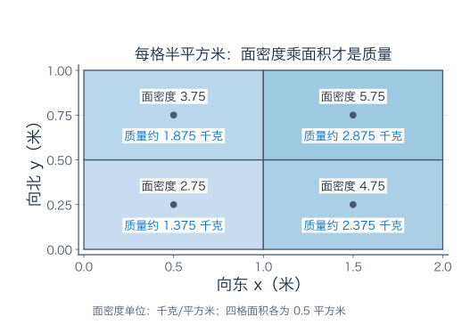
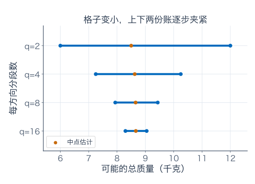
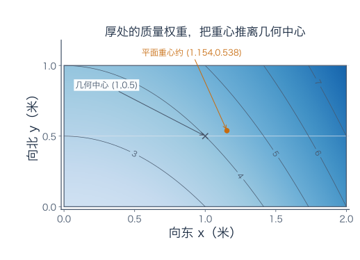
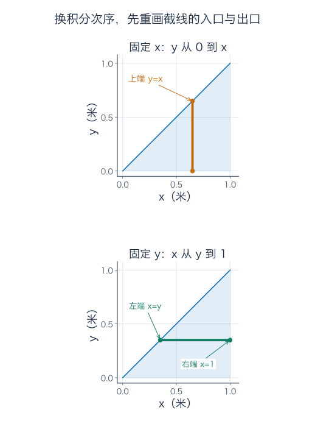
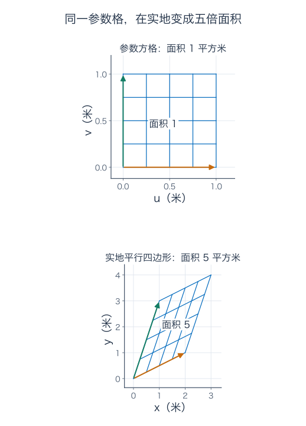
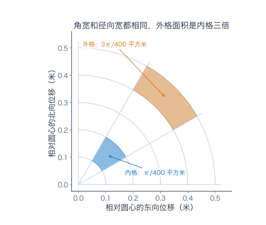
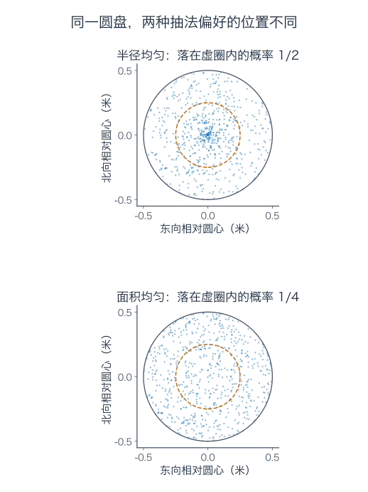
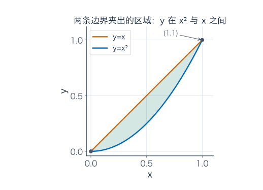
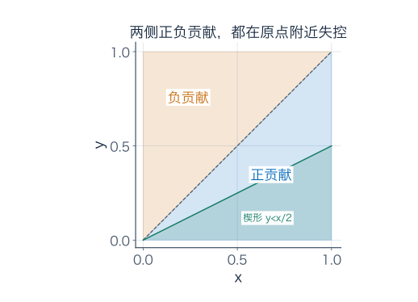
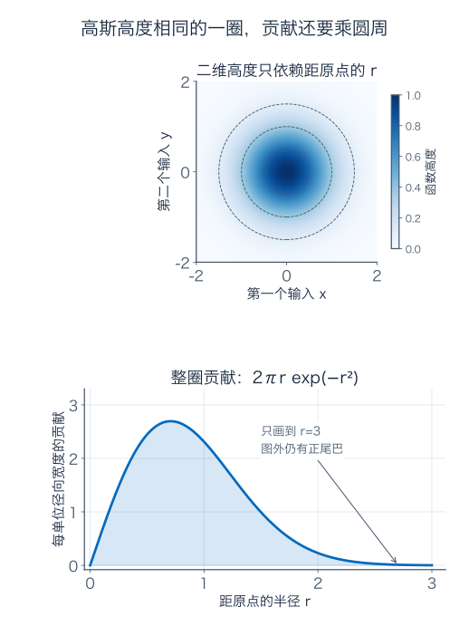

[数学总导航](../00-%E6%95%B0%E5%AD%A6%E5%AD%A6%E4%B9%A0%E5%AF%BC%E8%88%AA.md) · [本课程目录](00-%E5%AD%A6%E4%B9%A0%E8%B7%AF%E7%BA%BF%E4%B8%8E%E7%AC%A6%E5%8F%B7.md) · [← 上一章](07-%E5%A4%9A%E5%8F%98%E9%87%8F%E5%BE%AE%E5%88%86%E4%B8%8E%E6%A2%AF%E5%BA%A6.md) · [下一章 →](09-%E7%BA%A6%E6%9D%9F%E4%BC%98%E5%8C%96%E4%B8%8E%E5%90%91%E9%87%8F%E5%88%86%E6%9E%90.md)

## 厚薄不均的薄板，怎样称出整块质量

桌上有一块长 2 米、宽 1 米的板材。材料的体密度恒为 $1000$ 千克/立方米，但板材厚薄不均：以米记录平面坐标，厚度数值为

$$
h(x,y)=2+x^2+2y\quad\text{毫米},\qquad
D=\{0\le x\le2,\ 0\le y\le1\}.
$$

系数按这些单位选定。这是一块底面平、厚度按竖向计的理想材料，不是把真实曲面厚度与竖向高度混为一谈。

先把单位对上：1 平方米上铺 1 毫米厚的材料，体积是 $0.001$ 立方米，质量为 $1000\times0.001=1$ 千克。因此当地每平方米的质量，也就是面密度，数值恰好为

$$
\sigma(x,y)=2+x^2+2y\quad\text{千克/平方米}.
$$

面密度不是质量。知道某处“每平方米4千克”，还要知道它代表多大面积，才能记入总账。

我们先回答整块有多重，再问裁下三角形或圆形后怎样算，最后看同一套方法如何计算随机落点与概率。二维积分的核心仍是第 4 篇那件事：**每一小份的当地数值，乘它所代表的大小，再相加。**

## 1．先分四格，做一张能核对的近似账单

横向分两段、纵向也分两段，四格的面积各为 $1\times0.5=0.5$ 平方米。暂时用格子中心的面密度代表整格：

| 中心坐标 $(x,y)$ | 面密度（千克/平方米） | 估计质量（千克） |
| --- | --- | --- |
| $(0.5,0.25)$ | 2.75 | 1.375 |
| $(1.5,0.25)$ | 4.75 | 2.375 |
| $(0.5,0.75)$ | 3.75 | 1.875 |
| $(1.5,0.75)$ | 5.75 | 2.875 |

相加得到 $8.5$ 千克。这还是近似，因为每个格子内部厚度也在变。

如果只把四个面密度相加，得到 17，却没有乘面积，就不是整块质量。格子分得越多，单纯相加读数还会越加越大；面积权重负责告诉你每个读数究竟代表多大一份。

这里密度随 $x,y$ 增大而增加。每格用左下角密度估计，肯定不超过真实质量；用右上角估计，肯定不小于真实质量。四格的下估计为

$$
(2+3+3+4)\times0.5=6\ \text{千克},
$$

上估计为

$$
(4+7+5+8)\times0.5=12\ \text{千克}.
$$

于是，还不会精确积分，也已经知道真实质量在 6 到 12 千克之间。中点估计在其中，但仅凭它落在两边之间，还不知道它精确到几位小数。

## 2．格子越小，为什么不同取样能指向同一个总量

每个方向都分成 $q$ 段，格子宽 $2/q$、高 $1/q$。重新计算下估计 $L_q$、中点估计 $C_q$、上估计 $U_q$：

| 每方向分段数 $q$ | 下估计（千克） | 中点估计（千克） | 上估计（千克） |
| --- | --- | --- | --- |
| 2 | 6 | 8.5 | 12 |
| 4 | 7.25 | 8.625 | 10.25 |
| 8 | 7.9375 | 8.65625 | 9.4375 |
| 16 | 8.296875 | 8.6640625 | 9.046875 |

怎样知道这种变化会继续，而不只是有限几个数看起来不错？这一模型的上下差可以精确求出。

对横向变化，固定一行后，相邻格的平方项差 $x_{i+1}^2-x_i^2$ 会首尾抵消，总共留下 $2^2-0^2=4$。再乘格宽与各行高度，横向造成的上下总差为 $(2/q)\times4=8/q$ 千克。对纵向的 $2y$，每格上下差为 $2/q$，乘整块面积 2，贡献 $4/q$ 千克。因此

$$
U_q-L_q=\frac{12}{q}\ \text{千克}\longrightarrow0.
$$

当分段数不断翻倍，下估计不减、上估计不增，两者间距又趋零，所以夹住唯一的总量。不管每格怎样选点，这个模型的取样总账都夹在两者之间。

正式记法是：把小格记为 $D_{ij}$，面积为 $\Delta A_{ij}$，选点 $\xi_{ij}$，累加 $\sum_{i,j}\sigma(\xi_{ij})\Delta A_{ij}$。当格子的最大直径趋零，若不同划分与取样都趋向同一数，就将它记为

$$
\iint_D\sigma(x,y)\,dA.
$$

这叫二重积分。$dA$ 表示面积权重，在直角坐标格里就是 $dx\,dy$。它不是把所有密度读数裸加起来，也不是只有规则方格才允许使用。

为什么闭矩形上的连续函数可积？第 4 篇用过的一致连续性在二维也成立：格子足够小，每格内函数的变化幅度都可统一压到任意小的 $\eta$。上下总账差至多为 $\eta\operatorname{Area}(D)$，便能任意小。

本例还有不依赖规则网格的具体保证：

$$
|\sigma(x,y)-\sigma(x',y')|
\le4|x-x'|+2|y-y'|.
$$

若所有格子的直径不超过 $\delta$，每格变化幅度不超过 $6\delta$，上下总差不超过 $12\delta$ 千克。变小的必须是所有小格的尺寸；只把某一角切得很碎，却保留一整块粗格，不能靠“格子总数很多”保证逼近。比较两份划分时，先切出共同细分；细分会抬高下估计、压低上估计，因此不能把总量夹向不同的值。

## 3．先把一条窄带结账，再把所有窄带加起来

有限格子的求和，既可逐格加，也可先按列分组：

$$
\sum_i\sum_j\sigma(x_i,y_j)\,\Delta y\,\Delta x
=\sum_i\left[\sum_j\sigma(x_i,y_j)\Delta y\right]\Delta x.
$$

括号里先在一个固定横坐标处，沿 $y$ 方向累计。格子变细后，得到

$$
G(x)=\int_0^1(2+x^2+2y)\,dy
=[(2+x^2)y+y^2]_0^1=3+x^2.
$$

这里 $x$ 不参与内层积分，因此 $x^2$ 暂时就是常数。$G(x)$ 的单位是千克/米，表示**每单位横向宽度的条带质量**，不是零宽度的一条线真的称出了几千克。

再乘外层小宽度、加遍整块：

$$
\begin{aligned}
M=\iint_D\sigma\,dA
&=\int_0^2G(x)dx\\
&=\int_0^2(3+x^2)dx
=6+\frac83=\frac{26}{3}\ \text{千克}.
\end{aligned}
$$

所以四格估计 $8.5$ 千克，少算了 $1/6$ 千克。整块平均面密度为 $(26/3)/2=13/3$ 千克/平方米。只在几何中心测一次，得到 $\sigma(1,0.5)=4$，乘面积却只给 8 千克；中心读数并不总等于平均值。

反过来按横带分组也能算：

$$
\int_0^2\sigma(x,y)dx=\frac{20}{3}+4y,
$$

$$
M=\int_0^1\left(\frac{20}{3}+4y\right)dy=\frac{26}{3}.
$$

$dy\,dx$ 从内往外读，是先积 $y$，后积 $x$；$dx\,dy$ 则相反。连续函数在有限矩形上，这两种分组都合法，这是 Fubini 定理的一个常用情形。后面会区分更一般情况下需要查什么。

现在也能认出当前模型的中点误差。每个小格中，关于 $y$ 的一次项平均得正好；关于 $x$ 的平方项，在以中点为零的局部坐标 $s\in[-\Delta x/2,\Delta x/2]$ 上，多出的平均为

$$
\frac1{\Delta x}\int_{-\Delta x/2}^{\Delta x/2}s^2ds
=\frac{(\Delta x)^2}{12}.
$$

乘整块面积 2，且 $\Delta x=2/q$，得到精确少算量 $2/(3q^2)$ 千克。它比先前的通用上下区间缩得更快，因为这次用了模型的额外结构；不能把这个速度许给所有连续函数。

## 4．板材往哪边更重，能从同一张账算出重心吗

想在一个点下面支撑板材，重心应该位于几何中心吗？右侧更厚、北侧也稍厚，直觉上应向那边偏移。

一维平均位置是“每份质量乘位置，再除以总质量”。两维只需分别为两个坐标记账：

$$
\bar x=\frac{\iint_Dx\sigma\,dA}{M},\qquad
\bar y=\frac{\iint_Dy\sigma\,dA}{M}.
$$

分子单位为千克·米，除以千克后才是位置米。使用已经算出的条带贡献：

$$
\iint_Dx\sigma\,dA=\int_0^2x(3+x^2)dx=10,
$$

$$
\iint_Dy\sigma\,dA=\int_0^1y\left(\frac{20}{3}+4y\right)dy=\frac{14}{3}.
$$

因此

$$
(\bar x,\bar y)=\left(\frac{15}{13},\frac7{13}\right)
\approx(1.15385,0.53846)\ \text{米}.
$$

图中的重心指平面投影坐标。板材有厚度，完整三维重心还包括竖向坐标，本节没有把它默认为零。

若从板材的质量中均匀挑一小份材料，出现在某小块的概率为“该块质量除以总质量”，所以位置的联合密度为 $p(x,y)=\sigma(x,y)/M$。刚才的重心就是这份随机位置的均值。

若改成按平面面积均匀挑位置，密度为 $1/2$，位置均值才是 $(1,0.5)$。按面积选与按质量选是两个不同试验；它们使用同一块板，却赋予厚处不同的权重。

## 5．裁成三角形，积分上限为什么跟着另一个变量走

现在裁下原板中 $T=\{0\le y\le x\le1\}$ 这一块，密度仍是同一条 $\sigma$。

固定 $x$，竖条从 $y=0$ 走到 $y=x$；固定 $y$，横条从 $x=y$ 走到 $x=1$。这是同一块三角形的两种扫描方式。

所以质量可以写成

$$
\begin{aligned}
M_T&=\int_0^1\int_0^x(2+x^2+2y)\,dy\,dx\\
&=\int_0^1(2x+x^3+x^2)dx
=1+\frac14+\frac13=\frac{19}{12}\ \text{千克}.
\end{aligned}
$$

若先算 $x$，则

$$
M_T=\int_0^1\int_y^1(2+x^2+2y)\,dx\,dy.
$$

题三会让你把第二种计算做完。上限跟着变量走，是地界造成的，不是交换 $dx,dy$ 的符号游戏。若先积 $y$ 却仍把上限写 1，就把三角形外的半个正方形也称进来了。

遇到弯曲地界也一样：先画区域，固定一条截线，问它实际从哪儿进、到哪儿出，再写上下限。题二给出一个由直线与抛物线夹成的区域，不能只交换两个积分号而保留旧边界。

### 顺序选得好，原来难算的积分也可能接上已有工具

看同一三角形上的

$$
J=\int_0^1\int_y^1e^{-x^2}\,dx\,dy.
$$

内层若硬找熟悉的原函数，会卡住。换成竖条后，$y$ 的允许长度为 $x$，而 $e^{-x^2}$ 在这条线里不随 $y$ 变化：

$$
J=\int_0^1\int_0^x e^{-x^2}\,dy\,dx
=\int_0^1xe^{-x^2}dx
=\frac{1-e^{-1}}2.
$$

多出的 $x$ 就是条长，恰好与指数内层 $x^2$ 的导数配合，让第 5 篇的换元法接上。我们没有求出 $e^{-x^2}$ 的常见原函数公式，却算出了这份完整累计。

## 6．给平行四边形换一张坐标纸，质量怎样搬过去

按相同密度规则制作另一块平行四边形板，边界用下面的参数最好描述：

$$
x=2u+v,\qquad y=u+3v,\qquad0\le u,v\le1.
$$

$u,v$ 是以米为单位的参数坐标。单位 $u$ 边变成向量 $(2,1)$，单位 $v$ 边变成 $(1,3)$；一个参数正方形在实地就变成平行四边形。

先算面积：底边 $(2,1)$ 长 $\sqrt5$ 米，垂直于它的单位向量为 $(-1,2)/\sqrt5$；另一边 $(1,3)$ 在这个方向的投影为 $5/\sqrt5=\sqrt5$ 米。所以面积为 5 平方米。

这正是上一章 Jacobian 矩阵的行列式绝对值：

$$
J_\Phi=\begin{pmatrix}2&1\\1&3\end{pmatrix},\qquad
|\det J_\Phi|=|2\times3-1\times1|=5.
$$

二维行列式 $ad-bc$ 的绝对值表示有向两条边围出的普通面积。若映射只是 $x=-u,y=v$，行列式为 $-1$，图形被翻转，面积仍为正的 1 倍，因此这里必须取绝对值。

一个小参数格 $\Delta u\Delta v$ 对应实地面积 $5\Delta u\Delta v$。这块板的质量应为

$$
\int_0^1\int_0^1
\left[2+(2u+v)^2+2(u+3v)\right]\,5\,du\,dv,
$$

题四会算出它。只把函数里的 $x,y$ 换了，却漏掉 5，就只称了每个真实小格的五分之一。

一般光滑变换 $\Phi$ 在局部由 Jacobian 近似，小参数格的面积放大倍数因此为 $|\det J_\Phi|$。换元公式是

$$
\iint_{\Phi(U)}f(x,y)\,dx\,dy
=\iint_U f(\Phi(u,v))\,|\det J_\Phi(u,v)|\,du\,dv.
$$

一个方便使用的充分版本要求：$\Phi$ 在相应开区域上是 $C^1$、一一对应、行列式非零；连续函数在边界良好的有界区域上可以如此换元，非负或绝对可积函数也有相应推广。局部小格的图像解释权重，换元定理负责保证它们能拼成整体等式。

换坐标时一起换三件事：函数表达式、区域范围、面积权重。还要检查同一位置是否被算了两遍；第 5 篇的一维概率换元已经见过多分支的危险。

## 7．从原板裁一个圆，越外面的角度格为什么越重

在原板内裁圆心为 $(1,0.5)$、半径 $R=0.5$ 米的圆盘 $B$。边界在直角坐标里要写平方根，换成离圆心的距离 $r$ 与方向角 $\theta$ 就简单得多：

$$
x=1+r\cos\theta,\qquad
 y=\frac12+r\sin\theta,
\qquad0\le r\le\frac12,\quad0\le\theta<2\pi.
$$

角度按弧度计。相同的角宽 $\Delta\theta$，在远处会跨越更长的弧。径向厚度为 $\Delta r$ 的扇环小格，精确面积为

$$
\Delta A=\frac12[(r+\Delta r)^2-r^2]\Delta\theta
=\left(r\Delta r+\frac12(\Delta r)^2\right)\Delta\theta.
$$

主要部分是 $r\Delta r\Delta\theta$，不是单纯的 $\Delta r\Delta\theta$。

图中内格半径 $[0.1,0.2]$ 米，外格 $[0.4,0.5]$ 米，角度都为 $[\pi/6,\pi/3]$。面积分别为 $\pi/400$ 与 $3\pi/400$ 平方米。相同的角度格数，绝不等于相同土地面积。

求导也能核对：

$$
J_\Phi=\begin{pmatrix}\cos\theta&-r\sin\theta\\\sin\theta&r\cos\theta\end{pmatrix},
\qquad \det J_\Phi=r.
$$

圆心平移是常数，不影响导数。因此面积元为 $dA=r\,dr\,d\theta$。先用圆面积检查：

$$
\int_0^{2\pi}\int_0^Rr\,dr\,d\theta=\pi R^2.
$$

若漏掉 $r$，会错算为 $2\pi R$，不仅数值不对，长度因子也没配齐。

### 圆形板的密度也要一起换

将 $x,y$ 代入同一条 $\sigma$，得到

$$
\sigma(\Phi(r,\theta))
=4+2r\cos\theta+2r\sin\theta+r^2\cos^2\theta.
$$

它不只是 $4+r^2$，因为原材料的厚度规则并不关于这个圆心旋转对称。我们不能因区域是圆，就把函数也擅自改成圆对称。

不过，先沿整圈积分时，正弦、余弦的一次项都相消，而 $\int_0^{2\pi}\cos^2\theta\,d\theta=\pi$。所以

$$
\begin{aligned}
M_B&=\int_0^R\int_0^{2\pi}
\sigma(\Phi(r,\theta))\,r\,d\theta\,dr\\
&=\int_0^R(8\pi r+\pi r^3)dr
=4\pi R^2+\frac\pi4R^4.
\end{aligned}
$$

代 $R=1/2$ 得 $M_B=65\pi/64\approx3.19068$ 千克，面积为 $\pi/4$ 平方米，平均面密度为 $65/16=4.0625$ 千克/平方米。

原点 $r=0$ 对应所有角度，角度接缝也重合，所以极坐标在整个闭参数矩形上并非一一对应。去掉圆心与一条接缝，内部满足换元条件；这条线与这个点对通常面积积分没有贡献。这里的合法性来自分区与边界处理，不是因为公式好看就忽略条件。

## 8．在圆里均匀落点，半径为什么不能均匀抽

改做一个随机试验：在刚才的圆盘中按面积均匀挑位置，和材料厚度无关。令 $S$ 表示离圆心的距离。对 $0\le s\le R$，

$$
P(S\le s)=\frac{\pi s^2}{\pi R^2}=\frac{s^2}{R^2},
\qquad p_S(s)=\frac{2s}{R^2}.
$$

半径不超过 $R/2$ 的区域只占四分之一面积，所以概率为 $1/4$，而不是 $1/2$。

图是有限样本的示意，概率保证来自面积计算。要生成面积均匀的点，可独立抽 $U,V\sim\operatorname{Unif}[0,1]$，设 $S=R\sqrt U$、$\Theta=2\pi V$，再代入圆心平移后的极坐标。

理由是 $P(R\sqrt U\le s)=P(U\le s^2/R^2)=s^2/R^2$。如果直接令 $S=RU$，落入半径 $R/2$ 的小圆盘的概率就变成 $1/2$，中心受到过多偏爱。

平均距离为

$$
\mathbb ES=\int_0^R s\frac{2s}{R^2}ds=\frac{2R}{3}=\frac13\ \text{米}.
$$

面积均匀时，二维密度为 $1/(\pi R^2)$；换到 $(r,\theta)$ 参数坐标后，密度为 $r/(\pi R^2)$。把角度积掉，就得到半径密度 $2r/R^2$。同一个半径因子，既负责面积，也负责抽样权重。

若按材料质量挑位置，密度应改为 $\sigma(x,y)/M_B$，就不是本节这个试验。每次说“均匀”，要交代在哪种对象上均匀。

## 9．换序什么时候合法，什么时候要先停下来查

前面连续密度在有限矩形、三角形、圆盘与平行四边形上累计，都是好处理的情形。边界可以按分区或零面积边界处理，换序不会改变总质量。

更一般地，对通常面积、体积或概率测度上的可测函数，有两份常用保证：

| 需要查的条件 | 可以得到的保证 |
| --- | --- |
| $f\ge0$ | Tonelli：可以按两种次序累计，结果允许为 $+\infty$ |
| $\iint\lvert f\rvert\,dA<\infty$ | Fubini：有符号总量有限，两种次序给相同结果 |

这一段的通用规则按 Lebesgue 积分理解；在前面连续有界的例子中，它与熟悉的 Riemann 积分一致，严格构造放到后续课程。

“可测”保证我们谈的区域和数值能被积分理论处理，完整定义留到泛函分析；本章的连续函数及明确分片函数都满足要求。正式的一般版本使用 $\sigma$ 有限的测度空间，即能拆成可数个有限大小的部分，通常的欧氏空间与概率空间符合这一条件。

非负函数允许总量无穷，例如整个第一象限上恒为 1，两个次序都得到正无穷，并不违反 Tonelli。正负都出现时，绝对可积要求把每笔贡献的符号去掉，全部规模仍有限，这能避免累计顺序操纵正负抵消。

一般 Fubini 结论允许一组测度为零的例外截面，并不保证每根截线都普通可积。我们前面的连续有界例子更好，不需要靠例外来完成计算。

两个迭代积分都能分别算出有限数，并不足以保证可以换序。补充 A 会算出一对分别为 $\pi/4$、$-\pi/4$ 的答案，并指出绝对可积条件究竟怎样失败。

## 10．练习：先认区域，再认权重

下面八题先集中列出，后面逐题给完整解答。第一次读可完成练习后停在这里，补充部分再按需要回看。

**题一：另一块厚薄不均的板材。**

在 $[0,2]\times[0,1]$ 上，面密度为 $1+x+y^2$ 千克/平方米。写出两种次序的积分，求总质量与平均面密度，再用横纵各分两段的中点估计，算出少算或多算了多少。

**题二：上下地界夹着一条曲线。**

区域为 $0\le x\le1,x^2\le y\le x$。换成先积 $x$ 的描述，求面积，并用两种次序计算 $\iint_Dx\,dA$。坐标为无量纲数，本题先只练区域与积分。

**题三：三角形板的第二种称法。**

对正文的 $T=\{0\le y\le x\le1\}$ 和 $\sigma=2+x^2+2y$，完成先积 $x$ 的计算，核对质量 $19/12$ 千克。面积与平均面密度分别为多少？若把每条竖线的贡献直接当成“千克”，单位哪里出了问题？

**题四：换坐标不能漏掉面积。**

在参数正方形 $[0,1]^2$ 上用 $x=2u+v,y=u+3v$ 描述板材，面密度仍为 $2+x^2+2y$。求面积与总质量。若只代换函数而忘记行列式，会少算几倍？为什么翻转坐标的负行列式不能给出负质量？

**题五：圆心平移，函数也要跟着改。**

对正文圆心 $(1,0.5)$、半径 $0.5$ 米的板材，重新写出极坐标表达式、面积元和参数范围。求质量、面积与平均面密度，指出密度里的 $r^2\cos^2\theta$ 与面积元里的 $r$ 分别来自哪里。

**题六：椭圆里的平均距离平方。**

在无量纲椭圆盘 $x^2/4+y^2\le1$ 中按面积均匀选一点。用 $x=2r\cos\theta,y=r\sin\theta$ 求面积、$\iint_D(x^2+y^2)dA$ 和距原点的距离平方均值。参数 $r$ 是不是实际的欧氏距离？

**题七：圆里落点的两种“均匀”。**

圆盘半径为 0.5 米，按面积均匀落点。求距圆心不超过 0.25 米的概率、平均距离，并写出由两个独立均匀随机数生成落点的公式。若改成按原板材料质量选位置，二维密度应怎样写？

**题八：独立不等于可以跳过可积检查。**

实随机变量 $X,Y$ 独立，且 $\mathbb E|X|,\mathbb E|Y|$ 都有限。证明 $XY$ 可积，并证明 $\mathbb E[XY]=\mathbb EX\,\mathbb EY$。它们没有概率密度时还能这样说吗？非负函数换序后得正无穷，是否表示 Tonelli 失败？

### 参考答案与解题过程

#### 题一解答

先积 $y$，得到

$$
\int_0^2\int_0^1(1+x+y^2)dy\,dx
=\int_0^2\left(\frac43+x\right)dx=\frac{14}{3}\ \text{千克}.
$$

先积 $x$，得到 $\int_0^1(4+2y^2)dy=14/3$ 千克。面积为 2 平方米，所以平均面密度为 $7/3$ 千克/平方米。

四个中心 $(0.5,0.25),(1.5,0.25),(0.5,0.75),(1.5,0.75)$ 的面密度分别为 $25/16,41/16,33/16,49/16$。每格面积为 $1/2$，因此中点质量估计为

$$
\frac12\cdot\frac{25+41+33+49}{16}=\frac{37}{8}=4.625\ \text{千克}.
$$

真实值减估计值为 $14/3-37/8=1/24$ 千克，说明少算。关于 $x$ 的一次项在对称中点格里平均得正好，误差来自 $y^2$ 的弯曲；不是所有二维函数都能有这种简单误差。

#### 题二解答

固定 $y$，由 $y\le x$、$x^2\le y$ 和 $x\ge0$，得到 $y\le x\le\sqrt y$，且 $0\le y\le1$。不能加入负的 $-\sqrt y$，因为原区域只有非负 $x$。

面积为

$$
\int_0^1\int_y^{\sqrt y}1\,dx\,dy
=\int_0^1(\sqrt y-y)dy=\frac23-\frac12=\frac16.
$$

原次序计算目标积分：

$$
\int_0^1\int_{x^2}^{x}x\,dy\,dx
=\int_0^1(x^2-x^3)dx=\frac1{12}.
$$

换序后计算：

$$
\int_0^1\int_y^{\sqrt y}x\,dx\,dy
=\frac12\int_0^1(y-y^2)dy=\frac1{12}.
$$

两种次序使用同一区域与同一个函数，只是分组方式不同。

#### 题三解答

先积 $x$，固定 $y$ 后的范围是 $y\le x\le1$：

$$
\begin{aligned}
\int_y^1(2+x^2+2y)dx
&=(2+2y)(1-y)+\frac{1-y^3}{3}\\
&=\frac73-2y^2-\frac{y^3}{3}.
\end{aligned}
$$

再积 $y$，质量为 $7/3-2/3-1/12=19/12$ 千克。面积为 $1/2$ 平方米，平均面密度为 $(19/12)/(1/2)=19/6$ 千克/平方米。

沿一根固定竖线只积 $y$，单位为“千克/平方米乘米”，即千克/米。还要乘横向宽度，才能变成千克。零宽线并没有独自贡献一份非零质量。

#### 题四解答

Jacobian 行列式为 5，单位参数正方形对应实地面积 5 平方米。换元后的质量为

$$
\begin{aligned}
M&=5\int_0^1\int_0^1
[2+4u^2+4uv+v^2+2u+6v]du\,dv\\
&=5\left(2+\frac43+1+\frac13+1+3\right)
=\frac{130}{3}\ \text{千克}.
\end{aligned}
$$

例如交互项 $4uv$ 的积分为 $4(1/2)(1/2)=1$，不能把它当成只与一个变量有关的项。每个参数格实际面积放大五倍，漏掉行列式会只得 $26/3$，是实际质量的五分之一。

反射坐标改变了边的方向，却没把材料变成负质量。普通面积换元使用行列式绝对值；如果研究有向面积或曲面积分，还会另外规定方向，不能与这里的称重混用。

#### 题五解答

使用 $x=1+r\cos\theta,y=1/2+r\sin\theta$，其中 $0\le r\le1/2,0\le\theta<2\pi$，面积元为 $r\,dr\,d\theta$。平移不影响 Jacobian。

密度为 $4+2r\cos\theta+2r\sin\theta+r^2\cos^2\theta$。整圈积分后，一次的正弦、余弦项为零，余下 $8\pi+\pi r^2$。因此

$$
M_B=\int_0^{1/2}(8\pi r+\pi r^3)dr
=\pi+\frac\pi{64}=\frac{65\pi}{64}\ \text{千克}.
$$

面积为 $\pi/4$，平均面密度为 $65/16$。$r^2\cos^2\theta$ 来自原式的 $x^2$，属于材料密度；另一个 $r$ 来自参数格的实地面积，属于权重。即使材料恒密度，面积元里的 $r$ 也不能删。

#### 题六解答

参数范围为 $0\le r\le1,0\le\theta<2\pi$。Jacobian 为

$$
\begin{pmatrix}2\cos\theta&-2r\sin\theta\\\sin\theta&r\cos\theta\end{pmatrix},
\qquad\det J=2r.
$$

所以面积为 $\int_0^{2\pi}\int_0^12r\,dr\,d\theta=2\pi$。距离平方变为 $r^2(4\cos^2\theta+\sin^2\theta)$，于是

$$
\begin{aligned}
\iint_D(x^2+y^2)dA
&=\int_0^{2\pi}\int_0^12r^3(4\cos^2\theta+\sin^2\theta)dr\,d\theta\\
&=\frac12(4\pi+\pi)=\frac{5\pi}{2}.
\end{aligned}
$$

按面积均匀的密度为 $1/(2\pi)$，距离平方均值是 $5/4$。参数 $r$ 是未拉伸圆盘中的半径，实际欧氏距离为 $r\sqrt{4\cos^2\theta+\sin^2\theta}$，一般不等于 $r$。

这个答案是距离平方的平均，不能直接开根号就称为平均距离；开根号与取平均不是同一个操作。

#### 题七解答

面积比例给 $P(S\le0.25)=(0.25/0.5)^2=1/4$，平均距离为 $2(0.5)/3=1/3$ 米。抽独立 $U,V\sim\operatorname{Unif}[0,1]$，可令

$$
x=1+\frac12\sqrt U\cos(2\pi V),\qquad
 y=\frac12+\frac12\sqrt U\sin(2\pi V).
$$

这里面积均匀的二维密度为 $1/(\pi/4)=4/\pi$。若按材料质量挑，则改为

$$
p_{\mathrm{mass}}(x,y)=\frac{64(2+x^2+2y)}{65\pi}
\quad\text{在圆盘内},
$$

圆盘外为零。两种密度都积分为 1，却在厚薄位置分配不同的概率。不能只说“均匀挑一点”而省略选择方式。

#### 题八解答

记两个边缘分布为 $\mu,\nu$。独立说明联合分布为乘积测度 $\mu\times\nu$；这不要求它们有概率密度，也包括离散或混合分布。

先对非负函数 $|xy|$ 使用 Tonelli：

$$
\begin{aligned}
\mathbb E|XY|
&=\int\int |x||y|\,d\nu(y)\,d\mu(x)\\
&=\left(\int|x|\,d\mu(x)\right)
\left(\int|y|\,d\nu(y)\right)
=\mathbb E|X|\,\mathbb E|Y|<\infty.
\end{aligned}
$$

乘积因此可积，才对有符号函数 $xy$ 使用 Fubini：把内层的 $x$ 当固定常数，得到

$$
\mathbb E[XY]=\int x\left(\int y\,d\nu(y)\right)d\mu(x)
=\mathbb EX\,\mathbb EY.
$$

条件不是可有可无的装饰：它先排除了正负无限贡献相减。非负函数的换序结果为 $+\infty$ 不表示失败，Tonelli 本来就允许此结果；“允许换序”与“保证有限”是两项不同的结论。

## 补充 A：两种次序各算出一个有限数，仍可能不能换序

在 $(0,1)^2$ 上定义

$$
f(x,y)=\frac{x^2-y^2}{(x^2+y^2)^2}.
$$

对角线下方为正，上方为负，原点附近绝对值会很大。先固定 $x>0$，用 $y/(x^2+y^2)$ 作为关于 $y$ 的原函数：

$$
\int_0^1f(x,y)dy=\frac1{1+x^2},\qquad
\int_0^1\int_0^1f(x,y)dy\,dx=\frac\pi4.
$$

先固定 $y>0$，用 $-x/(x^2+y^2)$ 作为关于 $x$ 的原函数：

$$
\int_0^1f(x,y)dx=-\frac1{1+y^2},\qquad
\int_0^1\int_0^1f(x,y)dx\,dy=-\frac\pi4.
$$

两个一元计算都正确，不能因结果不一致就硬挑一个当“二维积分”。我们还没通过允许重新分组的绝对可积检查。

图只用颜色表示正负位置，不用深浅表示函数大小。只看 $0<y<x/2$ 的小楔形，

$$
x^2-y^2\ge\frac34x^2,\qquad
(x^2+y^2)^2\le\frac{25}{16}x^4,
$$

所以 $f\ge12/(25x^2)$。该条带长度为 $x/2$，从而

$$
\iint|f|\,dA
\ge\int_0^1\int_0^{x/2}\frac{12}{25x^2}dy\,dx
=\frac6{25}\int_0^1\frac{dx}{x}=+\infty.
$$

这里在比较非负贡献，可以合法使用 Tonelli，即使结论无穷。正贡献本身无穷；交换 $x,y$ 会把符号翻转，负贡献的绝对总量也无穷。因此有符号二维总量没有被定义为一个有限差。

这与第 5 篇的主值、第 6 篇的条件收敛重排是同一类提醒：有限的相消结果，可能依赖你组织极限的方式。若想把它当成不依赖次序的总量，就需要相应控制。

## 补充 B：正态分布里的π，怎样从一圈圈累计里出现

考虑 $I=\int_{-\infty}^{\infty}e^{-x^2}dx$。先检查有限性：在 $[-1,1]$ 上不超过 1；$|x|\ge1$ 时，$e^{-x^2}\le e^{-|x|}$，后者尾部可积。因此 $I$ 是有限正数。

不急着处理整个平面。先取有限的 $A>0$，记 $I_A=\int_{-A}^{A}e^{-x^2}dx$。有限正方形上函数连续，按两次积分：

$$
I_A^2=\iint_{[-A,A]^2}e^{-(x^2+y^2)}dA.
$$

二维高度只依赖距原点的半径 $r$。半径为 $A$ 的圆盘累计为

$$
\int_0^{2\pi}\int_0^A e^{-r^2}r\,dr\,d\theta
=\pi(1-e^{-A^2}).
$$

关键是几何夹逼：半径 $A$ 的圆盘包含在正方形内，正方形又包含在半径 $\sqrt2A$ 的圆盘内。函数非负，所以

$$
\pi(1-e^{-A^2})\le I_A^2\le\pi(1-e^{-2A^2}).
$$

两边随 $A\to\infty$ 都趋于 $\pi$，而 $I_A\to I$，因此 $I^2=\pi$，取正根得 $I=\sqrt\pi$。这份证明只在有限区域上换序、换元，再用一元极限夹逼，没有先把未知的无限累计随意拆开。

整圈贡献是 $2\pi r e^{-r^2}$：一个 $e^{-r^2}$ 来自高度，一个 $2\pi r$ 来自圆周。圆心处高度最高，但一圈的宽度因素趋零，所以整圈贡献反而从零开始。这也是不能把径向高度图直接当成总概率密度的原因。

最后令 $x=\sqrt2t$，有 $\int_{\mathbb R}e^{-x^2/2}dx=\sqrt{2\pi}$。标准正态密度因此需要系数 $1/\sqrt{2\pi}$ 才能归一化。没有求出一个常见的初等原函数，也照样能准确算出全局总量；圆的对称性让那份面积权重恰好与换元导数配合。

## 补充 C：同一片三角形，还能用来读联合概率

在长 1 分钟的录音中，独立均匀选两个时刻。将较晚的记为 $X$、较早的记为 $Y$，便有 $0\le Y\le X\le1$。

排序前两个标记在单位正方形上联合密度为 1；排序会把两半都折到 $0<y<x<1$ 的三角形。每半映射都是一一对应且面积不变，两份贡献相加，所以排序后密度为 2。直接核对：$2\times(1/2)=1$。

只关心一个变量时，把另一个变量累积掉，得到边缘密度：

$$
p_X(x)=\int_0^x2dy=2x,
\qquad p_Y(y)=\int_y^12dx=2(1-y).
$$

于是 $\mathbb EX=2/3$ 分钟，$\mathbb EY=1/3$ 分钟。原始时刻独立，不表示排序后的两个量也独立：知道较早标记已经很晚，较晚标记便不能很早。

计算也能核对：

$$
\mathbb E[XY]=\int_0^1\int_0^x2xy\,dy\,dx=\frac14,
\qquad \mathbb EX\,\mathbb EY=\frac29.
$$

二者不同，因此不独立。事件 $Y<X/2$ 只改变积分区域，密度仍是 2，所以 $P(Y<X/2)=\int_0^1\int_0^{x/2}2dy\,dx=1/2$。

### 密度换元时，为什么有时乘面积倍数，有时除

若将随机参数 $(U,V)$ 通过可逆光滑的 $\Phi$ 变成 $(X,Y)$，同一小事件的概率质量守恒：

$$
p_{U,V}(u,v)=p_{X,Y}(\Phi(u,v))|\det J_\Phi(u,v)|.
$$

这是把输出密度拉回参数坐标。若已知参数密度、要求输出密度，就反过来用逆映射：

$$
p_{X,Y}(x,y)=p_{U,V}(\Phi^{-1}(x,y))|\det J_{\Phi^{-1}}(x,y)|.
$$

还用正文 $x=2u+v,y=u+3v$。独立均匀的 $U,V\in[0,1]$ 具有密度 1，输出区域面积扩大到 5，输出密度变为 $1/5$，积分仍为 1。逆映射为 $u=(3x-y)/5,v=(-x+2y)/5$，其行列式为 $1/5$。

材料积分里乘 5，是把每格实地面积补回来；概率向外推后密度变成五分之一，是把同一概率分摊到五倍面积。先写出同一小事件的质量，便不必机械背“乘还是除”。排序不是一一对应，不能只套一条逆映射；前面把两半分别处理再相加，正是在算所有分支。

## 补充 D：再多一个方向，面积权重就变成体积权重

其实开头那块板的质量也能直接写成三重积分。因为竖向厚度为 $h(x,y)/1000$ 米，体密度为 1000 千克/立方米，

$$
M=\int_0^2\int_0^1\int_0^{h(x,y)/1000}1000\,dz\,dy\,dx.
$$

先算竖向积分，得到的就是面密度 $\sigma(x,y)$。二维称重并没有凭空忽略厚度，而是已经把它沿竖向累计进了面密度。

再看水箱：范围 $0\le x\le2,0\le y\le1,0\le z\le3$ 米，$z$ 从水面向下，浓度为 $c(z)=2+z$ 毫克/立方米。总含量是

$$
\int_0^2\int_0^1\int_0^3(2+z)dz\,dy\,dx
=2\left[2z+\frac{z^2}2\right]_0^3=21\ \text{毫克}.
$$

体积为 6 立方米，平均浓度为 3.5 毫克/立方米。单位仍是浓度乘体积。

圆柱坐标只是扇环面积再乘高度，体积元为 $r\,dr\,d\theta\,dz$。半径 1 米、高 2 米、恒密度 3 千克/立方米的圆柱，总质量为 $3\times\pi\times2=6\pi$ 千克，也可直接用这项体积权重积分核对。

球坐标令 $\phi$ 为与正 $z$ 轴的夹角、$\theta$ 为绕轴角：

$$
x=r\sin\phi\cos\theta,\quad y=r\sin\phi\sin\theta,\quad z=r\cos\phi.
$$

三个局部垂直小边长约为 $dr,r\,d\phi,r\sin\phi\,d\theta$，所以体积权重为 $r^2\sin\phi\,dr\,d\phi\,d\theta$。半径为 1 的球，体积为

$$
\int_0^{2\pi}\int_0^\pi\int_0^1r^2\sin\phi\,dr\,d\phi\,d\theta
=2\pi\times2\times\frac13=\frac{4\pi}{3}.
$$

两个角方向都随半径伸长，绕轴的那一圈还取决于 $\sin\phi$。它们承担的几何工作，与二维的半径因子一样明确。

## 补充 E：整张密度图输入一个规则，输出总质量

把积分看成规则 $T(f)=\iint_Df\,dA$。对绝对可积函数，它关于输入线性，能把一整张密度图变成一个有限总量。

若预测密度为 $\tilde f$，真实密度为 $f$，输入误差为 $e=f-\tilde f$，输出误差满足

$$
|T(f)-T(\tilde f)|\le\iint_D|e|\,dA=\|e\|_1.
$$

右边叫 $L^1$ 误差，先把每处误差取绝对值，再按面积加总，不允许正负先抵消。若区域面积有限，也有 $|T(f)-T(\tilde f)|\le\operatorname{Area}(D)\|e\|_\infty$。例如两平方米板材上每处面密度都误差不超过 0.1 千克/平方米，总质量误差不超过 0.2 千克。

第 6 篇的窄脉冲说明逐点误差小未必控制累计量，本篇的正负反例又说明相消结果可能依赖累计方式。泛函分析随后会把这些误差标准组织成函数空间，继续追问：用哪一种输入大小，才能保证这条输出规则稳定？

### 伴读与核对

- [3Blue1Brown：The determinant](https://www.3blue1brown.com/lessons/determinant/)：配合网格伸缩与平行四边形理解面积倍数。
- [3Blue1Brown：Why π is in the normal distribution](https://www.3blue1brown.com/lessons/gaussian-integral/)：配合补充 B 看圆周权重与高斯积分。本章模型、正文、图示和练习独立编写。
- [Jiří Lebl：Iterated integrals and the Fubini theorem](https://www.jirka.org/ra/html/sec_iteratedints.html)：核对有限区域上迭代积分的保证与条件。
- [OpenStax：Change of Variables in Multiple Integrals](https://openstax.org/books/calculus-volume-3/pages/5-7-change-of-variables-in-multiple-integrals)：核对坐标变换、Jacobian 与二维、三维面积体积权重。

- [Terence Tao：Measure and Integration Theory，Theorem 4](https://terrytao.wordpress.com/2009/01/01/245b-notes-0-a-quick-review-of-measure-and-integration-theory/)：进阶核对 Tonelli、Fubini 与测度条件；第一次可先掌握正文的具体例子。

---

[数学总导航](../00-%E6%95%B0%E5%AD%A6%E5%AD%A6%E4%B9%A0%E5%AF%BC%E8%88%AA.md) · [本课程目录](00-%E5%AD%A6%E4%B9%A0%E8%B7%AF%E7%BA%BF%E4%B8%8E%E7%AC%A6%E5%8F%B7.md) · [← 上一章](07-%E5%A4%9A%E5%8F%98%E9%87%8F%E5%BE%AE%E5%88%86%E4%B8%8E%E6%A2%AF%E5%BA%A6.md) · [下一章 →](09-%E7%BA%A6%E6%9D%9F%E4%BC%98%E5%8C%96%E4%B8%8E%E5%90%91%E9%87%8F%E5%88%86%E6%9E%90.md)
