[数学总导航](../00-%E6%95%B0%E5%AD%A6%E5%AD%A6%E4%B9%A0%E5%AF%BC%E8%88%AA.md) · [本课程目录](00-%E5%AD%A6%E4%B9%A0%E8%B7%AF%E7%BA%BF%E4%B8%8E%E7%AC%A6%E5%8F%B7.md) · [← 上一章](08-%E5%A4%9A%E9%87%8D%E7%A7%AF%E5%88%86%E3%80%81%E6%8D%A2%E5%85%83%E4%B8%8E%E7%A7%AF%E5%88%86%E6%AC%A1%E5%BA%8F.md) · [下一章 →](10-%E5%BE%AE%E5%88%86%E6%96%B9%E7%A8%8B%E3%80%81%E6%95%B0%E5%80%BC%E6%96%B9%E6%B3%95%E4%B8%8E%E5%A4%8D%E4%B9%A0.md)

最陡上坡方向已经找到了，但如果你只能沿一条山路走，那个方向未必允许。沿路的力也已经知道了，但要算整段搬运做了多少功，还得把每一小步的贡献累加。

这一章把第七章的“局部变化”与第八章的“区域累计”接起来。我们先围菜地，再搬箱子，最后把水流想成一群穿过边界的小箭头。Lagrange、Green、Gauss、Stokes 这些名字各自解决具体问题；先跟着例子把问题算清，再记名字。

## 1．只有 20 米围栏，怎样围出最大菜地？

先只考虑长方形，长宽为 $x,y>0$ 米，面积为 $A=xy$ 平方米。围栏长度固定，意味着

$$
2x+2y=20.
$$

可以加长一边，但必须相应缩短另一边。用约束消去 $y=10-x$，便得到一元问题：

$$
A(x)=x(10-x)=25-(x-5)^2,\qquad0<x<10.
$$

平方项非负，所以 $x=y=5$ 时面积最大，为 25 平方米。靠近两端时长方形越来越扁，面积趋近零。

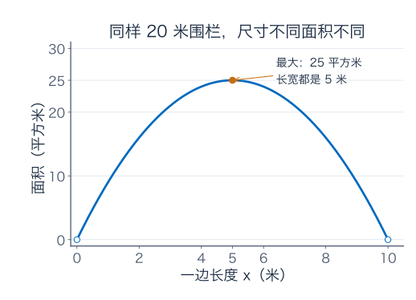

这里的“最好”是在允许的长方形里比较。如果忽略围栏，把 $x,y$ 都增大，当然能得到更大面积，却已经换了题目。约束不是算完之后再补的一行备注，它规定我们究竟能往哪里走。

## 2．最优点的梯度为什么不必为零？

在 $x=y=5$ 时，面积梯度为 $(y,x)=(5,5)$，并不为零。第七章说梯度指向最快增加方向；现在为什么已经最优？因为朝 $(5,5)$ 增大两边会需要更多围栏。

允许的小调整 $(a,b)$ 必须满足 $2a+2b=0$，即 $b=-a$。面积的一阶变化为

$$
dA=ya+xb=(y-x)a.
$$

在最优处，沿允许方向往正、往反都不能一阶提高面积，所以这个式子应对所有 $a$ 为零，得到 $x=y$。与围栏条件联立即得到 5 米乘 5 米。

用向量整理这段推理。令 $g(x,y)=2x+2y$，约束为 $g=20$。允许调整沿约束线的切向，$\nabla g=(2,2)$ 垂直切向。最优处的 $\nabla A$ 也必须垂直这个切向，因此二者平行：

$$
\nabla A=\lambda\nabla g.
$$

这就是 **Lagrange 乘子条件**。对一般 $C^1$ 函数 $f,g$，在等式约束 $g=c$ 的局部极值点，若 $\nabla g\ne0$，就存在数 $\lambda$ 使 $\nabla f=\lambda\nabla g$。非零约束梯度保证附近有正常的约束曲线，切方向能真实代表允许的微小移动。

多个等式约束时，若约束梯度线性无关，目标梯度落在这些法向量的张成空间中：$\nabla f=\sum_i\lambda_i\nabla g_i$。核心仍是同一件事：目标在所有允许的切方向上一阶不变。

## 3．乘子 λ 能告诉我们，多一米围栏值多少面积吗？

把围栏总长记为 $L$。仍取正方形时，边长 $L/4$，最优面积为

$$
A_*(L)=\frac{L^2}{16},\qquad A_*'(20)=\frac{20}{8}=2.5.
$$

因此在 20 米附近，多一小段围栏，最优面积约增加“2.5 平方米/米 × 新增长度”。这是一种局部的资源敏感度。

再从乘子方程计算：$(y,x)=\lambda(2,2)$，代入 $(5,5)$ 得 $\lambda=2.5$，恰好相同。原因是沿随 $L$ 改变的最优尺寸，$dA=\nabla A\cdot d(x,y)=\lambda\nabla g\cdot d(x,y)=\lambda\,dL$。

如果真的从 20 米增加到 21 米，一阶预测多出 $2.5$ 平方米，真实增量为 $21^2/16-25=2.5625$ 平方米。多出的 $0.0625$ 是二次项，不应被忽略后还声称预测精确。

这里的数值与约束写法有关。若把约束改写为 $x+y=L/2$，对应乘子会变成 5；但右端资源只变了原来的一半，最后对总围栏长度的敏感度仍为 $5/2=2.5$。同时核对约束和单位，才能正确解释乘子。

## 4．乘子方程给候选点，还没有替我们比较大小

在单位圆 $x^2+y^2=1$ 上最大化 $f=x+y$。乘子条件为

$$
(1,1)=2\lambda(x,y),\qquad x^2+y^2=1.
$$

由前两项知 $x=y$，因此有两个候选：$\pm(1,1)/\sqrt2$。目标值分别为 $\sqrt2$ 与 $-\sqrt2$，一个最大，一个最小。圆是闭有界的，连续目标能取得极值；这里约束梯度处处非零，两个候选已经覆盖极值可能出现的位置。

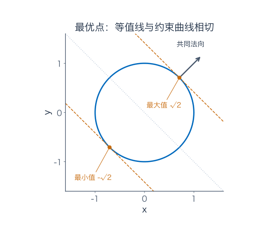

图中直线是 $x+y$ 的等值线。把它往目标增加的一侧平移，最后碰到圆的位置，就是最大点。此处目标等值线与约束相切，两梯度都垂直共同切线。

但不能把这幅正常图景当成所有约束都适用。若约束为 $x^2+y^2=0$，唯一允许点是原点。对目标 $f=x$，它当然同时是允许集合上的最大、最小点；可是 $\nabla f=(1,0)$，$\nabla g=(0,0)$，任何 $\lambda$ 都无法满足方程。这里缺少的正是非零约束梯度条件。

若还有 $x\ge0$、$y\ge0$ 等不等式边界，边界和角点也要单独处理。乘子法为符合条件的等式约束点提供必要条件，不会自动证明每个候选是最大，也不会替你检查遗漏的可行位置。

## 5．从高度地图到风向地图：向量场是什么？

高度图每个位置给一个数；风向图每个位置给一个带方向的速度。用 $F(x,y)=(P(x,y),Q(x,y))$ 记录它，叫向量场：第一分量是东西方向，第二分量是南北方向。

两个简单模型是 $F(x,y)=(x,y)$ 与 $G(x,y)=(-y,x)$。前者的箭头向外，后者的箭头绕原点转。坐标与场分量在这些数值模型中按约定的单位书写。

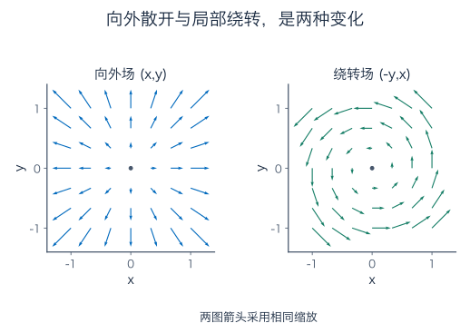

不要只看箭头长短。一个地方风很大，不代表附近净流出大；一个粒子沿弯路运动，也不能单凭这一点判断该处的局部旋转。接下来会分别计算这些量。

先看做功。你施加 10 牛顿的拉力，与水平位移夹角 60 度，把箱子水平拖动 2 米。这股拉力所做的功是

$$
W=10\cos60^\circ\times2=10\quad\text{焦耳}.
$$

只有沿位移方向的分量参与这一步做功。一般写成点积 $F\cdot\Delta r$，因为点积正好是“力的长度 × 位移长度 × 夹角余弦”。不能只拿力的大小乘总路程。

## 6．一段弯路：路程、沿路质量与做功各怎样加？

用参数曲线 $\gamma(t)$ 描述路线，$a\le t\le b$。对小参数步，位移约为 $\gamma'(t)\Delta t$，路程约为 $\|\gamma'(t)\|\Delta t$。在分段 $C^1$ 的正规曲线等常用条件下，累计后得到

$$
\begin{aligned}
\int_\gamma f\,ds&=\int_a^bf(\gamma(t))\|\gamma'(t)\|\,dt,\\
\int_\gamma F\cdot dr&=\int_a^bF(\gamma(t))\cdot\gamma'(t)\,dt.
\end{aligned}
$$

前者按路程加权，后者按有方向的位移做点积。$t$ 是描述位置的参数，不一定是时钟时间。

以单位圆上半圈为例，$\gamma(t)=(\cos t,\sin t)$，$0\le t\le\pi$，坐标按米计。导数为 $(-\sin t,\cos t)$，速度长度为 1，因此路程为 $\pi$ 米。若这是一根线密度恒为 2 千克/米的细绳，质量就是 $2\pi$ 千克。

若沿路受到恒力 $F=(1,0)$ 牛顿，做功为

$$
W=\int_0^\pi(-\sin t)dt=-2\quad\text{焦耳}.
$$

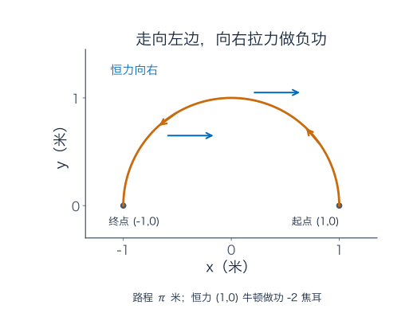

路程为正，功却为负：总体位移与力相反。把路线倒着走，路程和细绳质量不变，功变成 $+2$ 焦耳。方向是两种累计方法的实质区别。

若改用 $t=\pi s^2$、$0\le s\le1$ 描述同一条路线，新导数多出 $2\pi s$。做功变成 $\int_0^1-\sin(\pi s^2)\,2\pi s\,ds=-2$，结果不变。这个因子负责修正参数移动快慢；只替换位置、不替换导数，会改变你算的量。

## 7．有些力场，整段做功真的只看起点与终点

若向量场恰好是某个单值函数的梯度，$F=\nabla\varphi$，链式法则就把沿路的点积变成一个普通导数：

$$
F(\gamma(t))\cdot\gamma'(t)
=\frac d{dt}\varphi(\gamma(t)).
$$

再用微积分基本定理积分，得到

$$
\int_\gamma F\cdot dr=\varphi(\gamma(b))-\varphi(\gamma(a)).
$$

例如 $F=(2x,2y)$，可取 $\varphi=x^2+y^2$。从 $(0,0)$ 到 $(1,1)$，无论沿直线还是先向东再向北，做功数值都为 $2$。沿直线 $\gamma(t)=(t,t)$，被积函数为 $4t$，从 0 到 1 积得 2；沿折线，两段分别贡献 1 和 1。

这一类场称保守场或梯度场。任意闭路的起终点相同，所以闭路积分为零；若沿相同端点的两条路积分不同，就能直接排除全局势函数的存在。

物理里若用的是势能 $U$，通常写 $F=-\nabla U$，做功为 $U(\text{起点})-U(\text{终点})$。这里的 $\varphi$ 是满足 $F=\nabla\varphi$ 的势函数，两种记号差一个负号，不能混用。

## 8．绕路真的可能改变结果：两条 L 形路线

把场换成 $F=(-y,x)$，仍从原点走到 $(1,1)$。先向东、再向北，第一段 $y=0$，水平力分量为零；第二段 $x=1$，竖直力分量为 1，走长度 1，所以总积分为 $+1$。

若先向北、再向东，第一段 $x=0$，竖直分量为零；第二段 $y=1$，水平分量为 $-1$，所以总积分为 $-1$。

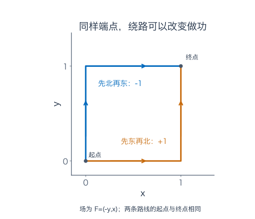

沿第一条路出去，再沿第二条反向回来，正好绕单位正方形逆时针一圈，闭路积分为 $1-(-1)=2$。这一数值说明它不是前一节的梯度场。

若把它理解成力的数值模型，坐标按米、力按牛顿，这些做功数值的单位就是焦耳。若把相同形式理解成速度场，相应的线积分叫环流，单位随速度和长度而变。数学累计规则相同，物理解释要随场的含义一起说明。

## 9．一小圈的环流，怎样变成旋度与 Green 定理？

取一个小矩形，按逆时针沿边走。下边向右，上边向左，水平分量贡献相减；右边向上，左边向下，竖直分量贡献相减。若 $F=(P,Q)$，小矩形环流近似为

$$
\big(Q_x-P_y\big)\,\Delta x\Delta y.
$$

为什么是这两个偏导？右边与左边的 $Q$ 之差，约为 $Q_x\Delta x$；上边与下边的 $P$ 之差约为 $P_y\Delta y$，但上边的行走方向相反，所以带负号。

精确理由也能写出来。对矩形 $[a,b]\times[c,d]$，四条边相加为

$$
\int_a^b[P(x,c)-P(x,d)]dx
+\int_c^d[Q(b,y)-Q(a,y)]dy.
$$

分别用一元基本定理把括号写成 $-\int_c^dP_y\,dy$ 与 $\int_a^bQ_x\,dx$，在 $C^1$ 条件下用 Fubini 合并，恰好得到 $\iint(Q_x-P_y)dA$。小矩形上的关系因此不仅是直觉近似。

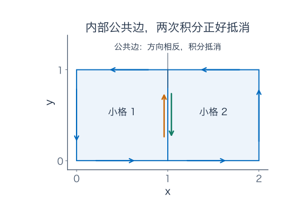

把区域切成许多小格，相邻两格公共边的方向相反，边界积分正好抵消。里面的小圈加完，只剩大区域外面的那一圈。这就是 **Green 定理**的结构：

$$
\oint_{\partial D}P\,dx+Q\,dy
=\iint_D(Q_x-P_y)\,dA.
$$

一个常用版本要求 $D$ 为边界分段光滑的有界平面区域，$P,Q$ 在包含区域及其边界的开邻域上为 $C^1$；边界取正向，沿着走时区域在左边。外边界因而逆时针，有孔时内边界要顺时针。

$Q_x-P_y$ 是平面旋度的标量形式，也就是把场视作三维 $F=(P,Q,0)$ 后旋度的 $z$ 分量。对一般三维场 $F=(P,Q,R)$，

$$
\nabla\times F=(R_y-Q_z,\ P_z-R_x,\ Q_x-P_y).
$$

它记录各个法向方向上的局部环流密度，方向按右手规则确定。对 $F=(-y,x,0)$，旋度为 $(0,0,2)$。单位圆上直接参数化也可核对：$F(\cos t,\sin t)=(-\sin t,\cos t)=\gamma'(t)$，点积为 1，积分一圈为 $2\pi$；Green 则给出 $2\times\pi=2\pi$。

若这是刚体式转动速度场，粒子角速度为 1，而旋度为 2：局部旋转的这个量带一个两倍因子。别把“旋度”直接当成某个粒子绕原点的角速度；它衡量的是小圈环流除以面积后的局部极限。

## 10．小盒子流出的比流入多多少：散度从哪里来？

现在改看穿过边界的流，不再沿边界走。对平面速度场 $F=(P,Q)$，一个小盒的右边流出由 $P$ 决定，左边流入也由 $P$ 决定。两边相减，主要部分为 $P_x\Delta x\Delta y$。上下两边同理给出 $Q_y\Delta x\Delta y$。

因此每单位面积的局部净流出率为 $P_x+Q_y$，叫二维散度。三维时再加前后两面，得到

$$
\nabla\cdot F=P_x+Q_y+R_z.
$$

以 $F=(x,y)$ 为例，图中单位方格从 $x=1$ 到 2、$y=1$ 到 2。按单位垂直厚度计算，左边流入数值为 1，右边流出 2，下边流入 1，上边流出 2，净量为 2。除以方格面积 1，得到散度 2。

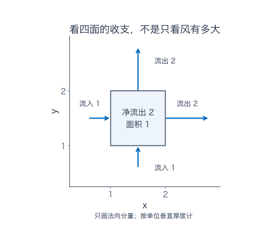

图只画穿过边的法向分量，沿边滑过去的速度不贡献这一面的通量。对速度以米/秒计的模型，单位厚度的流量单位为平方米/秒，散度单位为每秒。

散度为正表示局部净流出为正；它本身不替你判断物质究竟来自哪里，可能还有盒内存量变化或补给。散度也不等于速度大小：恒定大风各方向进出相抵，散度仍为零。

绕转场 $(-y,x)$ 的散度为 $0+0=0$，旋度却为 2；向外场 $(x,y)$ 的散度为 2，旋度为 $0-0=0$。向外散开与局部绕转，是两种不同的变化。

## 11．真正穿过一扇窗：通量为何要乘法向分量？

一扇面积为 2 平方米的窗口，气流速度为 $F=(3,0,0)$ 米/秒。若单位法向量为 $n=(1,0,0)$，空气正对窗口，流量为 $(F\cdot n)\times2=6$ 立方米/秒。

把相同面积的窗口转到 $n=(1,1,0)/\sqrt2$，穿过速度只剩 $3/\sqrt2$ 米/秒，流量为 $3\sqrt2$ 立方米/秒。若速度完全沿窗面吹，法向分量为零，就不穿过这扇窗。

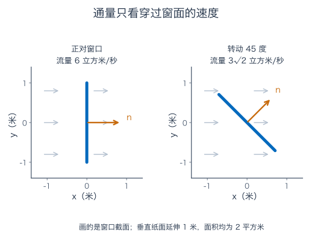

曲面上每小块法向都可能不同，因此向量场的曲面通量定义为

$$
\iint_SF\cdot n\,dS,
$$

其中 $n$ 是选定方向的单位法向，$dS$ 是真实曲面面积。反转法向，通量变号。封闭容器通常取向外法向，正号表示流出。

怎样在弯曲曲面上算 $dS$？若位置由 $r(u,v)$ 参数化，小格的两条切边约为 $r_u\Delta u$、$r_v\Delta v$。叉积 $r_u\times r_v$ 垂直两边，长度等于它们张成的平行四边形面积，方向按右手规则。于是

$$
dS=\|r_u\times r_v\|\,du\,dv,\qquad
n\,dS=(r_u\times r_v)\,du\,dv.
$$

第二式采用叉积所给方向，换参数顺序会反向。它是第八章局部面积换算在空间曲面上的版本。

例如斜屋顶 $r(u,v)=(u,v,u+v)$，$0\le u,v\le1$，取向上法向。两切向叉积为 $(-1,-1,1)$，实际面积为 $\sqrt3$ 平方米。竖直速度 $(0,0,2)$ 穿过它的通量为

$$
\int_0^1\int_0^1(0,0,2)\cdot(-1,-1,1)\,du\,dv=2
\quad\text{立方米/秒}.
$$

这也等于法向速度 $2/\sqrt3$ 乘真实面积 $\sqrt3$。屋顶比水平投影大，但竖直流穿过的投影范围只有一平方米，结果与此一致。

## 12．Gauss 定理：把封闭外壳的流量，换成内部散度

在盒子里分许多小盒，相邻两盒的公共面，对一盒是流出，对另一盒是流入。同一股流的两个符号相反，内部面的通量便相消。留下整个外壳的通量，同时把内部每小块的净流出率累计起来。

因此 **Gauss 散度定理**写成

$$
\iint_{\partial\Omega}F\cdot n\,dS
=\iiint_\Omega\nabla\cdot F\,dV.
$$

常用条件是：$\Omega$ 为边界分段光滑的有界立体区域，$F$ 在包含闭区域的开邻域上为 $C^1$，$n$ 为向外单位法向。注意是整个闭区域，不能把内部奇点藏在“反正只积边界”的说法后面。

取 $F=(x,y,z)$，散度为 $1+1+1=3$。单位球的向外通量便为 $3\times(4\pi/3)=4\pi$。可以在球面直接核对：外法向为 $n=(x,y,z)$，因为球面上向量长度为 1；$F\cdot n=x^2+y^2+z^2=1$，乘球面面积 $4\pi$，结果仍为 $4\pi$。

再用立方体 $[-1,1]^3$ 检查符号。六个面上，$F\cdot n$ 都为 1，包括负坐标一侧，因为那里法向也反向。每面面积为 4，总通量为 24；内部散度积分为 $3\times8=24$。

这条定理的用途不只是省掉曲面积分。它把“穿过外壳的净流量”与“内部局部收支”联系起来，是连续性方程和弱形式积分计算的重要来源。

## 13．Stokes 定理：空间里的一圈，连到跨面的旋度

Green 在平面里把许多小圈加成大圈；空间曲面也能这样做。先给曲面选择连续的法向，各小片按对应方向绕边，相邻边仍两两相消，只剩整个曲面的边界。

于是 **Stokes 定理**为

$$
\oint_{\partial S}F\cdot dr
=\iint_S(\nabla\times F)\cdot n\,dS.
$$

常用条件是：$S$ 为紧致（这里可理解为闭且有界）、可一致定向、分片光滑的曲面，边界分段光滑，$F$ 在曲面附近的开邻域上为 $C^1$。曲面可定向，意思是能连续选择法向而不会走一圈后被迫翻面。

边界方向按右手规则配合：拇指指法向，其余手指弯曲方向就是正向绕边。例如平盘法向向上，从上方看边界应逆时针。翻转法向时，边界方向也要一起翻转。

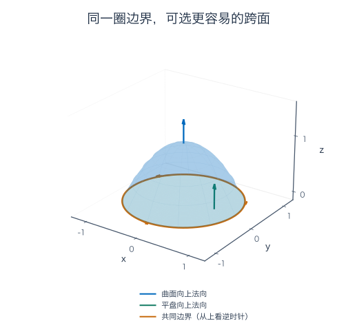

仍取 $F=(-y,x,0)$。单位圆平盘向上，旋度为 $(0,0,2)$，因此右边为 $2\pi$；左边早已沿圆算得 $2\pi$。

若换成鼓起的曲面 $z=1-x^2-y^2$，下方范围为单位圆盘，边界还是同一圈。用 $(x,y)$ 参数化，向上有向面积向量为 $(2x,2y,1)dxdy$。旋度与它点积仍为 2，所以曲面积分仍是 $2\pi$。

曲面面积变大，并不会让结果自动变大，因为要累计的是旋度的法向分量。若边界固定、场在所选曲面附近都满足条件，便能挑更容易算的跨面；本例选平盘最省事。

## 14．旋度为零，还需要担心哪一个洞？

在去掉原点的平面上，定义

$$
H(x,y)=\left(-\frac{y}{x^2+y^2},\frac{x}{x^2+y^2}\right).
$$

对所有非原点，直接求导得到 $Q_x=P_y=(y^2-x^2)/(x^2+y^2)^2$，所以平面旋度为零。但沿单位圆，$H(\gamma(t))=\gamma'(t)$，积分仍为 $2\pi$，不可能是一个全局单值势函数的梯度。

局部看，它像朝向角的梯度。绕旗杆走一圈，累计朝向角增加 $2\pi$，人却回到同一位置；一个全局单值函数在同一位置不能既等于原值，又多出 $2\pi$。

为什么不能用 Green 说圆盘里的旋度都是零？因为场在圆盘原点根本没有定义，不满足区域内部的光滑条件。若挖掉半径 $\varepsilon$ 的小圆，得到环形区域，Green 便合法：外边界逆时针积分 $2\pi$，内边界顺时针积分 $-2\pi$，相加恰好为零。

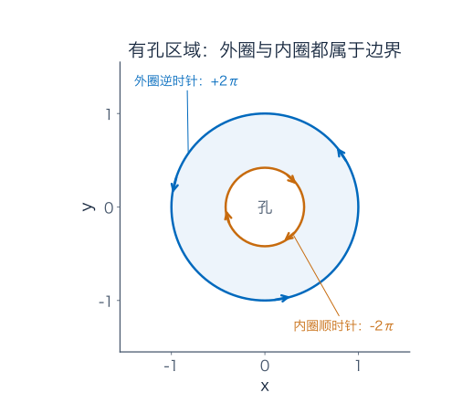

即使小洞缩得很小，内圈贡献也没有消失：场的大小为 $1/\varepsilon$，周长为 $2\pi\varepsilon$，相乘仍为 $2\pi$。

在单连通的平面开区域里，$C^1$ 场的旋度为零可以推出势函数存在。“单连通”可理解为每条闭路都能在区域内连续缩成一点，不会被洞卡住。这是一条好用的充分条件；有洞并不自动使每个场都非保守，但会让“只查旋度为零”的全局判断失去保证。

三维也有类似陷阱。令 $r=\sqrt{x^2+y^2+z^2}$，场 $F=(x,y,z)/r^3$ 在非原点散度为 $3/r^3-3(x^2+y^2+z^2)/r^5=0$，单位球向外通量却为 $4\pi$。它在原点有奇点，不能在包含原点的整球上套 Gauss。挖去小球后，外壳的 $4\pi$ 与内壳的 $-4\pi$ 正好抵消；内壳面积缩小，场却按 $1/r^2$ 增大，贡献同样不消失。

## 15．这些定理怎样通向分部积分与弱导数？

把三种已经计算过的关系放在一起，先辨认哪一种边界累计对应哪一种内部变化：

| 定理 | 边界累计 | 内部累计 |
| --- | --- | --- |
| Green | 平面边界的切向环流 | 平面旋度的面积积分 |
| Gauss | 封闭曲面的向外通量 | 散度的体积积分 |
| Stokes | 空间曲线的切向环流 | 旋度穿过跨面的通量 |

“沿边走”与“穿过面”是不同操作，内部出现的导数也不同。共同结构是内部边界相消，把局部变化和外边界联系起来。

例如对光滑标量 $u$ 与向量场 $\psi$，乘积法则为 $\nabla\cdot(u\psi)=\nabla u\cdot\psi+u\nabla\cdot\psi$。用 Gauss 并移项，得到

$$
\int_\Omega\nabla u\cdot\psi\,dV
=\int_{\partial\Omega}u\psi\cdot n\,dS
-\int_\Omega u\nabla\cdot\psi\,dV.
$$

这就是多维分部积分：把导数从一个因子转到另一个因子，并保留边界项。若 $\psi$ 在边界附近为零，边界项便消失。

它为什么值得带到泛函分析？因为某些函数有拐角，点上的普通导数不存在，积分关系却仍然成立。先看 $u(x)=|x|$，$-1\le x\le1$。取端点为零的光滑权重 $\phi$，把积分在零点拆开：

$$
\begin{aligned}
\int_{-1}^1|x|\phi'(x)dx
&=\int_{-1}^0(-x)\phi'(x)dx+\int_0^1x\phi'(x)dx\\
&=\int_{-1}^0\phi(x)dx-\int_0^1\phi(x)dx\\
&=-\int_{-1}^1\operatorname{sgn}(x)\phi(x)dx.
\end{aligned}
$$

分部积分时，端点项因 $\phi(\pm1)=0$ 消失，零点项因 $u(0)=0$ 消失。比如取 $\phi=(1-x^2)(1+x/2)$，左右两种计算都得到 $-1/4$，可以自行展开核对。

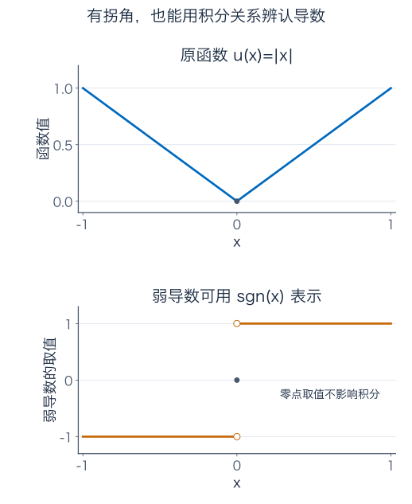

上面的恒等式特别适用于所有支撑在开区间内部的光滑测试函数。用这类积分关系来辨认导数，便称弱导数；$|x|$ 的弱导数可用符号函数表示。它在零点的取值不影响积分，不需要强迫普通导数在拐角处存在。

这里函数与弱导数的平方积分分别为 $2/3$、2，都有限。后面 Sobolev 空间会同时控制这两类量，接纳这种有拐角、但整体变化仍能稳定描述的函数。第七章的局部预测、第八章的累计与这一章的分部积分，开始连成同一条学习路线。

## 16．练习：六道题，把约束、路径与边界分清

先做题，后面再核对逐题答案。每题都要说明使用的条件和方向。

**题一：沿直线最省代价。** 在 $x+y=1$ 上最小化 $f=x^2+y^2$。用乘子法找候选，再用直接计算证明它是全局最小，而不是只停在乘子方程。

**题二：上半圈上的三种累计。** 沿单位圆上半圈从 $(1,0)$ 到 $(-1,0)$，坐标按米计。求路程、线密度为 3 千克/米的细绳质量，以及恒力 $F=(2,-1)$ 牛顿的做功。倒着走时分别怎样变化？

**题三：找到势函数。** 对 $F(x,y)=(2xy,x^2+2y)$，构造势函数，并求从 $(0,0)$ 到 $(1,2)$ 的路径积分。只检查旋度是否为零，能否替代这里对势函数的实际验证？

**题四：椭圆上的环流。** 对 $F=(-y,x)$，沿椭圆 $x^2/4+y^2=1$ 逆时针走一圈，求线积分。分别用 Green 与参数化核对，再说明顺时针的结果。

**题五：球的半径变大。** 对 $F=(x,y,z)$，求半径为 2 的球面向外通量。用 Gauss 算一次，再用球面上的单位法向直接核对。

**题六：鼓起的跨面。** 令 $S$ 为 $z=1-x^2-y^2$、$x^2+y^2\le1$ 的曲面，取向上法向。对 $F=(-y/2,x/2,0)$，求 $\oint_{\partial S}F\cdot dr$。可否把跨面换成平盘？用曲面参数化的有向面积再核对一次；若改取向下法向并相应改变边界方向，答案怎样变？

### 参考答案与解题过程

#### 题一解答

约束梯度为 $(1,1)\ne0$，乘子方程 $(2x,2y)=\lambda(1,1)$ 给出 $x=y$，联立得到 $x=y=1/2$，候选值为 $1/2$。

为证明全局最小，把 $y=1-x$ 代入：$x^2+(1-x)^2=2(x-1/2)^2+1/2\ge1/2$，等号只在 $x=1/2$ 取得。因此候选确为唯一全局最小点。这里可行直线不有界，但直接不等式仍能证明最小值存在并达到。

#### 题二解答

参数仍是 $\gamma(t)=(\cos t,\sin t)$，$0\le t\le\pi$，导数长度为 1。因此路程为 $\pi$ 米，质量为 $3\pi$ 千克。

做功为

$$
\int_0^\pi(2,-1)\cdot(-\sin t,\cos t)dt
=\int_0^\pi(-2\sin t-\cos t)dt=-4\quad\text{焦耳}.
$$

也可用势函数 $\varphi=2x-y$，终点值 $-2$ 减起点值 2，得到 $-4$。反向后路程与质量不变，功变为 $+4$。细绳质量不是有向累计，做功是。

#### 题三解答

先令 $\varphi_x=2xy$，沿 $x$ 积分得到 $\varphi=x^2y+C(y)$。再要求 $\varphi_y=x^2+C'(y)=x^2+2y$，得到 $C(y)=y^2+\text{常数}$。因此可取 $\varphi=x^2y+y^2$。

逐分量求导确实得到原场，所以路径积分为 $\varphi(1,2)-\varphi(0,0)=2+4=6$。场在整个平面光滑，任意端点间的分段光滑路径都适用。

本例也满足 $Q_x-P_y=2x-2x=0$，且定义域为单连通的整个平面，因此相应存在性定理可确认势函数存在；要用端点值计算，还需要确定势差。这里实际构造并验证势函数已经给出了直接证据；不能把“只查旋度”当成在任意有孔区域都够用的方法。

#### 题四解答

场在整个平面为 $C^1$，椭圆边界光滑且方向为逆时针。旋度标量为 2，椭圆面积为 $\pi\times2\times1=2\pi$，所以 Green 给出积分 $4\pi$。

直接取 $\gamma(t)=(2\cos t,\sin t)$，$0\le t\le2\pi$。则 $F(\gamma)=(-\sin t,2\cos t)$，$\gamma'=(-2\sin t,\cos t)$，点积为 $2\sin^2t+2\cos^2t=2$，积分也为 $4\pi$。顺时针把方向反转，答案为 $-4\pi$。

#### 题五解答

散度为 3，半径 2 的球体积为 $(4\pi/3)2^3=32\pi/3$，所以通量为 $32\pi$。

直接检查时，球面的外单位法向为 $n=(x,y,z)/2$，而不是未归一化的 $(x,y,z)$。于是 $F\cdot n=(x^2+y^2+z^2)/2=2$。球面面积为 $4\pi\times2^2=16\pi$，相乘仍为 $32\pi$。半径改变后，场强和面积都变了，只把单位球答案乘面积比例会漏掉场强变化。

#### 题六解答

旋度为 $(0,0,1)$。曲面与平盘都取向上法向，边界都是从上方看逆时针的单位圆；场在整个三维空间光滑，因此两张跨面都满足 Stokes 条件。选平盘最直接，旋度通量等于单位圆面积 $\pi$。

若坚持在曲面上算，取 $r(u,v)=(u,v,1-u^2-v^2)$，参数区域为单位圆盘。两条切向为 $(1,0,-2u)$、$(0,1,-2v)$，叉积为 $(2u,2v,1)$，与旋度点积为 1，所以曲面积分仍为 $\iint_B1\,dudv=\pi$。

沿边界直接核对，$F(\gamma)=(-\sin t/2,\cos t/2,0)$ 与 $\gamma'=(-\sin t,\cos t,0)$ 点积为 $1/2$，一圈积分为 $\pi$。若取向下法向，边界也改为顺时针，两边同时变号，答案为 $-\pi$。

## 17．遇到新问题，先判断要累计什么

约束优化先找允许移动的方向，别把不可行的最快方向当成可用选择；积分问题先分清沿路的长度、切向做功，还是穿过曲面的法向通量。接着确认场在哪些位置光滑、区域有没有孔、边界方向怎样选，再挑更容易算的一边。

这些检查各有具体后果：漏掉导数因子会改掉路径累计，法向不归一会改掉通量，漏掉内边界会改掉整圈答案，忽略奇点会让原本不适用的定理给出假结论。把例子里的数再算一遍，比孤立背下三个定理的名字更有帮助。

## 伴读与进一步核对

- [3Blue1Brown：Divergence and curl](https://www.3blue1brown.com/lessons/divergence-and-curl/)：可作为散度、旋度与流场的动画伴读，配合本章向外场、绕转场及小盒收支理解不同局部量。
- [MIT 18.02SC：Lagrange Multipliers](https://ocw.mit.edu/courses/18-02sc-multivariable-calculus-fall-2010/pages/2.-partial-derivatives/part-c-lagrange-multipliers-and-constrained-differentials/)：含乘子条件、证明与约束微分的分节材料。
- [MIT 18.02SC：Flux and the Divergence Theorem](https://ocw.mit.edu/courses/18-02sc-multivariable-calculus-fall-2010/pages/4.-triple-integrals-and-surface-integrals-in-3-space/part-b-flux-and-the-divergence-theorem/)：进一步学习空间通量与 Gauss 定理。
- [MIT 18.02SC：Line Integrals and Stokes’ Theorem](https://ocw.mit.edu/courses/18-02sc-multivariable-calculus-fall-2010/pages/4.-triple-integrals-and-surface-integrals-in-3-space/part-c-line-integrals-and-stokes-theorem/)：含空间曲线积分、势函数、Stokes、单连通区域与曲面选择。本章的围栏、搬运、通量计算、图示与练习独立编写。
- [MIT 18.02SC：Green’s Theorem](https://ocw.mit.edu/courses/18-02sc-multivariable-calculus-fall-2010/pages/3.-double-integrals-and-line-integrals-in-the-plane/part-c-greens-theorem/)：可进一步核对平面边界积分与区域内部的旋度、散度之间的关系。

---

[数学总导航](../00-%E6%95%B0%E5%AD%A6%E5%AD%A6%E4%B9%A0%E5%AF%BC%E8%88%AA.md) · [本课程目录](00-%E5%AD%A6%E4%B9%A0%E8%B7%AF%E7%BA%BF%E4%B8%8E%E7%AC%A6%E5%8F%B7.md) · [← 上一章](08-%E5%A4%9A%E9%87%8D%E7%A7%AF%E5%88%86%E3%80%81%E6%8D%A2%E5%85%83%E4%B8%8E%E7%A7%AF%E5%88%86%E6%AC%A1%E5%BA%8F.md) · [下一章 →](10-%E5%BE%AE%E5%88%86%E6%96%B9%E7%A8%8B%E3%80%81%E6%95%B0%E5%80%BC%E6%96%B9%E6%B3%95%E4%B8%8E%E5%A4%8D%E4%B9%A0.md)
