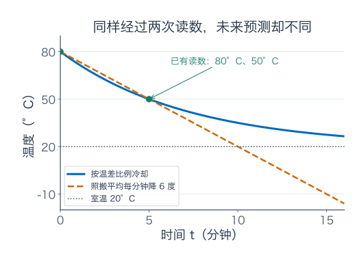
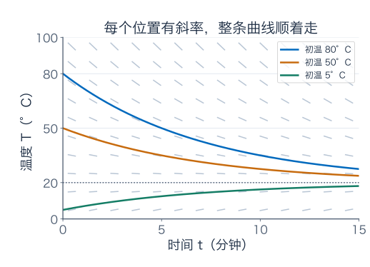
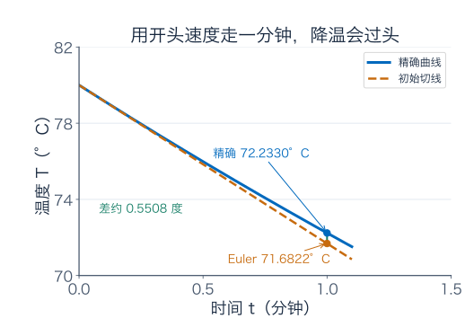
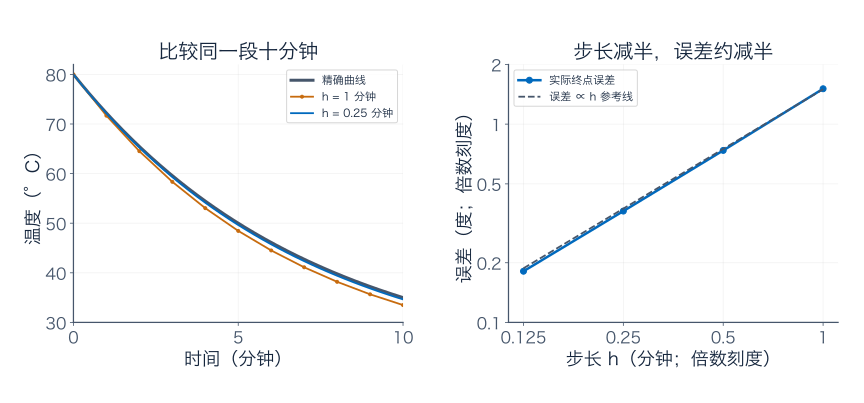
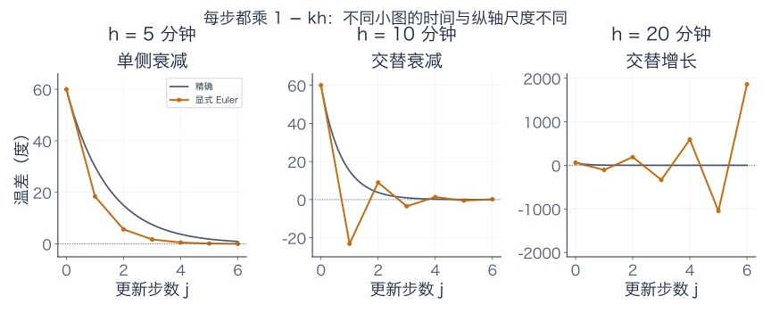
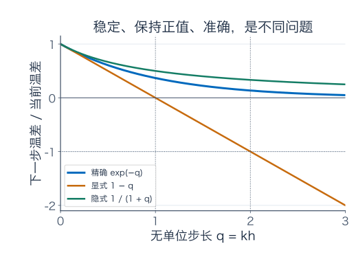
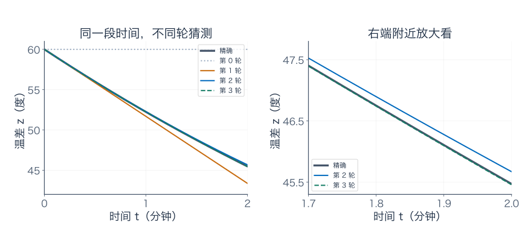
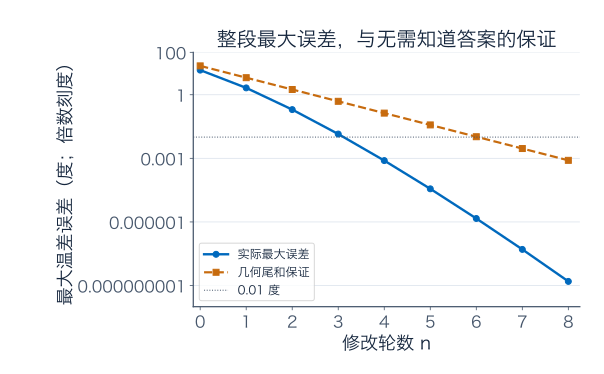
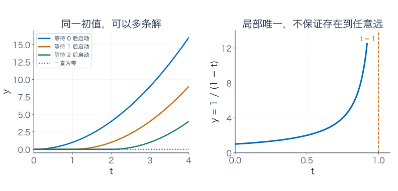
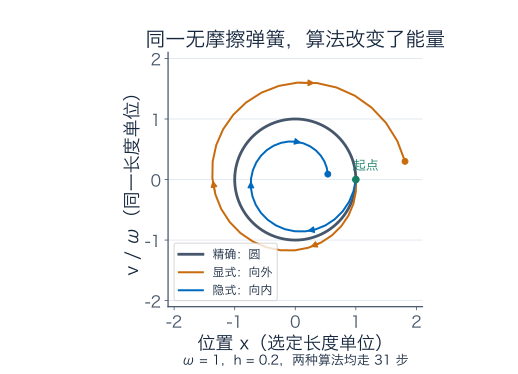

[数学总导航](../00-%E6%95%B0%E5%AD%A6%E5%AD%A6%E4%B9%A0%E5%AF%BC%E8%88%AA.md) · [本课程目录](00-%E5%AD%A6%E4%B9%A0%E8%B7%AF%E7%BA%BF%E4%B8%8E%E7%AC%A6%E5%8F%B7.md) · [← 上一章](09-%E7%BA%A6%E6%9D%9F%E4%BC%98%E5%8C%96%E4%B8%8E%E5%90%91%E9%87%8F%E5%88%86%E6%9E%90.md)

桌上一杯热茶，刚开始是 80°C。室温保持 20°C。五分钟后，你读到 50°C。

“前五分钟降了 30 度，平均每分钟降 6 度。那么再过五分钟，就是 20 度？”

这个推算很自然，但照这样推到第十五分钟，茶就会变成 −10°C。没有冰箱，没有外部制冷，只是放在房间里，这个答案显然不合理。问题不在减法，而在我们把**过去五分钟的平均速度，当成了未来每一刻的速度**。

这一篇就围着这杯茶做四件事：建立一个能解释“越接近室温，降温越慢”的规则；从测量反推参数；用计算器一步步预测；检查预测中的误差。最后，我们会把“一步步改数字”换成“一轮轮改整条曲线”，接到后面的函数空间。

本篇的温度数据是为学习设计的情景，并非真实实验报告。我们会明确哪些结论来自数据，哪些来自选定的模型。先读第 1—8 节，做后面的练习；数值误差证明、水箱、存在唯一性和弹簧放在补充部分，可以分次阅读。

## 1．先决定：降温速度应该看什么？

### 1.1 同一杯茶，不应该永远每分钟下降 6 度

茶是 80°C 时，比房间热 60 度；到了 50°C，只比房间热 30 度。第二种情况下，向外传热的驱动力已经减弱。一个简单模型是：**瞬时降温速度的大小，与当前温差成正比。**

设 $T(t)$ 是第 $t$ 分钟的温度。把室温 20 减掉，定义

$$
z(t)=T(t)-20.
$$

$z$ 是“比室温高几度”，初始值为 60。正比规则写成

$$
\boxed{z'(t)=-kz(t),\qquad z(0)=60,\qquad k>0.}
$$

这个式子的输入是当前温差，输出是当前温差的变化率。$z$ 的单位是摄氏温差，$z'$ 的单位是度/分钟，因此 $k$ 的单位是每分钟。负号使正温差下降；若饮料起初比室温低，$z<0$，右边就为正，它会升温。

这是一条**微分方程**：未知的是整条函数，而方程约束它的变化率。初值 $z(0)=60$ 指定从哪里开始；规则和初值合起来叫初值问题。

### 1.2 这条规则不是两次测温自动证明的

蒸发、搅拌、杯壁、风速都可能影响冷却。这里先假设室温不变、整杯温度可以用一个数代表，并用固定的 $k$ 概括热交换效果。

只测起点和第五分钟，可以在选定模型内确定 $k$，却不能证明模型永远正确。下一步应再测第十分钟、第十五分钟，检查预测。如果实际偏差持续出现，就要检查假设和数据，而不是把更多小数位当作更好的物理解释。

图中的两条线都经过已有读数。它们对未来给出不同答案，这正是需要更多观测的地方。

## 2．怎样从“当前变化率”找回整段温度？

### 2.1 先猜，再验证：指数为什么会出现？

我们需要一个函数，求导后仍是它本身乘固定数。第二篇里学过，$e^{at}$ 的导数就是 $ae^{at}$。因此可以尝试

$$
z(t)=Ce^{-kt}.
$$

代回去：$z'=-kCe^{-kt}=-kz$，变化规则满足了。再代初值 $z(0)=C=60$，得到

$$
\boxed{T(t)=20+60e^{-kt}.}
$$

指数中的 $kt$ 没有单位，所以指数运算有意义。先检查方程、再检查初值，是判断一个候选函数是否真为解的两项独立工作。

如果不想靠猜，在 $z>0$ 的区间内可用链式法则：

$$
\frac{d}{dt}\log\frac{z(t)}{60}=\frac{z'}z=-k.
$$

从 0 积到 $t$，得到 $\log(z(t)/60)=-kt$，所以同样有 $z=60e^{-kt}$。对数里用温差比值，避免对一个带单位的量直接取对数。由于除过 $z$，推导没有包括 $z\equiv0$；若起初恰好是室温，它确实是另一个初值下的平衡解，须单独保留。一般正负初始温差都可写为 $z=z(0)e^{-kt}$。

我们已经构造了这杯茶的解；关于为什么同一初值不会再冒出另一条不同的解，第 7 节会给出理由。

### 2.2 把第五分钟的测量放进去，反求 $k$

第五分钟温差为 $50-20=30$，是初始 60 的一半。因此

$$
30=60e^{-5k},\qquad e^{-5k}=\frac12,
\qquad k=\frac{\log2}{5}\approx0.138629\text{ 每分钟}.
$$

注意不能写成 $k=30/5=6$：6 是这五分钟平均下降的度数，而 $k$ 是“单位温差对应的相对下降率”，它们连单位都不同。

现在这个模型完整确定了：

$$
\boxed{T(t)=20+60\,2^{-t/5}.}
$$

每过五分钟，**温差**减半，而非摄氏温度减半。

| 时刻（分钟） | 温差 $z$（度） | 温度 $T$（°C） |
| --- | --- | --- |
| 0 | 60 | 80 |
| 5 | 30 | 50 |
| 10 | 15 | 35 |
| 15 | 7.5 | 27.5 |
| 20 | 3.75 | 23.75 |

指数始终为正，所以在这个模型里，任何有限时间都还高于室温。我们并没有用更多测量证明表格，只是列出了模型接下来会接受检验的预测。

初始瞬时降温速度是 $-60k\approx-8.3178$ 度/分钟，第五分钟是 $-30k\approx-4.1589$ 度/分钟。中间五分钟的平均速度为 $-6$，夹在它们之间；这比“永远每分钟降 6 度”更符合开始快、后来慢的图景。

## 3．盖住精确公式，只凭当前斜率能算到下一分钟吗？

### 3.1 先把变化规则画成小路标

在横轴是时间、纵轴是温度的纸上，每个点 $(t,T)$ 都能算出斜率 $-k(T-20)$。80°C 时陡一些，50°C 时缓一些，20°C 时为零，低于 20°C 时向上。

在每个位置画一小段对应斜率的线，就得到**斜率场**。一条解曲线经过某个点时，必须顺着当地的小线段。虽然变化规则在这里不显含时间，同一温度在各时刻有相同斜率，图的横轴仍然是时间。

### 3.2 用当前速度走一分钟，再重新估计

从 80°C 开始，当前斜率是 $-8.317766\ldots$ 度/分钟。如果接下来一分钟都不更新这个速度，就得到

$$
T_1=80-8.317766\ldots\approx71.6822\text{°C}.
$$

到了这个预测点，再算新的斜率，走下一分钟。这样得到下表；实际计算保留更多位，显示时才四舍五入，避免每行舍入误差反复累积。

| 时刻（分钟） | 当前预测（°C） | 当前斜率（度/分钟） | 下一分钟预测（°C） |
| --- | --- | --- | --- |
| 0 | 80.0000 | −8.3178 | 71.6822 |
| 1 | 71.6822 | −7.1647 | 64.5176 |
| 2 | 64.5176 | −6.1714 | 58.3461 |

这种方法叫**显式 Euler（欧拉）法**。对一般方程 $y'=F(t,y)$，时间步长为 $h>0$，当前网格点为 $t_j=jh$，算法写成

$$
\boxed{y_{j+1}=y_j+hF(t_j,y_j).}
$$

$y_j$ 是我们算出的近似值；$y(t_j)$ 才是真实解在那个时刻的值。不能因为下标都写着 $j$，就把二者当成一样。

它的依据是局部线性近似：下一点约等于当前点加“当前斜率乘一小段时间”。也可以从积分理解：

$$
y(t_j+h)=y(t_j)+\int_{t_j}^{t_j+h}F(s,y(s))\,ds.
$$

Euler 把这个积分换成左端点长方形 $hF(t_j,y_j)$。导数的切线和积分的长方形，变成了同一个近似的两种看法。

### 3.3 第一步算偏多少？偏在哪一边？

第一分钟的精确值是

$$
T(1)=20+60\,2^{-1/5}\approx72.2330\text{°C}.
$$

Euler 预测为 71.6822°C，低了约 0.5508 度。这一分钟里真实降温速度在减慢，而算法一直用了开头那个较大的速度，因此降得过头了。

这也能从 $T''=60k^2e^{-kt}>0$ 看出：真实曲线向上弯，初始切线位于下方。**误差不是计算器没把减法做好，而是算法有意把一段曲线替成了一段直线。**

## 4．同样算到十分钟，改用半分钟会好多少？

在温差变量里，更新特别清楚：

$$
z_{j+1}=z_j-khz_j=(1-kh)z_j.
$$

因此走 $N$ 步后，

$$
T_N=20+60(1-kh)^N,\qquad Nh=10.
$$

这里改变步长时，比较的是**同一个终点时间**，步数相应改变。精确答案是 35°C。

| 步长 $h$（分钟） | 步数 $N$ | 十分钟预测（°C） | 绝对误差（度） |
| --- | --- | --- | --- |
| 1 | 10 | 33.4912 | 1.5088 |
| 0.5 | 20 | 34.2629 | 0.7371 |
| 0.25 | 40 | 34.6356 | 0.3644 |
| 0.125 | 80 | 34.8188 | 0.1812 |

步长减半，误差也大致减半，代价是更新次数翻倍。这是 Euler 在这个问题上的**一阶全局精度**：在固定有限时间内，步长足够小时，误差能被某个常数乘 $h$ 控制。

这里有三件容易混淆的事。

第一，每一小步新引入的误差约为 $h^2$，并不意味着十分钟终点误差也是 $h^2$。步数约为 $10/h$，而旧误差还会影响后续斜率。补充 A 会把这两笔账一起估计。

第二，误差减半是小步长下的趋势，不是任意方程、任意步长的无条件承诺。变化规则的敏感程度、精确解的弯曲程度、总时间都会影响误差。

第三，当前的误差是与**同一个模型的精确解**比较。即使数值误差降到十万分之一度，也不能说明对真实茶水的预测已经准确到那个程度。

## 5．算法居然把热茶算到了室温以下

### 5.1 一个乘数，就能看出长期会发生什么

每一步的温差都乘 $1-kh$。取几个故意偏大的步长：

- $h=5$ 分钟：乘数约为 $0.3069$。温差保持非负，逐步缩小，但第一步已经从 60 降到约 18.4112，真实值应为 30，明显算冷了。
- $h=10$ 分钟：乘数约为 $-0.3863$。第一步温差变负，之后在室温两侧交替；幅度会衰减，但形状不符合这杯热茶的精确解。
- $h=20$ 分钟：乘数约为 $-1.7726$。每步翻到另一侧，还越偏越远，最后数值发散。

图的横轴是步数，同一步在三个小图里对应不同的实际时刻；纵轴范围也分别标明。虚线零点代表室温对应的零温差。

不能说第三种情况证明冷却模型会发疯：精确解好好的，出问题的是粗步长算法。

对任意冷却系数 $k>0$，显式 Euler 的两个范围可以直接解出来：

$$
\begin{aligned}
\text{温差幅度趋零：}&\quad |1-kh|<1
\quad\Longleftrightarrow\quad0<h<2/k,\\
\text{还要保持非负、单调下降：}&\quad0\le1-kh<1
\quad\Longleftrightarrow\quad0<h\le1/k.
\end{aligned}
$$

本例两个上端点约为 14.427 和 7.2135 分钟。$h=1/k$ 会一步跳到室温；$h=2/k$ 会永远以相同幅度交替，均不能当作准确的冷却过程。

“温差幅度趋零”在这里对应对负实数测试方程的衰减稳定性。它与精度不同；保持温差非负又是额外的形状要求。

### 5.2 改用下一点的斜率，代价是什么？

另一种办法是要求下一步满足

$$
z_{j+1}=z_j-kh z_{j+1}.
$$

这次右边也含未知的下一点，所以必须解一个方程。整理得到

$$
\boxed{z_{j+1}=\frac{z_j}{1+kh}.}
$$

这叫**隐式 Euler 法**。任意 $h>0$ 时，乘数都在 0 与 1 之间，这个冷却例子不会出现交替爆炸；一般非线性问题则需要额外求解代数方程，不能都这么轻松整理。

但大步长仍会失真。直接走十分钟，隐式预测是

$$
20+\frac{60}{1+2\log2}\approx45.1436\text{°C},
$$

精确值却为 35°C。稳定地算错十多度，也不是我们想要的结果。

图用无单位数 $q=kh$ 作横轴：三种比例分别是 $e^{-q}$、$1-q$、$1/(1+q)$。$q$ 很小时三者接近，$q$ 大时差别明显。算法好不好，要连同方程、步长和希望保留的性质一起判断。

## 6．把步长缩小，能修好测温读错吗？

假设 $k$ 已通过独立实验固定为 $\log2/5$，初温仍为 80°C，却把实际 20°C 的室温错填成 21°C。那么你解的是另一个方程，得到

$$
\widetilde T(t)=21+59e^{-kt}.
$$

与正确模型相减：

$$
\widetilde T(t)-T(t)=1-e^{-kt}.
$$

第十分钟 $e^{-10k}=1/4$，差了 0.75 度。Euler 步长再小，也只会越来越准确地解这个室温填错的模型。

这次明确固定了 $k$；如果 $k$ 原本也是从测温数据拟合出来的，修改室温后还要重新拟合，不能直接沿用这笔误差。练习八会让你亲自算一次测量值变化怎样影响参数和未来预测。

再比较两杯只差初温的茶。若初始温差相差 $d$，同一冷却规则下，它们随时间的差为 $de^{-kt}$，会缩小。若规则换成增长 $y'=ky$，初始差则为 $de^{kt}$，会放大。**解唯一，不代表长期一定不敏感。** 在固定有限时间内可控制误差，与时间越长误差越小，也不是一回事。

## 7．不往前走小步，改成每次修一整条曲线

### 7.1 先猜“温差一直是 60”，再用规则纠正

回到原来的冷却方程。基本定理把它改写成

$$
z(t)=60-k\int_0^t z(s)\,ds.
$$

左边是到时刻 $t$ 的温差；右边是初始温差，减去此前所有降温速度大小的累计。两边仍然含同一条未知函数，因此这还不是现成答案。

我们先猜一整条曲线 $z_0(t)=60$，暂时当作不冷却。把这条猜测放到右边，输出

$$
z_1(t)=60-k\int_0^t60\,ds=60-60kt.
$$

这条曲线已经会降温了，但一直沿用开头速度。再把它代入右边：

$$
\begin{aligned}
z_2(t)&=60-k\int_0^t(60-60ks)\,ds\\
&=60-60kt+30k^2t^2.
\end{aligned}
$$

第三轮又多修正一项：

$$
z_3(t)=60-60kt+30k^2t^2-10k^3t^3.
$$

这叫 **Picard（皮卡）迭代**。一般第 $n$ 轮为

$$
z_n(t)=60\sum_{m=0}^n\frac{(-kt)^m}{m!}.
$$

你可能认出了指数函数的部分和。但更有价值的是：这个“先猜曲线，再积分修改”的过程，不依赖我们预先认出指数；它也能帮助研究没有显式解的方程。

**Euler 的下标 $j$ 记时间走了几步；Picard 的下标 $n$ 记整条曲线改了几轮。** $z_1,z_2,z_3$ 都定义在同一整段时间上，不能把它们画成依次发生的三个时间点。

### 7.2 怎样在不知道答案时，保证整段误差都小？

先只研究前两分钟，令 $a=2$。规定候选曲线必须连续，并始终处于温差 0 到 120 之间。这个范围比真实过程宽，是为了容纳不准确的猜测。记为

$$
D=\left\{u\in C[0,2]:\max_{0\le t\le2}|u(t)-60|\le60\right\}.
$$

$C[0,2]$ 是所有定义在这段时间上的连续函数。两条曲线用

$$
\|u-v\|_\infty=\max_{0\le t\le2}|u(t)-v(t)|
$$

衡量距离，也就是同一时刻的**最大竖直差**。它关心整段最差的位置，不只是端点。

把修改规则记作

$$
(Pu)(t)=60-k\int_0^t u(s)\,ds.
$$

$P$ 的输入和输出都是一条函数；这样的对象叫**算子**。我们接下来检查三件实际有用的事。

**第一，修改后仍留在候选范围内。** 若 $u\in D$，则 $|u|\le120$，因此

$$
|(Pu)(t)-60|\le k\int_0^t|u(s)|\,ds
\le240k\approx33.2711<60.
$$

输出仍属于 $D$。这个检查防止下一轮跑到约定范围外，再错误地沿用只在范围内有效的估计。

**第二，不同猜测修改后会靠近。** 对任意 $u,v\in D$，

$$
\begin{aligned}
|(Pu)(t)-(Pv)(t)|
&\le k\int_0^t|u(s)-v(s)|\,ds\\
&\le2k\|u-v\|_\infty.
\end{aligned}
$$

对所有时刻取最大值，得到

$$
\|Pu-Pv\|_\infty\le q\|u-v\|_\infty,
\qquad q=2k\approx0.277259<1.
$$

修改后任意两条曲线的距离，至多是原来的 $q$ 倍，这叫**压缩**。这里 $q$ 没有单位，是两分钟乘以每分钟的系数；时间段短，让变化的累计影响受到控制。

**第三，剩下还可能改多少，有可计算的上界。** 第一轮最大改动为

$$
d=\|z_1-z_0\|_\infty=120k=60q.
$$

第二轮改动不超过 $qd$，第三轮不超过 $q^2d$。从第 $n$ 轮往后，所有改动加起来，不超过等比尾和

$$
\boxed{\|z-z_n\|_\infty\le\frac{q^n}{1-q}d
=\frac{60q^{n+1}}{1-q}.}
$$

这里暂用 $z$ 表示这些曲线的极限。为什么真的有这个极限？任意相隔许多轮的距离，都能被上述越来越小的尾和控制，所以曲线列是最大距离下的 Cauchy 序列。第六篇讲过：这样的连续函数列有一致极限，极限仍连续；每轮又都在闭的范围 $D$ 中，极限不会越界。这种“足够接近的迭代有落脚点”的性质，后面会叫完备性。

再把 $z_{n+1}=Pz_n$ 取极限。刚才的距离估计保证 $P$ 连续，因此 $z=Pz$；对积分求导，便得到原方程和初值。如果另一条候选曲线 $w$ 也是解，那么

$$
\|z-w\|_\infty=\|Pz-Pw\|_\infty\le q\|z-w\|_\infty.
$$

$q<1$ 迫使距离为零，所以在这个集合里解唯一。任何从初值出发的连续解在足够短的初始时间也会留在范围内，同样的估计给出局部唯一性；继续接短区间即可延伸。本例已有对所有 $t\ge0$ 有定义的指数解，前两分钟的限制只是为了把这套证明的各步看清。

这里的上界能在不知道精确指数答案时提供停止标准。实际误差通常比它小，不能把“上界还没达标”解释为“实际误差必定不达标”。我们也没有把“相邻两轮越来越近”直接当成收敛；真正控制住远处所有轮次的是可求和的尾和。

## 8．这杯茶，怎样把前面的微积分接起来？

最初我们只想预测十分钟后的温度，最后却用到了这些已经学过的工具：

| 具体动作 | 用到的微积分 | 在这杯茶里做了什么 |
| --- | --- | --- |
| 从当前状态预测一小步 | 导数与局部线性近似 | Euler 用切线走一步 |
| 把变化率加回整个过程 | 微积分基本定理 | 方程变成积分关系 |
| 检查切线漏掉多少 | 二阶导数与余项 | 区分单步缺陷和累计误差 |
| 把曲线逐轮修正 | 函数列与一致收敛 | 用最大误差控制整段温差 |
| 判断预测是否可信 | 模型、参数、数值误差的区分 | 测错室温不能靠缩步长修复 |

这比记住更多解题招式更接近进入泛函分析所需的准备：把函数作为整体比较，说明误差在哪种意义下变小，并检查极限是否仍在允许的函数集合里。

但并不是每个方程都像茶水冷却这么温和。补充 C 给出“同样初值却有多条解”和“解在有限时间爆大”的例子；补充 D 再用弹簧提醒我们，数值算法还可能破坏本来守恒的能量。

## 9．练习：先做自己的预测，再核对理由

**题一：换一杯、换一只杯子。** 室温 20°C，初温 90°C，第七分钟测得 55°C。仍采用固定系数冷却模型。求系数、精确解、第十四分钟温度，以及降到 30°C 的时刻。用一步显式 Euler、$h=1$ 预测第一分钟，并判断偏高还是偏低。

**题二：不会炸，也可能形状错误。** 对 $y'=-2y$、$y(0)=3$，写出精确解和显式 Euler 递推。分别求“幅度趋零”与“从非负一侧单调到零”的步长范围。列出 $h=0.75$ 与 $h=1.25$ 的前四项。

**题三：不断增加的进水量。** 先读补充 B。取升和分钟作为单位，水箱模型为 $V'+V=2t$、$V(0)=1$。用积分因子求解，核对方程与初值；它会不会在 $t\ge0$ 算出负水量？

**题四：真的在函数集合上迭代。** 对 $y'=1+y$、$y(0)=0$，在 $[0,1/4]$ 允许连续猜测满足 $\|u\|_\infty\le1$。写出积分修改规则，验证它保持这个范围，求压缩比例。以 $u_0=0$ 算前三轮；只用几何尾和，最少几轮能保证最大误差小于 $0.01$？实际第二轮是否已经达标？

**题五：复习相消后的误差和二维最低点。** （1）求 $\lim_{x\to0}(\sin x-x)/x^3$，解释为什么只用 $\sin x\approx x$ 不够。（2）用配方证明 $x^2+xy+y^2$ 在整个平面上的唯一最小点，不必借助特征值。

**题六：每个位置都消失了，面积也一定消失吗？** 在 $[0,1]$ 上研究 $f_n(x)=x^n$ 与 $g_n(x)=n\mathbf1_{(0,1/n)}(x)$。分别求逐点极限、积分的极限，判断是否一致收敛，以及能否交换积分和极限。$\mathbf1_A$ 在 $A$ 中为 1，其他处为 0。

**题七：弹簧能量从哪里多出来了？** 先读补充 D。对 $x'=v,v'=-x$，用显式 Euler 同时更新两项，从 $x_0=1,v_0=0$ 出发。证明每步能量乘 $1+h^2$；取 $h=0.2$，求 $t=1$ 的能量。固定步长长期能量发散，为什么不否定固定有限时间上缩小步长可以收敛？

**题八：读数高了一度，预测就只高一度吗？** 回到正文初温 80°C、室温 20°C 的茶。如果第五分钟读成 51°C，并重新拟合 $k$，求第十分钟预测。再把读数改成 49°C，求对应预测。比较与原预测 35°C 的差，并解释为什么不能用缩小 Euler 步长消掉这两种差。

### 参考答案与解题过程

#### 题一解答

初始温差为 70，第七分钟为 35，故 $e^{-7k}=1/2$，系数为 $k=\log2/7$ 每分钟。解是

$$
T(t)=20+70\,2^{-t/7}.
$$

第十四分钟温差减半两次，剩 $70/4=17.5$，温度为 37.5°C。降到 30°C 时温差为 10，因此 $2^{-t/7}=1/7$，得到 $t=7\log7/\log2\approx19.6515$ 分钟。

初始斜率为 $-70k=-10\log2$，一步 Euler 得 $T_1=90-10\log2\approx83.0685$°C。精确第一分钟为 $20+70\,2^{-1/7}\approx83.4007$°C。曲线向上弯，所以 Euler 偏低；这里的误差约为 0.3321 度。

代回解核对：导数是 $-k\cdot70e^{-kt}=-k(T-20)$，初值为 90，第七分钟为 55。三个条件都吻合；最后一项也核对了所拟合的参数。

#### 题二解答

精确解 $y=3e^{-2t}$。算法为 $y_{j+1}=(1-2h)y_j$，因此 $y_j=3(1-2h)^j$。

幅度趋零要求 $|1-2h|<1$，即 $0<h<1$。还要求非负并单调下降，则要 $0\le1-2h<1$，即 $0<h\le1/2$。如果要求每一步严格为正，就去掉 $h=1/2$；这个端点会一步到零，之后一直为零。

$h=0.75$ 时，前四项是 $3,-1.5,0.75,-0.375$，交替衰减；$h=1.25$ 时是 $3,-4.5,6.75,-10.125$，交替增长。前一种虽有幅度衰减，仍未保留精确解一直为正的性质。

#### 题三解答

乘上 $e^t$，左边合成 $(e^tV)'$，因此

$$
(e^tV)'=2te^t.
$$

右边分部积分得 $2(t-1)e^t+C$，所以 $V=2t-2+Ce^{-t}$。初值给 $-2+C=1$，最终

$$
V(t)=2t-2+3e^{-t}.
$$

求导 $V'=2-3e^{-t}$，加上 $V$ 后为 $2t$；初值为 1。初始导数 $-1$ 表示进水刚开始为零、水箱却已有水，先漏掉一点是合理的。

检查非负：$V'=0$ 在 $t=\log(3/2)$，此前为负、此后为正，所以此处是 $t\ge0$ 上的最小点。代入 $e^{-t}=2/3$，最小水量为 $2\log(3/2)>0$。这个数学模型在所问时间内没有产生负存量。

#### 题四解答

修改规则是 $(Pu)(t)=\int_0^t(1+u(s))\,ds$。因为 $|u|\le1$，所以 $|1+u|\le2$，有 $\|Pu\|_\infty\le(1/4)\times2=1/2\le1$，保持允许范围。

两条输入的输出差满足

$$
\|Pu-Pv\|_\infty\le\frac14\|u-v\|_\infty,
$$

可取 $q=1/4$。逐轮积分得到

$$
u_1=t,\qquad u_2=t+\frac{t^2}{2},\qquad
u_3=t+\frac{t^2}{2}+\frac{t^3}{6}.
$$

第一轮最大改动为 $d=1/4$，因此尾和保证

$$
\|y-u_n\|_\infty\le\frac{q^n d}{1-q}
=\frac13\,4^{-n}.
$$

第二轮上界为 $1/48\approx0.020833$，还不能保证；第三轮为 $1/192\approx0.005208<0.01$，因此按这个保证，最少三轮。

实际情况可用精确解核对：令 $w=1+y$，则 $w'=w,w(0)=1$，所以 $y=e^t-1$。第二轮误差为 $e^t-1-t-t^2/2$，在 $t\ge0$ 随 $t$ 增加，最大值在 $1/4$，约为 0.002775，已经达标。证明上界保守，并不意味着实际误差也那么大。

#### 题五解答

（1）$\sin x=x-x^3/6+O(x^5)$，减掉一次项再除以 $x^3$ 得 $-1/6+O(x^2)$，故极限为 $-1/6$。只说 $\sin x\approx x$ 没交代误差大小；一次项又恰好被相减消掉，决定答案的正是剩下的三次项。

（2）

$$
x^2+xy+y^2=\left(x+\frac y2\right)^2+\frac34y^2\ge0.
$$

等号同时要求 $y=0$ 和 $x+y/2=0$，因此只有原点。这个分解证明的是整个平面上的唯一全局最小值 0，而不只是梯度在原点为零。

#### 题六解答

$f_n$ 在 $0\le x<1$ 趋于零，在 $x=1$ 始终为 1。逐点极限 $f$ 只在右端点为 1，其积分为零；另一方面 $\int_0^1x^n\,dx=1/(n+1)\to0$，所以此例可交换积分与极限。

却不是一致收敛：每个有限 $n$，选一个小于但足够接近 1 的 $x$，$x^n$ 就任意接近 1，故 $\sup_{[0,1]}|f_n-f|=1$。差值在端点突然为零，最大差未必取到，不能用“最大值”代替这里的上确界。

对 $g_n$，任意固定 $x>0$ 最后都落到尖峰区间之外，而 $x=0$ 从来不在开区间内，所以逐点极限处处为零。但每个尖峰高 $n$、宽 $1/n$，积分始终为 1。因此

$$
\lim_n\int_0^1g_n\,dx=1\ne0=\int_0^1\lim_ng_n\,dx.
$$

$\sup|g_n|=n$，也不一致收敛。两个例子分别说明：没有一致收敛时，交换可能成功，也可能失败，需要其他控制；“每个固定位置最终看不到峰”不等于“峰的总量消失”。

#### 题七解答

同时使用旧状态更新：$x_{j+1}=x_j+hv_j,v_{j+1}=v_j-hx_j$。能量为 $E_j=(x_j^2+v_j^2)/2$，展开得

$$
\begin{aligned}
2E_{j+1}
&=(x_j+hv_j)^2+(v_j-hx_j)^2\\
&=x_j^2+2hx_jv_j+h^2v_j^2+v_j^2-2hx_jv_j+h^2x_j^2\\
&=(1+h^2)(x_j^2+v_j^2).
\end{aligned}
$$

交叉项相消，额外留下 $h^2$ 倍。$E_0=1/2$，$h=0.2$ 到 $t=1$ 为五步，所以 $E_5=(1/2)(1.04)^5\approx0.608326$。真实无摩擦过程的能量始终是 0.5，多出来的约 0.108326 来自算法。

固定 $h>0$、令步数 $N\to\infty$，能量确实发散。固定总时间 $A$、令 $h\to0$ 且 $N=A/h$ 为整数，则

$$
\log\frac{E_N}{E_0}=\frac Ah\log(1+h^2)\sim Ah\to0.
$$

所以固定有限时间内能量误差趋零，与固定步长的长期增长不冲突。能量接近本身不证明整条状态轨迹接近；这个光滑线性系统的状态收敛还可用补充 A 的误差估计推广到向量情形证明。

#### 题八解答

若第五分钟读成 51°C，温差就是 31。重新拟合得到 $e^{-5\widetilde k}=31/60$，所以 $\widetilde k=(1/5)\log(60/31)$。十分钟经过两个相同长度的区间，预测为

$$
20+60\left(\frac{31}{60}\right)^2
=20+\frac{961}{60}\approx36.0167\text{°C}.
$$

比原来 35°C 高约 1.0167 度。

若读成 49°C，温差为 29，系数变为 $(1/5)\log(60/29)$，十分钟预测为 $20+841/60\approx34.0167$°C，比原来低约 0.9833 度。数据上下相差一度，未来预测的变化并不完全对称，因为温差比值被平方了。

这两次差别来自输入读数及由此拟合的参数，计算时我们已经使用各自模型的精确解。把 Euler 步长缩小，只会逼近这些不同模型的各自答案，不会把错误读数自动改回来。

## 补充 A：一步误差是 $h^2$，为什么整体只是一阶？

先区分两种误差来源：**即使从正确点出发，用直线走一步也会歪；而从已经算歪的点出发，下一步还会继承旧误差。**

设一般方程为 $y'=F(t,y)$，精确解在固定区间 $[0,A]$ 上有连续二阶导，且 $|y''|\le M$。从真实点做一步 Euler，新漏掉的量是

$$
\delta_j=y(t_j+h)-y(t_j)-hy'(t_j)
=\int_0^h[y'(t_j+s)-y'(t_j)]\,ds.
$$

二阶导数界意味着方括号绝对值不超过 $Ms$，所以 $|\delta_j|\le Mh^2/2$。这里用的是**没有除以步长**的局部缺陷；不同教材可能把除以 $h$ 的版本也叫局部截断误差，读时先看定义。

实际用近似点 $y_j$ 出发。记 $e_j=y(t_j)-y_j$，把精确更新与数值更新相减：

$$
e_{j+1}=e_j+h[F(t_j,y(t_j))-F(t_j,y_j)]+\delta_j.
$$

假设在包含精确轨迹和数值点的区域内，$F$ 对状态满足

$$
|F(t,u)-F(t,v)|\le L|u-v|.
$$

这表示输入状态的误差，不会导致任意大的速度误差；叫对状态的 Lipschitz 控制。于是

$$
|e_{j+1}|\le(1+Lh)|e_j|+\frac{Mh^2}{2}.
$$

若初值准确，$e_0=0$，反复展开就是

$$
|e_j|\le\frac{Mh^2}{2}\sum_{r=0}^{j-1}(1+Lh)^r.
$$

$L>0$ 时求等比和，再用 $1+Lh\le e^{Lh}$：

$$
\boxed{|e_j|\le\frac{Mh}{2L}[(1+Lh)^j-1]
\le\frac{Mh}{2L}(e^{Lt_j}-1).}
$$

$L=0$ 时直接加 $j$ 个局部缺陷，得到 $|e_j|\le Mt_jh/2$。固定 $A$ 后，两种情况都得到常数乘 $h$ 的界。局部二阶缺陷、约 $1/h$ 次累计，加上受控的误差传播，共同给出一阶全局误差。

对热茶 $z'=-kz$，可取 $L=k,M=60k^2$。前十分钟的上界为

$$
|e_N|\le30kh(e^{10k}-1)=90kh\approx12.4766h\text{ 度}.
$$

它比表中实际误差宽松，因为通用估计把误差传播按 $1+kh$ 计，没有利用冷却实际的 $1-kh$ 在小步长下会缩小扰动。保证可以保守，但必须有条件；这里需要固定有限时间、二阶导数界，以及覆盖有关数值点的 Lipschitz 控制。

## 补充 B：水箱为什么也有和冷却相同的结构？

### B.1 固定进水、按存量漏水

一个箱子每分钟进 4 升，漏水速度与当前水量成正比：有 10 升时每分钟漏 2 升，有 20 升时每分钟漏 4 升。令水量为 $V$，模型是

$$
V'=4-0.2V,\qquad V(0)=5.
$$

0.2 的单位是每分钟。这是连续漏水率，不是每分钟末突然倒掉五分之一。

20 升时，输入和输出相抵。先减掉这个平衡值，令 $w=V-20$，就得到 $w'=-0.2w,w(0)=-15$，所以

$$
V(t)=20-15e^{-0.2t}.
$$

水从下方靠近 20 升，茶从上方靠近 20°C；数字巧合地相同，单位和场景不同，数学结构则是“偏离平衡的部分按比例衰减”。

### B.2 输入不断变化时，怎样把左边合成一个导数？

设一般一阶线性方程为 $y'+a(t)y=b(t)$。我们希望乘一个 $\mu(t)$ 后，左边变成乘积导数

$$
(\mu y)'=\mu y'+\mu'y.
$$

与 $\mu y'+\mu a y$ 对比，只要让 $\mu'=a\mu$ 即可。取

$$
\mu(t)=\exp\left(\int_0^t a(s)\,ds\right),
$$

便有 $(\mu y)'=\mu b$，于是

$$
y(t)=\frac{y(0)+\int_0^t\mu(s)b(s)\,ds}{\mu(t)}.
$$

这里假设 $a,b$ 在所讨论区间连续，且 $\mu(0)=1$。这个乘子叫积分因子；它是为了倒用乘积求导而构造的，不需要把它当成突然出现的口诀。练习三给了一个需要分部积分的完整算例。

## 补充 C：有变化规则，为什么还可能不唯一或走不到无限远？

### C.1 “等一会儿再启动”的多条解

考虑 $y'=2\sqrt{|y|},y(0)=0$，只讨论 $t\ge0$。一直不动的 $y=0$ 是解。对任意等待时间 $c\ge0$，

$$
y_c(t)=\begin{cases}0,&0\le t\le c,\\(t-c)^2,&t>c\end{cases}
$$

也是解：等待时两边都是零；启动后导数为 $2(t-c)$，正好等于 $2\sqrt{(t-c)^2}$；接合处左右导数都是零。

同一初值竟允许任意等待时间。变化规则虽然连续，却没给足唯一性。

问题出在零点附近的敏感性：拿状态 $u>0$ 与 0 比，速度差除以状态差为 $2/\sqrt u$，能任意大，没有有限的 Lipschitz 常数控制它。

### C.2 光滑又唯一，也可能有限时间爆大

$y'=y^2,y(0)=1$ 的右边处处光滑。直接求导检查，$y=1/(1-t)$ 是解，却在 $t\uparrow1$ 时发散，不能以有限值继续通过 $t=1$。

常用的局部结论是：$F(t,y)$ 在初始点附近连续，且对 $y$ 局部 Lipschitz（同一小矩形内可用一个常数控制各时刻），则初值附近存在唯一的可微解。连续的 $F_y$ 是便于核对这一条件的充分条件。第 7 节的积分压缩展示了证明机制；一般情形也要先选好矩形、检查输出不越界，再把时间缩短到“时间长度乘 $L<1$”。

这只是局部保证。能否一直延伸、是否有多个解、对初值是否敏感，分别需要判断。茶水模型的良好行为，不能未经检查地推广给所有微分方程。

## 补充 D：弹簧没有摩擦，算法却偷偷改变了能量

### D.1 只知道位置，为什么还不够？

把一个物块连在弹簧上。它同样位于右侧 1 厘米处，可能正向右飞，也可能正向左回；只报位置无法预测下一刻，还要报速度。

忽略摩擦，回复力与位移成正比，Newton 定律给出 $mx''=-k_sx$。令 $\omega^2=k_s/m$，再把速度记作 $v=x'$，方程就变成

$$
x'=v,\qquad v'=-\omega^2x.
$$

一个二阶位置方程，变成了位置与速度这两个状态的一阶方程。选好时间和长度单位，使本例 $\omega$ 的数值为 1，初始位置数值为 1、速度为 0，则 $x=\cos t,v=-\sin t$。一般单位下可用 $(x,v/\omega)$ 画图，使两轴都是长度。

把状态画在位置—速度平面上，就是相图；这里精确状态绕圆走。单位质量能量为

$$
E=\frac12(v^2+\omega^2x^2),\qquad
E'=vv'+\omega^2xx'=0.
$$

没有外力做功、没有摩擦，能量保持不变。

### D.2 两种 Euler 都能一步步算，却都没守住能量

显式更新是

$$
x_{j+1}=x_j+hv_j,\qquad v_{j+1}=v_j-h\omega^2x_j.
$$

两项都必须使用旧状态；先改 $x$ 再用新 $x$ 改 $v$，已经换了算法。平方展开会得到 $E_{j+1}=(1+\omega^2h^2)E_j$，因此能量逐步增加。练习七要求亲自展开交叉项。

隐式更新则同时满足 $x_{j+1}=x_j+hv_{j+1}$、$v_{j+1}=v_j-h\omega^2x_{j+1}$，解得

$$
x_{j+1}=\frac{x_j+hv_j}{1+\omega^2h^2},\qquad
v_{j+1}=\frac{v_j-h\omega^2x_j}{1+\omega^2h^2}.
$$

与显式的分子相同，但多了分母；代入二次能量后，得到 $E_{j+1}=E_j/(1+\omega^2h^2)$。它反而不断损失能量，像额外添上了阻尼。

图中 $\omega=1,h=0.2$，两种算法都走到 $t=6.2$。稳定、准确、保留守恒结构，是不同的要求。学到这里无需立即掌握全部数值算法，但应开始检查：漂亮平滑的数值轨迹，有没有保住模型原本的重要性质？

## 伴读与下一段学习

- [3Blue1Brown：Differential equations, studying the unsolvable](https://www.3blue1brown.com/lessons/differential-equations/)：看过本篇的斜率、逐步更新和弹簧相图后，可以配合动画再理解“变化规则怎样约束整条轨迹”。本篇热茶情景、拟合数据、计算、图与练习均独立编写。
- [Wisconsin：Picard Iteration](https://people.math.wisc.edu/~angenent/519.2014s/coursenotes/picard)：进一步核对积分迭代、定义范围与收敛证明。阅读时分别找出“新猜测留在范围内”“误差能求和”“极限满足方程”三步。

下一段按计划学习 [线性代数：从箭头到函数空间](../%E7%BA%BF%E6%80%A7%E4%BB%A3%E6%95%B0/00-%E4%BB%8E%E7%AE%AD%E5%A4%B4%E5%88%B0%E5%87%BD%E6%95%B0%E7%A9%BA%E9%97%B4.md)。已有基础时，也可以先看 [泛函分析：为什么要把函数当作点](../%E6%B3%9B%E5%87%BD%E5%88%86%E6%9E%90/00-%E4%B8%BA%E4%BB%80%E4%B9%88%E8%A6%81%E6%8A%8A%E5%87%BD%E6%95%B0%E5%BD%93%E4%BD%9C%E7%82%B9.md)。到 [Banach 空间与压缩映射](../%E6%B3%9B%E5%87%BD%E5%88%86%E6%9E%90/04-Banach%20%E7%A9%BA%E9%97%B4%E4%B8%8E%E5%8E%8B%E7%BC%A9%E6%98%A0%E5%B0%84.md) 时，还会再碰到这里“每轮改整条曲线”的思路。

---

[数学总导航](../00-%E6%95%B0%E5%AD%A6%E5%AD%A6%E4%B9%A0%E5%AF%BC%E8%88%AA.md) · [本课程目录](00-%E5%AD%A6%E4%B9%A0%E8%B7%AF%E7%BA%BF%E4%B8%8E%E7%AC%A6%E5%8F%B7.md) · [← 上一章](09-%E7%BA%A6%E6%9D%9F%E4%BC%98%E5%8C%96%E4%B8%8E%E5%90%91%E9%87%8F%E5%88%86%E6%9E%90.md)
