[数学总导航](../00-%E6%95%B0%E5%AD%A6%E5%AD%A6%E4%B9%A0%E5%AF%BC%E8%88%AA.md) · [本课程目录](00-%E4%B8%BA%E4%BB%80%E4%B9%88%E8%A6%81%E6%8A%8A%E5%87%BD%E6%95%B0%E5%BD%93%E4%BD%9C%E7%82%B9.md) · [← 上一章](00-%E4%B8%BA%E4%BB%80%E4%B9%88%E8%A6%81%E6%8A%8A%E5%87%BD%E6%95%B0%E5%BD%93%E4%BD%9C%E7%82%B9.md) · [下一章 →](02-%E8%B7%9D%E7%A6%BB%E3%80%81%E5%BC%80%E9%97%AD%E9%9B%86%E4%B8%8E%E7%B4%A7%E6%80%A7.md)

## 三次都显示 20℃，温室就全天恒温吗

你在照看一间带定时加热、通风装置的小温室。温度计每天记录三次：凌晨 0 点、中午 12 点、当天结束时的 24 点。某天三次都显示 **20℃**。

如果只看这三个数，你可能觉得设备很稳定。但另一份完整记录显示：6 点达到 24℃，18 点降到 16℃。三次抽查恰好都避开了波动。

我们给这个问题设定两条准确的理想曲线。把一整天的时长归一化成区间 $[0,1]$：$t=0$ 是 0 点，$t=1/4$ 是 6 点，$t=1/2$ 是 12 点，$t=1$ 是 24 点。两天的温度分别为

$$
T_a(t)=20,\qquad T_b(t)=20+4\sin(2\pi t).
$$

这些公式是我们为检验记录方法而给定的模型，**不是从三次测温中推断出的唯一规律**。真实温室未必遵循正弦曲线；但只要这两种可能都符合三次记录，三次记录就不足以证明“全天恒温”。

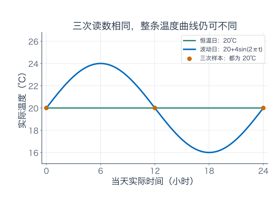

问题出在哪里？温度计一次给你一个数，一天的温度变化却是一整条记录。我们这次要把**整条记录**当成研究对象，问它能怎样相加、怎样比较，以及怎样用有限信息近似。

本篇分三段：第 1—5 节从记录走到函数向量；第 6—8 节算误差并发现无限多个独立方向；第 9—12 节拆开无限展开与采样保证。第一次可以先读前六节、做前四题。后面的十道练习都附有逐题解答。

## 1．三个数、五个数，与整条记录

把两条曲线在五个时刻的值列出来：

| 时间 $t$ | 实际时刻 | 恒温日 $T_a$（℃） | 波动日 $T_b$（℃） |
| --- | --- | --- | --- |
| 0 | 0 点 | 20 | 20 |
| $1/4$ | 6 点 | 20 | 24 |
| $1/2$ | 12 点 | 20 | 20 |
| $3/4$ | 18 点 | 20 | 16 |
| 1 | 24 点 | 20 | 20 |

只保留 0、12、24 点，两个数据向量相同，都是 $(20,20,20)$。改为每六小时一次，得到

$$
\text{恒温日：}(20,20,20,20,20),\qquad
\text{波动日：}(20,24,20,16,20).
$$

现在能区分了。数据向量有几个位置，取决于你记了几次；函数 $T_b$ 则规定了**每一个允许时刻**应该读到什么。比如 3 点对应 $t=1/8$，模型给出

$$
T_b(1/8)=20+4\sin(\pi/4)=20+2\sqrt2\approx22.828\,{}^\circ\mathrm C.
$$

函数括号里的 $t$ 是用来查询的时间，查询得到的 $T_b(t)$ 是一个数。函数 $T_b$ 本身，是把所有时刻的查询规则放在一起的那个对象。

以后说“空间里的一个点是 $T_b$”，指的是整条记录；说“取 $t=1/8$”，是在这条记录内部选一个查询时刻。它们处于不同层次。图上的横坐标也不是函数空间里排列不同曲线的位置。

## 2．先把基准 20℃ 扣掉，再谈向量运算

直接把两天的摄氏温度相加，会出现让人困惑的说法：“两天各 20℃，相加成 40℃，是什么天气？”为了让计算对应明确的实验量，先研究**偏离基准的温差**。

写成

$$
u(t)=T(t)-20.
$$

恒温日对应零函数 $u_a(t)=0$，波动日对应

$$
g(t)=4\sin(2\pi t).
$$

$g(t)=4$ 表示比基准高 4℃；$g(t)=-4$ 表示低 4℃。温差相加、乘系数可以用普通线性规则；摄氏零点的选取不会影响这些温差。需要报告实际温度时，再把 20 加回去。

接下来选择一个容纳这些偏差记录的集合：

$$
C[0,1]=\{u:[0,1]\to\mathbb R\mid u\text{ 在 }[0,1]\text{ 上连续}\}.
$$

这行可以读作：“从 $[0,1]$ 中的时刻，查询一个实数，而且曲线连续的全部规则。”$C$ 提醒我们选了连续函数。两条连续曲线相加仍连续，乘一个实数仍连续，零函数也在里面，因而它能承接线性代数里的向量运算。

交换、结合、分配等规则，也逐时继承了实数运算。例如每个时刻都有 $u(t)+v(t)=v(t)+u(t)$，所以两条函数 $u+v$ 与 $v+u$ 相同；负函数 $-u$ 则让 $u+(-u)$ 在每个时刻都为零。

这个数学空间允许任意大小的连续偏差，不等于说每条曲线都能被温室设备实现。真实设备可能要求偏差不超过 4℃、变化速度有限、某时刻必须达到指定温度；这些要求可以作为空间中的限制条件，逐项加入。

例如“所有时刻偏差都在 $[-4,4]$ 之间”的集合，并不是线性子空间：$g$ 在其中，但 $2g$ 的最高偏差为 8，已经越界。**选择线性空间是在建立方便计算的背景；物理可行范围还要另行说明。**

### 固定一个初值，会改变什么

连续偏差且 $u(0)=0$ 的集合是子空间：两条这样的记录相加，起点仍为零；任意数乘也如此。

连续且 $T(0)=20$ 的实际温度记录，在通常函数加法下不是子空间：它不包含零函数，两条记录相加的起点变成 40。它是“所有起点为零的连续函数”整体加上常数 20 后得到的平移集合。

把基准扣掉，正好把这类“固定起点”的记录拉回了能使用线性工具的形式。这和上一章已知起始量、再研究变化部分的做法是一致的。

## 3．两条函数相加，是每个时刻分别算

再安排一条慢慢升温的偏差记录

$$
h(t)=2t.
$$

它对应实际温度从 20℃ 线性升到 22℃。现在把两个控制方案各取一半，得到新的偏差目标

$$
k(t)=\frac12g(t)+\frac12h(t)=2\sin(2\pi t)+t.
$$

这可以作为一条新的设定曲线来比较，不是在断言把两种温室空气混合后，实际温度必然正好等于这条曲线；混合过程还需要热量、质量等物理模型。这里的操作是对记录或设定值进行运算。

先算几个时刻：

| 时间 $t$ | $g(t)$：波动偏差 | $h(t)$：升温偏差 | $k(t)=(g(t)+h(t))/2$ |
| --- | --- | --- | --- |
| 0 | 0 | 0 | 0 |
| $1/4$ | 4 | $1/2$ | $9/4=2.25$ |
| $1/2$ | 0 | 1 | $1/2$ |
| $3/4$ | $-4$ | $3/2$ | $-5/4=-1.25$ |
| 1 | 0 | 2 | 1 |

各项单位都是温差℃。例如 6 点时，新目标实际温度为 $20+2.25=22.25$℃。

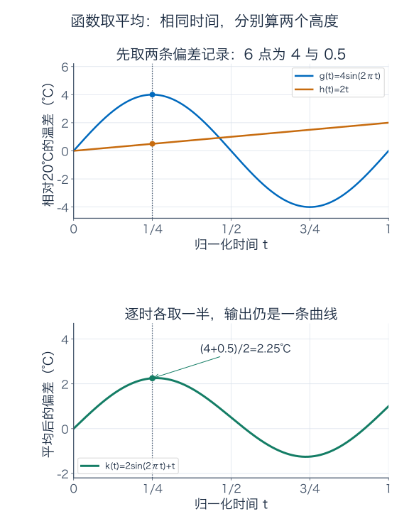

一般地，对实数 $a,b$ 与函数 $u,v$，规定

$$
(au+bv)(t)=a\,u(t)+b\,v(t).
$$

左边是先造出一条新记录，再去查时刻 $t$；右边是先分别查这两条记录，再对两个数计算。两种做法应当得到同一个数，这就是**逐点线性组合**的含义。

这里有两种“平均”要分清：$k(t)$ 是把两个方案在**同一时刻**的值平均，输出仍是一条函数；“全天平均温差”则把**同一个方案的不同时刻**累积平均，最后只输出一个数。下一节就算后者。

## 4．一台平均温度仪，只读出整条曲线的一方面

时间已归一化到长度为 1，所以一条偏差记录 $u$ 的全天平均值为

$$
M(u)=\int_0^1u(t)\,dt.
$$

若用实际时间 $\tau$（以小时为数值单位），同一个平均值应写成

$$
\frac1{24}\int_0^{24}u(\tau/24)\,d\tau.
$$

换元 $t=\tau/24$ 后，两式相同。前一式的 $dt$ 对应无量纲时间；后一式先累积了“温差乘小时”，再除以 24 小时。**平均温差**的单位仍是℃。

现在代入两条记录。对波动日，

$$
M(g)=4\int_0^1\sin(2\pi t)\,dt
=4\left[-\frac{\cos(2\pi t)}{2\pi}\right]_0^1=0.
$$

正的半天与负的半天抵消。恒温日的偏差平均也为零，因此两天实际平均温度都为 20℃。但在 6 点，一个是 20℃，另一个是 24℃。

对升温日，$M(h)=\int_0^1 2t\,dt=1$；所以新方案 $k$ 的平均偏差为 $(0+1)/2=1/2$，实际平均温度为 20.5℃。

把平均值看成一台仪器，它接收整条函数，只吐出一个数。积分的线性性质给出

$$
M(au+bv)=aM(u)+bM(v).
$$

这类从向量空间输出一个实数、并遵守线性组合规则的读数，叫**线性泛函**。“泛函”的输入可以是一整条函数，并没有要求输出也是函数。

### 瞬时温度也是另一台仪器

固定时刻 $r$，令 $E_r(u)=u(r)$，它叫取值泛函。它同样线性：

$$
E_r(au+bv)=(au+bv)(r)=aE_r(u)+bE_r(v).
$$

例如 $E_{1/4}(g)=4$，而 $M(g)=0$。两台仪器测的是不同方面，读数不同很正常。平均仪读不出 $g$ 与零函数的差异，6 点取值仪能读出。

最高温差这台仪器 $P(u)=\max_{0\le t\le1}u(t)$ 却不是线性的。$g$ 的最高值为 4，$-g$ 的最高值也为 4，而 $g+(-g)=0$ 的最高值是零：

$$
P(g)+P(-g)=8\ne0=P(g-g).
$$

因此“从函数得到一个数”可以叫泛函，但要进一步叫**线性**泛函，必须真的检查线性。温度最高点随曲线改变，不是事先固定同一个查询时刻。

## 5．画了无穷多个时刻，模型也可能只有三个自由度

先暂时规定，只允许下面这类偏差记录：

$$
V=\{u(t)=a+bt+c\sin(2\pi t):a,b,c\in\mathbb R\}.
$$

它包含恒定偏移、线性升温、一天一次波动。每条曲线可以查询无穷多个时刻，却只需要三个旋钮 $a,b,c$ 来决定。

为什么三个旋钮没有互相重复？假设

$$
a+bt+c\sin(2\pi t)=0\quad\text{对所有 }t\in[0,1].
$$

取 $t=0$ 得 $a=0$；取 $t=1$ 得 $a+b=0$，因此 $b=0$；再取 $t=1/4$ 得 $c=0$。所以 $1,t,\sin(2\pi t)$ 线性无关，且按定义张成 $V$，是一组基。**这个函数空间只有三维。**

例如

$$
g\leftrightarrow\begin{pmatrix}0\\0\\4\end{pmatrix},\qquad
h\leftrightarrow\begin{pmatrix}0\\2\\0\end{pmatrix},\qquad
k\leftrightarrow\begin{pmatrix}0\\1\\2\end{pmatrix}.
$$

在这组基下，平均仪与 6 点取值仪可以直接写成行矩阵：

$$
M(u)=\begin{pmatrix}1&1/2&0\end{pmatrix}
\begin{pmatrix}a\\b\\c\end{pmatrix},\qquad
E_{1/4}(u)=\begin{pmatrix}1&1/4&1\end{pmatrix}
\begin{pmatrix}a\\b\\c\end{pmatrix}.
$$

把 $k$ 的坐标 $(0,1,2)^T$ 代进去，得到平均偏差 $1/2$、6 点偏差 $1/4+2=9/4$，与前面逐点计算一致。

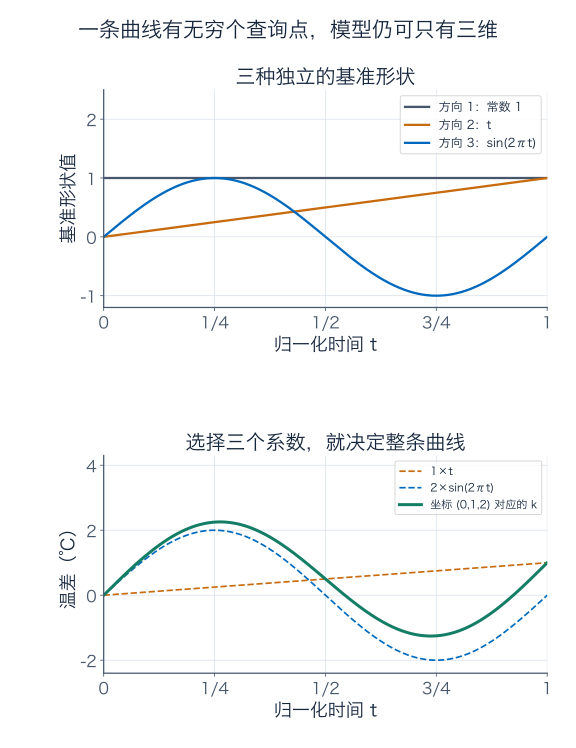

还可以用三个瞬时读数直接反推出坐标：

$$
a=u(0),\qquad b=u(1)-u(0),\qquad
c=u(1/4)-a-b/4.
$$

**这次有限读数确实足够，前提是已经知道曲线属于 $V$。** 如果把允许范围放大到所有连续函数，就不能继续默认三个读数决定一切。

“函数在每个时刻都有值”，不意味着每个时刻都能独立调整。有限维或无限维，看的是能有多少个线性无关的变化方向，不是横轴上有多少个点。

## 6．同样平均为零，怎样量整条记录的差

恒温日的偏差为零，所以与波动日的逐时差就是 $g(t)=4\sin(2\pi t)$。已经知道它的平均为零，但我们想评估整个记录的误差，不能让冷热相互抵消。

### 第一把尺：最严重的那一次偏差

逐时取绝对值，再找最大值：

$$
\|g\|_\infty=\max_{0\le t\le1}|g(t)|=4.
$$

因为 $|\sin|\le1$，且在 $t=1/4,3/4$ 达到 1，最大温差确实为 4℃。若植物不能忍受某个瞬间偏高 3℃，这把尺子能直接提醒你：这条设定已经越界。

### 第二把尺：把整个白天的平方误差记到账上

先平方，避免正负抵消，再积分，最后开平方：

$$
\|g\|_2=\left(\int_0^1|g(t)|^2\,dt\right)^{1/2}.
$$

利用 $\sin^2\theta=(1-\cos2\theta)/2$，

$$
\begin{aligned}
\int_0^1|g(t)|^2\,dt
&=16\int_0^1\sin^2(2\pi t)\,dt\\
&=8\int_0^1(1-\cos(4\pi t))\,dt=8.
\end{aligned}
$$

所以 $\|g\|_2=2\sqrt2\approx2.828$℃。在长度为 1 的归一化时间区间，这个数也正好是全天均方根温差。如果直接用小时积分，平方误差总账是 $24\times8=192$ ℃平方乘小时；**先除以一天的时长再开方**，才得到相同的均方根数值。

这两把尺子通常分别叫最大范数、二范数；两条函数 $u,v$ 的距离，就用 $\|u-v\|$ 计算。本篇先学会把它们算出来，后面会系统说明范数的规则。

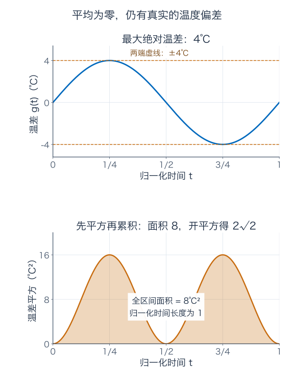

### 只热一小会儿，两把尺子会怎样分歧

再设一条短时升温记录：在正午形成一个高 4℃ 的三角形小峰，半宽为 $a$，其中 $0<a\le1/2$：

$$
b_a(t)=
\begin{cases}
4\left(1-\dfrac{|t-1/2|}{a}\right),&|t-1/2|\le a,\\
0,&|t-1/2|>a.
\end{cases}
$$

这条曲线连续，峰值为 4，但只有正午前后各 $a$ 天的时间偏离零。最大误差始终是 $\|b_a\|_\infty=4$。

平方误差则可以把峰左右各算一次。令 $s$ 表示离正午的距离：

$$
\begin{aligned}
\|b_a\|_2^2
&=2\int_0^a16(1-s/a)^2\,ds\\
&=32\left[s-\frac{s^2}a+\frac{s^3}{3a^2}\right]_0^a
=\frac{32a}{3}.
\end{aligned}
$$

例如 $a=1/8$，整次升温持续 $2a\times24=6$ 小时，二范数为 $2/\sqrt3\approx1.155$℃。改成 $a=1/128$，总共持续 22.5 分钟，二范数只有 $1/(2\sqrt3)\approx0.289$℃；最高偏差仍为 4℃。

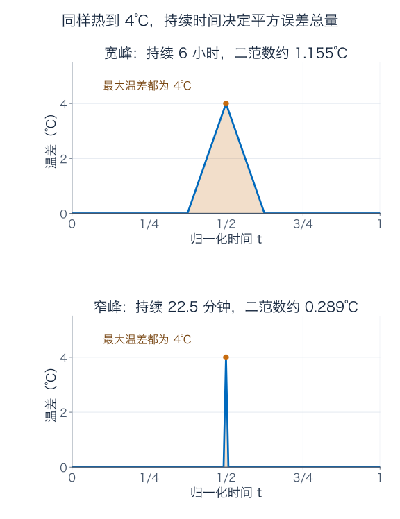

如果关心瞬时耐受上限，短峰仍值得警惕；如果任务用全天平均平方误差评价，持续时间缩短会降低它的权重。**说“这条曲线已经很接近恒温”，必须说明用哪把尺子。**

本篇暂把两种范数都放在连续函数上。连续曲线若某处不为零，附近一小段也会有非零幅度，因此平方积分严格为正。以后扩大到可测函数时，“只在一个时刻不为零”会引出零积分但不逐点相同的情况，届时要建立 $L^2$ 等价类；这里先不把它与 $C[0,1]$ 混为一谈。

## 7．怎样真正证明“无限维”

三个旋钮的模型 $V$ 只允许三种基本形状。但所有连续曲线的集合 $C[0,1]$ 大得多。要证明它无限维，不用画一个无法想象的无穷维坐标系；只需证明：**无论给多大的整数，都能找到那么多个互不重复的线性方向。**

先看常数函数 $1$、线性函数 $t$、二次函数 $t^2$。假设

$$
a_0+a_1t+a_2t^2=0\quad\text{在整个 }[0,1]\text{ 上成立}.
$$

取 $t=0$ 得 $a_0=0$；求一次导数再取零点，得 $a_1=0$；求两次导数得 $2a_2=0$。所以三个方向线性无关。

同样地，若

$$
\sum_{j=0}^m a_jt^j=0,
$$

依次求 $0,1,\ldots,m$ 阶导数并在零点代入，得到 $j!a_j=0$，各系数全为零。于是 $1,t,\ldots,t^m$ 是 $m+1$ 个线性无关的连续函数。

如果 $C[0,1]$ 只有某个有限维数 $d$，它就不能容纳 $d+1$ 个线性无关向量。但取 $m=d$，我们恰好找出了 $d+1$ 个。这就证明它无限维。

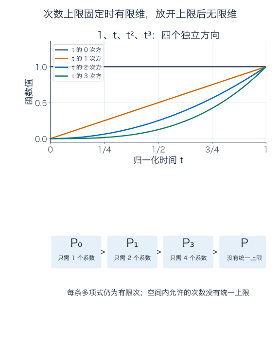

这里要区分两个集合：

$$
\mathcal P_m=\left\{\sum_{j=0}^m a_jt^j:a_j\in\mathbb R\right\},
\qquad
\mathcal P=\bigcup_{m=0}^{\infty}\mathcal P_m.
$$

$\mathcal P_m$ 是次数**至多**为 $m$ 的多项式，维数为 $m+1$；它包含次数更低的多项式和零函数。$\mathcal P$ 是所有有限次多项式，没有一个统一的最高次数；两项多项式相加仍是有限次，因此它也是向量空间，而且已经无限维。

**无限维并不要求每个元素都含无限多个非零系数。** 每个多项式仍只用有限多个系数；无限的是整个空间里可供使用的独立方向数。类似地，一家仓库允许不断新开抽屉，不表示每件物品都必须占满无穷多个抽屉。

## 8．每个近似都是多项式，极限也一定是吗

温室控制器接下来想跟随一条缓慢上升的偏差曲线

$$
q(t)=\frac1{2-t},\qquad0\le t\le1.
$$

实际温度为 $20+q(t)$，从 20.5℃ 升到 21℃。假设控制器容易执行有限次多项式，我们试着用它们近似 $q$。

把分母中的 2 提出来：

$$
q(t)=\frac12\frac1{1-t/2}.
$$

有限几何和告诉我们，保留 $N$ 项可取

$$
p_N(t)=\sum_{n=1}^N\frac{t^{n-1}}{2^n}
=\frac12+\frac t4+\cdots+\frac{t^{N-1}}{2^N}.
$$

$N$ 是项数，$p_N$ 的次数为 $N-1$。不是直接把无穷和当成已经有意义，而是先定义每一个有限的 $p_N$，再看余项。

有限和公式给出

$$
p_N(t)=\frac{1-(t/2)^N}{2-t},\qquad
\boxed{q(t)-p_N(t)=\frac{t^N}{2^N(2-t)}.}
$$

当 $t\in[0,1]$，$t^N\le1$、$2-t\ge1$，所以误差处处不超过 $2^{-N}$；在 $t=1$ 恰好达到这个上界。因此

$$
\boxed{\|q-p_N\|_\infty=2^{-N}.}
$$

这是一份**全天每个时刻**都有效的误差保证：

| 项数 $N$ | 多项式次数 | 最大偏差误差（℃） |
| --- | --- | --- |
| 1 | 0 | $1/2=0.5$ |
| 2 | 1 | $1/4=0.25$ |
| 4 | 3 | $1/16=0.0625$ |
| 7 | 6 | $1/128=0.0078125$ |
| 10 | 9 | $1/1024\approx0.00097656$ |

要求最大误差不超过 0.01℃，7 项已经够；要求不超过 0.001℃，10 项够。给 $p_N$ 和 $q$ 都加回基准 20，误差不会改变。

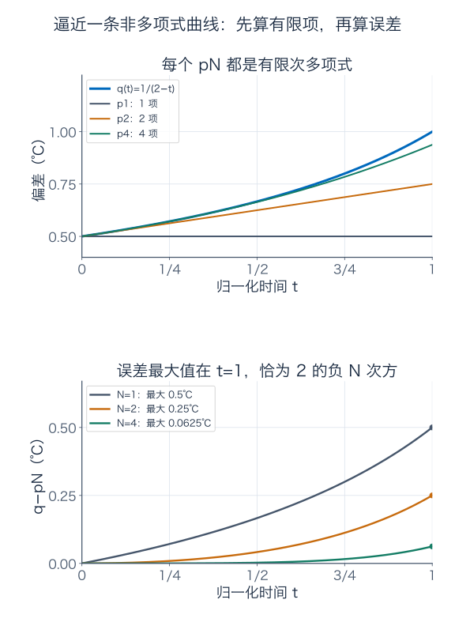

### 越来越接近，不等于已经属于

没有任何一个有限次多项式 $p$ 能在整个区间上等于 $q$。否则 $(2-t)p(t)=1$ 在区间内处处成立。两个多项式在整个区间相等，就有相同的系数；但如果非零 $p$ 的次数为 $d$，左侧次数是 $d+1$，不可能恒为常数 1。$p=0$ 当然也不行。

因此每个近似 $p_N$ 都属于 $\mathcal P$，极限 $q$ 却不属于 $\mathcal P$；它仍属于更大的 $C[0,1]$。我们已经得到一个具体事实：**在最大误差的意义下，多项式集合里的一串点，可以靠近一个集合外的连续函数。**

下一篇会把“包含自己的序列极限”与“闭”联系起来。这里先记住这个能核对的例子，不必提前背闭包或完备化的定义。本篇只证明了这一个 $q$ 的逼近，不把它自动升级成“任意连续函数都能这样逼近”的证明。

## 9．无限坐标：把不会结束的表格，先截断再算

刚才多项式系数按顺序是

$$
a=(1/2,1/4,1/8,\ldots),\qquad a_n=2^{-n}.
$$

把这张不会结束的表格本身当成一个对象，就是数列向量。它与时间函数不同：数列的查询位置是整数 $n=1,2,\ldots$，时间函数的查询位置是整个实数区间中的 $t$。

先定义标准单位向量 $e_n$：只有第 $n$ 项为 1，其他项全为零。例如 $e_1=(1,0,0,\ldots)$、$e_3=(0,0,1,0,\ldots)$。任何有限多个这样的向量线性无关，因为查看第 $j$ 项，就能直接读出 $e_j$ 前的系数。

所有只有有限多个非零坐标的数列组成空间 $c_{00}$。这里不要求所有向量使用同一个截止位置；$(1,2,0,\ldots)$、只有第 1000 项为 3 的数列，都在其中。它已经无限维，却没有哪一个元素需要无限多个非零坐标。

而 $a$ 不在 $c_{00}$，因为每项都非零。若想把它纳入，先给允许的无限记录一个明确标准，例如要求平方和有限：

$$
\ell^2=\left\{x=(x_1,x_2,\ldots):\sum_{n=1}^{\infty}|x_n|^2<\infty\right\},
\qquad
\|x\|_2=\left(\sum_{n=1}^{\infty}|x_n|^2\right)^{1/2}.
$$

逐项加法与数乘仍可使用。例如

$$
|\alpha x_n+\beta y_n|^2\le2|\alpha|^2|x_n|^2+2|\beta|^2|y_n|^2,
$$

右侧对 $n$ 求和有限，就保证左侧也有限，因此线性组合仍属于 $\ell^2$。具体的范数三角不等式将在后面系统建立。

对 $a$，几何级数给出

$$
\|a\|_2^2=\sum_{n=1}^{\infty}4^{-n}
=\frac{1/4}{1-1/4}=\frac13.
$$

所以它在 $\ell^2$ 中，长度为 $1/\sqrt3$。这个系数向量的长度，不是前面温度曲线的均方根温差；**数列的平方和与函数的平方积分，是针对两种对象的计算。**

### 先保留前 $N$ 项，能保证遗漏多大

写有限截断

$$
a^{(N)}=\sum_{n=1}^N2^{-n}e_n
=(1/2,1/4,\ldots,2^{-N},0,0,\ldots).
$$

截掉的部分是 $n>N$ 的所有项，误差平方为

$$
\begin{aligned}
\|a-a^{(N)}\|_2^2
&=\sum_{n=N+1}^{\infty}4^{-n}\\
&=\frac{4^{-(N+1)}}{1-1/4}
=\frac{4^{-N}}3.
\end{aligned}
$$

因此

$$
\boxed{\|a-a^{(N)}\|_2=\frac{2^{-N}}{\sqrt3}\longrightarrow0.}
$$

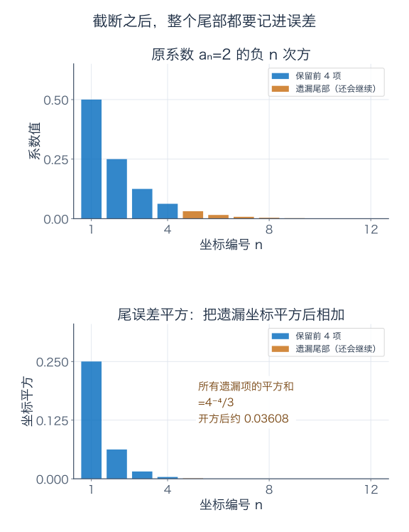

这才是把 $a$ 写成 $\sum_{n=1}^{\infty}2^{-n}e_n$ 时，需要补上的那句话：**有限部分和在指定范数下趋近 $a$。** 不只是“每个坐标都写上去了”。

对任意 $x\in\ell^2$，同样有

$$
\left\|x-\sum_{n=1}^Nx_ne_n\right\|_2^2
=\sum_{n>N}|x_n|^2\longrightarrow0.
$$

原因就是整个平方级数收敛，其尾和必然趋于零。这也说明 $c_{00}$ 中的向量能在这把尺子下逼近任意 $\ell^2$ 向量；下一篇会把这样的性质叫作“稠密”。

## 10．写成同一个无穷和，换把尺子还成立吗

看最简单的无限记录

$$
w=(1,1,1,\ldots),\qquad
w^{(N)}=\sum_{n=1}^Ne_n.
$$

固定第 7 项，只要 $N\ge7$，截断记录的第 7 项就与 $w$ 完全相同。对每个固定坐标都是如此，这叫逐坐标收敛。

但如果要求**所有坐标的最坏遗漏误差**小，结果就不同。对有界数列定义

$$
\|x\|_\infty=\sup_{n\ge1}|x_n|.
$$

$\sup$ 是上确界，即最小的上界。数列不像闭区间上的连续函数，未必真的有某项达到这个值：例如 $x_n=1-1/n$，每项都小于 1，却能任意接近 1，上确界为 1。

对 $w^{(N)}$，无论保留多少项，下一项仍漏掉一个 1。因此

$$
\boxed{\|w-w^{(N)}\|_\infty=1\quad\text{对所有 }N.}
$$

它从未在最大坐标误差的意义下靠近 $w$。而 $w$ 本身也不属于 $\ell^2$，因为平方和为 $1+1+\cdots$，发散。

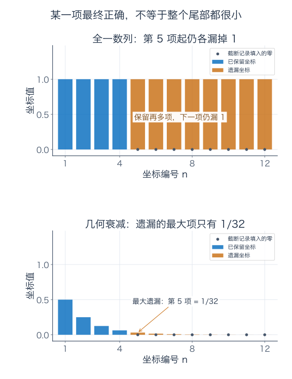

如果数列的项本身趋于零，截断在最大误差下就能成功。这类数列组成

$$
c_0=\{x:x_n\to0\}.
$$

因为给定任意 $\varepsilon>0$，项趋于零意味着足够后面的每项都小于 $\varepsilon$，于是 $\sup_{n>N}|x_n|\to0$。所以 $e_1,e_2,\ldots$ 的截断方法在 $c_0$ 的最大范数下也有效。

全部有界数列组成 $\ell^\infty$，它包含 $w$。由于这个反例，同一组 $e_n$ 无法在最大范数下展开 $\ell^\infty$ 里的每个向量。

### 两种“基”，到底差在哪一步

线性代数里的基，要求每个向量是基向量的**有限线性组合**，而且系数唯一；放到无限维时，这种要求叫 Hamel 基。$1,t,t^2,\ldots$ 是 $\mathcal P$ 的 Hamel 基，每个多项式只使用有限项。

允许按固定顺序取部分和，并要求它们在指定范数下趋近向量，而且展开系数唯一的基，叫 Schauder 基。我们刚才已证明 $e_1,e_2,\ldots$ 在 $\ell^2$ 中能这样展开所有向量。

唯一性也能直接验证：如果某组系数 $b_n$ 的部分和在二范数下趋近 $x$，对任意固定 $j$，当 $N\ge j$ 时

$$
|x_j-b_j|\le\left\|x-\sum_{n=1}^Nb_ne_n\right\|_2\longrightarrow0,
$$

所以 $b_j=x_j$。因此 $e_n$ 确实是 $\ell^2$ 的 Schauder 基。它不是 $\ell^2$ 的 Hamel 基，因为任何有限组合都只在有限多个坐标非零，无法精确等于 $a=(1/2,1/4,\ldots)$。

同样，$e_n$ 是 $c_0$ 在最大范数下的 Schauder 基，却不是 $\ell^\infty$ 在最大范数下的 Schauder 基。每次说“基”，都要说明空间、允许有限还是无限组合，以及无限部分和怎样收敛。

### 系数平方和有限，不代表对应函数级数在端点也收敛

别把数列向量和温度函数的近似标准混用。数列 $(1,1/2,1/3,\ldots)$ 属于 $\ell^2$，因为从 $n=2$ 开始

$$
\frac1{n^2}\le\frac1{n(n-1)}=\frac1{n-1}-\frac1n,
$$

右侧可望远镜求和。但若把这些数作为单项式系数，形成

$$
\sum_{n=1}^{\infty}\frac{t^{n-1}}n,
$$

在 $t=1$ 就得到发散的调和级数。它甚至不能在整个 $[0,1]$ 上表示一条处处有限的连续曲线，更别说从“系数属于 $\ell^2$”直接推出最大误差收敛。

前面的 $q$ 之所以能逼近，不是因为看见了一个无穷和符号，而是因为我们单独算出了函数误差 $2^{-N}$。

## 11．采得更密之前，先说允许曲线怎样变化

回头看开头的三个测温点。增加采样通常有帮助，但对完全不限制变化速度的连续曲线，**任意一个固定的有限网格，都可能遗漏某些波动**。

把一天分成 $N$ 段，采样时刻为 $0,1/N,2/N,\ldots,1$，共 $N+1$ 次。取

$$
u_N(t)=4\sin(2\pi Nt).
$$

每个采样点都满足

$$
u_N(j/N)=4\sin(2\pi j)=0,
$$

但 $\|u_N\|_\infty=4$。这条曲线仍连续，所有样本却与零函数一样。

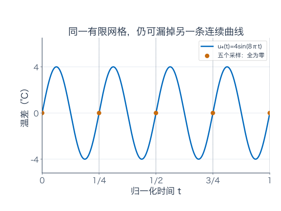

注意这里的 $u_N$ **随着网格大小一起更换了**。我们证明的是“每个固定有限网格都有盲区”，不是“同一条非零连续曲线在所有越来越密的网格上都读成零”。如果一条固定连续曲线在所有这些网格点都为零，网格点能任意接近每个时刻，连续性反而会迫使它处处为零。

### 加上一条变化速度保证，采样就能给出误差保证

假设通过额外的设备模型，我们知道温差每小时最多变化 2℃。换成归一化时间，相当于

$$
|u(t)-u(s)|\le48|t-s|\quad(t,s\in[0,1]).
$$

48 表示跨越一整天时间单位时的变化率上界。一般把这个上界记为 $L$，这种不等式叫 Lipschitz 条件；这里先按“任意两次读数的差不超过速度上界乘时差”理解。

每个时刻 $t$ 都能找到最近的采样点 $j/N$，距离至多 $1/(2N)$。拿最近样本估计当前偏差，便有

$$
|u(t)-u(j/N)|\le\frac{L}{2N}.
$$

若每次测温读数另有不超过 $\delta$ 的误差，三角不等式给出

$$
\boxed{\text{任意时刻的估计误差}\le\frac{L}{2N}+\delta.}
$$

每小时一次，$N=24$，没有测温误差时上界为 $48/(2\times24)=1$℃。每 15 分钟一次，$N=96$，上界降为 0.25℃；若每次测量还可能偏 0.1℃，总保证为 0.35℃。

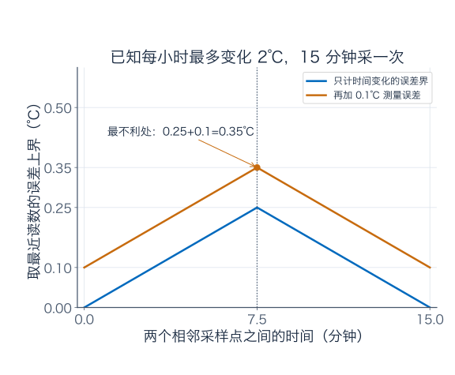

这里的保证来自**采样加额外的变化限制**。前面的高频 $u_N$ 在 $N$ 增大时斜率越来越大，无法一直满足同一个固定的 $L$。因此两个计算没有矛盾。

## 12．同一台仪器是否稳定，也要看输入误差怎样量

用最大误差比较曲线，任意固定时刻的读数差一定满足

$$
|E_r(u)-E_r(v)|=|u(r)-v(r)|\le\|u-v\|_\infty.
$$

也就是说，整条曲线每时每刻都最多偏 0.01℃，那么某一刻的读数当然也最多偏 0.01℃。这台取值仪在最大误差尺子下有一份很直接的稳定保证。

但若输入只要求均方误差小，短峰例子就会改变结论。取正午读数 $E_{1/2}$，我们算过

$$
\|b_a\|_2=\sqrt{32a/3},\qquad E_{1/2}(b_a)=4.
$$

给定任意小的正数 $\varepsilon$，选 $a<3\varepsilon^2/32$ 且 $a\le1/2$，输入二范数便小于 $\varepsilon$，正午读数却仍偏 4℃。

所以在这个输入标准下，不存在固定 $C$ 让所有连续 $u$ 都满足 $|u(1/2)|\le C\|u\|_2$。若声称有，代入短峰就需要 $4\le C\sqrt{32a/3}$ 对所有小 $a$ 成立，右侧可趋于零，显然不可能。

这里输入空间的元素仍是同一批连续函数，取值操作也没改，改的是**衡量整条输入误差的尺子**。这就是泛函分析中必须把“空间、范数、映射”一起说清楚的一个实际理由。下一篇开始，我们会把“接近”“极限”“稳定”逐步写成能检验的条件。

## 13．练习：把整条记录算一遍

**题一：三次读数漏掉了什么？** 对开头的 $T_a,T_b$，算出 3 点、6 点、12 点的实际温度。解释为何 0、12、24 点的数据不能唯一确定一天的连续曲线。若已知曲线属于第 5 节的 $V$，在 0、12、24 点各读一次，就一定能恢复它吗？

**题二：逐点运算与允许集合。** 用 $g(t)=4\sin(2\pi t)$、$h(t)=2t$ 算出 $k=(g+h)/2$ 在 6 点、18 点的偏差和实际温度。判断三个集合是否为 $C[0,1]$ 的线性子空间：$u(0)=0$；$u(0)=1$；所有时刻 $|u(t)|\le4$。各给出封闭性理由或一个明确反例。

**题三：三个旋钮怎样从读数找回来？** 已知 $u\in V$，测得 $u(0)=1$、$u(1/4)=4.5$、$u(1)=3$。求 $a,b,c$、全天平均偏差、6 点偏差。解释为什么这次恢复的唯一性需要“$u\in V$”这个条件。

**题四：平均、峰值与整体误差。** 求 $M(g)$、$M(h)$、$M(k)$ 与 $P(g),P(-g),P(g-g)$。再计算恒温日与波动日的最大温差、归一化时间二范数，以及用小时累计的平方温差总账。哪些读数线性，哪个不线性？

**题五：短峰能躲进均方误差里吗？** 取 $b_a$ 的 $a=1/32$，算升温总时长、最大温差、二范数。若想让二范数不超过 0.2℃，三角峰半宽 $a$ 至多多大，总时长至多多少分钟？峰值是否随之降低？

**题六：无限维不等于每个向量都用无穷项。** 证明 $1,t,t^2,t^3$ 线性无关。判断 $\mathcal P_3$ 与 $\mathcal P$ 的维数；“次数恰好为 3 的多项式”是否为子空间？所有多项式能否都用固定的前一百个单项式表示？说明理由。

**题七：近似精度由余项负责。** 写出 $p_3$，推导 $q-p_N$ 的精确式子，并算出误差在 $t=1/2$ 和全区间最大值。为了使最大误差不超过 0.005℃，最少要几项？解释为什么不存在一个有限项 $p_N$ 与 $q$ 处处相等。

**题八：系数表与温度曲线，不能偷换误差。** 对 $a_n=2^{-n}$，求 $\|a\|_2$、截断到 $N$ 项的二范数尾误差、最大坐标尾误差。若系数二范数误差不超过 0.01，最少保留几项？若要求对应温度曲线 $p_N$ 的最大误差不超过 0.01℃，最少又是几项？

**题九：每项都变小，平方和就一定有限吗？** 判断 $(1,1,\ldots)$、$(1/\sqrt n)_{n\ge1}$、$(1/n)_{n\ge1}$ 分别是否属于 $c_{00},c_0,\ell^2,\ell^\infty$。分析它们的标准截断是否在最大范数下收敛；若属于 $\ell^2$，在二范数下呢？这些例子怎样区分 Hamel 组合与 Schauder 展开？

**题十：采样保证与读数稳定。** 把一天四等分，写出一条所有五个采样点均为零、最大幅度却为 4 的连续偏差曲线。另设温度每小时最多变化 2℃，每个测温点误差至多 0.1℃：为了让“取最近采样值”的全天误差保证不超过 0.2℃，至少分成多少段，间隔至多几分钟？最后用 $b_a$ 说明，为何不能从任意小的二范数输入误差推出正午读数也任意小。

### 参考答案与解题过程

#### 题一解答

恒温日三个时刻都为 20℃。波动日 3 点对应 $t=1/8$，温度为 $20+2\sqrt2\approx22.828$℃；6 点为 $20+4=24$℃；12 点为 $20+4\sin\pi=20$℃。

0、12、24 点分别对应 $t=0,1/2,1$，正弦项恰好全为零，所以 $T_a,T_b$ 在这些点数据相同，却在 6 点不同。这两个明确的连续函数已经足以证明：三次记录不能唯一确定任意连续曲线。

即使限制在 $V$，这三个取值点也没选好。对 $u(t)=a+bt+c\sin(2\pi t)$，它们分别只读到 $a,a+b/2,a+b$，完全没有 $c$。例如 $c=0$、$c=4$ 都能与 $a=b=0$ 配合，产生全零的偏差样本。

“空间三维”说明可以寻找三条合适的独立读数，不表示任意三个查询点都能做到。第 5 节改用 $0,1/4,1$，才提供了反推出三个系数的公式。

#### 题二解答

6 点 $t=1/4$，$g=4,h=1/2$，所以 $k=(4+1/2)/2=9/4$，实际温度为 22.25℃。18 点 $t=3/4$，$g=-4,h=3/2$，所以 $k=(-4+3/2)/2=-5/4$，实际温度为 18.75℃。

集合 $u(0)=0$ 包含零函数。任取其中的 $u,v$ 及实数 $\alpha,\beta$，有 $(\alpha u+\beta v)(0)=0$，并且线性组合仍连续，因此是子空间。

集合 $u(0)=1$ 不含零函数，已经不是子空间。例如常数函数 1 在其中，乘 2 后常数函数 2 不在其中。

处处满足 $|u(t)|\le4$ 的集合虽然包含零函数，却不对数乘封闭：常数函数 4 在里面，乘 2 后常数函数 8 不在。因此它也不是子空间。一个可行集合并不需要为了建模而强行成为子空间。

#### 题三解答

按反推公式，

$$
a=u(0)=1,\qquad b=u(1)-u(0)=3-1=2,
$$

$$
c=u(1/4)-a-b/4=4.5-1-0.5=3.
$$

因此 $u(t)=1+2t+3\sin(2\pi t)$，平均偏差为 $a+b/2=2$，6 点偏差为 $a+b/4+c=4.5$，与记录相符。

若允许任意连续曲线，就可以给这条曲线加上 $r(t)=t(t-1/4)(t-1)$。$r$ 在三个采样点都为零，却不是零函数，比如 $r(1/2)=-1/16$。因此 $u$ 与 $u+r$ 的三个读数相同，中间的记录不同。

限制属于 $V$，才排除了这种额外的独立变化。模型条件与读数一起，才使本题的唯一恢复成立。

#### 题四解答

正弦在整周期上积分为零，因此 $M(g)=0$；$M(h)=\int_0^12t\,dt=1$；线性性给出 $M(k)=1/2$。

$P(g)=4$、$P(-g)=4$、$P(g-g)=0$，所以 $P$ 不保持加法，不线性。$M$ 线性，固定时刻取值的 $E_r$ 也线性；它们分别根据积分和逐点运算的规则保持线性组合。

两天逐时温差为 $g$。最大绝对温差为 4℃；归一化时间的平方积分为 8，所以二范数为 $2\sqrt2$℃。换成小时，平方积分变成 $24\times8=192$，单位为℃平方乘小时。

不能把 $\sqrt{192}$ 直接标成全天均方根温差：它还含时间长度的因素。均方根应为 $\sqrt{192/24}=2\sqrt2$℃。两种误差范数本身也不是线性读数，例如 $\|-g\|=\|g\|$，而线性读数必须在乘 $-1$ 时变号。

#### 题五解答

总时长为 $2a$ 天。取 $a=1/32$，它等于 $24/16=1.5$ 小时，即 90 分钟。最大温差仍为 4℃；二范数平方为 $32a/3=1/3$，二范数为 $1/\sqrt3\approx0.577$℃。

要求二范数不超过 0.2，先平方：

$$
\frac{32a}{3}\le0.2^2=0.04
\quad\Longrightarrow\quad
a\le\frac{3\times0.04}{32}=\frac3{800}.
$$

总时长至多

$$
2\times\frac3{800}\times24\times60=10.8\text{ 分钟}.
$$

不论半宽怎样缩短，正午始终有 $b_a(1/2)=4$，峰值没有降低。这些曲线在本题允许的连续函数空间里合法；若另加固定的变化率上限，就不能任意缩短同样高的峰，必须重新检验可行性。

#### 题六解答

若 $a_0+a_1t+a_2t^2+a_3t^3=0$，在零点依次读函数及前三阶导数，得到

$$
a_0=0,\quad a_1=0,\quad2a_2=0,\quad6a_3=0.
$$

所以四个单项式线性无关，并张成 $\mathcal P_3$，它的维数为 4。$\mathcal P$ 容纳任意多个线性无关的单项式，因此无限维。

次数恰好为 3 的多项式不含零函数，也不对加法封闭。例如 $t^3$ 与 $-t^3$ 都在其中，和却为零，不再是三次，因此不是子空间。

固定前一百个单项式 $1,t,\ldots,t^{99}$，只能张成 $\mathcal P_{99}$。$t^{100}$ 不在里面，否则就与前面单项式构成一个非平凡的恒零线性组合，违背已经证明的无关性。允许每条多项式使用有限项，与整个空间只允许固定有限项，是两种不同限制。

#### 题七解答

三项近似为 $p_3(t)=1/2+t/4+t^2/8$。用有限几何和，

$$
p_N(t)=\frac12\frac{1-(t/2)^N}{1-t/2}
=\frac{1-(t/2)^N}{2-t},
$$

所以 $q-p_N=t^N/[2^N(2-t)]$。在 $t=1/2$，误差为

$$
\frac{(1/2)^N}{2^N(3/2)}=\frac{2}{3\cdot4^N}.
$$

全区间误差至多 $2^{-N}$，且在 $t=1$ 达到，因此最大值恰为 $2^{-N}$。要求不超过 0.005，需要 $2^N\ge200$；$2^7=128<200$，$2^8=256\ge200$，所以最少 8 项。

每个有限 $N$ 的端点误差 $q(1)-p_N(1)=2^{-N}>0$，已经直接说明没有一个 $p_N$ 与 $q$ 处处相等。若讨论任意有限次多项式，而不仅这组 $p_N$，则用正文的 $(2-t)p(t)=1$ 与次数矛盾排除。

#### 题八解答

整个系数表的平方和为 $1/3$，所以 $\|a\|_2=1/\sqrt3$。截断 $N$ 项后，二范数尾误差为 $2^{-N}/\sqrt3$。

由于各项正且递减，尾部最大的那一项恰好是第 $N+1$ 项，因此最大坐标误差为

$$
\|a-a^{(N)}\|_\infty=2^{-(N+1)}.
$$

系数二范数误差不超过 0.01，检查相邻两个整数：$N=5$ 时 $1/(32\sqrt3)\approx0.01804$，不够；$N=6$ 时 $1/(64\sqrt3)\approx0.009021$，已经够。误差随 $N$ 递减，所以最少 6 项。

对应函数 $q-p_N$ 的最大误差是 $2^{-N}$。$N=6$ 时 $1/64=0.015625$，不够；$N=7$ 时 $1/128=0.0078125$，足够，因此最少 7 项。

相同的一组系数截断，放到“数列平方和”与“整个函数的最大值”中，得到不同的误差规则。不能只因为都出现 $N$ 和无穷展开，就把一个结论直接换到另一个对象上。

#### 题九解答

三条数列都每项非零，因此都不在 $c_{00}$。它们都满足绝对值不超过 1，所以都在 $\ell^\infty$。

全一数列的项不趋于零，不在 $c_0$；平方和发散，也不在 $\ell^2$。任意标准截断的最大尾误差为 1，不在最大范数下收敛到它。

$(1/\sqrt n)$ 的项趋于零，所以在 $c_0$；平方和却是调和级数 $\sum1/n$，发散，故不在 $\ell^2$。它的最大尾误差为 $1/\sqrt{N+1}\to0$，所以在最大范数下可以用截断展开。

调和级数为何发散？按 $n=2^{j-1}+1,\ldots,2^j$ 分组，每组有 $2^{j-1}$ 项，每项至少 $1/2^j$，所以每组至少贡献 $1/2$，不断加组便无界。

$(1/n)$ 的项趋于零，在 $c_0$；正文的望远镜比较保证平方和有限，所以也在 $\ell^2$。最大尾误差为 $1/(N+1)\to0$；二范数尾误差满足

$$
\left\|x-x^{(N)}\right\|_2^2
=\sum_{n>N}\frac1{n^2}\le\frac1N\longrightarrow0.
$$

因此它在这两把尺子下都可由截断逼近。三条数列都不能由有限多个 $e_n$ 精确组合出来，所以这些展开不属于 Hamel 有限组合。$(1/\sqrt n)$ 在 $c_0$ 的最大范数下、$(1/n)$ 在 $c_0$ 的最大范数或 $\ell^2$ 的二范数下，可以使用对应的 Schauder 展开。全一数列逐项最终正确，却不满足 $\ell^\infty$ 最大范数的展开要求。

#### 题十解答

取 $u_4(t)=4\sin(8\pi t)$。四等分的点为 $j/4$，$j=0,1,2,3,4$，代入得到 $4\sin(2\pi j)=0$。而 $t=1/16$ 时，正弦为 1，函数值为 4，最大幅度确实没有被样本反映。

有变化率约束时，$L=48$。加入每点测温误差 0.1，要求全天误差保证不超过 0.2：

$$
\frac{48}{2N}+0.1\le0.2
\quad\Longrightarrow\quad
N\ge240.
$$

所以至少分成 240 段，共 $N+1=241$ 个包含两端的样本，间隔至多 $24\times60/240=6$ 分钟。任意时刻离最近样本最多 3 分钟，变化误差至多 $2\times3/60=0.1$℃，再加测量误差 0.1℃，合计 0.2℃。

高频反例不一定满足这个额外的速度限制。例如 $u_4$ 的归一化时间导数最大幅度为 $32\pi$，换成每小时为 $32\pi/24=4\pi/3\approx4.189$℃，超过给定的 2℃/小时。

最后，短峰 $b_a$ 的二范数为 $\sqrt{32a/3}$，可随 $a$ 变小而任意小；正午值始终为 4。因此在没有另加变化率限制的 $C[0,1]$ 中，单凭小二范数误差无法保证小正午读数误差。若假设存在固定上界常数，代入这些短峰就得到正文末尾的矛盾。

## 补充 A：这两把函数尺子为什么真是范数

范数要满足三条规则：非负，且只有零向量长度为零；乘实数 $c$ 后长度乘 $|c|$；两项相加的长度不超过各自长度之和。后面会把规则用于更多空间，这里用连续函数核对一次。

最大范数的前两条直接来自绝对值。逐时有 $|u(t)+v(t)|\le|u(t)|+|v(t)|\le\|u\|_\infty+\|v\|_\infty$，再取最大，得到三角不等式。

对二范数，平方积分非负，数乘会在开方后留下 $|c|$。若某个连续 $u$ 在 $t_0$ 非零，连续性保证它在附近一段区间上满足 $|u(t)|\ge|u(t_0)|/2>0$；即使 $t_0$ 在端点，也有一侧的正长度区间。因此积分严格为正，不能让非零连续函数的二范数变成零。

剩下三角不等式。先算积分版 Cauchy–Schwarz：若 $v$ 非零，对任意实数 $a$，$\int_0^1(u-av)^2\,dt\ge0$。选 $a=\int uv/\int v^2$，展开后得到

$$
\left|\int_0^1uv\,dt\right|\le\|u\|_2\|v\|_2.
$$

若 $v=0$，不等式也成立。代回和的平方：

$$
\|u+v\|_2^2
=\|u\|_2^2+2\int_0^1uv\,dt+\|v\|_2^2
\le(\|u\|_2+\|v\|_2)^2.
$$

两边开非负平方根，就得到二范数的三角不等式。因此两者都能产生合法的距离 $d(u,v)=\|u-v\|$。但它们强调不同的误差，短峰已经显示它们不能在这个无限维空间里随意互换。

## 补充 B：有限台线性仪器，为什么不能认出所有连续曲线

若允许的曲线属于一个确定的三维模型，合适的三条读数可以够用。若允许所有连续函数，有限台线性仪器总会剩下一些看不见的方向。

设仪器为 $L_1,\ldots,L_m$，每台输出一个实数，并保持线性。选 $m+1$ 个已经证明线性无关的连续函数 $1,t,\ldots,t^m$，尝试构造

$$
u(t)=\sum_{j=0}^m a_jt^j,
\qquad L_i(u)=0\quad(i=1,\ldots,m).
$$

线性性把它变成关于 $m+1$ 个未知系数的 $m$ 个齐次线性方程：

$$
\sum_{j=0}^m L_i(t^j)a_j=0.
$$

列数大于行数，核里必有非零系数向量。由于单项式线性无关，对应的 $u$ 不是零函数；所有仪器却都把它读成零。因此任意记录 $v$ 与 $v+u$，会给出同样的这 $m$ 个读数。

这个结论说的是对**全部连续曲线精确区分**的局限，不排斥在额外的模型或误差目标下进行有效近似。温室那条已知变化率的保证，就是利用额外信息完成可控近似的一个例子。

## 补充 C：配合视频与教材继续读

本篇最直接的配套是 [3Blue1Brown 的《抽象向量空间》](https://www.3blue1brown.com/lessons/abstract-vector-spaces/)，可配合看函数怎样继承加法、数乘和线性变换的语言。本篇的温室记录、采样反例、尾误差与配图均为重新设计。

标准空间记号可对照 [MIT 18.102 第一讲](https://ocw.mit.edu/courses/18-102-introduction-to-functional-analysis-spring-2009/a44eb673c3cab91a57d7a537c2955699_MIT18_102s09_lec01.pdf)；关于级数与空间中缺失的极限，后续可读 [第三讲](https://www.ocw.mit.edu/courses/18-102-introduction-to-functional-analysis-spring-2009/34aa7af3453590196e4c834ad62b8129_MIT18_102s09_lec03.pdf)。这些资料更紧凑，建议先独立算出本篇的 $2^{-N}$ 与 $2^{-N}/\sqrt3$，再回去对照术语。

读下一篇 [距离、开闭集与紧性](02-%E8%B7%9D%E7%A6%BB%E3%80%81%E5%BC%80%E9%97%AD%E9%9B%86%E4%B8%8E%E7%B4%A7%E6%80%A7.md) 时，带着两个具体问题：多项式近似的终点 $q$ 落在哪里？一串有限支撑数列靠近 $a$ 时，为什么可能走出原来的允许集合？它们会把“闭”“完备”等词重新变成可算的问题。

---

[数学总导航](../00-%E6%95%B0%E5%AD%A6%E5%AD%A6%E4%B9%A0%E5%AF%BC%E8%88%AA.md) · [本课程目录](00-%E4%B8%BA%E4%BB%80%E4%B9%88%E8%A6%81%E6%8A%8A%E5%87%BD%E6%95%B0%E5%BD%93%E4%BD%9C%E7%82%B9.md) · [← 上一章](00-%E4%B8%BA%E4%BB%80%E4%B9%88%E8%A6%81%E6%8A%8A%E5%87%BD%E6%95%B0%E5%BD%93%E4%BD%9C%E7%82%B9.md) · [下一章 →](02-%E8%B7%9D%E7%A6%BB%E3%80%81%E5%BC%80%E9%97%AD%E9%9B%86%E4%B8%8E%E7%B4%A7%E6%80%A7.md)
