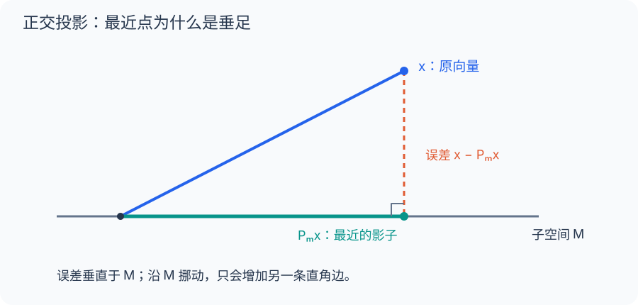

[数学总导航](../00-%E6%95%B0%E5%AD%A6%E5%AD%A6%E4%B9%A0%E5%AF%BC%E8%88%AA.md) · [本课程目录](00-%E4%B8%BA%E4%BB%80%E4%B9%88%E8%A6%81%E6%8A%8A%E5%87%BD%E6%95%B0%E5%BD%93%E4%BD%9C%E7%82%B9.md) · [← 上一章](06-%E6%B5%8B%E5%BA%A6%E3%80%81Lebesgue%20%E7%A7%AF%E5%88%86%E4%B8%8E%20Lp%20%E7%A9%BA%E9%97%B4.md) · [下一章 →](08-%E6%AD%A3%E4%BA%A4%E5%B1%95%E5%BC%80%E3%80%81Fourier%20%E4%B8%8E%20Parseval.md)

## 空调只能设一个温度，怎样让一天的偏差最小？

假设你希望空调上午维持 20°C、下午维持 24°C，两段时间等长；设备却只允许全天设一个温度 $c$。

若用平方误差衡量不满意程度，平均损失为 $[(20-c)^2+(24-c)^2]/2=(c-22)^2+4$。设 22°C 最好。这不是“两个数取平均”的巧合，而是把温度需求投影到“全天恒定”这类允许方案上。

如果下午持续时间是上午三倍，损失就变成 $[(20-c)^2+3(24-c)^2]/4$，最优温度是 23°C。内积里的权重决定什么误差更重要；投影不是脱离应用的纯几何玩具。

## 最佳常数为何是加权平均

把空调两段损失推广：目标温度为 $T_i$，持续时间权重为 $w_i>0$ 且总和为 1。损失 $L(c)=\sum_iw_i(T_i-c)^2$。

令 $m=\sum_iw_iT_i$，把 $T_i-c=(T_i-m)+(m-c)$ 代入。因为 $\sum_iw_i(T_i-m)=0$，交叉项消失：

$$
L(c)=\sum_iw_i(T_i-m)^2+(m-c)^2.
$$

所以最佳常数就是 $m$。这条分解与投影的勾股定理完全同构：总误差等于不可消除部分加上选错常数带来的额外代价。

## 闭性与凸性具体避免什么问题

如果设备允许设定 $c<22$，却禁止恰好 22，损失可以越来越接近最小值，却取不到。这是集合没把极限点留下，缺了闭性。

如果设备只许设 20 或 24，两个设定对对称需求一样好，没有唯一最优。这是可行集合不凸，中间折中方案被排除。

Hilbert 投影定理在说：完备环境中，只要可行集合非空、闭、凸，最小距离就能取到且只有一个点。线性子空间给出的更强结构，是最近点与误差之间的正交关系。

## 再做一个不是常数的拟合

用直线 $a+bt$ 近似 $t^2$（$0\le t\le1$），平方误差最小的条件是误差同时与 1、$t$ 正交：

$$
\int_0^1(t^2-a-bt)dt=0,\quad
\int_0^1t(t^2-a-bt)dt=0.
$$

积分后得到 $a+b/2=1/3$、$a/2+b/3=1/4$。第二式减第一式的一半，得 $b/12=1/12$，所以 $b=1,a=-1/6$。

你可以把它看成无限多个时间点上的最小二乘。未知参数仍只有两个，数据从有限测量变成整条曲线，求解结构却没有改变。

## Riesz 表示把读数仪器变成内部方向

在欧氏空间里，任何加权评分 $F(x)=a_1x_1+\cdots+a_dx_d$ 都能写成与权重向量的点积。Riesz 表示保证这种关系在 Hilbert 空间中继续成立，只要读数线性且连续。

例如 $F(f)=\int_0^1f(t)(1+t)dt$ 对应内部方向 $y(t)=1+t$。这会让寻找读数、定义伴随和研究优化梯度都统一为内积计算。但若读数本来不连续，如普通 $L^2$ 的单点评价，就没有这个表示可用。

## 带你做：一组基函数不正交，怎样找最佳近似

想用 $a+bt$ 近似 $f(t)=1+t^2$。因为 $1$ 与 $t$ 不正交，不能分别读取两个系数后就直接相加。

设置误差与两个允许方向都正交，得到 $a+b/2=4/3$、$a/2+b/3=3/4$。第二式减第一式的一半，得 $b/12=1/12$，所以 $b=1,a=5/6$。

最后核对两项积分都为零。若你得到别的系数，别只比较曲线看着像不像，直接计算这两个正交条件，就能找到错误。

这也说明投影本身与基的选择无关：换成正交基 $1,t-1/2$ 会让计算更方便，但最后的最佳函数仍是 $5/6+t$。坐标可以换，几何答案不能跟着换。

## 回头整理：定义、工具与练习

### 函数之间也能问夹角

在 $L^2[0,1]$ 中定义 $\langle f,g\rangle=\int_0^1f\overline g$。Hölder 保证积分有限，Cauchy–Schwarz 保证其诱导的范数满足三角不等式。带内积且在诱导范数下完备的空间叫 Hilbert 空间。

$\ell^2$、$L^2$ 都是 Hilbert 空间；一般 $L^p$（$p\ne2$）不是此范数下的内积空间。内积范数必须满足平行四边形恒等式：

$$
\|x+y\|^2+\|x-y\|^2=2\|x\|^2+2\|y\|^2.
$$

事实上它也是范数可由内积诱导的充分条件，内积可用极化恒等式恢复。

### 最近点为何需要闭与凸

设 $C$ 为 Hilbert 空间的非空闭凸子集，则对每个 $x$，存在唯一 $p\in C$ 最小化 $\|x-p\|$。

证明：设距离下确界为 $d$，取极小化序列 $y_n$。凸性保证中点在 $C$，平行四边形恒等式给出

$$
\|y_n-y_m\|^2
\le2\|x-y_n\|^2+2\|x-y_m\|^2-4d^2\to0.
$$

因此它是 Cauchy 列。完备性给极限，闭性把极限留在 $C$，范数连续性使距离达到 $d$。同样的中点论证给唯一性。各条件在证明里各司其职。

### 对子空间，最近点就是正交投影

若 $C=M$ 是闭线性子空间，最优点满足

$$
x=P_Mx+(x-P_Mx),\qquad x-P_Mx\perp M.
$$

理由：对任意 $v\in M$，$\|x-p-tv\|^2$ 在 $t=0$ 最小，线性项为零；复数情形再对 $iv$ 检查虚部。于是 $H=M\oplus M^\perp$，$P_M$ 线性且 $\|P_M\|\le1$。

若 $M$ 不闭，最近点可能不存在。比如 $c_{00}\subset\ell^2$，取不属于 $c_{00}$ 的 $x\in\ell^2$：距离下确界为零，却不能达到。

### 最佳常数近似

把 $f(t)=t$ 投影到常数函数子空间，正交条件为 $\int_0^1(t-c)dt=0$，所以 $c=1/2$，最小平方误差为 $\int_0^1(t-1/2)^2dt=1/12$。

这是最小二乘、取均值和 Fourier 系数共同的几何原型。

### Riesz 表示：每个连续线性读数都是内积

每个连续线性泛函 $F:H\to\mathbb F$ 都能唯一表示为

$$
F(x)=\langle x,y\rangle,\qquad\|F\|=\|y\|.
$$

证明思路：若 $F\ne0$，其核是闭超平面，投影定理说明其正交补为一维，沿该方向可确定唯一 $y$。范数等式由 Cauchy–Schwarz 和测试 $x=y/\|y\|$ 得到。

按本课程的复内积约定，$y\mapsto F_y$ 是共轭线性的，不能把这点忽略。Riesz 表示不是说所有 Banach 空间的对偶都可用空间内部的内积表示。

### 练习与解答

1. 求 $t^2$ 到 $\operatorname{span}\{1,t\}$ 的投影。
2. $C=\{-1,1\}\subset\mathbb R$ 对零点有唯一最近点吗？

解答：1. 令 $p=a+bt$，解 $1/3-a-b/2=0$、$1/4-a/2-b/3=0$，得 $p=t-1/6$。2. 没有，两个点都最近；闭性本身不足以保证唯一，凸性不能省略。

---

[数学总导航](../00-%E6%95%B0%E5%AD%A6%E5%AD%A6%E4%B9%A0%E5%AF%BC%E8%88%AA.md) · [本课程目录](00-%E4%B8%BA%E4%BB%80%E4%B9%88%E8%A6%81%E6%8A%8A%E5%87%BD%E6%95%B0%E5%BD%93%E4%BD%9C%E7%82%B9.md) · [← 上一章](06-%E6%B5%8B%E5%BA%A6%E3%80%81Lebesgue%20%E7%A7%AF%E5%88%86%E4%B8%8E%20Lp%20%E7%A9%BA%E9%97%B4.md) · [下一章 →](08-%E6%AD%A3%E4%BA%A4%E5%B1%95%E5%BC%80%E3%80%81Fourier%20%E4%B8%8E%20Parseval.md)
