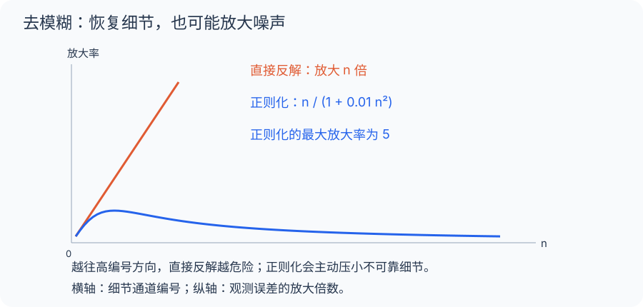

[数学总导航](../00-%E6%95%B0%E5%AD%A6%E5%AD%A6%E4%B9%A0%E5%AF%BC%E8%88%AA.md) · [本课程目录](00-%E4%B8%BA%E4%BB%80%E4%B9%88%E8%A6%81%E6%8A%8A%E5%87%BD%E6%95%B0%E5%BD%93%E4%BD%9C%E7%82%B9.md) · [← 上一章](12-%E5%BC%B1%E6%94%B6%E6%95%9B%E3%80%81%E5%BC%B1%E6%98%9F%E6%94%B6%E6%95%9B%E4%B8%8E%E8%87%AA%E5%8F%8D%E6%80%A7.md) · [下一章 →](14-%E8%B0%B1%E3%80%81%E7%B4%A7%E8%87%AA%E4%BC%B4%E7%AE%97%E5%AD%90%E4%B8%8E%20Fredholm%20%E7%90%86%E8%AE%BA.md)

## 手机拍糊了，为什么一去模糊就满屏颗粒？

用一个简化模型：照片拆成不同细节通道，模糊过程把第 $n$ 个通道的幅度除以 $n$。粗轮廓保留较多，越细的纹理越被压小。

假设第 1000 个通道真实输出只有 0.001，叠加了 0.001 的测量噪声。反向乘以 1000 后，真实幅度恢复为 1，但噪声也变成 1。你想恢复的细节和放大的颗粒混在一起。

紧算子常体现这种“高编号方向越来越被压小”的特征。前向处理很稳定，反向恢复却可能极不稳定。截断或正则化，就是在恢复细节和压住噪声之间作选择。

## 把模糊机的近似成本算出来

$Kx=(x_n/n)$，只保留前 $N$ 个输出通道得到 $K_N$。若输入总能量最多为 1，则遗漏输出满足

$$
\|(K-K_N)x\|^2=\sum_{n>N}\frac{|x_n|^2}{n^2}
\le\frac1{(N+1)^2}\sum_{n>N}|x_n|^2
\le\frac1{(N+1)^2}.
$$

因此整个单位球上的最坏误差至多为 $1/(N+1)$，输入 $e_{N+1}$ 又能达到它。这是统一的有限维近似，不只是某一张照片恰好压缩得好。

给定误差 0.01，只需 $N\ge99$ 就够控制这台机器的所有单位输入输出。有限维输出再可用有限张小网覆盖，于是输出族相对紧。

## 有限维近似不意味着原输入可压缩

输入中的高编号通道仍可能拥有全部能量，例如 $e_{1000000}$。只是模糊机把它压得很小，所以输出易近似。

因此紧算子描述的是机器对有界输入族的压缩效果，而不是声称所有原图本来简单。无限维恒等机器不会压小任何新方向，正是因为这样，它不紧。

## 反求时，前面得到的好处怎样变成坏处

前向把第 $n$ 个方向除以 $n$，使输出尾部容易忽略；反向则要乘 $n$，恰好把尾部不确定性重新放大。让前向输出可有限描述的机制，正是逆问题的危险来源。

假设观测噪声二范数最多为 $\delta$，只恢复前 $N$ 个通道时，噪声放大至多为 $N\delta$。真实信号的尾部又带来偏差 $\|(I-P_N)x\|$。总误差可估为

$$
\|x_N^{\delta}-x\|\le N\delta+\|(I-P_N)x\|.
$$

第一项随 $N$ 增大变坏，第二项通常变好。这份误差分解把“恢复多少细节”变成可以分析的权衡，也说明为什么不能永远增加分辨率而无视噪声。

## 带你做：同样有界的两台对角机器，哪台紧

机器 A 把第 $n$ 个通道乘 $1/n$，机器 B 乘 $(-1)^n$。二者算子范数都是 1，但只有 A 紧。

对 A，截断尾部的统一误差为 $1/(N+1)$，会趋零；对 B，遗漏任意靠后的单位通道仍有单位输出，有限截断的误差始终为 1。B 只是不断翻转符号，没有压缩新方向。

还可以直接看单位输入序列。A 的输出 $e_n/n$ 强趋零；B 的输出 $(-1)^ne_n$ 两两距离为 $\sqrt2$，不存在收敛子列。

这里检验一条序列足以否定紧性，却不足以单独证明紧性；证明 A 紧时，我们使用的是对整个单位球的有限秩一致逼近。分清“反例一条就够”和“正面证明要覆盖全部输入”，是学习定义时很重要的逻辑习惯。

## 回头整理：定义、工具与练习

### 无限方向被逐渐压小

在 $\ell^2$ 上定义 $Kx=(x_1,x_2/2,x_3/3,\ldots)$。越靠后的方向越被压缩。这让所有有界输入的输出，在给定误差下都能主要由有限个坐标描述。

有界线性算子 $K:X\to Y$ 称为紧算子，如果每个有界序列 $(x_n)$ 的像都有一个在 $Y$ 中范数收敛的子列。等价地，单位球像的闭包紧。

### 有限秩与算子范数极限

有界有限秩算子是紧的，因为其输出落在有限维空间，那里有界序列可提取收敛子列。

若 $Y$ Banach，紧算子的算子范数极限仍紧。证明思路：对给定精度先用一个紧算子近似，再用有限小球覆盖其单位球像，得到极限算子像的全有界性；闭包在完备值域中完备，因此紧。

对 $K$ 取截断 $K_N$，仅保留前 $N$ 坐标，便有

$$
\|K-K_N\|=\frac1{N+1}\to0.
$$

所以 $K$ 紧。更一般的对角算子 $D_ax=(a_nx_n)$ 在 $\ell^2$ 上紧，当且仅当 $a_n\to0$。必要性可用 $D_ae_n=a_ne_n$ 检查。

### 单位算子为何不紧

无限维赋范空间的恒等算子不紧；对 $\ell^2$ 已有 $e_n$ 反例，一般结论可由 Riesz 引理构造保持间距的单位向量序列。

因此无限维 Banach 空间上的紧算子不能拥有定义在整个值域空间上的有界逆。否则恒等算子 $K^{-1}K$ 也是紧的，矛盾。

### 逆问题里发生了什么

对 $Kx=y$，逐坐标解是 $x_n=ny_n$，但任意 $y\in\ell^2$ 未必得到 $x\in\ell^2$。即使限制到像空间，逆也不有界。

观测误差 $y^{(n)}=e_n/n$ 满足 $\|y^{(n)}\|\to0$，反解却是 $e_n$，大小不减。反问题的不稳定有明确的方向与放大率，而不是计算机精度不够这一种原因。

截断正则化只恢复前 $N$ 坐标：会留下截断偏差，却限制噪声放大。$N$ 太小漏掉信息，太大又放进高频噪声。

### 积分算子的紧性

若 $k\in C([0,1]^2)$，则 $Tf(t)=\int_0^1k(t,s)f(s)ds$ 从 $C[0,1]$ 到自身为紧算子。单位球像一致有界，且由核的一致连续性得到等度连续，再应用 Arzelà–Ascoli 定理。

在 $L^2$ 框架中，平方可积核给出 Hilbert–Schmidt 算子，并且是紧的。证明可用有限和的乘积核在 $L^2$ 中逼近，再用算子范数估计。这里引用这类逼近的标准稠密性结论。

Hilbert 空间上紧算子可由有限秩算子作算子范数逼近；一般 Banach 空间中不能不加近似性质就宣称同一结论。

### 练习与解答

1. $a_n=(-1)^n$ 的对角算子紧吗？
2. 紧算子一定有界吗？
3. 有界线性算子与紧算子复合是否仍紧？

解答：1. 不紧，像的标准单位向量保持固定间距。2. 按本章定义已经要求有界；在线性映射中，单位球相对紧本身也保证有界。3. 是，只要复合的定义域和值域匹配，前后任一侧与有界算子复合都保持紧性。

---

[数学总导航](../00-%E6%95%B0%E5%AD%A6%E5%AD%A6%E4%B9%A0%E5%AF%BC%E8%88%AA.md) · [本课程目录](00-%E4%B8%BA%E4%BB%80%E4%B9%88%E8%A6%81%E6%8A%8A%E5%87%BD%E6%95%B0%E5%BD%93%E4%BD%9C%E7%82%B9.md) · [← 上一章](12-%E5%BC%B1%E6%94%B6%E6%95%9B%E3%80%81%E5%BC%B1%E6%98%9F%E6%94%B6%E6%95%9B%E4%B8%8E%E8%87%AA%E5%8F%8D%E6%80%A7.md) · [下一章 →](14-%E8%B0%B1%E3%80%81%E7%B4%A7%E8%87%AA%E4%BC%B4%E7%AE%97%E5%AD%90%E4%B8%8E%20Fredholm%20%E7%90%86%E8%AE%BA.md)
