[数学总导航](../00-%E6%95%B0%E5%AD%A6%E5%AD%A6%E4%B9%A0%E5%AF%BC%E8%88%AA.md) · [本课程目录](00-%E4%BB%8E%E7%AE%AD%E5%A4%B4%E5%88%B0%E5%87%BD%E6%95%B0%E7%A9%BA%E9%97%B4.md) · [← 上一章](00-%E4%BB%8E%E7%AE%AD%E5%A4%B4%E5%88%B0%E5%87%BD%E6%95%B0%E7%A9%BA%E9%97%B4.md) · [下一章 →](02-%E7%9F%A9%E9%98%B5%E6%98%AF%E4%B8%80%E5%8F%B0%E5%8F%98%E6%8D%A2%E6%9C%BA%E5%99%A8.md)

早餐会需要 **5 盒牛奶、4 袋面包**，供应商却只卖两种不能拆开的套餐：

| 套餐 | 牛奶（盒） | 面包（袋） |
| --- | --- | --- |
| A | 1 | 2 |
| B | 2 | 1 |

你不想买多，也不想买少。A、B 各买几包？

这个问题用小学算术就能开始，最后会走到线性代数最要紧的几件事：几种基本材料能拼出哪些结果，同一个结果有没有不同配法，材料清单能不能既够用又不重复。

先把早餐真的配出来，名字留到后面再起。图只画清单，横轴是牛奶盒数，纵轴是面包袋数；牛奶和面包并没有真的东、北方向。

## 1．先试着买，不要急着背向量的定义

### 1.1 为什么只用试四种买法？

每包套餐都有三件东西，目标共有九件。因此，如果能恰好买齐，一定总共买三包。

A 的包数只能是 0、1、2、3；B 的包数相应为 3、2、1、0。把四种结果列出来：

| A 的包数 | B 的包数 | 得到的清单（牛奶盒数，面包袋数） |
| --- | --- | --- |
| 0 | 3 | $(6,3)$ |
| 1 | 2 | $(5,4)$ |
| 2 | 1 | $(4,5)$ |
| 3 | 0 | $(3,6)$ |

答案是 A 一包、B 两包。这个试法不是碰巧撞到了答案：总包数已经由总件数确定，四种非负整数分配全部检查过了。

### 1.2 两张清单怎样合并？

用一个有顺序的数对记每包内容：

$$
u=(1,2),\qquad v=(2,1).
$$

第一栏始终是牛奶，第二栏始终是面包。两包 B 的清单是 $2v=(4,2)$，再加一包 A：

$$
u+2v=(1,2)+(4,2)=(5,4).
$$

同类物品对应相加，正好得到需要的结果。向量加法就是逐项相加，数乘就是整张清单同乘一个数。

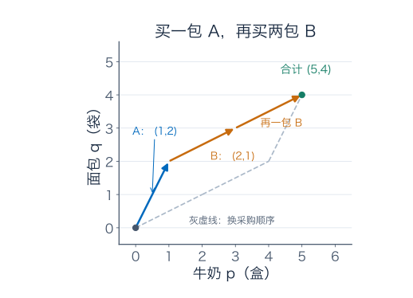

图把一张清单画成从起点指向终点的箭头。先买 A 再买两包 B，与先买两包 B 再买 A，途中清单不同，最后总数相同。箭头头尾相接，只是在表示逐项相加。

我们把这样能整体相加、整体按倍数调整的对象叫作**向量**。目前用数对表示它，竖着写也一样：

$$
u=\begin{pmatrix}1\\2\end{pmatrix},\qquad
v=\begin{pmatrix}2\\1\end{pmatrix}.
$$

列写法没有改变清单内容，下一篇写矩阵时会更方便。

## 2．乘一个数，到底改动了什么？

### 2.1 加倍、减半与撤销，先分别说清楚

$3u=(3,6)$ 表示三包 A 的内容：每一栏都同时乘 3，不是只乘第一栏。

如果暂时允许数学上的半份，$u/2=(1/2,1)$；系数为零，得到 $0u=(0,0)$，即空清单。乘数称为**标量**，本篇统一取实数，也就是允许正数、零、负数和分数。

负数有什么用？例如用“入库为正、退货为负”记库存变动，$-u=(-1,-2)$ 表示退回一包 A，且

$$
u+(-u)=(0,0).
$$

零向量表示“没有净变动”，不等于中间什么也没发生。先买再退，交易发生过，但最后净清单是零。

允许负数和分数参与代数，不等于供应商会卖负套餐、半套餐。运算所在的数学背景和实际能下单的范围是两件事，下面用一个具体目标看区别。

### 2.2 每一栏的意义不能偷偷换掉

如果另一个人把第一栏写成面包、第二栏写成牛奶，他的 $(1,2)$ 就不是我们的 $(1,2)$。合并前必须把栏位和单位对齐。

同样，$(1,2)$ 与 $(1000,2)$ 可能只是第一栏换了计量单位，也可能是完全不同的采购量，单看数字判断不了。先约定坐标含义再计算，这本身就是线性模型的一部分。

在这张采购图上，箭头长度也不能自动解释为“物品总数”或“采购成本”。两种物品的坐标只是记账数值；若想算成本，需要另外给牛奶和面包的单价。

### 2.3 换成走路，同样的运算又有方向含义

在地图上约定东为第一坐标正方向、北为第二坐标正方向，单位都取米。若第一段位移为 $(2,1)$、第二段为 $(-1,2)$，总位移就是

$$
(2,1)+(-1,2)=(1,3).
$$

第二段的负号表示向西，数乘 $-1$ 就表示反向。这里两栏单位相同，箭头长度有真正的距离意义；但净位移的长度仍不等于绕路走过的总路程。

清单和位移的生活解释不同，逐项相加、整体数乘的运算结构却相同。线性代数抓的是这个结构，不要求每个向量都是一根实物箭头。

## 3．换一份任意清单，还能配出来吗？

### 3.1 从试四次，走向一次通用计算

令 A、B 的份数为 $a,b$。无论目标是什么，合成清单始终为

$$
au+bv=(a+2b,\ 2a+b).
$$

这种先分别数乘、再相加的表达叫**线性组合**。输入是各套餐的份数，输出是采购结果。

目标若是 $r=(p,q)$，就要求

$$
a+2b=p,\qquad 2a+b=q.
$$

两条方程分别在核对牛奶和面包。

消去 $a$：第一式乘 2，再减第二式，得到 $3b=2p-q$。同样消去 $b$，得到 $3a=2q-p$。因此

$$
\boxed{a=\frac{2q-p}{3},\qquad b=\frac{2p-q}{3}.}
$$

把公式用于最初的 $(5,4)$，得到 $a=(8-5)/3=1$、$b=(10-4)/3=2$，与逐个试买一致。

再代回任意目标核对：

$$
a+2b=\frac{2q-p+4p-2q}{3}=p,\qquad
2a+b=\frac{4q-2p+2p-q}{3}=q.
$$

只要 $p,q$ 是实数，公式就给出一组实数系数，且它们没有别的取值。因此，在允许任意实数系数的代数模型里，每个平面目标都能唯一表示。

### 3.2 目标 $(1,0)$：代数上能表示，采购却失败

只想要一盒牛奶、不要面包，公式给出

$$
a=-\frac13,\qquad b=\frac23.
$$

代数完全对：

$$
-\frac13(1,2)+\frac23(2,1)
=\left(-\frac13+\frac43,-\frac23+\frac23\right)=(1,0).
$$

但实际下单不能靠退回三分之一包 A 来抵消面包。方程有解，只是这个解不满足只买不退、整包购买的限制。

如果先放宽整包限制，只要求 $a,b\ge0$，公式告诉我们必须满足

$$
p\le2q,\qquad q\le2p.
$$

这两个不等式已迫使 $p,q$ 非负：例如合起来有 $p\le2q\le4p$，故 $p\ge0$，同理 $q\ge0$。可行结果只在两个套餐方向夹住的扇形区域中，不是整个第一象限。纯牛奶方向 $(1,0)$ 落在外面。

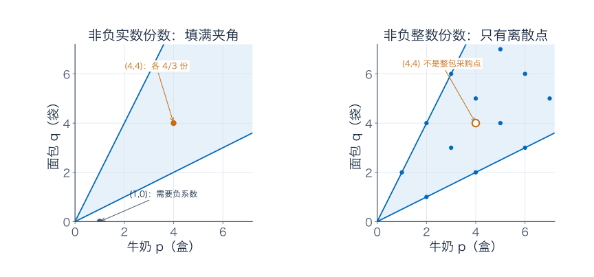

### 3.3 目标 $(4,4)$：份数非负，也未必能整包购买

这次 $a=b=4/3$，都为正，所以目标位于扇形内。但两种套餐都需要买三分之四包，仍然不能下单。

对整数目标 $(p,q)$，除了前面的非负条件，还要 $a,b$ 是整数。一眼就能先排除的情况是：$p+q$ 不是 3 的倍数，因为每包都只有三件。$(4,4)$ 共八件，当然凑不成。

这里这个检查配合非负条件也是充分的：若 $m=(p+q)/3$ 为整数，则

$$
a=q-m,\qquad b=p-m
$$

也都是整数；前面两个不等式又保证它们非负。这个结论依赖当前两种套餐的具体内容，不是任意采购模型都只查总件数就够。

### 3.4 若总共只允许“一份混合配方”，结果又变了

假设不再下整包订单，而是研究两种配方的连续混合比例。总份数固定为 1，意味着 $a+b=1$；只取非负份数，意味着 $0\le a\le1$。结果为

$$
au+(1-a)v.
$$

$a=0$ 是纯 B，$a=1$ 是纯 A，$a=1/2$ 得 $(1.5,1.5)$。全部结果在连接 $u,v$ 的线段上，总件数按连续模型计算始终是 3。

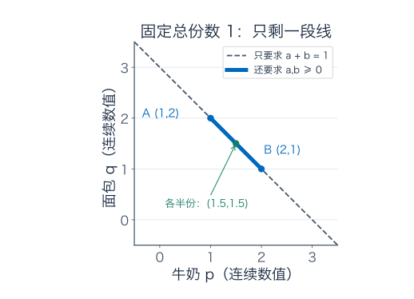

目标 $(3,3)$ 虽然等于 $u+v$，却需要两份，不能塞进固定一份的规则里。系数范围一改，可行结果就改变：

| 系数范围 | 结果集合 | 问的是什么 |
| --- | --- | --- |
| 任意实数 $a,b$ | 整个平面 | 代数上能否表示 |
| 非负实数 $a,b$ | 两方向夹住的区域 | 允许分份、只加不减 |
| 非负整数 $a,b$ | 区域内离散的采购点 | 实际整包订单 |
| $a,b\ge0$ 且 $a+b=1$ | 两端点之间的线段 | 固定总份数的连续混合 |

## 4．把能表示的结果收在一起，才叫张成

### 4.1 两种套餐不一定带来两种独立能力

先回到允许所有实数系数的代数问题。现在供应商把 B 换成新套餐 D：

$$
d=(2,4)=2u.
$$

D 只是 A 的双份装。任意组合都能写成

$$
au+bd=(a+2b)u.
$$

无论写两个系数还是只写一个系数，结果的面包数总是牛奶数的两倍，只能落在 $q=2p$ 这条过原点的直线上。目标 $(5,4)$ 即使允许负数、分数也做不到，因为 $4\ne2\times5$。

原先 B 为 $(2,1)$ 时，整个平面都能到达；改成双份 A 后，只剩一条线。关键不是供应商列了几款商品，而是有没有带来原来拼不出的结果。

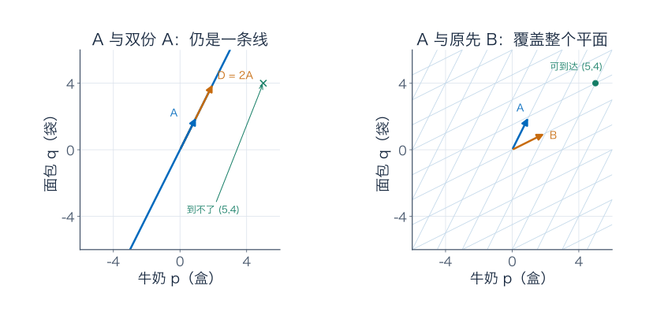

对于向量 $v_1,\ldots,v_k$，所有有限实线性组合组成的集合，叫它们的**线性张成**：

$$
\operatorname{span}\{v_1,\ldots,v_k\}
=\{c_1v_1+\cdots+c_kv_k:c_1,\ldots,c_k\in\mathbb R\}.
$$

本篇的 $\operatorname{span}$ 默认包含负系数和分数系数，不能拿它直接代替整包订单集合。

因此 $\operatorname{span}\{u,v\}=\mathbb R^2$，$\operatorname{span}\{u,d\}$ 是一条直线；若手里只有零向量，张成就只有零。图中的线和平面都无限延伸，画框只是截取一部分。

### 4.2 多加一款 C，会不会让配法不唯一？

再把原先的 A、B 留着，加入套餐 C：

$$
c=(3,3)=u+v.
$$

目标 $(5,4)$ 现在至少有两种整包买法：A 一包、B 两包；或者 B 一包、C 一包。

$$
u+2v=0u+v+c=(5,4).
$$

把两份配法相减：

$$
u+v-c=0.
$$

这条等式说的是：多加一包 A、多加一包 B，同时少一包 C，结果完全不变。

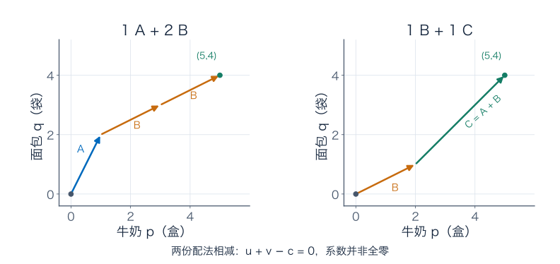

## 5．线性无关，不是“看起来方向都不同”

若一组向量的组合等于零，只有把每个系数都取零才能做到，这组向量就叫**线性无关**。若存在另一种系数不全为零、结果却为零的配法，就叫线性相关。

写成公式是：

$$
a_1v_1+\cdots+a_kv_k=0
\quad\Longrightarrow\quad a_1=\cdots=a_k=0.
$$

定义在检查整组是否有冗余。刚才 $u+v-c=0$ 的系数为 $(1,1,-1)$，不全为零，所以 A、B、C 相关。三条箭头两两都不平行，判断照样是相关；两两检查代替不了整组检查。

对原先的 $u,v$，若 $au+bv=0$，就是把第 3 节公式中的 $p,q$ 设为零，得到 $a=b=0$。所以这两条确实无关。

### 5.1 为什么相关关系意味着“有一种可以删掉”？

假如 $a_1v_1+\cdots+a_kv_k=0$，至少有一个系数，例如 $a_j\ne0$，就能解出

$$
v_j=-\sum_{i\ne j}\frac{a_i}{a_j}v_i.
$$

这个向量可以由其他向量拼出来。任何用到它的组合，都能代入右边改写，所以删掉它不会减少可表示的结果。

本例直接用 $c=u+v$ 即可：

$$
au+bv+ec=(a+e)u+(b+e)v.
$$

反过来，原先只用 $u,v$ 的组合本来就是 $e=0$ 的情形，所以删 C 前后的张成完全相同。

若一组里含零向量，也必然相关：给零向量系数 1，其他系数全零，就是非全零系数的零组合。“全零系数能得到零”从来不是独立性的证据，因为任何一组都做得到。

### 5.2 为什么无关性能保证表示唯一？

假设同一个结果有两种表示：$r=au+bv=a'u+b'v$。相减得到

$$
(a-a')u+(b-b')v=0.
$$

如果 $u,v$ 无关，只能 $a-a'=b-b'=0$，两份系数表其实一样。因此无关性让“材料份数”成为可靠的坐标。

如果有非零关系 $\sum c_iv_i=0$，则可以往任一份系数表加上 $s(c_1,\ldots,c_k)$，$s$ 为任意实数，结果却不变。只有先限定所有系数都可取实数时，这种自由改法才没有额外限制。实际订单还要重新检查非负、整数条件。

## 6．基：既配得出全部结果，又只配出一份系数表

在一个要研究的空间里，一组向量既能张成整个空间、又线性无关，就叫这个空间的一组**基**。

张成解决“够不够用”，无关解决“有没有冗余”。前面求出的通用公式，同时证明 $u=(1,2),v=(2,1)$ 是平面的一组基：每个目标都有表示，而且只有一种。

最熟悉的基是 $e_1=(1,0),e_2=(0,1)$。目标 $(5,4)$ 在这组基下写成 $5e_1+4e_2$；在有序基 $B=(u,v)$ 下写成 $1u+2v$，所以

$$
[(5,4)]_{(e_1,e_2)}=\begin{pmatrix}5\\4\end{pmatrix},\qquad
[(5,4)]_B=\begin{pmatrix}1\\2\end{pmatrix}.
$$

同一张采购结果，用“单件牛奶和单件面包”记份数，是 5 和 4；用“A 和 B”记份数，是 1 和 2。变的是描述结果的坐标，结果本身没变。

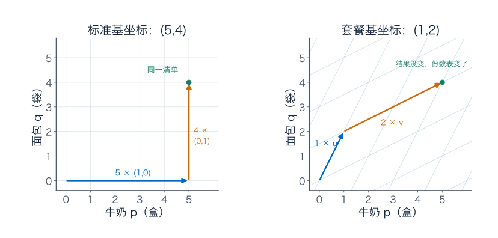

如果把基顺序改成 $(v,u)$，坐标就变成 $(2,1)$。因此只报一列数字，不报按什么顺序、相对于哪组基，信息并不完整。

基不要求正交，也不要求每条向量长度为 1。斜网格照样能作为坐标系统。

一组有限基有几个向量，就需要几个独立的坐标份数，这个数量叫空间的**维数**。同一个有限维空间的所有基大小相同，证明放在第四篇；眼下只管用它数独立自由度，别去数供应商写了几款套餐。A、B、C 三款仍只张成二维平面。

## 7．向量空间不是一个大盒子里的“所有东西”

### 7.1 它必须允许我们持续做已经学过的运算

所有实数数对组成的集合记为 $\mathbb R^2$。在上面用逐项相加、实数数乘，每次操作仍得到实数数对，并遵守熟悉的交换、结合、分配等规则。这样的背景叫**实向量空间**。

所有含 $n$ 个实数的有序列表同样组成 $\mathbb R^n$：

$$
(x_1,\ldots,x_n)+(y_1,\ldots,y_n)
=(x_1+y_1,\ldots,x_n+y_n),\qquad
\alpha(x_1,\ldots,x_n)=(\alpha x_1,\ldots,\alpha x_n).
$$

一张 24 小时的逐时用电记录，可以在约定单位后成为 $\mathbb R^{24}$ 的一个向量；不需要先想象 24 根互相垂直的实物轴。

合并、撤销、改变份数可以一直做下去，计算也不因分组或写法而矛盾；这些规则完整列在补充 A。单有一个集合名字不够，还得说清允许什么标量、怎样加法、怎样数乘。向量空间本身不带长度和角度，范数和内积是后面另加的。

### 7.2 “总件数不变”的增量，是一个可保留的线性结构

假设在两种库存间调配，暂时只研究带正负号的变动数值，不加实际库存上下限与整数限制。若总件数不变，变动清单 $(p,q)$ 就满足

$$
p+q=0.
$$

比如 $(-1,1)$ 表示牛奶减少一、面包增加一；$(-2,2)$ 表示同类的另一笔调整。合并后为 $(-3,3)$，总变动仍为零。把任何一笔整体乘实数，总变动也仍为零；零清单当然在内。

因此 $W=\{(p,q):p+q=0\}$ 继承原来的运算，自己也成为向量空间，叫 $\mathbb R^2$ 的**子空间**。

在已知向量空间里检查子空间，其他运算规则可以继承，实际只需核对三项：

1. 零向量在集合里。
2. 集合里的两个向量相加，结果仍在里面。
3. 集合里的向量乘任意实数，结果仍在里面。

后两项称为对相应运算封闭，意思就是“算完不要跑出去”。这和后来“极限也留在里面”的闭集含义不同。

### 7.3 为什么固定九件的清单不是子空间？

固定总件数为九，满足 $p+q=9$。它不含零清单，已经不合格；两份九件清单相加会变成十八件，数乘 2 也一样。

但它并非毫无结构。选一张参照清单 $r_0=(5,4)$，其他满足 $p+q=9$ 的实数清单，都能写成

$$
(p,q)=(5,4)+(s,-s).
$$

把两张固定九件的清单相减，差又回到 $W$。这叫 $W$ 的一个**仿射平移**：记录实际位置时有固定偏置，记录相对变化时才有过零的线性结构。这里讨论整条实数直线；实际非负整数清单只在其中占一部分。

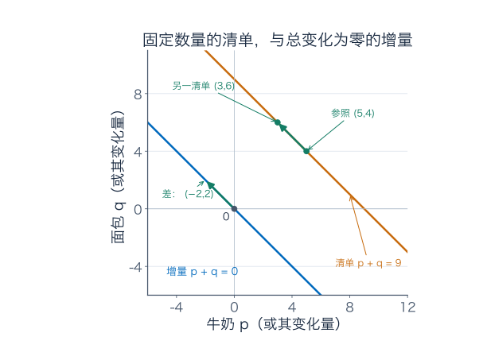

含零也不是万能通行证。平面上两条坐标轴的并集含零，任意数乘也留在轴上。但 $(1,0)+(0,1)=(1,1)$ 跑到轴外了，所以不是子空间。

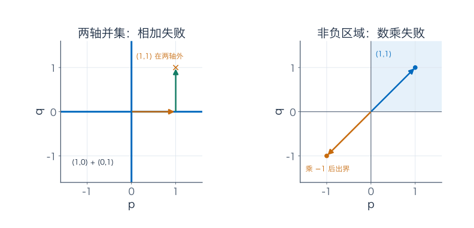

同样，第一象限连同边界虽然含零、可以相加，却经不起乘 $-1$。三项检查各自有用，不能只查“过不过原点”。

### 7.4 为什么张成总是子空间？

把任意两份组合 $\sum a_iv_i$、$\sum b_iv_i$ 相加，只需把系数改成 $a_i+b_i$；整体乘 $\alpha$，只需改成 $\alpha a_i$。全零系数又给零。因此所有实线性组合自然满足三项检查。

如果某个子空间已经包含全部 $v_i$，它还必须容纳它们的一切组合。所以张成是包含这些材料的最小子空间；这里的“最小”是按包含关系说的，不是在比较面积大小。

## 8．把一张数字清单换成整条曲线，结构还在吗？

### 8.1 两户用水，不只合并三个读数

先看一个具体信号。在一小时中，用 $t\in[0,1]$ 表示经过的小时比例；下面用升/分钟作为流量单位，只写数值。两户的用水速度模型分别是

$$
f(t)=2-t,\qquad g(t)=3t^2.
$$

第一户逐渐减少，第二户逐渐增加。总管在**同一时刻**的流量是

$$
q(t)=f(t)+g(t)=2-t+3t^2.
$$

| 小时比例 $t$ | 第一户 $f(t)$ | 第二户 $g(t)$ | 合计 $q(t)$ |
| --- | --- | --- | --- |
| 0 | 2 | 0 | 2 |
| $1/2$ | $3/2$ | $3/4$ | $9/4$ |
| 1 | 1 | 3 | 4 |

表格只是抽出三个时刻。真正的相加对每个 $t$ 都进行，输出是一整条新函数。

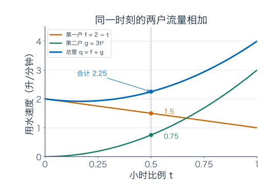

所有连续实函数组成的 $C[0,1]$，用

$$
(f+g)(t)=f(t)+g(t),\qquad(\alpha f)(t)=\alpha f(t)
$$

作为运算，也成为实向量空间。连续性被加法和数乘保留；零向量是每个时刻都为零的函数；相反向量是 $-f$。运算规则逐点继承自实数运算。

真实用水流量要求非负，不能把负流量直接解释为实际用水；整个函数空间则暂时允许负值，用于记录差额、修正与误差。与早餐套餐一样，背景空间和物理可行集合不同。

### 8.2 函数也能记“基础材料的份数”

把常数函数 $1$、一次函数 $t$、二次函数 $t^2$ 当材料，$q$ 的表达就是

$$
q=2\cdot1-1\cdot t+3\cdot t^2.
$$

系数 2、−1、3 是固定实数。$t$ 在这里是一个基础函数的名字，不能把它当成随位置改变的标量。例如，常数函数 1 的实线性张成只有所有常数函数；“用 $t$ 乘 1 就得到 $t$”改了标量约定，不是允许的固定实数数乘。

图纸上虽然只有横纵两轴，也不能据此说函数空间二维。横轴是函数的输入，纵轴是输出；空间里的一个向量，是整条函数，不是图上的一个点。

这三种函数材料是否独立？若 $a+bt+ct^2$ 在整个 $[0,1]$ 上为零，代入 $0,1/2,1$ 得

$$
a=0,\qquad b/2+c/4=0,\qquad b+c=0.
$$

中间一式乘 4，再减去最后一式，得到 $b=0$，继而 $c=0$。所以它们独立，并张成所有次数至多为 2 的多项式，记为 $P_2$。因此 $P_2$ 的维数是 3，尽管函数曲线只画在一张二维纸上。

“次数至多为 2”包括常数、一次函数和零函数。“次数恰好为 2”的集合却不是子空间，因为 $t^2+(-t^2)=0$ 已跑出这个集合。条件里两个小字，就会改变结构。

### 8.3 三个读数一样，就一定是同一条函数吗？

如果事先限定候选都属于 $P_2$，刚才的三次代入确实能唯一确定系数：两个候选的差仍在 $P_2$，若三个读数相同，差就只能处处为零。

但对于任意连续信号，不行。构造另一条

$$
\widetilde q(t)=q(t)+8t(t-1/2)(t-1).
$$

新增项在三个采样时刻 $0,1/2,1$ 都为零，所以它们的读数表完全相同；在 $t=1/4$，新增项却为

$$
8\times\frac14\times\left(-\frac14\right)\times\left(-\frac34\right)=\frac38.
$$

第一条预测为 $31/16=1.9375$，第二条为 $37/16=2.3125$，相差 0.375。

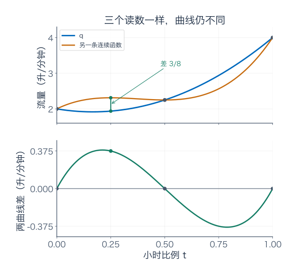

先限制模型空间，才有“三个样本够用”的结论；不能把有限模型里的唯一性直接搬到所有连续函数。零函数也必须处处为零，不能只检查几个时刻就宣布一整条信号为零。

## 9．进入矩阵之前，先分清两个问题

给定一组基础向量，先问它能否表示目标，再问表示是否唯一。

早餐里，A、B 足够且不冗余，能建立平面坐标；A 和双份 A 既不够覆盖平面，又有重复；A、B、C 能覆盖平面，却多出了互换关系。转到函数时，同样可以问几种基础曲线能否表示信号，以及份数是否确定。

“输入各材料份数，输出组合结果”，这套操作可以完整记成矩阵。先把操作做熟，矩阵才不是一张要背乘法规则的数字方块。

张成问可表示的范围，线性无关问有没有重复表示，基让每个对象都有唯一坐标。实际限制、采样和极限，都要在这套代数结构上另外说明。

## 10．练习：把对象、系数和限制分别写出来

**题一：三种“能配出”不要混用。** 用本篇 A、B，求目标 $(7,8)$ 的系数与总包数。再判断 $(1,0)$、$(4,4)$ 是否属于实线性张成、是否允许非负实数份数、是否能整包购买。若只能总共买三包，$(7,8)$ 还可行吗？

**题二：把负号换成地图上的走法。** 东、北为坐标正方向，位移 $r=(2,1)$ 米、$s=(-1,2)$ 米。求 $r+s$、$2r-s$，以及走完 $r+s$ 后回到原点的位移。若两段路各自是直线，两段总路程是否等于净位移长度？

**题三：加入 C 后，目标到底有几份配法？** 加入 $c=(3,3)$。写出非全零系数的零组合，并求目标 $(5,4)$ 在 $u,v,c$ 下的全部实数系数。再限制非负，最后限制整包购买。删掉 C 会不会缩小实线性张成？

**题四：三个坐标，未必三个自由度。** 判断以下集合是否为相应实向量空间的子空间：（1）$x+y-z=0$；（2）$x+y-z=1$；（3）平面上两个坐标都非负；（4）两条坐标轴的并集。对（1）给出一组基和维数，可先看补充 B。

**题五：用水信号的三个条件。** 在 $C[0,1]$ 中，分别判断满足 $f(0)=0$、满足 $f(0)=1$、满足处处 $f\ge0$ 的集合是否为子空间。每个判断给出运算保持条件的理由，或一个足以否定的反例。

**题六：系数表不等于读数表。** 对 $q=2-t+3t^2$，写出它在有序基 $(1,t,t^2)$ 下的坐标。再用 $B'=(1,1+t,1+t+t^2)$ 表示它，并证明 $B'$ 确是 $P_2$ 的基。与读数 $(q(0),q(1/2),q(1))$ 比较，说明三张数表各记什么。

**题七：增加一个样本，就能确定任意连续信号吗？** 第四次在 $t=1/4$ 采样，能否分清正文中的 $q,\widetilde q$？是否由此就能唯一确定任意连续函数？请构造一条与 $q$ 不同、却在 $0,1/4,1/2,1$ 四处读数相同的连续函数。

**题八：精确拼出与越来越接近。** 阅读补充 C。证明 $e^t$ 不属于 $1,t,t^2,\ldots$ 的有限实线性张成。若只要求 $[0,1]$ 上最大误差小于 $10^{-3}$，用 $e<3$ 与 Taylor 余项界找一个足够的阶数，解释为什么不矛盾。

### 参考答案与解题过程

#### 题一解答

对 $(7,8)$，系数公式给出

$$
a=(16-7)/3=3,\qquad b=(14-8)/3=2.
$$

检查 $3(1,2)+2(2,1)=(3,6)+(4,2)=(7,8)$。总共五包，整数且非负，可以实际下单。如果只允许三包就不可行：三包只有九件，目标共有十五件；它的唯一系数也确实不满足 $a+b=3$。

$(1,0)$ 的系数是 $(-1/3,2/3)$，属于实线性张成，但有负份数，既不属于非负实数可行区，也不可能整包购买。

$(4,4)$ 的系数是 $(4/3,4/3)$，属于实线性张成，也属于非负实数可行区；但不是整数，不能整包购买。八件总数不是三的倍数，也能先排除它。三种“能配出”问的是不同范围，不能只看到方程有解就宣布采购成功。

#### 题二解答

逐项计算：$r+s=(1,3)$，$2r-s=(4,2)-(-1,2)=(5,0)$。返回原点要走 $-(r+s)=(-1,-3)$，相加检查为零位移。

每段直线路程都是 $\sqrt{2^2+1^2}=\sqrt5$ 米，总路程为 $2\sqrt5$ 米。净位移长度则是 $\sqrt{1^2+3^2}=\sqrt{10}$ 米，并不相等。负号记录方向或反向操作，没有让实际路程变成负数。

#### 题三解答

$u+v-c=0$ 的系数 $(1,1,-1)$ 不全为零，故三向量相关。设 C 的份数为 $e$，由

$$
au+bv+ec=(a+e)u+(b+e)v=(5,4)
$$

以及 $u,v$ 表示唯一，得到 $a+e=1,b+e=2$，所以全部实数解为

$$
(a,b,e)=(1-e,\ 2-e,\ e),\qquad e\in\mathbb R.
$$

非负要求 $e\ge0,1-e\ge0,2-e\ge0$，合起来为 $0\le e\le1$。若还要求三者都是整数，$e$ 只能取 0 或 1，分别得到 $(1,2,0)$ 与 $(0,1,1)$，即两种整包买法。

删 C 不缩小实线性张成，因为任意用 C 的组合都可以改写成 $(a+e)u+(b+e)v$；原先的两向量组合又已经包含在三向量组合中。这里既展示了冗余，也分别检查了额外系数限制。

#### 题四解答

（1）是子空间。零向量满足等式；两份满足等式的向量相加，左边是两份零相加；任意实数数乘后左边仍为零。由 $z=x+y$，任意元素可写成

$$
(r,s,r+s)=r(1,0,1)+s(0,1,1).
$$

组合等于零时，看前两个坐标就迫使 $r=s=0$，所以这两向量独立，又能表示所有元素，构成一组基，维数为 2。

（2）不是，因为零向量不满足右端为 1；检查到这一项已足够否定。

（3）不是，$(1,0)$ 在内，乘以 $-1$ 得 $(-1,0)$，离开非负区域。它含零且对相加封闭，仍缺少任意实数数乘封闭。

（4）不是，$(1,0)$ 与 $(0,1)$ 都在并集中，和 $(1,1)$ 却不在任何一条轴上。它含零且对数乘封闭，失败在相加。两类反例说明三项检查不能互相代替。

#### 题五解答

满足 $f(0)=0$ 的集合是子空间。零函数在内；若 $f,g$ 满足该条件，对任意实数 $\alpha,\beta$，有

$$
(\alpha f+\beta g)(0)=\alpha f(0)+\beta g(0)=0.
$$

连续性又被线性组合保持，所以结果仍满足全部要求。

满足 $f(0)=1$ 的集合不含零函数，不是子空间；两条这样的函数相加，还会在零点变成 2。

处处非负的连续函数也不是子空间。常数函数 1 在内，乘 $-1$ 之后处处为负。物理可行信号可以形成有用的集合，但不因此就是整个实向量子空间。

#### 题六解答

在第一组基下，系数表为 $(2,-1,3)$。对 $B'$，设

$$
a+b(1+t)+c(1+t+t^2)
=(a+b+c)+(b+c)t+ct^2.
$$

与 $q$ 比较系数，得 $c=3,b+c=-1,a+b+c=2$，依次解得 $b=-4,a=3$，故 $[q]_{B'}=(3,-4,3)$。代回：常数项 $3-4+3=2$，一次项 $-4+3=-1$，二次项为 3。

对任意 $A+Bt+Ct^2$，同样有唯一解 $c=C,b=B-C,a=A-B$。因此 $B'$ 能表示每个 $P_2$ 元素且表示唯一，确实是一组基。

读数表为 $(2,9/4,4)$，和前两表都不同。前两表各记录一种基础函数的固定份数，后一表记录三个时刻的输出。三张表都恰好三个数，含义却不同，不能因为长度相同就当成同一种坐标。

#### 题七解答

第四次采样可以分清给定的那一对：$q(1/4)=31/16$，$\widetilde q(1/4)=37/16$，相差 $3/8$。

但这不保证识别任意连续函数。例如

$$
h(t)=q(t)+16t(t-1/4)(t-1/2)(t-1).
$$

新增项在四个采样位置都为零，所以四次读数仍与 $q$ 相同；在 $t=3/4$，新增项为

$$
16\cdot\frac34\cdot\frac12\cdot\frac14\cdot\left(-\frac14\right)=-\frac38\ne0.
$$

因此 $h$ 与 $q$ 不同。更一般地，对任意有限采样位置 $t_1,\ldots,t_m$，都可以加上一个非零倍数的 $\prod_{j=1}^m(t-t_j)$，保留全部这些样本却改变函数。若希望样本唯一确定对象，必须给候选空间加足够的限制。

#### 题八解答

一次有限组合一定是某个有限次多项式 $p$。若它在整个区间等于 $e^t$，取 $n$ 大到不小于 $p$ 的次数，在区间内部求 $n+1$ 阶导数，左边为零，右边仍为 $e^t>0$，矛盾。所以不能精确拼出。

但 Taylor 多项式 $p_n=\sum_{j=0}^nt^j/j!$ 满足

$$
\max_{0\le t\le1}|e^t-p_n(t)|\le\frac e{(n+1)!}
<\frac3{(n+1)!}.
$$

取 $n=6$，保证值为 $3/7!=3/5040\approx0.000595238<0.001$，所以六阶足够。若只用这条粗界，五阶的 $3/6!$ 还不能保证目标；并非说实际误差恰好等于粗界。

一次有限组合与一列越来越准的组合是两件事。没有哪个有限多项式已经完全等于指数，却可以让整段误差任意小，二者没有矛盾。

## 补充 A：把向量空间的完整规则列出来

前文一直使用实数数乘。正式说，实向量空间 $V$ 带有加法 $V\times V\to V$ 和数乘 $\mathbb R\times V\to V$。这个写法已经要求运算结果留在 $V$ 中。对所有 $u,v,w\in V$、$\alpha,\beta\in\mathbb R$，还要求：

| 已经用过的运算规律 | 公式 |
| --- | --- |
| 合并先后次序不改结果 | $u+v=v+u$ |
| 三份合并可以改变分组 | $(u+v)+w=u+(v+w)$ |
| 有一个不改结果的零向量 | $v+0=v$ |
| 每个向量都能被相反向量撤销 | $v+(-v)=0$ |
| 连续两次数乘可以合并 | $\alpha(\beta v)=(\alpha\beta)v$ |
| 乘 1 不改变向量 | $1v=v$ |
| 整体缩放可以分配给各向量 | $\alpha(u+v)=\alpha u+\alpha v$ |
| 两份数相加可拆成两次组合 | $(\alpha+\beta)v=\alpha v+\beta v$ |

这些规则让前面的清单相加、取消和改写成立。$\mathbb R^n$ 逐栏继承实数的相应性质；函数空间则逐点继承。仅仅说“能相加、能数乘”还不是全部定义，所用运算也必须满足这些规则。

本篇只用实数；以后可以把标量换成复数，得到复向量空间，那时“线性”就要相对于选定的标量范围判断。

## 补充 B：三张账户的平衡变化，为什么只有两个自由度？

设三张账户的金额变化为 $(x,y,z)$，统一以同一种货币计量。若只是在账户之间转账，没有外部流入流出，总变化满足 $x+y+z=0$。暂不加入余额和转账额度限制。

这时任意允许变化都可写成

$$
(x,y,z)=(r,s,-r-s)=r(1,0,-1)+s(0,1,-1).
$$

选择前两张账户的变化，第三张就被守恒条件确定。一笔具体变化 $(2,-1,-1)$ 等于两份 $(1,0,-1)$ 减一份 $(0,1,-1)$。

两种基本变化独立：如果它们的组合为零，看第一栏迫使 $r=0$，看第二栏迫使 $s=0$。因此这个子空间有一组两向量的基，维数是 2，而不是看到三栏就答 3。

零在内、相加和数乘保留总变化为零，也可直接证明它是子空间。三维背景中的一个子空间，可以有更少的自由度；基负责把这些自由度数清。

## 补充 C：材料无限多，普通张成仍只做有限次组合

加入所有幂函数 $1,t,t^2,t^3,\ldots$。它们的普通线性张成，仍只允许每次取有限种、每种配一个固定实数系数。结果是所有多项式组成的空间 $P$，不是直接等于全部连续函数。

任意有限个不同幂函数都独立。若某个有限多项式处处为零，依次在零点求导，便能让每个系数都为零；所以总能找到任意多的独立方向，没有一份有限基能装下全部多项式。$P$ 是无限维的，包含它的 $C[0,1]$ 也不可能只有有限维。

指数 $e^t$ 不能由有限多项式精确表示，题八已用高阶导数说明。不过微积分的 Taylor 多项式

$$
p_n(t)=\sum_{j=0}^n\frac{t^j}{j!}
$$

在 $[0,1]$ 上的整段最大误差满足

$$
\max_{[0,1]}|e^t-p_n(t)|\le\frac e{(n+1)!}\longrightarrow0.
$$

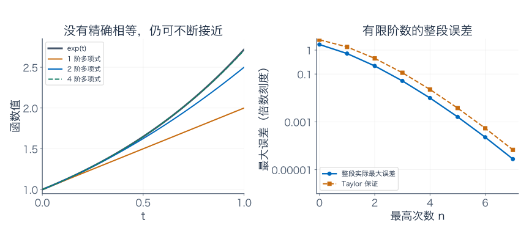

本例的误差非负，且随 $t$ 增加而不减，所以最大值在右端；可以由 Taylor 余项及误差的导数核对。右图把真实最大误差与保证值分别画出，不把它们当作相同数字。

若把“整段最大误差趋零”这种极限也纳入，$e^t$ 就进入幂函数的**闭线性张成**。这个说法依赖刚才选定的最大误差衡量方式；普通线性张成只管有限次运算，闭线性张成还管允许的极限。

这里的“闭”涉及极限，与“相加后仍在集合内”的运算封闭不同。接下来的泛函分析会认真研究怎样给函数规定距离，以及近似的极限是否仍留在所选空间里。

## 几何伴读

- [3Blue1Brown：Vectors, what even are they?](https://www.3blue1brown.com/lessons/vectors/) 可配合清单与地图例子，观察箭头、数字列表和运算之间的联系。
- [3Blue1Brown：Linear combinations, span, and basis vectors](https://www.3blue1brown.com/lessons/span/) 可配合本篇的直线、扇形与斜网格；看动画时始终问清系数允许取什么值。本文早餐采购、用水信号、推导、图与练习均独立编写。

---

[数学总导航](../00-%E6%95%B0%E5%AD%A6%E5%AD%A6%E4%B9%A0%E5%AF%BC%E8%88%AA.md) · [本课程目录](00-%E4%BB%8E%E7%AE%AD%E5%A4%B4%E5%88%B0%E5%87%BD%E6%95%B0%E7%A9%BA%E9%97%B4.md) · [← 上一章](00-%E4%BB%8E%E7%AE%AD%E5%A4%B4%E5%88%B0%E5%87%BD%E6%95%B0%E7%A9%BA%E9%97%B4.md) · [下一章 →](02-%E7%9F%A9%E9%98%B5%E6%98%AF%E4%B8%80%E5%8F%B0%E5%8F%98%E6%8D%A2%E6%9C%BA%E5%99%A8.md)
