[数学总导航](../00-%E6%95%B0%E5%AD%A6%E5%AD%A6%E4%B9%A0%E5%AF%BC%E8%88%AA.md) · [本课程目录](00-%E4%BB%8E%E7%AE%AD%E5%A4%B4%E5%88%B0%E5%87%BD%E6%95%B0%E7%A9%BA%E9%97%B4.md) · [← 上一章](01-%E5%90%91%E9%87%8F%E3%80%81%E7%BA%BF%E6%80%A7%E7%BB%84%E5%90%88%E4%B8%8E%E7%A9%BA%E9%97%B4.md) · [下一章 →](03-%E6%B6%88%E5%85%83%E3%80%81%E7%BA%BF%E6%80%A7%E6%96%B9%E7%A8%8B%E4%B8%8E%E5%9B%9B%E4%B8%AA%E5%AD%90%E7%A9%BA%E9%97%B4.md)

## 一张采购单，怎样一次算出重量和货款

你准备买三种分装原料。先假设每包的重量、单价固定，没有满减，也没有固定运费。

| 原料包 | 每包重量 | 每包货款 |
| --- | --- | --- |
| 第一种 | 2 千克 | 5 元 |
| 第二种 | 3 千克 | 4 元 |
| 第三种 | 1 千克 | 3 元 |

采购数量按这个顺序写成一列，$x=(a,b,c)^T$。右上角 $T$ 表示把一行转成一列，后面会解释。买 $(2,1,3)^T$ 时，总重量与货款分别为

$$
2\times2+3\times1+1\times3=10\text{ 千克},
$$

$$
5\times2+4\times1+3\times3=23\text{ 元}.
$$

我们可以把两次计算打包成一台机器：输入三种数量，输出两项读数。

$$
\begin{pmatrix}\text{重量}\\\text{货款}\end{pmatrix}
=
\underbrace{\begin{pmatrix}2&3&1\\5&4&3\end{pmatrix}}_{C}
\underbrace{\begin{pmatrix}a\\b\\c\end{pmatrix}}_{x}.
$$

这个两行三列的数表，就是一个 $2\times3$ 矩阵。读尺寸时先说行数，再说列数。这里的三列对应三种输入项目，两行对应两项输出读数；矩阵不需要长成正方形。

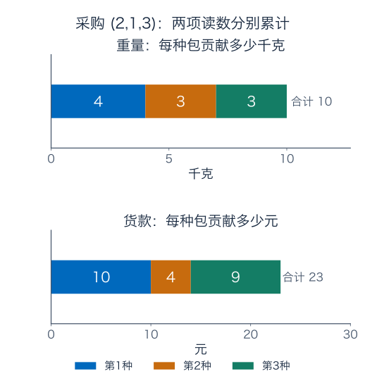

**行和列都要有固定含义。** 第一行的数带千克/包的单位，第二行带元/包的单位；矩阵里的 2 与 5 并不是同一种物理量。如果把商品顺序换了，数量表也必须按同样顺序换，不能只改一边。

实际整包采购时，$a,b,c$ 是非负整数；允许拆包时可以是非负实数。我们研究的线性映射先定义在整个 $\mathbb R^3$ 上，负数可作账面增减量；实际订单再受这些限制。这与上一章“实数线性组合”和“只能加料”的区别一致。

## 列是基本订单的结果，行是某一个读数的算法

只买第一种一包，数量表是 $e_1=(1,0,0)^T$，输出 $(2,5)^T$，正好是 $C$ 的第一列。其余两列也分别记录只买第二种、第三种一包时的结果。

买 $a,b,c$ 包，就把这三个基本订单分别乘以份数，再合起来：

$$
Cx=
 a\begin{pmatrix}2\\5\end{pmatrix}
+b\begin{pmatrix}3\\4\end{pmatrix}
+c\begin{pmatrix}1\\3\end{pmatrix}
=\begin{pmatrix}2a+3b+c\\5a+4b+3c\end{pmatrix}.
$$

这就是**矩阵乘向量：按输入坐标，把矩阵的各列做线性组合**。第一行再从输出的一侧看，问“重量怎样算”；第二行问“货款怎样算”。列和行是同一台机器的两种读法。

对一般的 $m\times n$ 矩阵 $A=(a_{ij})$，下标 $i$ 指行、$j$ 指列，$x$ 有 $n$ 个输入数。第 $i$ 个输出是

$$
(Ax)_i=\sum_{j=1}^n a_{ij}x_j.
$$

求和号只是说：固定一个输出读数，把每种输入对它的贡献依次加上。所谓“行乘列”，正是刚才的逐项乘再求和。

若同一台机器同时处理两张采购单 $x,z$，把它们并排成两列，则

$$
C[\,x\ z\,]=[\,Cx\ Cz\,].
$$

它表示分别处理两份输入，不是在两订单之间做额外的混合。这个读法稍后会自然变成矩阵乘矩阵。

## 为什么知道基本输入，就能知道所有输入

采购模型有两个特点：合并两张数量表再结算，与分别结算再合并读数相同；把所有采购数量乘以一个数，重量、货款也同倍变化。

写成公式，就是对所有输入 $u,v$ 和实数 $\alpha,\beta$，

$$
\boxed{T(\alpha u+\beta v)=\alpha T(u)+\beta T(v).}
$$

这样的映射叫**线性映射**，也叫线性变换。等价地，可以分成“保持相加”和“保持实数数乘”两项要求。令系数为零，就得到 $T(0)=0$；什么都没有增加，线性读数也不增加。

因为任意 $x\in\mathbb R^n$ 都能唯一写成 $x=x_1e_1+\cdots+x_ne_n$，线性性迫使

$$
T(x)=x_1T(e_1)+\cdots+x_nT(e_n).
$$

把这些基本输出按列装起来，就得到 $A=[\,T(e_1)\ \cdots\ T(e_n)\,]$，于是 $T(x)=Ax$。这解释了为什么 $n$ 列足够描述从 $\mathbb R^n$ 出发的一台线性机器。

反过来，任意固定实矩阵的逐行求和都满足分配律，所以 $x\mapsto Ax$ 一定线性。我们得到了双向联系：**在标准坐标下，实有限维坐标空间之间的线性映射，恰好能由矩阵表示。**

价格随数量打折时，输出可能不再保持这两条规则；带固定偏置时也一样。不能因为计算里出现了一张数表，就省掉模型条件的核对。

## 把输入换成位置：两根箭头决定整张网格

现在把 $(x,y)$ 当作平面上的位置，相对同一个固定原点记录。假设一台线性机器把向右一步 $e_1$ 送到 $(2,1)$，把向上一步 $e_2$ 送到 $(-1,1)$，它的矩阵就是

$$
A=\begin{pmatrix}2&-1\\1&1\end{pmatrix},
\qquad A\begin{pmatrix}x\\y\end{pmatrix}
=\begin{pmatrix}2x-y\\x+y\end{pmatrix}.
$$

原来沿 $e_1$ 方向的一排等间距点，现在沿 $(2,1)$ 排列；原来沿 $e_2$ 方向的一排，现在沿 $(-1,1)$ 排列。整张网格因此发生变化。

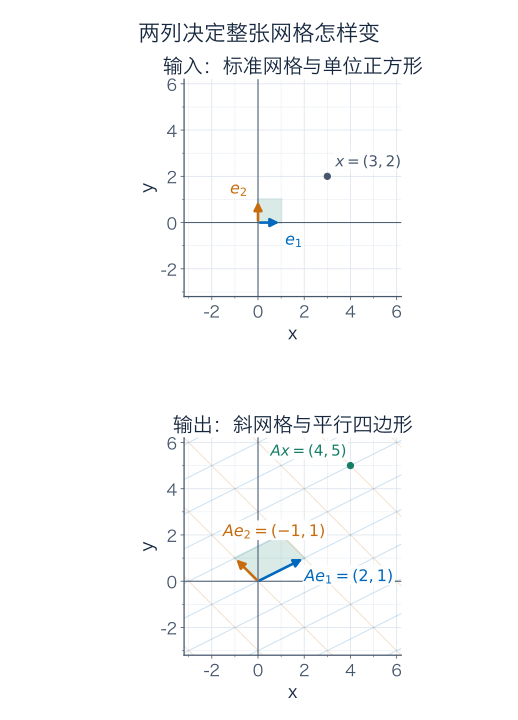

比如位置 $(3,2)=3e_1+2e_2$ 的输出必须为

$$
A\begin{pmatrix}3\\2\end{pmatrix}
=3\begin{pmatrix}2\\1\end{pmatrix}
+2\begin{pmatrix}-1\\1\end{pmatrix}
=\begin{pmatrix}4\\5\end{pmatrix}.
$$

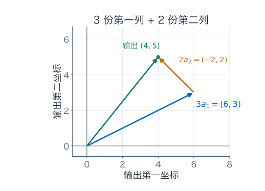

这里输入的“3 份、2 份”没有改成别的系数，改变的是它们所配的两个基本输出。图里每个点、每条边都按同一个规则变换；这就是追踪基向量的力量。

### 直线为什么不会弯，但可能被压成一个点

一条直线可写成 $p+td$：$p$ 是线上一个点，非零 $d$ 指定方向，$t$ 沿整条实数轴变化。线性映射给出

$$
T(p+td)=T(p)+tT(d).
$$

若 $T(d)\ne0$，输出仍沿一个固定方向排列，是直线；若 $T(d)=0$，整条输入线都被送到同一个 $T(p)$。因此看线性变换时，要允许“线退化成点”，不能把压扁投影错误地排除。

同理，平行直线的方向在变换后仍相同，或发生重合、退化。直角、长度和面积则未必保持：刚才的单位正方形已经变成平行四边形。后面的内积、行列式章节会分别研究这些量。

## 认出几种常见的机器

横向放大两倍、竖向不变时，$e_1\mapsto(2,0)$、$e_2\mapsto(0,1)$，所以

$$
D=\begin{pmatrix}2&0\\0&1\end{pmatrix},\qquad D(x,y)^T=(2x,y)^T.
$$

绕原点逆时针转 $90^\circ$ 时，向右变向上、向上变向左，所以

$$
R=\begin{pmatrix}0&-1\\1&0\end{pmatrix},\qquad R(x,y)^T=(-y,x)^T.
$$

向右错切的机器 $S(x,y)=(x+y,y)$，把越高的一行移得越向右；它的列是 $(1,0)$、$(1,1)$。投到横轴的机器 $U(x,y)=(x,0)$，则把不同高度叠在一起：

$$
S=\begin{pmatrix}1&1\\0&1\end{pmatrix},\qquad
U=\begin{pmatrix}1&0\\0&0\end{pmatrix}.
$$

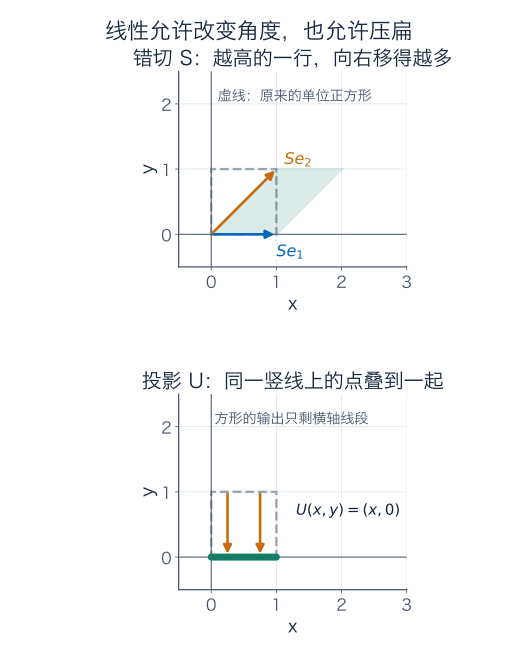

投影的第二列为零，仍然是合法的线性映射。线性只要求保持组合规则，没有要求信息完整保留。沿横轴反射 $F(x,y)=(x,-y)$ 也是线性映射，矩阵为 $\operatorname{diag}(1,-1)$；这里 $\operatorname{diag}$ 表示只在主对角线上放指定的数，其余位置为零。

所有点原地不动的机器叫恒等映射，矩阵为 $I_2=\operatorname{diag}(1,1)$。下标 2 说明它处理两个坐标；在 $n$ 维时就写 $I_n$。

## 先拉宽再转身，与先转身再拉宽

取同一个输入 $u=(1,1)^T$。先执行横向放大 $D$，再执行旋转 $R$：

$$
(1,1)\xrightarrow{D}(2,1)\xrightarrow{R}(-1,2).
$$

交换次序：

$$
(1,1)\xrightarrow{R}(-1,1)\xrightarrow{D}(-2,1).
$$

结果已经不同。因为“横向”指的是固定坐标系的横向，旋转前后的横向拉伸作用在不同的几何方向上。

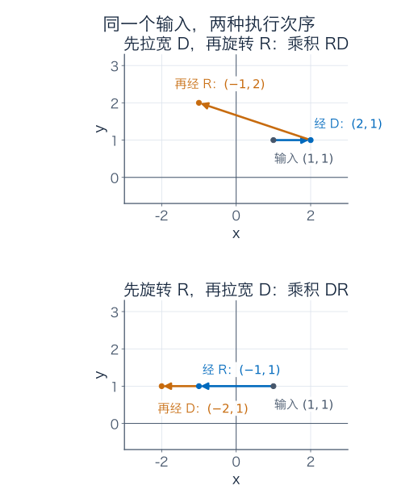

函数记法写成 $R(Du)$。先作用的 $D$ 紧挨着输入，所以把整台机器记成 $RD$，而不是按口头叙述从左到右排。以后遇到长乘积，也从最靠近输入的右端开始执行。

为了算出 $RD$ 的矩阵，只需追踪两个基输入：

$$
R(De_1)=R(2,0)^T=(0,2)^T,
$$

$$
R(De_2)=R(0,1)^T=(-1,0)^T.
$$

因此

$$
RD=\begin{pmatrix}0&-1\\2&0\end{pmatrix},\qquad
DR=\begin{pmatrix}0&-2\\1&0\end{pmatrix}.
$$

第一列已经不同，足以说明两台总机器不同。矩阵乘法**一般不满足交换律**；但不是说永远不能交换，例如 $2I_2$ 与任意 $2\times2$ 矩阵都可交换，因为对整体放大两倍的先后位置，线性性给出相同结果。

## 一般矩阵乘法为什么要“行乘列”

设 $B$ 先工作，再把输出交给 $A$。$B$ 的第 $j$ 列 $b_j=Be_j$ 是这个基输入的中间结果，再经过 $A$，最终落点为 $Ab_j$。因此

$$
\boxed{AB=[\,Ab_1\ \cdots\ Ab_n\,].}
$$

设 $B$ 的尺寸为 $m\times n$，$A$ 的尺寸为 $k\times m$，则

$$
\mathbb R^n\xrightarrow{B}\mathbb R^m\xrightarrow{A}\mathbb R^k,
\qquad AB\text{ 的尺寸为 }k\times n.
$$

中间的 $m$ 必须对得上，因为上一台的输出表，要能原样送入下一台的输入栏。只对上数字个数还不够：在实际模型里，顺序、单位、项目含义也要兼容。

把 $Ab_j$ 的第 $i$ 个读数展开，得到

$$
(AB)_{ij}=\sum_{\ell=1}^m A_{i\ell}B_{\ell j}.
$$

其中 $\ell$ 枚举中间坐标：输入的第 $j$ 项先对各个中间读数产生影响，再由这些中间读数共同影响最终第 $i$ 项。它不是把 $A,B$ 相同位置的元素直接相乘；那种逐项乘法是另一种运算。

### 把采购与计费真的串起来

回到采购矩阵 $C$。现在规定物流按每千克 2 元收取，无固定费用；在原货款上加物流费，付款读数为

$$
L\begin{pmatrix}w\\p\end{pmatrix}=2w+p,
\qquad L=\begin{pmatrix}2&1\end{pmatrix}.
$$

这里第一项系数单位为元/千克，第二项系数表示保留货款。$C$ 输出的重量、货款顺序正好能被 $L$ 接上。

$$
LC=\begin{pmatrix}2&1\end{pmatrix}
\begin{pmatrix}2&3&1\\5&4&3\end{pmatrix}
=\begin{pmatrix}9&10&5\end{pmatrix}.
$$

三列分别是每种包的“货款加物流”：$2\times2+5=9$、$2\times3+4=10$、$2\times1+3=5$。订单 $(2,1,3)^T$ 的付款为 $18+10+15=43$ 元，也等于先算重量 10、货款 23，再算 $2\times10+23=43$。

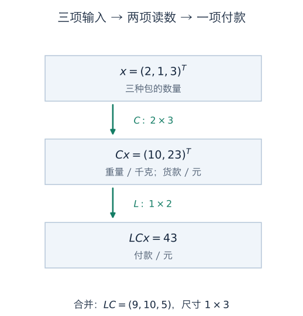

$LC$ 是 $1\times3$ 矩阵。反过来的 $CL$ 却没有定义：$C$ 要接三项输入，$L$ 只交出一项，接口不匹配。“把两个矩阵反过来乘”有时甚至不是一个可做的运算。

### 能改分组，不能擅自改次序

三台能接上的机器满足 $(AB)H=A(BH)$：输入按 $H$、$B$、$A$ 的顺序经过它们，括号只决定预先把哪两台合并，不改变实际次序。这叫结合律。

同尺寸矩阵可逐项相加、数乘；$(A+B)x=Ax+Bx$，可以理解为对同一输入运行两台机器后，把对应输出相加。相应的分配律为

$$
A(B+H)=AB+AH,\qquad(A+B)H=AH+BH,
$$

各式都以尺寸相容为前提。对 $A\in\mathbb R^{m\times n}$，恒等机器位于不同端口时尺寸不同：$I_mA=A=AI_n$。

## 能不能把机器倒过来运行

对刚才的二维 $A$，若知道输出 $(p,q)$，方程是 $2x-y=p$、$x+y=q$。把两式相加，$3x=p+q$，再代回得到

$$
x=\frac{p+q}{3},\qquad y=\frac{2q-p}{3}.
$$

所以恢复输入的机器为

$$
A^{-1}=\frac13\begin{pmatrix}1&1\\-1&2\end{pmatrix},
\qquad A^{-1}A=AA^{-1}=I_2.
$$

比如输出 $(4,5)$，恢复出 $(3,2)$。这里每个实输出都能到达，而且都只有一个原输入，才有一台双向恢复的逆机器。怎样系统判断可逆、求出逆，后面会用消元进一步讨论。

投影 $U(x,y)=(x,0)$ 却不能恢复原高度：$(2,1)$ 与 $(2,9)$ 都变成 $(2,0)$。若恢复机器存在，它面对同一个输入 $(2,0)$ 就要同时给出两个不同结果，矛盾。因此不能一般地从 $Ux=Uz$ 约去 $U$ 得到 $x=z$；要先有相应的可恢复条件。

### 非方阵可能只在一边恢复

把二维点补一个零放到三维，再读回前两项：

$$
J=\begin{pmatrix}1&0\\0&1\\0&0\end{pmatrix},\qquad
P=\begin{pmatrix}1&0&0\\0&1&0\end{pmatrix}.
$$

先 $J$ 后 $P$，原来的二维输入完全恢复，所以 $PJ=I_2$。先 $P$ 后 $J$，三维点的第三项已经丢掉，只能补回零，所以

$$
JP=\begin{pmatrix}1&0&0\\0&1&0\\0&0&0\end{pmatrix}\ne I_3.
$$

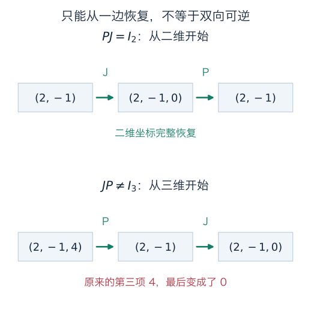

$P$ 是 $J$ 的左逆，$J$ 是 $P$ 的右逆，但它们不是彼此的双向逆。注意两个乘积都可计算，结果尺寸却分别为 $2\times2$、$3\times3$；尺寸不同的恒等矩阵不能混作同一个。

## 转置：把行列换位，不是倒放机器

把矩阵沿主对角线方向换位，原来的第 $i$ 行、第 $j$ 列元素放到新表的第 $j$ 行、第 $i$ 列，叫**转置**，记为 $A^T$。采购表给出

$$
C^T=\begin{pmatrix}2&5\\3&4\\1&3\end{pmatrix}.
$$

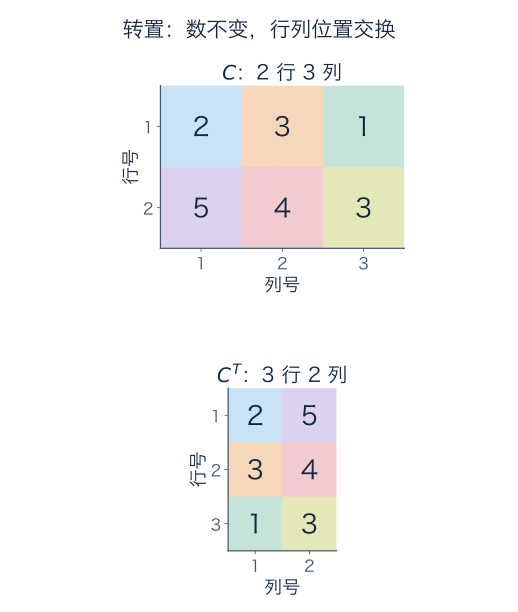

它将 $m\times n$ 的尺寸换成 $n\times m$；列向量转置后成为行向量，再转置一次回到原样：$(A^T)^T=A$。所以本章用 $(a,b,c)^T$ 表示竖排数量表。

转置不自动代表逆。对 $D=\operatorname{diag}(2,1)$，$D^T=D$，仍是横向放大两倍；恢复机器却是 $D^{-1}=\operatorname{diag}(1/2,1)$。两者动作明显不同。

还有两个实用的尺寸结论：若 $A$ 为 $m\times n$，则 $A^TA$ 是 $n\times n$，$AA^T$ 是 $m\times m$。它们都为方阵，不等于说它们都等于恒等矩阵。对投影 $U$，就有 $U^TU=U\ne I_2$。

对尺寸相容的乘积，转置会反转书写次序：

$$
(AB)^T=B^TA^T.
$$

检查一个元素即可：左边第 $(i,j)$ 项为 $\sum_\ell A_{j\ell}B_{\ell i}$；右边为 $\sum_\ell B_{\ell i}A_{j\ell}$，实数项相同。先看尺寸，再看元素，是验证矩阵公式很可靠的顺序。

## 什么样的变形，两列就是描述不了

先看平移 $F(x,y)=(x+2,y+1)$。原点跑到 $(2,1)$，已经违反线性映射的必要条件。它可写成 $F(x)=Ax+b$，其中 $A=I_2$、$b=(2,1)^T$，叫仿射映射。

再看 $G(x,y)=(x,y+x^2)$。这次原点不动，但仍然不线性：

$$
G(1,0)=(1,1),\qquad G(2,0)=(2,4)\ne2G(1,0)=(2,2).
$$

如果只记录 $G(e_1)=(1,1)$、$G(e_2)=(0,1)$，错用这两列组成矩阵，就会把 $(2,0)$ 的结果误判成 $(2,2)$。因为机器本来就不保持组合，基本输入处的两个样本无法决定其他输入。

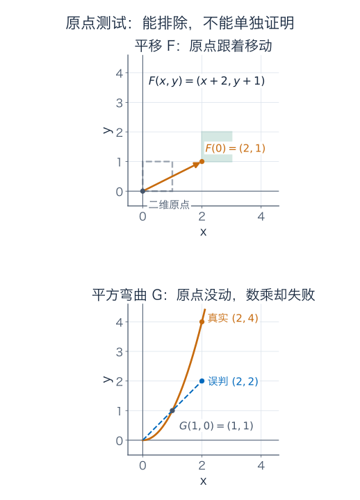

所以 $T(0)=0$ 可以快速排除某些非线性机器，却不能独自证明线性；“图里几条线看上去直”也不能替代对所有输入的组合规则。

回到购物，如果在公式里增加固定运费 6 元，$x\mapsto Cx+(0,6)^T$ 就是仿射模型，代入零输入仍输出运费。若商家对空订单不收费，则空单另按零处理，整个规则变成分段模型，也不能因此恢复为原来的线性机器。

### 为什么图形软件又能用矩阵做平移

给点额外添一个固定坐标 1，写成 $(x,y,1)^T$，则

$$
\begin{pmatrix}1&0&2\\0&1&1\\0&0&1\end{pmatrix}
\begin{pmatrix}x\\y\\1\end{pmatrix}
=\begin{pmatrix}x+2\\y+1\\1\end{pmatrix}.
$$

这是齐次坐标的一种用法。三维矩阵作用在整个 $\mathbb R^3$ 上确实线性，但原来的二维点被放在第三项等于 1 的平面上。这个平面不含三维零向量，不是子空间。特别地，二维原点表示为 $(0,0,1)^T$，而不是三维零向量。扩充了表示方式，不代表二维平移忽然满足了原来的线性定义。

## 求导也能装进矩阵，输入是系数表

上章把 $q(t)=a+bt+ct^2$ 当成一个函数向量。在有序基 $B=(1,t,t^2)$ 下，它的坐标是 $(a,b,c)^T$。求导给出 $q'(t)=b+2ct$，仍属于 $P_2$，于是坐标变化为

$$
\begin{pmatrix}a\\b\\c\end{pmatrix}
\longmapsto
\begin{pmatrix}b\\2c\\0\end{pmatrix},
\qquad
D_{\!\partial}=\begin{pmatrix}0&1&0\\0&0&2\\0&0&0\end{pmatrix}.
$$

三列分别记录 $1'=0$、$t'=1$、$(t^2)'=2t$ 在同一基下的坐标。线性性来自 $(\alpha f+\beta g)'=\alpha f'+\beta g'$；这里的乘数是固定实数。

对 $q(t)=2-t+3t^2$，

$$
D_{\!\partial}\begin{pmatrix}2\\-1\\3\end{pmatrix}
=\begin{pmatrix}-1\\6\\0\end{pmatrix},
\qquad q'(t)=-1+6t.
$$

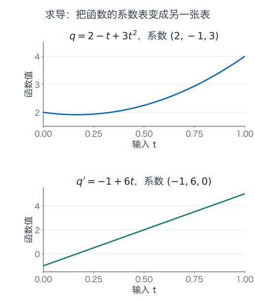

图中的点值不是系数表。$(2,-1,3)^T$ 记录的是三个基函数的份数，不是三个时刻的采样；把采样值直接塞进这个求导矩阵，会算错对象。

若要取 $t=0,1$ 两处样本，另有一台机器

$$
E=\begin{pmatrix}1&0&0\\1&1&1\end{pmatrix},
\qquad E(a,b,c)^T=(q(0),q(1))^T.
$$

先求导再采样对应 $ED_{\!\partial}$；输入三个系数，输出两个导数读数。反过来 $D_{\!\partial}E$ 尺寸就不匹配。即使已经限定 $P_2$，仅凭两个端点样本也不能确定导数：$q(t)$ 与 $q(t)+t(t-1)$ 的端点值相同，导数却相差 $2t-1$。要从样本推回导数，还需要更多样本或更强限制，不能把两个动作凭直觉交换。

## 同一台抽象机器，换坐标表后矩阵也会变

最后把“对象真的变了”和“只是换份坐标表”接起来。取上章的斜基 $B=(v,w)$，其中 $v=(1,2)^T$、$w=(2,1)^T$。若输入的斜基份数是 $z$，先用

$$
K=[\,v\ w\,]=\begin{pmatrix}1&2\\2&1\end{pmatrix}
$$

变成标准坐标 $x=Kz$，再交给前面的几何机器 $A$，输出为 $AKz$。

$$
AK=\begin{pmatrix}2&-1\\1&1\end{pmatrix}
\begin{pmatrix}1&2\\2&1\end{pmatrix}
=\begin{pmatrix}0&3\\3&3\end{pmatrix}.
$$

这个矩阵的列现在记录 $Av$、$Aw$，而不是 $Ae_1$、$Ae_2$；它接收的是输入的斜基份数，交出的仍为输出的标准坐标。不要把它与原来的 $A$ 当成接收同一种数表的两个公式。

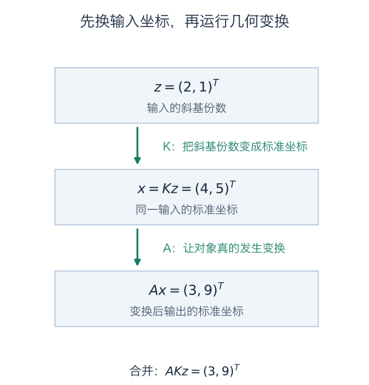

例如 $z=(2,1)^T$ 对应真实输入 $x=2v+w=(4,5)^T$，输出 $Ax=(3,9)^T$，而 $AKz$ 也得到 $(3,9)^T$。若希望输出也改用斜基记份数，还要再做一次输出坐标转换，不能把这里的标准坐标直接冒充斜基坐标。

在函数例子里也一样：求导算子是一件事，指定输入、输出基以后得到的数表是另一件事。未来从有限维走向函数空间，保留下来的是线性映射的组合规则；无限维算子则不能一概用一张有限数表记录完。

## 练习：把每台机器真的运行一遍

**题一：采购与读数。** 用本章 $C$ 分别计算订单 $(2,1,0)^T$、$(2,1,3)^T$、$(0,2,1)^T$ 的输出，写明单位。说明第二列与第二行分别记录什么；若改用“第三种、第二种、第一种”的商品顺序，怎样同步调整矩阵和输入？

**题二：列组合与恢复。** 已知线性映射把 $e_1$ 送到 $(2,1)^T$，$e_2$ 送到 $(-1,1)^T$。写矩阵，求输入 $(3,2)^T$ 的输出，再从输出 $(4,5)^T$ 恢复输入。解释为什么这些基向量样本足够确定整台机器。

**题三：原点测试够不够。** 判断以下映射是否线性，并给出证明或一个足以否定的反例：（1）$(x,y)\mapsto(x+y,0)$；（2）$(x,y)\mapsto(x+2,y+1)$；（3）$(x,y)\mapsto(x,y+x^2)$；（4）$(x,y)\mapsto(|x|,y)$。其中哪些固定原点却不线性？

**题四：次序与交换。** 计算本章 $RD$、$DR$，并分别作用于 $(1,1)^T$。若把横向拉伸 $D$ 改为整体放大 $2I_2$，它与 $R$ 是否可交换？用线性性说明原因。

**题五：非方阵串联。** 对本章 $L,C$，求 $LC$ 的尺寸、各项数值及订单 $(2,1,3)^T$ 的付款。$CL$ 有定义吗？再写出 $C^T$、$C^TC$ 和 $CC^T$ 的尺寸；无须把后两者每个元素都算出。

**题六：只在一边能恢复。** 对补零矩阵 $J$ 和取前两项矩阵 $P$，算出 $PJ$、$JP$，用 $(2,-1)^T$ 与 $(2,-1,4)^T$ 分别追踪两种次序。为什么 $PJ=I_2$ 不能推出 $JP=I_3$？

**题七：平移的三维表示。** 用本章齐次坐标矩阵将二维点 $(1,2)$ 平移。检查二维原点的齐次表示如何变化，再检查真正的三维零向量如何变化。这是否说明二维平移是线性映射？说明理由。

**题八：求导后采样。** 求 $ED_{\!\partial}$，再作用于 $q(t)=2-t+3t^2$ 的系数表，与直接算 $q'(0),q'(1)$ 对照。$D_{\!\partial}E$ 为什么不能相乘？两个端点样本能否唯一确定 $P_2$ 函数的导数？求导矩阵为何不可逆？验证三次求导的矩阵为零，但求导矩阵本身不为零。

**题九：接收哪一种坐标。** 对输入斜基 $B=(v,w)$，计算 $AK$，追踪斜基份数 $(2,1)^T$ 对应的标准输入及最终输出。若错误地直接算 $A(2,1)^T$，结果是什么，错在哪里？这里 $AK$ 的输出是否已经是斜基坐标？

### 参考答案与解题过程

#### 题一解答

逐项贡献相加：

$$
C(2,1,0)^T=(4+3,10+4)^T=(7,14)^T,
$$

$$
C(2,1,3)^T=(4+3+3,10+4+9)^T=(10,23)^T,
$$

$$
C(0,2,1)^T=(6+1,8+3)^T=(7,11)^T.
$$

每个结果第一项单位为千克，第二项为元。第二列 $(3,4)^T$ 记录第二种一包的两项读数；第二行 $(5,4,3)$ 记录三种包各自对货款的贡献系数。

改用反向商品顺序，输入应改为 $(c,b,a)^T$，矩阵列也反向排列：

$$
\widetilde C=\begin{pmatrix}1&3&2\\3&4&5\end{pmatrix}.
$$

于是 $\widetilde C(c,b,a)^T=(c+3b+2a,3c+4b+5a)^T=C(a,b,c)^T$，读数不变。只调换列却不调换数量，会把数量与错误商品对上。

#### 题二解答

矩阵两列由基本输出确定，故

$$
A=\begin{pmatrix}2&-1\\1&1\end{pmatrix},\qquad
A(3,2)^T=3(2,1)^T+2(-1,1)^T=(4,5)^T.
$$

恢复时解 $2x-y=4$、$x+y=5$。两式相加给出 $3x=9$，所以 $x=3$、$y=2$。也可乘 $A^{-1}=\frac13\begin{pmatrix}1&1\\-1&2\end{pmatrix}$，得到 $(3,2)^T$。

关键前提是已经知道映射线性。任意输入 $xe_1+ye_2$ 的输出都被迫等于 $xT(e_1)+yT(e_2)$，所以没有额外自由选择。非线性映射不受这个约束，不能照搬结论。

#### 题三解答

（1）线性。对 $u=(u_1,u_2)$、$v=(v_1,v_2)$，

$$
T(\alpha u+\beta v)
=(\alpha(u_1+u_2)+\beta(v_1+v_2),0)
=\alpha T(u)+\beta T(v).
$$

矩阵为 $\begin{pmatrix}1&1\\0&0\end{pmatrix}$。输出少一个自由方向，不影响线性成立。

（2）不线性，因为 $T(0,0)=(2,1)\ne(0,0)$。

（3）固定原点但不线性，因为 $T(2,0)=(2,4)$，而 $2T(1,0)=(2,2)$，数乘规则失败。

（4）也固定原点但不线性。取 $u=(1,0)$，有 $T(-u)=(1,0)$，而 $-T(u)=(-1,0)$，乘数 $-1$ 就给出了反例。只检查正数加倍可能漏掉绝对值的这个问题；线性要求对所有实数标量都成立。

#### 题四解答

逐列追踪或行乘列，得到

$$
RD=\begin{pmatrix}0&-1\\2&0\end{pmatrix},\qquad
DR=\begin{pmatrix}0&-2\\1&0\end{pmatrix}.
$$

分别乘 $(1,1)^T$，得到 $(-1,2)^T$、$(-2,1)^T$，与两步追踪一致。

整体放大 $2I_2$ 则可交换。任意 $u$ 都有 $R(2u)=2R(u)$，因此先放大后旋转与先旋转后放大的输出完全相同，$R(2I_2)=(2I_2)R=2R$。不要把“通常不可交换”误读成“任何两矩阵都不能交换”。

#### 题五解答

$L$ 为 $1\times2$，$C$ 为 $2\times3$，中间尺寸匹配，乘积为 $1\times3$：

$$
LC=(2\times2+5,\ 2\times3+4,\ 2\times1+3)=(9,10,5).
$$

乘订单后付款 $9\times2+10\times1+5\times3=43$ 元。反向 $CL$ 的中间尺寸是 3 与 1，不匹配，所以没有定义。

转置 $C^T$ 为 $3\times2$；因此 $C^TC$ 的尺寸为 $(3\times2)(2\times3)=3\times3$，$CC^T$ 的尺寸为 $(2\times3)(3\times2)=2\times2$。两者方形但尺寸不同，均不意味着是逆变换或恒等矩阵。

#### 题六解答

直接计算得到

$$
PJ=\begin{pmatrix}1&0\\0&1\end{pmatrix}=I_2,\qquad
JP=\begin{pmatrix}1&0&0\\0&1&0\\0&0&0\end{pmatrix}.
$$

二维输入沿第一种次序：$(2,-1)\xrightarrow{J}(2,-1,0)\xrightarrow{P}(2,-1)$，完全恢复。

三维输入沿第二种次序：$(2,-1,4)\xrightarrow{P}(2,-1)\xrightarrow{J}(2,-1,0)$，第三项 4 丢失。$PJ$ 的恒等性只保证原本从二维补零得到的输入能恢复，不能保证所有三维输入都能恢复；后者还包含第三项非零的点。

#### 题七解答

点 $(1,2)$ 表示为 $(1,2,1)^T$，矩阵乘后为 $(3,3,1)^T$，对应二维点 $(3,3)$。

二维原点表示为 $(0,0,1)^T$，乘后为 $(2,1,1)^T$，说明它确实移动到了二维点 $(2,1)$。真正的三维零向量 $(0,0,0)^T$ 乘后仍为 $(0,0,0)^T$，所以三维矩阵映射没有违反线性规则。

这不能证明二维平移线性。第三项为 1 的表示平面不是三维子空间：不含三维零向量，两点相加后第三项还会变成 2。原二维问题和扩充后的三维线性问题，要连同表示约定一起看。

#### 题八解答

$E$ 为 $2\times3$，$D_{\!\partial}$ 为 $3\times3$，乘积是

$$
ED_{\!\partial}=\begin{pmatrix}0&1&0\\0&1&2\end{pmatrix}.
$$

作用于 $(2,-1,3)^T$，得到 $(-1,-1+6)^T=(-1,5)^T$。直接求 $q'(t)=-1+6t$，在 $0,1$ 处也分别为 $-1,5$。

反向的 $D_{\!\partial}E$ 需要把一个两项采样表交给要求三项系数表的机器，尺寸 3 与 2 不匹配，不能相乘。

两个端点样本也不能唯一决定导数。取 $h(t)=q(t)+t(t-1)$，它仍属于 $P_2$，且 $h(0)=q(0)$、$h(1)=q(1)$，但 $h'(t)-q'(t)=2t-1$ 不为零函数。

求导不可逆，因为不同常数函数都求导成零，比如 $1$ 与 $2$；已知导数无法唯一恢复常数项。连续运行两次、三次的矩阵为

$$
D_{\!\partial}^2=\begin{pmatrix}0&0&2\\0&0&0\\0&0&0\end{pmatrix},
\qquad D_{\!\partial}^3=0.
$$

次数至多 2 的多项式三次求导全为零，但求导机器本身不为零，因为它至少把 $t$ 变成非零常数 1。矩阵的幂为零，不代表矩阵本身必为零。

#### 题九解答

$K$ 的列为 $v,w$，因此

$$
AK=[\,Av\ Aw\,]=\begin{pmatrix}0&3\\3&3\end{pmatrix}.
$$

斜基份数 $z=(2,1)^T$ 对应标准输入 $Kz=2(1,2)^T+(2,1)^T=(4,5)^T$。所以输出为 $A(4,5)^T=(3,9)^T$，与 $AK(2,1)^T=(3,9)^T$ 一致。

错误地直接算 $A(2,1)^T$ 会得到 $(3,3)^T$，因为此时 $A$ 把 $(2,1)$ 当成标准基份数，实际处理了另一点。$AK$ 的输出仍是标准坐标：我们只在输入端插入了转换 $K$，并没有在输出端转换基。

## 下一章要追问的，是哪些输入能被分辨

到这里，矩阵的行、列、尺寸与乘法都有了实际含义。它可以把商品数变成读数，把图形变形，把一张系数表送去求导；组合这些机器，就得到矩阵乘法。

下一章研究 $Ax=b$：给定输出，能不能找回输入？有时唯一，有时很多输入产生同样结果，有时输出根本无法产生。投影丢失高度、求导丢失常数项，就是核与消元问题的具体入口。

### 几何伴读与正式核对

- [3Blue1Brown：线性变换与矩阵](https://www.3blue1brown.com/lessons/linear-transformations/)：配合观察基本方向与整张网格的变化。
- [3Blue1Brown：把矩阵乘法看作变换复合](https://www.3blue1brown.com/lessons/matrix-multiplication/)：配合观察先后次序。本文采购模型、计算、配图和习题均为独立编写。
- [TU Delft：矩阵运算](https://interactivetextbooks.tudelft.nl/linear-algebra/Chapter3/MatrixOperations.html)：核对尺寸约束、逐列乘法、转置与运算规则。

---

[数学总导航](../00-%E6%95%B0%E5%AD%A6%E5%AD%A6%E4%B9%A0%E5%AF%BC%E8%88%AA.md) · [本课程目录](00-%E4%BB%8E%E7%AE%AD%E5%A4%B4%E5%88%B0%E5%87%BD%E6%95%B0%E7%A9%BA%E9%97%B4.md) · [← 上一章](01-%E5%90%91%E9%87%8F%E3%80%81%E7%BA%BF%E6%80%A7%E7%BB%84%E5%90%88%E4%B8%8E%E7%A9%BA%E9%97%B4.md) · [下一章 →](03-%E6%B6%88%E5%85%83%E3%80%81%E7%BA%BF%E6%80%A7%E6%96%B9%E7%A8%8B%E4%B8%8E%E5%9B%9B%E4%B8%AA%E5%AD%90%E7%A9%BA%E9%97%B4.md)
