[数学总导航](../00-%E6%95%B0%E5%AD%A6%E5%AD%A6%E4%B9%A0%E5%AF%BC%E8%88%AA.md) · [本课程目录](00-%E4%BB%8E%E7%AE%AD%E5%A4%B4%E5%88%B0%E5%87%BD%E6%95%B0%E7%A9%BA%E9%97%B4.md) · [← 上一章](02-%E7%9F%A9%E9%98%B5%E6%98%AF%E4%B8%80%E5%8F%B0%E5%8F%98%E6%8D%A2%E6%9C%BA%E5%99%A8.md) · [下一章 →](04-%E5%9F%BA%E3%80%81%E7%BB%B4%E6%95%B0%E3%80%81%E7%A7%A9%E4%B8%8E%E5%95%86%E7%A9%BA%E9%97%B4.md)

## 两张小票，到底提供了几份信息

买 2 杯奶茶、1 个面包花了 19 元；买 1 杯奶茶、2 个面包花了 17 元。假定单价固定，没有包装费和折扣。设奶茶单价为 $x$、面包单价为 $y$，得到

$$
2x+y=19,\qquad x+2y=17.
$$

把第二张订单买两遍：2 杯奶茶、4 个面包，花 34 元。减去第一张订单，同样数量的奶茶费用抵消，剩下 3 个面包花 $34-19=15$ 元。因此 $y=5$，再代回 $2x+5=19$，得到 $x=7$。

这里的“消元”就是先让某一项数量对齐，再把它抵消，留下更容易辨认的信息。最后要把答案代回**每一张原小票**：$2\times7+5=19$、$7+2\times5=17$，两张都对才算完成。

如果第二张换成“4 杯奶茶、2 个面包，38 元”，它只是第一张的两倍，不能再告诉你面包与奶茶各是多少钱。若金额记成 39 元，又与第一张冲突：同一份东西翻倍，固定单价下不可能多出 1 元。

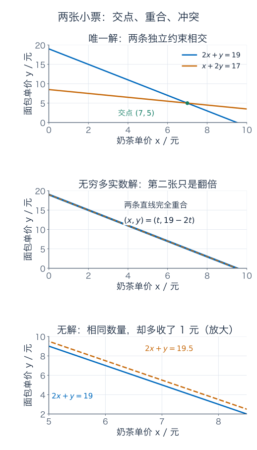

图里每条直线是“满足一张小票的所有价格组合”，两条同时满足就要取交集。重合时的完整实数解为 $(x,y)=(t,19-2t)$；如果另要求单价非负，还要 $0\le t\le19/2$。**方程的解与实际价格限制，要分两步处理。**

## 用增广矩阵，把等号两边一起记下来

上一章把矩阵理解成一台输入输出机器。这里未知的是输入：

$$
\underbrace{\begin{pmatrix}2&1\\1&2\end{pmatrix}}_{B}
\begin{pmatrix}x\\y\end{pmatrix}
=\begin{pmatrix}19\\17\end{pmatrix}.
$$

为了在消元时不漏掉金额，把系数与右侧并排，写成**增广矩阵**：

$$
[\,B\mid b\,]=\left[\begin{array}{cc|c}2&1&19\\1&2&17\end{array}\right].
$$

竖线只是区分未知量系数与目标读数，并不是又添了一种商品。第一行仍代表 $2x+y=19$。

记 $R_i$ 为第 $i$ 行。先对第二行做 $R_2\leftarrow2R_2-R_1$，得到

$$
\left[\begin{array}{cc|c}2&1&19\\0&3&15\end{array}\right].
$$

再依次做 $R_2\leftarrow R_2/3$、$R_1\leftarrow R_1-R_2$、$R_1\leftarrow R_1/2$，最终得到

$$
\left[\begin{array}{cc|c}1&0&7\\0&1&5\end{array}\right].
$$

最后两行直接读成 $x=7$、$y=5$。消元没有发明新价格，只是把混合的小票信息整理成各自单价。

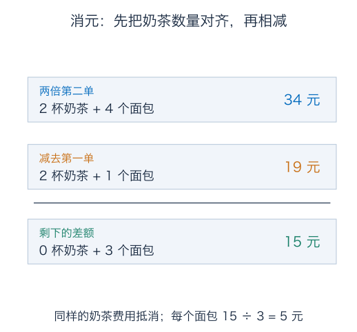

## 为什么这些行操作不会偷偷丢掉解

允许的基本操作有三种：交换两行；一行乘一个非零数；给一行加上另一行的某个倍数，其余行保持原样。它们都能撤销：再交换回来、除以那个非零数、减去刚才加的倍数。

因此原方程组的解一定满足新方程组，而新方程组的解也能沿反操作满足原方程组，解集完全相同。上面的 $2R_2-R_1$ 实际是先乘 2，再加第一行的 $-1$ 倍，两步都可逆。

“把两张票加起来”当然能得到一条真等式，但如果把原来两张都扔掉、只留下总价，信息就少了。比如只留 $3x+3y=36$，$(6,6)$ 也满足，却不满足原来的第一张小票。保留一行、用它更新另一行，与只留两行之和，是不同的操作。

同样，不能把一行乘零再宣称等价，因为原约束被擦成 $0=0$。若交换的是**两列**，未知量的含义也跟着交换；不改变量表，解的坐标通常会改变。行操作改的是等价的测量表，列操作改的是输入的记法，不能混用。

## 四种原料，三项读数：把完整问题算一遍

设原料份数为 $x=(x_1,x_2,x_3,x_4)^T$，配料表的三项统计量定义为

$$
b_1=x_1+2x_2+x_3,\qquad b_2=x_2+x_3+x_4,
$$

$$
b_3=b_1+2b_2=x_1+4x_2+3x_3+2x_4.
$$

第三栏由前两栏合成，没有增加一个独立读数。矩阵为

$$
A=\begin{pmatrix}1&2&1&0\\0&1&1&1\\1&4&3&2\end{pmatrix}.
$$

先在实数范围内求目标 $b=(3,1,5)^T$ 的全部输入；实际只加料的非负条件稍后再加。

$$
[\,A\mid b\,]=\left[\begin{array}{cccc|c}
1&2&1&0&3\\0&1&1&1&1\\1&4&3&2&5
\end{array}\right].
$$

先 $R_3\leftarrow R_3-R_1$，第三行成为 $(0,2,2,2\mid2)$；再 $R_3\leftarrow R_3-2R_2$，整行成为零。最后 $R_1\leftarrow R_1-2R_2$，得到

$$
\left[\begin{array}{cccc|c}
1&0&-1&-2&1\\0&1&1&1&1\\0&0&0&0&0
\end{array}\right].
$$

### 主元告诉你谁要由别人决定

一行从左数第一个非零系数，叫这一行的主元。阶梯形要求零行放在底下、下面各行的主元逐渐右移，主元下面全为零；若再把主元化为 1，并把主元列的其他位置清成零，就得到简化阶梯形。刚才已经做到后者。

实际计算时，从左向右扫描列、从上向下安排主元：若当前位置为零，就到下面找本列非零行交换上来；若本列剩余部分全零，就跳到下一列。用已选的非零主元消去下面各行相应项，再处理右下角剩余部分，最后回代，或继续把主元上方也清零。

例如系数矩阵 $\begin{pmatrix}0&1\\1&0\end{pmatrix}$ 的左上角虽然为零，交换两行就得到恒等矩阵；不能一看到零就直接除，也不能因此宣布无解。

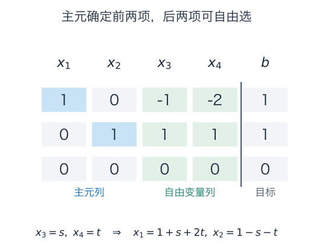

这里主元在第 1、2 列，所以 $x_1,x_2$ 是主变量；第 3、4 列没有主元，$x_3,x_4$ 可自由选。令 $x_3=s$、$x_4=t$，从非零行读出

$$
x_1-x_3-2x_4=1,\qquad x_2+x_3+x_4=1.
$$

因此全部实数解为

$$
\boxed{x=\begin{pmatrix}1\\1\\0\\0\end{pmatrix}
+s\begin{pmatrix}1\\-1\\1\\0\end{pmatrix}
+t\begin{pmatrix}2\\-1\\0\\1\end{pmatrix},\quad s,t\in\mathbb R.}
$$

任取 $s,t$ 代入都行，但不能再任意更改 $x_1,x_2$；它们已经被方程与自由参数确定。两个自由参数表示这个解集是一张四维背景中的二维仿射平面，而不是说四个原料数只剩两个栏。

### 自由参数也能装下实际配料限制

若所有原料份数都要非负，刚才的表达要求

$$
s\ge0,\quad t\ge0,\quad1-s-t\ge0,\quad1+s+2t\ge0.
$$

最后一项在前两项成立时自动满足，实际条件化成 $s,t\ge0$、$s+t\le1$。比如 $(s,t)=(0,0),(1,0),(0,1)$ 分别给出三份不同配方

$$
(1,1,0,0),\qquad(2,0,1,0),\qquad(3,0,0,1),
$$

却都产生读数 $(3,1,5)$。只看统计量，无法知道到底用了哪份配方。

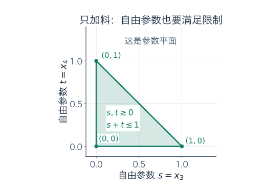

这幅图画的是**参数平面**，并没有假装把四维原料空间直接画成二维。若还要求整份购买，$s,t$ 就要是整数，本例这个三角形里恰好只剩上述三个整数点；允许分装时则有连续多种配法。

## 零空间：怎样改配方，读数完全不变

把刚才的两种自由变化记成

$$
z_1=(1,-1,1,0)^T,\qquad z_2=(2,-1,0,1)^T.
$$

直接乘矩阵就会发现 $Az_1=Az_2=0$。例如按 $z_1$ 调整，就是第一种加一份、第二种减一份、第三种加一份，三项统计读数都抵消为零。

定义**零空间**或**核**为

$$
\ker A=\{z\in\mathbb R^4:Az=0\}.
$$

对本例，把右端改成零后消元，得到 $x_1=s+2t$、$x_2=-s-t$、$x_3=s$、$x_4=t$，所以

$$
\ker A=\operatorname{span}\{z_1,z_2\}.
$$

这两个方向无关：若 $\alpha z_1+\beta z_2=0$，第三、第四坐标直接给出 $\alpha=\beta=0$。因此它们是一组基，核的维数为 2。

### 有一个具体解，就能写出全部解

设 $Ax_p=b$。若 $Ax=b$，两式相减，$A(x-x_p)=0$，所以 $x-x_p$ 在核中。反过来，若 $Az=0$，则 $A(x_p+z)=b$。两边合起来得到

$$
\boxed{\{x:Ax=b\}=x_p+\ker A,\quad\text{前提是已经有一个解 }x_p.}
$$

例如只有两个未知量时，机器 $M(u,v)=(u+v,2u+2v)$ 将整条 $u+v=3$ 都送到 $(3,6)$。原点处的核为 $u+v=0$；把核平移到任意一个特解，比如 $(3,0)$，就得到整个解集。

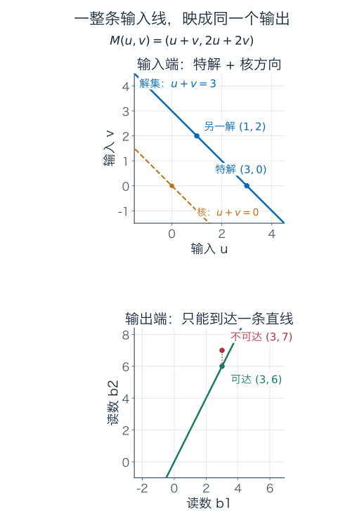

固定 $A$ 后，不同可达目标可能把解集平移到不同位置，但所有有解的目标都共享同一个核和同样的自由维数。不能出现“这台实线性机器对一个目标有唯一解，对另一个可达目标却有两种解”的情形。

## 列空间：哪些读数有可能产生

把 $A$ 的四列叫 $a_1,a_2,a_3,a_4$，则 $Ax=x_1a_1+\cdots+x_4a_4$。因此全部可达输出正是各列的张成空间，称为**列空间**或**像空间**：

$$
\operatorname{im}A=\operatorname{span}\{a_1,a_2,a_3,a_4\}.
$$

本例中

$$
a_1=(1,0,1)^T,\quad a_2=(2,1,4)^T,
$$

$$
a_3=-a_1+a_2,\qquad a_4=-2a_1+a_2.
$$

前两列无关：看第二坐标先让 $a_2$ 的系数为零，再看第一坐标让 $a_1$ 的系数为零。因此前两列构成列空间的一组基，维数为 2。

每个列组合都满足 $b_3=b_1+2b_2$；反过来，若读数满足此式，就可以写成

$$
b=(b_1-2b_2)a_1+b_2a_2.
$$

所以像空间恰好是输出 $\mathbb R^3$ 中过原点的平面 $b_3=b_1+2b_2$。$(3,1,5)$ 在平面内，可以产生；$(3,1,6)$ 在平面外，不可能精确产生。

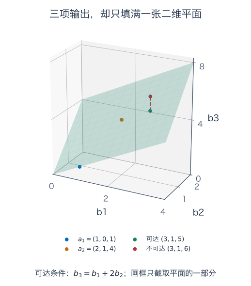

这给出求解 $Ax=b$ 的第一问：**目标是否属于列空间？** 若不属于，先别找所谓“唯一输入”，因为连一个输入都没有。

## 行空间：现有读数能算出哪些线性信息

前两项统计量分别是

$$
r_1^Tx=x_1+2x_2+x_3,\qquad r_2^Tx=x_2+x_3+x_4,
$$

其中 $r_1=(1,2,1,0)^T$、$r_2=(0,1,1,1)^T$。记号 $r_i^Tx$ 就是逐项乘再相加，这里先把它当读数公式。

已知 $b_1,b_2$ 后，任意 $\lambda b_1+\mu b_2$ 都能算出。它对应原料表上的读数系数 $\lambda r_1+\mu r_2$。所有这种系数组成**行空间**：

$$
\operatorname{Row}(A)=\operatorname{im}A^T\subseteq\mathbb R^4.
$$

我们把行的系数列表竖写成列向量，便于明确它与输入同样有四项。本例第三行是 $r_1+2r_2$，没有新方向，行空间也只有两个维度。

另一组方便的基，是简化阶梯形的两个非零行竖写而成：

$$
(1,0,-1,-2)^T,\qquad(0,1,1,1)^T.
$$

它们对应能直接由原读数算出的 $b_1-2b_2$ 与 $b_2$。它们无关，前两坐标就能检查；也能生成原来的 $r_1,r_2$，所以确实是同一个行空间。

但单独的 $x_3$ 无法从现有读数中确定：沿核方向 $z_1$ 调整时，读数不变，$x_3$ 却改变了。行空间讨论“可由读数线性合成的测量”，核讨论“读数完全看不到的输入变化”，两者都在输入的四维背景中。

## 左零空间：读数必须通过哪些校验

第三读数减第一读数、再减两倍第二读数，应永远为零。令

$$
y=(-1,-2,1)^T,
$$

就有 $y^TA=0$，等价地 $A^Ty=0$。所有这样的输出权重组成**左零空间**：

$$
\ker A^T=\{y\in\mathbb R^3:A^Ty=0\}.
$$

“左”来自写法 $y^TA=0$，它不是把 $\ker A$ 改个称呼；这里向量有三项，权重对应三路输出。

本例解 $A^Ty=0$：第一、第四列给出 $y_1+y_3=0$、$y_2+2y_3=0$，其余两式随之成立。因此全部权重为 $t(-1,-2,1)$，左零空间是一维的。

若 $Ax=b$，则一定

$$
y^Tb=y^TAx=0\qquad\text{对每个 }y\in\ker A^T.
$$

对合法目标 $(3,1,5)$，校验读数为 $-3-2+5=0$；对 $(3,1,6)$，为 $-3-2+6=1$。后者给出一张简短的**无解证据**：如果真有输入，它本该算出零，却算成了 1。

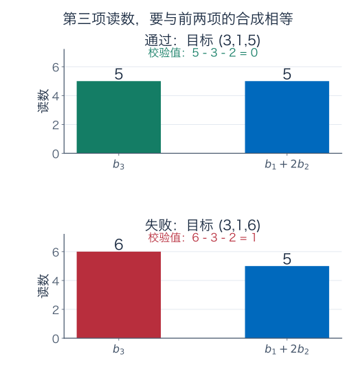

若实际读数含噪声，校验不为零表示它在这个精确模型下不相容，未必说明仪器故障。后面的最小二乘会寻找离观测尽量近的可达读数，再说明采用什么距离。

对实矩阵，反过来也成立：若 $b$ 通过左零空间里的**全部**校验，则 $Ax=b$ 有解。理由可以从消元看出：每一条消成零的系数行，都来自原行的某个组合，这个组合的权重属于左零空间；全部校验通过后，对应右侧也为零，不会出现矛盾行，其余主变量便能解出。

不是随便挑一个权重检查完就总能放心；本例左零空间只有一维，检查它的一组基已经覆盖全部校验。若维数更高，要检查一整组基。

## 四个空间各在机器的哪一边

对本例，输入有四项、输出有三项：

| 空间 | 所在背景 | 维数 | 它回答的问题 |
| --- | --- | --- | --- |
| 行空间 $\operatorname{im}A^T$ | 输入端 $\mathbb R^4$ | 2 | 能由读数合成哪些线性测量 |
| 核 $\ker A$ | 输入端 $\mathbb R^4$ | 2 | 哪些输入变化不影响输出 |
| 列空间 $\operatorname{im}A$ | 输出端 $\mathbb R^3$ | 2 | 哪些输出可以产生 |
| 左零空间 $\ker A^T$ | 输出端 $\mathbb R^3$ | 1 | 输出之间有哪些必然校验 |

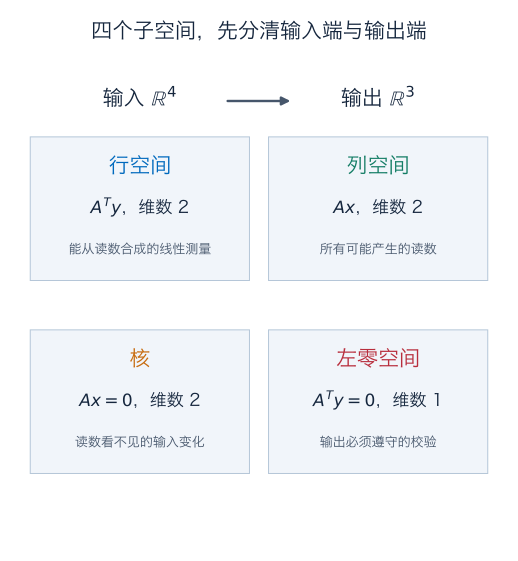

若 $z\in\ker A$，每一行都有 $r_i^Tz=0$；若 $y\in\ker A^T$，它与每个可达输出 $b$ 都有 $y^Tb=0$。以后学习内积与正交补，会把这些逐项乘积和为零的关系组织成两对正交空间。现在先明确各个向量的项数和角色，比急着记四个符号更重要。

## 秩：数独立信息，而不是数纸上的方程

消元后系数矩阵的主元数记为 $r$，称为矩阵的秩。对一般 $A\in\mathbb R^{m\times n}$，它同时等于列空间维数与行空间维数。为什么两个看似不同的数相同？

行操作的每一步可逆，所以新行能由原行生成，原行也能由新行生成，**行空间保持不变**。在简化阶梯形中，非零行在主元列处形成不同的单位方向，因此这 $r$ 行无关并张成行空间。

另一方面，主元列无关，其他列都能由主元列生成。行操作也保持“同一份系数能否把各列组合成零”：原来 $Az=0$，消元后仍为零，反过来也成立。因此可把阶梯形的列关系带回原矩阵，选取**原矩阵中对应主元位置的列**，得到列空间的一组基，恰好也是 $r$ 列。

这里没有说原列空间与新列空间相同，保持的是列之间的组合关系与独立列的数量。

### 为什么列空间的基要回原矩阵找

小例子 $N=\begin{pmatrix}1&2\\2&4\end{pmatrix}$ 做 $R_2\leftarrow R_2-2R_1$，成为 $\widetilde N=\begin{pmatrix}1&2\\0&0\end{pmatrix}$。原输出都在直线 $b_2=2b_1$ 上，新输出却都在横轴上。

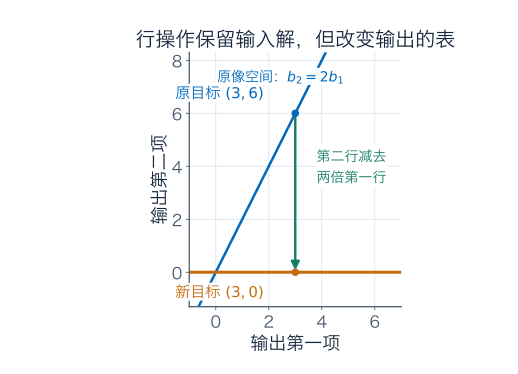

要保持方程等价，右侧也要同时从 $(3,6)^T$ 改成 $(3,0)^T$。两组方程有同一个输入解集，但输出坐标表已经变了。原列空间的基应取 $(1,2)^T$，不能偷换成阶梯形第一列的 $(1,0)^T$。

原核与新核相同，原行空间与新行空间也相同；列空间与左零空间则一般会变，只是维数不变。

## 从主元数直接读出解的结构

有 $n$ 个未知量、$r$ 个主元时，齐次方程有 $n-r$ 个自由变量。让每个自由变量依次为 1、其余为零，就得到 $n-r$ 个核向量；它们在自由坐标处构成单位方向，所以无关，并表示全部齐次解。因此

$$
\dim\ker A=n-r.
$$

对 $A^T$ 使用同样结论，而它的秩仍为 $r$，得到 $\dim\ker A^T=m-r$。本例是 $4=2+2$、$3=2+1$，分别在输入、输出两侧核对得上。

求给定 $Ax=b$ 时，先看增广矩阵有没有 $[0\ \cdots\ 0\mid c]$、$c\ne0$ 的矛盾行：有就无解；没有时，$r=n$ 则唯一解，$r<n$ 则有无穷多**实数**解。数主元时数的是系数矩阵 $A$，别把右端目标列中的矛盾主元当成又确定了一个未知量。

也可以记成 $\operatorname{rank}[A\mid b]=\operatorname{rank}A$ 当且仅当有解。若要求每个 $b\in\mathbb R^m$ 都有解，就需要 $r=m$；若每个 $b$ 都恰有一个解，则要同时 $r=m=n$。

给本例再加一次测量 $x_3=0$，便令 $s=0$，仍有 $t$ 自由；再测到 $x_4=0$，才令 $t=0$，输入唯一为 $(1,1,0,0)$。重复抄一遍原来的第三读数不会做到这件事，因为它没有增加独立约束。

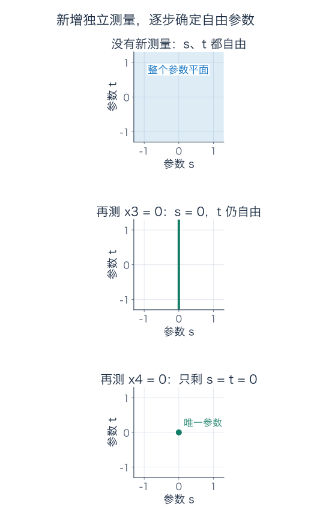

## 手算能消掉，不代表低精度计算也可靠

最后看一个很小的数值例子：

$$
10^{-4}x+y=1,\qquad x+y=2.
$$

精确相减可得 $x=10000/9999$、$y=9998/9999$，两者都接近 1。为了看清舍入机制，故意让下面每步运算只保留**三位有效数字**，这是一种粗精度模拟。

不交换行，第一主元为 $10^{-4}$。为了消掉第二行的 $x$，需要减去第一行的一万倍：

$$
-9999y=-9998.
$$

三位有效数字把两边都存成 $-1.00\times10^4$，于是算出 $y=1$；回代第一式得到 $x=0$。把 $(0,1)$ 代回原第二式，却只有 $1\ne2$，误差很大。

若先交换两行，用 1 作主元，再从下面一行减去上面一行的 $10^{-4}$ 倍，则得到

$$
0.9999y=0.9998.
$$

同样三位有效数字下，两边存成 1.00，算得 $y=1$，由上面一行 $x+y=2$ 回代得到 $x=1$。这次第二式精确满足，第一式只差 $10^{-4}$。

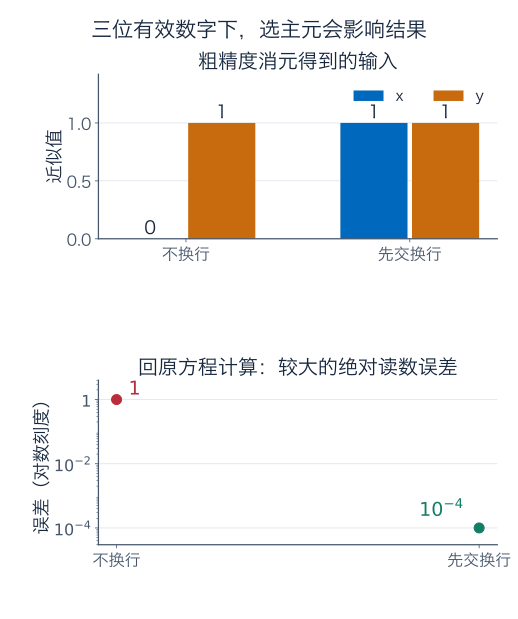

这个例子不是说计算机的实际精度永远只有三位，也不是说换行能解决全部数值问题。它说明为什么算法常在当前列里选择绝对值较大的元素作主元：避免不必要的大倍数消去与信息损失。后面的数值稳定性章节会区分舍入误差和问题本身对数据误差的敏感程度。

## 练习：先解，再回到原机器核对

**题一：三种小票。** 解 $2x+y=19$、$x+2y=17$。若第二式改为 $4x+2y=38$，写全部实数解和非负单价限制；若改为 $4x+2y=39$，给出明确的矛盾等式。

**题二：哪些操作真的等价。** 对题一原方程组，判断以下做法是否保留同一个 $(x,y)$ 解集：（1）交换两行；（2）给第二行加第一行三倍；（3）把第一行乘零；（4）只保留两行相加的结果；（5）交换两列但仍按原来的未知量顺序解释。给出可逆理由或反例。

**题三：完整配方族。** 对本章 $3\times4$ 矩阵 $A$ 和 $b=(3,1,5)^T$，写出简化阶梯形、全部实数解、两个自由变量及非负条件。若份数还必须是整数，究竟剩几份配方？逐一核对输出。

**题四：四个空间各求一组基。** 求本章 $A$ 的核、列空间、行空间、左零空间的基与维数。每组基的向量分别有几项？为什么行空间、核不能直接当成输出空间里的集合？

**题五：用校验代替盲找解。** 对本章 $A$，判断目标 $(3,1,6)^T$、$(2,3,8)^T$ 是否能由实数输入产生。对无解目标给出左零空间证据；对有解目标写全部输入，并找一个非负配方。只检查第三项合成关系，为什么在这个例子里足够？

**题六：行操作到底改变了哪些空间。** 对 $N=\begin{pmatrix}1&2\\2&4\end{pmatrix}$ 及其阶梯形 $\widetilde N=\begin{pmatrix}1&2\\0&0\end{pmatrix}$，分别求核、列空间、行空间、左零空间。目标 $(1,3)^T$ 对原方程有解吗？若同步做同一行操作，右端变成什么？

**题七：方程多少，能决定结论吗。** 对实数方程，$m<n$ 时能否对所有右端都有唯一解？多于未知量的方程是否必定冲突？方阵是否必定可逆？分别用主元条件说明，后两问还要举一个小矩阵例子。

**题八：别忘了额外限制。** 实数方程 $x+y=10$ 有多少解？若要求 $x,y$ 为非负整数呢？再看 $x+y=0$：实数解与非负实数解分别是什么？这是否推翻“有解且自由变量存在，就有无穷多实数解”的结论？

**题九：舍入后也要回代。** 对本章 $10^{-4}x+y=1$、$x+y=2$，核对精确解。按三位有效数字比较不换行所得 $(0,1)$ 与换行所得 $(1,1)$：分别计算代回原两式的读数误差，并取其中绝对值较大者。为什么必须回原方程核对？

### 参考答案与解题过程

#### 题一解答

原式第二行乘 2 减第一行，得到 $3y=15$，所以 $y=5$、$x=7$。代回为 $19$、$17$，唯一性也可由消元后的两个主元看出。

改成 $4x+2y=38$ 时，第二式正好为第一式两倍。令 $x=t$，得 $(x,y)=(t,19-2t)$，$t\in\mathbb R$。若单价非负，则 $t\ge0$、$19-2t\ge0$，即 $0\le t\le19/2$。

若右端为 39，做第二式减第一式两倍，得到 $0=39-38=1$，矛盾，无解。增加一条方程不保证增加独立信息，也可能引入冲突。

#### 题二解答

（1）保留。交换一次改变排列，交换回来便恢复原式。

（2）保留。保留第一行，用它更新第二行；之后减去第一行三倍就能撤销，且等号右端也必须一起更新。

（3）不保留。第一条约束被抹去，只剩 $x+2y=17$；例如 $(17,0)$ 满足剩余式，却不满足原第一式。

（4）不保留。两行相加只给出 $x+y=12$，$(6,6)$ 满足它，但原第一式左端为 18，不是 19。

（5）不保留原坐标下的解。交换系数列后是 $x+2y=19$、$2x+y=17$，解为 $(5,7)$。若把未知量顺序也明确换成 $(y,x)$，可以描述同一物理问题；题设没有同步更改，所以不能说同一个 $(x,y)$ 解集保持不变。

#### 题三解答

增广矩阵化简为

$$
\left[\begin{array}{cccc|c}
1&0&-1&-2&1\\0&1&1&1&1\\0&0&0&0&0
\end{array}\right].
$$

第 3、4 列无主元，令 $x_3=s$、$x_4=t$，得到

$$
x=(1+s+2t,\ 1-s-t,\ s,\ t)^T.
$$

非负条件是 $s,t\ge0$、$s+t\le1$；第一坐标此时自动至少为 1。若 $s,t$ 还为整数，只能 $(0,0),(1,0),(0,1)$，所以只剩三份配方。

逐一计算：$(1,1,0,0)$ 的三项读数为 $(1+2,1,1+4)=(3,1,5)$；$(2,0,1,0)$ 为 $(2+1,1,2+3)=(3,1,5)$；$(3,0,0,1)$ 为 $(3,1,3+2)=(3,1,5)$。整数限制缩小了实数解族，不改变原来的消元计算。

#### 题四解答

核的一组基为 $(1,-1,1,0)^T$、$(2,-1,0,1)^T$，两向量各有四项，维数为 2。它们乘 $A$ 均为零，且第三、第四坐标保证独立。

列空间的一组基为原矩阵第 1、2 列 $(1,0,1)^T$、$(2,1,4)^T$，各有三项，维数为 2。其余两列分别等于 $-a_1+a_2$、$-2a_1+a_2$；前两列独立。

行空间的一组基可取 $(1,0,-1,-2)^T$、$(0,1,1,1)^T$，各有四项，维数为 2。它们来自简化阶梯形的非零行，行操作可逆，张成的仍是原行空间。

左零空间的一组基为 $(-1,-2,1)^T$，有三项，维数为 1。代入 $A^Ty=0$，前两项分别被第三项确定。

原输入有四栏，输出只有三栏。行空间的向量是四个输入项的测量系数，核的向量是四个输入项的变化量；它们不是三项输出向量。维数同为 2，并不意味着所属背景与含义相同。

#### 题五解答

所有实数输出必须满足 $b_3-b_1-2b_2=0$。对 $(3,1,6)$，该值为 1；左零向量 $y=(-1,-2,1)^T$ 满足 $y^TA=0$，但 $y^Tb=1$，所以无解。

对 $(2,3,8)$，校验为 $8-2-6=0$。取第三、第四输入为 $s,t$，先从第二行解 $x_2=3-s-t$，再从第一行解 $x_1=-4+s+2t$，所以

$$
x=(-4,3,0,0)^T+s(1,-1,1,0)^T+t(2,-1,0,1)^T.
$$

令 $s=0,t=2$，得到非负输入 $(0,1,0,2)^T$。代回三项读数为 $(2,3,4+4)=(2,3,8)$。

本例左零空间只有一维，所有校验权重均为 $(-1,-2,1)$ 的倍数，检查这一条就覆盖全部；一般矩阵可能需要多条独立校验。

#### 题六解答

原矩阵 $N$ 的核为 $\operatorname{span}\{(-2,1)^T\}$，因为 $x+2y=0$；列空间为 $\operatorname{span}\{(1,2)^T\}$；行空间把行竖写后也是 $\operatorname{span}\{(1,2)^T\}$；左零空间为 $\operatorname{span}\{(-2,1)^T\}$。行列空间在本例数值形式碰巧相同，但分别对应输入与输出两端，角色仍不同。

阶梯形 $\widetilde N$ 的核仍为 $\operatorname{span}\{(-2,1)^T\}$，行空间仍为 $\operatorname{span}\{(1,2)^T\}$；列空间改成 $\operatorname{span}\{(1,0)^T\}$；左零空间改成 $\operatorname{span}\{(0,1)^T\}$。

原目标 $(1,3)$ 不满足第二项为第一项两倍，所以无解。同步做 $R_2\leftarrow R_2-2R_1$ 后，右端变成 $(1,1)^T$，方程出现 $0=1$，依旧无解。若只改矩阵却把右端错误地保留，会得到另一个问题。

#### 题七解答

$m<n$ 时，秩 $r\le m<n$，所以核维数 $n-r>0$。只要某个目标有解，就能沿非零核方向生成无穷多实数解，因此不可能对所有目标都有唯一解；但并不是说所有目标都无解。

多于未知量的方程不一定冲突。例如 $J=\begin{pmatrix}1&0\\0&1\\0&0\end{pmatrix}$ 是 $3\times2$，对目标 $(2,-1,0)^T$，唯一输入为 $(2,-1)^T$。这里 $r=2=n$ 保证有解时唯一，但不是每个三维目标都可达，比如 $(2,-1,1)$ 就无解。

方阵也不一定可逆，$N=\begin{pmatrix}1&2\\2&4\end{pmatrix}$ 秩只有 1，小于列数 2，有非零核方向。方阵可逆需要满秩 $r=m=n$，仅看外形为正方形远远不够。

#### 题八解答

$x+y=10$ 的全部实数解为 $(t,10-t)$，$t\in\mathbb R$，有无穷多。非负整数限制要求 $t\in\{0,1,\ldots,10\}$，因此恰好 11 个。

$x+y=0$ 的实数解为 $(t,-t)$，仍有无穷多；但若两项都非负，只能 $t=0$，于是只有 $(0,0)$。

这些结论没有矛盾。自由变量计数描述的是实数线性方程的完整解集；再与非负区域或整数点相交后，可行集合已经增加额外限制。不能把关于完整实数解族的结论直接套给所有受限配料问题。

#### 题九解答

原两式相减得到 $(1-10^{-4})x=1$，所以 $x=10000/9999$，$y=2-x=9998/9999$。第一式代回为

$$
10^{-4}\frac{10000}{9999}+\frac{9998}{9999}
=\frac{1+9998}{9999}=1,
$$

第二式为 $19998/9999=2$，精确成立。

定义代回误差为“左侧计算读数减右侧目标”。近似 $(0,1)$ 的两项误差为 $1-1=0$、$1-2=-1$，绝对值较大者为 1。近似 $(1,1)$ 的误差为 $(1.0001-1,2-2)=(10^{-4},0)$，较大者为 $10^{-4}$。

只核对舍入后的新方程，可能发现两者都满足各自那组被舍入过的式子；它不能证明原方程也被满足。因此要回到原系数、原目标计算误差。主元选择改变了粗精度下保留的信息，没有改变精确方程本身。

## 接下来，把“独立信息”组织成维数理论

求解方程不只是把未知数算出来。你还可以读出哪些目标可达、哪些输入变化不可见、哪些测量可合成、哪些输出关系必须成立。它们分别落在列空间、核、行空间与左零空间中。

下一章会把本章的主元与自由参数推广成基、维数和秩零化度定理，再用商空间准确表达“把无法分辨的输入归为同类”。

### 几何伴读与算法核对

- [3Blue1Brown：逆矩阵、列空间与零空间](https://www.3blue1brown.com/lessons/inverse-matrices/)：配合观察可达输出与被压扁的输入方向；本章另外逐步计算消元过程，模型、图与习题均为独立编写。
- [TU Delft：线性方程组与消元](https://interactivetextbooks.tudelft.nl/linear-algebra/Chapter2/LinearSystems.html)：核对可逆行操作、阶梯形与相容性。
- [Gilbert Strang：四个子空间的维数，MIT 教材节选](https://math.mit.edu/~gs/linearalgebra/ila5/linearalgebra5_3-5.pdf)：核对四个空间所属的输入、输出背景，以及行消元保留与改变的内容。

---

[数学总导航](../00-%E6%95%B0%E5%AD%A6%E5%AD%A6%E4%B9%A0%E5%AF%BC%E8%88%AA.md) · [本课程目录](00-%E4%BB%8E%E7%AE%AD%E5%A4%B4%E5%88%B0%E5%87%BD%E6%95%B0%E7%A9%BA%E9%97%B4.md) · [← 上一章](02-%E7%9F%A9%E9%98%B5%E6%98%AF%E4%B8%80%E5%8F%B0%E5%8F%98%E6%8D%A2%E6%9C%BA%E5%99%A8.md) · [下一章 →](04-%E5%9F%BA%E3%80%81%E7%BB%B4%E6%95%B0%E3%80%81%E7%A7%A9%E4%B8%8E%E5%95%86%E7%A9%BA%E9%97%B4.md)
