[数学总导航](../00-%E6%95%B0%E5%AD%A6%E5%AD%A6%E4%B9%A0%E5%AF%BC%E8%88%AA.md) · [本课程目录](00-%E4%BB%8E%E7%AE%AD%E5%A4%B4%E5%88%B0%E5%87%BD%E6%95%B0%E7%A9%BA%E9%97%B4.md) · [← 上一章](03-%E6%B6%88%E5%85%83%E3%80%81%E7%BA%BF%E6%80%A7%E6%96%B9%E7%A8%8B%E4%B8%8E%E5%9B%9B%E4%B8%AA%E5%AD%90%E7%A9%BA%E9%97%B4.md) · [下一章 →](05-%E8%A1%8C%E5%88%97%E5%BC%8F%E3%80%81%E9%80%86%E7%9F%A9%E9%98%B5%E4%B8%8E%E6%8D%A2%E5%9F%BA.md)

## 三种套餐，不一定有三个独立选择

一家店有三种套餐，坐标依次表示牛奶盒数、面包个数：

$$
a=(1,2),\qquad b=(2,4),\qquad c=(2,1).
$$

$b$ 只是两份 $a$。不管买多少份这两种，结果都沿着同一个配比方向；第三种 $c$ 才带来新的方向。宣传单写了三种套餐，独立的配比能力却只有两种。

把三种套餐排成矩阵的列，$H=[\,a\ b\ c\,]$，它的列空间是整个 $\mathbb R^2$，秩为 2。比如 $(4,5)=2a+c$，也等于 $b+c$，两种订单的商品完全相同。冗余套餐让系数表示不唯一。

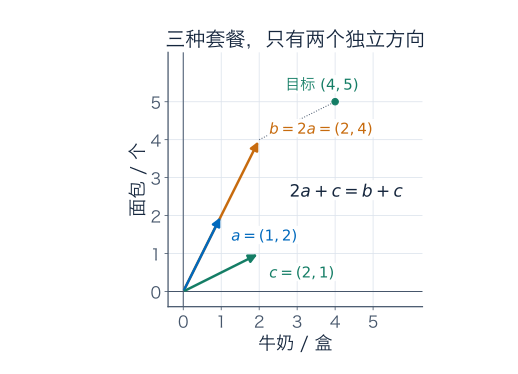

这里仍采用实线性模型：允许任意实数份数来研究张成与独立性；实际只买整份、不能退货时，要再加非负整数限制。**维数数的是独立实数方向，不是菜单长度，也不是实际可买套餐的种类数。**

前几章已经用过基和维数。这章要回答两个更深的问题：为什么换一组基，独立方向的数量不变？如果一台机器看不见某些输入差别，怎样把这些差别准确地忽略掉？

## 基：每个对象表示得出，而且表示唯一

如果一组向量张成空间 $V$，且线性无关，就叫 $V$ 的一组基。张成保证每个对象有一份系数表示；独立保证没有第二份不同表示。因为两份表示相减会得到非平凡的零组合，独立性正好排除这种冗余。

只取 $a$、$c$ 就是平面的一组基。若目标为 $(p,q)$，解 $sa+tc=(p,q)$，得到

$$
s+2t=p,\qquad2s+t=q,
\qquad s=\frac{2q-p}{3},\quad t=\frac{2p-q}{3}.
$$

每个实数目标都有唯一的份数。因此给基指定顺序 $B=(a,c)$ 后，$[x]_B$ 就是对象 $x$ 对应的份数表。交换基向量的顺序，份数表也要交换。

另一组基 $v_1=(1,1)$、$v_2=(1,-1)$ 下，同一对象 $r=(3,1)$ 满足

$$
r=3e_1+e_2=2v_1+v_2,
\qquad[r]_{(e_1,e_2)}=(3,1)^T,
\qquad[r]_{(v_1,v_2)}=(2,1)^T.
$$

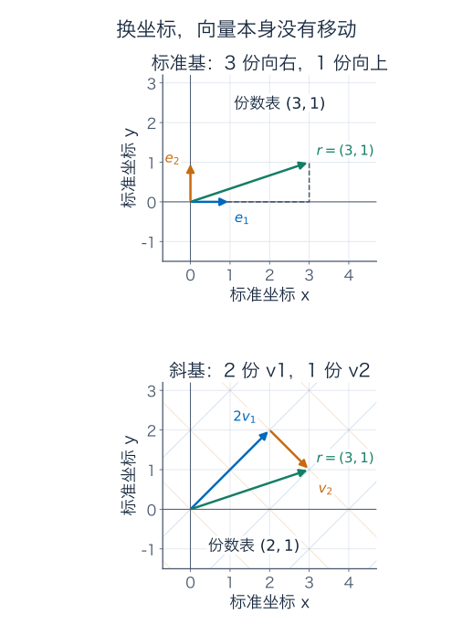

换坐标是在换描述。若把 $(2,1)^T$ 忘记标注基就直接当标准坐标，便会指向另一个点。下一章会系统推导两套坐标之间怎样翻译。

## 为什么所有有限基都有相同大小

先建立一个可用的计数事实：**若一个空间能由 $m$ 个向量生成，其中任何线性无关组都至多有 $m$ 个向量。**

设生成向量为 $w_1,\ldots,w_m$，另取无关向量 $u_1,\ldots,u_k$。把每个 $u_j$ 用 $w_i$ 表示，系数排成 $m\times k$ 矩阵 $C$，便有

$$
[\,u_1\ \cdots\ u_k\,]=[\,w_1\ \cdots\ w_m\,]C.
$$

若 $k>m$，齐次方程 $C\alpha=0$ 的未知量比方程多，上一章的消元保证存在非零系数向量 $\alpha$。于是

$$
\sum_{j=1}^k\alpha_j u_j
=[\,w_1\ \cdots\ w_m\,]C\alpha=0,
$$

与 $u_j$ 无关矛盾，所以必须 $k\le m$。注意这里不要求生成组 $w_i$ 本身无关，论证仍成立。

现在若 $B$ 有 $n$ 个基向量、$B'$ 有 $m$ 个基向量，用 $B'$ 生成整个空间，$B$ 又无关，得到 $n\le m$；交换角色得到 $m\le n$，所以 $m=n$。这个共同的数才可以作为空间自身的量，叫**维数**，记为 $\dim V$。

比如 $\mathbb R^n$ 的标准基有 $n$ 项，因此维数为 $n$；$P_2$ 的基 $1,t,t^2$ 有三项，因此维数为 3。画函数时纸上只有两条轴，不会让 $P_2$ 的维数变成 2。

### 已有材料怎样整理成一组基

若手里是一份有限生成清单，就从中删掉能由其他材料表示的向量，张成空间不变，最终剩下一组无关的生成向量。套餐中删掉 $b=2a$ 就是这样的操作。

若手里已有一组无关向量，但还没张成整个有限维 $V$，就选一个原张成之外的向量加入。它不会引入相关关系，否则能反过来把新向量写成旧组合，与选择条件矛盾。继续添加，独立向量数不能超过 $\dim V$，所以有限步后会成为基。这叫**把无关组扩充成基**。

零空间 $\{0\}$ 的维数为 0，采用空基；$\{0\}$ 中那一个零向量不能当基，因为它本身线性相关。以后核只有零时写“核维数为零”，并不是说没有零向量。

## 温差记录：三项输入，究竟丢掉哪一项信息

你在三个时刻测到温度 $(20,22,21)$。另一台温度计整体高报 5 度，给出 $(25,27,26)$。两张原始记录不同，相邻变化却都是先升 2 度、再降 1 度。

把相邻温差写成线性机器：

$$
D(T_1,T_2,T_3)^T=(T_2-T_1,T_3-T_2)^T,
\qquad D=\begin{pmatrix}-1&1&0\\0&-1&1\end{pmatrix}.
$$

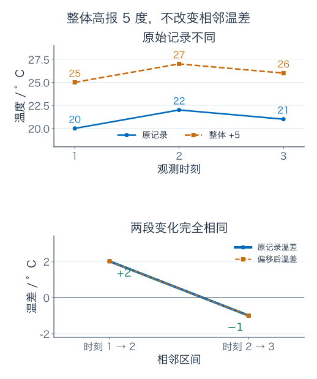

求 $DT=0$，得到 $T_2=T_1$、$T_3=T_2$，所以

$$
\ker D=\operatorname{span}\{(1,1,1)^T\}.
$$

核的一维方向表示“给所有时刻同时加同一个偏移”，这是设备看不见的输入变化。给任意温差 $(a,b)$，都可以选择原记录 $(0,a,a+b)$，所以像空间为整个 $\mathbb R^2$，秩为 2。输入的三个自由方向中，一个整体偏移消失，两个变化信息保留下来。

### 选对基，丢掉的信息就直接显出来

取

$$
m=(1,1,1)^T,\qquad u=(0,1,1)^T,\qquad v=(0,0,1)^T.
$$

这是一组基，因为任意温度表都能唯一写成

$$
T=T_1m+(T_2-T_1)u+(T_3-T_2)v.
$$

所以新坐标的三项依次是“起始基准、第一段温差、第二段温差”。对 $(20,22,21)$，这张份数表为 $(20,2,-1)$。

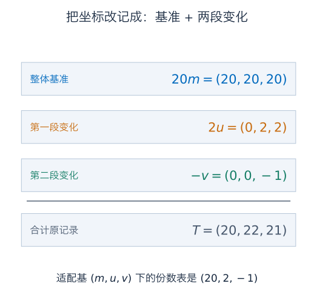

机器在这组输入基上的作用尤其清楚：

$$
Dm=0,\qquad Du=(1,0)^T,\qquad Dv=(0,1)^T.
$$

第一项基准被消去，后两项分别变成输出的两个标准方向。若输入采用 $B=(m,u,v)$、输出仍用标准基，矩阵就成为

$$
[D]_{\text{输出标准}\leftarrow B}
=\begin{pmatrix}0&1&0\\0&0&1\end{pmatrix}.
$$

原机器没有变，只是用适合它的坐标把行为展开了。这也解释了为什么上一章强调矩阵要连同输入、输出基一起看。

## 秩零化度定理：把核的基扩充起来

现在将温差例子的办法用于一般线性映射 $T:V\to W$，假设**定义域 $V$ 有限维**。秩是 $\dim\operatorname{im}T$，零化度是 $\dim\ker T$；后者这个名字只是在数“被送到零的自由方向”。

先给核取基 $k_1,\ldots,k_q$，再把它扩充成整个 $V$ 的基

$$
k_1,\ldots,k_q,\ v_1,\ldots,v_r.
$$

我们要证明 $T(v_1),\ldots,T(v_r)$ 恰好构成像空间的基。

先看够不够用。任意 $x\in V$ 都可写成核方向与新增方向的组合，应用 $T$ 后，核项全部消失：

$$
T\left(\sum_i a_i k_i+\sum_j b_jv_j\right)
=\sum_j b_jT(v_j).
$$

所以它们张成全部像空间。再看有没有冗余。若 $\sum_j c_jT(v_j)=0$，则 $\sum_jc_jv_j$ 在核中，可写成 $\sum_i d_i k_i$。把两边移到一起，是完整输入基上的零组合，只能所有 $c_j,d_i$ 为零。因此这些输出方向无关。

于是 $\dim V=q+r$，其中 $q=\dim\ker T$、$r=\dim\operatorname{im}T$，得到

$$
\boxed{\dim V=\dim\ker T+\dim\operatorname{im}T.}
$$

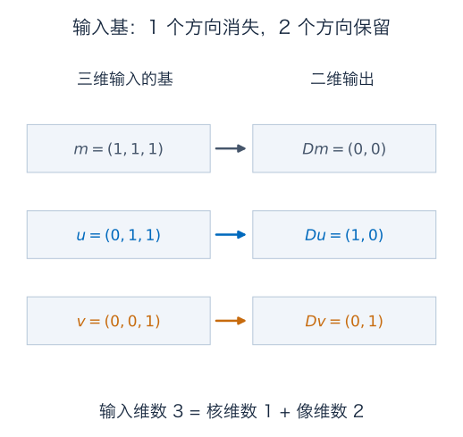

这里不要求 $W$ 有限维：有限维输入的像最多仍由有限个基本输出生成。对 $m\times n$ 矩阵，定义域维数为 $n$，便回到上一章的 $n=\dim\ker A+\operatorname{rank}A$。

## 单射与满射：分别检查“有没有重影”和“够不够覆盖”

**单射**要求不同输入有不同输出。在线性映射中，它等价于 $\ker T=\{0\}$：如果 $T(x)=T(y)$，就有 $T(x-y)=0$；核只有零便迫使 $x=y$。反过来，单射不允许非零输入与零输入输出相同。

**满射**要求声明的终点空间 $W$ 中，每个对象都能成为输出，也就是 $\operatorname{im}T=W$。判断满射时一定要把 $W$ 写清楚。

比如把二维坐标补零放进三维，$J(a,b)=(a,b,0)$，没有重影，却到不了第三项非零的点。求导 $p\mapsto p'$ 在 $P_2$ 上会丢掉常数；它的输出至多一次，不能覆盖以 $P_2$ 为终点的全部对象。

| 映射及终点空间 | 单射？ | 满射？ |
| --- | --- | --- |
| 温差 $D:\mathbb R^3\to\mathbb R^2$ | 否，整体偏移不可分辨 | 是，任意两段温差都可实现 |
| 补零 $J:\mathbb R^2\to\mathbb R^3$ | 是 | 否，第三项只能为零 |
| 求导 $P_2\to P_2$ | 否，丢掉常数 | 否，输出不含二次项 |
| 求导 $P_2\to P_1$ | 否，仍丢掉常数 | 是，每个一次函数都有二次原函数 |

若 $V,W$ 维数同为有限的 $n$，秩零化度给出：单射时核维数为零，所以秩为 $n$，像空间只能是整个 $W$；满射时秩为 $n$，核只能为零。因此单射、满射、可逆等价。输入输出维数不相等，或维数不是有限，这条等价关系就需要重新检查。

## 商空间：先说清楚哪些差别不再区分

现在回到两台温度计。假设你只想分析变化，不想保留整体偏移，就规定：两张记录 $x,y$ 在且仅在相差常数向量时算同一类。

令 $M=\operatorname{span}\{(1,1,1)^T\}$，便写成

$$
x\sim y\quad\Longleftrightarrow\quad x-y\in M.
$$

某张记录 $x$ 所在的整个类别是

$$
[x]=x+M=\{x+m:m\in M\}.
$$

例如 $[(20,22,21)]$ 包含 $(25,27,26)$、$(0,2,1)$、$(-1,1,0)$，以及所有 $(c,c+2,c+1)$。其中每一张具体表叫这一类的一个**代表元**；类本身包含全部这些表。

一般地，对向量空间 $V$ 的子空间 $M$，所有这种类别组成的集合记为 $V/M$，称为**商空间**。符号中的 $M$ 明确记录你决定忽略的方向。

### 为什么这能稳定地分成一类一类

$x-x=0\in M$，所以每个对象与自己同类；若 $x-y\in M$，其相反向量 $y-x$ 也在 $M$，所以同类关系可以反过来；若 $x-y,y-z\in M$，两者之和 $x-z$ 也在 $M$，所以可以传递。这三条分别叫自反、对称、传递，合起来保证是等价关系。

因此不同的类不会只重合一部分：若两个类共享一个代表，任取其中一个对象，都能经由这个共同代表与另一个类同类，两类就全部相同。

在平面上忽略水平轴 $M=\operatorname{span}\{(1,0)\}$ 时，每条水平线就是一类；$(1,2)$ 与 $(5,2)$ 同类，而 $(1,3)$ 属于另一类。这里剩下的分类坐标是高度 $y$。

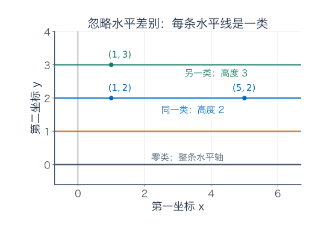

“温度相差不到 1 度就算同类”却不具备这个性质：0 与 0.75 相差不到 1，0.75 与 1.5 也相差不到 1，但 0 与 1.5 不满足。它不传递，不能直接当作这里的等价分类。

## 类之间怎样相加，为什么必须检查代表元

想把两个温度变化模式合起来，可以各选一张代表表先相加，然后取它的类。一般定义为

$$
[x]+[y]=[x+y],\qquad \alpha[x]=[\alpha x].
$$

问题是：别人可能选了不同代表，会不会算出另一类？若 $x'=x+m_1$、$y'=y+m_2$，则

$$
(x'+y')-(x+y)=m_1+m_2\in M,
$$

所以两份结果确实同类；数乘时的差为 $\alpha m_1\in M$，也不受代表选择影响。这叫**良定义**，意思是“算的是这个类自身的结果，别因换一张代表表而变卦”。

零类是 $[0]=M$，因为被忽略的每个方向都与零同类；相反类为 $[-x]$。其余向量空间运算规则由 $V$ 继承。因此 $V/M$ 确实是一个向量空间，不只是随意贴标签。

若打算在类上定义别的读数，也要做相同检查。温度的首项 $T_1$ 会在换代表时改变，不能作为这个温差类的固定数值；$T_2-T_1$ 却保持不变，可以。最高值减最低值也保持不变，但它不是线性读数，因为取相反向量后，范围仍非负，并不会整体变号。

## 忽略一个方向，不等于直接删掉原始第一栏

两张同类表 $(20,22,21)$、$(25,27,26)$，直接删掉首项后成为 $(22,21)$、$(27,26)$，仍然不同。因此“丢掉一维偏移”不能凭直觉实现为删除某个原始坐标。

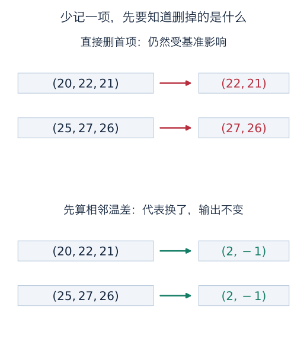

前面已经找到合适的输入基 $(m,u,v)$。在它的坐标里，两张表分别是 $(20,2,-1)$ 与 $(25,2,-1)$，这时舍去第一项基准，就得到同样的 $(2,-1)$。真正有用的是先把“可忽略方向”与其余信息分开。

商空间也不等于强行选定一张标准表。可以给每类选首项为零的代表，本例为 $(0,2,1)$；也可以减掉三项均值 21，选零均值代表 $(-1,1,0)$。两者相差 $(1,1,1)$，仍是同一类。

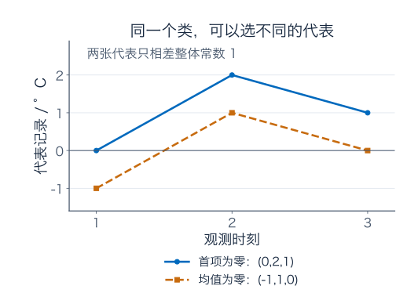

“选一个代表”是计算的便利约定；商空间的定义保留的是整类。某种代表选择可能特别适合后续问题，但需要把选择规则写出来，不能假设每个商空间天然附带唯一的标准代表。

## 商空间还剩多少维

设有限维 $V$ 中的子空间 $M$ 有基 $m_1,\ldots,m_k$，将其扩充为 $V$ 的基

$$
m_1,\ldots,m_k,\ v_1,\ldots,v_r.
$$

进入商空间后，前 $k$ 项都成为零类。任意类只要用 $[v_1],\ldots,[v_r]$ 组合便能表示；若 $\sum_jc_j[v_j]=[0]$，则 $\sum_jc_jv_j\in M$，可写成 $m_i$ 的组合，完整基的独立性再次迫使全部 $c_j=0$。

所以这些类构成商空间的一组基，得到

$$
\boxed{\dim(V/M)=\dim V-\dim M.}
$$

温度例子里 $\mathbb R^3/M$ 的维数为 $3-1=2$，基可取 $[u],[v]$，分别表示第一段与第二段变化。平面忽略水平轴后，维数为 $2-1=1$，可取竖直单位方向的类为基。

两个边界情况也很清楚：忽略零子空间时，每类只有一个对象，$V/\{0\}$ 与 $V$ 对应；忽略整个 $V$ 时，所有对象归成零类，$V/V$ 只有一个元素，维数为零。

## 为什么按核分类后，机器就不再有重影

温差机器 $D$ 的核恰好是 $M$。同一个类中任取代表，温差都相同，所以可以定义

$$
\Phi:\mathbb R^3/M\longrightarrow\mathbb R^2,\qquad \Phi([T])=DT.
$$

它单射：若 $Dx=Dy$，就有 $x-y\in\ker D=M$，说明 $[x]=[y]$。它满射：任意 $(a,b)$ 都由 $[(0,a,a+b)]$ 输出。它也保持类的线性组合，因此是一种双向保持线性结构的对应，叫**线性同构**。

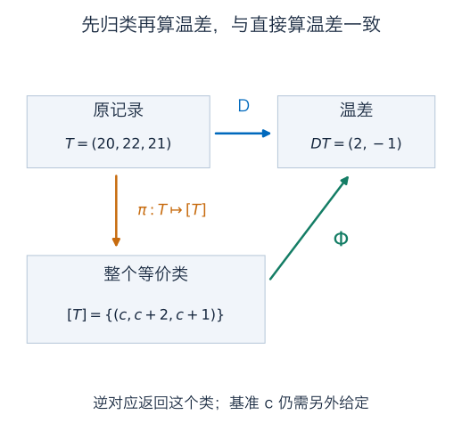

一般的线性映射 $T:V\to W$ 都有

$$
\boxed{V/\ker T\cong\operatorname{im}T,\qquad[x]\longmapsto Tx.}
$$

证明与温差例子一样：核确保换代表不改输出；输出相同说明差在核里，因而类相同；像中的每个输出按定义都有一个输入。这个结果叫第一同构定理，**不要求有限维**。如果 $T$ 原来不满射，终点必须写成 $\operatorname{im}T$，不能直接冒充整个 $W$。

这没有使原来的温差机器凭空恢复绝对温度。$\Phi^{-1}(2,-1)$ 返回的是所有 $(c,c+2,c+1)$ 组成的类；要恢复某一张原表，还需要给出一个基准，比如 $T_1=20$。

### 可忽略的方向，必须真的不影响输出

若希望线性读数 $S:V\to W$ 能在 $V/M$ 上按 $[x]\mapsto Sx$ 计算，必要且充分的条件是 $M\subseteq\ker S$。必要性来自 $m\in M$ 与零同类，所以必须 $S(m)=S(0)=0$；充分性来自两个代表之差在 $M$，应用 $S$ 后差为零。

例如温差问题若把 $(1,2,3)$ 的倍数也忽略，这个方向却有 $D(1,2,3)^T=(1,1)^T\ne0$。同一类会出现不同温差，输出就不良定义。选哪种差别算“同一个对象”，必须与要保留的读数相容。

## 函数也可以按“只差常数”分类

考虑二次以下多项式 $P_2$。$p(t)=5+2t-t^2$ 与 $q(t)=-3+2t-t^2$ 相差常数 8，求导后都为 $2-2t$。

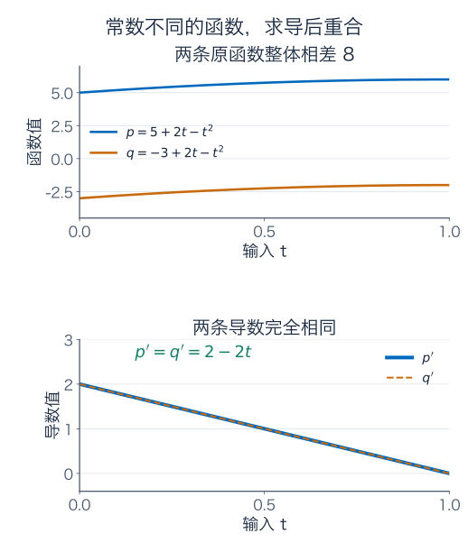

求导 $\partial:P_2\to P_1$ 的核是常数子空间 $\operatorname{span}\{1\}$，像为整个 $P_1$：对任意 $a+bt$，$at+(b/2)t^2$ 就是一份原函数。秩为 2，核维数为 1，满足 $3=1+2$。

于是

$$
P_2/\operatorname{span}\{1\}\cong P_1,\qquad[p]\longmapsto p'.
$$

商空间的基可取 $[t],[t^2]$；求导后对应 $1,2t$，仍是 $P_1$ 的基。若仍把终点写成 $P_2$，诱导映射单射但不能满射，因为导数不可能含二次项。

另一种读数 $E(p)=p(0)$，则保留常数项、丢掉 $t,t^2$ 方向：核为 $\operatorname{span}\{t,t^2\}$，秩为 1。读数不同，核不同，要忽略的方向也不同；不能把按常数分类的求导故事照搬给评价读数。

对连续可微函数也能沿用这个思路。在同一个区间 $[0,1]$ 上，若 $f'=g'$，[中值定理](../微积分/03-中值定理、Taylor%20展开与优化.md)说明 $f-g$ 是常数；而由[积分基本定理](../微积分/04-定积分与微积分基本定理.md)，任意连续函数 $h$ 都有原函数 $F(t)=\int_0^t h(s)\,ds$。因此在代数意义下，$C^1[0,1]$ 按常数取商后，通过求导与 $C[0,1]$ 对应。

进入泛函分析后，还要问这种对应是否连续、逆是否连续、按什么距离取极限，以及被忽略的子空间是否闭。今天证明的是线性结构的同构，这为后面的分析问题提供起点。

## 无限维里，单射与满射会分开

最后看一个能直接运行的反例。令 $c_{00}$ 为只有有限多项非零的实数列组成的空间，例如 $(2,-1,3,0,0,\ldots)$。它有无限多个独立的单位方向 $e_1,e_2,\ldots$，每个元素又是有限组合，所以这是一组无限基。

定义右移与左移：

$$
R(x_1,x_2,\ldots)=(0,x_1,x_2,\ldots),
$$

$$
L(x_1,x_2,\ldots)=(x_2,x_3,\ldots).
$$

两种操作都保持有限非零项的条件，也都线性。右移没有丢项，$Rx=0$ 只可能 $x=0$，所以单射；但输出首项永远为零，到不了 $e_1$，所以不满射。

左移能覆盖任何目标：想输出 $y$，输入 $(0,y_1,y_2,\ldots)$ 即可；但输入首项被丢掉，核为 $\operatorname{span}\{e_1\}$，所以不单射。

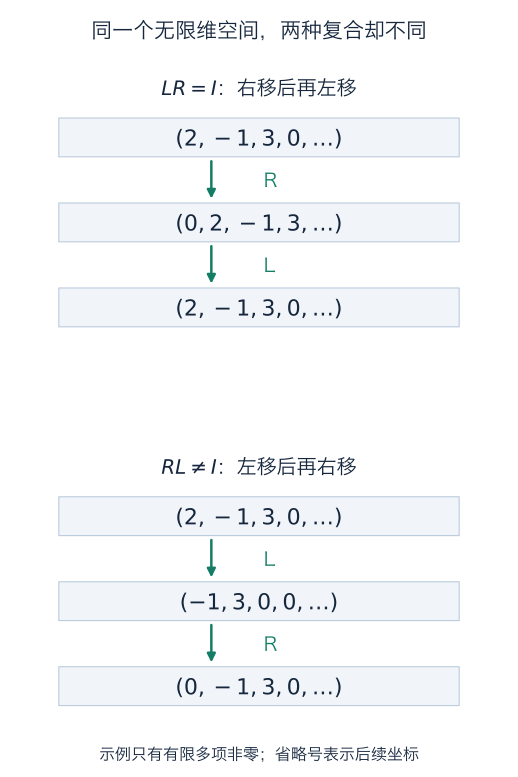

因此 $LR=I$，而 $RL(x)=(0,x_2,x_3,\ldots)$ 一般不等于 $x$。两台机器的输入输出都是同一个无限维空间，仍然一台单射不满射、另一台满射不单射。有限维同维数下的等价结论，不能省掉“有限”二字。

## 练习：数清楚，再检查分类有没有意义

**题一：套餐与独立性。** 对 $a=(1,2)$、$b=(2,4)$、$c=(2,1)$，判断三者能否构成平面的基，求矩阵 $H=[a\ b\ c]$ 的秩和核的一组基。再求 $(4,5)$ 在有序基 $(a,c)$ 下的坐标。

**题二：一组材料怎样变成基。** 在 $\mathbb R^3$ 中，$u_1=(1,0,0)$、$u_2=(0,1,0)$、$u_3=(1,1,0)$ 生成什么空间？删去一个冗余向量得到基，再加入一个向量扩充为整个 $\mathbb R^3$ 的基。解释为什么整个平面的基不能只含一个向量。

**题三：用适合温差的坐标。** 对温度表 $(18,21,20)$，写出它在 $B=(m,u,v)$ 下的坐标以及 $D$ 的输出。求该输出对应的全部原记录；若补充首项温度为 18，是否唯一？核维数、秩与输入维数如何核对？

**题四：秩零化度也适用于函数。** 在 $P_2$ 上，分别求求导 $\partial:P_2\to P_1$ 与评价 $E:P_2\to\mathbb R$、$E(p)=p(0)$ 的核、秩、零化度及单射满射情况。若把求导的终点改成 $P_2$，哪一项结论会改变？

**题五：水平线的商空间。** 令 $M=\operatorname{span}\{(1,0)\}\subseteq\mathbb R^2$。判断 $(1,2)$、$(5,2)$、$(1,3)$ 哪些同类；计算 $[(1,2)]+[(4,-1)]$ 和 $3[(1,2)]$，给出零类及商空间的一组基、维数。换代表为 $(5,2)$ 会改变结果吗？

**题六：别把分类当成删栏。** 对 $(20,22,21)$，分别求首项为零与均值为零的代表。直接删去第一项能否给这个温差类定义不依赖代表的坐标？怎样改做才可以？

**题七：哪些读数能定义在温差类上。** 对按整体常数偏移分类的温度表，判断以下读数是否不依赖代表：（1）$T_1$；（2）$T_2-T_1$；（3）$T_1+T_2+T_3$；（4）最高温减最低温。对能定义的读数再判断是否线性。若改为忽略 $(1,2,3)$ 方向，温差机器 $D$ 还能在新类别上良定义吗？

**题八：同构的逆，究竟恢复什么。** 通过温差机器诱导的 $\Phi:\mathbb R^3/M\to\mathbb R^2$，求 $\Phi^{-1}(2,-1)$。再求求导同构下，$2-2t\in P_1$ 对应的多项式类，说明其全部代表及商空间维数。为什么这两个逆都没自动找回原来的基准？

**题九：无限维的两台移位机器。** 对 $x=(2,-1,3,0,0,\ldots)$，计算 $Rx,Lx,LRx,RLx$。分别说明 $R,L$ 的单射满射情况，并解释为什么只检查组合 $LR=I$ 不能推出它们互为双向逆。

### 参考答案与解题过程

#### 题一解答

三者相关，因为 $b-2a=0$，所以不是基；$a,c$ 却无关且张成整个平面，因此 $H$ 秩为 2。

设三种套餐的系数为 $(s,t,r)$，零组合为

$$
sa+tb+rc=(s+2t)a+rc=0.
$$

由 $a,c$ 无关，得 $s+2t=0$、$r=0$。所以 $\ker H=\operatorname{span}\{(-2,1,0)^T\}$，维数为 1，输入三维正好等于核的一维加像的二维。

对目标 $(4,5)$，解 $s+2r=4$、$2s+r=5$，得 $s=2,r=1$，因此坐标为 $(2,1)^T$。检查 $2(1,2)+(2,1)=(4,5)$。

#### 题二解答

因为 $u_3=u_1+u_2$，三者生成的都是 $z=0$ 平面。删去 $u_3$，$u_1,u_2$ 仍张成该平面且无关，是它的一组基。

加入 $u_4=(0,0,1)$ 后，任意 $(x,y,z)=xu_1+yu_2+zu_4$，系数也由各坐标唯一确定，因此成为 $\mathbb R^3$ 的基。

平面已有两个独立向量 $u_1,u_2$，若一个向量就能张成它，便出现“两个无关向量落在一个生成向量张成的空间”这一不可能情况。也可直接看：一个非零向量的实数倍只有一条直线，不能覆盖整个平面。

#### 题三解答

基准为 18，第一段温差为 $21-18=3$，第二段为 $20-21=-1$，所以 $[T]_B=(18,3,-1)^T$，输出 $DT=(3,-1)^T$。

所有原记录为

$$
(c,c+3,c+2)^T=(0,3,2)^T+c(1,1,1)^T,\qquad c\in\mathbb R.
$$

指定首项为 18 就固定 $c=18$，唯一恢复 $(18,21,20)$。核维数为 1，秩为 2，$3=1+2$；缺失的信息正是那个还没有被给定的基准。

#### 题四解答

设 $p=a+bt+ct^2$。求导为 $b+2ct$，等于零当且仅当 $b=c=0$，因此核为 $\operatorname{span}\{1\}$，零化度为 1。任意 $\alpha+\beta t$ 都由 $\alpha t+(\beta/2)t^2$ 输出，所以像为 $P_1$，秩为 2，满射但不单射。

评价为 $E(p)=a$。核为 $\operatorname{span}\{t,t^2\}$，零化度为 2；任意实数可由常数函数得到，所以秩为 1，同样满射但不单射。两种情况均满足输入维数 $3=1+2$。

求导若声明终点为 $P_2$，实际像仍为 $P_1$，核与秩都不变，但满射性改变为否，因为 $t^2$ 不能是某个 $P_2$ 元素的导数。

#### 题五解答

$(1,2)-(5,2)=(-4,0)\in M$，所以前两点同类；它们与 $(1,3)$ 的纵坐标不同，差不在水平轴上，不同类。

按定义相加得 $[(5,1)]$，其整个类是高度为 1 的水平线；数乘得 $[(3,6)]$，是高度为 6 的水平线。若改用代表 $(5,2)$，相加得到 $[(9,1)]$，数乘得到 $[(15,6)]$，仍为刚才同样的两条水平线，所以结果不变。

零类就是水平轴 $M$。商空间的一组基为 $[(0,1)]$：任意类 $[(x,y)]=y[(0,1)]$；该类不为零，且只有零系数会让纵坐标为零。故商空间维数为 1。

#### 题六解答

减去首项 20 的整体偏移，得到 $(0,2,1)$。均值为 $(20+22+21)/3=21$，减去它得到 $(-1,1,0)$。两代表相差 $(1,1,1)$，同属原类。

直接删首项不行：原表给出 $(22,21)$，同类表 $(25,27,26)$ 却给出 $(27,26)$，结果受代表影响。

可以改取相邻温差 $(T_2-T_1,T_3-T_2)=(2,-1)$；也可先减首项，再取后两项，得到 $(T_2-T_1,T_3-T_1)=(2,1)$。两种都是不依赖代表的坐标，但含义不同：后者第二项是相对起点的变化，不是第二段相邻温差。两套坐标之间为 $(a,b)\mapsto(a,a+b)$，可相互还原。

#### 题七解答

整体加常数 $c$ 时，$T_1$ 增加 $c$，三项之和增加 $3c$，所以（1）（3）不能定义为类本身的读数。（2）中的常数相消，因此良定义，且差分保持加法、数乘，是线性的。

（4）中最高与最低温都增加同一个 $c$，范围不变，所以良定义。但它不是线性的：对 $T=(0,1,0)$，范围为 1；对 $-T=(0,-1,0)$，范围仍为 1，不是原范围的 $-1$ 倍。

若改为忽略 $n=(1,2,3)$ 方向，零表与 $n$ 会同类，但 $D0=(0,0)$、$Dn=(1,1)$。同一类出现不同输出，故 $D$ 不良定义；等价地，新忽略的子空间没有包含在 $\ker D$ 中。

#### 题八解答

$\Phi^{-1}(2,-1)$ 是 $[(0,2,1)]$，也就是所有 $(c,c+2,c+1)$ 组成的类，而不是某一个固定三元组。若需要原来的 20 度基准，必须另给 $c=20$。

对导数 $2-2t$，一份原函数为 $2t-t^2$，因此对应类为 $[2t-t^2]$，全部代表是 $c+2t-t^2$，$c\in\mathbb R$。商空间维数为 $\dim P_2-\dim\operatorname{span}\{1\}=3-1=2$，基可取 $[t],[t^2]$。

这两个逆的对象都是已经把基准归为同类的输入，基准自由度本来就被忽略了。它们恢复了全部可分辨信息，不能自动给出当初被省去的那个常数。

#### 题九解答

按定义逐项移动：

$$
Rx=(0,2,-1,3,0,\ldots),\qquad Lx=(-1,3,0,0,\ldots),
$$

$$
LRx=x,\qquad RLx=(0,-1,3,0,\ldots)\ne x.
$$

$R$ 单射，因为输出从第二项起完整记录输入；它不满射，因为首项为 1 的 $e_1$ 无法输出。$L$ 满射，因为任意目标 $y$ 都由 $Ry$ 输出；它不单射，因为 $e_1$ 与零都输出零，核为 $\operatorname{span}\{e_1\}$。

$LR=I$ 只说明右移之后能用左移撤销；$RL$ 已给出相反顺序失败的例子。双向逆要求两种组合都是恒等映射，不能由其中一边省略另一边。

## 下一章再把坐标翻译与几何变化接起来

基给出无冗余的坐标，维数让独立方向的数量不依赖基的选择；秩零化度把这些方向分成被核消去的部分与保留在像中的部分。商空间进一步把核方向上的不同输入归成同一类，让可分辨信息与输出建立线性对应。

下一章研究行列式、逆矩阵与换基。你会看到：换描述与真正变形怎样用不同的矩阵步骤表示，以及方向被压扁时为什么不能恢复全部原输入。

### 几何伴读与正式核对

- [3Blue1Brown：线性组合、张成与基](https://www.3blue1brown.com/lessons/span/)：配合观察方向与坐标份数。本文的温度模型、证明安排、图和习题为独立编写。
- [TU Delft：基与维数](https://interactivetextbooks.tudelft.nl/linear-algebra/Chapter4/BasisAndDimension.html)：核对基的定义、精简生成组与维数不变性。
- [UCL：秩零化度定理](https://www.homepages.ucl.ac.uk/~ucahmto/0005_2021/Ch4.S16.html)：核对扩充核基后证明像基的两个步骤；本文明确使用有限维定义域。
- [Dartmouth：商空间上的线性映射](https://math.dartmouth.edu/~trs/PreTeXtProjects/linear-algebra-refresher-CLI/output/web/section-factoring-through-a-quotient.html)：核对代表元无关条件、商空间维数和第一同构定理。

---

[数学总导航](../00-%E6%95%B0%E5%AD%A6%E5%AD%A6%E4%B9%A0%E5%AF%BC%E8%88%AA.md) · [本课程目录](00-%E4%BB%8E%E7%AE%AD%E5%A4%B4%E5%88%B0%E5%87%BD%E6%95%B0%E7%A9%BA%E9%97%B4.md) · [← 上一章](03-%E6%B6%88%E5%85%83%E3%80%81%E7%BA%BF%E6%80%A7%E6%96%B9%E7%A8%8B%E4%B8%8E%E5%9B%9B%E4%B8%AA%E5%AD%90%E7%A9%BA%E9%97%B4.md) · [下一章 →](05-%E8%A1%8C%E5%88%97%E5%BC%8F%E3%80%81%E9%80%86%E7%9F%A9%E9%98%B5%E4%B8%8E%E6%8D%A2%E5%9F%BA.md)
