[数学总导航](../00-%E6%95%B0%E5%AD%A6%E5%AD%A6%E4%B9%A0%E5%AF%BC%E8%88%AA.md) · [本课程目录](00-%E4%BB%8E%E7%AE%AD%E5%A4%B4%E5%88%B0%E5%87%BD%E6%95%B0%E7%A9%BA%E9%97%B4.md) · [← 上一章](03-%E6%B6%88%E5%85%83%E3%80%81%E7%BA%BF%E6%80%A7%E6%96%B9%E7%A8%8B%E4%B8%8E%E5%9B%9B%E4%B8%AA%E5%AD%90%E7%A9%BA%E9%97%B4.md) · [下一章 →](05-%E8%A1%8C%E5%88%97%E5%BC%8F%E3%80%81%E9%80%86%E7%9F%A9%E9%98%B5%E4%B8%8E%E6%8D%A2%E5%9F%BA.md)

采购员关心“原来买了几包”，仓库关心“拆开后有多少东西”。这两个问题需要保留的信息并不一样。

沿用上一章：A 套餐是 1 盒牛奶、2 袋面包；B 是 2 盒牛奶、1 袋面包；C 是 A 加 B。牛奶每盒 250 克，面包每袋 100 克，不计外包装重量。用 50 克作重量单位，三种套餐的读数为

$$
v_1=(1,2,9)^T,\quad v_2=(2,1,12)^T,\quad v_3=(3,3,21)^T=v_1+v_2.
$$

两份真实订单 $(1,2,0)$ 与 $(0,1,1)$，都会送来 5 盒牛奶、4 袋面包、33 个重量单位。只看仓库清单，它们没有区别；若还要数原包装，它们就有区别：一份三包，一份两包。

## 1．三种套餐，仓库为什么只需要两个模板

### 1.1 三个模板能表示，但会重复

把实际订单记为 $x=(a,b,c)^T$，拆开后输出

$$
Ax=av_1+bv_2+cv_3,\qquad
A=\begin{pmatrix}1&2&3\\2&1&3\\9&12&21\end{pmatrix}.
$$

如果把三种套餐的清单都当作模板，当前输出既能写成 $v_1+2v_2$，也能写成 $v_2+v_3$。同一份东西有两种模板份数，记录不唯一。

可是 $v_3$ 本来就是前两个相加。把所有 C 都在清单上拆成一份 A 加一份 B，就有

$$
av_1+bv_2+cv_3=(a+c)v_1+(b+c)v_2.
$$

这并不是说供应商真的拆了 C 的包装，这里只是在算内容清单。令

$$
u=a+c,\qquad v=b+c,
$$

两项数值就能保留全部输出：$Ax=uv_1+vv_2$。这里斜体字母 $v$ 是一个份数，带下标的 $v_1,v_2$ 是两张模板，不要把它们混读。

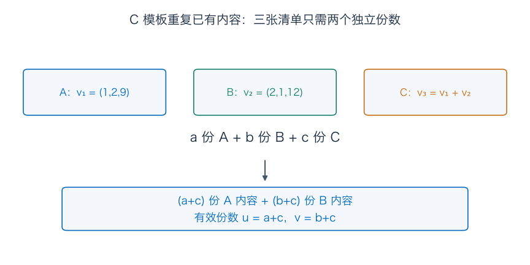

### 1.2 这两个数会不会仍然不唯一

假设同一输出有两套份数 $(u,v)$、$(u',v')$。相减得到

$$
(u-u')v_1+(v-v')v_2=0.
$$

只看牛奶、面包两项，就要求

$$
(u-u')+2(v-v')=0,\qquad2(u-u')+(v-v')=0.
$$

第二式减第一式的两倍，得到 $-3(v-v')=0$，所以 $v=v'$，再有 $u=u'$。两张模板的份数确实唯一。

现在才给这份“够用而且不重复”的清单起名字：$\mathcal B=(v_1,v_2)$ 是全部可达输出的一组**有序基**。

“够用”叫张成：每个可达输出都能由它组合。“不重复”叫线性无关：只有全零份数才组合成零。这两条合起来，让每个对象有且只有一套基坐标。

只留下 $v_1$ 就不够了：若想用它凑出 5 盒牛奶，需要 5 份，却会同时给出 10 袋面包，而目标只有 4 袋。因此不能把模板从两个再减成一个。

### 1.3 亲手把目标清单翻译成模板份数

设目标 $d=(p,q,w)^T$ 符合 $w=5p+2q$。求 $d=uv_1+vv_2$，前两项给出

$$
u+2v=p,\qquad2u+v=q.
$$

两倍第二式减第一式，得到 $3u=2q-p$；两倍第一式减第二式，得到 $3v=2p-q$。所以

$$
\boxed{[d]_{\mathcal B}=
\begin{pmatrix}(2q-p)/3\\(2p-q)/3\end{pmatrix}.}
$$

方括号的下标标明了基：里面的数不是牛奶、面包数量，而是相对于这组模板的份数。

对 $d=(5,4,33)^T$，得到 $(u,v)=(1,2)$。重新合成：$v_1+2v_2=(5,4,33)^T$，三项全部回来了。两个坐标就够描述这份三项清单，因为第三项始终受重量关系约束。

这里讨论全部实数输入与实数线性组合。采购时是否允许半包、负数包，要另外检查；基坐标的唯一性不等于实际原订单的唯一性。

## 2．换一组基，同一份早餐会有另一张份数表

既然 C 是 A 加 B，可以改用 A 模板、C 模板吗？试着写

$$
d=\xi v_1+\zeta v_3.
$$

展开 C 后是

$$
\xi v_1+\zeta(v_1+v_2)=(\xi+\zeta)v_1+\zeta v_2.
$$

因为 A、B 份数唯一，必须 $u=\xi+\zeta,v=\zeta$，反过来就是

$$
\xi=u-v,\qquad\zeta=v.
$$

每一对 $(u,v)$ 都能唯一翻译过去，$\mathcal C=(v_1,v_3)$ 也是同一输出空间的基。当前早餐对应

$$
[d]_{\mathcal B}=(1,2)^T,\qquad
[d]_{\mathcal C}=(-1,2)^T.
$$

逐项核对 $-v_1+2v_3=-(1,2,9)+2(3,3,21)=(5,4,33)$。

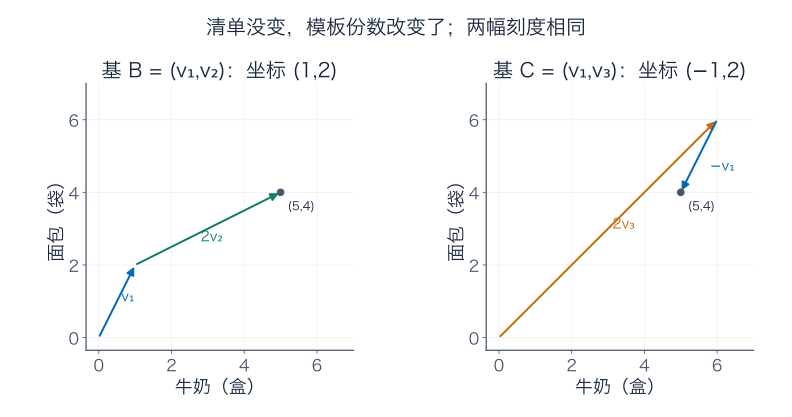

图只画牛奶、面包两项，重量可以由它们补出；两幅采用相同刻度。右边的负一表示在模板计算中减去一份 A，不是允许负包数的真实采购建议。早餐本身没变，原来那两份非负整数订单也没有消失。

这说明三件事要分开：对象本身、它在某组基下的坐标、实际允许的采购方案。把坐标的基名漏掉，或把每张份数表都当实际订单，都会答错问题。

## 3．维数数什么：换模板也改不了独立信息的数量

刚才两组基都含两个向量。会不会另找三张特别聪明的模板，它们既无关，又描述同一个输出空间？

不会。每张新模板都能用 $v_1,v_2$ 表示。若有三张新模板，想寻找它们的一个零组合，最后只需要让 A、B 两个总份数都为零。这是两条齐次方程、三个未知系数；上一章的消元告诉我们，一定存在非零解。所以三张模板中至少有一份重复信息，无法全部无关。

也不能只用一个模板覆盖，因为 $v_1,v_2$ 已经是两个独立方向。于是任何基都恰好两个。这种不随基选择改变的数量，叫**维数**。

一般结论是：一个有限生成的向量空间，所有基都有相同的向量个数。完整计数证明见补充 A。它让“维数”成为空间自身的属性，不是某次选模板的习惯。

本例的输入是任意三元组 $(a,b,c)$，有三个独立实数坐标；输出虽然也写三项，却只能在 $w=5p+2q$ 这个平面中活动，维数为 2。矩阵的**秩**就是它的像空间维数，因此 $\operatorname{rank}A=2$。

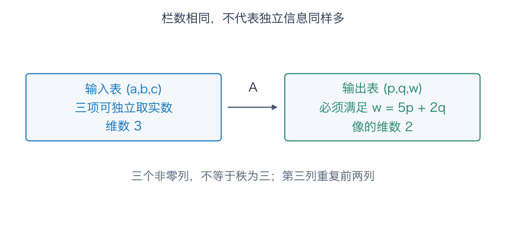

维数也不是纸上画了几条轴。例如二次以下多项式 $a+bt+ct^2$，有三个独立系数，空间 $P_2$ 为三维；用平面曲线画它，不会把它降成二维。零空间 $\{0\}$ 只有零对象，采用空基，维数为零；把零向量放进基中会破坏独立性。

## 4．给原订单换一套记录，让丢掉的信息单独站出来

输出模板已经整理清楚，原订单能否也换成更好读的坐标？

上一章算出所有不可见变化沿着 $k=(-1,-1,1)^T$：少一包 A、少一包 B、多一包 C，输出不变。试着把它直接放进输入基。

取

$$
e_1=(1,0,0)^T,\quad e_2=(0,1,0)^T,\quad k=(-1,-1,1)^T,
\qquad\mathcal E=(e_1,e_2,k).
$$

对任意订单，直接展开可得

$$
\boxed{x=(a,b,c)^T=(a+c)e_1+(b+c)e_2+c\,k.}
$$

右边逐项是 $(a+c,b+c,0)+(-c,-c,c)=(a,b,c)$。反过来，给定新坐标 $(u,v,r)$，原坐标唯一为

$$
x=(u-r,\ v-r,\ r)^T.
$$

任意对象都能唯一来回翻译，所以 $\mathcal E$ 确实是一组输入基。新坐标的含义依次为：有效 A 内容份数、有效 B 内容份数、C 的原包数。

当前两份订单的对照是

| 原包数坐标 $(a,b,c)$ | 新坐标 $[x]_{\mathcal E}=(u,v,r)$ | 输出 |
| --- | --- | --- |
| $(1,2,0)$ | $(1,2,0)$ | $(5,4,33)$ |
| $(0,1,1)$ | $(1,2,1)$ | $(5,4,33)$ |

第三项依然记得原包装区别，但输出只需要前两项。把机器作用在新基向量上：

$$
Ae_1=v_1,\qquad Ae_2=v_2,\qquad Ak=0.
$$

因此输入采用 $\mathcal E$、输出采用 $\mathcal B$ 时，机器的坐标表极其简单：

$$
\boxed{[A]_{\mathcal B\leftarrow\mathcal E}
=\begin{pmatrix}1&0&0\\0&1&0\end{pmatrix},\qquad
(u,v,r)\longmapsto(u,v).}
$$

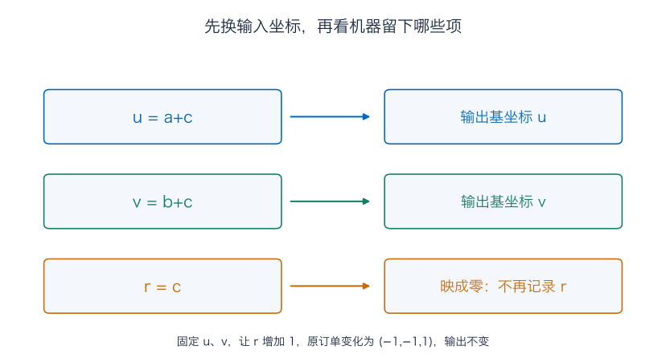

符号下标写出坐标从哪里来、到哪里去。这张 $2\times3$ 表和原来的 $3\times3$ 矩阵描述同一个输出过程，但输出现在用可达平面的两项基坐标表示。它没有宣布整个三维输出背景都能达到。

这也把 $3=2+1$ 具体拆开：三个输入方向中，两个留下可分辨的内容，一个只改变包装。一般的**秩零化度定理**说，有限维定义域 $V$ 满足

$$
\dim V=\dim\operatorname{im}T+\dim\ker T.
$$

“零化度”只是核的维数。一般证明与刚才的做法一样，先把核的基放进输入基，再看剩下方向的输出；补充 A 会把两个必要步骤写全。

## 5．仓库决定不记包装：商空间先是一条明确的分类规则

现在仓库说：“既然只统计拆开的内容，就把送来同样东西的订单当作同一类。”

不是随便少写一栏，而是先规定哪些订单可以合在一起。记

$$
M=\ker A=\operatorname{span}\{k\},\qquad
x\sim y\quad\Longleftrightarrow\quad Ax=Ay
\quad\Longleftrightarrow\quad x-y\in M.
$$

也就是说，只有差别完全沿着不可见的包装交换方向，才算同类。

对 $x=(1,2,0)^T$，它所属的整个类别为

$$
\boxed{[x]=x+M=
\{(1-t,\ 2-t,\ t)^T:t\in\mathbb R\}.}
$$

一份具体订单叫**代表元**；$[x]$ 代表整类订单。$x$、$(0,1,1)^T$ 都是代表，$(2,3,-1)^T$ 也是实数模型中的代表，后者当然不是非负采购方案。

留意方括号的用途：前面的 $[d]_{\mathcal B}$ 带基的下标，表示一列坐标；这里的 $[x]$ 表示按当前规则得到的整个类别。两者不是同一种对象。

这里 $M$ 叫被取商的子空间，所有类别组成的集合叫**商空间**，写作 $\mathbb R^3/M$。斜杠不是把每个数除以某个分母；它在说“沿 $M$ 相差的对象归成同一类”。

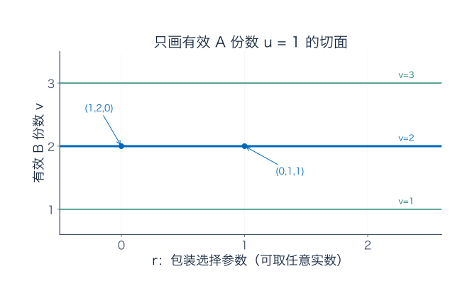

图只画 $u=1$ 的切面，横轴为包装参数 $r$，纵轴为 $v$。同一条线上，$u,v$ 不变，输出不变；换到另一条线，内容就变了。图截取有限范围，完整类别沿横向继续延伸。零类 $M$ 的 $u=v=0$，不在这个 $u=1$ 的切面里。

### 为什么分类不会出现“这两类只重合一半”

同类关系有三条可直接检查的性质：

1. $x-x=0\in M$，自己和自己同类。
2. $x-y\in M$ 时，相反数 $y-x\in M$，同类可以反过来。
3. $x-y,y-z\in M$ 时，相加得 $x-z\in M$，同类可以接着传递。

这叫等价关系。如果两类共享一个代表，沿着上面三条规则走，就会发现它们每个成员都同类，所以两类其实完全相同。

相反，“读数差不到 1 就算同类”不能直接这样用：0 与 0.75、0.75 与 1.5 都达标，0 与 1.5 却不达标。缺少传递性，就不能稳定地把所有对象分成互不重叠的类别。

## 6．整类订单也能相加吗：先做两次，再检查换代表

仓库还想合并两批货。第一批属于 $[(1,2,0)]$，第二批属于 $[(2,1,0)]$。先各取这两个代表相加，得到 $(3,3,0)$，内容为

$$
A(3,3,0)^T=(9,9,63)^T.
$$

但别人可能为第一批选 $(0,1,1)$，为第二批选 $(1,0,1)$。相加是 $(1,1,2)$，原包装总数不同；再算内容，却仍是

$$
A(1,1,2)^T=(1+2+6,\ 2+1+6,\ 9+12+42)^T=(9,9,63)^T.
$$

两份合并结果之差为 $(-2,-2,2)=2k$，仍在同一类。于是可以定义

$$
[x]+[y]=[x+y],\qquad\lambda[x]=[\lambda x].
$$

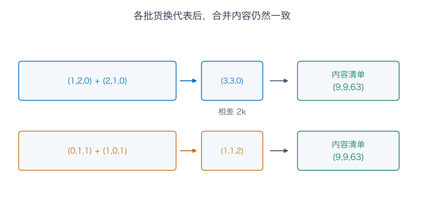

刚才只算了两组数，还需要保证以后每次都行。若换成 $x'=x+m_1,y'=y+m_2$，其中 $m_1,m_2\in M$，则

$$
(x'+y')-(x+y)=m_1+m_2\in M.
$$

数乘后的差也是 $\lambda m_1\in M$。结果不依赖代表怎么选，叫作运算**良定义**。用人话说，就是“算的是这一类本身，不会因为换张同类订单就变卦”。

零对象也变成一个类：$[0]=M$，其中包括零订单，也包括所有 $tk$。零类不是说只有一张零订单；它说这整类变化都不贡献输出。相反类为 $[-x]$，其余向量运算规则从原空间继承。

因此商空间仍是向量空间。但代数运算要在全体实数订单上做：负数倍也是合法操作，而“只允许非负整包”的集合一乘负数就出界，当不了这里的实向量空间。

## 7．“忽略一维”不等于删掉原表的某一栏

### 7.1 删掉 C 栏，会立刻露馅

同一类的两张表 $(1,2,0)$、$(0,1,1)$，若直接删掉第三项，会得到 $(1,2)$、$(0,1)$。同一类竟有两个不同标签，这种记录不良定义。

正确做法已经在第 4 节找到：先换成 $(u,v,r)=(a+c,b+c,c)$，再舍去第三项，留下

$$
P(a,b,c)^T=(a+c,b+c)^T,\qquad
P=\begin{pmatrix}1&0&1\\0&1&1\end{pmatrix}.
$$

两张表都给出 $(1,2)$。舍去的是**换好坐标后的不可见方向**，并非原始表上碰巧排在最后的一栏。

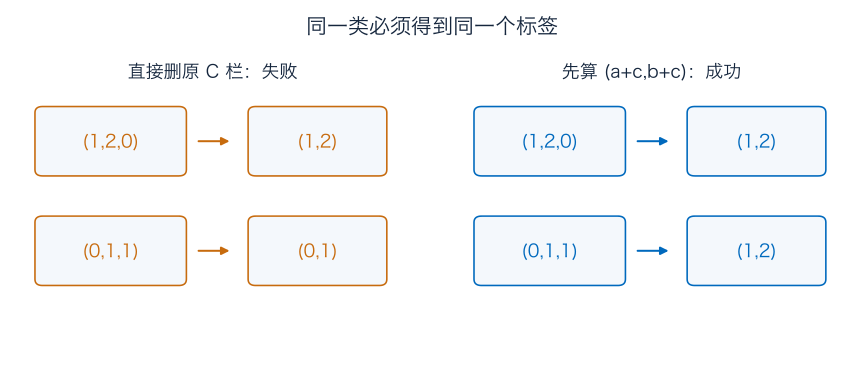

### 7.2 哪些读数可以属于“这一类”

货款为 $7a+8b+15c=7u+8v$。同一类的 $u,v$ 不变，所以货款是类本身的读数。当前为 $7+16=23$ 元。

原包装数却为 $a+b+c=u+v-r$。换代表时 $r$ 会变，不能让这个类自带一个固定的“原来几包”。这一信息已经被有意忽略。

更一般地，想从类得到一个线性读数 $Sx$，必要且充分的条件是

$$
\boxed{M\subseteq\ker S.}
$$

必要性：$m\in M$ 和零同类，所以必须 $Sm=S0=0$。充分性：两个代表之差在 $M$，应用 $S$ 后差为零。对系数读数 $h_1a+h_2b+h_3c$，检查 $S(k)=0$ 就变成 $h_3=h_1+h_2$；这与上一章的行空间条件接上了。

能在类上定义，不代表一定线性。例如清单中牛奶与面包数量差的绝对值 $|p-q|$ 不受包装影响，但把订单乘 $-1$，这个非负数不会变为原数的负数。练习五会检查这一区别。

### 7.3 选一张标准代表，也不等于找回历史订单

对任意类，用它唯一的 $(u,v)$ 可以选代表 $(u,v,0)$，即统一要求 $c=0$。也可以选 $(0,v-u,u)$，即统一要求 $a=0$。两张表的差是 $u\,k$，属于同一类。

当前 $(u,v)=(1,2)$ 时，两规则分别选 $(1,2,0)$ 与 $(0,1,1)$，恰好都是实际可买的订单。只凭类本身，却没有理由说哪张才是采购员当初写的那张。

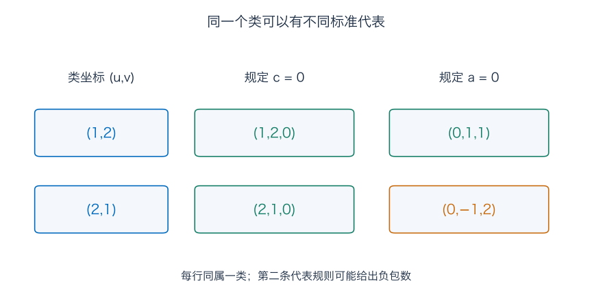

而对 $(u,v)=(2,1)$，第二种规则选出 $(0,-1,2)$，含负包数；这个类明明还有 $(2,1,0)$、$(1,0,1)$ 两份非负整数订单。代数上有效的标准代表，不一定符合业务限制。

选代表是方便计算的约定；类本身包含全部代表。若要恢复某一份实际订单，仍需额外信息，例如 C 的原包数。

## 8．商空间到底剩几个方向：把基真的写出来

在商空间中，$k=-e_1-e_2+e_3$ 属于零类，所以

$$
[e_3]=[e_1]+[e_2].
$$

原先三个标准方向，进入分类后只剩两个独立的类方向。对任意订单，

$$
\boxed{[x]=u[e_1]+v[e_2].}
$$

这说明 $[e_1],[e_2]$ 够用。它们会不会相关？如果 $u[e_1]+v[e_2]=[0]$，就有 $(u,v,0)\in M$，应等于 $t(-1,-1,1)$。比较第三项，$t=0$；再比较前两项，$u=v=0$。所以它们确实无关，是商空间的一组基。

因此 $\dim(\mathbb R^3/M)=2$。这次不是仅凭“忽略一个方向大概少一维”猜出来的，而是把剩下的基找齐并检查了独立性。

一般有限维情况下，先将 $M$ 的基扩充为整个 $V$ 的基；取商时 $M$ 的基方向都变成零类，剩下基向量的类形成商空间的基。因此

$$
\boxed{\dim(V/M)=\dim V-\dim M.}
$$

证明细节在补充 A。两个边界情况可以自己先想：若只忽略零向量，每类恰有一个对象；若忽略整个空间，所有对象都在唯一的零类里，商空间维数为零。

## 9．按核分类之后，机器恢复了什么意义上的可逆

原矩阵 $A$ 不能从输出找回唯一订单，因为输入有包装自由度。但换成类以后，可以定义

$$
\Phi:\mathbb R^3/M\longrightarrow\operatorname{im}A,
\qquad\Phi([x])=Ax.
$$

先检查三件事。

**换代表不会换输出。** 若 $x'=x+tk$，则 $Ax'=Ax+tAk=Ax$，所以 $\Phi$ 良定义。

**不同类不会再撞到同一输出。** 若 $Ax=Ay$，则 $x-y\in\ker A=M$，所以两者本来就是同一类。这叫单射。

**每个声明允许的输出都能得到。** 终点写的是像空间；其中每个 $d$ 按定义都由某个 $x$ 产生，因此都由 $[x]$ 产生。这叫满射。

类的加法、数乘又与 $A$ 的线性运算相容，所以 $\Phi$ 是双向保持线性结构的对应，叫**线性同构**。

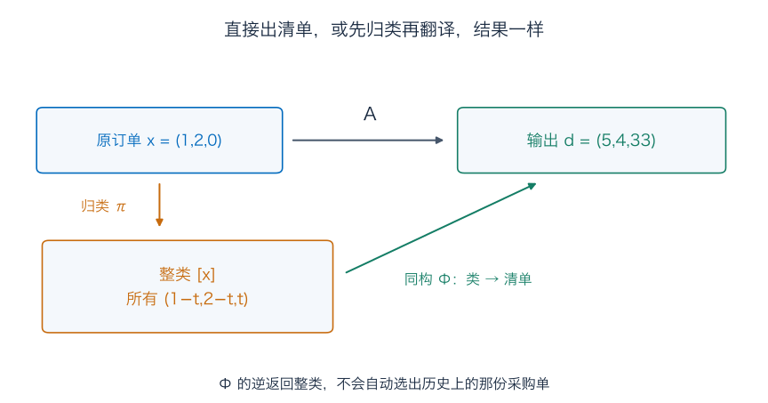

给一个合法输出 $d=(p,q,w)$，其中 $w=5p+2q$，逆的具体计算是

$$
\Phi^{-1}(d)=
\left[\begin{pmatrix}(2q-p)/3\\(2p-q)/3\\0\end{pmatrix}\right].
$$

对 $(5,4,33)$，返回的是 $[(1,2,0)]$ 这个完整类别，而不是断定原订单必为 $(1,2,0)$。后者只是我们为方便而选的一个代表。

这个结果推广到任意线性映射 $T:V\to W$，就是

$$
\boxed{V/\ker T\cong\operatorname{im}T,\qquad[x]\longmapsto Tx.}
$$

称为第一同构定理。上面的三个检查就是它的证明，并不需要有限维假设。它让“把机器看不见的差别归并以后，剩下的信息恰好对应输出”成为精确陈述。

### 终点空间写错，满射结论就错了

$(5,4,34)$ 在整个 $\mathbb R^3$ 中，却不在可达平面内，不能交给 $\Phi^{-1}$。取商没有让违反重量关系的清单突然变得可能。

| 映射与声明的终点 | 核或不可见部分 | 单射？ | 满射？ |
| --- | --- | --- | --- |
| $A:\mathbb R^3\to\mathbb R^3$ | $M$，一维 | 否 | 否 |
| $P:\mathbb R^3\to\mathbb R^2$ | $M$，一维 | 否 | 是 |
| $\Phi:\mathbb R^3/M\to\operatorname{im}A$ | 只有零类 | 是 | 是 |
| 同一公式，终点改为整个 $\mathbb R^3$ | 只有零类 | 是 | 否 |

原来的 $A$ 与归类后的 $\Phi$ 不是同一套输入对象，不能据此说原矩阵突然有了逆。写 $A=\Phi\circ\pi$ 时，$\pi(x)=[x]$ 是先归类，$\Phi$ 再把类翻译成输出，两步合起来才是原过程。

有限维中，若输入、终点**维数相同**，秩零化度会让单射与满射等价。单射意味着核维数为零，秩便达到终点维数；满射则反过来逼迫核维数为零。这里每个条件都不能漏掉。补充 C 用无限数列实际算出“单射却不满射”和“满射却不单射”的反例。

## 练习：每次都写明对象、坐标与类别

题七、八配合补充 B，题九配合补充 C。

**题一：同一清单的两张坐标表。** 对目标 $d_*=(4,5,30)^T$，求它在 $\mathcal B=(v_1,v_2)$、$\mathcal C=(v_1,v_3)$ 下的坐标，逐项重建三项输出。三张模板 $v_1,v_2,v_3$ 为什么不是基？只取 $v_1$ 为什么也不是整个像空间的基？给出像空间维数与原矩阵秩。

**题二：输入换坐标，不是给原来的数改名。** 对订单 $x=(2,3,1)^T$，写出 $[x]_{\mathcal E}$，再分别从原包数和有效模板份数算输出。若别人给的是新坐标 $[y]_{\mathcal E}=(2,3,1)^T$，求实际原坐标 $y$ 及输出。为什么这与第一问不一样？

**题三：整类订单的运算。** 取 $x=(1,2,0)^T,z=(2,1,0)^T$，分别用 $x'=x+k,z'=z+k$ 作为另一组代表。计算 $[x]+[z]$、$2[x]$，用两套代表核对结果类别相同。写出零类；它是否只含零向量？“数值相差不到 1 就同类”为什么不能直接替代这里的分类规则？

**题四：删栏、选代表与实际采购。** 对 $d_*$ 的订单类，先求唯一的有效模板坐标 $(u,v)$，写出整个订单类。分别选 $c=0$、$a=0$ 的代表，再列出所有非负整数代表。说明为什么选好一个标准代表不等于找回历史订单。用正文两份同类订单说明直接删 C 栏为何失败。

**题五：什么信息可以跟着类别走。** 判断下列读数能否不依赖代表：（1）$a$；（2）$a+c$；（3）$7a+8b+15c$；（4）$a+b+c$；（5）$|p-q|$。对能定义在类上的读数，再判断是否线性。对一般系数 $h=(h_1,h_2,h_3)$，推导对应线性读数能保留的条件。

**题六：同构的逆到底返回什么。** 求 $\Phi^{-1}(5,4,33)$；$\Phi^{-1}(5,4,34)$ 为什么不能按同一公式硬算成合法逆？写出商空间一组基与维数，核对秩零化度。若改成忽略 $M'=\operatorname{span}\{e_3\}$，试图定义 $[x]\mapsto Ax$，是否仍良定义？给一对同类代表检验。

**题七：另一台温度计。** 阅读补充 B.1。对温度表 $T=(18,21,20)^T$，计算相邻温差，并写所有给出相同温差的温度表。分别选首项为零、均值为零的代表。直接删除首项为何不行？在适合温差的基下，哪一项信息会被舍去？

**题八：求导后找回的是什么。** 阅读补充 B.2。对 $\partial:P_2\to P_1$，求核、像、秩和零化度，写出 $P_2/\operatorname{span}\{1\}$ 的基。导数为 $2-2t$ 对应哪个类，全部代表是什么？求导的终点改为 $P_2$ 后，满射性是否改变？评价读数 $p(0)$ 能否定义在这个按常数分类的商空间上？

**题九：无限维不能只检查一边。** 阅读补充 C。对 $x=(2,-1,3,0,0,\ldots)$，计算 $Rx,Lx,LRx,RLx$，证明 $R,L$ 各自是否单射、是否满射。$LR=I$ 为什么没有让它们成为双向逆？

### 参考答案与解题过程

#### 题一解答

由 $p=4,q=5$，得到

$$
u=(2\times5-4)/3=2,\qquad v=(2\times4-5)/3=1.
$$

所以 $[d_*]_{\mathcal B}=(2,1)^T$，重建为

$$
2v_1+v_2=(2+2,\ 4+1,\ 18+12)^T=(4,5,30)^T.
$$

另一基下 $\xi=u-v=1,\zeta=v=1$，所以 $[d_*]_{\mathcal C}=(1,1)^T$，重建为 $v_1+v_3=(1+3,2+3,9+21)^T=(4,5,30)^T$。

三张模板满足 $v_1+v_2-v_3=0$，系数不全零，故相关，不能作基。只有 $v_1$ 又无法生成 $v_2$：第一项若倍数为 2，第二项会是 4 而非 1。因此一张不够，三张重复，两张独立模板恰好够用。像空间维数为 2，$A$ 的秩为 2。

#### 题二解答

原订单 $(2,3,1)$ 换成新坐标为

$$
[x]_{\mathcal E}=(2+1,3+1,1)^T=(3,4,1)^T.
$$

从原包数算输出为

$$
Ax=(2+6+3,\ 4+3+3,\ 18+36+21)^T=(11,10,75)^T.
$$

从模板算为 $3v_1+4v_2=(3+8,6+4,27+48)^T=(11,10,75)^T$，一致。

若给的本来是 $[y]_{\mathcal E}=(2,3,1)$，则原坐标是 $(2-1,3-1,1)=(1,2,1)$。其输出为 $2v_1+3v_2=(8,7,54)^T$，也可直接代入原矩阵核对。

同样三个数字，在不同基下是不同的份数说明，不能直接改个名字就当成同一对象。

#### 题三解答

两组代表分别为

$$
x=(1,2,0),\ z=(2,1,0),\quad
x'=(0,1,1),\ z'=(1,0,1).
$$

相加得到 $x+z=(3,3,0)$、$x'+z'=(1,1,2)$，差为 $2k$，所以都表示 $[(3,3,0)]$。输出均为 $(9,9,63)$。

数乘得到 $2x=(2,4,0)$、$2x'=(0,2,2)$，差也是 $2k$，所以都表示 $[(2,4,0)]$；输出均为 $(10,8,66)$。

零类为 $M=\{t(-1,-1,1):t\in\mathbb R\}$，不只含零向量。非零的 $k$ 就属于零类，因为它对输出的贡献为零。

“差不到 1”的关系中，0 与 0.75、0.75 与 1.5 分别同类，却无法推出 0 与 1.5 同类。它不传递，不能形成这里需要的等价分类。

#### 题四解答

题一已经算出 $(u,v)=(2,1)$，所以整个订单类为

$$
[(2,1,0)]=\{(2-t,1-t,t):t\in\mathbb R\}.
$$

规定 $c=0$ 得 $t=0$，代表为 $(2,1,0)$；规定 $a=0$ 得 $t=2$，代表为 $(0,-1,2)$。它们的差是 $2k$，类别相同。

实际非负要求 $t\ge0,t\le2,t\le1$，合起来为 $0\le t\le1$；整包只剩 $t=0,1$，即 $(2,1,0)$、$(1,0,1)$，两份输出都是 $(4,5,30)$。负包数的标准代表不能当采购方案；即使选到非负代表，也没有证据说它就是历史上那份订单。

直接删 C 栏则把同类的 $(1,2,0)$ 与 $(0,1,1)$ 记成 $(1,2)$ 与 $(0,1)$，不同，故不是类的固定标签。先改算 $(a+c,b+c)$，两者才同为 $(1,2)$。

#### 题五解答

换代表就是从 $(a,b,c)$ 变为 $(a-t,b-t,c+t)$。

（1）$a$ 变为 $a-t$，不能保留；（2）$a+c$ 中两项抵消，能保留，且线性；（3）货款的变化为 $-7t-8t+15t=0$，能保留，且线性；（4）原包装数变化为 $-t$，不能保留。

（5）$p,q$ 都不变，所以 $|p-q|$ 能保留。但对输入 $e_1$，$p=1,q=2$，读数为 1；对 $-e_1$，$p=-1,q=-2$，读数仍为 1，不等于原读数的负一倍，所以它不线性。这里负输入只用来检查实向量空间的线性条件。

一般线性读数的变化为

$$
t(-h_1-h_2+h_3).
$$

要对所有代表、所有 $t$ 都不变，必要且充分为 $h_3=h_1+h_2$，即它在核方向上为零。能保留的读数也可写为 $h_1u+h_2v$。

#### 题六解答

合法清单的坐标为 $(u,v)=(1,2)$，所以逆返回 $[(1,2,0)]$，也就是整类 $(1-t,2-t,t)$，不是唯一的原订单。

$(5,4,34)$ 不满足 $w=5p+2q=33$，不在 $\Phi$ 声明的终点 $\operatorname{im}A$ 中。若硬用前两项生成 $[(1,2,0)]$，再应用 $\Phi$，得到的是 $(5,4,33)$，不是原目标；因此这不是对该目标的逆。

商空间的基为 $[e_1],[e_2]$，维数为 2；原核维数为 1，输入维数为 3，核对 $3=2+1$。$[e_3]=[e_1]+[e_2]$，故第三个类方向不独立。

改用 $M'=\operatorname{span}\{e_3\}$ 时，零向量与 $e_3$ 同类；但 $A0=0$，$Ae_3=v_3=(3,3,21)^T\ne0$。同一类有两个输出，故不良定义。被忽略的方向必须真正包含在核中，不能只因为它是一维就随意替换。

#### 题七解答

相邻温差为 $(21-18,20-21)=(3,-1)$。所有原记录为

$$
(c,c+3,c+2)^T,\qquad c\in\mathbb R.
$$

首项为零的代表取 $c=0$，是 $(0,3,2)$。原表均值为 $59/3$，逐项减去它，得到

$$
(18,21,20)-\tfrac{59}{3}(1,1,1)=(-5/3,4/3,1/3).
$$

三项之和为零，相邻差仍为 $3,-1$。

同类表 $(23,26,25)$ 删除首项后是 $(26,25)$，原表删除后却是 $(21,20)$，不相同。正确做法是先记录“起始基准、第一段温差、第二段温差”，本例坐标为 $(18,3,-1)$，然后舍去基准，只保留 $(3,-1)$。这与早餐先换坐标、再删不可见项的道理相同。

#### 题八解答

任意 $p=a+bt+ct^2$，导数为 $b+2ct$。它为零当且仅当 $b=c=0$，所以核为 $\operatorname{span}\{1\}$，零化度为 1。对任意 $\alpha+\beta t\in P_1$，多项式 $\alpha t+(\beta/2)t^2$ 的导数就是它，所以像为整个 $P_1$，秩为 2。输入三维，满足 $3=1+2$。

商空间基为 $[t],[t^2]$：常数项在零类里，其余两项系数唯一。它们的导数分别为 $1,2t$，是像空间的另一组基。

导数为 $2-2t$ 时，原多项式为 $C+2t-t^2$，全部 $C\in\mathbb R$ 的代表组成类 $[2t-t^2]$。没有初始值，就不能恢复那个常数。

若把终点写为 $P_2$，实际输出仍只有 $P_1$，例如 $t^2$ 无法由二次以下多项式求导得到，所以不再满射；核和秩不变。

评价 $p(0)$ 不能定义在按常数分类的商空间上。零多项式与常数多项式 1 同类，评价却分别为 0 与 1；它没有消去被取商的常数方向。

#### 题九解答

按定义逐项算：

$$
Rx=(0,2,-1,3,0,\ldots),\qquad
Lx=(-1,3,0,0,0,\ldots),
$$

$$
LRx=x,\qquad RLx=(0,-1,3,0,0,\ldots)\ne x.
$$

$R$ 单射：若输出相同，从第二项起逐项读回，就有原输入相同。它不满射，因为首项非零的 $e_1$ 不可能是右移输出。

$L$ 满射：任意目标 $y$ 可由 $Ry$ 输出，$L(Ry)=y$，而且 $Ry$ 仍只有有限多项非零。它不单射：零与 $e_1$ 都输出零；核恰为 $\operatorname{span}\{e_1\}$。

$LR=I$ 只保证“先右移、再左移”能撤销。相反顺序已经丢了首项，补零不能知道原首项是 2 还是别的数，所以 $RL\ne I$。双向逆必须检查两个顺序。

## 补充 A：把本章用到的三个计数证明写全

### A.1 为什么基的大小不随选择而变

先证明一个有限计数事实：若 $w_1,\ldots,w_m$ 生成 $V$，则 $V$ 中任意无关组 $u_1,\ldots,u_k$ 都有 $k\le m$。

将每个 $u_j$ 用 $w_i$ 展开，系数排成 $m\times k$ 矩阵 $C$。若 $k>m$，齐次方程 $C\alpha=0$ 有非零解，因为主元至多 $m$ 个，至少一个自由变量。于是

$$
\sum_{j=1}^k\alpha_j u_j
=[\,w_1\ \cdots\ w_m\,]C\alpha=0,
$$

与无关性矛盾。这里生成组 $w_i$ 不必先无关。

若两组基分别有 $m,n$ 项，用第一组生成、第二组无关得 $n\le m$；交换角色得 $m\le n$，所以 $m=n$。

有限生成组怎样变成基？发现一个向量可由其他向量组合，就删去它，张成不变；重复直到无关。反过来，已有无关组若还没生成整个有限维空间，就从其张成之外添加一个向量。新增后仍无关，否则可把新增向量反解成旧组合。无关向量数有上界，所以有限步后可以扩充成基。

零子空间采用空基。有限维 $V$ 的任意子空间也有有限基：从其中逐次添加不在已有张成中的向量，独立向量数不能超过 $\dim V$，过程必停。这保证下面“先给核取基”的步骤可执行。

### A.2 秩零化度：核以外的输入方向，为何变成像的基

对线性映射 $T:V\to W$，假设 $V$ 有限维。将核的基 $k_1,\ldots,k_q$ 扩充成 $V$ 的基

$$
k_1,\ldots,k_q,v_1,\ldots,v_r.
$$

任意输入都能写成这组基的组合；应用 $T$，核项消失，所以 $T(v_1),\ldots,T(v_r)$ 生成像。

若这些输出存在零组合 $\sum c_jT(v_j)=0$，则 $\sum c_jv_j\in\ker T$，可写成 $\sum d_i k_i$。两者相减是完整输入基上的零组合，所以所有 $c_j,d_i$ 都为零，输出向量无关。

这样输入有 $q+r$ 个基方向，核有 $q$ 个，像有 $r$ 个，得到 $\dim V=\dim\ker T+\dim\operatorname{im}T$。不要求 $W$ 本身有限维；有限维输入的像仍只由有限多个基本输出生成。

### A.3 商空间维数：剩下的是向量的类

将有限维子空间 $M$ 的基 $m_1,\ldots,m_k$ 扩充为 $V$ 的基 $m_1,\ldots,m_k,v_1,\ldots,v_r$。取商后，所有 $[m_i]$ 都是零类，所以 $[v_1],\ldots,[v_r]$ 生成全部类别。

若 $\sum c_j[v_j]=[0]$，意味着 $\sum c_jv_j\in M$，可写成 $m_i$ 的组合。输入基的独立性再次迫使全部 $c_j$ 为零。因此这些**类**是商空间的基，维数为 $r=\dim V-\dim M$。

这里没有选定一个天然唯一的代表子空间。选不同的扩充基，可以得到不同的代表约定；类别及其维数仍是同一回事。

## 补充 B：离开早餐，温差和求导仍在做同一件事

### B.1 温度计整体高报，变化记录却没变

三次温度读数为 $(20,22,21)$。另一台整体高报 5 度，记录为 $(25,27,26)$，相邻变化都为先升 2 度、再降 1 度。

设数值表 $T=(T_1,T_2,T_3)^T$，只读相邻温差：

$$
DT=(T_2-T_1,T_3-T_2)^T,\qquad
D=\begin{pmatrix}-1&1&0\\0&-1&1\end{pmatrix}.
$$

两表之差为 $5(1,1,1)$，恰好在核中。解 $DT=0$ 得三项都相等，故核为常数偏移方向 $\operatorname{span}\{(1,1,1)\}$。

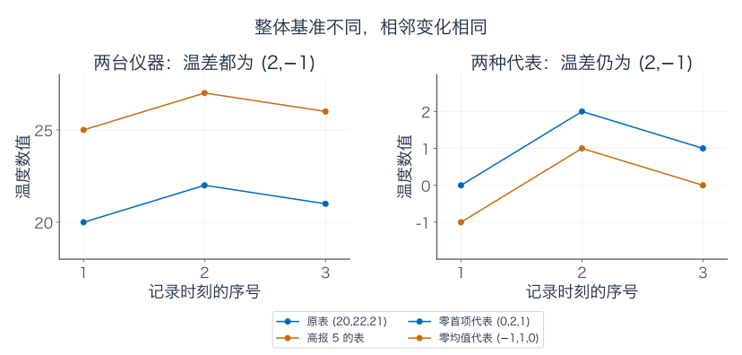

选输入基

$$
m=(1,1,1),\quad f=(0,1,1),\quad g=(0,0,1).
$$

任意表都能唯一写成

$$
T=T_1m+(T_2-T_1)f+(T_3-T_2)g.
$$

因此新坐标是“起始温度、第一段温差、第二段温差”，机器恰好丢掉第一项。对第一张表为 $(20,2,-1)$，第二张为 $(25,2,-1)$。

给定任意温差 $(\alpha,\beta)$，所有表为 $(c,c+\alpha,c+\alpha+\beta)$。取首项为零可选 $(0,\alpha,\alpha+\beta)$，所以像为整个 $\mathbb R^2$，核一维、秩二维，满足 $3=1+2$。

对当前类，可以选首项为零的代表 $(0,2,1)$；也可减去原表均值 21，选 $(-1,1,0)$。两者相差 $(1,1,1)$，仍为同一类。它们都是方便研究变化的数值表，不是由温差自动找回的真实绝对温度。

### B.2 为什么不定积分总带一个常数

这次对象换成 $P_2$ 中的多项式。两条曲线

$$
p(t)=5+2t-t^2,\qquad q(t)=-3+2t-t^2
$$

整体相差 8，导数却都为 $2-2t$。如果曲线表示位置，导数表示速度，那么只知道速度，确实分不清整段位置平移了多远。

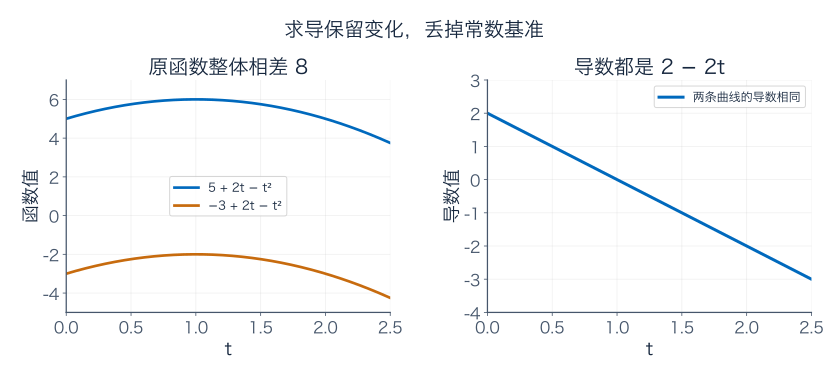

对 $a+bt+ct^2$，求导只保留 $b+2ct$。核为常数子空间，像为 $P_1$。按常数分类后，一个类只需两项系数 $b,c$，基可取 $[t],[t^2]$，得到

$$
P_2/\operatorname{span}\{1\}\cong P_1,\qquad[p]\longmapsto p'.
$$

这恰好解释“导数已知，原函数差一个常数”：逆返回的是整类原函数。再给 $p(0)=5$ 才能选出那一条具体曲线。

若换成评价 $p\mapsto p(0)$，保留的反而是常数项，核是 $\operatorname{span}\{t,t^2\}$。所以不是随便选一种分类都能配任何读数；要保留什么，决定哪些差别允许被忽略。

在区间 $[0,1]$ 上，同样可以把连续可微函数 $C^1[0,1]$ 按常数分类。[中值定理](../微积分/03-中值定理、Taylor%20展开与优化.md)保证导数相同的两函数只差常数。[积分基本定理](../微积分/04-定积分与微积分基本定理.md)保证任意连续函数 $h$ 都有原函数 $F(t)=\int_0^t h(s)\,ds$。因此代数上有 $C^1[0,1]/\operatorname{span}\{1\}\cong C[0,1]$。

到泛函分析中，还要给函数和类别规定距离，检查对应及逆是否连续。今天的同构结论只处理线性结构，不能凭它自动宣布所有这些分析性质都成立。

## 补充 C：同一个无限维空间，单射与满射仍可能分开

设 $c_{00}$ 为只有有限多项非零的无限实数列。每个元素都是有限个 $e_1,e_2,\ldots$ 的组合，但整个空间没有固定的最后一个坐标；允许的非零项位置可以任意靠后，所以维数无限。

定义右移、左移：

$$
R(x_1,x_2,\ldots)=(0,x_1,x_2,\ldots),\qquad
L(x_1,x_2,\ldots)=(x_2,x_3,\ldots).
$$

两种操作都线性，也都把有限支撑数列送到有限支撑数列。

右移把原来每一项完整保留，只是前面多一个零，所以可从输出逐项读回输入，是单射；但输出第一项只能为零，不满射。左移能输出任意目标 $y$，因为 $L(Ry)=y$，所以满射；第一项却被删去，不单射。

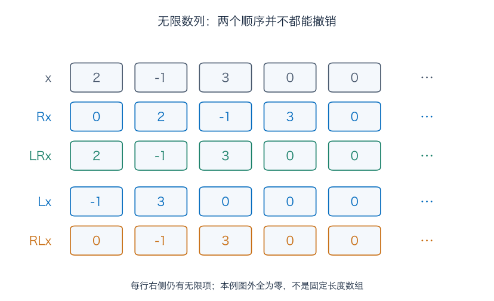

题九把具体数值完整写出。两种组合中 $LR=I$，而 $RL$ 只是抹去首项。这里输入输出是同一个无限维空间，单射与满射仍不等价，因此有限维结论里的“有限”不能删掉。

## 伴读与下一篇

下一篇讲行列式、逆矩阵与换基。对象没变、只换坐标是什么意思，前面已经算过；后面要把它和真正改变对象的几何变换分开。

- [3Blue1Brown：线性组合、张成与基](https://www.3blue1brown.com/lessons/span/)：可以配合观察基坐标怎样表示同一对象。
- [TU Delft：基与维数](https://interactivetextbooks.tudelft.nl/linear-algebra/Chapter4/BasisAndDimension.html)：核对有限生成组、基及维数的条件。
- [Dartmouth：商空间上的线性映射](https://math.dartmouth.edu/~trs/PreTeXtProjects/linear-algebra-refresher-CLI/output/web/section-factoring-through-a-quotient.html)：核对代表元无关条件与通过商空间定义映射的过程。

---

[数学总导航](../00-%E6%95%B0%E5%AD%A6%E5%AD%A6%E4%B9%A0%E5%AF%BC%E8%88%AA.md) · [本课程目录](00-%E4%BB%8E%E7%AE%AD%E5%A4%B4%E5%88%B0%E5%87%BD%E6%95%B0%E7%A9%BA%E9%97%B4.md) · [← 上一章](03-%E6%B6%88%E5%85%83%E3%80%81%E7%BA%BF%E6%80%A7%E6%96%B9%E7%A8%8B%E4%B8%8E%E5%9B%9B%E4%B8%AA%E5%AD%90%E7%A9%BA%E9%97%B4.md) · [下一章 →](05-%E8%A1%8C%E5%88%97%E5%BC%8F%E3%80%81%E9%80%86%E7%9F%A9%E9%98%B5%E4%B8%8E%E6%8D%A2%E5%9F%BA.md)
