[数学总导航](../00-%E6%95%B0%E5%AD%A6%E5%AD%A6%E4%B9%A0%E5%AF%BC%E8%88%AA.md) · [本课程目录](00-%E4%BB%8E%E7%AE%AD%E5%A4%B4%E5%88%B0%E5%87%BD%E6%95%B0%E7%A9%BA%E9%97%B4.md) · [← 上一章](04-%E5%9F%BA%E3%80%81%E7%BB%B4%E6%95%B0%E3%80%81%E7%A7%A9%E4%B8%8E%E5%95%86%E7%A9%BA%E9%97%B4.md) · [下一章 →](06-%E5%86%85%E7%A7%AF%E3%80%81%E6%AD%A3%E4%BA%A4%E4%B8%8E%E6%9C%80%E8%BF%91%E7%82%B9.md)

你在绘图软件里做了一张小贴纸。原稿有一个边长 1 厘米的方格，里面画着一个面积为半平方厘米的直角三角形。现在软件要把整张图按下面的规则变形：

$$
T(x,y)^T=(2x+2y,3y)^T,\qquad
T=\begin{pmatrix}2&2\\0&3\end{pmatrix}.
$$

这里坐标是以厘米为单位的数值；规则是我们给定的理想几何模型。它会把方格变斜、变大。**贴纸的实际涂色面积变成多少？变形后的点还能找回原位置吗？如果同事用另一套坐标，公式又该怎样写？**

这一篇就追踪同一台机器，把三个问题算完，再给行列式、逆矩阵与换基各自安上准确的位置。面积只讨论几何量，不把它直接等同于真实打印机的耗墨量。

第一遍可以读第 1—4 节，亲手算面积与压扁的例子；第二遍再读第 5—10 节，跟着坐标追踪恢复与换基。高维公式、乘积定理的证明和特征方向放在答案后的补充部分，需要时再回看。

## 1．先把这台变形机器拆成两件会算的事

### 1.1 向右错开，为什么面积可以不变

先做 $S(x,y)=(x+y,y)$。横着的一排点，各向右移动同样的距离 $y$：高度为零的底边不动，高度为 1 的顶边向右移 1 厘米。

单位方格的四角依次从

$$
(0,0),(1,0),(1,1),(0,1)
$$

变成

$$
(0,0),(1,0),(2,1),(1,1).
$$

这是一个底长仍为 1、高仍为 1 的平行四边形，所以面积还是 1。它占用的水平范围变宽，却没有多出涂色面积。这个动作叫**剪切**：想象把一摞纸的上层逐渐向右错开，单层宽度并没有因此变长。

### 1.2 再拉伸，底和高分别变几倍

接着做 $D(x,y)=(2x,3y)$。横向所有距离变为两倍，竖向距离变为三倍；刚才的平行四边形变成四角为

$$
(0,0),(2,0),(4,3),(2,3)
$$

的图形。底长为 2、高为 3，面积就是 6 平方厘米。

把两步合起来：

$$
(x,y)\xrightarrow{S}(x+y,y)
\xrightarrow{D}(2x+2y,3y).
$$

所以开头的机器确实是

$$
T=DS,\qquad
S=\begin{pmatrix}1&1\\0&1\end{pmatrix},\quad
D=\begin{pmatrix}2&0\\0&3\end{pmatrix}.
$$

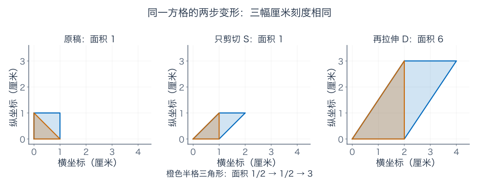

图里的小三角形也能直接核对：原来底 1、高 1，面积 $1/2$；剪切后仍底 1、高 1；最后底 2、高 3，面积为 $2\times3/2=3$。它与整个方格的面积都乘了 6。

### 1.3 为什么只追踪一个方格就有用

线性机器对每个位置使用相同规则。把一个小方格平移到别处，两条边的变化仍相同；将方格的边长缩为原来的一半，原面积与新面积都再缩为四分之一，它们的倍率不变。

所以可以先看单位格，再把图形划成许多小块，逐块算新面积。对这里的多边形，也可直接拆成三角形核对；对圆形等通常的图形，可以用越来越细的格子逼近。**我们寻找的是统一的面积倍率，不是某一个形状的特殊答案。**

## 2．面积不能为负，行列式为什么还要一个负号

在 $T$ 后面再接一个左右镜像 $F(x,y)=(-x,y)$。方格跑到了纵轴左侧，仍然底长 2、高 3，实际面积还是 6。

但它的有序方向反过来了。原来先看第一条边 $e_1$，再看第二条边 $e_2$，是标准的正向；镜像以后，对应的两条边顺序形成反向。为了同时记住面积大小与方向，我们给这个倍率加一个符号。

于是约定：$T$ 的**行列式**记作 $\det T=6$；镜像后的 $FT$ 为 $\det(FT)=-6$。这里

$$
F=\begin{pmatrix}-1&0\\0&1\end{pmatrix},\qquad
FT=\begin{pmatrix}-2&-2\\0&3\end{pmatrix}.
$$

二维行列式记录有向面积的倍率，**实际面积倍率取绝对值**。负号不意味着涂色区域有负面积，而是记录方向翻转。

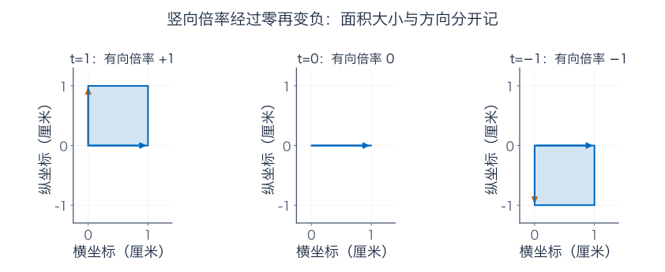

图用了更简单的 $\operatorname{diag}(1,t)$：当 $t$ 从 1 变为 0，再变为 $-1$，竖直方向先缩到零，再翻过去。$t=0$ 时图形只剩一条线，二维面积为零。方向的正负不是凭“往左走了没有”判断，而是看两根有序边的整体关系。

三维时，同样记录有向体积倍率；高维使用相应维数的有向体积。这里说的是方阵 $n\times n$ 的 $n$ 维体积，不能把非方阵也硬塞进同一种行列式。

## 3．$ad-bc$ 从哪里来：先把一块真的面积减出来

开头的 $T$ 底边水平，很容易算。换成

$$
A=\begin{pmatrix}2&1\\1&2\end{pmatrix},
$$

单位格两条边变成 $u=(2,1)^T$、$v=(1,2)^T$，顶角为 $u+v=(3,3)$，两条边都斜了。面积不能再把两个边长随便相乘；要用垂直的底高，或换一种分割方法。

在它外面框一个 $3\times3$ 的正方形，面积为 9。图中分出的四个直角三角形，底高数值分别为 3 和 1，每个面积为 $3/2$。减掉外面这四块：

$$
\text{内部面积}=9-4\times\frac32=3.
$$

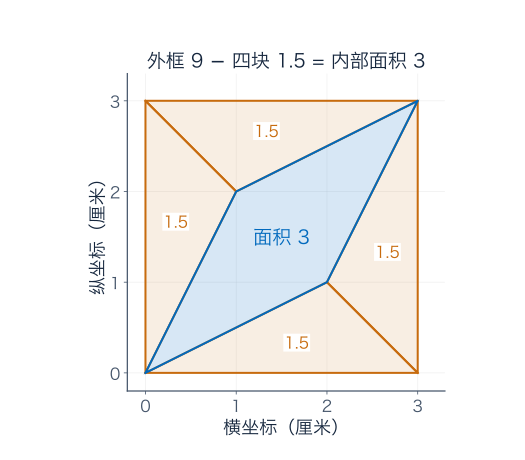

对一般两列 $u=(a,c)^T,v=(b,d)^T$，先在 $a,b,c,d>0$ 且第一列方向在第二列顺时针一侧的这类图形中做同样的分割。外框面积为 $(a+b)(c+d)$；外面的四块，成对合计为 $c(a+b)$ 与 $b(c+d)$。因此剩下

$$
\begin{aligned}
(a+b)(c+d)-c(a+b)-b(c+d)
&=ac+ad+bc+bd-ac-bc-bc-bd\\
&=ad-bc.
\end{aligned}
$$

这给出公式里减号的一个实际来源：外框中有些面积不属于平行四边形，不能把所有乘积都加进去。

推广到坐标有负数、边的顺序反过来等情况，有向面积统一写成

$$
\boxed{\det\begin{pmatrix}a&b\\c&d\end{pmatrix}=ad-bc.}
$$

补充 A 从有向面积的运算规则再证明一次这个通用公式，不靠上述特殊摆放方式。

现在核对三种图形：$\det A=2\times2-1\times1=3$；开头的 $\det T=2\times3-2\times0=6$；镜像后的 $\det(FT)=-2\times3-(-2)\times0=-6$，都与前面的几何计算一致。

交换 $A$ 的两列，平行四边形的区域不变，但有序边的先后颠倒，行列式成为 $1\times1-2\times2=-3$。这也是负号记录的信息。

## 4．面积为零：不是所有点都消失，而是某种区别丢了

试运行

$$
N=\begin{pmatrix}1&2\\2&4\end{pmatrix}.
$$

第二列是第一列的两倍。任意输入都变成

$$
N(x,y)^T=(x+2y)(1,2)^T,
$$

所有输出挤在同一条直线上，二维方格没有了二维面积，$\det N=4-4=0$。

可是 $N(2,0)^T=N(0,1)^T=(2,4)^T$，是一个非零输出。行列式零并不等于零矩阵，它表示**至少有一份输入区别无法从输出恢复**。这里不可见方向为 $(-2,1)^T$，因为 $N(-2,1)^T=0$。

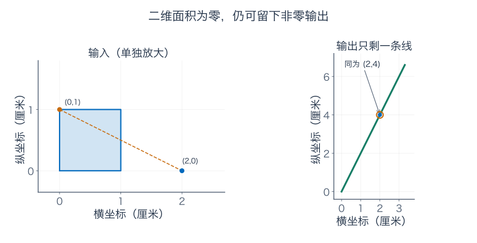

如果目标为 $(1,2)$，仍然有解，只需 $x+2y=1$，全部解为 $(1-2t,t)$。若目标为 $(1,3)$，不满足输出第二项为第一项两倍，便无解。因此行列式零只告诉你不能对所有目标唯一恢复，不能替你判断某个特定目标有没有解。

相反，对方阵，行列式非零意味着列之间没有重复自由方向，所有输入都可唯一恢复。正式的等价条件与证明放在补充 A。先记住本章的区别：$T$ 的非零面积倍率允许完整恢复；$N$ 压扁了方向，缺失的信息不会因再算一次公式而回来。

## 5．大一点的矩阵，怎样靠消元算倍率

三维不能再直接用 $ad-bc$。但你已经会消元，可以一边整理矩阵，一边记住操作怎样改变行列式。

| 对一个 $n\times n$ 方阵的操作 | 行列式的变化 |
| --- | --- |
| 交换两行，或交换两列 | 乘 $-1$ |
| 只把一行或一列乘 $c$ | 乘 $c$ |
| 给一行加另一行的倍数，或对应列操作 | 不变 |
| 整个矩阵都乘 $c$ | 乘 $c^n$ |

最后一项不是笔误：整个矩阵乘 $c$，等于把全部 $n$ 列都乘 $c$，所以倍率要乘 $n$ 次。比如二维 $2I$ 把面积乘 4，不是乘 2。

用缩放做等价消元时，因子仍须非零。把一行乘零虽然也符合表中的行列式变化规则，却会丢掉原方程信息，不能拿来保持解集。

这些规则来自“对某一列单独相加、数乘时，有向体积相应相加、数乘；交换两列变号”。给一列加另一列的倍数，多出来的体积项有重复方向，所以为零。行列式转置不变，行也遵守同样规则。完整定义与推导见补充 A；**行操作保持方程解集，并不代表每种操作都保持行列式数值。**

看三阶例子

$$
M=\begin{pmatrix}0&2&1\\1&1&0\\2&0&3\end{pmatrix}.
$$

左上角为零，不必宣布失败；交换前两行，得到

$$
M_1=\begin{pmatrix}1&1&0\\0&2&1\\2&0&3\end{pmatrix}.
$$

这一次变号，$\det M_1=-\det M$。接着做 $R_3\leftarrow R_3-2R_1$，再做 $R_3\leftarrow R_3+R_2$：

$$
M_2=\begin{pmatrix}1&1&0\\0&2&1\\0&-2&3\end{pmatrix}
\longrightarrow
U=\begin{pmatrix}1&1&0\\0&2&1\\0&0&4\end{pmatrix}.
$$

后两步只是加行，不变值。三角矩阵的行列式是对角元之积，所以 $\det U=1\times2\times4=8$。补回最初换行的负号，得到

$$
\boxed{\det M=-8.}
$$

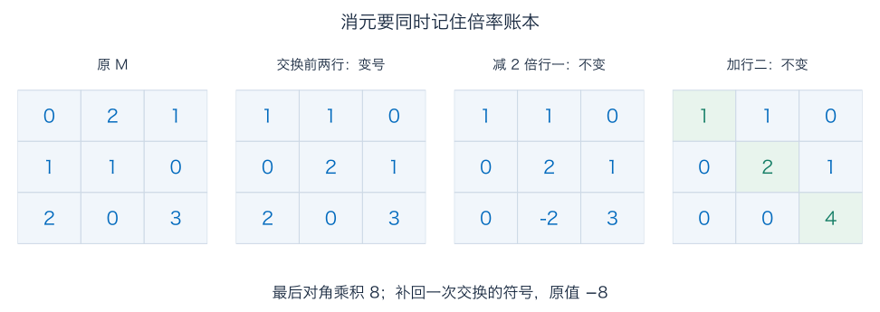

三角矩阵为什么只乘对角线？沿最后一行展开上三角矩阵，只有最后那个对角元可能贡献；剩下仍是上三角矩阵，重复即可。补充 A 会说明这里的展开规则。

若为了手算把某行除以主元，也要记入那次缩放。对角线乘完后，必须追踪此前所有换行与缩放；不然算出的只是最后那张表的行列式。

## 6．怎样真正恢复：把基本输出的原输入一起找出来

回到贴纸机器 $T$。若输出坐标为 $(p,q)$，要找回原来的点 $(x,y)$，只需解

$$
2x+2y=p,\qquad3y=q.
$$

从第二式先得到 $y=q/3$，代回第一式：

$$
\boxed{x=p/2-q/3,\qquad y=q/3.}
$$

输出 $(6,6)$ 对应 $y=2,x=3-2=1$，恢复为 $(1,2)$。这套恢复规则同样线性，因此可以写成**逆矩阵**：

$$
T^{-1}=\begin{pmatrix}1/2&-1/3\\0&1/3\end{pmatrix}.
$$

### 为什么求逆要在右边放一个单位矩阵

要知道逆的第一列，就是问：“输出 $e_1$ 时，原输入是什么？”得到 $(1/2,0)$。第二列问输出 $e_2$，得到 $(-1/3,1/3)$。把这两道方程并排求，就是

$$
\left[\begin{array}{cc|cc}2&2&1&0\\0&3&0&1\end{array}\right]
\xrightarrow{R_2/3}
\left[\begin{array}{cc|cc}2&2&1&0\\0&1&0&1/3\end{array}\right].
$$

再从第一行减去第二行的两倍，并把第一行除以 2：

$$
\left[\begin{array}{cc|cc}2&0&1&-2/3\\0&1&0&1/3\end{array}\right]
\xrightarrow{R_1/2}
\left[\begin{array}{cc|cc}1&0&1/2&-1/3\\0&1&0&1/3\end{array}\right].
$$

右边两列分别是两份基本输出的原输入。左边化成单位阵后，右边就把恢复规则全部记下来了，不是随意加上的装饰。

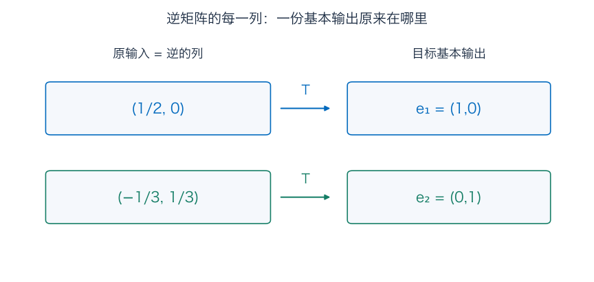

再检查两个顺序：

$$
TT^{-1}=T^{-1}T=I_2.
$$

前者保证每个输出经过恢复再运行会回到自己，后者保证每个输入先运行再恢复也回到自己。对前面压扁的 $N$，没有这种双向恢复，因为已经有两份不同输入撞到一起。

一般二维方阵若 $\Delta=ad-bc\ne0$，可直接乘开核对

$$
\begin{pmatrix}a&b\\c&d\end{pmatrix}^{-1}
=\frac1\Delta\begin{pmatrix}d&-b\\-c&a\end{pmatrix}.
$$

两种顺序的乘积都是单位阵：未除 $\Delta$ 前，对角项为 $\Delta$，其余项抵消。$\Delta=0$ 时不能除，并且前面的唯一恢复条件确实失败。

如果只求某一份右端，直接消元即可；把所有基本右端都算一遍才得到整个逆。理论上能写 $x=T^{-1}d$，并不强迫实际计算先显式造出一张逆矩阵。

## 7．撤销动作为什么要倒着来，面积倍率又为什么直接相乘

### 7.1 先恢复最后一步，才回得去第一步

输入点 $(1,2)$ 先经剪切 $S$ 成为 $(3,2)$，再经拉伸 $D$ 成为 $(6,6)$。现在要倒回去，应当先除去最后那次横向两倍、竖向三倍的拉伸，再消去剪切：

$$
(6,6)\xrightarrow{D^{-1}}(3,2)
\xrightarrow{S^{-1}}(1,2),\qquad
S^{-1}=\begin{pmatrix}1&-1\\0&1\end{pmatrix}.
$$

所以

$$
\boxed{T^{-1}=(DS)^{-1}=S^{-1}D^{-1}.}
$$

矩阵乘在左边，离输入最近的先执行。恢复的第一步是 $D^{-1}$，因此它写在右边。

若误按 $D^{-1}S^{-1}$，实际就是先对 $(6,6)$ 做反剪切，得到 $(0,6)$，再缩回成 $(0,2)$，没有回到 $(1,2)$。

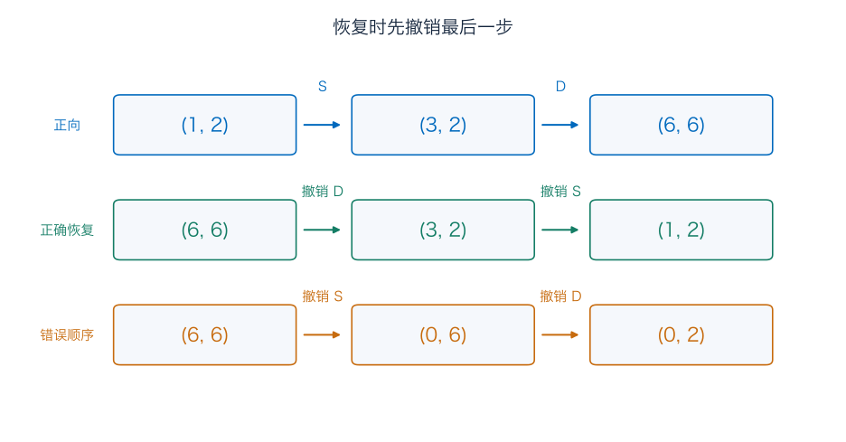

一般 $A,B$ 都可逆时，$(AB)(B^{-1}A^{-1})=I$，$(B^{-1}A^{-1})(AB)=I$，所以 $(AB)^{-1}=B^{-1}A^{-1}$。这两份检查也包括“从输出出发”和“从输入出发”，没有把单侧撤销当成双向逆。

### 7.2 顺序会改变形状，却不改变倍率相乘这件事

我们的剪切面积倍率为 1，拉伸为 6，串联总倍率为 $6\times1=6$。对一般方阵，连同方向符号也满足

$$
\boxed{\det(AB)=\det A\det B.}
$$

补充 A 给出包含奇异情形的代数证明。

不要由数字乘法可交换，就以为两台机器也可交换。对本例，反过来先拉伸后剪切得到

$$
SD=\begin{pmatrix}2&3\\0&3\end{pmatrix}\ne
DS=\begin{pmatrix}2&2\\0&3\end{pmatrix}.
$$

$(1,2)$ 先 $D$ 后 $S$ 成为 $(8,6)$，而原顺序得到 $(6,6)$。两种面积倍率都是 6，点的位置却不同；一个数没有记录全部几何动作。

逆的面积倍率则必须补回原倍率：$\det(T^{-1})\det T=1$，所以 $\det T^{-1}=1/6$。原来乘六，再乘六分之一，面积才恢复。

## 8．换基先不移动点：给同一位置换一张地址说明

同事在图纸上用两根斜方向记位置：

$$
b_1=(1,1)^T,\qquad b_2=(1,-1)^T.
$$

他说某点的坐标是 $(2,1)$，意思是“从原点沿 $b_1$ 走两份，再沿 $b_2$ 走一份”。实际位置是

$$
2b_1+b_2=2(1,1)+(1,-1)=(3,1).
$$

上一章已经强调，份数要连同基一起读。我们把新基向量的旧标准坐标排成列：

$$
P=\begin{pmatrix}1&1\\1&-1\end{pmatrix}.
$$

它的用途是“**新基份数翻译成旧标准坐标**”：

$$
x=Pz,\qquad z=(\alpha,\beta)^T
\quad\Longrightarrow\quad x=(\alpha+\beta,\alpha-\beta)^T.
$$

从旧坐标 $(x_1,x_2)$ 反过来找份数，解两式相加、相减，得到

$$
\alpha=(x_1+x_2)/2,\qquad\beta=(x_1-x_2)/2,
\qquad P^{-1}=\tfrac12\begin{pmatrix}1&1\\1&-1\end{pmatrix}.
$$

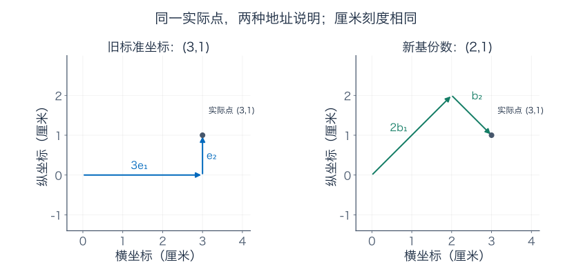

这个过程中点没有移动。新坐标 $(2,1)$ 与旧坐标 $(3,1)$ 是**同一对象的两张说明**。

当然，若明确把同一张数字矩阵 $P$ 当成标准坐标中的真实变换，它也会把实际点 $(2,1)$ 移到 $(3,1)$。两种用法的乘法数字相同，输入记录的含义不同；看清楚当前在翻译份数，还是在移动实际点，才能决定怎么算。

## 9．同一变形交给新坐标，为什么需要三步

现在真的要对同事的那个点运行 $T$。同事给的新输入是 $z=(2,1)$，我们希望给他的也是新坐标输出。

不要先背公式，按实际需要办事：

1. **读懂输入。** 用 $P$ 把新份数翻成旧坐标，得到 $(3,1)$。
2. **真的变形。** 用原规则 $T$，得到 $(2\times3+2\times1,3\times1)=(8,3)$。
3. **按对方的语言回答。** 用 $P^{-1}$ 把旧输出翻回新份数，得到 $((8+3)/2,(8-3)/2)=(11/2,5/2)$。

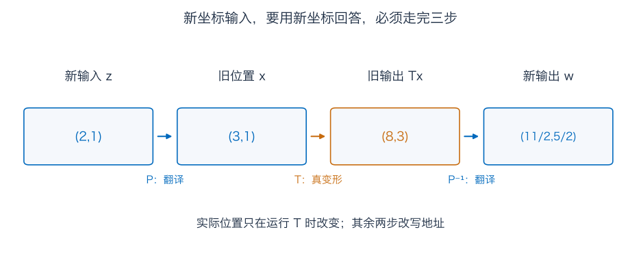

把这三步并成一张表，才得到

$$
\boxed{T_{\mathrm{new}}=P^{-1}TP
=\frac12\begin{pmatrix}7&-3\\1&3\end{pmatrix}.}
$$

中间乘法也展开一次：

$$
TP=\begin{pmatrix}4&0\\3&-3\end{pmatrix},\qquad
P^{-1}(TP)=\tfrac12\begin{pmatrix}7&-3\\1&3\end{pmatrix}.
$$

检查合并规则：$T_{\mathrm{new}}(2,1)^T=((14-3)/2,(2+3)/2)^T=(11/2,5/2)^T$。再用 $P$ 重建实际位置，得到 $((11+5)/2,(11-5)/2)=(8,3)$，确实和真实变形相符。

如果只算 $TP$，得到的 $(8,3)$ 仍是旧坐标，尚未翻译输出。如果直接把新份数 $(2,1)$ 送进原 $T$，就把它误读成另一个实际点，算出 $(6,3)$，不再是本来的问题。

这就是为什么先写转换方向，比死记 $P$ 应放在哪边可靠。这里规定 $P$ 为新到旧；若一开始规定成旧到新，公式位置会相应改变。

## 10．换了一张矩阵，面积倍率为什么仍是六

$T$ 和 $P^{-1}TP$ 描述同一个算子，只是两端都换成同一组新基，这叫**相似矩阵**。

由乘积公式，

$$
\det(P^{-1}TP)=\det(P^{-1})\det T\det P=\det T=6.
$$

也可以直接算新矩阵：$7\times3/4-(-3)\times1/4=24/4=6$。

这里有一个很容易看漏的面积单位。新坐标中的“单位格”，在实际旧图纸上是 $b_1,b_2$ 围出的平行四边形，实际面积为 $|\det P|=2$，不是 1。经过 $T$ 后，它的两边为 $(4,3)$、$(0,-3)$，面积为 $|\det(TP)|=12$。

所以实际倍率是 $12/2=6$，仍然没变。

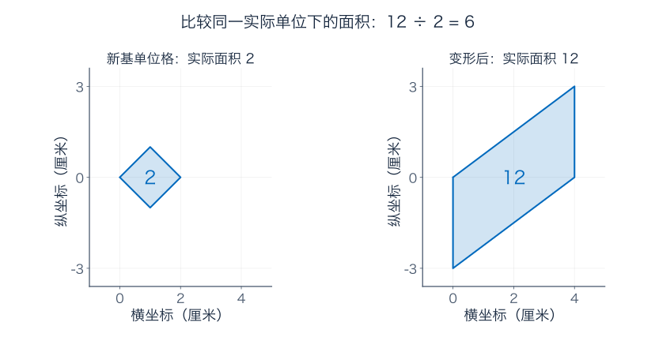

若输入、输出用的是不同的两组基，对应两种单位格可能不同，就必须把这层比例算清楚；不能拿矩阵的行列式直接冒充同一物理面积单位下的倍率。

秩、核维数也不会因这种可逆坐标翻译改变。补充 B 还会算迹与特征方向，说明哪些数量反映机器本身，哪些只是坐标写法。

## 11．面积都没变，图形与误差也可能差得很远

对比恒等变换与 $H=\operatorname{diag}(4,1/4)$：两者行列式都是 1，前者保留原方格，后者变成宽 4、高 $1/4$ 的扁长方形。它们都保面积，却没有相同的长度变化。

剪切 $S$ 也是行列式为 1，但原来的竖直单位边从 $(0,1)$ 变为 $(1,1)$，按勾股定理，长度从 1 变为 $\sqrt2$。所以“保面积”不是“每条边都不动”。

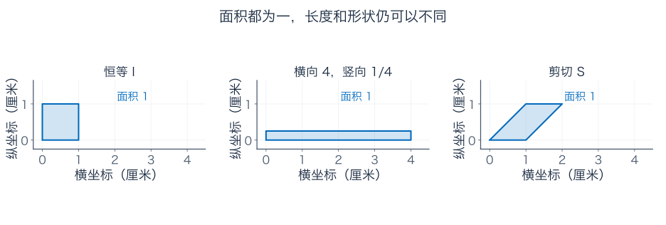

测量误差也有方向。假设某台机器为 $G=\operatorname{diag}(100,0.01)$，行列式仍为 1。输出第二项若读多 0.001，恢复时要除以 0.01，输入第二项就多出 0.1。面积倍率没有单独告诉你每个方向的误差会怎样放大。

反过来，$0.001I_2$ 的行列式虽很小，表达的首先是两个方向统一缩小；评价相对误差还需看输入、输出尺度及所用距离。**不能只凭行列式一个数判断全部形状或数值表现。** 后面的奇异值与条件数会继续把各个方向拆开研究。

多变量积分中，局部面积或体积倍率要取绝对值，这正是[换元公式中的 Jacobian 行列式](../微积分/08-多重积分、换元与积分次序.md)的几何来源。下一章先研究另一件事：怎样统一测量长度、夹角，以及怎样找最近点。

## 练习：先画或追踪，再用公式核对

题目全部列在前面，完整答案放在后面。题三的余子式展开见补充 A，题八的迹见补充 B；相应部分可以第二遍再做。

**题一：同一贴纸的面积。** 对正文 $S,D,T=DS,F$，求各自行列式以及 $FT$ 的行列式。原面积为 $1/2$ 的三角形经过 $T$、$FT$ 后实际面积分别是多少？哪个数记录大小，哪个符号记录方向？

**题二：为什么不能把行列式当作整个矩阵的线性函数。** 对 $A=\begin{pmatrix}2&1\\1&2\end{pmatrix}$，求行列式、交换两列后的行列式、$2A$ 的行列式。比较 $\det(A+A)$ 与 $\det A+\det A$。说明单独一列乘 2 与整个矩阵乘 2 的区别。

**题三：三阶算两遍。** 对正文 $M$，分别沿第一行展开、通过消元计算行列式，写出每个二阶余子式、换行符号与最终对角乘积。左上角零能否直接推出矩阵不可逆？

**题四：零面积丢了什么。** 对 $N=\begin{pmatrix}1&2\\2&4\end{pmatrix}$，求核与行列式，举两个不同输入产生同一非零输出。目标 $(1,2)$ 与 $(1,3)$ 分别有多少实数输入？写出有解目标的整个解族。

**题五：从基本输出造恢复规则。** 求 $T^{-1}$，说明它两列各自表示什么，并检查 $TT^{-1}$ 与 $T^{-1}T$。从输出 $(6,6)$ 恢复原位置。转置 $T^T$ 是否就是逆？用实际乘积检查。

**题六：顺序改变了什么。** 输入 $(1,2)$，分别先 $S$ 后 $D$、先 $D$ 后 $S$，求两个输出与两台总机器的行列式。对第一种输出，按正确顺序、错误顺序分别恢复。逆机器的行列式是多少？为什么面积倍率相同不能推出矩阵相同？

**题七：同一点的地址翻译。** 对正文基矩阵 $P$，把新坐标 $(2,1)$ 翻成旧坐标，再把旧坐标 $(5,1)$ 翻成新坐标。求 $P^{-1}$ 并核对双向翻译。这个过程为什么没有实际移动那两个点？

**题八：新语言下的同一台机器。** 计算 $T_{\mathrm{new}}=P^{-1}TP$，让新输入 $(2,1)$ 完成三步，再重建最终实际位置。比较新旧矩阵的行列式与迹。新基单位格的实际面积及其变形后面积分别是多少，怎样从它们得到真实面积倍率？只算 $TP$，输出采用哪套坐标？

**题九：保面积还不够说明什么。** 比较 $I_2$、$H=\operatorname{diag}(4,1/4)$ 与 $S$ 的行列式及单位边的长度变化。若实方阵 $Q$ 额外满足 $Q^TQ=I$，证明它的行列式只能为 $\pm1$；行列式为 1 反过来能否推出这个矩阵等式？最后计算 $G=\operatorname{diag}(100,0.01)$ 的逆怎样放大第二输出分量的 0.001 读数误差。

### 参考答案与解题过程

#### 题一解答

$\det S=1\times1-1\times0=1$，$\det D=2\times3=6$，$\det T=2\times3-2\times0=6$，$\det F=-1$，$\det(FT)=-6$。

后两台总机器的实际面积倍率均为 $|-6|=|6|=6$，所以三角形都变成面积 3。$T$ 保持有序方向，$FT$ 反转有序方向。绝对值告诉面积乘几倍，正负告诉有没有方向翻转；不能把负行列式当成实际涂色面积为负。

#### 题二解答

$\det A=2\times2-1\times1=3$。交换两列后为 $\begin{pmatrix}1&2\\2&1\end{pmatrix}$，行列式为 $1-4=-3$，区域大小相同，有序边反向。

$2A=\begin{pmatrix}4&2\\2&4\end{pmatrix}$，行列式为 $16-4=12$。因此 $\det(A+A)=12$，而 $\det A+\det A=6$，不同。

若只把第一列乘 2、保持第二列不变，行列式才只乘 2，成为 6。整个二维矩阵乘 2 同时改变两列，要乘 $2^2$。所谓“对每一列分别线性”，必须把其余列固定，不能省去这个条件。

#### 题三解答

沿第一行，符号依次为正、负、正：

$$
\begin{aligned}
\det M
&=0\det\begin{pmatrix}1&0\\0&3\end{pmatrix}
-2\det\begin{pmatrix}1&0\\2&3\end{pmatrix}
+1\det\begin{pmatrix}1&1\\2&0\end{pmatrix}\\
&=0\times3-2\times3+1\times(-2)=-8.
\end{aligned}
$$

消元先交换前两行：$\begin{pmatrix}1&1&0\\0&2&1\\2&0&3\end{pmatrix}$；第三行减第一行两倍后为 $\begin{pmatrix}1&1&0\\0&2&1\\0&-2&3\end{pmatrix}$；再加第二行后为 $\begin{pmatrix}1&1&0\\0&2&1\\0&0&4\end{pmatrix}$。

最终对角乘积为 8，只有第一次换行变号，所以原值为 $-8$。左上角零只是当前不能拿它当非零主元，本例行列式仍非零，所以可逆。

#### 题四解答

$\det N=4-4=0$，齐次方程只要求 $x+2y=0$，核为 $\operatorname{span}\{(-2,1)^T\}$。不同输入 $(2,0)$、$(0,1)$ 都输出 $(2,4)$，说明输出非零却丢失了输入区别。

对目标 $(1,2)$，只需 $x+2y=1$。令 $y=t$，全部输入为 $(1-2t,t)$，有无穷多实数解。

对目标 $(1,3)$，第二方程减第一方程两倍，得到 $0=1$，无解。没有任何逆能把这类不可达目标还原成一个真实输入。

#### 题五解答

恢复规则为 $x=p/2-q/3,y=q/3$，所以

$$
T^{-1}=\begin{pmatrix}1/2&-1/3\\0&1/3\end{pmatrix}.
$$

第一列 $(1/2,0)$ 是输出 $(1,0)$ 的原输入，第二列 $(-1/3,1/3)$ 是输出 $(0,1)$ 的原输入。把任意输出分成两种标准输出的组合，按相同份数合并原输入，就得到整套恢复规则。

两种乘积分别是

$$
TT^{-1}=\begin{pmatrix}1&-2/3+2/3\\0&1\end{pmatrix}=I_2,
$$

$$
T^{-1}T=\begin{pmatrix}1&1-1\\0&1\end{pmatrix}=I_2.
$$

输出 $(6,6)$ 恢复为 $(3-2,2)=(1,2)$。转置是 $T^T=\begin{pmatrix}2&0\\2&3\end{pmatrix}$，却有 $T^TT=\begin{pmatrix}4&4\\4&13\end{pmatrix}\ne I$，所以不是逆。

#### 题六解答

先剪切后拉伸：$(1,2)\mapsto(3,2)\mapsto(6,6)$，总机器 $DS=\begin{pmatrix}2&2\\0&3\end{pmatrix}$。

反过来：$(1,2)\mapsto(2,6)\mapsto(8,6)$，总机器 $SD=\begin{pmatrix}2&3\\0&3\end{pmatrix}$。两者行列式都是 6，但某点输出不同，因此矩阵不同。

对第一种输出，正确恢复先 $D^{-1}$：$(6,6)\mapsto(3,2)$，再 $S^{-1}$：$(3,2)\mapsto(1,2)$。错误顺序先 $S^{-1}$ 得 $(0,6)$，再 $D^{-1}$ 得 $(0,2)$。

逆的行列式为 $1/6$。行列式概括总面积倍率和方向，省去了大量关于位置、边长、剪切方式的信息，因而相同并不足以确定整台机器。

#### 题七解答

新坐标 $(2,1)$ 翻为 $P(2,1)^T=(3,1)^T$。旧坐标 $(5,1)$ 则解 $\alpha+\beta=5,\alpha-\beta=1$，得新份数 $(3,2)$。

$P^{-1}=P/2$，因为 $P^2=\begin{pmatrix}2&0\\0&2\end{pmatrix}=2I$。所以两边乘积 $PP^{-1}=P^{-1}P=I$，两套记录可双向翻译。

重建第二个点：$3b_1+2b_2=(5,1)$；第一个点也满足 $2b_1+b_2=(3,1)$。每次都在为同一个实际位置改写份数，没有对那个位置施加贴纸变形 $T$。

#### 题八解答

先 $TP=\begin{pmatrix}4&0\\3&-3\end{pmatrix}$，再乘 $P^{-1}$，得到

$$
T_{\mathrm{new}}=\tfrac12\begin{pmatrix}7&-3\\1&3\end{pmatrix}.
$$

新 $(2,1)$ 经 $P$ 变为旧 $(3,1)$；经 $T$ 变为旧 $(8,3)$；经 $P^{-1}$ 变为新 $(11/2,5/2)$。合并矩阵也给出 $(11/2,5/2)$；最后重建 $P(11/2,5/2)^T=(8,3)^T$，核对同一实际输出。

旧行列式为 6，新为 $(21+3)/4=6$。旧迹为 $2+3=5$，新迹为 $7/2+3/2=5$。

新基单位格在旧坐标中的有向面积为 $\det P=-2$，实际面积为 2；变形后 $\det(TP)=-12$，实际面积为 12。二者之比是 6。负号都来自这组基的有序方向，与同一算子的面积倍率为正不矛盾。

只算 $TP$，输入为新份数，输出仍是旧标准坐标；要按新份数回答，还需最后的 $P^{-1}$。

#### 题九解答

三个行列式都是 1。恒等矩阵保留两个单位方向长度；$H$ 将它们分别变为 4 和 $1/4$；$S$ 把竖直单位边送成 $(1,1)$，长度变为 $\sqrt2$。保面积不能保证保长度或保原来的夹角。

若 $Q^TQ=I$，取行列式得到

$$
1=\det(Q^TQ)=\det Q^T\det Q=(\det Q)^2,
$$

所以实数行列式只能为 $1$ 或 $-1$。但反向不成立：$\det S=1$，而 $S^TS=\begin{pmatrix}1&1\\1&2\end{pmatrix}\ne I$。下一章会正式解释这个矩阵条件对应的长度与夹角意义。

$G^{-1}=\operatorname{diag}(0.01,100)$。第二输出读数若增加 0.001，恢复的第二输入就增加 $100\times0.001=0.1$。总面积倍率为 1，没有阻止一个方向缩得很厉害、另一个方向拉得很长。

## 补充 A：公式与定理的完整依据

### A.1 不靠第一象限的摆放，怎样证明二维公式

记 $\Delta(u,v)$ 为两根有序边围出的有向面积。固定一根底边，把它转到水平方向观察，面积是底长乘带符号的高度；另一根边相加或数乘，高度也相加或数乘。所以 $\Delta$ 对第二根边线性。交换边顺序变号，又让它对第一根边也线性。

标准单位边取 $\Delta(e_1,e_2)=1$；两边相同则交换前后对象相同、符号却反转，所以 $\Delta(e_i,e_i)=0$。对 $u=ae_1+ce_2,v=be_1+de_2$，逐项展开：

$$
\begin{aligned}
\Delta(u,v)
&=ab\Delta(e_1,e_1)+ad\Delta(e_1,e_2)\\
&\quad+cb\Delta(e_2,e_1)+cd\Delta(e_2,e_2)\\
&=ad-bc.
\end{aligned}
$$

这同时适用于负坐标、反序与退化，不必为每一种图形重新画外框。

### A.2 高维定义、余子式与转置

在 $n$ 维中，行列式同样对每一列分别线性，交换两列变号，并规定单位矩阵的值为 1。把每一列展开成标准方向，含重复标准方向的项都为零，只剩将 $e_1,\ldots,e_n$ 各用一次的项。

用 $\sigma$ 记录这些标准方向的排列，$S_n$ 是所有排列的集合，符号 $\operatorname{sgn}(\sigma)$ 记录交换次数的奇偶，得到

$$
\det A=\sum_{\sigma\in S_n}\operatorname{sgn}(\sigma)
\prod_{j=1}^n a_{\sigma(j),j}.
$$

每个乘积从每一行、每一列各取一个元素。这个公式既给出明确计算值，也满足上面三条规则；项数为 $n!$，因此大矩阵通常更适合消元。

把这些项按第 $i$ 行取到了哪一列分组，会得到沿该行展开：

$$
\det A=\sum_{j=1}^n a_{ij}(-1)^{i+j}\det M_{ij}.
$$

$M_{ij}$ 是删去第 $i$ 行、第 $j$ 列后的子矩阵。前面的符号使余下有序方向正确接回原顺序；三阶沿第一行就是正、负、正，题三已经将三个二阶计算展开。

转置会把置换对应为逆置换，选中的乘积相同，奇偶也相同，所以 $\det A^T=\det A$。因此列操作的倍率规则可原样转成行操作规则。三角矩阵逐行展开，只剩对角乘积；也可从置换公式看出别的项都会碰到三角区域中的零。

### A.3 乘积公式，包含压扁的情形

固定 $A$，把 $B$ 的列记为 $b_1,\ldots,b_n$，定义

$$
F(b_1,\ldots,b_n)=\det(Ab_1,\ldots,Ab_n).
$$

$F$ 对各列线性、交换变号；在标准方向上，它的值为 $\det A$。同样按标准方向展开，只有各方向恰好用一次的项留下，每项是一个符号乘 $\det A$。所以总和就是 $\det A$ 乘 $B$ 的置换公式：$\det(AB)=\det A\det B$。

整个证明没有除以 $\det A$，因此即使机器会压扁方向，结论也成立。

### A.4 为什么非零行列式等价于完整可逆

若列相关，就能把某列写成其他列的组合。按该列线性展开后，每一项都有重复列，因此行列式为零。所以行列式非零必有 $n$ 个独立列；由上一章的维数结论，它们构成 $\mathbb R^n$ 的基，每个输出都有唯一输入。

把每个标准输出的唯一输入放成列，就得到逆矩阵；两边恢复都是恒等。反过来，若已有双向逆，由乘积公式得 $\det A\det A^{-1}=1$，所以行列式不可能为零。

对方阵，这就把“非零行列式、满秩、列构成基、核只有零、所有右端都有唯一解、存在双向逆”连接起来。维数不同的两端、单侧撤销或数值近似，仍需分别检查，不能只凭一句“有逆”混过去。

## 补充 B：同一机器换坐标，还保留哪些信息

### B.1 迹不是面积，却同样不受相似变换影响

迹是对角元素之和：$\operatorname{tr}A=\sum_i a_{ii}$。它与行列式是不同的量，本例新旧迹都为 5，并非面积倍率 6。

对同阶方阵 $X,Y$，把乘法逐项展开：

$$
\operatorname{tr}(XY)=\sum_{i,j}X_{ij}Y_{ji}
=\sum_{j,i}Y_{ji}X_{ij}=\operatorname{tr}(YX).
$$

因此 $\operatorname{tr}(P^{-1}TP)=\operatorname{tr}(PP^{-1}T)=\operatorname{tr}T$。秩、核维数不变，则来自前后两次可逆翻译都不增加或删除可分辨信息。

### B.2 选到真正的伸缩方向，混合项会消失

本章先用了便于同事交流的一组斜基，矩阵仍有混合项。换成 $c_1=(1,0)^T,c_2=(2,1)^T$ 试试：

$$
Tc_1=(2,0)^T=2c_1,\qquad
Tc_2=(6,3)^T=3c_2.
$$

每个方向各自只伸长，不混进另一个方向。在基 $\mathcal C=(c_1,c_2)$ 下，输入 $(\alpha,\beta)$ 的输出就为 $(2\alpha,3\beta)$。

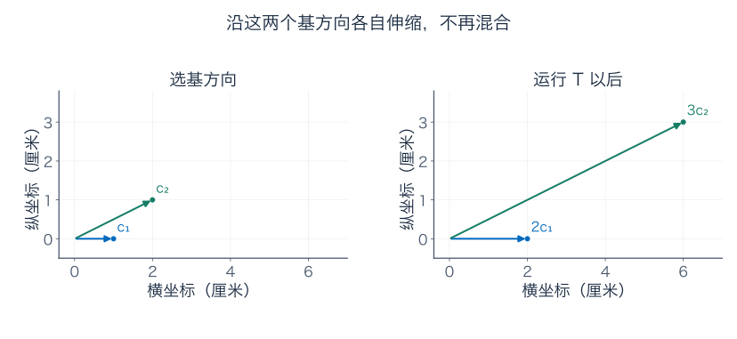

把两列排成 $C=\begin{pmatrix}1&2\\0&1\end{pmatrix}$，有 $C^{-1}=\begin{pmatrix}1&-2\\0&1\end{pmatrix}$，直接核对

$$
C^{-1}TC=\begin{pmatrix}2&0\\0&3\end{pmatrix}.
$$

这种只按倍数改变的非零方向叫特征向量，倍数叫特征值。一般要使 $C^{-1}TC=\operatorname{diag}(\lambda_i)$，逐列读 $TC=C\operatorname{diag}(\lambda_i)$，就要求 $Tc_i=\lambda_i c_i$，且这些方向独立到足以构成基。

这不是每台机器都做得到的事。后面的特征值章节会系统研究何时能找到足够多这样的方向；这里先把换基与“找到不互相混合的方向”接上。

## 伴读与下一篇

下一篇进入内积、正交与最近点：我们已经会测面积，却还需要另一套工具比较长度与夹角，解释为什么最小二乘的“最近”有可计算的含义。

- [3Blue1Brown：行列式](https://www.3blue1brown.com/lessons/determinant/)：配合观察有向面积倍率与压扁方向。本篇贴纸模型、数值路线、分割图与练习独立编写。
- [3Blue1Brown：换基](https://www.3blue1brown.com/lessons/change-of-basis/)：配合观察同一对象的两种坐标语言，重点追踪三步的输入输出基。
- [TU Delft：消元计算行列式](https://interactivetextbooks.tudelft.nl/linear-algebra/Chapter5/DeterminantsViaRowReduction.html)：核对行操作倍率、乘积公式与可逆条件。

---

[数学总导航](../00-%E6%95%B0%E5%AD%A6%E5%AD%A6%E4%B9%A0%E5%AF%BC%E8%88%AA.md) · [本课程目录](00-%E4%BB%8E%E7%AE%AD%E5%A4%B4%E5%88%B0%E5%87%BD%E6%95%B0%E7%A9%BA%E9%97%B4.md) · [← 上一章](04-%E5%9F%BA%E3%80%81%E7%BB%B4%E6%95%B0%E3%80%81%E7%A7%A9%E4%B8%8E%E5%95%86%E7%A9%BA%E9%97%B4.md) · [下一章 →](06-%E5%86%85%E7%A7%AF%E3%80%81%E6%AD%A3%E4%BA%A4%E4%B8%8E%E6%9C%80%E8%BF%91%E7%82%B9.md)
