[数学总导航](../00-%E6%95%B0%E5%AD%A6%E5%AD%A6%E4%B9%A0%E5%AF%BC%E8%88%AA.md) · [本课程目录](00-%E4%BB%8E%E7%AE%AD%E5%A4%B4%E5%88%B0%E5%87%BD%E6%95%B0%E7%A9%BA%E9%97%B4.md) · [← 上一章](06-%E5%86%85%E7%A7%AF%E3%80%81%E6%AD%A3%E4%BA%A4%E4%B8%8E%E6%9C%80%E8%BF%91%E7%82%B9.md) · [下一章 →](08-%E7%89%B9%E5%BE%81%E5%80%BC%E3%80%81%E5%AF%B9%E8%A7%92%E5%8C%96%E4%B8%8E%E8%B0%B1%E5%AE%9A%E7%90%86.md)

## 三次温度读数，哪条直线才算“最合适”

沿用上一章那三次观测：第 0、1、2 分钟，温度分别为 2、1、3 摄氏度。时间暂且视为准确，我们只比较温度方向上的误差。

想用一条直线概括这一小段记录，便写成

$$
\widehat b(t)=\alpha+\beta t.
$$

$\alpha$ 是第 0 分钟的预测温度，$\beta$ 是每分钟变化多少度。这里用分钟、摄氏度记数值；换单位时，参数和矩阵里的数字也要跟着换。选直线是我们做的简化，不表示真实温度一定按直线变化。

你可能先连接第一点与最后一点：从 2 升到 3，用了两分钟，于是得到 $2+0.5t$。但中间时刻，它预测 2.5，观测却是 1，差了 1.5 度。

上一章用投影找到了一个最近预测。接下来把它写成能直接照着算的求参数步骤，再处理两件事：有几组参数同样好，电脑为什么会把很小的区别丢掉。

## 1．先写清楚怎么打分，再讨论最好

三次预测分别为 $\alpha,\alpha+\beta,\alpha+2\beta$。统一把残差写成“观测减预测”，选用**三个残差的平方和**作为分数：

$$
J(\alpha,\beta)=(2-\alpha)^2+(1-\alpha-\beta)^2
+(3-\alpha-2\beta)^2.
$$

平方让高估、低估都产生非负代价，不会让两次方向相反的错误抵消。它还意味着偏差翻倍，代价变四倍。这个标准是我们的选择；它并不适合所有任务。

先算三个候选：

| 候选规则 | 三次预测 | 三次残差 | 平方误差和（平方度） |
| --- | --- | --- | --- |
| 连接两个端点：$2+t/2$ | $(2,5/2,3)$ | $(0,-3/2,0)$ | $9/4$ |
| 只报平均水平：$2$ | $(2,2,2)$ | $(0,-1,1)$ | $2$ |
| 上章找到的：$3/2+t/2$ | $(3/2,2,5/2)$ | $(1/2,-1,1/2)$ | $3/2$ |

第三条线不穿过任何一个观测点，却比前两条的总分都好。拟合的目标是让整个平方和小，不是让某几个点看起来特别准。

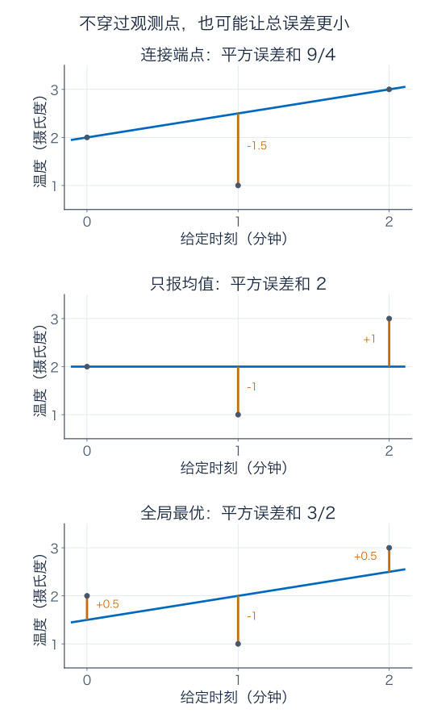

图中第一条的平方和是 $9/4=2.25$。三幅图坐标刻度一致；误差线都沿温度轴画，因为时刻已固定。这里求的不是纸上散点到直线的垂直距离。

“最小二乘”的“二乘”就是这些平方。在这一例里，意思很直白：在所有截距与斜率中，挑出让这三个平方相加最小的那一组。

### 一个常见误会：误差小，不等于真实规律已被证明

这三条读数不足以证明温度真的线性变化，更无法排除温度计的共同偏差。一个灵活到能穿过所有点的模型，训练误差可以是零，但也可能在两个时刻之间胡乱弯曲。

本章先固定模型和打分方式，回答按这个规则怎么算最好；该不该用直线、要不要更多观测，得靠实际证据判断。

## 2．把一张表翻译成矩阵，每个位置都对得上

把三次预测叠起来：

$$
\underbrace{\begin{pmatrix}1&0\\1&1\\1&2\end{pmatrix}}_A
\underbrace{\begin{pmatrix}\alpha\\\beta\end{pmatrix}}_x
=\begin{pmatrix}\alpha\\\alpha+\beta\\\alpha+2\beta\end{pmatrix},
\qquad b=\begin{pmatrix}2\\1\\3\end{pmatrix}.
$$

第一行说“第 0 分钟，用一份截距，加零份斜率”；第三行说“第 2 分钟，用一份截距，加两份斜率”。这样的 $A$ 叫**设计矩阵**：行对应观测，列对应模型中的成分。

两个参数，产生三个预测。$x$ 在二维参数空间，$Ax$ 在三维数据空间，两者不是同一种对象。

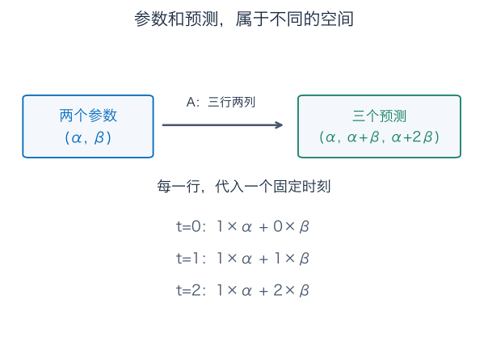

要求精确穿过三点，就是求 $Ax=b$。前两行要求 $\alpha=2,\beta=-1$，此时第三行却预测 0，而观测是 3。方程不相容。

最小二乘保留这份冲突，改求

$$
\min_x\|b-Ax\|^2.
$$

这里 $\|b-Ax\|^2$ 就是三个残差的平方和，不是另一个新指标。对一般 $m\times n$ 实矩阵，$m$ 是观测数，$n$ 是参数数。下面只讨论有限维，默认普通欧氏平方误差，加权时会另行说明。

### 不妨先检查一个直觉办法为什么会错

$A$ 的两列为 $e=(1,1,1)^T$、$\tau=(0,1,2)^T$。把 $b$ 分别投到两列上，得到系数 $6/3=2$ 和 $7/5$；若直接合并，就预测成 $(2,17/5,24/5)$。

这个办法上一章已经失败过：两列不正交，共同水平被重复算入。下面的正规方程会让这两个参数一起接受检查，不再各自报一个答案。

## 3．正规方程：剩余误差不能还含着可调整的成分

上一章的最近点条件是：最佳残差必须与所有允许预测方向正交。这里允许方向是 $A$ 的列空间，所以条件为

$$
A^T(b-Ax)=0.
$$

在本例，它包含两条要求：残差的三项和为零；残差与时间列 $(0,1,2)$ 的点积也为零。若任一方向还有分量，沿那个方向调整参数便能继续改善。

把括号展开并移项，得到**正规方程**：

$$
\boxed{A^TAx=A^Tb.}
$$

这没有把冲突读数修成精确相容的读数，只是要求剩余误差不能再被模型解释。

### 为什么它保证全局最优，而不只是一个可疑候选

设某参数 $x_*$ 已满足 $A^T(b-Ax_*)=0$，记 $r_*=b-Ax_*$。把参数改为 $x_*+h$，预测多了 $Ah$，所以

$$
\begin{aligned}
\|b-A(x_*+h)\|^2
&=\|r_*-Ah\|^2\\
&=\|r_*\|^2-2r_*^TAh+\|Ah\|^2\\
&=\|r_*\|^2+\|Ah\|^2.
\end{aligned}
$$

中间交叉项为零，是因为 $A^Tr_*=0$。最后只多了一个非负量。因此往哪个方向改、改多大，平方误差都不会更小。

反过来也成立。若在某方向 $h$ 上 $d=r^TAh\ne0$，把参数改为 $x+th$，误差改变量为

$$
-2td+t^2\|Ah\|^2.
$$

取 $t=d/\|Ah\|^2$，便得到负的 $-d^2/\|Ah\|^2$，找到更好的参数。分母不会为零，因为 $d\ne0$ 已保证 $Ah\ne0$。所以最优参数必满足正规方程。

### 把本例的每个数都算出来

相乘时，$A^TA$ 的四项是两列的两两点积；$A^Tb$ 是每列与观测的点积：

$$
A^TA=\begin{pmatrix}3&3\\3&5\end{pmatrix},\qquad
A^Tb=\begin{pmatrix}2+1+3\\0\times2+1\times1+2\times3\end{pmatrix}
=\begin{pmatrix}6\\7\end{pmatrix}.
$$

于是

$$
\begin{cases}3\alpha+3\beta=6,\\3\alpha+5\beta=7.\end{cases}
$$

第二式减第一式，$2\beta=1$，得 $\beta=1/2$；再代第一式，$\alpha+\beta=2$，得 $\alpha=3/2$。所以

$$
x_*=(3/2,1/2)^T,\qquad
p=Ax_*=(3/2,2,5/2)^T,\qquad
r_*=b-p=(1/2,-1,1/2)^T.
$$

核对两列：

$$
\frac12-1+\frac12=0,\qquad
0\times\frac12+1\times(-1)+2\times\frac12=0.
$$

最小平方误差为 $1/4+1+1/4=3/2$。现在第三个候选不只赢过另两个，它已经赢过所有允许的截距与斜率。

## 4．把图上的“谷底”也算清楚

将时间居中，写 $s=t-1$，再把预测写成 $c+ds$。$c$ 是第 1 分钟的预测温度，$d$ 仍是每分钟变化量。两种参数的关系为 $c=\alpha+\beta,d=\beta$。

三次预测为 $(c-d,c,c+d)$。令 $c=2+u,d=1/2+v$，与最佳预测相比，三项多了 $(u-v,u,u+v)$。与最佳残差正交后，总误差为

$$
\begin{aligned}
J&=\frac32+(u-v)^2+u^2+(u+v)^2\\
&=\frac32+3u^2+2v^2\\
&=\frac32+3(c-2)^2+2(d-1/2)^2.
\end{aligned}
$$

共同水平偏 0.1 度，误差增加 $3\times0.1^2=0.03$；斜率数值偏 0.1，增加 $2\times0.1^2=0.02$。

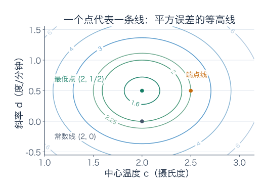

图不是山坡的实测地形，也不是温度曲线，画的是**参数的选择**：每个点代表一整条候选直线。中心水平 2、零时刻截距 $3/2$ 是同一最佳直线的两种读数。

## 5．QR：把整理过的方向，变成一张求参数的账

正规方程已经能解这个小例子。先从上一章的两根单位方向出发：

$$
q_0=\frac1{\sqrt3}(1,1,1)^T,\qquad
q_1=\frac1{\sqrt2}(-1,0,1)^T.
$$

第一根描述共同水平，第二根描述居中趋势。它们长度为 1，点积为零。把它们排成 $3\times2$ 的 $Q=[q_0\ q_1]$，便有 $Q^TQ=I_2$。

上一章用它们求最近预测。这里还要记另一件事：原来每一列，需要多少份这些新方向。

- 原第一列 $e$ 恰好是 $\sqrt3q_0$。
- 原时间列 $\tau=e+(-1,0,1)^T=\sqrt3q_0+\sqrt2q_1$。

把这四个系数按列排好，得到

$$
R=\begin{pmatrix}\sqrt3&\sqrt3\\0&\sqrt2\end{pmatrix},\qquad
\boxed{A=QR.}
$$

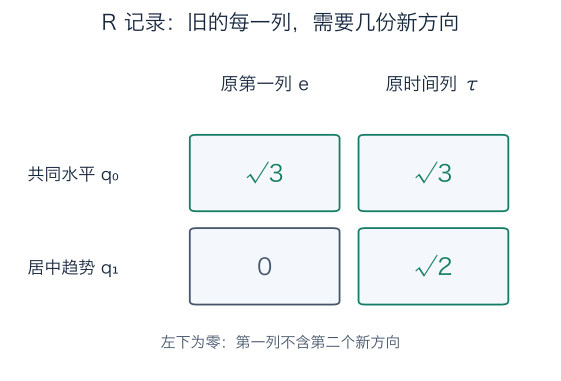

左下为零，是因为第一列在建立第二根新方向之前，已经完全表达好了。对一般列满秩矩阵，逐列正交化时，第 $j$ 列只用到前 $j$ 个新方向，因此 $R$ 是上三角。

### 读取数据，再从最后一行往回解

先求数据在新方向上的坐标：

$$
Q^Tb=\begin{pmatrix}(2+1+3)/\sqrt3\\(-2+3)/\sqrt2\end{pmatrix}
=\begin{pmatrix}2\sqrt3\\1/\sqrt2\end{pmatrix}.
$$

预测 $Ax=QRx$ 在同样两根方向上的坐标为 $Rx$。让这两个读数吻合，解

$$
Rx=Q^Tb,
\quad\text{即}\quad
\begin{cases}\sqrt3\alpha+\sqrt3\beta=2\sqrt3,\\
\sqrt2\beta=1/\sqrt2.\end{cases}
$$

从最后一行开始：$\beta=1/2$。再代第一行：$\alpha+1/2=2$，所以 $\alpha=3/2$。这种由下往上的求解叫**回代**。

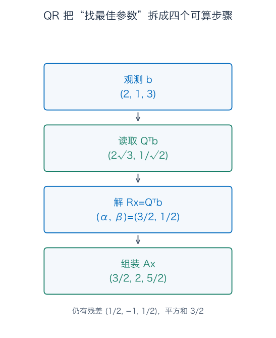

### 为什么可以放心丢下剩余坐标

把 $b$ 正交拆成 $QQ^Tb$ 与 $r_\perp=(I-QQ^T)b$。任意预测都在 $Q$ 的列空间里，动参数碰不到后面这部分。

因为 $Q$ 保长度：$\|Qz\|^2=z^TQ^TQz=\|z\|^2$，便有

$$
\boxed{\|b-Ax\|^2=\|Q^Tb-Rx\|^2+\|r_\perp\|^2.}
$$

第二项固定；$R$ 可逆，第一项能做到零。三角方程给出的正是最小二乘解，不是一次凑巧的换算。

补上第三根单位方向 $q_2=(1,-2,1)^T/\sqrt6$，本例观测在这方向的读数为

$$
q_2^Tb=\frac{2-2+3}{\sqrt6}=\frac3{\sqrt6}.
$$

允许预测在此方向的读数始终为零，所以无法消去的误差平方正是 $(3/\sqrt6)^2=3/2$。

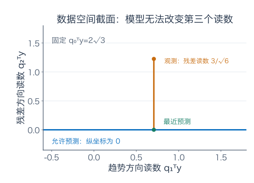

这张图用的是正交坐标中的一个二维截面：共同水平坐标固定了，横轴是趋势读数，纵轴是残差读数。完整预测空间仍是三维数据空间里的二维平面，别把截面当成全部数据。

对于一般 $m\ge n$ 的列满秩矩阵，约化 QR 的尺寸为 $Q:m\times n$、$R:n\times n$。只有 $Q^TQ=I_n$；$QQ^T$ 是到模型空间的投影，通常不是 $I_m$。若正交化出现精确零余量，说明列相关，不能继续把零归一化并假装 $R$ 可逆。

## 6．给模型多加一个参数，真的多知道一件事了吗

假如有人把温度的共同水平拆成两个来源 $u,v$，模型改写成

$$
\widehat b(t)=u+\beta t+v,\qquad
B=\begin{pmatrix}1&0&1\\1&1&1\\1&2&1\end{pmatrix},
\qquad z=(u,\beta,v)^T.
$$

两根共同水平列完全相同。两种来源无论怎样分配，都只以 $u+v$ 出现在预测中，观测分辨不了它们。

要得到同样的最佳预测，只需

$$
u+v=\frac32,\qquad\beta=\frac12.
$$

于是 $(u,\beta,v)=(0,1/2,3/2)$、$(3/4,1/2,3/4)$、$(2,1/2,-1/2)$ 都同样好，三次预测完全一样。这里暂不加来源非负等额外约束。

这些参数的差沿 $(1,0,-1)$：给第一来源多分一点，再从第二来源扣掉同样多，输出不动。它恰是 $B$ 的核方向。

### 到底什么时候唯一

对任意有限矩阵 $A$，允许预测组成有限维列空间，最近预测 $p$ 存在且唯一；又因为 $p$ 在列空间里，至少有一组参数能产生它。因此有限矩阵的最小二乘解总存在。

但产生它的所有参数为

$$
\boxed{x_*+\ker A.}
$$

原因也能从第 3 节的误差恒等式读出：另一个参数 $x_*+h$ 同样好，当且仅当 $\|Ah\|^2=0$，即 $h\in\ker A$。

所以预测始终唯一，参数唯一当且仅当列满秩。观测条数多，代替不了“列无关”这个条件：$B$ 有三条观测、三个参数，仍然分不开两个共同水平。

正规矩阵也会暴露这一点：$h^TA^TAh=\|Ah\|^2$，从而 $\ker(A^TA)=\ker A$。只有列满秩时 $A^TA$ 才可逆，公式 $(A^TA)^{-1}A^Tb$ 才适用。实际求解方程时可用分解和回代，没必要先算出整块逆矩阵。

## 7．最小范数：从同样好的分配里，再选一个

现在加一条额外规则：在所有误差同样小的参数里，让参数数值的平方和最小。这里先按本篇固定的单位与参数尺度比较。

本例所有最优参数可以写成

$$
z(h)=(3/4+h,\ 1/2,\ 3/4-h)^T.
$$

它的平方长度为

$$
\begin{aligned}
\|z(h)\|^2
&=(3/4+h)^2+(1/2)^2+(3/4-h)^2\\
&=\frac{11}{8}+2h^2.
\end{aligned}
$$

所以唯一最小范数解是 $z_{\min}=(3/4,1/2,3/4)^T$。它把两个无法区分的共同水平平均分开。

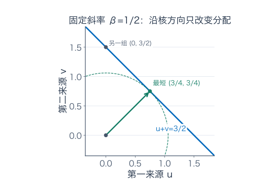

图固定了斜率，只画 $u,v$ 两个坐标，因此比的是 $u^2+v^2$；完整参数长度还需加固定的 $1/4$，不会改变最优分配。

最小范数没有让它更贴合观测，因为这条线上的每一个参数都已经产生同样预测。如果真实来源是 $(u,v)=(0,3/2)$，本次温度记录不会因此多告诉你一条信息。

### “最短”也依赖参数用什么尺子

如果第一来源改记为 $w=2u$，但仍让新的两个参数数值平方相加，那么约束变成 $w/2+v=3/2$。代入 $v=3/2-w/2$，有

$$
w^2+v^2=\frac54(w-3/5)^2+\frac95.
$$

新规则选 $w=3/5,v=6/5$，翻回原参数就是 $u=3/10,v=6/5$，不再均分。预测照样不变。

这不是算错，而是改了参数的计量规则。截距与斜率本来就有不同单位，把它们的数值直接平方相加，是一项需要说清的选择，不是天然的物理长度。若只是换记法而想保留原偏好，应把原来的 $u^2+v^2$ 翻译成 $w^2/4+v^2$。

一般情形也一样：把参数分解为 $x=x_\perp+k$，其中 $k\in\ker A$，$x_\perp\perp\ker A$。删去 $k$ 不改预测，而

$$
\|x_\perp+k\|^2=\|x_\perp\|^2+\|k\|^2.
$$

因此最小范数就是去掉所有核分量。先后次序很明确：先让预测误差最小，再在同样好的解里挑参数最短的。

## 8．伪逆：把刚才的两层选择，合成一台机器

每换一组观测，都先求最近预测，再取没有核分量的参数，这一整套操作叫 **Moore–Penrose 伪逆**，记成 $A^+$。它是从 $m$ 个观测到 $n$ 个参数的线性映射，所以矩阵尺寸是 $n\times m$。

先在已经会解的温度表上，把这台机器写出来。对任意三条输入读数 $y=(y_0,y_1,y_2)^T$，正规方程为

$$
3\alpha+3\beta=y_0+y_1+y_2,\qquad
3\alpha+5\beta=y_1+2y_2.
$$

相减得 $2\beta=y_2-y_0$，再代回求 $\alpha$：

$$
\beta=\frac{y_2-y_0}{2},\qquad
\alpha=\frac{5y_0+2y_1-y_2}{6}.
$$

因此原来两参数模型的伪逆是

$$
A^+=\begin{pmatrix}5/6&1/3&-1/6\\-1/2&0&1/2\end{pmatrix}.
$$

第一行把三条读数变成截距，第二行变成斜率。输入 $(2,1,3)$，输出正是 $(3/2,1/2)$。有了它，每换一组读数都不必重新推导。

重复参数模型 $B$ 还要将截距均分给 $u,v$，所以

$$
B^+=\begin{pmatrix}5/12&1/6&-1/12\\-1/2&0&1/2\\5/12&1/6&-1/12\end{pmatrix}.
$$

对同一个 $b$，得到 $(3/4,1/2,3/4)^T$。上、下两行相同，恰好表达“两个不可分辨来源取同一份”的规则。

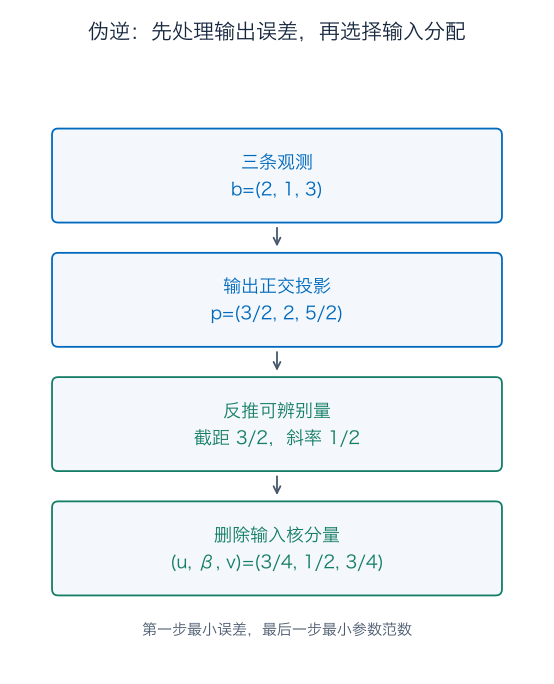

### 为什么不能当作普通逆，说它把所有信息都恢复了

两个乘积分别在不同空间工作：

$$
BB^+=\frac16\begin{pmatrix}5&2&-1\\2&2&2\\-1&2&5\end{pmatrix},
\qquad
B^+B=\begin{pmatrix}1/2&0&1/2\\0&1&0\\1/2&0&1/2\end{pmatrix}.
$$

第一个把观测送到最佳预测，丢掉观测中模型无法解释的残差。第二个作用于参数：把 $(u,\beta,v)$ 变成 $((u+v)/2,\beta,(u+v)/2)$，丢掉无法辨别的来源差异。

两者都对称、幂等，分别是输出空间和参数空间的正交投影，通常不是单位阵。原来列满秩的 $A$ 则有 $A^+A=I_2$，但 $AA^+$ 仍是三维空间里的二维投影。只有可逆方阵才有 $A^+=A^{-1}$，两个顺序都真正恢复原对象。

### 一般定义为什么也成立

令 $K=\ker A$。将 $A$ 限制到 $K^\perp$，它与列空间之间一一对应：同输出的两个输入相差一个核向量，又都与核正交，差只能是零。任意可达输出的输入，删掉核分量后也仍可达。

因此可以先正交投影，再在这个一一对应中反推：

$$
A^+=\left(A|_{K^\perp}\right)^{-1}
\operatorname{proj}_{\operatorname{im}A}.
$$

两步都线性，所以它是固定矩阵。补充 B 给出四条常用的代数核对式和不同秩条件下的公式。

## 9．小区别被放大：先分清问题敏感，还是算法丢了数

换一个很小的测量实验：两种来源数值为 $x_1,x_2$，第一台仪器只报告总量 $x_1+x_2$；第二台只对第二来源有很弱的响应 $\varepsilon x_2$。固定各项数值单位，模型是

$$
A_\varepsilon=\begin{pmatrix}1&1\\0&\varepsilon\end{pmatrix},
\qquad \varepsilon>0.
$$

输入 $(1,1)$，读数为 $(2,\varepsilon)$。假设第一读数不变，第二读数多了 $\delta$，新参数就必须满足

$$
\varepsilon x_2=\varepsilon+\delta,
\qquad x_1+x_2=2.
$$

所以

$$
\boxed{x_2=1+\frac\delta\varepsilon,\qquad
x_1=1-\frac\delta\varepsilon.}
$$

取 $\varepsilon=10^{-8},\delta=10^{-10}$，读数只多了 $10^{-10}$，参数却分别变化 $-0.01,+0.01$。两来源对仪器的影响几乎相同，辨别来源差异便很困难。这是**问题本身的敏感性**，换一种算术步骤也补不出缺少的信息。

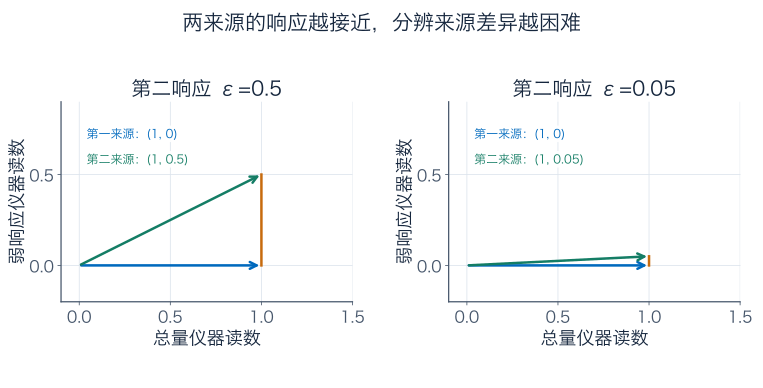

另有一种损失，是算法主动制造的。若先形成正规矩阵，

$$
A_\varepsilon^TA_\varepsilon
=\begin{pmatrix}1&1\\1&1+\varepsilon^2\end{pmatrix}.
$$

原来那个小区别 $\varepsilon$，变成要靠 $1+\varepsilon^2$ 与 1 的差来保存。通常的双精度、就近舍入下，$1+10^{-16}$ 会舍入成 1；而 $10^{-8}$ 本身仍能用非零浮点数表示。于是原矩阵可逆，形成的浮点正规矩阵却可能已看起来奇异。

QR 通过正交变换与回代求解，避免显式形成 $A^TA$，从而避免这一类额外损失；但它仍要面对原问题的敏感性。对于一般最小二乘，数据和矩阵的扰动、残差大小也影响误差，不能一句“用了 QR 就准确”包办所有情况。

实际计算 QR 常用保持长度的反射，补充 A 算一个二维例子。若列已经精确相关，或小区别低于任务的可信精度，还要处理秩。不能因为小数不是机器里的精确零，就断言这个方向值得反推。

## 10．正则化会改变任务，伪逆先后两层选择不会

用最简单的来源总量说明区别。仪器只报告 $x_1+x_2=2$，误差能做到零。伪逆先要求零误差，再从这条解直线上选最短参数 $(1,1)$。

若换成同时打分

$$
F(x_1,x_2)=(x_1+x_2-2)^2+\lambda(x_1^2+x_2^2),
\qquad\lambda>0,
$$

就容许牺牲吻合程度来换更短参数，这叫二次正则化。$\lambda$ 规定两项怎么取舍，它的含义随参数和观测的计量尺度而变。

令 $a=(x_1+x_2)/2,d=(x_1-x_2)/2$，即 $x_1=a+d,x_2=a-d$，则

$$
\begin{aligned}
F&=(2a-2)^2+2\lambda(a^2+d^2)\\
&=2(2+\lambda)\left(a-\frac2{2+\lambda}\right)^2
+2\lambda d^2+\frac{4\lambda}{2+\lambda}.
\end{aligned}
$$

所以唯一最优为

$$
x_\lambda=\left(\frac2{2+\lambda},\frac2{2+\lambda}\right)^T.
$$

例如 $\lambda=2$，参数为 $(1/2,1/2)$，预测总量只有 1。它主动接受了总量少 1 的误差，换来更小参数。伪逆的 $(1,1)$ 则始终先把总量拟合到 2。$\lambda\downarrow0$ 时，本例正则化解才趋于伪逆解。

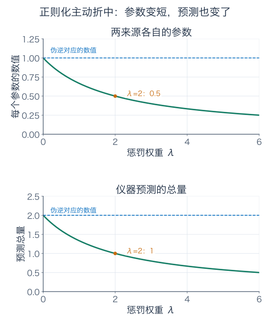

## 11．加权与概率：仍是同一张表，打分的尺子变了

回到温度 $(2,1,3)$。假如任务规定中间那次的误差平方按三倍计入，目标变成

$$
J_W=(2-\alpha)^2+3(1-\alpha-\beta)^2
+(3-\alpha-2\beta)^2.
$$

这是预先规定的代价，不能从这三条读数本身推断中间仪器更可靠。

仍记 $W=\operatorname{diag}(1,3,1)$。与普通展开相同，一次项消失的条件是

$$
A^TW(b-Ax)=0,\qquad
A^TWA=\begin{pmatrix}5&5\\5&7\end{pmatrix},
\quad A^TWb=\begin{pmatrix}8\\9\end{pmatrix}.
$$

两式相减仍得 $2\beta=1$，再代回得 $\alpha+\beta=8/5$，所以 $\alpha=11/10,\beta=1/2$。最佳预测为 $(11/10,8/5,21/10)$，比原预测整体下移了 $2/5$ 度，更照顾中间那条偏低的读数。

残差为 $(9/10,-3/5,9/10)$。加权和 $9/10-9/5+9/10=0$；与加权时间方向的点积也为 $-9/5+18/10=0$。普通残差和却为 $6/5$，因此不要用普通和为零来否定这个加权解。

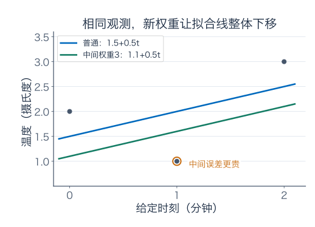

加权最小值为 $27/10$。这个数比普通最小值 $3/2$ 大，不表示加权结果“更差”：两个分数用了不同尺子。若拿普通最优线放进新尺子，总分是 $1/4+3+1/4=7/2$，确实高于 $27/10$。

一般正权重可令 $\widetilde A=W^{1/2}A,\widetilde b=W^{1/2}b$，对它们做普通 QR。乘 $W^{1/2}$ 的含义，是让第 $i$ 个残差的长度放大 $\sqrt{w_i}$，平方后代价才恰好乘 $w_i$。

### 与你学过的概率论有什么关系

如果额外假设 $b_i=a_i^Tx+\varepsilon_i$，各误差独立、服从零均值正态分布，且已知方差 $\sigma_i^2>0$ 不随待估参数变化，那么这次观测的似然为各项密度的乘积。取负对数，去掉不随 $x$ 变化的项，留下

$$
\frac12\sum_i\frac{(b_i-a_i^Tx)^2}{\sigma_i^2}.
$$

因此最大似然等于以逆方差 $1/\sigma_i^2$ 作权重的最小二乘。若一个仪器的误差标准差是另一个的两倍，它的逆方差权重应是后者的四分之一，而非二分之一。

最小二乘的几何计算本身不要求正态分布；把它认作这一最大似然估计，才需要刚才的概率假设。有共同系统偏差或相关误差时，不能继续把每次误差简单看作独立的一份证据。

## 练习：先分清在优化什么，再动手算

题目在前，答案在后；题五用到补充 A 的反射，题七见补充 B 的核对式，题十的 SVD 与条件数在补充 C。

**题一：比较与全局保证。** 对本篇三次温度观测，计算连接端点、常数均值、最佳直线的预测、残差和平方误差。再推出居中参数的恒等式 $J=3/2+3(c-2)^2+2(d-1/2)^2$。为什么只比较三条线还不够，而这个恒等式足够？

**题二：从残差到正规方程。** 写出本例 $A,b,A^TA,A^Tb$，解出参数并逐列核对残差正交。若删掉截距，只允许 $\beta t$，最优斜率、预测、残差和分别是什么？为什么此时残差和不必为零？

**题三：解究竟什么时候唯一。** 推导参数改动 $h$ 的误差增量，证明正规方程既必要又充分，并推出最优参数的全集。用重复参数模型 $B$ 写出核的一组基、全部最优参数和唯一最优预测。

**题四：把 QR 真正用于求解。** 构造本例的约化 QR，解释 $R$ 中四项的来源，算 $Q^Tb$ 并回代。补出 $q_2$，根据数据在该方向的读数求最小误差。为什么 $QQ^T$ 不是单位阵？

**题五：换一种整理方向的方法。** 对 $a=(3,4)^T$，用补充 A 的办法构造 Householder 反射，算出 $u,H,Ha$ 并核对保持长度。为什么选目标 $(-5,0)$？零列段如何处理？

**题六：最小范数与参数的尺子。** 在 $B$ 的全部最优参数中求最小范数解。若把 $u$ 改记为 $w=2u$，改用 $w^2+\beta^2+v^2$ 选最短，得到什么？若只是换记法但想保留旧规则，应如何改写代价？

**题七：伪逆的两种往返。** 推出本章 $A^+$ 与 $B^+$，对任意三条输入读数说明它们的每行在读取什么。计算 $BB^+$、$B^+B$，解释各自删掉什么，再核对四条 Penrose 条件。为什么两者尺寸相同也不是同一个动作？

**题八：敏感性与舍入。** 对 $A_\varepsilon$ 与读数 $(2,\varepsilon+\delta)$ 求参数，代入 $\varepsilon=10^{-8},\delta=10^{-10}$。计算正规矩阵，解释哪一部分困难来自任务本身，哪一部分来自形成正规矩阵。

**题九：加权与概率。** 将中间温度误差权重改成 3，完整解出直线、残差与加权最小值。比较原直线在新尺子下的分数。若误差独立正态且标准差分别为 1 与 2，权重比例是多少？几何最小化中哪一步需要正态假设？

**题十：伪逆与正则化的边界。** 对总量模型 $x_1+x_2=2$，分别求伪逆解与正则化解，取 $\lambda=2$ 作比较。对 $D_\varepsilon=\operatorname{diag}(1,\varepsilon)$ 求 $\varepsilon>0$ 和 $\varepsilon=0$ 时的伪逆。最后用补充 C 的 SVD 解释列满秩时 $\kappa_2(A^TA)=\kappa_2(A)^2$ 的前提。

### 参考答案与解题过程

#### 题一解答

连接端点的 $2+t/2$ 预测 $(2,5/2,3)$，残差 $(0,-3/2,0)$，平方和 $9/4$。常数 2 预测 $(2,2,2)$，残差 $(0,-1,1)$，平方和 2。最佳线 $3/2+t/2$ 预测 $(3/2,2,5/2)$，残差 $(1/2,-1,1/2)$，平方和 $3/2$。

令 $u=c-2,v=d-1/2$，预测相对最佳值的增量为 $(u-v,u,u+v)$。它与最佳残差的点积为

$$
\frac12(u-v)-u+\frac12(u+v)=0.
$$

所以误差总量等于原误差加增量平方：

$$
J=\frac32+(u-v)^2+u^2+(u+v)^2
=\frac32+3u^2+2v^2.
$$

比较三个候选，只排除了这三个中的另外两个，没检查无穷多其他参数。恒等式则对每个实数 $u,v$ 都成立，新增部分非负，且只在两者都为零时消失，因此同时证明全局最小与唯一性。

#### 题二解答

$A$ 的两列为 $(1,1,1)$、$(0,1,2)$，故

$$
A^TA=\begin{pmatrix}3&3\\3&5\end{pmatrix},\quad
A^Tb=(6,7)^T.
$$

两行相减得 $2\beta=1$，再代回得 $\alpha=3/2$。残差 $(1/2,-1,1/2)$ 与常数列的点积为 $1/2-1+1/2=0$，与时间列为 $-1+2/2=0$。

删掉截距后，只有时间方向，系数为

$$
\beta=\frac{\tau^Tb}{\tau^T\tau}=\frac75.
$$

预测为 $(0,7/5,14/5)$，残差 $(2,-2/5,1/5)$，残差和为 $9/5$。它与允许的时间方向仍正交：$-2/5+2/5=0$。允许空间不含常数方向，便没有要求残差与常数方向也正交。它的平方误差是 $4+4/25+1/25=21/5$，高于含截距模型，符合允许集合缩小后的比较。

#### 题三解答

将参数改为 $x+th$，残差从 $r$ 变为 $r-tAh$，平方误差改变量为 $-2tr^TAh+t^2\|Ah\|^2$。若 $r^TAh\ne0$，取 $t=(r^TAh)/\|Ah\|^2$，改变量严格为负。因此最优时 $r^TAh=0$ 对每个 $h$ 成立，即 $A^Tr=0$。

反向，若该式成立，对任意改动取 $t=1$，误差就只增大 $\|Ah\|^2\ge0$。同样最优当且仅当 $Ah=0$，故全部解为 $x_*+\ker A$，参数唯一当且仅当列满秩。

对 $B$，$Bz=0$ 的第一行给 $u+v=0$，第二行再给 $\beta=0$。所以核基为 $\{(1,0,-1)^T\}$。全部最优参数为

$$
(3/4+h,1/2,3/4-h)^T,\qquad h\in\mathbb R.
$$

无论 $h$ 是多少，预测始终为 $(3/2,2,5/2)^T$。不唯一的是参数分配，不是最近预测。

#### 题四解答

第一列长度为 $\sqrt3$，给 $q_0=e/\sqrt3$。第二列与 $q_0$ 的点积为 $3/\sqrt3=\sqrt3$，减去这一部分后剩 $(-1,0,1)$，长度 $\sqrt2$，给 $q_1=(-1,0,1)/\sqrt2$。

因此 $R$ 的两列分别为 $(\sqrt3,0)^T$、$(\sqrt3,\sqrt2)^T$，$Q^TQ=I_2$，逐列重组也得 $QR=A$。

观测坐标 $Q^Tb=(2\sqrt3,1/\sqrt2)^T$。回代：第二行除以 $\sqrt2$ 给 $\beta=1/2$；第一行除以 $\sqrt3$ 给 $\alpha+\beta=2$，所以 $\alpha=3/2$。

第三方向 $q_2=(1,-2,1)/\sqrt6$ 的观测读数为 $3/\sqrt6$，模型在这一方向为零，所以最小平方误差是 $9/6=3/2$。$QQ^Tq_2=0$，但 $I_3q_2=q_2\ne0$，因此 $QQ^T$ 不是三维单位阵。

#### 题五解答

$a=(3,4)^T$ 长度为 5，选 $\gamma=-5$。$w=a-\gamma e_1=(8,4)^T$，长度 $4\sqrt5$，所以 $u=(2,1)^T/\sqrt5$。于是

$$
H=I-2uu^T=\begin{pmatrix}-3/5&-4/5\\-4/5&3/5\end{pmatrix}.
$$

直接相乘：第一项 $(-3/5)3+(-4/5)4=-5$，第二项 $(-4/5)3+(3/5)4=0$，故 $Ha=(-5,0)^T$。

两列长度平方分别为 $9/25+16/25=1$、$16/25+9/25=1$，列点积为 $12/25-12/25=0$，所以 $H^TH=I$，长度保持为 5。选择负目标使 $w$ 的第一项为 $3+5$；一般情况下避免接近的数相减而丢失有效数字。零列段直接跳过，不归一化零向量。

#### 题六解答

全部最优参数的平方长度为

$$
(3/4+h)^2+1/4+(3/4-h)^2=11/8+2h^2.
$$

故最短为 $(3/4,1/2,3/4)^T$。换成 $w=2u$ 后，仍要求 $w/2+v=3/2$，但若改用新数值平方，

$$
w^2+v^2+1/4=\frac54(w-3/5)^2+\frac95+\frac14.
$$

所以选 $w=3/5,\beta=1/2,v=6/5$，原参数对应 $u=3/10$。新的最短选择与旧的不同，来源总量仍为 $3/2$。

若只是改记法，应把旧代价翻译成 $w^2/4+\beta^2+v^2$，这样会选回 $w=3/2$、即 $u=3/4$。普通范数最小的结论始终是相对于明确的参数坐标与尺子。

#### 题七解答

对任意输入 $y$，消去正规方程得到

$$
\alpha=(5y_0+2y_1-y_2)/6,\qquad\beta=(y_2-y_0)/2.
$$

按这些系数排成行，就得本篇的 $A^+$。$B^+$ 把截距行各分一半给第一、第三参数，斜率行照旧，故第一、第三行都为 $(5/12,1/6,-1/12)$，第二行为 $(-1/2,0,1/2)$。

乘积为

$$
P=BB^+=\frac16\begin{pmatrix}5&2&-1\\2&2&2\\-1&2&5\end{pmatrix},
\quad S=B^+B=\begin{pmatrix}1/2&0&1/2\\0&1&0\\1/2&0&1/2\end{pmatrix}.
$$

$P$ 保留 $e,\tau$，消去 $(1,-2,1)$；$S$ 保留两个来源的共同部分与斜率，消去 $(1,0,-1)$。两者都是对称幂等矩阵，但作用对象与消去方向不同。相同的三行三列不代表相同语义。

因为 $PB=B$、$SB^+=B^+$，有 $BB^+B=B$、$B^+BB^+=B^+$；再用 $P^T=P,S^T=S$，就核对了全部四条 Penrose 条件。对于原模型 $A$，核为零，$A^+A=I_2$；而 $AA^+=P$，仍会丢掉不能由直线解释的观测分量。

#### 题八解答

第二行给 $x_2=1+\delta/\varepsilon$，第一行再给 $x_1=1-\delta/\varepsilon$。代入题设数值，$\delta/\varepsilon=0.01$，所以参数为 $(0.99,1.01)$。

正规矩阵为 $\begin{pmatrix}1&1\\1&1+\varepsilon^2\end{pmatrix}$。原任务只能通过很弱的第二响应辨别两来源，噪声除以 $\varepsilon$ 后被放大，这是换算法也不能消除的敏感性。

形成正规矩阵时又要把 $\varepsilon^2$ 加到 1 上。双精度就近舍入下，$\varepsilon=10^{-8}$ 时，这份区别可能直接被舍掉。QR 避免显式形成该矩阵，可以避免这类额外损失，但没有让两来源在物理测量中变得更容易分辨。

#### 题九解答

加权正规方程为 $5\alpha+5\beta=8$、$5\alpha+7\beta=9$，两式相减得 $\beta=1/2$，再得 $\alpha=11/10$。残差 $(9/10,-3/5,9/10)$，加权和为零，与加权时间列的点积也为零。

代价为

$$
\frac{81}{100}+3\frac9{25}+\frac{81}{100}=\frac{27}{10}.
$$

原直线放到相同新尺子下，代价是 $1/4+3+1/4=7/2$。新解将新代价减少 $7/2-27/10=4/5$，因此没有拿不同尺子的两个最小值硬比。

标准差 1 与 2 对应方差 1 与 4，逆方差权重为 $1$ 与 $1/4$，比例 $4:1$。最小二乘的展开、正交条件与全局最优证明都不需要正态假设。把给定权重解释成独立正态误差的最大似然规则，才需要概率假设。

#### 题十解答

总量模型的全部精确解为 $(t,2-t)$，平方长度 $2(t-1)^2+2$，所以伪逆解 $(1,1)$，预测总量 2，残差为零。

正则化完成平方后，最优共同分量 $a=2/(2+\lambda)$、差异分量 $d=0$，故两个参数都是 $2/(2+\lambda)$。取 $\lambda=2$，参数 $(1/2,1/2)$，预测总量为 1，残差为 1。这是新目标主动做出的取舍。

若 $\varepsilon>0$，$D_\varepsilon$ 可逆，其伪逆为 $\operatorname{diag}(1,1/\varepsilon)$；若 $\varepsilon=0$，第二方向完全没有被测到，伪逆为 $\operatorname{diag}(1,0)$。前者的第二倍率趋于无穷，不能直接把这个极限当作后者。矩阵秩发生变化时，伪逆未必连续。

列满秩时所有 $n$ 个列方向的奇异值都正，$A^TA$ 的特征值为这些奇异值的平方。因此二范数条件数从 $\sigma_{\max}/\sigma_{\min}$ 变成其平方。这里说的是二范数、列满秩情形；列相关时，正规矩阵不可逆，不能把它当作普通可逆系统来套有限的条件数比值。

## 补充 A：电脑怎样用反射整理列

### A.1 先看一面真的能算的“镜子”

取单位向量 $u$，矩阵

$$
H=I-2uu^T
$$

会把沿 $u$ 的分量取反，其余正交分量保持。因为 $uu^T$ 是到这根方向的投影，$H^T=H$，并且

$$
H^TH=(I-2uu^T)^2=I-4uu^T+4u(u^Tu)u^T=I.
$$

所以这面镜子保持长度与夹角，叫 Householder 反射。

要把 $a=(3,4)^T$ 的第二分量变成零，选单位法向 $u=(2,1)^T/\sqrt5$，计算得

$$
H=\begin{pmatrix}-3/5&-4/5\\-4/5&3/5\end{pmatrix},
\qquad Ha=(-5,0)^T.
$$

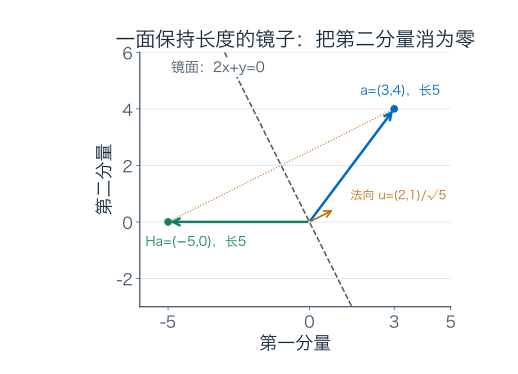

### A.2 法向不能靠猜，怎样自动得到

对非零列段 $a$，先选目标 $\gamma e_1$，其中

$$
\gamma=-\operatorname{sign}(a_1)\|a\|,
\qquad w=a-\gamma e_1,\qquad u=w/\|w\|.
$$

这里 $a_1=0$ 时把符号取为 $+1$。目标与原向量等长，且第一分量取相反符号，保证 $w$ 不为零，并避免 $a_1$ 与接近它的长度相减。

为什么这个法向确实有效？记 $s=\|a\|$，利用 $\gamma^2=s^2$，有

$$
w^Tw=2(s^2-\gamma a_1),\qquad
w^Ta=s^2-\gamma a_1.
$$

两者相差恰好两倍，因此

$$
Ha=a-2w\frac{w^Ta}{w^Tw}=a-w=\gamma e_1.
$$

不是忽然冒出一个反射公式，而是把“想变成哪根等长轴向量”倒推成法向。本例 $w=(8,4)$，归一化就得到上面的 $u$。列段为零时直接跳过。

处理矩阵时，先消第一列下方各项；之后只在右下剩余子块继续反射，保留前面已消出的零。最终得到上三角部分，反向组合反射便给出 $Q$。程序可存反射向量并直接作用于 $b$，不必显式造一个完整大方阵。对角符号可能与本篇手算 QR 不同，但拟合答案不变。

## 补充 B：伪逆的代数核对与特殊公式

### B.1 四条条件在核对哪两种往返

对任意实矩阵 $A$，伪逆满足

$$
AA^+A=A,\qquad A^+AA^+=A^+,\qquad
(AA^+)^T=AA^+,\qquad(A^+A)^T=A^+A.
$$

前两条说已经在可解释的输出、可分辨的输入里往返，不再改变结果。后两条要求两个投影按当前欧氏尺子正交，而不是斜着投。

它们还唯一确定伪逆。若另一个 $C$ 也满足四式，$AC$ 对称幂等，且像恰为 $\operatorname{im}A$，因此是唯一的输出正交投影。$CA$ 也对称幂等，核恰为 $\ker A$：若 $CAz=0$，由 $ACA=A$ 得 $Az=0$，反向显然成立。

所以 $CA$ 投到 $K^\perp$。再由 $C=CAC$，$Cb$ 必在 $K^\perp$，同时 $A(Cb)$ 是 $b$ 的最近预测。第 8 节已证明这样的输入唯一，故 $C=A^+$。

### B.2 什么时候可以用熟悉的逆矩阵式子

| 已核对的条件 | 伪逆公式 | 公式为何适用 |
| --- | --- | --- |
| 列满秩 | $(A^TA)^{-1}A^T$ | 正规方程参数唯一 |
| 行满秩 | $A^T(AA^T)^{-1}$ | 每个输出可达，并把参数选在转置的像中 |
| 可逆方阵 | $A^{-1}$ | 没有核，也没有无法解释的输出 |
| 零矩阵 $m\times n$ | 零矩阵 $n\times m$ | 最佳预测为零，最短参数也为零 |

行满秩公式的输出乘积为 $I_m$；它产生的参数属于 $\operatorname{im}A^T=(\ker A)^\perp$，所以正好选最短者。例如 $S=(1\ \ 1)$，有 $SS^T=2$，因而 $S^+=(1/2,1/2)^T$；输入总量 2 就均分成 $(1,1)$。这是第 10 节总量模型的伪逆。

秩亏矩阵不能先给奇异的 $A^TA$ 硬套普通逆。公式说明适用范围，实际数值计算还需选择合适的分解。

## 补充 C：先知道 SVD 要解决什么，再去下一章细学

秩为 $r$ 的矩阵可以用两组标准正交方向 $v_i$、$u_i$ 与正数 $\sigma_i$ 表示为

$$
A=\sum_{i=1}^r\sigma_i u_i v_i^T.
$$

这里输入方向 $v_i$、输出方向 $u_i$ 可以属于不同维数，$\sigma_i$ 记录这个输入方向的伸缩倍率。这叫奇异值分解；第 9 篇会证明存在性并逐步计算，现在把它当作待展开的工具。

一旦有这份分解，伪逆的动作就很清楚：沿各个输出方向读取，除以正倍率，送回相应输入方向：

$$
A^+=\sum_{i=1}^r\frac1{\sigma_i}v_i u_i^T.
$$

没有被测到的核方向不补回，模型不能解释的输出方向先丢掉。若写成完整矩阵 $A=U\Sigma V^T$，则 $A^+=V\Sigma^+U^T$，其中只将正奇异值取倒数、零保持为零，并交换矩形中间表的行列尺寸。秩为零时求和为空，仍得到零矩阵。

对 $D_\varepsilon=\operatorname{diag}(1,\varepsilon)$，正的第二倍率再小，精确伪逆也要除以它；一旦倍率恰好为零，就完全不反推它。这解释了第十题的秩变化为何不能靠简单取极限处理。

数值计算中把很小的奇异值当作零，是对有效秩的选择，会改变保留哪些信息。这要结合测量误差、尺度与任务要求，不是无关紧要的格式选项。

列满秩时，以最大、最小奇异值定义二范数条件数 $\kappa_2(A)=\sigma_{\max}/\sigma_{\min}$。$A^TA$ 的对应特征值变成 $\sigma_i^2$，故

$$
\kappa_2(A^TA)=\kappa_2(A)^2.
$$

它解释形成正规矩阵为何会额外恶化求解系统的条件；不能反过来声称 QR 让原最小二乘问题免疫于数据和矩阵误差。

## 伴读与下一篇

- [3Blue1Brown：点积与对偶](https://www.3blue1brown.com/lessons/dot-products/)：配合看单位方向的读数与矩阵的联系。本篇温度模型、参数重复的延伸、图与练习独立编写。
- [TU Delft：最小二乘](https://interactivetextbooks.tudelft.nl/linear-algebra/Chapter7/LeastSquares.html)：核对列空间、正规方程与 QR 的关系。
- [LAPACK：线性最小二乘问题](https://netlib.org/lapack/lug/node27.html)：区分满秩求解与一般的最小范数最小二乘。
- [LAPACK：误差分析](https://netlib.org/lapack/lug/node83.html)：进一步区分问题敏感性、稳定算法和数值秩选择。

下一篇研究同一台线性机器的特殊方向：哪些输入方向经过作用后，只改变倍率而不转向？这会引出特征值、对角化与谱定理，再为 SVD 铺路。

---

[数学总导航](../00-%E6%95%B0%E5%AD%A6%E5%AD%A6%E4%B9%A0%E5%AF%BC%E8%88%AA.md) · [本课程目录](00-%E4%BB%8E%E7%AE%AD%E5%A4%B4%E5%88%B0%E5%87%BD%E6%95%B0%E7%A9%BA%E9%97%B4.md) · [← 上一章](06-%E5%86%85%E7%A7%AF%E3%80%81%E6%AD%A3%E4%BA%A4%E4%B8%8E%E6%9C%80%E8%BF%91%E7%82%B9.md) · [下一章 →](08-%E7%89%B9%E5%BE%81%E5%80%BC%E3%80%81%E5%AF%B9%E8%A7%92%E5%8C%96%E4%B8%8E%E8%B0%B1%E5%AE%9A%E7%90%86.md)
