[数学总导航](../00-%E6%95%B0%E5%AD%A6%E5%AD%A6%E4%B9%A0%E5%AF%BC%E8%88%AA.md) · [本课程目录](00-%E4%BB%8E%E7%AE%AD%E5%A4%B4%E5%88%B0%E5%87%BD%E6%95%B0%E7%A9%BA%E9%97%B4.md) · [← 上一章](06-%E5%86%85%E7%A7%AF%E3%80%81%E6%AD%A3%E4%BA%A4%E4%B8%8E%E6%9C%80%E8%BF%91%E7%82%B9.md) · [下一章 →](08-%E7%89%B9%E5%BE%81%E5%80%BC%E3%80%81%E5%AF%B9%E8%A7%92%E5%8C%96%E4%B8%8E%E8%B0%B1%E5%AE%9A%E7%90%86.md)

## 电子秤给了三个数，你到底该报多少克

同一件物品称三次，读数为 98、101、104 克。先假设三次误差按相同标准计入，而且物品重量没有变化。你只能报一个数 $c$，怎样让三份误差整体尽可能小？

选用平方误差之和，得到

$$
J(c)=(98-c)^2+(101-c)^2+(104-c)^2.
$$

把 $c$ 写成 $101+h$，展开后恰好是

$$
J(101+h)=18+3h^2.
$$

因此 101 克使这个指标最小，平方误差为 18 平方克。它是给定模型与损失下的最佳折中，不保证真实重量一定是 101 克；如果秤有共同偏差，重复称重本身无法把这种偏差消掉。

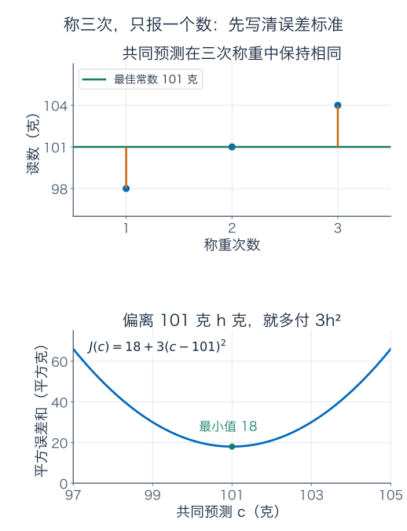

为什么选择平方？它非负、能把正负误差一起计入，也能用上一章的内积几何来求解。不过误差翻倍会让惩罚变成四倍，异常读数可能产生很大影响。若改用绝对误差之和，最优常数一般是中位数；“最好”必须连同评价规则一起说。

## 读数在漂移：一条拟合直线，为什么对应一个预测平面

若秤的读数会随时间缓慢变化，只报一个常数不够，可以改用 $\alpha+\beta t$。将时间先归一化，三个给定时刻为 $0,1,2$，读数为 $1,2,2$。假设能用直线近似这段变化，我们想同时选好截距 $\alpha$ 与斜率 $\beta$。

把三次预测并排：

$$
\begin{pmatrix}\alpha\\\alpha+\beta\\\alpha+2\beta\end{pmatrix}
=\underbrace{\begin{pmatrix}1&0\\1&1\\1&2\end{pmatrix}}_A
\underbrace{\begin{pmatrix}\alpha\\\beta\end{pmatrix}}_x,
\qquad b=\begin{pmatrix}1\\2\\2\end{pmatrix}.
$$

这里 $A$ 叫设计矩阵：一行对应一次观测，一列对应一种预测成分。第一列是共同基线，第二列是随时间增长的趋势。$x$ 有两个参数，$Ax$ 却有三个预测读数；两者生活在不同空间中。

若要求三点全穿过，会先从前两次得到 $\alpha=1,\beta=1$，第三次预测就成了 3，与观测的 2 冲突。现在改问

$$
\boxed{\min_{x\in\mathbb R^n}\|b-Ax\|_2^2,\qquad A\in\mathbb R^{m\times n}.}
$$

“最小二乘”的“二乘”就是平方。这一章默认实数、有限维和普通欧氏误差，后面会单独说明加权的变化。

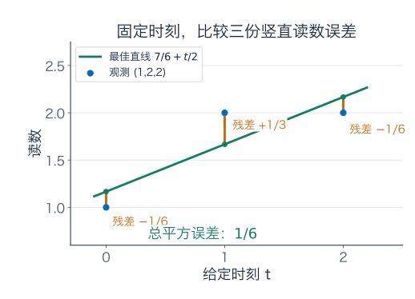

在时间—读数图上，模型画成一条直线；在三维数据空间里，所有允许预测组成 $\operatorname{im}A=\operatorname{span}\{(1,1,1),(0,1,2)\}$，是一个过原点的平面。改变参数，相当于在这个预测平面上挑点。拟合就是把三维观测 $b$ 投到这个平面。

我们固定时刻，只惩罚竖直的读数差。它等于数据空间中的欧氏距离，而不是时间—读数图中每个点到拟合线的垂直距离；如果时刻本身也有需要建模的误差，那是另一个问题。

## 正规方程：残差为什么必须对每一列都正交

本章统一记残差为 $r=b-Ax$，即“观测减预测”。上一章的最近点判据告诉我们，最优预测必须满足

$$
r\perp\operatorname{im}A
\quad\Longleftrightarrow\quad A^Tr=0.
$$

代入残差，得到**正规方程**：

$$
\boxed{A^TAx=A^Tb.}
$$

“正规”在这里与法向、正交条件有关，并不是说原方程不正规。它也没有把原本冲突的数据变得完全一致；它要求剩余误差在允许的预测方向上没有分量。

不用先相信投影定理，也能从“动一点参数是否更好”推出来。把参数改为 $x+th$，则

$$
\|b-A(x+th)\|^2
=\|r\|^2-2t\,r^TAh+t^2\|Ah\|^2.
$$

若 $r^TAh\ne0$，取足够小且同号的 $t$，误差就能下降。因此最优时必须对每个 $h$ 有 $r^TAh=0$，等价于 $A^Tr=0$。

反过来，满足这个条件的 $x_*$ 不只是一个候选驻点。对任意改动 $h$，

$$
\boxed{\|b-A(x_*+h)\|^2
=\|b-Ax_*\|^2+\|Ah\|^2.}
$$

右侧只能增加非负量，所以它就是全局最小点。这条恒等式比单独说“求导等于零”更有用：它同时解释了什么时候答案唯一。

## 唯一的到底是什么：预测与参数要分开问

列空间有限维，上一章已构造出到它的唯一正交投影 $p$。由于 $p\in\operatorname{im}A$，至少有一个 $x_*$ 使 $Ax_*=p$，所以有限矩阵的最小二乘解总存在，正规方程也总有解。

但两个参数 $x_1,x_2$ 只要相差一个核向量，就有相同预测：

$$
A(x_1-x_2)=0.
$$

因此全部最小二乘解恰好为 $x_*+\ker A$。若列无关，$\ker A=\{0\}$，参数唯一；若列相关，改变核方向不会改变任何预测。

同一件事可从 $A^TA$ 看出：对任意 $h$，

$$
h^TA^TAh=\|Ah\|^2.
$$

于是 $\ker(A^TA)=\ker A$。列满秩时，右侧对非零 $h$ 严格为正，$A^TA$ 正定可逆，才可写

$$
x_*=(A^TA)^{-1}A^Tb.
$$

这是一条带适用条件的理论公式，不是每次计算都应该先求逆的操作指令。方程多于未知数，也不自动保证列无关；方程少于未知数，则不可能列满秩。

## 把拟合直线一项项算完，再让残差接受检查

对前面的三次观测，

$$
A^TA=\begin{pmatrix}3&3\\3&5\end{pmatrix},\qquad
A^Tb=\begin{pmatrix}5\\6\end{pmatrix}.
$$

所以方程为 $3\alpha+3\beta=5$、$3\alpha+5\beta=6$。后一个减前一个，得 $2\beta=1$；再代回，得到

$$
\beta=\frac12,\qquad\alpha=\frac76.
$$

三个预测与残差为

$$
p=\left(\frac76,\frac53,\frac{13}6\right)^T,
\qquad r=b-p=\left(-\frac16,\frac13,-\frac16\right)^T.
$$

残差平方和为 $1/36+1/9+1/36=1/6$。与常数列取内积：$-1/6+1/3-1/6=0$；与时间列取内积：$0+1/3-2/6=0$。这两项都为零，才核对完“误差垂直于整个预测平面”。

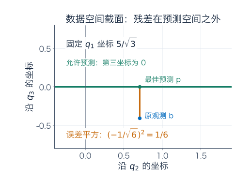

图中使用稍后算出的正交坐标。完整数据仍有三个坐标，固定第一坐标后，预测平面在截面里显示成一条线；这张图不是把三次读数误认为二维参数。

### 截距列带来的一个实用校验

只要是普通无权平方误差，且设计矩阵包含全 1 列，正规方程就包含 $\sum r_i=0$，预测均值与观测均值相等。本例两者均为 $5/3$。

删掉截距，只拟合 $\beta t$，会得 $\beta=(t^Tb)/(t^Tt)=6/5$，预测为 $(0,6/5,12/5)$，残差总和为 $7/5$，并不为零。加权时对应的则是加权残差和。模型变了，校验规则也应当跟着变。

## QR：先把挤在一起的尺子整理成正交方向

上章的 Gram–Schmidt 不只给新方向，还能记录每根旧列需要多少份新方向。对列满秩且 $m\ge n$ 的矩阵，有

$$
A=QR,\qquad Q\in\mathbb R^{m\times n},\quad Q^TQ=I_n,
\quad R\in\mathbb R^{n\times n}\text{ 为可逆上三角矩阵}.
$$

为什么是上三角？第 $j$ 根旧列只用到前 $j$ 根新方向，所以 $a_j=\sum_{i\le j}r_{ij}q_i$，$r_{ij}=\langle q_i,a_j\rangle$；编号比 $j$ 大的行全为零。若取正的对角元，$r_{jj}$ 就是当步未解释余量的长度。

对本章设计矩阵，第一列归一化为 $q_1=(1,1,1)^T/\sqrt3$。时间列在这方向上的投影是 $(1,1,1)^T$，去掉后剩 $(-1,0,1)^T$，归一化得 $q_2=(-1,0,1)^T/\sqrt2$。于是

$$
Q=\begin{pmatrix}1/\sqrt3&-1/\sqrt2\\1/\sqrt3&0\\1/\sqrt3&1/\sqrt2\end{pmatrix},
\qquad
R=\begin{pmatrix}\sqrt3&\sqrt3\\0&\sqrt2\end{pmatrix}.
$$

第一旧列是 $\sqrt3q_1$，第二旧列是 $\sqrt3q_1+\sqrt2q_2$，逐列核对就是 $QR=A$。

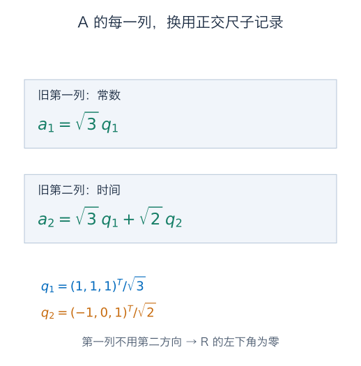

### 为什么只需解 Rx = Q 的转置乘 b

将 $b$ 分成投影与残差，

$$
b=QQ^Tb+(I-QQ^T)b.
$$

两部分正交，而 $QRx$ 在前一空间中。利用 $Q$ 的列标准正交，有 $\|Qz\|^2=z^TQ^TQz=\|z\|^2$，所以

$$
\boxed{\|b-Ax\|^2
=\|Q^Tb-Rx\|^2+\|(I-QQ^T)b\|^2.}
$$

后一项不随参数改变，前一项因 $R$ 可逆可以做到零。因此最优解由

$$
Rx=Q^Tb
$$

确定。按本例，$Q^Tb=(5/\sqrt3,1/\sqrt2)^T$。从最后一行回代，$\sqrt2\beta=1/\sqrt2$ 给 $\beta=1/2$；再由 $\sqrt3(\alpha+\beta)=5/\sqrt3$ 得 $\alpha=7/6$，与正规方程完全一致。

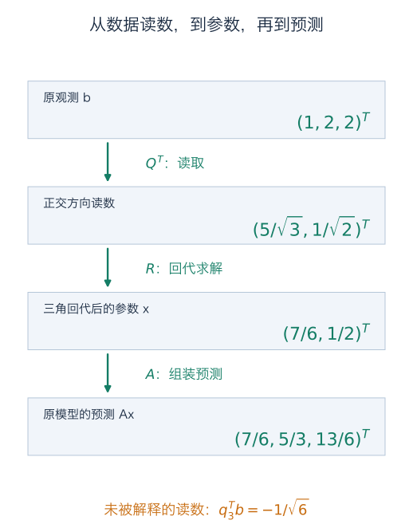

还可补一根 $q_3=(1,-2,1)^T/\sqrt6$。观测在它上面的读数为 $-1/\sqrt6$，而允许预测在这个方向永远为零。因此误差平方 $1/6$ 就是这份无法解释的坐标平方。

## 在电脑里怎样得到 QR：反射也能整理方向

Gram–Schmidt 很适合解释每一步做什么；实际浮点计算常用 Householder 反射形成 QR。反射矩阵写为

$$
H=I-2uu^T,\qquad\|u\|=1.
$$

$uu^T$ 是沿 $u$ 的正交投影。这个式子把沿 $u$ 的分量取反，保留其正交补，所以 $H^T=H$、$H^TH=I$。它翻转一个方向，却不改变距离。

具体怎样把列中多余分量消掉？对非零列段 $a$，取 $\gamma=-\operatorname{sign}(a_1)\|a\|$，其中 $a_1=0$ 时将符号取为 $+1$；令

$$
w=a-\gamma e_1,\qquad u=w/\|w\|.
$$

由 $w^Tw=2\|a\|(\|a\|+\operatorname{sign}(a_1)a_1)$ 以及 $w^Ta=\|a\|(\|a\|+\operatorname{sign}(a_1)a_1)$，可核对 $Ha=a-w=\gamma e_1$。选相反符号避免在形成 $w$ 时把两个很接近的正数相减。列段本来为零时则跳过，不能除以零。

例如 $a=(3,4)^T$，取 $\gamma=-5$、$u=(2,1)^T/\sqrt5$，得到

$$
H=\begin{pmatrix}-3/5&-4/5\\-4/5&3/5\end{pmatrix},
\qquad H(3,4)^T=(-5,0)^T.
$$

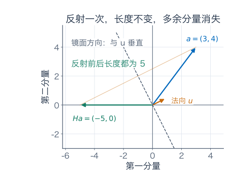

对矩阵逐列这样操作，并在后续步骤保留已整理好的前几行，就把矩阵化为上三角形；反射的逆也是自身，反向组合即可得到相应正交矩阵。实际程序可以存反射向量，直接作用于 $b$，无需显式造出一大块完整 $Q$。不同对角符号约定会给不同的 $Q,R$，但不改变预测和最小二乘答案。

## 参数有多组时，最小范数究竟选了什么

先看只知道两种来源总量的测量 $x_1+x_2=2$。所有精确解为 $(t,2-t)$，而

$$
t^2+(2-t)^2=2(t-1)^2+2.
$$

最短的参数向量是 $(1,1)$。它没有更多地吻合数据，因为所有点都完全吻合；它只是按欧氏长度偏好选了总量的对称分配。真实来源仍可能是 $(0,2)$，测量本身没有区分它们的能力。

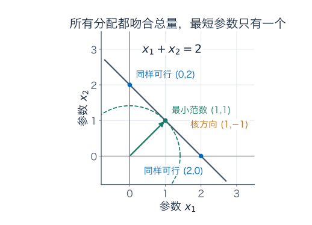

一般地，设 $K=\ker A$。将任一最优参数正交分解成 $x_*=x_\perp+k_0$，其中 $x_\perp\in K^\perp$、$k_0\in K$。去掉核分量不改预测，而任意同样好的参数可写成 $x_\perp+k$，满足

$$
\|x_\perp+k\|^2=\|x_\perp\|^2+\|k\|^2.
$$

所以核方向取零时，参数范数唯一最小。整个过程有先后两层要求：先使预测误差最小，再在所有同样好的解里使参数长度最小；不是把这两个目标随意相加。

## 伪逆：先投到可解释输出，再在可分辨输入里反推

限制 $A$ 的定义域到 $K^\perp$，得到

$$
T=A|_{K^\perp}:K^\perp\longrightarrow\operatorname{im}A.
$$

它是双射：若其中两个输入输出相同，差既在 $K$ 又在 $K^\perp$，只能为零；任意可达输出 $Az$，将 $z$ 的核分量去掉仍会得到它，所以也满射。

令 $\Pi$ 为到列空间的正交投影，定义

$$
\boxed{A^+=T^{-1}\Pi,\qquad x_{\min}=A^+b.}
$$

这就是 **Moore–Penrose 伪逆**的几何构造。投影与 $T^{-1}$ 都线性，所以它也是一个固定的 $n\times m$ 矩阵，并不需要对每个 $b$ 另立规则。它先处理无法解释的输出，再选没有核分量的输入，因此给出唯一的最小范数最小二乘解。

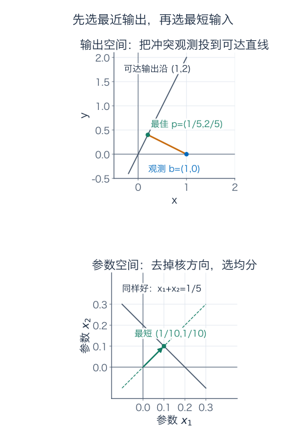

两个乘积很有意义：

$$
AA^+=\operatorname{proj}_{\operatorname{im}A},\qquad
A^+A=\operatorname{proj}_{(\ker A)^\perp}.
$$

它们一般不是完整单位矩阵，维数也不同。若 $A$ 是可逆方阵，两个投影才都变成单位矩阵，$A^+=A^{-1}$。

由这两个投影，可以核对四条 Penrose 条件：

$$
AA^+A=A,\qquad A^+AA^+=A^+,
\qquad(AA^+)^T=AA^+,\quad(A^+A)^T=A^+A.
$$

这些条件也唯一刻画伪逆。若另一个 $B$ 满足相同四式，$AB$ 是到 $\operatorname{im}A$ 的对称幂等投影；$BA$ 是核等于 $\ker A$ 的对称幂等投影，故投向 $K^\perp$。再由 $B=BAB$，$Bb$ 位于 $K^\perp$ 且满足 $A(Bb)=\Pi b$，只能等于刚才构造的唯一输入。

### 一个例子，同时出现“数据冲突”和“参数重复”

设两种来源的仪器响应完全相同：

$$
A=\begin{pmatrix}1&1\\2&2\end{pmatrix},\qquad b=(1,0)^T.
$$

所有可达输出沿 $(1,2)$，观测却不在这条线上。投影系数为 $1/5$，所以最佳预测 $p=(1/5,2/5)$，残差为 $(4/5,-2/5)$，误差平方为 $4/5$。

要得到这个预测，只需 $x_1+x_2=1/5$。最小范数再选 $x_{\min}=(1/10,1/10)$。对任意观测 $(b_1,b_2)$，同样计算给出

$$
A^+=\frac1{10}\begin{pmatrix}1&2\\1&2\end{pmatrix}.
$$

于是

$$
AA^+=\frac15\begin{pmatrix}1&2\\2&4\end{pmatrix},\qquad
A^+A=\frac12\begin{pmatrix}1&1\\1&1\end{pmatrix}.
$$

第一个投影在输出空间工作，第二个在参数空间工作。它们分别沿 $(1,2)$ 与 $(1,1)$，不能因为都写成二阶矩阵就混为一个动作。

### 熟悉的公式，是一般构造的特殊情况

| 条件 | 伪逆公式 |
| --- | --- |
| 列满秩 | $A^+=(A^TA)^{-1}A^T$ |
| 行满秩 | $A^+=A^T(AA^T)^{-1}$ |
| 可逆方阵 | $A^+=A^{-1}$ |
| 零矩阵 | $A^+=0$，维数转为 $n\times m$ |

第一行已由唯一的正规方程解得到。第二行里，每个输出都可达，公式满足 $AA^+=I_m$，并把输入选在 $\operatorname{im}A^T=K^\perp$，所以正好是最小范数右逆。核的正交补与转置像空间相等，可由上章的正交补关系再取补得到。

## 提前看 SVD：哪些方向能倒回来，哪些方向不能

伪逆已经可以用投影定义，不必先记一个分解公式。不过统一计算它的好工具是奇异值分解。先理解它要表达的动作，第 9 章会证明并详细计算。

对秩为 $r>0$ 的矩阵，可找到两组标准正交方向 $v_i\in\mathbb R^n$、$u_i\in\mathbb R^m$ 和正数 $\sigma_i$，使

$$
A=\sum_{i=1}^r\sigma_i u_i v_i^T,
\qquad A^+=\sum_{i=1}^r\frac1{\sigma_i}v_i u_i^T.
$$

前式沿输入 $v_i$ 读取份数，乘伸缩倍率 $\sigma_i$，放到输出 $u_i$；后式反向读取并除以倍率。输出中垂直于所有 $u_i$ 的分量先被丢掉，输入中没有被测到的核方向则不凭空补回。零秩时两和式都是空和，仍得到零矩阵。

将全部标准正交基补齐，可写 $A=U\Sigma V^T$、$A^+=V\Sigma^+U^T$：只对正奇异值取倒数，零保持为零，并把矩形中间表的行列维数互换。

## QR 能少制造误差，但不能替病态问题创造信息

考虑两列几乎相同的矩阵

$$
A_\varepsilon=\begin{pmatrix}1&1\\0&\varepsilon\end{pmatrix},\qquad\varepsilon>0.
$$

第一测量主要告诉你两参数的和，第二测量只靠很小的 $\varepsilon$ 来区分第二个参数。若第二读数变动 $\delta$，解会变化

$$
\Delta x=\left(-\frac\delta\varepsilon,\frac\delta\varepsilon\right)^T.
$$

例如 $\varepsilon=10^{-8}$、$\delta=10^{-10}$，第二读数变化很小，两个参数却分别变化 $-0.01,+0.01$。这是问题本身的敏感性，换成 QR 也无法消除。

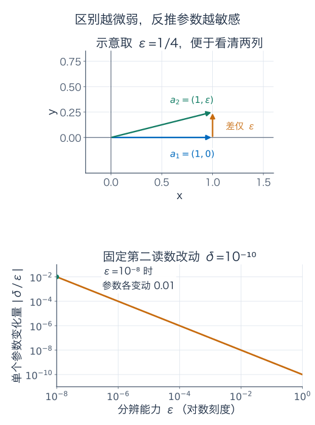

另一个问题来自算法主动形成

$$
A_\varepsilon^TA_\varepsilon
=\begin{pmatrix}1&1\\1&1+\varepsilon^2\end{pmatrix}.
$$

区别两列的信息变成了 $\varepsilon^2$。在常见 IEEE 754 双精度运算中，$1+10^{-16}$ 会舍入成 1；$\varepsilon=10^{-8}$ 时，形成的右下角可能已经丢掉这份差异，矩阵看起来奇异。直接使用 $A$ 时，那个 $10^{-8}$ 的分量本身仍可表示。

用奇异值还能精确表达这种额外恶化。列满秩时，定义二范数条件数 $\kappa_2(A)=\sigma_{\max}/\sigma_{\min}$。由 SVD，$A^TA$ 的正特征值为各 $\sigma_i^2$，所以

$$
\boxed{\kappa_2(A^TA)=\kappa_2(A)^2.}
$$

QR 使用正交变换和三角回代，避免显式形成这个平方后的系统。因此通常更适合浮点求解；但列几乎相关时，参数误差仍可能被放大。秩亏或数值秩不明确时，还要用带主元的 QR、完整正交分解或 SVD 等办法，不能把可逆 $R$ 的回代公式硬套上去。

### 很小的奇异值，该不该当成零

$D_\varepsilon=\operatorname{diag}(1,\varepsilon)$ 在 $\varepsilon>0$ 时的精确伪逆是 $\operatorname{diag}(1,1/\varepsilon)$；若观测第二项主要是噪声，倒回来可能非常大。到 $\varepsilon=0$，伪逆却是 $\operatorname{diag}(1,0)$，可见改变秩时伪逆未必连续。

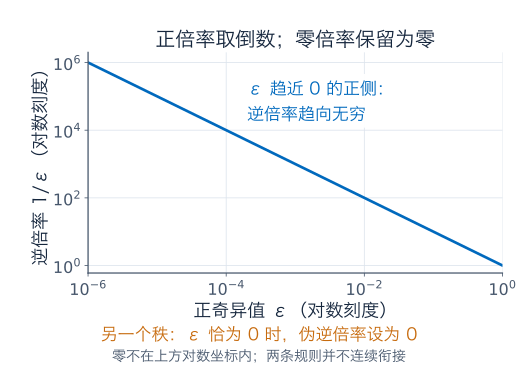

实际求解常给定阈值，把太小的奇异值视为零。这是在更改保留的信息方向，称为截断，而不是无条件精确恢复。阈值要结合数据尺度、噪声和任务选；不会仅靠“机器算得出来”就自动合理。

也可以另选目标 $\|Ax-b\|^2+\lambda\|x\|^2$，$\lambda>0$，给出岭型正则化系统 $(A^TA+\lambda I)x=A^Tb$。它对参数大小收取代价，会改变最佳预测，一般不同于“先最小误差，再从同样好的解里选最短”的伪逆。计算时也可以把它写成增广最小二乘：用 $\begin{pmatrix}A\\\sqrt\lambda I\end{pmatrix}$ 拟合 $\begin{pmatrix}b\\0\end{pmatrix}$，再做 QR，避免为了正则化又显式形成正规矩阵。这里先认清区别，后续反问题章节再研究怎样选择约束。

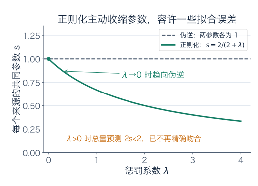

## 加权与概率：换了误差标准，要同步改方程

如果第 $i$ 次测量的误差平方应计权 $w_i>0$，目标变为

$$
\min_x\sum_i w_i(b_i-a_i^Tx)^2
=\min_x\|W^{1/2}(b-Ax)\|^2,
\qquad W=\operatorname{diag}(w_i).
$$

这就是对新数据 $\widetilde A=W^{1/2}A$、$\widetilde b=W^{1/2}b$ 做普通最小二乘。相应条件为 $A^TW(b-Ax)=0$，包含截距时给 $\sum w_i r_i=0$。例如用常数拟合读数 $(0,2)$，权重为 $(1,3)$，最佳结果是 $(0+3\times2)/4=3/2$。

在概率论里，若 $b_i=a_i^Tx+\varepsilon_i$，误差彼此独立、均为零均值正态，且已知方差均为同一个 $\sigma^2>0$，则负对数似然除了不随 $x$ 变化的项，是 $\sum(b_i-a_i^Tx)^2/(2\sigma^2)$。所以此时最小二乘也给最大似然估计；方差分别为已知 $\sigma_i^2>0$ 时，对应权重为 $1/\sigma_i^2$。不满足这些假设时，几何最小化仍有定义，但不能自动附会成同一个概率结论。

把平方和换成期望平方误差，就会走向随机变量的投影；可在后续[概率、条件期望与再生核](../泛函分析/17-概率、条件期望与再生核.md)接着学习。此处只需记住：模型决定允许预测，误差标准决定怎样比较，求解方法负责算出相应答案。

## 练习：每次都分清参数、预测与残差

**题一：重复称重。** 用一个常数拟合 $98,101,104$，配平方求最佳结果与误差平方和。再拟合 $1,2,6$，求最佳常数。若改用绝对误差，后一组最佳常数是什么？说明为什么评价标准必须写清楚。

**题二：完整手算直线。** 对本章 $A=\begin{pmatrix}1&0\\1&1\\1&2\end{pmatrix}$、$b=(1,2,2)^T$，求正规方程、参数、预测、残差和平方误差，并逐列核对正交。删掉截距后再求斜率，检查残差和是否为零。

**题三：驻点为何就是全局最优。** 从 $r=b-Ax$ 的小改动推导正规方程，证明满足它的 $x_*$ 对任意 $h$ 都有误差增量 $\|Ah\|^2$。推出全部最小二乘解的形式，以及参数唯一的充要条件。

**题四：QR 每个数字从哪里来。** 为题二的 $A$ 求一组对角元为正的约化 QR。计算 $Q^Tb$ 并回代；补上 $q_3=(1,-2,1)/\sqrt6$，用它的观测读数重新算出最小误差平方。为什么 $QQ^T$ 不是三维单位矩阵？

**题五：反射消元。** 对 $a=(3,4)$ 构造本章的 $u$ 与 Householder 矩阵 $H$，核对 $H^TH=I$、$Ha=(-5,0)^T$。解释为什么此处选负的目标第一分量，以及零列段如何处理。

**题六：总量已知，分配未知。** 对 $A=(1\ \ 1)$、$b=2$，写出全部精确解和唯一最小范数解，求 $A^+$、$AA^+$、$A^+A$。若真实参数是 $(0,2)$，伪逆为何不能判断出来？

**题七：同时有冲突和重复。** 对 $A=\begin{pmatrix}1&1\\2&2\end{pmatrix}$、$b=(1,0)^T$，求最佳预测、残差、全部最小二乘参数、最小范数参数及伪逆。核对两个乘积是对应空间的正交投影，并验证四条 Penrose 条件。

**题八：很小的区别。** 对 $A_\varepsilon=\begin{pmatrix}1&1\\0&\varepsilon\end{pmatrix}$、$\varepsilon>0$，计算 $A_\varepsilon^TA_\varepsilon$。若原读数为 $(2,\varepsilon)$，第二读数增加 $\delta$，新参数怎样变化？解释显式形成正规矩阵与原问题敏感性分别造成什么问题。

**题九：伪逆与正则化不是同一选择。** 对 $A=(1\ \ 1)$、$b=2$，求 $\|Ax-b\|^2+\lambda\|x\|^2$、$\lambda>0$ 的最优参数，并与伪逆比较。对 $D_\varepsilon=\operatorname{diag}(1,\varepsilon)$ 写出 $\varepsilon>0$ 以及 $\varepsilon=0$ 时的伪逆，解释秩变化为何需要当心。

**题十：加权与概率假设。** 用权重 $(1,3)$ 给读数 $(0,2)$ 拟合常数，求答案并核对加权残差和。一般地从目标推导加权正规方程。说明什么独立正态误差假设会产生逆方差权重，哪些结论不依赖正态假设。

### 参考答案与解题过程

#### 题一解答

$c=101+h$ 时误差为 $18+3h^2$，最佳为 101，平方误差为 18。第二组均值为 3；令 $c=3+h$，有

$$
(1-c)^2+(2-c)^2+(6-c)^2=14+3h^2.
$$

故最佳常数 3，误差平方和 14。改成绝对误差时，中位数为 2，误差和为 $1+0+4=5$；若取 3，误差和为 $2+1+3=6$。这说明“最佳”确实随着损失改变，不能把均值当成所有误差标准下的统一答案。

#### 题二解答

$A^TA=\begin{pmatrix}3&3\\3&5\end{pmatrix}$，$A^Tb=(5,6)^T$。两行相减得 $2\beta=1$，再代回得 $\alpha=7/6$。预测为 $(7/6,5/3,13/6)$，残差为 $(-1/6,1/3,-1/6)$，误差平方和为 $1/6$。

残差与常数列点积为 $-1/6+1/3-1/6=0$，与时间列点积为 $1/3-2/6=0$，所以满足全局最优条件。

没有截距时，$\beta=6/5$，预测为 $(0,6/5,12/5)$，残差为 $(1,4/5,-2/5)$。残差和为 $7/5$，但与时间列点积仍为 $4/5-4/5=0$。这里没有要求残差与常数方向正交。

#### 题三解答

误差在参数 $x+th$ 处为 $\|r\|^2-2t r^TAh+t^2\|Ah\|^2$。若一次项不为零，选合适的小 $t$ 可下降，故最优时有 $r^TAh=0$ 对所有 $h$ 成立，等价于 $A^Tr=0$。

反向若该条件成立，取 $t=1$ 就有误差增量 $\|Ah\|^2\ge0$，所以是全局最优。另一个参数同样最优，当且仅当 $Ah=0$，因此全部解为 $x_*+\ker A$。只有核为零、也就是列满秩时参数唯一；预测则始终是列空间的唯一正交投影。

#### 题四解答

第一列给 $q_1=(1,1,1)/\sqrt3$、$r_{11}=\sqrt3$。第二列与 $q_1$ 的点积为 $\sqrt3$，去掉后余量为 $(-1,0,1)$，故 $q_2=(-1,0,1)/\sqrt2$、$r_{22}=\sqrt2$。所以

$$
R=\begin{pmatrix}\sqrt3&\sqrt3\\0&\sqrt2\end{pmatrix},
\qquad Q^Tb=(5/\sqrt3,1/\sqrt2)^T.
$$

回代得 $\beta=1/2$、$\alpha=7/6$。补充方向的读数是 $(1-4+2)/\sqrt6=-1/\sqrt6$，平方为 $1/6$，恰好是不可解释的误差。$Q$ 只有两列，$QQ^Tq_3=0$，而 $I_3q_3=q_3$，所以 $QQ^T$ 是到二维列空间的投影，不是完整单位矩阵。

#### 题五解答

$\|a\|=5$，目标第一分量选 $\gamma=-5$，于是 $w=(8,4)$，$u=(2,1)/\sqrt5$。代入得

$$
H=\begin{pmatrix}-3/5&-4/5\\-4/5&3/5\end{pmatrix}.
$$

它两列长度平方均为 1，点积为零，故 $H^TH=I$；直接乘得第一分量 $-9/5-16/5=-5$，第二分量 $-12/5+12/5=0$。长度仍为 5。

符号选择使 $w$ 的第一项为 $3+5$，避免一般情形里接近等长时用 $a_1-\|a\|$ 相减损失有效数字。零列段不需要消元，直接跳过，不能归一化零向量。

#### 题六解答

全部解为 $(t,2-t)$，范数平方为 $2(t-1)^2+2$，因此唯一最短参数为 $(1,1)$。对一般标量观测 $b$，均分给出 $(b/2,b/2)$，所以

$$
A^+=\begin{pmatrix}1/2\\1/2\end{pmatrix},\qquad
AA^+=(1),\qquad
A^+A=\frac12\begin{pmatrix}1&1\\1&1\end{pmatrix}.
$$

所有标量输出都可达，故输出投影为单位；输入投影则删去核方向 $(1,-1)$。真实 $(0,2)$ 与 $(1,1)$ 的差就在这个核里，测量输出相同，无法靠本次观测区分。最小范数是一项明确选择，不是额外获得了一次测量。

#### 题七解答

输出沿 $u=(1,2)$，投影系数 $b\cdot u/(u\cdot u)=1/5$，所以 $p=(1/5,2/5)$、$r=(4/5,-2/5)$，误差平方 $4/5$。全部最小二乘参数可写为

$$
x=(1/10+t,1/10-t)^T.
$$

其范数平方为 $1/50+2t^2$，故最短为 $(1/10,1/10)$。一般观测的共同参数为 $(b_1+2b_2)/10$，因此

$$
A^+=\frac1{10}\begin{pmatrix}1&2\\1&2\end{pmatrix}.
$$

乘积分别为 $P=\frac15\begin{pmatrix}1&2\\2&4\end{pmatrix}$ 与 $S=\frac12\begin{pmatrix}1&1\\1&1\end{pmatrix}$。二者都对称且平方不变，像分别为输出方向 $(1,2)$ 与输入方向 $(1,1)$。由于 $PA=A$、$SA^+=A^+$，便有 $AA^+A=A$、$A^+AA^+=A^+$；两个乘积的对称性正是另两条 Penrose 条件。

#### 题八解答

相乘得 $A_\varepsilon^TA_\varepsilon=\begin{pmatrix}1&1\\1&1+\varepsilon^2\end{pmatrix}$。原读数对应 $x=(1,1)$；改变后，第二行要求 $x_2=1+\delta/\varepsilon$，第一行保持两数和为 2，所以 $x_1=1-\delta/\varepsilon$。

取 $\varepsilon=10^{-8}$、$\delta=10^{-10}$，参数变为 $(0.99,1.01)$。这是测量辨别能力很弱造成的敏感性。再显式形成 $A^TA$，差异只剩 $\varepsilon^2$，还可能在相加时被舍入抹掉，是算法额外引入的问题。QR 可以避免后者，不会消除前者；条件数平方公式的前提是原矩阵列满秩，讨论的是二范数。

#### 题九解答

正则化目标为 $(x_1+x_2-2)^2+\lambda(x_1^2+x_2^2)$。两条一阶方程相减给 $\lambda(x_1-x_2)=0$，故 $x_1=x_2=s$。代回得 $(2+\lambda)s=2$，所以

$$
x_\lambda=\left(\frac2{2+\lambda},\frac2{2+\lambda}\right)^T.
$$

正定的 Hessian $2(A^TA+\lambda I)$ 保证唯一最优。对任意 $\lambda>0$，预测和为 $4/(2+\lambda)<2$，主动容许了一些误差；伪逆解 $(1,1)$ 则精确吻合总量。$\lambda\downarrow0$ 时本例正则解才趋向伪逆解。

对 $\varepsilon>0$，$D_\varepsilon^+=\operatorname{diag}(1,1/\varepsilon)$；对 $\varepsilon=0$，伪逆为 $\operatorname{diag}(1,0)$。前者第二方向逆倍率越来越大，后者直接删除该方向，没有连续衔接。数值截断实际是在决定哪些方向仍可信。

#### 题十解答

目标为 $c^2+3(2-c)^2=4(c-3/2)^2+3$，所以常数为 $3/2$。残差为 $(-3/2,1/2)$，加权和 $-3/2+3/2=0$，普通残差和则为 $-1$。

一般目标 $(b-Ax)^TW(b-Ax)$ 对参数增量展开，一次项为 $-2h^TA^TW(b-Ax)$，故条件为 $A^TW(b-Ax)=0$。反向交叉项消失后，误差增量为 $(Ah)^TW(Ah)\ge0$，保证全局最优。

若误差独立、分别服从 $N(0,\sigma_i^2)$ 且方差已知、正且不随参数改变，负对数似然除常数外为 $\frac12\sum_i(b_i-a_i^Tx)^2/\sigma_i^2$，所以权重为逆方差。最小二乘的投影、正规方程及全局最小性来自给定平方损失，不需要误差服从正态；把它认作这一个最大似然模型的解才需要这些概率假设。

## 接下来，找出机器自身最自然的方向

本章用正交方向整理输入与输出，并发现“有些方向很难分辨”会影响求解。下一章的特征值与谱定理，会研究哪些方向在同一个算子作用下只改变倍率、不混入其他方向；再往后的 SVD 会把这种想法推广到不同维数的输入和输出。

### 几何伴读与正式核对

- [3Blue1Brown：点积与对偶](https://www.3blue1brown.com/lessons/dot-products/)：伴读正交方向读数、投影与矩阵的联系。本文的测量故事、完整计算、图和习题均独立编写。
- [TU Delft：最小二乘](https://interactivetextbooks.tudelft.nl/linear-algebra/Chapter7/LeastSquares.html)：核对列空间投影、正规方程与 QR 回代。
- [LAPACK：线性最小二乘问题](https://netlib.org/lapack/lug/node27.html)：核对满秩、秩亏、最小范数及不同分解的求解范围。
- [LAPACK：最小二乘误差分析](https://netlib.org/lapack/lug/node83.html)：核对条件数、原问题敏感性与小奇异值阈值的区别。

---

[数学总导航](../00-%E6%95%B0%E5%AD%A6%E5%AD%A6%E4%B9%A0%E5%AF%BC%E8%88%AA.md) · [本课程目录](00-%E4%BB%8E%E7%AE%AD%E5%A4%B4%E5%88%B0%E5%87%BD%E6%95%B0%E7%A9%BA%E9%97%B4.md) · [← 上一章](06-%E5%86%85%E7%A7%AF%E3%80%81%E6%AD%A3%E4%BA%A4%E4%B8%8E%E6%9C%80%E8%BF%91%E7%82%B9.md) · [下一章 →](08-%E7%89%B9%E5%BE%81%E5%80%BC%E3%80%81%E5%AF%B9%E8%A7%92%E5%8C%96%E4%B8%8E%E8%B0%B1%E5%AE%9A%E7%90%86.md)
