[数学总导航](../00-%E6%95%B0%E5%AD%A6%E5%AD%A6%E4%B9%A0%E5%AF%BC%E8%88%AA.md) · [本课程目录](00-%E4%BB%8E%E7%AE%AD%E5%A4%B4%E5%88%B0%E5%87%BD%E6%95%B0%E7%A9%BA%E9%97%B4.md) · [← 上一章](07-%E6%9C%80%E5%B0%8F%E4%BA%8C%E4%B9%98%E3%80%81QR%20%E4%B8%8E%E4%BC%AA%E9%80%86.md) · [下一章 →](09-%E5%A5%87%E5%BC%82%E5%80%BC%E5%88%86%E8%A7%A3%E4%B8%8E%20PCA.md)

## 两箱染料水，换来换去以后会怎样

桌上放着两只水箱，每箱都有 10 升水。左箱含 80 克染料，右箱含 20 克；染料已溶解均匀，不发生反应，也不损失。

每一轮，先各自搅匀，再从两箱**同时**各取出 2.5 升，交换后放入对方。两箱水量仍然都是 10 升。下一轮再按同样规则操作。

我们想知道：**第九轮以后，两箱各有多少染料？是否已经足够接近平均分配？**

这里有意选了一个理想实验：每次确实混匀、交换量准确、没有残留。这样算出的规律针对这组假设，不是对任何真实管路的保证。

这一篇会一直追踪这两箱水。先用小学算术发现总量与差异，再认识特征向量、对角化和谱分解；随后用剪切、旋转检查它们什么时候失效。一般证明和连续时间模型可以分次读，不要求一口气记住全部术语。

## 1．先把两轮真的算出来

左箱浓度是每升 8 克，取出 2.5 升，就流出 20 克染料。右箱浓度是每升 2 克，同样的 2.5 升只带走 5 克。

因此第一轮后：

$$
\text{左箱}=80-20+5=65\ \text{克},\qquad
\text{右箱}=20-5+20=35\ \text{克}.
$$

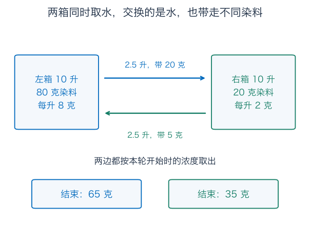

第二轮重新搅匀。各取走自身染料的四分之一，得到

$$
\text{左箱}=\frac34\times65+\frac14\times35=57.5\ \text{克},
$$

$$
\text{右箱}=\frac14\times65+\frac34\times35=42.5\ \text{克}.
$$

注意这不是先从左倒进右、再从已经改变浓度的右箱取水。**同时按本轮开始时的浓度取出**，才得到这里的系数。

把一轮开始时的染料质量数值写成 $x_k=(L_k,R_k)^T$，下标 $k$ 是完成的轮数。更新规则为

$$
x_{k+1}=Mx_k,\qquad
M=\begin{pmatrix}3/4&1/4\\1/4&3/4\end{pmatrix}.
$$

质量用克记录，矩阵里的比例没有单位。第一行正是“左边保留四分之三，再收到右边的四分之一”。

| 已完成轮数 $k$ | 左箱染料（克） | 右箱染料（克） | 总量（克） | 左减右（克） |
| --- | --- | --- | --- | --- |
| 0 | 80 | 20 | 100 | 60 |
| 1 | 65 | 35 | 100 | 30 |
| 2 | 57.5 | 42.5 | 100 | 15 |
| 3 | 53.75 | 46.25 | 100 | 7.5 |

表里有两件很显眼的事：总量不动，差异每轮减半。但三行规律仍是观察；我们要从公式证明以后每轮都如此，才敢跳到第九轮。

## 2．换一种记账，两个数突然不再互相搅在一起

把两条更新式相加：

$$
L_{k+1}+R_{k+1}
=\left(\frac34+\frac14\right)L_k
+\left(\frac14+\frac34\right)R_k=L_k+R_k.
$$

再用第一条减第二条：

$$
L_{k+1}-R_{k+1}
=\frac12L_k-\frac12R_k=\frac12(L_k-R_k).
$$

现在给这两种读数各除以 2，记

$$
m_k=\frac{L_k+R_k}{2},\qquad
d_k=\frac{L_k-R_k}{2}.
$$

$m_k$ 是两箱的平均染料质量，$d_k$ 是带正负号的半差。原质量能从它们恢复：$L_k=m_k+d_k,R_k=m_k-d_k$。所以只是换记法，没有丢信息。

新记法下，一轮操作变成

$$
\boxed{m_{k+1}=m_k,\qquad d_{k+1}=\frac12d_k.}
$$

互相混合的两条记录，变成两条互不干扰的简单规则。开始时 $m_0=50,d_0=30$，故

$$
m_k=50,\qquad d_k=30\,2^{-k}.
$$

于是任意轮数都可以直接算：

$$
\boxed{L_k=50+30\,2^{-k},\qquad
R_k=50-30\,2^{-k}.}
$$

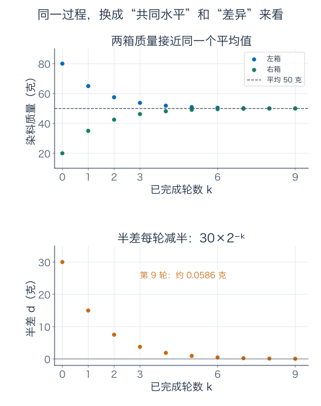

第九轮 $2^9=512$，两箱分别为 $50\pm30/512$，即约 50.0586 克、49.9414 克。每箱离 50 克都小于 0.1 克。第八轮的偏差 $30/256\approx0.1172$ 克还不达标，所以第九轮是首次满足这个要求。

随着轮数增加，半差趋于零，总量始终为 100，极限才是每箱 50 克。不能把“反复作用”简单理解为“所有东西都会消失”。

## 3．这时再认识特征向量，名字就有着落了

为什么平均水平和差异能独立处理？看两种特别的变化：

- 两箱各加相同的一份，方向为 $v_+=(1,1)^T$。一轮后，这种共同变化完整保留。
- 左箱多一份、右箱少一份，方向为 $v_-=(1,-1)^T$。一轮后，这种重新分配只剩原来的一半。

第二个向量含负数，表达的是**相对某个状态的减少量**，不是在实际水箱里放负的染料。

直接相乘可核对：

$$
Mv_+=\begin{pmatrix}3/4+1/4\\1/4+3/4\end{pmatrix}=v_+,
$$

$$
Mv_-=\begin{pmatrix}3/4-1/4\\1/4-3/4\end{pmatrix}=\frac12v_-.
$$

这两根方向没有混入其他方向，只乘了各自的倍率。一般若方阵 $A$ 与某个非零向量满足

$$
\boxed{Av=\lambda v,\qquad v\ne0,}
$$

就称 $v$ 为**特征向量**，$\lambda$ 为对应的**特征值**。本例的共同模式倍率是 1，差异模式倍率是 $1/2$。

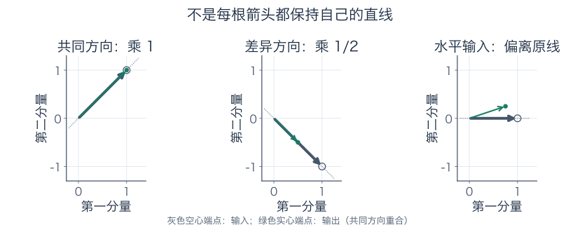

例如 $(1,0)^T$ 会变成 $(3/4,1/4)^T$，离开原来的水平直线，便不是特征方向。一个特征向量的非零倍数仍代表同一模式；我们关心的是整条过原点的直线，不是某个特别长度。

### 负倍率和零倍率有没有意义

若每轮交换的不是四分之一，而是各自体积的比例 $\rho$，其中 $0\le\rho\le1$，更新矩阵是

$$
M_\rho=\begin{pmatrix}1-\rho&\rho\\\rho&1-\rho\end{pmatrix}.
$$

共同模式仍乘 1，差异模式则乘 $1-2\rho$。

取 $\rho=3/4$，差异倍率为 $-1/2$。起点 $(80,20)$ 一轮后变成 $(35,65)$：左边从高于平均，翻到低于平均，但偏差大小仍减半。**负的是相对平均值的偏差，不是箱内质量。**

取 $\rho=1/2$，差异倍率为零，两箱一轮后都恰好 50 克；非零差异向量被压成零。零特征值完全合法。不能把零向量本身叫特征向量，因为 $A0=\lambda0$ 对任何 $\lambda$ 都成立，辨别不了任何模式。

取 $\rho=1$，每轮只是完全交换两箱，差异倍率为 $-1$，两种状态反复交替而不趋近。取 $\rho=0$ 则什么也不做。因此两箱对于任意初始质量都趋向共同平均的条件，是 $0<\rho<1$；边界不能直接算进去。

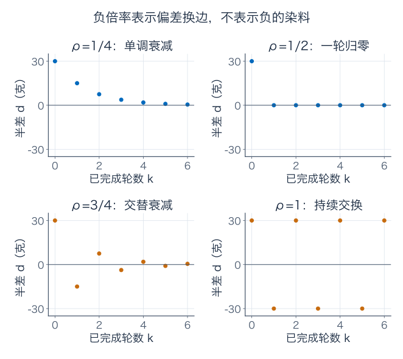

## 4．如果没看出模式，怎样自己把它算出来

水箱刚好容易猜共同与差异方向。面对一张陌生数表，可以把特征方程移项：

$$
(M-\lambda I)v=0.
$$

要有非零向量解，这个矩阵必须有非零核，等价于不可逆。第五篇已经学过，对方阵这又等价于行列式为零。

我们采用首项系数为 1 的多项式

$$
p_M(\lambda)=\det(\lambda I-M).
$$

它叫特征多项式。改写成 $\det(M-\lambda I)$ 会差一个整体符号 $(-1)^n$，根相同，但写系数时应明确用哪种约定。

本例：

$$
\begin{aligned}
p_M(\lambda)
&=(\lambda-3/4)^2-(-1/4)(-1/4)\\
&=\lambda^2-\frac32\lambda+\frac12\\
&=(\lambda-1)(\lambda-1/2).
\end{aligned}
$$

所以候选倍率只有 1 和 $1/2$。接着还要找方向，不能只算完两个根就收工。

对 $\lambda=1$，齐次方程的第一行是 $-v_1/4+v_2/4=0$，故 $v_1=v_2$；对 $\lambda=1/2$，第一行是 $v_1/4+v_2/4=0$，故 $v_1=-v_2$。第二行分别给同一个条件。

因此特征空间为

$$
E_1=\ker(M-I)=\operatorname{span}\{(1,1)^T\},
\quad E_{1/2}=\ker(M-\tfrac12I)=\operatorname{span}\{(1,-1)^T\}.
$$

“空间”包括零向量，而特征向量专指其中的非零成员。完整的手算流程是：**行列式找可能的数，齐次方程找对应的方向。** 大矩阵的实际数值算法不必先展开高次多项式再找根，这里用它解释定义并计算小例子。

## 5．对角化：先读模式份数，再各自乘倍率

把模式作为两列，排成

$$
P=\begin{pmatrix}1&1\\1&-1\end{pmatrix},\qquad
P^{-1}=\frac12\begin{pmatrix}1&1\\1&-1\end{pmatrix}.
$$

对任意原状态 $x=(L,R)^T$，新份数为

$$
z=P^{-1}x=\begin{pmatrix}(L+R)/2\\(L-R)/2\end{pmatrix}
=\begin{pmatrix}m\\d\end{pmatrix}.
$$

作用一次，只需让第一份乘 1，第二份乘 $1/2$，再翻回去：

$$
\Lambda=\operatorname{diag}(1,1/2),\qquad
\boxed{M=P\Lambda P^{-1},\quad P^{-1}MP=\Lambda.}
$$

初始 $(80,20)$ 先翻成 $(50,30)$，乘倍率后为 $(50,15)$，翻回去便是 $(65,35)$。这是第 5 篇换基流程在一组特殊基上的具体用法。

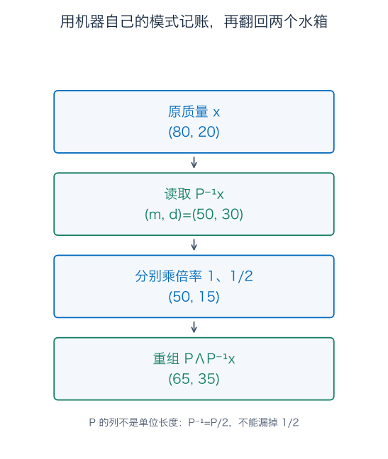

两个动作容易混淆：$P$ 是把模式份数组装回原坐标，$P^{-1}$ 才是读取份数。这里 $P^T=P$，但 $P^{-1}=P/2$，不能因为两列垂直，就遗漏它们还没有单位长度。

### 连做很多轮，为什么不必连乘很多张矩阵

两轮时，中间的 $P^{-1}P$ 抵消，留下 $M^2=P\Lambda^2P^{-1}$；继续归纳，对非负整数 $k$ 有

$$
M^k=P\operatorname{diag}(1,2^{-k})P^{-1}
=\frac12\begin{pmatrix}1+2^{-k}&1-2^{-k}\\1-2^{-k}&1+2^{-k}\end{pmatrix}.
$$

取 $k=0$，它是单位阵；取 $k=2$，两行分别为 $(5/8,3/8)$、$(3/8,5/8)$，再乘 $(80,20)$ 得 $(57.5,42.5)$，与最开始手算吻合。

一般对角化 $A=PDP^{-1}$ 等价于 $AP=PD$。按列读，$P$ 的每列都是相应倍率的特征向量；$P$ 可逆要求这些列组成一组基。所以**能对角化的充要条件，就是有足够多独立特征向量组成全空间的基。** 列的顺序可以换，倍率必须同步换。

如果起点恰在差异方向，根本没有共同分量，就只剩差异衰减；不能说“所有起点最终都由最大倍率模式主导”，却忘记检查那个模式最初有没有出现。对角化简化的是各模式的计算，并不替你决定初始份数。

## 6．算出了特征值，方向却不一定够

### 6.1 同一个二重根，可能有两根方向，也可能只有一根

先看单位阵 $I_2$。所有箭头都不变，所以任意非零向量都是倍率 1 的特征向量，当然能挑两根独立的组成基。

再看剪切矩阵

$$
J=\begin{pmatrix}1&1\\0&1\end{pmatrix},\qquad
J(x,y)^T=(x+y,y)^T.
$$

它的特征多项式同样是 $(\lambda-1)^2$。可解 $(J-I)v=0$ 时，条件变成 $v_2=0$，只剩水平轴。你无论把水平箭头放大几倍，也拼不出第二根独立方向。

这里正好需要区分两个数：根 1 在多项式里出现两次，叫代数重数 2；对应核空间只有一维，叫几何重数 1。对角化需要方向的数量，不能拿根的重复次数顶替。

| 矩阵 | 倍率 1 的根重数 | 特征空间维数 | 能否组成特征基 |
| --- | --- | --- | --- |
| $I_2$ | 2 | 2 | 能 |
| $J$ | 2 | 1 | 不能 |

行为也会暴露区别：从 $(0,1)$ 出发，$J$ 每次把第二坐标再加到第一坐标，得到 $(1,1),(2,1),(3,1),\ldots$，所以

$$
J^k=\begin{pmatrix}1&k\\0&1\end{pmatrix}.
$$

全部特征值都是 1，却仍有轨迹持续增长。缺少的方向，使串联的剪切效应没有被分成独立倍率。

### 6.2 也可能只是实数里根本没有所需倍率

九十度旋转矩阵为

$$
R=\begin{pmatrix}0&-1\\1&0\end{pmatrix},\qquad
p_R(\lambda)=\lambda^2+1.
$$

每根非零实箭头都被转到垂直方向，没有留在原直线上；多项式也没有实根。所以在实平面里不能靠特征向量作基。

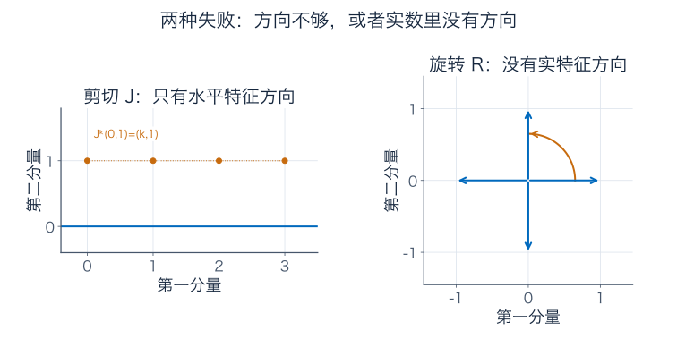

改用复数，旋转有倍率 $i,-i$，方向分别可取 $(1,-i)^T$、$(1,i)^T$，因而能在复向量空间中对角化。补充 B 会核对这两式。这不表示在实平面里找到了不旋转的实箭头，而是改变了允许的数域。

剪切 $J$ 即使改用复数，条件仍是 $v_2=0$，依旧只有一根方向。这两种失败原因不同，不能把“有全部根”当作“必有特征基”。一般重数判据与独立性证明见补充 A。

### 6.3 方向够了，也不一定能彼此垂直

例如 $C=\begin{pmatrix}2&1\\0&1\end{pmatrix}$，倍率 2 与 1 的方向分别是 $(1,0)^T$、$(-1,1)^T$。两根独立，可以对角化；点积却为 $-1$，并不正交。

两特征空间各只有一维，给向量改长度也不能让它们突然垂直。水箱矩阵那样互不干扰的正交模式，并非一般矩阵都能拥有。下面要说明对称性究竟多提供了什么。

## 7．对称矩阵为什么总能找到一套正交模式

水箱矩阵满足 $M^T=M$，两箱相互影响的比例相同。我们已经找到正交的 $(1,1)$、$(1,-1)$。对任意实对称方阵 $S$，是否都能找到同样完整的一套正交特征基？

这就是实对称谱定理要回答的事。不要只把它当成一句需要背的结论；我们分三步把方向造出来。

### 7.1 不同倍率之间必然正交

若 $Su=\lambda u,Sv=\mu v$，且倍率为实数，则

$$
\lambda u^Tv=(Su)^Tv=u^TS^Tv=u^TSv=\mu u^Tv.
$$

当 $\lambda\ne\mu$ 时，唯一可能是 $u^Tv=0$。同一个倍率内部则没有这份强制正交；好在同一特征空间内做线性组合仍不改倍率，可以用上一章的正交化方法选择一组标准正交基。

但这一段尚未证明实特征向量存在，也没证明方向总数够用。不能跳过这两件事。

### 7.2 先在所有单位方向里，找一个极值

对于单位向量 $x$，$x^TSx$ 是输出 $Sx$ 沿原单位方向 $x$ 的有符号读数。现在把输入长度固定为 1，只改变方向，问这个数最大能有多大。

这是几何读数，不是水箱染料总量。对水箱矩阵，$x=(\cos\theta,\sin\theta)$ 时可算

$$
x^TMx=\frac34+\frac12\cos\theta\sin\theta
=\frac34+\frac14\sin2\theta.
$$

它的最大值 1 出现在共同方向，最小值 $1/2$ 出现在差异方向。我们要把这个观察推广到任何维数。

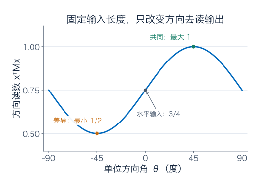

对一般实对称 $S$，函数 $x^TSx$ 连续，有限维单位球面闭且有界、因而紧，所以它一定在某个单位向量 $q$ 上达到最大值。这一步用的是有限维极值存在性；“有上界”本身并不等于“能取到最大值”。

取任意 $y\perp q$，沿球面稍微移动：

$$
x(t)=\frac{q+ty}{\sqrt{1+t^2\|y\|^2}}.
$$

分母来自 $\|q+ty\|^2=1+t^2\|y\|^2$，保证新输入仍为单位长度。代入读数，

$$
x(t)^TSx(t)=
\frac{q^TSq+2t\,y^TSq+t^2y^TSy}{1+t^2\|y\|^2}.
$$

极大点处 $t=0$ 的导数必须为零；上式分母在零点的导数为零，因此导数正是 $2y^TSq$。于是对每个 $y\perp q$ 都有 $y^TSq=0$。

将 $Sq$ 拆成沿 $q$ 的部分和正交余量：$Sq=\lambda q+w$，其中 $\lambda=q^TSq$、$w\perp q$。刚才的条件也适用于 $y=w$，故

$$
0=w^TSq=w^T(\lambda q+w)=\|w\|^2.
$$

所以 $w=0$，得到一根真正的实特征向量 $Sq=\lambda q$。

### 7.3 剩余空间能保住，再重复一次

对任意 $z\perp q$，利用对称性，

$$
q^TSz=(Sq)^Tz=\lambda q^Tz=0.
$$

所以整个 $q^\perp$ 被映回自身。我们可以留在这个少一维的空间里，再做同样的单位方向极值搜索。用标准正交坐标表达时，限制后的矩阵仍对称。

不断重复，到一维为止，便构造出 $n$ 根标准正交特征向量。排成完整方阵 $Q$，得到

$$
\boxed{S=Q\Lambda Q^T,\qquad
Q^TQ=QQ^T=I,\qquad \lambda_i\in\mathbb R.}
$$

这就是实对称谱定理。它同时保证倍率实、方向完整、方向可以正交，三者都不是“不同倍率正交”一句话就能替代。

反过来，若实矩阵可写成上述形式，转置后仍是自身，所以必对称。因此在标准点积下，实矩阵有完整正交特征基，恰好等价于矩阵对称。

对水箱矩阵可取

$$
Q=\frac1{\sqrt2}\begin{pmatrix}1&1\\1&-1\end{pmatrix},
\qquad M=Q\operatorname{diag}(1,1/2)Q^T.
$$

现在两列已归一化，读取初始坐标为 $(50\sqrt2,30\sqrt2)^T$。它们与之前 $P$ 下的份数 $(50,30)$ 差一个尺度，但重组的是同一个状态。这里 $Q$ 是完整方阵，两种乘法顺序都为单位阵；第 7 篇约化 QR 的矩形 $Q$ 只有一侧成立，不要混用。

## 8．谱分解：两台独立的小机器相加

记 $q_+=(1,1)^T/\sqrt2,q_-=(1,-1)^T/\sqrt2$，到两个模式的投影为

$$
P_+=q_+q_+^T=\frac12\begin{pmatrix}1&1\\1&1\end{pmatrix},\qquad
P_-=q_-q_-^T=\frac12\begin{pmatrix}1&-1\\-1&1\end{pmatrix}.
$$

它们满足 $P_++P_-=I$、$P_+P_-=0$。第一台小机器取出共同分量，第二台取出差异分量。混合便是

$$
\boxed{M=P_++\frac12P_-.}
$$

对初始状态，$P_+x_0=(50,50)^T$，$P_-x_0=(30,-30)^T$。给差异部分乘半，再相加就得 $(65,35)^T$。

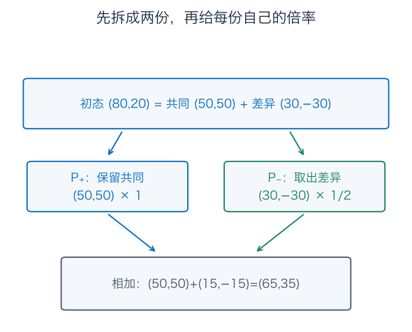

这让矩阵幂更透明：

$$
M^k=P_++2^{-k}P_-,\qquad
\lim_{k\to\infty}M^k=P_+.
$$

极限是一台“取两箱平均”的投影机器，既不是原来的 $M$，也不是零矩阵。

对一般实对称矩阵，将同一特征空间内的单位方向合并成投影 $P_\lambda$，有

$$
S=\sum_\lambda\lambda P_\lambda,
\qquad I=\sum_\lambda P_\lambda,
\qquad P_\lambda P_\mu=0\quad(\lambda\ne\mu).
$$

这些和按不同特征值计算。同一个特征空间里换一组正交基，整块投影不变；不必为某根基向量选哪个正负号纠结。

### 正向混合很稳，反向还原却会放大读数误差

有限轮的两个倍率都非零，所以可逆：

$$
M^{-1}=P_++2P_-=
\begin{pmatrix}3/2&-1/2\\-1/2&3/2\end{pmatrix},
\quad M^{-k}=P_++2^kP_-.
$$

这说的是从终态数值反算初态，不是指照着负系数就能设计一轮物理倒水。

若第九轮的两箱读数误差分别为 $0.01,-0.01$ 克，它完全沿差异模式。反算九轮后，这份误差会放大 $2^9=512$ 倍，变成初始估计的 $5.12,-5.12$ 克。

混合逐步抹平差异，而还原必须把小差异放回原大小，敏感性正从这里来。无限轮极限 $P_+$ 更是彻底删除差异，普通逆不存在；不能先取极限再指望恢复丢掉的来源差异。第 7 篇伪逆的限制在这里又出现了。

## 9．长度、方向读数、等代价线，是三种不同的问题

现在暂时把水箱总量放在一边，考察任意实向量 $x$ 的几何性质。取模式坐标 $z=Q^Tx$，正交换坐标保持长度，直接得到

$$
\|x\|^2=z_+^2+z_-^2,
$$

$$
x^TMx=z_+^2+\frac12z_-^2,
\qquad
\|Mx\|^2=z_+^2+\frac14z_-^2.
$$

例如输入 $x=(1,-1)^T$：原长度平方为 2，方向的二次读数为 1，输出长度平方为 $1/2$。这三个数不同，别只因公式中都有一个 $M$ 就把它们认成同一个量。

### 9.1 固定输入长度，能放大多少

若 $\|x\|=1$，上式表明 $\|Mx\|^2\le1$，等号只在纯共同方向上成立。最大长度倍率为 1，叫这个矩阵的二范数 $\|M\|_2$。

把单位圆上每个输入都作用一次，共同方向长不变，差异方向长度减半，输出形成半轴为 1、$1/2$ 的椭圆。

### 9.2 固定二次代价，允许的输入幅度有多大

若限制的是 $x^TMx=1$，模式坐标满足 $z_+^2+z_-^2/2=1$，半轴反而为 1、$\sqrt2$。因为差异方向的代价系数更小，允许的输入幅度更大。

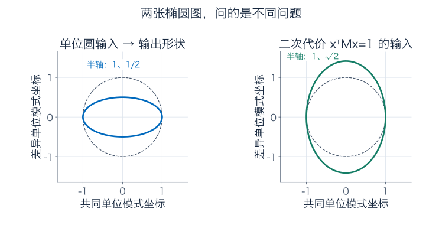

前一张画“单位长度输入会变成什么输出”，后一张画“哪些输入付出同样二次代价”。问题不同，半轴自然不同。

### 9.3 带符号的方向读数：Rayleigh 商

对非零 $x$，把二次读数除以输入长度平方，得到

$$
\mathcal R_S(x)=\frac{x^TSx}{x^Tx}
=\frac{\sum_i\lambda_i z_i^2}{\sum_i z_i^2}.
$$

这就是 Rayleigh 商。各个权重 $z_i^2/\sum z_i^2$ 非负且和为 1，所以它是倍率的加权平均，范围从最小特征值到最大特征值。端点分别由相应特征空间的非零向量取得。

水箱矩阵的范围为 $[1/2,1]$。但对 $D=\operatorname{diag}(-2,1)$，最大 Rayleigh 商是 1，最大长度倍率却是 2：负号会翻向，普通长度不会为负。

一般实对称矩阵同样有 $\|Sx\|^2=\sum_i\lambda_i^2z_i^2$。固定 $\sum_i z_i^2=1$，输出长度最大时把份数放在绝对倍率最大的方向，所以 $\|S\|_2=\max_i|\lambda_i|$。

若问二次型是否对每个非零 $x$ 都严格为正，也就是是否正定，则需要所有特征值严格为正：全正时，非零向量至少有一个非零模式份数，代价和必正；反向取某根特征向量，代价就是对应特征值乘正的长度平方，便强迫该特征值为正。水箱 $M$ 满足，$D$ 不满足，因为 $e_1^TDe_1=-2$。

对非对称矩阵，不能把最大特征值绝对值直接当最大长度倍率。下一节会给一个只算一轮就能发现的反例，下一章的奇异值则会统一处理这种长度问题。

## 10．倍率都小于一，为什么还可能先变长

看另一台抽象的两通道机器

$$
N=\begin{pmatrix}1/2&4\\0&1/2\end{pmatrix}.
$$

它不是上面的染料交换规则，不要求质量守恒。它的两个特征值都是 $1/2$，但从 $x_0=(0,1)^T$ 出发，一轮就得到

$$
Nx_0=(4,1/2)^T,\qquad
\|Nx_0\|=\frac{\sqrt{65}}2\approx4.03.
$$

初始长度为 1，却先变长了四倍多。原因与剪切相似：第二通道还会向第一通道注入一份大响应，特征值列表没有独自描述完这份耦合。

令 $K=N-\tfrac12I$，则 $K^2=0$。展开 $N^k=(\tfrac12I+K)^k$ 时，含两个及以上 $K$ 的项全部为零，只剩

$$
N^k=2^{-k}I+k\,2^{1-k}K
=\begin{pmatrix}2^{-k}&4k\,2^{1-k}\\0&2^{-k}\end{pmatrix}.
$$

所以给定起点的轨迹为 $(4k\,2^{1-k},2^{-k})^T$。尽管中途变长，$k2^{-k}$ 最后仍趋零，轨迹最终回到零。

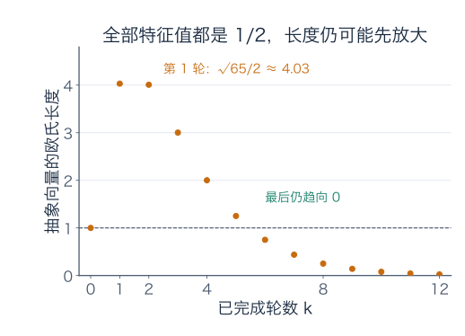

这说明“所有模式最终衰减”与“每一轮长度都下降”是两种结论。对实对称矩阵，标准正交模式给 $\|S^kx\|^2=\sum_i|\lambda_i|^{2k}z_i^2$，若所有 $|\lambda_i|<1$，每轮长度都不会增加，且当前向量非零时下一轮严格缩短；非对称情形不能直接这样拆。

有限维离散线性系统对所有初值趋零的判据，确实是全部特征值绝对值严格小于 1，包含不能对角化的情形。一般证明需要处理 Jordan 块中的多项式因子，补充 D 会交代这里的范围。也不能放宽为小于等于 1：第 6 节的 $J$ 就有无界轨迹。

连续时间还要换一套判据。对 $x'(t)=Ax(t)$，一个特征模式按 $e^{\lambda t}$ 变化，因此看的是实部是否负，而不是绝对值是否小于 1。补充 D 从两箱连续交换重新算起，再给一个“负特征值但中途变长”的例子。

## 练习：倍率、方向、实际变化分别核对

题目全部在前，答案在后。题四的完整独立性与重数证明配合补充 A；题七的平方根可读补充 C；题十的连续模型配合补充 D。第一遍可先完成其余手算。

**题一：把实验与误差对上。** 手算水箱前两轮，求总量与半差的一般式。每箱离 50 克严格小于 0.1 克，需要至少几轮？为什么只看总量守恒还不足以判断混匀？

**题二：负倍率、零倍率与边界。** 推导 $M$ 的特征多项式与两个特征空间，再对 $M_\rho$ 求两个倍率。用同一起点分别算 $\rho=1/2,3/4,1$ 的第一轮，说明零向量和零特征值为何不能混淆。哪种比例保证任意初始状态都趋向平均？

**题三：对角化不是忽略换基。** 求本例 $P,P^{-1},\Lambda,Q$，用模式份数算一轮，写出 $M^k$。第九轮出现 $(0.01,-0.01)$ 克读数误差，反算初态时误差是多少？为什么不能用 $P^T$ 直接代替 $P^{-1}$？

**题四：根重复与方向不足。** 比较 $I_2,J$ 的代数、几何重数，计算 $J^k(0,1)^T$。证明不同特征值的特征向量独立。对 $C=\begin{pmatrix}2&1\\0&1\end{pmatrix}$ 找特征基，判断能否用正交基对角化。

**题五：旋转与数域。** 求九十度旋转的实、复特征信息，在复数域写出一组对角化矩阵及其逆。改用复数能否让 $J$ 对角化？解释两种失败的不同。

**题六：谱定理要补齐哪三步。** 先证明实对称矩阵不同实特征值的方向正交，再完整说明单位球面极值怎样给出实特征向量、其正交补为何不变，以及怎样归纳成完整正交特征基。对水箱 $M$ 求单位方向读数的最大与最小值。

**题七：投影就是独立的小机器。** 求 $P_+,P_-$，核对正交投影关系，重算 $M^k$ 与极限。用谱投影算 $M^{-1}$ 和一个对称正定平方根，并核对平方。为什么极限的平均投影没有普通逆？

**题八：两种椭圆与三种读数。** 对 $M$ 写出输入长度平方、二次型、输出长度平方的模式表达。求 Rayleigh 商范围、二范数，以及输出单位圆和二次型等值线的半轴。对 $D=\operatorname{diag}(-2,1)$ 做对应的方向读数与长度比较，并判断正定性。

**题九：中途放大。** 对 $N$ 求特征值、几何重数、矩阵幂与起点 $(0,1)$ 的轨迹，算第一轮长度并证明最终趋零。它否定了什么说法？为什么对称矩阵可以有更强的逐轮长度保证？

**题十：连续交换与连续衰减。** 对补充 D 的连续水箱方程求解，说明共同模式的生成特征值为何是 0。再对 $G=\begin{pmatrix}-1&8\\0&-1\end{pmatrix}$ 求矩阵指数、起点 $(0,1)$ 一秒后的长度和最终极限。区分离散与连续的衰减条件。

### 参考答案与解题过程

#### 题一解答

第一轮左箱保留 $80\times3/4=60$ 克，再收到右箱的 $20/4=5$ 克，共 65 克；右箱保留 15 克，再收到 20 克，共 35 克。

第二轮左箱为 $(3\times65+35)/4=57.5$ 克，右箱为 $(65+3\times35)/4=42.5$ 克。总量每次保持 100 克，半差从 30 变成 15、7.5，递推得 $d_k=30\,2^{-k}$，两箱质量为 $50\pm d_k$。

每箱偏差严格小于 0.1，等价于 $30/2^k<0.1$，即 $2^k>300$。$2^8=256$ 不够，$2^9=512$ 够，所以至少九轮。仅有总量守恒不能推出混匀，因为原地不动、完全互换同样守恒，却不会使非零差异消退。

#### 题二解答

特征多项式为 $(\lambda-3/4)^2-1/16=(\lambda-1)(\lambda-1/2)$。倍率 1 要求 $v_1=v_2$，倍率 $1/2$ 要求 $v_1=-v_2$，特征空间分别是共同方向与差异方向。

对 $M_\rho$，作用 $(1,1)$ 得自身，作用 $(1,-1)$ 得 $(1-2\rho)(1,-1)$，所以倍率是 1 与 $1-2\rho$。同一起点的共同份数 50、差异份数 30 不变：

- $\rho=1/2$：差异乘零，第一轮 $(50,50)$。
- $\rho=3/4$：差异乘 $-1/2$，第一轮 $(35,65)$。
- $\rho=1$：差异乘 $-1$，第一轮 $(20,80)$，随后交换回来。

零特征值表示一根非零输入方向被压成零；零向量则对任意倍率都满足等式，不能用作识别模式的特征向量。

共同平均对任意起点保持，而差异对任意起点消退需要 $|1-2\rho|<1$，在允许区间里恰为 $0<\rho<1$。即使 $\rho$ 为边界，起点已经两箱相同也会不变，但这不能推广为所有起点都混匀。

#### 题三解答

取 $P=\begin{pmatrix}1&1\\1&-1\end{pmatrix}$、$P^{-1}=P/2$、$\Lambda=\operatorname{diag}(1,1/2)$，有 $M=P\Lambda P^{-1}$。初态的份数为 $(50,30)$，一轮后为 $(50,15)$，重组得 $(65,35)$。

单位特征矩阵 $Q=P/\sqrt2$ 才满足 $Q^{-1}=Q^T$。原 $P$ 的两列长度都是 $\sqrt2$，直接用 $P^T$ 读取会得到 $(100,60)$，比真正份数大两倍。

矩阵幂为

$$
M^k=\frac12\begin{pmatrix}1+2^{-k}&1-2^{-k}\\1-2^{-k}&1+2^{-k}\end{pmatrix}.
$$

第九轮误差 $(0.01,-0.01)$ 纯属差异模式，反算乘 $2^9$，给初态误差 $(5.12,-5.12)$ 克。正向稳稳混匀与反向准确还原不是同一个保证。

#### 题四解答

$I_2$、$J$ 的特征多项式都为 $(\lambda-1)^2$，倍率 1 代数重数为 2。前者特征空间是全平面，几何重数 2；后者条件为 $v_2=0$，几何重数 1，所以只有前者能对角化。反复剪切给 $J^k(0,1)^T=(k,1)^T$。

若 $Av_i=\lambda_i v_i$、倍率两两不同，假设 $\sum_{i=1}^r c_iv_i=0$。作用 $A-\lambda_rI$，得 $\sum_{i<r}c_i(\lambda_i-\lambda_r)v_i=0$。由向量数目的归纳，前 $r-1$ 根独立，所以各 $c_i(\lambda_i-\lambda_r)=0$；倍率差非零，得到 $c_i=0$，最后 $c_r=0$。单根非零向量独立给出归纳起点。

对 $C$，倍率 2 的核方程要求第二分量零，取 $(1,0)$；倍率 1 要求两分量和零，取 $(-1,1)$。两根独立，可取为 $P$ 的列对角化；内积为 $-1$，任意非零缩放后仍不为零，因此不能组成正交特征基。它也不对称，与谱定理的反向结论一致。

#### 题五解答

旋转的特征多项式为 $\lambda^2+1$，无实根，无非零实特征向量。复数域中，$R(1,-i)^T=(i,1)^T=i(1,-i)^T$，$R(1,i)^T=(-i,1)^T=-i(1,i)^T$。

因此可取

$$
P_R=\begin{pmatrix}1&1\\-i&i\end{pmatrix},\qquad
P_R^{-1}=\frac12\begin{pmatrix}1&i\\1&-i\end{pmatrix},
\qquad R=P_R\operatorname{diag}(i,-i)P_R^{-1}.
$$

行列式 $2i\ne0$ 保证两列独立。$J$ 改用复数后仍要求 $v_2=0$，特征空间维数没有增加，依旧不能对角化。旋转缺实根，剪切缺独立方向，原因不同。

#### 题六解答

对称性给 $\lambda u^Tv=(Su)^Tv=u^TSv=\mu u^Tv$，不同倍率使内积为零。

在单位球面上，连续函数 $x^TSx$ 达到最大值于某个 $q$。对任意 $y\perp q$，归一化扰动的读数为

$$
\frac{q^TSq+2t y^TSq+t^2y^TSy}{1+t^2\|y\|^2}.
$$

零点导数为 $2y^TSq$，极值要求它为零。令 $Sq=\lambda q+w$、$w\perp q$，取 $y=w$ 得 $\|w\|^2=0$，因此 $q$ 是实特征向量，$\lambda=q^TSq$。

对 $z\perp q$，$q^TSz=(Sq)^Tz=0$，所以正交补不变；限制到其中的算子仍对称。归纳降低维数直到一维，得到完整标准正交特征基。存在性、完整性和正交性由这三步共同保证。

对水箱矩阵，单位方向读数为 $3/4+(1/4)\sin2\theta$，最大值 1 在共同方向，最小值 $1/2$ 在差异方向取得。相反朝向的单位箭头给相同二次读数，因此每种极值对应整条方向而非唯一箭头。

#### 题七解答

两个投影为 $P_+=\tfrac12\begin{pmatrix}1&1\\1&1\end{pmatrix}$、$P_-=\tfrac12\begin{pmatrix}1&-1\\-1&1\end{pmatrix}$。各自对称、平方不变，和为单位阵，互相乘为零。

由 $M=P_++\tfrac12P_-$，幂为 $P_++2^{-k}P_-$，极限是 $P_+$。逆为 $P_++2P_-=\begin{pmatrix}3/2&-1/2\\-1/2&3/2\end{pmatrix}$。

取平方根 $H=P_++\tfrac1{\sqrt2}P_-$，具体为

$$
H=\frac12\begin{pmatrix}1+1/\sqrt2&1-1/\sqrt2\\1-1/\sqrt2&1+1/\sqrt2\end{pmatrix}.
$$

交叉投影乘积为零，因此 $H^2=P_++\tfrac12P_-=M$，且 $H$ 的特征值均正，所以对称正定。

极限 $P_+$ 把非零差异方向 $(1,-1)$ 送到零，有非零核，故普通逆不存在。有限轮两倍率都非零，不能据此断言其极限也可逆。

#### 题八解答

模式坐标下，输入长度平方为 $z_+^2+z_-^2$，二次型为 $z_+^2+z_-^2/2$，输出长度平方为 $z_+^2+z_-^2/4$。

Rayleigh 商为倍率 1 与 $1/2$ 的加权平均，范围 $[1/2,1]$；二范数是最大长度倍率 1。单位圆输出的半轴为共同方向 1、差异方向 $1/2$；二次型等于一的输入等值线半轴为 1、$\sqrt2$。

对 $D$，二次型是 $-2x_1^2+x_2^2$，方向读数范围 $[-2,1]$；输出长度平方是 $4x_1^2+x_2^2$，二范数为 2。取 $x=e_1$，二次型为负，所以不正定。负倍率翻转箭头，并不产生负的长度。

#### 题九解答

特征多项式 $(\lambda-1/2)^2$，齐次条件为 $4v_2=0$，几何重数为 1，不能对角化。令 $K=\begin{pmatrix}0&4\\0&0\end{pmatrix}$，有 $K^2=0$，二项式展开只保留前两项：

$$
N^k=2^{-k}I+k2^{1-k}K.
$$

作用起点得 $(4k2^{1-k},2^{-k})^T$。第一轮为 $(4,1/2)$，长度 $\sqrt{65}/2\approx4.03>1$。由于 $k2^{-k}\to0$，两个坐标最后都趋零；例如相邻正数项 $k2^{-k}$ 的比从 $k\ge2$ 起不超过 $3/4$，所以可用衰减等比数列控制尾部。

它否定“全部倍率绝对值小于一就每轮缩短”，没有否定最终趋零。对称矩阵则有完整正交基，长度平方分成 $\sum_i|\lambda_i|^{2k}z_i^2$，每个非零分量都逐轮缩小，因此非零向量整体也严格缩短。

#### 题十解答

连续交换的生成矩阵为 $B=\kappa\begin{pmatrix}-1&1\\1&-1\end{pmatrix}$。共同模式倍率 0，差异模式倍率 $-2\kappa$；初态份数 50、30，所以

$$
L(t)=50+30e^{-2\kappa t},\qquad
R(t)=50-30e^{-2\kappa t}.
$$

共同模式的方程是 $m'=0$，常数保留；生成特征值为零正对应 $e^{0t}=1$，不是要求状态本身为零。

对 $G$，写 $G=-I+K_c$，其中 $K_c=\begin{pmatrix}0&8\\0&0\end{pmatrix}$、$K_c^2=0$，可得

$$
e^{tG}=e^{-t}(I+tK_c)
=e^{-t}\begin{pmatrix}1&8t\\0&1\end{pmatrix}.
$$

起点 $(0,1)$ 给 $e^{-t}(8t,1)$；一秒后长度 $\sqrt{65}/e\approx2.97$，仍先放大，最终因 $te^{-t}\to0$ 而趋零。

离散系统每轮乘 $\lambda$，最终衰减要求 $|\lambda|<1$；连续系统每秒按 $e^{\lambda t}$ 变化，要求 $\operatorname{Re}\lambda<0$。这些是有限维常系数系统对所有初值渐近趋零的严格判据，不等于过程中的长度单调性。连续水箱有零模式，所以并非所有初值都趋零。

## 补充 A：独立性、重数与换坐标的精确条件

不同特征值的非零特征向量独立，题四已给逐个作用 $A-\lambda I$ 的归纳证明。由此，$n$ 阶矩阵若在选定数域中有 $n$ 个不同特征值，必能对角化。

对某个特征值 $\lambda$，记几何重数 $d_\lambda=\dim\ker(A-\lambda I)$，代数重数为特征多项式根的次数 $m_\lambda$。为何 $d_\lambda\le m_\lambda$？

把特征空间的 $d_\lambda$ 根基扩充成全空间的基。这套坐标里，前几列的形式迫使矩阵为

$$
\begin{pmatrix}\lambda I_{d_\lambda}&*\\0&C\end{pmatrix}.
$$

取特征多项式，会带上因子 $(t-\lambda)^{d_\lambda}$，所以根重数至少有这么大。

当特征多项式在所选数域中完全分裂时，不同特征空间彼此独立，它们的维数总和达到 $n$，当且仅当每个根都有 $d_\lambda=m_\lambda$。这正是完整特征基的判据。少数重复特征值本身不致命，方向数量不够才阻止对角化。

同样，特征多项式的系数给出按代数重数计的 $\operatorname{tr}A=\sum_i\lambda_i$、$\det A=\prod_i\lambda_i$。但 $I_2$ 和 $J$ 的迹、行列式都一样，行为却不同，这两个汇总数不代替特征空间。

对称性也要连同尺子谈。在标准正交坐标里用 $S^T=S$；若改用斜基 $x=Hz$，新矩阵 $H^{-1}SH$ 可能不再普通转置对称，但 Gram 矩阵变为 $H^TH$。同时翻译内积后，算子仍保留原来的对称关系。这与第 6 篇“换坐标也要翻译尺子”是同一件事。

## 补充 B：复数里的旋转方向，不是实平面的不动箭头

对 $R$，解 $(R-iI)v=0$ 给第二分量 $v_2=-iv_1$，取 $v_1=1$ 得 $(1,-i)$；对 $-i$ 得 $(1,i)$。

这些向量含复数分量。它们让复线性运算变成分别乘 $i,-i$，但实平面中每根非零实箭头仍在旋转，两种说法并不矛盾。

若需要复数的正交关系，应采用第 6 篇的共轭内积和共轭转置，而不是把复向量的分量直接平方相加。实对称谱定理在更一般的复空间中对应自伴（Hermitian）矩阵的谱定理，本篇主证明针对实数情形。

## 补充 C：平方根是对模式的倍率开根号

对称正定矩阵的每个倍率都正，所以可定义

$$
S^{1/2}=Q\operatorname{diag}(\sqrt{\lambda_i})Q^T.
$$

两次作用时，中间 $Q^TQ$ 消掉，倍率分别平方回 $\lambda_i$，因此 $(S^{1/2})^2=S$。

对水箱 $M$，共同模式乘 1，差异模式乘 $1/\sqrt2$，得到题七的 $H$。两次乘 $1/\sqrt2$ 才等于原来的一次乘 $1/2$。

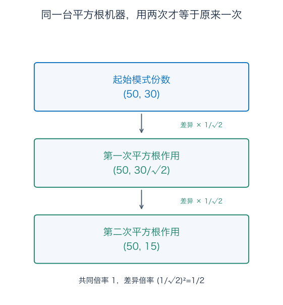

这里构造了一台两步合成等于原一步的数学机器。它不能自动证明真实装置“操作半轮”就恰好服从这个平方根；物理时间怎样对应矩阵，还得另建连续模型。

对于有零特征值的实对称矩阵，普通逆不存在，但伪逆仍可对非零特征值取倒数，对零保持零。特别是 $P_+^+=P_+$，它只恢复共同分量，不补回已经消失的差异。

## 补充 D：连续交换、矩阵指数与严格衰减条件

### D.1 把每轮取水改成持续交换

若两箱水量相同，持续充分混匀，以相同体积流率相互交换，染料质量满足

$$
L'=\kappa(R-L),\qquad R'=\kappa(L-R),\qquad\kappa>0.
$$

这里时间以秒记录，$\kappa$ 的单位是每秒，等于交换体积流率除以单箱体积。相同流率保持每箱水量不变。

两式相加得 $m'=0$，相减后除以 2 得 $d'=-2\kappa d$。用微积分第 10 篇的指数衰减方法，$m(t)=50,d(t)=30e^{-2\kappa t}$，便得到题十的质量公式。

离散共同倍率是 1，而连续生成矩阵的共同倍率是 0：前者说“一轮乘 1 不变”，后者说“变化率为零，所以不变”。两者指向同一种保留，不应把两个数字直接当成同一类倍率。

### D.2 矩阵指数不是给表里每个元素取指数

若 $A=P\Lambda P^{-1}$，将 $x'=Ax$ 改为模式坐标 $z=P^{-1}x$，得到 $z_i'=\lambda_i z_i$。于是

$$
x(t)=P\operatorname{diag}(e^{\lambda_i t})P^{-1}x(0).
$$

一般矩阵指数定义为收敛的矩阵级数

$$
e^{tA}=I+tA+\frac{t^2A^2}{2!}+\cdots.
$$

若可对角化，逐个代入各幂，就回到上面的指数倍率公式。对 $G=-I+K_c$、$K_c^2=0$，两个部分交换，故 $e^{tG}=e^{-t}(I+tK_c)$，不需要它有完整特征基。

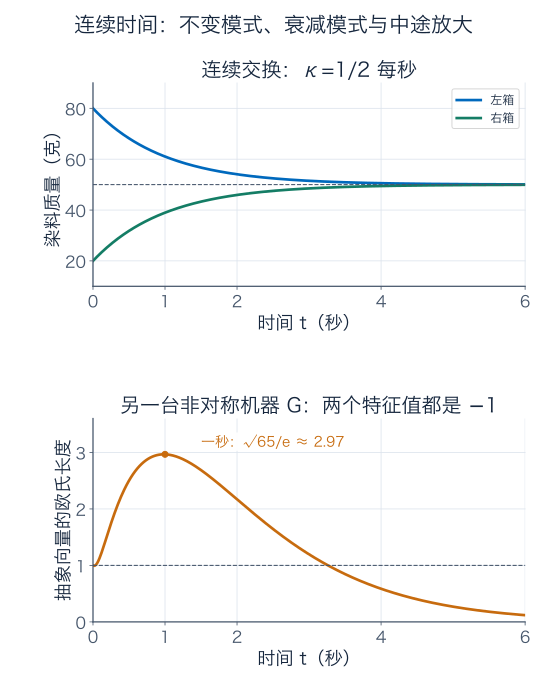

上图只是连续水箱，取 $\kappa=1/2\ \text{每秒}$；下图是抽象连续机器 $G$，其数值系数按每秒计。不能把两条不同单位的纵轴数值拿来互相比较。

### D.3 为什么最后的判据能覆盖缺方向的矩阵

对可对角化矩阵，离散各项是 $\lambda_i^k$，连续各项是 $e^{\lambda_i t}$，严格衰减条件已很直观。一般有限维矩阵还可能像 $J,N,G$ 一样有串联部分，需要 Jordan 结构来统一描述，本篇不证明这一标准形的存在。

它给出的额外项是“多项式乘幂”或“多项式乘指数”。当 $|\lambda|<1$，有限次幂的 $k$ 乘 $|\lambda|^k$ 仍趋零；当实部严格为负，有限次幂的 $t$ 乘 $e^{\operatorname{Re}\lambda t}$ 也仍趋零。零特征值的离散 Jordan 块则在有限步后为零。因此严格的有限维衰减判据可覆盖不能对角化的矩阵。

边界上额外的多项式却可能留下增长，例如 $J$。所以本篇手算已经证明了这些具体例子；一般充要判据还借用了 Jordan 结构这一后续工具，不能假装仅靠“列出特征值”就完成了全部证明。

对称负定的连续矩阵还更强：$\|x(t)\|^2=\sum_i e^{2\lambda_i t}z_i(0)^2$，每个非零分量都严格衰减，故长度严格下降。$G$ 不对称，不能照搬这份单调保证。

## 伴读与下一篇

- [3Blue1Brown：特征向量与特征值](https://www.3blue1brown.com/lessons/eigenvalues/)：配合看保持同一直线的方向、旋转与剪切。本篇水箱的设定、推导、图和习题独立编写。
- [TU Delft：对角化](https://interactivetextbooks.tudelft.nl/linear-algebra/Chapter6/Diagonalizability.html)：核对特征基、代数重数与几何重数。
- [TU Delft：对称矩阵](https://interactivetextbooks.tudelft.nl/linear-algebra/Chapter8/SymmetricMatrices.html)：核对正交谱分解与长度读数。
- [MIT 18.06：矩阵指数与 Jordan 结构的练习](https://web.mit.edu/18.06/www/Spring2022/pset11sol.html)：延伸阅读连续系统、复特征值与串联项。

下一篇研究 SVD 与 PCA：即使输入输出维数不同、没有这种特征基，仍怎样找最容易被放大的输入方向，并用少数方向近似数据。

本篇谱定理证明还用到了有限维单位球面的紧性。无限维函数空间不能直接照搬这一步，也不能默认所有谱信息都由特征向量组成；到泛函分析时会重新检查这些存在条件。

---

[数学总导航](../00-%E6%95%B0%E5%AD%A6%E5%AD%A6%E4%B9%A0%E5%AF%BC%E8%88%AA.md) · [本课程目录](00-%E4%BB%8E%E7%AE%AD%E5%A4%B4%E5%88%B0%E5%87%BD%E6%95%B0%E7%A9%BA%E9%97%B4.md) · [← 上一章](07-%E6%9C%80%E5%B0%8F%E4%BA%8C%E4%B9%98%E3%80%81QR%20%E4%B8%8E%E4%BC%AA%E9%80%86.md) · [下一章 →](09-%E5%A5%87%E5%BC%82%E5%80%BC%E5%88%86%E8%A7%A3%E4%B8%8E%20PCA.md)
