[数学总导航](../00-%E6%95%B0%E5%AD%A6%E5%AD%A6%E4%B9%A0%E5%AF%BC%E8%88%AA.md) · [本课程目录](00-%E4%BB%8E%E7%AE%AD%E5%A4%B4%E5%88%B0%E5%87%BD%E6%95%B0%E7%A9%BA%E9%97%B4.md) · [← 上一章](08-%E7%89%B9%E5%BE%81%E5%80%BC%E3%80%81%E5%AF%B9%E8%A7%92%E5%8C%96%E4%B8%8E%E8%B0%B1%E5%AE%9A%E7%90%86.md) · [下一章 →](10-%E6%AD%A3%E5%AE%9A%E3%80%81%E7%9F%A9%E9%98%B5%E5%BE%AE%E5%88%86%E4%B8%8E%E6%95%B0%E5%80%BC%E7%A8%B3%E5%AE%9A%E6%80%A7.md)

## 两间工作室每天用多少电，能不能只留一个变化读数

假设拿到两间工作室连续四天的用电记录，单位都是千瓦时。为了能手算，先用一组简化数据：

| 天数 | A 室用电量 | B 室用电量 | A 室偏离自身平均 | B 室偏离自身平均 |
| --- | --- | --- | --- | --- |
| 1 | 12 | 21 | 2 | 1 |
| 2 | 11 | 22 | 1 | 2 |
| 3 | 9 | 18 | $-1$ | $-2$ |
| 4 | 8 | 19 | $-2$ | $-1$ |
| 平均 | 10 | 20 | 0 | 0 |

两间工作室的平均用电量不同，但这四天里常常一起高、一起低。现在要用每天一个数概括这两路共同变化，尽量少丢信息。

接下来要算两件事：这个数怎么选，只拿它能把两间用电量还原到多准。

这里先规定“少丢信息”的意思：把每个数还原出来，计算还原误差的平方，再对两间、四天一起相加。两列使用同一单位，误差同等计入。若任务改成精确区分每间电费，评价标准可能不同，后面会看到这一区别。

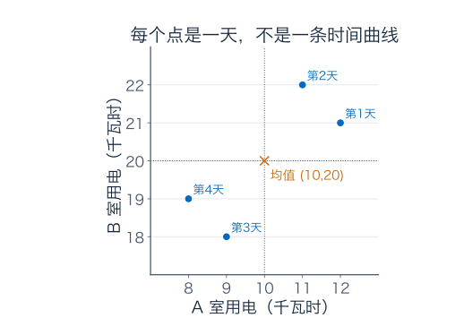

从这张表出发，可以一步步得到主成分分析 PCA 和奇异值分解 SVD。一般最优性证明放在练习答案后的补充 B。

## 1．先把“通常用多少”和“今天变了多少”分开

A 室平均为 $(12+11+9+8)/4=10$，B 室平均为 $(21+22+18+19)/4=20$，记作均值向量 $\mu=(10,20)^T$。

每天减去自己的基线，得到偏差向量 $x_i$。将它们按行排成

$$
X=\begin{pmatrix}2&1\\1&2\\-1&-2\\-2&-1\end{pmatrix}.
$$

每行是一天，每列是一间工作室；两列各自和为零。这一步叫**中心化**。先集中研究偏差，最后还原用电量时，再把 $\mu$ 加回去。

为什么不直接对原用电量找方向？因为原坐标的零代表完全不用电，离它远近包含了两间各自的基线。现在要研究的是围绕自身平均怎样波动，先减均值才能把这个问题单独拿出来。第 9 节会用数字比较不减均值的结果。

## 2．只留 A 室，再猜 B 室，为什么不是最好

第一种办法：每天只留 A 室偏差 $a$，猜 B 室也变了同样多，于是把 $(a,b)$ 还原成 $(a,a)$。

第一天 $(2,1)$ 被还原为 $(2,2)$，平方误差为 $0^2+(-1)^2=1$；第二天 $(1,2)$ 变成 $(1,1)$，也是 1。后两天也各损失 1，合计为 4。

再试平均偏差 $c=(a+b)/2$，将两间都还原成 $(c,c)$。第一天取 $c=1.5$，误差为 $0.5^2+(-0.5)^2=0.5$。第二天同样取 1.5，后两天取 $-1.5$，合计平方误差只剩 2。

还原点都在同一条线 $a=b$ 上，但第二种办法选到了线里真正最近的点。第 6 篇的投影又出现了。

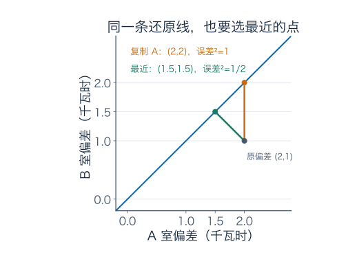

这个结果也能对任意一天证明。将误差配平方：

$$
(a-c)^2+(b-c)^2
=2\left(c-\frac{a+b}{2}\right)^2+\frac{(a-b)^2}{2}.
$$

所以在这条还原线上，平均偏差确实总是最好。但会不会换一条倾斜角度不同的线，更好一些？

## 3．把还原线也拿来比较，找全局最好的方向

用单位向量 $v=(v_A,v_B)^T$ 指定一条经过偏差原点的直线，$v_A^2+v_B^2=1$。每天存一个坐标

$$
t_i=v^Tx_i,
$$

再还原为 $\widehat x_i=t_iv$。因为 $v$ 单位长度，这正是到该直线的正交投影，残差与还原向量正交。因此

$$
\|x_i-\widehat x_i\|^2=\|x_i\|^2-t_i^2.
$$

四天合起来，原偏差平方和固定为

$$
\|X\|_F^2=(2^2+1^2)+(1^2+2^2)+((-1)^2+(-2)^2)+((-2)^2+(-1)^2)=20.
$$

下标 $F$ 表示 Frobenius 范数：矩阵每个条目平方相加，再开方。这里先用它的平方，正好是整张表的平方量总账。

投影坐标叠成 $t=Xv$，所以总还原误差为

$$
\boxed{E(v)=20-\|Xv\|^2,\qquad\|v\|=1.}
$$

让损失最小，等价于让投影坐标保留的平方和最大。现在只需找到使 $\|Xv\|^2$ 最大的单位方向。

展开这个量：

$$
\|Xv\|^2=v^TX^TXv,\qquad
X^TX=\begin{pmatrix}10&8\\8&10\end{pmatrix}.
$$

左上角的 10 来自 A 室四天偏差的平方和 $4+1+1+4$；右上角的 8 来自逐天两室偏差相乘 $2+2+2+2$。这张小矩阵把要比较的方向信息汇总了。

按上一章的方法求特征值：

$$
(\lambda-10)^2-64=(\lambda-18)(\lambda-2).
$$

对应单位方向为

$$
v_1=\frac{(1,1)^T}{\sqrt2},\qquad
v_2=\frac{(1,-1)^T}{\sqrt2}.
$$

把任意单位 $v$ 写成 $c_1v_1+c_2v_2$，$c_1^2+c_2^2=1$，方向读数就为

$$
\|Xv\|^2=18c_1^2+2c_2^2\le18.
$$

只有纯 $v_1$ 方向能取最大值，所以前面用共同偏差的那条线，确实在所有直线中最好。把它反向成 $-v_1$，坐标符号也一起反向，还原点不变。

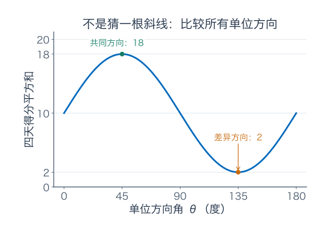

这一最大方差方向叫第一**主成分方向**。

## 4．主成分方向、每天的得分、还原值，不是同一个东西

用 $v_1$ 读取，四天得分为

$$
t=Xv_1=\frac1{\sqrt2}(3,3,-3,-3)^T.
$$

例如第一天 $t_1=3/\sqrt2$，还原偏差为 $(3/\sqrt2)v_1=(3/2,3/2)^T$。加回均值，得到 A、B 室用电量 $(11.5,21.5)$。

| 天数 | 保存的得分 $t_i$ | 还原偏差 | 加回均值后的用电量 | 真实值减还原值 |
| --- | --- | --- | --- | --- |
| 1 | $3/\sqrt2$ | $(3/2,3/2)$ | $(11.5,21.5)$ | $(1/2,-1/2)$ |
| 2 | $3/\sqrt2$ | $(3/2,3/2)$ | $(11.5,21.5)$ | $(-1/2,1/2)$ |
| 3 | $-3/\sqrt2$ | $(-3/2,-3/2)$ | $(8.5,18.5)$ | $(1/2,-1/2)$ |
| 4 | $-3/\sqrt2$ | $(-3/2,-3/2)$ | $(8.5,18.5)$ | $(-1/2,1/2)$ |

方向 $v_1$ 是整批共用的一根二维单位箭头；$t_i$ 是每天不同的一个数；$t_iv_1$ 才是当天还原的二维偏差。再加基线，才是原单位下的用电量。

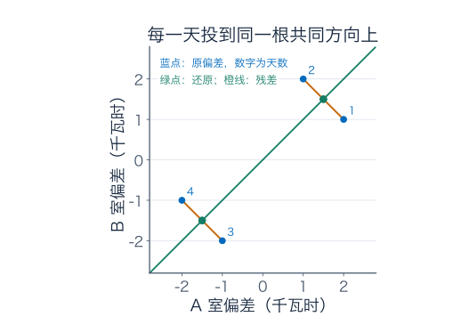

### 为什么叫最大方差，而我们一直在算平方和

因为数据已中心化，所有得分的平均也为零。四天的样本方差为

$$
\frac1{4-1}\sum_i t_i^2=\frac{18}{3}=6.
$$

分母 3 对所有方向都相同，所以最大化平方和与最大化样本方差相同。样本协方差矩阵是 $C=X^TX/3$，特征值为 6、$2/3$；主方向仍是 $v_1,v_2$。若用分母 4 的另一种约定，数值整体缩放，主方向不变。

保留一维时，丢掉的正是差异方向。要做第二主成分，就在与第一根正交的单位方向中继续保留最多变化，本例只剩 $v_2$；它的四天得分为 $(1,-1,1,-1)^T/\sqrt2$。

两列得分的内积为 $(3/2)(1-1-1+1)=0$，均值也都为零，所以样本协方差为零，称为不相关。不能据此就断言任意数据的各主成分相互独立；“不相关”只检查一种二阶关系，补充 C 给一个明确反例。

PCA 描述这批观测的共同变化，不证明这两间工作室互相影响，也不单凭四天数据给出未来预测。

## 5．同一张表，还有一种“机器”的读法

矩阵 $X$ 有四行两列。作为线性映射，它可以接收两个权重 $w=(w_A,w_B)^T$，输出四天的混合读数：

$$
Xw=\begin{pmatrix}2w_A+w_B\\w_A+2w_B\\-w_A-2w_B\\-2w_A-w_B\end{pmatrix}.
$$

输入空间是“两列特征的权重”，维数 2；输出空间是“四天的读数记录”，维数 4。不能对这个矩形矩阵直接问“哪根二维向量输出后仍是自身的倍数”，因为输入与输出根本不在同一个空间。

但我们仍然可以问，哪根单位输入权重产生的输出最长；第 3 节已经给出答案，正是 $v_1$。

它的输出长度为 $\sqrt{18}=3\sqrt2$；另一根 $v_2$ 的输出长度为 $\sqrt2$。把这两个非负长度记为

$$
\sigma_1=3\sqrt2,\qquad\sigma_2=\sqrt2.
$$

它们叫**奇异值**。再把输出各自除以长度，得到单位输出方向：

$$
u_1=\frac{Xv_1}{\sigma_1}=\frac12(1,1,-1,-1)^T,
\quad
u_2=\frac{Xv_2}{\sigma_2}=\frac12(1,-1,1,-1)^T.
$$

$u_1$ 记录“前两天同向、后两天反向”的四维模式；$u_2$ 记录另一个四天模式。它们长度都为 1，点积为 $(1-1-1+1)/4=0$。

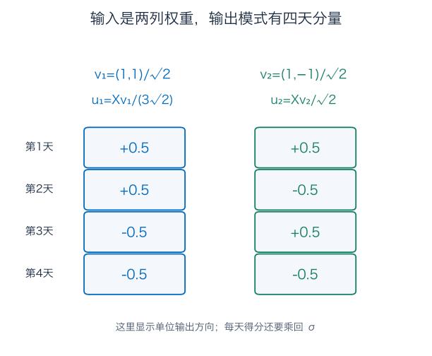

注意 $u_1$ 不是得分 $t$ 本身：得分是 $\sigma_1u_1$，乘回长度以后，才得到 $\pm3/\sqrt2$。

## 6．把每一步排成矩阵，就是 SVD

令 $U_r=[u_1\ u_2]$，$V=[v_1\ v_2]$，写成

$$
U_r=\frac12\begin{pmatrix}1&1\\1&-1\\-1&1\\-1&-1\end{pmatrix},
\quad \Sigma_r=\begin{pmatrix}3\sqrt2&0\\0&\sqrt2\end{pmatrix},
\quad V=\frac1{\sqrt2}\begin{pmatrix}1&1\\1&-1\end{pmatrix}.
$$

从右向左执行三步：$V^T$ 读取输入在两根单位方向上的坐标，$\Sigma_r$ 分别伸缩，$U_r$ 组装成四天输出。

$$
\boxed{X=U_r\Sigma_rV^T.}
$$

这就是本例的奇异值分解，简称 **SVD**。尺寸依次为 $(4\times2)(2\times2)(2\times2)$，结果仍为四行两列。

真的试一个输入 $w=(1,0)^T$：$V^Tw=(1/\sqrt2,1/\sqrt2)^T$，伸缩后为 $(3,1)^T$，再组装为

$$
3u_1+u_2=(2,1,-1,-2)^T,
$$

正好是原矩阵第一列。

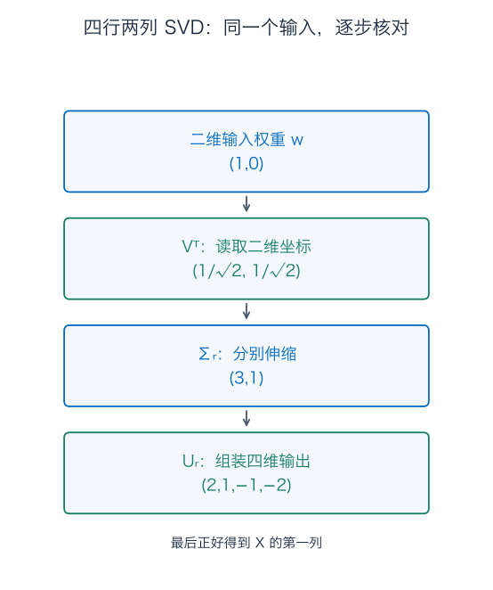

### 为什么能重构全部输入，而不只这个试算

任意 $w$ 都能写成 $(v_1^Tw)v_1+(v_2^Tw)v_2$。作用 $X$ 后，分别变为 $\sigma_i(v_i^Tw)u_i$，所以矩阵也等于两台秩一小机器之和：

$$
X=\sigma_1u_1v_1^T+\sigma_2u_2v_2^T.
$$

每台先读一个输入坐标，再沿一个输出方向放置结果。左右方向属于不同维数，不要求相等；这正是它比普通特征分解更灵活的地方。

### 单位圆的像在哪里

对本例二维单位输入，输出沿 $u_1,u_2$ 形成椭圆，半轴长为 $3\sqrt2,\sqrt2$。这个椭圆实际位于四维输出空间的二维平面里；图上用两根正交输出坐标画出该平面。

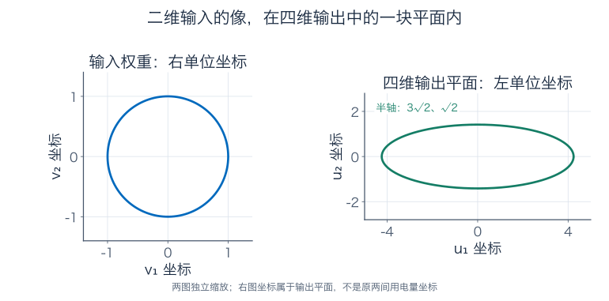

这里的圆不是前面的“四天数据散点”，输出椭圆也不是四天点云的直接连线。它画的是矩阵 $X$ 对所有单位权重的作用。

$U_r$ 的两列标准正交，所以 $U_r^TU_r=I_2$；但它不是四维的完整基，$U_rU_r^T$ 不是 $I_4$。若补两根正交单位方向，可得到完整的 $4\times4$ 矩阵 $U$，同时把 $\Sigma_r$ 补成 $4\times2$ 的矩形对角表：

$$
X=U\Sigma V^T.
$$

本例可补 $u_3=(1,1,1,1)^T/2$、$u_4=(1,-1,-1,1)^T/2$。它们与前两根都正交，是不能由两个特征权重产生的输出方向。完整 SVD 与约化写法是同一台机器的不同记账方式。

## 7．为什么任何实矩阵都能这样拆

刚才的小表不是碰巧成功。对任意实矩阵 $A\in\mathbb R^{m\times n}$，考察 $G=A^TA$。它对称，而且

$$
v^TGv=\|Av\|^2\ge0.
$$

上一章谱定理给出一组标准正交特征向量 $v_i$，对应特征值 $\lambda_i$ 必非负：取单位特征向量代入，上式就是 $\lambda_i\ge0$。

对正的 $\lambda_i$，令 $\sigma_i=\sqrt{\lambda_i}$、$u_i=Av_i/\sigma_i$。这些输出方向为什么正交？直接算

$$
u_i^Tu_j=\frac{v_i^TA^TAv_j}{\sigma_i\sigma_j}
=\frac{\lambda_j v_i^Tv_j}{\sigma_i\sigma_j}.
$$

不同编号时为零，同编号时为 1。于是得到成对的单位输入、输出方向，满足 $Av_i=\sigma_i u_i$。

若 $\lambda_i=0$，则 $\|Av_i\|^2=0$，输出已经是零。此时不能除以零来定义 $u_i$。这个输入方向属于核，不参与正倍率的求和；输出端按需要补一组正交基即可。

因此，按正奇异值从大到小排列，总有

$$
\boxed{A=\sum_{i=1}^{r}\sigma_i u_i v_i^T,
\qquad\sigma_1\ge\cdots\ge\sigma_r>0,}
$$

其中 $r=\operatorname{rank}A$。补齐左右标准正交基，就得到完整形式 $A=U\Sigma V^T$，尺寸为

$$
U:m\times m,\qquad\Sigma:m\times n,\qquad V:n\times n.
$$

零矩阵没有正奇异值，上面的和为空，仍得到零矩阵。左右补基与符号选择不唯一，矩阵本身不因此改变。关于重奇异值的方向选择，见补充 A。

奇异值始终非负。例如 $D=\operatorname{diag}(-3,1)$ 的奇异值是 3、1；第一方向翻转的负号可由左方向 $u_1=-e_1$ 表达，不需要负的长度倍率。

### 范数与数值计算的两句必要说明

对单位输入，正交坐标中有 $\|Av\|^2=\sum_i\sigma_i^2c_i^2$，因此最大长度倍率是 $\|A\|_2=\sigma_1$。Frobenius 平方和则是 $\|A\|_F^2=\sum_i\sigma_i^2$，与最大单个倍率回答不同问题。

这里用 $A^TA$ 来证明存在性、手算小例子；不等于要求电脑求 SVD 时先形成它。第 7 篇已经看到，形成正规矩阵可能额外丢掉小差异，实际算法可以直接对原矩阵作正交变换。

对一般矩阵，更稳妥的几何说法是“单位球体的像为可能压扁的椭球”。若输入有核，单位球面的像甚至可能填满一片区域；不能把所有矩形矩阵都画成只剩一条椭圆边界。本例列满秩，二维单位圆周的像才确为输出平面的一条椭圆周。

## 8．只留第一层，损失到底有多少

回到四天数据，将两项写成实际数表：

$$
X_1=\sigma_1u_1v_1^T
=\begin{pmatrix}3/2&3/2\\3/2&3/2\\-3/2&-3/2\\-3/2&-3/2\end{pmatrix},
$$

$$
E=X-X_1=\sigma_2u_2v_2^T
=\begin{pmatrix}1/2&-1/2\\-1/2&1/2\\1/2&-1/2\\-1/2&1/2\end{pmatrix}.
$$

第一张表的每行都沿同一方向，因此秩为 1；加上第二层，精确恢复原表。$X_1=Xv_1v_1^T$，也正是第 4 节全部每天投影后的偏差表。PCA 的还原与 SVD 截断在这里接上了。

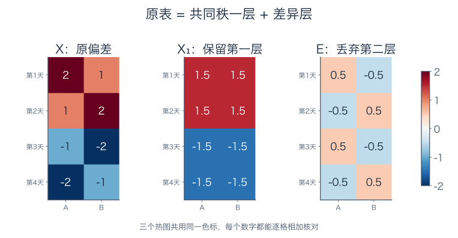

八个残差条目各为 $\pm1/2$，Frobenius 平方误差为 $8\times(1/2)^2=2$。这也等于丢掉的奇异值平方 $\sigma_2^2$。

如果关心的是“最坏单位权重下，输出读数错多少”，则用矩阵二范数。残差作用为 $Ew=\sigma_2u_2(v_2^Tw)$，故

$$
\|E\|_2=\sqrt2,\qquad\|E\|_F^2=2.
$$

这里二范数与 Frobenius 范数恰好都等于 $\sqrt2$，因为残差只有一个模式；不能把平方误差 2 当作二范数误差 2。

### 这只是一个不错的近似，还是所有秩一表中最好

任何非零秩一近似都能写成 $B=cv^T$，$v$ 是单位方向，四个系数 $c_i$ 可各自选择。固定方向后，每行最近的系数只能是 $c_i=v^Tx_i$，这就是第 3 节的投影。再优化方向，最大保留平方和为 18，最小损失便是 $20-18=2$。零近似损失 20，更不可能胜出。

因此它在全部秩至多 1 的矩阵中确实使 Frobenius 误差最小。

二范数的最优性也能在本例证明。任何四行两列、秩至多 1 的 $B$ 都有一根单位核向量 $w$，即 $Bw=0$。于是

$$
\|X-B\|_2\ge\|(X-B)w\|=\|Xw\|\ge\sqrt2.
$$

最后一步来自 $X$ 两个奇异值至少为 $\sqrt2$。截断正好达到这个下界。

一般保留前 $k$ 项，$0\le k<r$，得到 $A_k$，有

$$
\boxed{\|A-A_k\|_2=\sigma_{k+1},\qquad
\|A-A_k\|_F^2=\sum_{i>k}\sigma_i^2.}
$$

它在这两种范数下都是秩至多 $k$ 的最优近似，称为 Eckart–Young 型结论。保留全部正奇异值就精确恢复。一般下界证明放在补充 B；“最优”不意味着在所有情形都只有一个最优解，尤其遇到重复奇异值时要检查方向选择。

### “保留 90%”究竟保留了什么

本例总平方量为 $18+2=20$，只留第一层保留 $18/20=90\%$。样本方差总量为 $20/3$，保留方差为 $18/3$，比例同样是 90%。

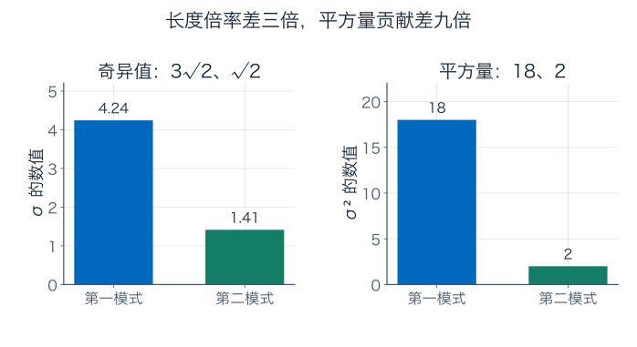

它不是说“每个用电数值都保留 90%”，也不是“预测正确的概率有 90%”。若要求至少保留 95% 的这批方差，一层不够，必须把第二层也留下。做维数选择时，要把阈值与平方和真正比较。

## 9．为什么中心化和计量单位会改变你看到的主方向

### 9.1 不减均值，优化的是另一个量

记原记录矩阵为 $Y=\mathbf1\mu^T+X$，$\mathbf1$ 是四项全 1 列向量。因为 $\mathbf1^TX=0$，对任意单位方向 $w$，

$$
\|Yw\|^2=\|Xw\|^2+4(\mu^Tw)^2.
$$

第二项来自基线有多大，不是围绕均值的变化。它可能远大于第一项。

本例共同方向 $v_1$ 有 $\|Yv_1\|^2=18+4(30/\sqrt2)^2=1818$。改试沿均值的方向 $w=\mu/\|\mu\|=(1,2)^T/\sqrt5$，有

$$
\|Xw\|^2=\frac{82}{5}=16.4,
\qquad4(\mu^Tw)^2=2000,
\qquad\|Yw\|^2=2016.4.
$$

这个候选的围绕均值变化量反而较少，却在未经中心化的目标下大幅胜出。因此原来 $v_1$ 不会是未经中心化矩阵的最佳方向。这里不用管它是否就是精确最优方向。仅这一个候选就已经说明两个优化问题不同。

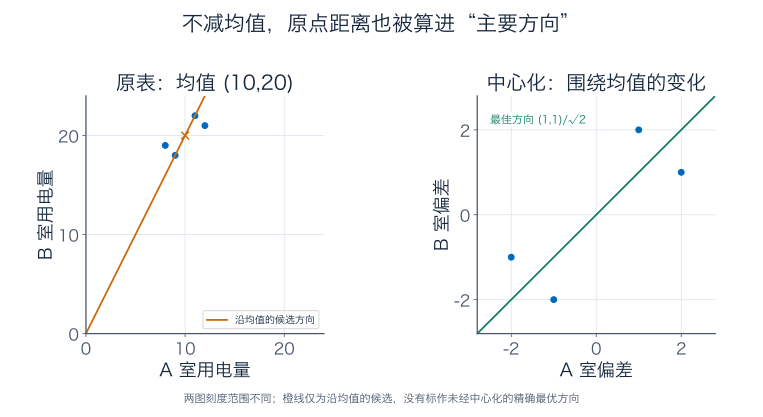

中心化后的 PCA 在原坐标中，用的是经过均值的直线 $\mu+\operatorname{span}\{v_1\}$；未经中心化的秩一近似则要求原点直线。未经中心化的 SVD 本身没有错，只是它解的不是刚才那一个方差问题。

### 9.2 把 B 室改用瓦时，难道物理规律就变了吗

若只把 B 室数字乘 1000，写成瓦时，再直接平方相加，新损失会把 B 室原来一单位的误差计为一百万单位平方。这已经换了比较尺子，主方向可能被 B 室数值主导。

若只是改记法、想保留原来的千瓦时平方误差，应在新坐标中写

$$
\text{误差代价}=e_A^2+10^{-6}e_{B,\mathrm{Wh}}^2.
$$

另一种选择是各列除以自身标准差，研究“相对于自身波动有多大”。这是标准化后的另一项任务，未必总应采用。本例两列样本方差都为 $10/3$，同单位下标准化只给整张表乘相同常数，不改变方向；一般数据未必如此。

所以中心化处理基线，标准化或加权处理计量尺度，两件事不要混为一步。

## 10．保留最大变化，不等于保留你最关心的区别

第一天原记录 $(12,21)$，第二天 $(11,22)$，第一主成分得分却都是 $3/\sqrt2$，还原后也都是 $(11.5,21.5)$。

如果任务只是概括“两间一起忙或一起闲”的走势，这可能有用；若任务要分清哪间当天多用了电，这个差别已经被删掉了。

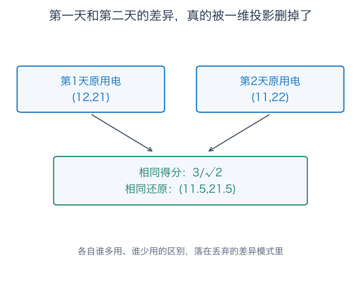

第二模式只占 10% 的平方量，也不等于它在每个任务中都“不重要”。PCA 优化的是我们指定的重构平方误差，不会替代实际用途的判断。

这四天数据也没有立刻节省存储。按每天存一个得分、另存两个均值和两个方向分量的办法，一共 $4+2+2=8$ 个数，恰与原表八个数相同。若样本很多，这种直接记法由 $2N$ 个数变成 $N+4$ 个数，才开始体现批量节省；量化和文件编码还会带来自己的成本与误差。

## 11．伪逆现在能按每个模式反着读

对 SVD，反推的步骤是：沿输出 $u_i$ 读取，再除以正奇异值，放回对应输入方向 $v_i$。因此

$$
A^+=\sum_{i=1}^r\frac1{\sigma_i}v_i u_i^T.
$$

这正好实现第 7 篇的“投到可解释输出，再选没有核分量的输入”。对零奇异值不取倒数，也不凭空恢复未测到的方向。

对本例数据机器 $X$，具体得到

$$
X^+=\begin{pmatrix}1/3&-1/6&1/6&-1/3\\-1/6&1/3&-1/3&1/6\end{pmatrix}.
$$

它把四条混合读数变回两个权重的最小二乘估计。例如 $X^+u_1=v_1/(3\sqrt2)$，$X^+u_2=v_2/\sqrt2$：同等大小的输出误差，落在第二模式时，反推权重的变化是第一模式的三倍。这里比较的是相对敏感程度，不是说本例每个方向都把误差放大到大于 1。

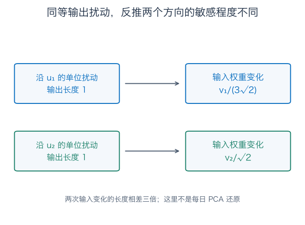

此处 $X^+$ 解的是“已知四条读数，求两项混合权重”。PCA 的每日还原则是 $t_iv_1+\mu$，两者不能因为都写了某种“反变换”就当成同一步。

若把第二奇异值截成零再反推，第二输出模式会被直接丢掉，这可能减少敏感性，也改变了求解的模型。它不再是原矩阵 $X$ 的精确伪逆；保留哪些小方向，需要结合误差与任务，而不是只因某个数非零就一定取倒数。

## 练习：每次说清行、列与优化目标

题十的一般低秩证明可配合补充 B 阅读。

**题一：中心化与还原。** 从四天原表算均值、中心化矩阵和两列平方和。写出第一天得分与一维还原值。解释为什么还原原用电量时不能忘记均值，为什么行顺序不会影响主方向，却会改变得分的排列。

**题二：同一条还原线，也有更好的读数。** 计算“复制 A 偏差”与“取两列平均偏差”的总平方误差，给出单天配平方证明。对任意单位方向 $v$，证明最近系数为 $v^Tx_i$，推导 $E(v)=20-\|Xv\|^2$。

**题三：把 PCA 真正算出来。** 求 $X^TX$、特征值、单位主方向、两列得分、样本方差与保留一维的方差比例。第一与第二主成分的样本协方差是多少？能否仅凭协方差为零就断言任意数据的主成分相互独立？

**题四：完整 SVD 的每个数字。** 求 $u_1,u_2,\sigma_1,\sigma_2$，写约化 SVD，并逐层重组 $X$。补 $u_3,u_4$ 得完整形式，核对各尺寸。用权重 $(1,0)$ 走完读取、伸缩、组装三步。

**题五：低秩与误差。** 求 $X_1$、残差、两种范数误差，并证明它在全部秩至多 1 的表中最优。若要求至少保留本例 95% 方差，要留几维？这里的比例不保证什么？

**题六：奇异值不带负号，也不能除以零。** 分别给 $\operatorname{diag}(-3,1)$、$\operatorname{diag}(3,0)$ 一组 SVD，解释负号放在哪里、零方向怎样处理。证明一般 $A^TA$ 的非负性与正奇异值构造出的 $u_i$ 的正交性。

**题七：基线和尺子。** 比较 $v_1$ 与 $(1,2)/\sqrt5$ 在原表、中心化表上的投影平方和。B 列从千瓦时改成瓦时，若保留原误差意义应如何计权？本例标准化为什么不改方向，一般情形又为什么不能随意保证？

**题八：阈值必须算。** 某矩阵奇异值为 8、4、2、1，求总 Frobenius 平方量。保留前两层时，平方误差、二范数误差、保留比例分别是多少？若要求至少保留 99%，留三层够吗？

**题九：伪逆与截断反推。** 求本例 $X^+$，核对 $X^+X$、$XX^+$ 的含义。对输出分别为 $u_1,u_2,u_3$ 求最小范数解。若只用第一层模型的伪逆，第二输出方向会怎样？为什么这不是原 PCA 每天的还原步骤？

**题十：推广与实际用途。** 对一般矩阵与秩至多 $k$ 的竞争近似，证明二范数误差至少为 $\sigma_{k+1}$；再按补充 B 的行空间投影方法说明 Frobenius 下界。回到四天数据，举出被一维还原抹掉的具体区别，计算直接存储得分方案的数目，并说明什么时候才比存原表少。

### 参考答案与解题过程

#### 题一解答

均值为 $\mu=(40/4,80/4)=(10,20)$，逐行减去它，得到正文的 $X$。两列平方和均为 $4+1+1+4=10$，总和为 20。

第一天中心化向量 $(2,1)$，与单位方向 $v_1=(1,1)/\sqrt2$ 的点积为 $3/\sqrt2$。乘回方向得 $(3/2,3/2)$，再加 $\mu$ 得 $(11.5,21.5)$。若忘记加均值，就把偏差误当成实际用电量，两个基线都丢掉了。

交换行顺序相当于用置换矩阵 $P$ 左乘，$P^TP=I$，故 $(PX)^T(PX)=X^TX$，主方向不变；得分却从 $Xv$ 变成 $P(Xv)$，必须跟每天的标签一起重新排列。

#### 题二解答

复制 A 偏差时，四天误差分别为 $(0,-1),(0,1),(0,-1),(0,1)$，平方和 4。取平均偏差时，四天误差都是两个绝对值 $1/2$ 的条目，每天贡献 $1/2$，总和 2。

一般共同还原 $(c,c)$ 的误差为 $2(c-(a+b)/2)^2+(a-b)^2/2$，只有 $c=(a+b)/2$ 使第一项为零。

对一般单位方向，展开

$$
\|x_i-tv\|^2=\|x_i\|^2-2t v^Tx_i+t^2
=(t-v^Tx_i)^2+\|x_i\|^2-(v^Tx_i)^2.
$$

所以最佳系数为 $t=v^Tx_i$。逐行相加，原长度平方和为 20，得 $E(v)=20-\sum_i(v^Tx_i)^2=20-\|Xv\|^2$。

#### 题三解答

$X^TX=\begin{pmatrix}10&8\\8&10\end{pmatrix}$，多项式 $(\lambda-10)^2-64$，根为 18、2，单位方向为 $v_1=(1,1)/\sqrt2$、$v_2=(1,-1)/\sqrt2$。

两列得分分别为 $(3,3,-3,-3)/\sqrt2$ 和 $(1,-1,1,-1)/\sqrt2$，平方和为 18、2。分母用 $4-1=3$，样本方差为 6、$2/3$，第一维比例 $6/(6+2/3)=9/10$。

内积为 $3/2-3/2-3/2+3/2=0$，故样本协方差为零。但不相关不自动给出独立；例如补充 C 的 $Z$ 与 $Z^2$，协方差为零，却知道 $Z$ 后就完全知道它的平方。

#### 题四解答

奇异值是 18、2 的非负平方根，$\sigma_1=3\sqrt2,\sigma_2=\sqrt2$。输出得分各除以长度，得到 $u_1=(1,1,-1,-1)/2$、$u_2=(1,-1,1,-1)/2$。

第一项外积给每行 $(3/2,3/2),(3/2,3/2),(-3/2,-3/2),(-3/2,-3/2)$；第二项给 $(1/2,-1/2),(-1/2,1/2),(1/2,-1/2),(-1/2,1/2)$，相加逐格恢复 $X$。

约化尺寸为 $U_r:4\times2,\Sigma_r:2\times2,V:2\times2$。补 $u_3=(1,1,1,1)/2,u_4=(1,-1,-1,1)/2$，四根长度均为 1、任意两根点积为零，得到完整 $U:4\times4$；$\Sigma$ 前两行是 $\Sigma_r$，后两行全零，所以为 $4\times2$。

输入 $(1,0)$ 经 $V^T$ 得 $(1/\sqrt2,1/\sqrt2)$，经 $\Sigma_r$ 得 $(3,1)$，经 $U_r$ 得 $3u_1+u_2=(2,1,-1,-2)$，确为第一列。

#### 题五解答

$X_1=\sigma_1u_1v_1^T$，就是题四第一层；残差为第二层。八个残差平方各为 $1/4$，所以 Frobenius 平方误差 2、Frobenius 范数 $\sqrt2$。残差只有一个奇异值 $\sqrt2$，故二范数也是 $\sqrt2$。

任意秩一表 $B=cv^T$，固定单位 $v$ 后，每行最优系数为 $v^Tx_i$；再优化 $v$，保留平方和至多 18，误差至少 2。改用二范数，$B$ 有单位核向量 $w$，所以 $\|X-B\|_2\ge\|Xw\|\ge\sqrt2$。截断同时达到两个下界。

95% 要求保留至少 $0.95\times20=19$ 的平方量，一层只有 18，必须两维。解释方差比例不保证每个数值的相对误差、不保证某个业务判断的准确率，也不等于任何事件的概率。

#### 题六解答

对 $D_1=\operatorname{diag}(-3,1)$，取 $U=\operatorname{diag}(-1,1),\Sigma=\operatorname{diag}(3,1),V=I$，乘积即为 $D_1$。奇异值是正长度，负号放在左输出方向。

对 $D_0=\operatorname{diag}(3,0)$，可取 $U=V=I,\Sigma=D_0$。第二输入方向输出为零，不用 $Av_2/0$ 构造左方向；左侧第二方向可直接补成 $e_2$。

一般 $v^TA^TAv=\|Av\|^2\ge0$，所以对单位特征向量给出的特征值非负。正特征值时，$u_i^Tu_j=(\lambda_j/\sigma_i\sigma_j)v_i^Tv_j$，同号编号为 1，不同编号为零。零特征值直接给 $Av_i=0$，不参加正奇异值求和。

#### 题七解答

共同单位方向在中心化表上保留 18，在原表上另加基线平方量 $4(30/\sqrt2)^2=1800$，共 1818。

沿 $w=(1,2)/\sqrt5$，中心化量为

$$
w^TX^TXw=(10+32+40)/5=82/5=16.4.
$$

因 $\mu^Tw=10\sqrt5$，基线项为 $4\times500=2000$，原表总量 2016.4。它在中心化目标下不如共同方向，却在未经中心化目标下胜出，证明两个目标不同。

B 改为瓦时后，保留原误差意义要给该列平方误差乘 $10^{-6}$。本例两列标准差相同，分别除以它们等于全表乘一个常数，所以不改主方向；一般两列方差不同，除以不同常数相当于重新规定误差尺度，方向可以改变。

#### 题八解答

总平方量为 $8^2+4^2+2^2+1^2=85$。留两层后误差平方 $2^2+1^2=5$，Frobenius 范数为 $\sqrt5$，二范数是最大遗漏奇异值 2；保留比例为 $80/85=16/17\approx94.12\%$。

留三层保留 $84/85\approx98.82\%$，仍低于 99%，因此必须四层。不能把“接近 99%”当成满足“至少 99%”。两种范数也不能混用，前者加全部遗漏平方，后者看最坏方向。

#### 题九解答

用每个模式反向读取得

$$
X^+=\frac1{3\sqrt2}v_1u_1^T+\frac1{\sqrt2}v_2u_2^T
=\begin{pmatrix}1/3&-1/6&1/6&-1/3\\-1/6&1/3&-1/3&1/6\end{pmatrix}.
$$

$X^+X=I_2$，两个输入权重方向都可分辨。输出乘积为

$$
XX^+=u_1u_1^T+u_2u_2^T
=\frac12\begin{pmatrix}1&0&0&-1\\0&1&-1&0\\0&-1&1&0\\-1&0&0&1\end{pmatrix},
$$

是四维输出中二维可达平面的投影，不是 $I_4$。三个输入读数 $u_1,u_2,u_3$ 分别给出参数 $v_1/(3\sqrt2),v_2/\sqrt2,0$。最后一种输出正交于整个可达平面，只能留下残差。

截断后的 $X_1^+=v_1u_1^T/(3\sqrt2)$，把 $u_2$ 也送到零，改变了模型。每日 PCA 还原用的是二维方向组装 $t_iv_1+\mu$；这里的伪逆接收四条读数、输出两个权重，连输入输出对象都不同。

#### 题十解答

若 $0\le k<r$，在 $k+1$ 维空间 $\operatorname{span}\{v_1,\ldots,v_{k+1}\}$ 中，秩至多 $k$ 的 $B$ 必有非零核向量，归一化成 $w$。于是

$$
\|A-B\|_2\ge\|(A-B)w\|=\|Aw\|\ge\sigma_{k+1}.
$$

最后一步因为该空间每根奇异方向的倍率至少为 $\sigma_{k+1}$。截断的残差恰以该奇异值为最大倍率，达到下界。

改用 Frobenius 范数。设 $P$ 是投到 $B$ 行空间的投影，则 $B=BP$。把每行误差拆成投向行空间和其正交补的两份，得

$$
\|A-B\|_F^2\ge\|A(I-P)\|_F^2
=\|A\|_F^2-\|AP\|_F^2.
$$

投影维数至多 $k$，最多保留最大的 $k$ 项平方量，故 $\|AP\|_F^2\le\sum_{i=1}^k\sigma_i^2$；剩余至少为尾部平方和。补充 B 展开这一步的权重证明。

本例第一、第二天的原记录不同，却变成相同得分和相同还原值，谁多用电的差异消失。直接存得分方案要 $N$ 个得分、2 个均值、2 个方向分量，共 $N+4$ 个数；原表为 $2N$。四天时两者都是 8，只有 $N>4$ 时这个直接计数才更少，还未计算文件头、量化等开销。

## 补充 A：符号、重奇异值与退化形状

将某一对 $u_i,v_i$ 同时取反，外积不变，SVD 仍是同一矩阵。PCA 的得分和方向同时换符号，也不会改变还原结果。

如果一组奇异值相同，还可以在对应的输入、输出子空间里同时做相同正交旋转，不改变分解。这时某根单独的主方向未必唯一；若只允许留一根，可能有许多方向同样最优。本例 $18>2$，第一主方向只有正负号这一自由度。

不要把奇异值与原矩阵的特征值直接混用：特征向量要在同一个空间里保持自身直线，SVD 允许左右方向不同。本例 $X$ 是四行两列，根本不能对它使用通常方阵的特征方程；我们求的是 $X^TX$ 的特征值，再开非负平方根。

“单位球体变成椭球”允许压扁。例如 $A=(1\ \ 0)$ 把二维单位圆盘送成区间 $[-1,1]$；单位圆周也能覆盖整个区间，因为另一个坐标位于核中。只有结合秩与维数，才能说清画的是边界还是填满的区域。

## 补充 B：一般低秩最优性的两种下界

二范数下界已在题十用核向量证明。截断残差为尾部模式之和，正交性给它的最大长度倍率正好是 $\sigma_{k+1}$，所以达到下界。

Frobenius 范数可以从行空间看。设 $B$ 秩至多 $k$，$P$ 投到它的行空间，维数 $d\le k$。因为 $B=BP$，两份误差的每行分别属于行空间与其正交补，勾股相加给

$$
\|A-B\|_F^2
=\|AP-B\|_F^2+\|A(I-P)\|_F^2
\ge\|A\|_F^2-\|AP\|_F^2.
$$

用左奇异方向读取 $AP$，其非零行模式的长度平方分别为 $\sigma_i^2\|Pv_i\|^2$，故

$$
\|AP\|_F^2=\sum_i\sigma_i^2w_i,\qquad w_i=\|Pv_i\|^2.
$$

可将奇异值的平方补零至 $n$ 项。投影不增长长度，所以 $0\le w_i\le1$；全部权重和为 $d\le k$。后一个等式也能直接看：若投影空间单位基为 $q_1,\ldots,q_d$，$w_i=\sum_\ell(q_\ell^Tv_i)^2$，再对完整输入基 $v_i$ 求和，每根 $q_\ell$ 恰贡献自己的长度平方 1。

在这些约束下，把有限的总权重放到最大的 $k$ 个平方倍率上才最多。更明确地，尾部倍率不超过 $\sigma_{k+1}^2$，而尾部总权重不超过前 $k$ 项尚未填满的量，所以

$$
\begin{aligned}
\sum_i\sigma_i^2w_i
&\le\sum_{i\le k}\sigma_i^2w_i
+\sigma_{k+1}^2\sum_{i\le k}(1-w_i)\\
&\le\sum_{i\le k}\sigma_i^2.
\end{aligned}
$$

因此误差至少是 $\sum_{i>k}\sigma_i^2$，截断恰好达到。$k=0$ 时直接是零矩阵近似；$k\ge r$ 时保留全部正模式，误差为零。

这里的 Frobenius 正交分解是对矩阵每行应用普通勾股。

## 补充 C：不相关、图片压缩与新样本，各有自己的边界

### C.1 不相关不等于独立

令随机变量 $Z$ 等概率取 $-1,0,1$，$W=Z^2$。有 $E[Z]=0,E[ZW]=E[Z^3]=0$，所以 $\operatorname{Cov}(Z,W)=0$。

但给定 $Z=0$，$W=0$ 的概率为 1，而不加条件时只有 $1/3$。二者显然不独立。PCA 让得分协方差对角化，不能对任意分布自动推出独立。

### C.2 灰度图像也能用同一份低秩账

把灰度图像写成像素亮度表，每项 $\sigma_i u_iv_i^T$ 就是一层简单横竖模式。例如两行 $(10,20,30)$ 与 $(20,40,60)$，恰好是

$$
\begin{pmatrix}1\\2\end{pmatrix}\begin{pmatrix}10&20&30\end{pmatrix},
$$

只有一个非零奇异值，单层就能恢复。一般图像保留前几层，用的是像素平方误差意义下的最优低秩近似，不保证文字笔画、人脸识别或人眼感受也同样最优；单独的层还可能含负数，不必是可独立显示的合法亮度图。

这类图像低秩近似也不等于已经生成某种压缩文件，实际还涉及量化、颜色、编码和存储开销。

### C.3 新的一天怎样用，不能再偷偷重算基线

若已有这一批学出的均值 $\mu$ 和方向 $v_1$，新一天用电量为 $y$，先用同一基线中心化，再读得分 $v_1^T(y-\mu)$，还原为 $\mu+v_1v_1^T(y-\mu)$。

这是固定模型的投影。新数据若换了环境或计量方式，旧方向是否仍合适，需要重新检查；不能把“在四天表上最优”说成对未来记录也有同一误差保证。

## 伴读与下一篇

- [3Blue1Brown：特征向量与特征值](https://www.3blue1brown.com/lessons/eigenvalues/)：伴读方向、换基与伸缩的几何。本篇 SVD 与 PCA 的用电例子、推导、图和练习独立编写。
- [TU Delft：奇异值分解](https://interactivetextbooks.tudelft.nl/linear-algebra/Chapter8/SingularValueDecomp.html)：核对左右方向、矩形尺寸与正交构造。
- [scikit-learn：PCA 文档](https://scikit-learn.org/stable/modules/generated/sklearn.decomposition.PCA.html)：对照中心化、得分与解释方差等术语；实际使用时仍要检查自己选择的计量尺度。

下一篇把这几章的工具用于正定矩阵、矩阵微分与数值稳定性：怎样从一个平方损失得到参数方程，又怎样判断算出的答案是否可靠。更往后的泛函分析，会把有限个模式与低秩近似推广到函数和算子。

---

[数学总导航](../00-%E6%95%B0%E5%AD%A6%E5%AD%A6%E4%B9%A0%E5%AF%BC%E8%88%AA.md) · [本课程目录](00-%E4%BB%8E%E7%AE%AD%E5%A4%B4%E5%88%B0%E5%87%BD%E6%95%B0%E7%A9%BA%E9%97%B4.md) · [← 上一章](08-%E7%89%B9%E5%BE%81%E5%80%BC%E3%80%81%E5%AF%B9%E8%A7%92%E5%8C%96%E4%B8%8E%E8%B0%B1%E5%AE%9A%E7%90%86.md) · [下一章 →](10-%E6%AD%A3%E5%AE%9A%E3%80%81%E7%9F%A9%E9%98%B5%E5%BE%AE%E5%88%86%E4%B8%8E%E6%95%B0%E5%80%BC%E7%A8%B3%E5%AE%9A%E6%80%A7.md)
