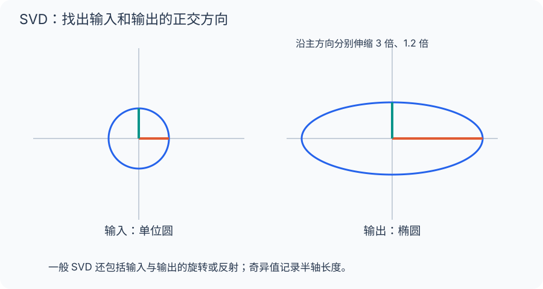

[数学总导航](../00-%E6%95%B0%E5%AD%A6%E5%AD%A6%E4%B9%A0%E5%AF%BC%E8%88%AA.md) · [本课程目录](00-%E4%BB%8E%E7%AE%AD%E5%A4%B4%E5%88%B0%E5%87%BD%E6%95%B0%E7%A9%BA%E9%97%B4.md) · [← 上一章](08-%E7%89%B9%E5%BE%81%E5%80%BC%E3%80%81%E5%AF%B9%E8%A7%92%E5%8C%96%E4%B8%8E%E8%B0%B1%E5%AE%9A%E7%90%86.md) · [下一章 →](10-%E6%AD%A3%E5%AE%9A%E3%80%81%E7%9F%A9%E9%98%B5%E5%BE%AE%E5%88%86%E4%B8%8E%E6%95%B0%E5%80%BC%E7%A8%B3%E5%AE%9A%E6%80%A7.md)

## 手机照片太大，能不能只保留主要结构？

把一张灰度照片看成数字表：每个数字表示一个像素的亮度。若某个小块的两行是 $(10,20,30)$ 和 $(20,40,60)$，第二行只是第一行的两倍，只要存一行再存一个倍数，就能恢复整块。

现实照片不会如此完美，但常有近似重复的纹理与明暗。SVD 把图片拆成一层层简单的横竖模式，并按照贡献大小排列。保留主要层，文件可变小；丢掉细层，会损失纹理和边缘。

下面会算清楚“主要”指什么：奇异值衡量这些模式的伸缩大小，截断后的误差能用被丢弃的奇异值定量表达。它不是“压缩后肯定看不出来”，而是有一笔可计算的信息损失。

## 先把一个图片块拆成秩一层

对两行 $r=(10,20,30)$ 与 $2r$ 组成的矩阵，有

$$
A=\begin{pmatrix}1\\2\end{pmatrix}\begin{pmatrix}10&20&30\end{pmatrix}.
$$

左边六个像素值由一根竖向变化模式与一根横向变化模式相乘生成。这叫秩一层。一般图片是许多这样的层叠加，SVD 找的是一组彼此正交、按大小排序的层。

先不要纠结压缩文件格式；这里只比较线性代数意义上的近似。真正图片编码还涉及量化、边界、色彩与编码开销。

## SVD 与特征分解的关键不同

特征向量要求输入输出仍沿同一个方向，因此只能比较同一个空间中的方向。SVD 允许输入方向 $v_i$ 经过机器后变成另一个输出方向 $u_i$，只要求不同模式的输出互相正交。

这让它能处理非方阵，例如 100 个输入特征变成 3 个输出读数。式子 $Av_i=\sigma_i u_i$ 在说“这一根输入轴被送到哪一根输出轴，以及放大几倍”，并不要求 $u_i=v_i$。

## 用能量账决定保留几层

假设某图像矩阵的奇异值是 10、3、1。总平方能量为 $10^2+3^2+1^2=110$。只留第一层，丢掉的平方误差为 10；保留前两层，平方误差只剩 1。

因此前两层保留了 $109/110$ 的 Frobenius 能量。但这不保证任何人眼判断或分类任务都只损失 $1/110$：平方像素误差是这里明确优化的标准，任务意义需要另行评估。

## PCA 里为什么先减均值

假设所有人的身高体重都围绕某个大均值波动。不减均值时，最大的方向可能主要指向“整体离坐标原点有多远”；减去均值后，才是在研究人群内部怎样变化。

对中心化数据，沿单位方向 $v$ 的投影方差与 $\|Xv\|^2=v^TX^TXv$ 成比例。要让它最大，选 $X^TX$ 最大特征值的方向，也就是 $X$ 最大奇异值对应的右奇异向量。PCA 不是凭经验选一条斜线，而是一个带约束的最大方差问题。

## 带你做：用奇异值判断压缩代价

设矩阵奇异值为 8、4、2、1。总 Frobenius 平方能量是 $64+16+4+1=85$。只留两层，遗漏平方误差为 5，保留能量比例为 $80/85\approx94.1\%$。

若要求保留至少 99% 能量，前三层保留 $84/85\approx98.82\%$，仍不够，所以这份要求迫使你全部保留。不能看到“前三层已经很大”就随意声称达到 99%。

而二范数误差看最大的遗漏奇异值：留两层时为 2，留三层时为 1。它关心最坏输入方向的输出误差，Frobenius 范数关心全部矩阵条目的平方误差；两个指标在回答不同问题。

最后再问应用：如果最小层刚好包含文字笔画，能量比例很高的压缩仍可能影响阅读。数学最优始终相对于指定损失而言，不自动替代实际任务验收。

## 回头整理：定义、工具与练习

### 一个圆为什么会变成椭圆

一般矩阵可能没有足够特征向量，但总能找到一套输入正交方向，使各方向的输出相互正交。单位圆或球便被变成椭圆或椭球，其半轴长度就是奇异值。

对任意实矩阵 $A\in\mathbb R^{m\times n}$，存在

$$
A=U\Sigma V^T,
$$

其中 $U,V$ 正交，$\Sigma$ 为矩形对角阵，对角元 $\sigma_1\ge\sigma_2\ge\cdots\ge0$。从右向左读：用 $V$ 的方向读取输入，按奇异值伸缩，再用 $U$ 的方向输出。

### 与特征值的关系

$A^TA$ 对称半正定，特征值为 $\sigma_i^2$。若 $\sigma_i>0$ 且 $A^TAv_i=\sigma_i^2v_i$，令 $u_i=Av_i/\sigma_i$，则这些 $u_i$ 正交，且

$$
Av_i=\sigma_i u_i,\qquad
A=\sum_{i=1}^{r}\sigma_i u_iv_i^T.
$$

$r$ 为秩。每一项是秩一变换：先读出一个输入坐标，再沿一个输出方向放置结果。

### 丢弃小奇异值

保留前 $k$ 项得 $A_k$。Eckart–Young 定理给出：它是二范数和 Frobenius 范数下的最佳秩至多 $k$ 近似，并且

$$
\|A-A_k\|_2=\sigma_{k+1},\qquad
\|A-A_k\|_F^2=\sum_{i>k}\sigma_i^2.
$$

这为图像压缩提供误差量化。不过小奇异值对应的方向也可能携带任务相关信息，“能量小”不等于“任何任务都不重要”。

### PCA 是数据的正交投影

设数据矩阵 $X$ 每行是样本，并且每列已经减去均值。样本协方差矩阵为 $X^TX/(N-1)$（$N>1$）。它的主要特征向量也就是 $X$ 的主要右奇异向量。

最大化投影方差等价于在固定维数下最小化重构平方误差。中心化很关键：未经中心化的 SVD 也合法，但其主方向未必是围绕均值的最大方差方向。

### 例题与练习

$A=\operatorname{diag}(3,1)$ 的奇异值为 3 和 1。最佳秩一近似为 $\operatorname{diag}(3,0)$，二范数误差为 1。

1. $A=\operatorname{diag}(-3,1)$ 的奇异值是否含负数？
2. 为何矩阵二范数等于最大奇异值？
3. 只有一个非零奇异值说明什么？

解答：1. 不含，仍为 3、1，符号进入左右方向。2. 正交变换保持长度，对角伸缩的最大比例为 $\sigma_1$。3. 矩阵秩为 1，所有输出都落在同一条直线上。

---

[数学总导航](../00-%E6%95%B0%E5%AD%A6%E5%AD%A6%E4%B9%A0%E5%AF%BC%E8%88%AA.md) · [本课程目录](00-%E4%BB%8E%E7%AE%AD%E5%A4%B4%E5%88%B0%E5%87%BD%E6%95%B0%E7%A9%BA%E9%97%B4.md) · [← 上一章](08-%E7%89%B9%E5%BE%81%E5%80%BC%E3%80%81%E5%AF%B9%E8%A7%92%E5%8C%96%E4%B8%8E%E8%B0%B1%E5%AE%9A%E7%90%86.md) · [下一章 →](10-%E6%AD%A3%E5%AE%9A%E3%80%81%E7%9F%A9%E9%98%B5%E5%BE%AE%E5%88%86%E4%B8%8E%E6%95%B0%E5%80%BC%E7%A8%B3%E5%AE%9A%E6%80%A7.md)
